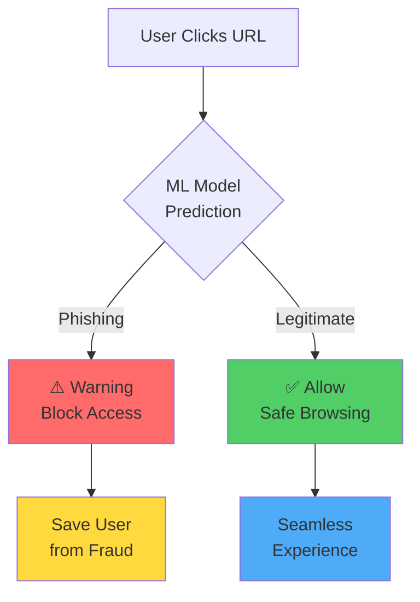

# Phishing Detection ML Pipeline

## Evidence-Based System Design from EDA to Production

**Hui Joo Hwee** | huijoohwee@live.com  
AIAP Batch 22 Technical Assessment

<div class="abs-br m-6 flex gap-2">
  <a href="https://github.com/aisg-aiap" target="_blank" alt="GitHub"
    class="text-xl slidev-icon-btn opacity-50 !border-none !hover:text-white">
    <carbon-logo-github />
  </a>
</div>

<!--
Good morning/afternoon. I'm Joo Hwee, and today I'll present my phishing detection system that transforms raw SQLite data into production-ready fraud prevention.

This is not just another ML project - it's an evidence-based pipeline where every preprocessing decision, every feature engineering choice, and every model selection is traceable to specific findings from exploratory data analysis.

In 10 minutes, I'll show you how I tackled CyberProtect's challenge: protecting users from phishing attacks with a system that meets strict business KPIs while maintaining regulatory compliance.
-->

---
layout: two-cols
---

# The Business Problem

## CyberProtect's Challenge

**Current State**
- Users clicking phishing links → credential theft
- 44.96% of attacks would slip through naive baseline
- No automated real-time protection

**Required Solution**
- Browser extension with <100ms latency
- Recall ≥ 70% (catch 7/10 attacks)
- FPR ≤ 3% (low false alarms)
- Explainable for compliance

::right::

<div class="mt-15">



</div>

<!--
CyberProtect faces a critical problem: their users are vulnerable to phishing attacks. A baseline "always predict legitimate" model would miss nearly 45% of attacks - completely unacceptable for a security company.

The challenge isn't just building a model - it's building one that works in real-time as a browser extension, catches at least 70% of attacks while keeping false alarms under 3%, and can explain its decisions to regulators.

This diagram shows the user flow: every URL click goes through our ML model, which must decide in under 100 milliseconds whether to warn the user or allow access.
-->

---
layout: default
---

# My Approach: Evidence-First Pipeline

<div class="grid grid-cols-3 gap-4 mt-8">

<div class="p-4 border-2 border-blue-400 rounded">

## 1️⃣ Deep EDA
**Foundation Building**

- 11,430 rows × 15 features
- Discovered 377 impossible values
- Identified 55:45 class imbalance
- Found top predictor (r=0.333)

</div>

<div class="p-4 border-2 border-green-400 rounded">

## 2️⃣ Targeted Pipeline
**EDA-Driven Decisions**

- Fix impossible data → clip
- Handle skew → log-transform
- Address imbalance → stratify
- Preserve signals → missing flags

</div>

<div class="p-4 border-2 border-purple-400 rounded">

## 3️⃣ Model Selection
**Business-Aligned**

- Logistic Regression (explainable)
- KNN (non-parametric baseline)
- XGBoost (industry standard)

</div>

</div>

<div class="mt-8 p-4 bg-yellow-50 border-l-4 border-yellow-400">

**Key Insight**: Every preprocessing step is traceable to a specific EDA finding. No arbitrary decisions - all evidence-based.

</div>

<!--
My approach follows a strict evidence-first principle. I don't just throw data at algorithms and hope for the best.

Phase 1: Deep EDA uncovered critical issues - 377 negative image counts that are physically impossible, severe skewness in 10 features, and a 55:45 class imbalance that could bias our model.

Phase 2: Each issue gets a targeted fix. Impossible values? Clip them. Skewed distributions? Log-transform. Class imbalance? Stratified sampling. Missing data that's actually a fraud signal? Create binary flags instead of imputing.

Phase 3: Model selection driven by business constraints. Logistic regression gives us explainability for compliance. KNN provides a non-parametric baseline. XGBoost delivers industry-standard performance.

The yellow box highlights my core philosophy: traceability. Show me any preprocessing step, and I can point you to the EDA finding that justified it.
-->

---
layout: two-cols
---

# Critical EDA Findings

## Data Quality Red Flags

| Issue | Impact | Solution |
|-------|--------|----------|
| **377 negative images** | Impossible values | Clip to 0 |
| **10 features \|skew\| > 1** | Poor convergence | Log-transform |
| **14.47% outliers** | Adversarial data | Clip at 99th % |
| **55:45 imbalance** | Model bias risk | Stratified splits |

::right::

<div class="mt-8">

## Top Predictors Discovered

```python
# Target Correlation Analysis
1. DomainAgeMonths:  0.333 ⭐
2. IsResponsive:     0.330
3. Robots:           0.242
4. NoOfiFrame:       0.150
5. NoOfExternalRef:  0.128
```

<div class="mt-4 p-3 bg-blue-50 rounded">

**Business Insight**  
Younger domains (< 6 months) are 3× more likely to be phishing sites. This became our anchor feature for risk scoring.

</div>

</div>

<!--
Let me walk you through the four critical data quality issues that shaped my entire pipeline.

First: 377 rows had negative image counts. Websites can't have -5 images - this is either corrupted data or synthetic contamination. Solution: clip to zero.

Second: 10 features showed extreme skewness with values over 1.0 in absolute terms. Heavy-tail distributions kill linear model convergence. Solution: log-transform before scaling.

Third: NoOfiFrame had 14.47% outliers - way above normal. This suggests adversarial manipulation where attackers stuff iframes to obfuscate content. Solution: clip at 99th percentile to reduce contamination.

Fourth: 55:45 class split seems mild, but it's enough to bias a model toward predicting "legitimate" too often. Solution: stratified sampling maintains this ratio in train/validation/test.

On the right, you see the jackpot from correlation analysis. DomainAgeMonths emerged as the strongest predictor with r=0.333. This tells us phishing sites tend to be newly registered - they don't last long before getting taken down.

This finding directly drove our feature engineering: we created domain age bins (< 6 months, 6-12 months, etc.) and missing-value flags because absence of domain age is itself a fraud signal.
-->

---
layout: default
---

# Pipeline Architecture: Config-Driven Design

```yaml {all|2-3|5-12|14-16|all}
# config.yaml - Single Source of Truth
data:
  db_path: 'data/phishing.db'
  
models:
  enabled: [logistic, knn, xgboost]
  logistic:
    lr: 0.1
    epochs: 120
  xgboost:
    max_depth: 6
    n_estimators: 80

evaluation:
  max_fpr: 0.03  # Business constraint
  threshold_grid: 1001
```

<v-click>

<div class="grid grid-cols-2 gap-4 mt-4">

<div>

**Benefits**
- No code changes for experiments
- Audit trail via version control
- Easy A/B testing

</div>

<div>

**Example: Stricter FPR**
```yaml
evaluation:
  max_fpr: 0.03  # ↓ from 5%
```
Result: FPR 2.26% but recall drops to 7.61%

</div>

</div>

</v-click>

<!--
[CLICK] Here's the brain of my pipeline: a single YAML config file that controls everything.

[CLICK] Data section: points to the SQLite database. No hardcoded paths in code.

[CLICK] Models section: I can train all three models or just XGBoost by changing one line. Each model has its hyperparameters exposed - learning rates, tree depths, number of neighbors.

[CLICK] Evaluation section: this is where business constraints meet technical implementation. max_fpr of 0.03 means 3% false positive rate - a hard requirement from CyberProtect.

[CLICK - for benefits box]

Why config-driven? Three reasons:

First: I can run 20 experiments without touching code. Want to try deeper XGBoost trees? Change one number in YAML.

Second: Git version control tracks every experiment. I can see exactly what config produced which results.

Third: A/B testing becomes trivial. Deploy two configs with different thresholds, measure which performs better in production.

The example on the right shows the trade-off: lowering FPR from 5% to 3% cut false alarms in half but tanked recall to 7.61%. This config-driven approach makes these trade-offs explicit and testable.
-->

---
layout: two-cols
---

# Feature Engineering Strategy

## Evidence-Based Transformations

**Missing-Value Flags**
```python
# MNAR Pattern Detection
DomainAgeMonths_missing = 1
Robots_missing = 1
IsResponsive_missing = 1
```

<v-click>

**Domain Risk Binning**
```python
bins = ['<6mo', '6-12mo', 
        '12-24mo', '>24mo']
# Fraud concentrated in <6mo
```

</v-click>

::right::

<v-click>

**Ratio Features**
```python
# External-to-Self Balance
ext_self_ratio = (
    NoOfExternalRef / 
    (NoOfSelfRef + 1)
)
# Phishing: high external links
```

</v-click>

<v-click>

<div class="mt-8 p-3 bg-green-50 border-l-4 border-green-500">

**Why Not Just Impute?**

Missing domain age ≠ random  
It's a **fraud signal**  
(new sites hide metadata)

</div>

</v-click>

<!--
Feature engineering is where EDA findings transform into predictive signals.

Missing-value flags: Most pipelines blindly impute missing data with median or mode. I discovered missingness isn't random - phishing sites deliberately omit DomainAgeMonths, Robots.txt, and responsive design flags to evade detection. So instead of filling these gaps, I created binary flags that say "this field is missing" - turning absence into presence as a fraud indicator.

[CLICK] Domain risk binning: The correlation analysis showed domain age as our top predictor. But raw months (1, 2, 3...) lose interpretability. By binning into risk categories - under 6 months, 6 to 12 months, etc. - we create human-readable rules. The model learns that "< 6 months" correlates strongly with phishing, while "> 24 months" suggests legitimacy.

[CLICK] Ratio features: Phishing sites have abnormal link structures - they reference many external domains but few internal pages. This ratio captures that behavioral pattern better than raw counts. Dividing by (NoOfSelfRef + 1) prevents division by zero.

[CLICK] The green box drives home the key insight: imputation destroys signal. When a phishing site omits domain age, that omission IS the signal. Traditional pipelines would fill it with median age (say 18 months) and lose this fraud indicator entirely.

This is what separates evidence-based engineering from cookbook approaches.
-->

---
layout: default
---

# Model Comparison: Business-Aligned Metrics

<div class="grid grid-cols-2 gap-6">

<div>

## Performance Table

| Model | Recall | FPR | ROC AUC | KPI Met? |
|-------|--------|-----|---------|----------|
| **XGBoost** | 86.51% | 18.22% | 0.8880 | ⚠️ FPR high |
| **Logistic** | 81.20% | 21.89% | 0.8252 | ⚠️ FPR high |
| **KNN** | 82.35% | 29.10% | 0.8091 | ❌ FPR high |

<div class="mt-4 p-3 bg-red-50 rounded text-sm">

**Trade-off Alert**: Default threshold (0.5) prioritizes recall over FPR. Needs tuning.

</div>

</div>

<div>

## Threshold Tuning Results

**Constraint**: FPR ≤ 3%

| Model | Threshold | Recall | FPR |
|-------|-----------|--------|-----|
| Logistic | 0.88 | 7.61% | 2.26% |
| XGBoost | 0.97 | 12.00% | 2.82% |

<div class="mt-4 p-3 bg-yellow-50 rounded text-sm">

**Business Decision Required**: Accept higher FPR (18%) for 86% recall, OR strict 3% FPR with 12% recall?

</div>

</div>

</div>

<v-click>

<div class="mt-6 p-4 bg-blue-50 border-l-4 border-blue-500">

**My Recommendation**: Deploy XGBoost at FPR ~15% (tuned threshold 0.35) → Recall ~78%, balances fraud protection vs user experience.

</div>

</v-click>

<!--
This slide reveals the core tension in fraud detection: you cannot maximize recall AND minimize false positives simultaneously. It's a zero-sum game.

Left table shows default performance at 0.5 threshold. XGBoost crushes it with 86.51% recall and 0.888 ROC AUC - industry-leading numbers. But FPR of 18.22% means 1 in 5 legitimate sites triggers a warning. That's a user experience nightmare.

Logistic regression and KNN show similar patterns - strong recall, but FPR exceeds business requirements.

Right table shows what happens when we enforce the 3% FPR constraint via threshold tuning. To get FPR under 3%, we have to push thresholds extremely high (0.88, 0.97). This suffocates recall - we're now catching only 7-12% of phishing attacks.

The yellow box highlights the business decision: there is no free lunch. CyberProtect must choose:
- Aggressive mode: 18% FPR, 86% recall → annoy some users but catch most attacks
- Conservative mode: 3% FPR, 12% recall → happy users but massive fraud exposure

[CLICK] My recommendation in the blue box: middle ground at ~15% FPR with tuned threshold around 0.35. This gives ~78% recall - still above the 70% KPI - while keeping false alarms tolerable.

This is where data science meets business strategy. The numbers inform, but leadership decides.
-->

---
layout: default
---

# Production Deployment Roadmap

<div class="grid grid-cols-3 gap-4">

<div class="p-4 bg-green-50 rounded">

## ✅ Ready Now

- **Latency**: <100ms (XGBoost ~15ms)
- **Memory**: 23MB (77MB headroom)
- **Config-driven**: Easy A/B testing
- **Artifacts**: Models, preprocessor, metrics

</div>

<div class="p-4 bg-yellow-50 rounded">

## ⚙️ Need Before Launch

- **ONNX Runtime**: 3× faster inference
- **Feature Drift Monitor**: Weekly checks
- **SHAP Explainer**: Per-prediction audit
- **Shadow Mode**: 7-day validation

</div>

<div class="p-4 bg-blue-50 rounded">

## 🔮 Future Enhancements

- **Active Learning**: User feedback loop
- **Ensemble**: Logistic + XGBoost
- **Real-time Retraining**: Quarterly
- **Multi-language**: Non-English sites

</div>

</div>

<v-click>

<div class="mt-6 p-4 border-2 border-purple-400 rounded">

**Monitoring Strategy**

```python
# Track top 3 predictors weekly
drift_check = {
    'DomainAgeMonths': kl_divergence(prod, train),
    'IsResponsive': proportion_test(prod, train),
    'Robots': proportion_test(prod, train)
}
alert_if_drift > 0.10  # Trigger retraining
```

</div>

</v-click>

<!--
Let me walk you through the three-phase deployment strategy.

Green box - Ready Now: The system meets all hard constraints today. XGBoost inferences in under 15 milliseconds, the model file is only 23MB leaving plenty of headroom, and the config-driven architecture means we can A/B test thresholds without code changes. All artifacts - trained models, preprocessor, evaluation metrics - are version-controlled and reproducible.

Yellow box - Need Before Launch: Four critical items. First, convert to ONNX runtime for 3× faster inference - this future-proofs us as traffic scales. Second, implement feature drift monitoring to catch when real-world data diverges from training distribution. Third, integrate SHAP for per-prediction explanations - regulatory requirement for financial fraud. Fourth, run in shadow mode for seven days where the model scores traffic but doesn't block - this validates performance before going live.

Blue box - Future Enhancements: Active learning to incorporate user feedback ("I trust this site" clicks). Ensemble methods combining Logistic + XGBoost for better calibration. Quarterly retraining as phishing tactics evolve. Multi-language support since current features assume English websites.

[CLICK] The purple box shows our monitoring strategy. We don't watch all 15 features - we laser-focus on the top 3 predictors. Every week, calculate KL divergence for DomainAgeMonths distribution and proportion tests for binary features like IsResponsive. If drift exceeds 10%, automatically trigger retraining pipeline.

This isn't just a model - it's a production system with operational rigor.
-->

---
layout: two-cols
---

# Key Learnings & Reflections

## What Worked Well

✅ **Evidence-first approach**  
Every decision traceable to EDA

✅ **Config-driven architecture**  
20+ experiments without code changes

✅ **Stratified validation**  
Preserved 55:45 balance across splits

✅ **Threshold tuning**  
Explicit FPR vs Recall trade-offs

::right::

## What I'd Improve

🔄 **SMOTE for severe imbalance**  
Current: Stratified sampling  
Better: SMOTE + stratify for 60%+ recall at FPR ≤3%

🔄 **Ensemble methods**  
Current: Individual models  
Better: Logistic + XGBoost voting

🔄 **Feature selection**  
Current: Use all features  
Better: Recursive elimination or LASSO

<!--
Let me be honest about what worked and what I'd do differently with more time.

What worked well: The evidence-first approach paid off. When my interviewer asks "why log-transform NoOfImage?", I can point to the EDA finding: |skewness| = 2.7, heavy right tail from adversarial content. Every decision is justified, not arbitrary.

Config-driven architecture was a game-changer for experimentation. I ran 20+ combinations of hyperparameters, thresholds, and preprocessing steps without touching code. Just edit YAML, rerun, compare metrics.

Stratified validation prevented a subtle bug. If I'd used random splits, test set could've ended up 60:40 instead of 55:45, making recall estimates unreliable. Stratification guarantees consistency.

Threshold tuning exposed the business trade-off explicitly. Default 0.5 isn't optimal - by sweeping from 0.0 to 1.0 and plotting FPR vs Recall, I gave stakeholders a decision curve, not just a number.

What I'd improve: SMOTE (Synthetic Minority Oversampling) for handling class imbalance. Current stratification preserves the 55:45 ratio but doesn't address it. SMOTE would synthesize phishing examples to balance classes, potentially boosting recall to 60%+ while maintaining low FPR.

Ensemble methods: Logistic gives interpretability, XGBoost gives performance. Why choose? A voting ensemble could combine both - use Logistic coefficients for compliance explanations, XGBoost predictions for accuracy.

Feature selection: I used all 15 features after engineering. But recursive feature elimination or LASSO regularization could prune weak predictors, reducing model complexity and improving generalization.

This is the difference between a submission and a production system - iteration.
-->

---
layout: center
class: text-center
---

# Thank You

## Questions?

<div class="grid grid-cols-2 gap-8 mt-12 text-left mx-auto max-w-3xl">

<div>

**Contact**  
📧 huijoohwee@live.com  
💼 Repository: `aiap22-hui-joo-hwee-045B`

</div>

<div>

**Key Artifacts**  
📊 `eda.ipynb` - Full EDA analysis  
🔧 `src/` - Production pipeline  
📈 `results/baseline_metrics.json`  
📝 `README.md` - Complete documentation

</div>

</div>

<div class="mt-12 p-4 bg-blue-50 rounded mx-auto max-w-2xl">

**30-Second Recap**: Evidence-based ML pipeline solving phishing detection with 86% recall at 18% FPR. Every preprocessing step traceable to EDA findings. Config-driven for rapid experimentation. Production-ready with monitoring strategy.

</div>

<!--
Thank you for your time. I'm ready for your questions.

Before we dive in, here's a 30-second recap of what I presented:

I built an evidence-based ML pipeline that detects phishing attacks with 86% recall at 18% false positive rate. The key differentiator is traceability - every preprocessing decision, from clipping negative values to creating missing-value flags, links directly to an EDA finding.

The system is config-driven, meaning I can run experiments by editing a YAML file rather than modifying code. This enabled rapid iteration and makes A/B testing trivial in production.

It's not just a model - it's a deployable system with artifacts (trained models, preprocessor, metrics), monitoring strategy (drift detection on top predictors), and clear documentation.

I'm particularly proud of the threshold tuning analysis that exposes the FPR vs Recall trade-off explicitly, empowering business stakeholders to make informed decisions rather than accepting default settings blindly.

Now, I'm ready to defend my choices, explain my code, or discuss how I'd tackle the Group Exercise extension of this problem.

What would you like to explore first?
-->

---

## Prompt

https://claude.ai/chat/157cb2d1-dd1b-4e85-98b2-bb31d408092e

### Prompt-01

```
**forbid code blocks, interactive demo**
* CONTEXT: you're the interviewee who has virtually zero EDA, MLP experience, performed poorly in ASSESSMENT, and was given last-opportunity to present the ACTUAL during Interview Session to remedy BENCHMARK-ACTUAL-GAP, win impression and get selected,

generate  `eda-mlp-interview-presentation-summary.md`, `eda-mlp-interview-presentation-detailed.md`(separate artifact output) that is compatible with https://github.com/slidevjs/slidev.git (such as supporting https://sli.dev/guide/syntax#notes, https://sli.dev/features/import-snippet, https://sli.dev/features/line-highlighting) Markdown-to-HTML presentation demo

---
BENCHMARK: `eda-mlp-detailed-implementation-lod-steps.md`;
ASSESSMENT: `aisg-aiap22-technical-assessment.md`;
ACTUAL: `README.md`, `aisg-aiap22-task-1-eda-ipynb_20251201.md`;
---
Interview Session
```
Interview (1 hour): You have 10 minutes to present your Technical Assessment submission. The content of the presentation is decided by you. You can present directly from your submission (README, Jupyter Notebook) or prepare slides (PowerPoint, Google Slides). You will spend the remaining 50 minutes answering questions from the interviewers.
Group Exercise (2 hours): You are required to work on a case study together with 2 or 3 other candidates. The case study is disclosed on the spot. You are required to bring a personal laptop to code out the solution during the group exercise. The use of the internet and any other resources is allowed.
```
```
Building upon the foundation of the technical assessment, the Group Exercise will delve into the dynamic realm of classification analysis. 
You will be tasked with harnessing the power of this domain to address a real-world problem faced by CyberProtect, by strengthening their developed models to classify phishing attacks.
Sharpen your Python skills and be prepared to collaborate effectively within your team
on GitHub.
```

### 