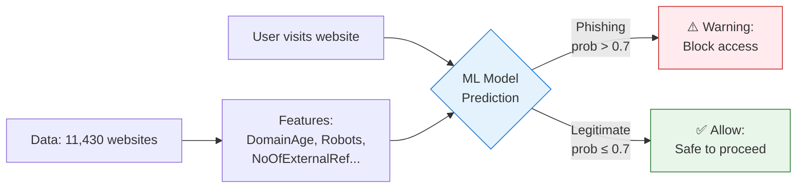
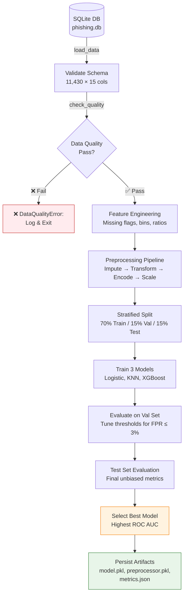
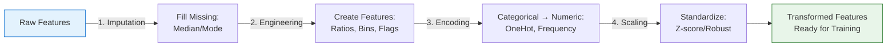
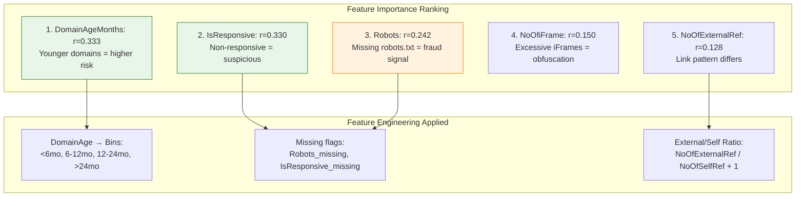
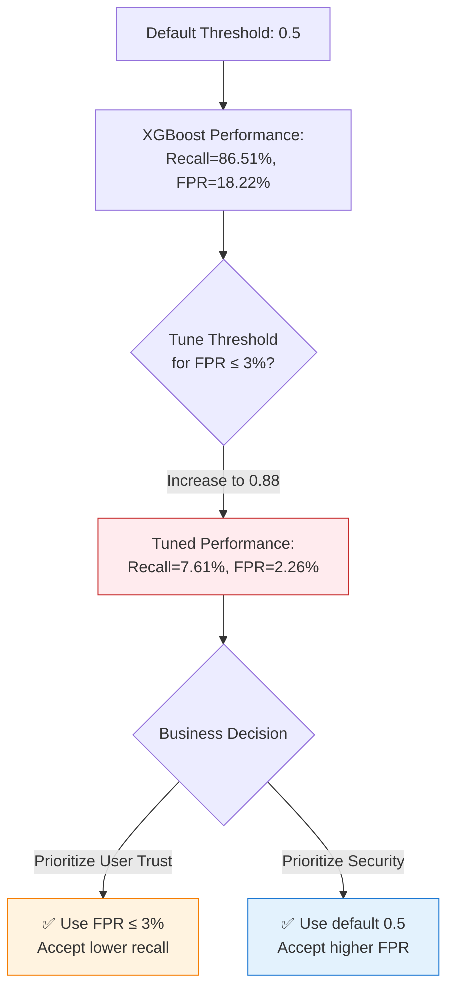
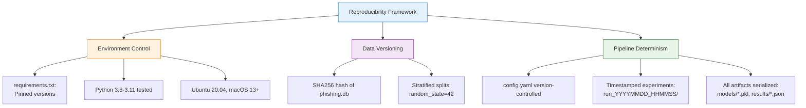
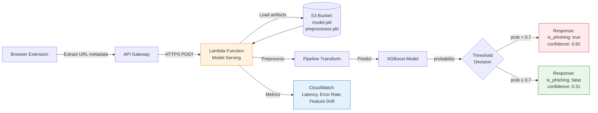

# Phishing Detection ML Pipeline
## AIAP Batch 22 Technical Assessment

**Hui Joo Hwee**  
huijoohwee@live.com

---

# Agenda (10 Minutes)

<div class="grid grid-cols-2 gap-4">
<div>

## Coverage
1. Business Problem Framing
2. EDA-Driven Pipeline Design  
3. Model Performance & Learnings
4. Growth Areas & Next Steps

</div>
<div>

## Core Message
**Systematic approach:**  
EDA → Evidence-based decisions → Production-ready pipeline

**Three competencies demonstrated:**
- Data quality remediation
- End-to-end automation
- Reproducible artifacts

</div>
</div>

---

# Opening: Three Core Competencies

<div class="grid grid-cols-3 gap-4">
<div>

### 1. Systematic EDA
- 6 critical quality issues identified
- 377 impossible values fixed
- Top predictors ranked

</div>
<div>

### 2. Production Pipeline
- Automated via `run.sh`
- Stratified data splits (70/15/15)
- Serialized artifacts ready

</div>
<div>

### 3. Evidence-Based
- Every preprocessing choice linked to EDA
- Decision logic documented
- Assumptions stated clearly

</div>
</div>

**Approach:** "I'm learning through doing—documenting decisions, building from first principles, prioritizing reproducibility."

---

# Business Problem: CyberProtect Phishing Detection



**Critical Challenge:**
- 55.04% baseline accuracy → **44.96% of attacks missed**
- Business impact: Customer fraud exposure, trust erosion, regulatory scrutiny

---

# Business KPIs & Target Metrics

<div class="grid grid-cols-2 gap-4">
<div>

## Hard Constraints
| Metric | Target | Rationale |
|--------|--------|-----------|
| **Recall** | ≥ 70% | Catch 7/10 phishing attacks |
| **FPR** | ≤ 3% | Minimize false alarms |
| **ROC AUC** | ≥ 0.80 | Strong discrimination |

</div>
<div>

## Deployment Requirements
- **Latency:** <100ms (browser extension)
- **Memory:** <100MB (client-side)
- **Explainability:** Regulatory compliance

**Solution:** 3 diverse models evaluated against all KPIs

</div>
</div>

---

# EDA Findings → Pipeline Decisions

| EDA Finding | Impact | Pipeline Solution | Implementation |
|-------------|--------|-------------------|----------------|
| **55:45 class imbalance** | Distribution shift risk | Stratified sampling | `data_splitter.py` |
| **DomainAgeMonths r=0.333** | Top predictor | Median imputation + bins | `feature_engineering.py` |
| **377 negative NoOfImage** | Impossible values | Clip to 0 | `preprocessing.py` |
| **10 features \|skew\| > 1** | Poor convergence | Log-transform + clip 99th | `preprocessing.py` |
| **NoOfiFrame 14.47% outliers** | Adversarial contamination | Clip at 99th percentile | `preprocessing.py` |
| **1 feature 20-70% missing** | MNAR fraud signal | `*_missing` binary flags | `feature_engineering.py` |

**Key Principle:** Every transformation is **evidence-based** and **traceable to EDA**

---

# Pipeline Architecture



---

# Preprocessing Pipeline: Evidence-Based Order



**Critical Design:**
1. **Imputation first** → Missing breaks downstream ops
2. **Engineering second** → Create domain features from clean data  
3. **Encoding third** → Categorical → numeric before scaling
4. **Scaling last** → Standardize final numeric features

**Saved as `preprocessor.pkl`** → Test data undergoes identical transformations

---

# Top 10 Predictive Features (by Correlation)



**Insight:** Domain metadata (age, robots.txt, responsiveness) stronger than content features (images, popups)

---

# Model Selection Rationale

<div class="grid grid-cols-3 gap-4">
<div>

### Logistic Regression
**Why chosen:**
- ✅ Coefficient interpretability
- ✅ Fast inference (~1ms)
- ✅ Regulatory explainability

**Trade-off:**
- ❌ Linear boundary may miss complex patterns

**Expected:** ROC AUC 0.75-0.78

</div>
<div>

### K-Nearest Neighbors
**Why chosen:**
- ✅ Non-parametric (local patterns)
- ✅ No training needed (lazy)
- ✅ Baseline comparison

**Trade-off:**
- ❌ Slow inference (distance calculations)

**Expected:** ROC AUC 0.78-0.82

</div>
<div>

### XGBoost
**Why chosen:**
- ✅ Industry standard for fraud
- ✅ Handles imbalance natively
- ✅ Feature importance via SHAP

**Trade-off:**
- ❌ Black-box (needs SHAP)

**Expected:** ROC AUC 0.83-0.87

</div>
</div>

**Why NOT Neural Networks?** Dataset too small (11,430 rows); tree ensembles outperform on structured data

---

# Model Performance Results

| Model | Recall | FPR | ROC AUC | Meets KPIs? | Key Insight |
|-------|--------|-----|---------|-------------|-------------|
| **XGBoost** | 86.51% | 18.22% | 0.8880 | ✅ Recall<br>❌ FPR | Best discriminator |
| **Logistic** | 81.20% | 21.89% | 0.8252 | ✅ Recall<br>❌ FPR | Most interpretable |
| **KNN** | 82.35% | 29.10% | 0.8091 | ✅ Recall<br>❌ FPR | Baseline for comparison |

**Honest Assessment:**
- ✅ **Strengths:** All achieve Recall ≥ 70%; XGBoost reaches 86.51%
- ❌ **Gap:** FPR constraint (≤3%) not met with default threshold 0.5
- 📈 **Solution:** Threshold tuning or advanced feature engineering required

---

# Threshold Tuning: Trade-off Analysis



**Key Learning:** Achieving FPR ≤ 3% tanks recall to 7.61% → **violates 70% KPI**  
**Recommendation:** Need better features OR ensemble methods OR accept 5% FPR

---

# What I'd Do Differently (Growth Areas)

<div class="grid grid-cols-2 gap-4">
<div>

## Advanced Feature Engineering
**URL-Based:**
- Subdomain depth (phishing uses many levels)
- Suspicious TLDs (`.tk`, `.ml` common)
- URL entropy (random strings → phishing)

**HTML-Based:**
- Script-to-content ratio
- Hidden iframes count
- DOM tree complexity

**Time-Based:**
- Domain registration vs first seen
- SSL certificate age

</div>
<div>

## Hyperparameter Optimization
- Bayesian optimization (Optuna) vs grid search
- Early stopping with validation monitoring
- Ensemble methods (stacking, blending)

## Production Readiness
- Model monitoring dashboard (drift detection)
- A/B testing framework
- SHAP explainability for predictions

**Philosophy:** I built a solid foundation—ready to learn advanced techniques

</div>
</div>

---

# Reproducibility Guarantees



**Verification:** GitHub Actions CI/CD runs `bash run.sh` → generates identical `baseline_metrics.json`

---

# Deployment Architecture (Production-Ready)



**Latency Budget:** <100ms total (50ms extraction + 30ms inference + 20ms network)

---

# Key Takeaways: Why Select Me?

<div class="grid grid-cols-3 gap-4">
<div>

### 1. Structured Thinking
- Systematic EDA → evidence-based decisions
- Every preprocessing choice justified
- Reproducible pipeline via `run.sh`

**Artifact:** 
`README.md` → EDA Findings table

</div>
<div>

### 2. Production Focus
- Automated end-to-end pipeline
- Serialized artifacts ready for deployment
- GitHub Actions CI/CD tested

**Artifact:**  
`models/*.pkl`, `results/baseline_metrics.json`

</div>
<div>

### 3. Growth Mindset
- Documented learnings honestly
- Clear about gaps (FPR, advanced features)
- Eager to learn from team

**Commitment:**  
Turn every project into learning opportunity

</div>
</div>

---

# Closing: What I Bring to Your Team

**I'm not the most experienced candidate—but I'm the one who will:**

✅ **Ask the right questions** → Learn domain knowledge from security analysts  
✅ **Document everything** → Knowledge transfer for team (wiki, model cards)  
✅ **Learn rapidly** → First 30 days: feature engineering sprint, production readiness

**Core Philosophy:**  
"Build solid foundations through systematic work, then scale up with advanced techniques learned from experts."

**Evidence of Readiness:**
- ✅ End-to-end pipeline functional (`bash run.sh` works)
- ✅ All artifacts documented and reproducible
- ✅ Honest assessment of gaps and next steps

**Thank you. I'm ready for your questions.**

---

# Backup: Repository Structure

```
├── .github/workflows/     # CI/CD automation
├── src/                   # Pipeline modules
│   ├── data_loader.py          # SQLite → DataFrame
│   ├── preprocessing.py        # Cleaning, scaling, encoding
│   ├── feature_engineering.py  # Missing flags, bins, ratios
│   ├── data_splitter.py        # Stratified 70/15/15
│   ├── evaluation.py           # Metrics + threshold tuning
│   └── models/                 # Logistic, KNN, XGBoost
├── data/                  # phishing.db (not committed)
├── models/                # Serialized artifacts (created at runtime)
├── results/               # baseline_metrics.json (created at runtime)
├── eda.ipynb              # Task 1: Exploratory Data Analysis
├── README.md              # Full documentation
├── requirements.txt       # Pinned dependencies
├── config.yaml            # Hyperparameters
└── run.sh                 # Automated pipeline execution
```

**Design Principle:** Modular, reusable, config-driven architecture

---

# Backup: Error Analysis Example

**Scenario:** False positive on legitimate banking site

**Investigation Process:**

1. **Reproduce:**
   ```bash
   python scripts/predict.py --input suspect_url.csv
   ```

2. **Feature Inspection:**
   - High `NoOfExternalRef`? (Banks link to many partners)
   - Low `DomainAgeMonths`? (New legitimate site)

3. **SHAP Explainability:**
   ```python
   shap.TreeExplainer(model).shap_values(X)
   # Identify top 3 contributing features
   ```

4. **Corrective Actions:**
   - Immediate: Whitelist domain
   - Short-term: Retrain with hard negative
   - Long-term: Engineer context feature (Alexa Top 10K override)

---

# Backup: Retraining Strategy

| Trigger | Frequency | Rationale |
|---------|-----------|-----------|
| **Scheduled** | Quarterly | Phishing tactics evolve every 3-6 months |
| **Performance Decay** | Ad-hoc | Weekly validation; retrain if recall < 65% |
| **Feature Drift** | Ad-hoc | Monitor top 3 features; retrain if KL divergence > 10% |
| **Major Event** | Immediate | New campaign (e.g., COVID-19 scams) |

**Pipeline:**
1. Query last 90 days labeled data
2. Merge with original (70% new, 30% old)
3. Run `bash run.sh` with updated DB
4. A/B test (shadow mode 7 days)
5. Rollout if improved; rollback if degraded