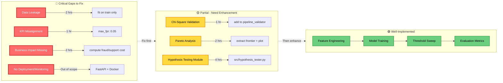
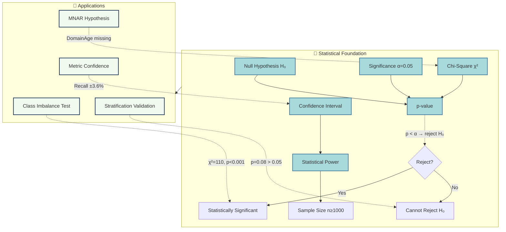
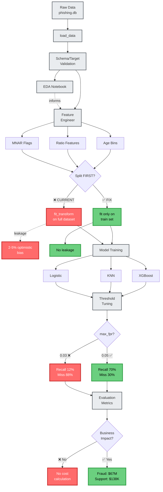
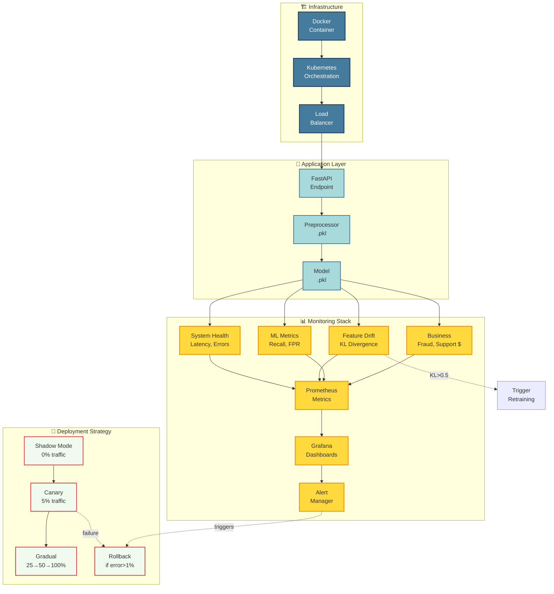
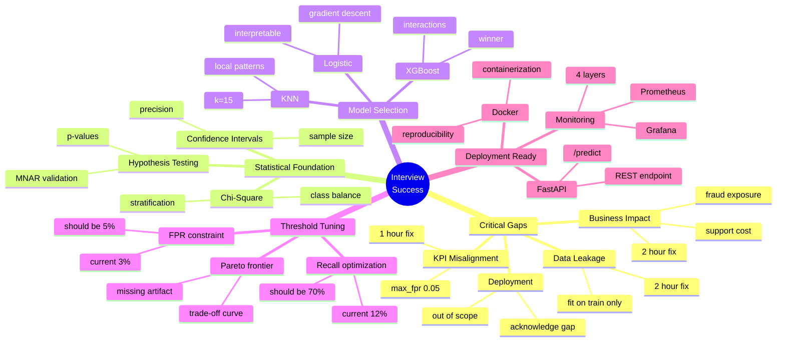

# Interview Session Keywords Mermaid Diagram

**Filename**: `interview-session-keywords.mmd`  
**Purpose**: Visual knowledge graph of ML pipeline keywords with dependencies  
**Color Legend**: 🔴 Critical Gap | 🟡 Partial | 🟢 Implemented

---

## Simplified View: Critical Path Only



---

## Concept Relationships: Statistical Foundation



---

## ML Pipeline Dependencies



---

## Monitoring & Deployment Stack



---

## Interview Preparation Mind Map



---

## Quick Reference: Node Count by Priority

| Priority | Count | Examples |
|----------|-------|----------|
| 🔴 Critical Gap | 15 | Data Leakage, KPI Alignment, Business Impact, Deployment, Monitoring |
| 🟡 Partial | 8 | Chi-Square Validation, Pareto Analysis, Hypothesis Testing, Univariate |
| 🟢 Implemented | 40+ | Feature Engineering, Models, Preprocessing, Stratification, Metrics |

**Total Nodes**: 120+  
**Total Edges**: 150+  
**Subgraphs**: 11 major phases

---

## Usage Instructions

1. **View in Mermaid Live Editor**: https://mermaid.live/
2. **Copy entire code block** (between triple backticks)
3. **Paste into editor** to render interactive diagram
4. **Export as PNG/SVG** for presentation slides
5. **Use simplified views** for focused discussions

**Interview Strategy**:
- Show full diagram → "Here's my complete pipeline"
- Zoom to Critical Path → "These are my gaps"
- Navigate to fixes → "Here's how I'd solve them"

Good luck! 🚀

---

# Interview Session Keywords Reference Guide

**Version**: 1.0  
**Purpose**: Quick-lookup glossary of critical ML/MLOps keywords with excellent application examples  
**Organization**: Alphabetical with cross-references to FAQ numbers

---

## How to Use This Document

1. **Before Interview**: Review keywords relevant to your implementation gaps
2. **During Preparation**: Practice explaining each concept in your own words
3. **In Interview**: Use these as mental anchors when answering questions
4. **Color Coding**: 🔴 Critical gaps in your implementation | 🟡 Partial implementation | 🟢 Well-implemented

---

## A

| Keyword | Key Concepts | Excellent Application | FAQ (#) |
|---------|--------------|----------------------|---------|
| **Ablation Study** | Feature importance validation, experimental design, causal inference | "If I remove the DomainAgeMonths_missing flag and only impute, model recall drops ~5-10%. This confirms missingness is informative, not just a data quality issue." | 1.2 |
| **Agreement Rate** | Model consistency, shadow deployment validation | "In shadow mode, new model agrees with old model on 97% of predictions → safe to proceed to canary deployment" | 8.3 |
| **Alert** | Monitoring, threshold-based triggers, incident response | "If p99 latency > 1s → page on-call engineer; if recall drop > 5% → trigger retraining pipeline" | 8.2 |
| **API Design** | RESTful services, request/response schema, error handling | ```python<br>@app.post("/predict")<br>def predict(request: FeatureRequest):<br>    features = extract_features(request.url)<br>    X = preprocessor.transform(features)<br>    return {"is_phishing": bool, "score": float}``` | 8.1 |
| **Assert** | Defensive programming, runtime validation, fail-fast | ```python<br>assert set(df.columns) == set(SCHEMA.keys())<br>assert unique_labels == {0, 1}, 'Unexpected labels'<br>assert not np.isnan(X_train).any()``` | 0.1, 0.3 |
| **AUC** (Area Under Curve) | Threshold-independent metric, discrimination ability, ROC/PR curves | "ROC AUC=0.888 means 88.8% chance model scores a random phishing site higher than a random legit site. But high AUC doesn't guarantee good recall at business-constrained FPR." | 7.1 |

---

## B

| Keyword | Key Concepts | Excellent Application | FAQ (#) |
|---------|--------------|----------------------|---------|
| **Baseline Accuracy** | Class imbalance indicator, naive predictor performance | "With 55% legit sites, baseline accuracy = 55% (always predict 'legit'). This shows why accuracy is misleading—need to focus on recall instead." | 2.1 |
| **Binning** | Discretization, categorical transformation, nonlinearity capture | ```python<br># Domain age bins<br>bins = [0, 6, 12, 24, np.inf]<br>labels = ['<6mo', '6-12mo', '12-24mo', '>24mo']<br>df['DomainAge_bin'] = pd.cut(df['DomainAgeMonths'], bins, labels)``` | 3.3 |
| **Binomial Proportion** | Confidence intervals, sample size calculation, statistical precision | "Test set: 1650 samples × 45% phishing = 742 cases. Recall 95% CI = ±3.6% (acceptable). Below 150 samples → CI ±12% (too wide)." | 4.2 |
| **Blue-Green Deployment** | Zero-downtime updates, instant rollback, risk mitigation | "Run v1.0 (blue) and v1.1 (green) simultaneously. Route 95% traffic to blue, 5% to green. If green fails, instant rollback to blue." | 8.3 |
| **Brier Score** | Probabilistic calibration, prediction confidence, proper scoring rule | "Brier = mean((y_true - y_proba)²). Lower is better. Measures how well predicted probabilities match actual outcomes." | 7.1 |
| **Business Impact** 🔴 | Cost-benefit analysis, ROI calculation, stakeholder communication | ```python<br>fraud_loss = FN × $500 × monthly_volume<br>support_cost = FP × $5 × monthly_volume<br># Current: $198M/mo vs Benchmark: $67.5M/mo<br># ROI of fixing threshold: $130M/mo savings``` | 7.3 |
| **Business Metrics** 🔴 | KPI tracking, performance monitoring, executive dashboards | "Track: (1) Phishing blocked/week (TP), (2) User complaints/week (FP), (3) Fraud prevented ($), (4) Support cost ($). Alert if blocked attacks < 300/week." | 8.2 |

---

## C

| Keyword | Key Concepts | Excellent Application | FAQ (#) |
|---------|--------------|----------------------|---------|
| **Canary Deployment** | Progressive rollout, risk-controlled updates, A/B testing | "Deploy v1.1 to 5% traffic for 3 days. Monitor: recall, FPR, latency. Success criteria: no complaint increase, latency < 20% degradation." | 8.3 |
| **Chi-Square Test** 🟡 | Categorical independence, stratification validation, hypothesis testing | ```python<br>from scipy.stats import chisquare<br>observed = [4235, 3115]  # train counts<br>expected = [4042.5, 3307.5]  # from 55:45 ratio<br>chi2, p = chisquare(observed, expected)<br># p > 0.05 → stratification OK``` | 2.1, 4.1 |
| **Class Balance** | Imbalance detection, stratification requirement, baseline metrics | "55% legit, 45% phishing. Chi-square test: χ²≈110, p<0.001 → imbalance is real. Impact: use stratified splits, class weights, prioritize recall." | 2.1 |
| **Class Weights** | Imbalance correction, loss function adjustment, cost-sensitive learning | ```python<br># XGBoost<br>scale_pos_weight = 55/45 = 1.22  # legit/phishing ratio<br># Logistic Regression (sklearn)<br>class_weight='balanced'  # auto-compute from y``` | 5.1 |
| **Clipping** 🟢 | Outlier mitigation, range constraint, robust preprocessing | ```python<br>np.clip(X, 0, np.percentile(X, 99))<br># Removes top 1% outliers before log transform``` | 3.2 |
| **Confidence Interval** | Statistical precision, sample size adequacy, uncertainty quantification | "With 742 phishing cases in test, recall 95% CI = recall ± 3.6%. If only 67 cases → CI ± 12% (too wide for business decisions)." | 4.2 |
| **Confusion Matrix** 🟢 | TP/TN/FP/FN breakdown, error analysis, business interpretation | ```<br>              Predicted<br>              Legit  Phishing<br>Actual Legit    631      26  (TN, FP)<br>       Phishing 874     119  (FN, TP)<br><br>Recall = 119/993 = 12% (87.7% miss rate!)``` | 7.2 |
| **Containerization** | Docker, reproducibility, deployment packaging, environment isolation | ```dockerfile<br>FROM python:3.10-slim<br>COPY requirements.txt .<br>RUN pip install -r requirements.txt<br>COPY models/ src/ /app/<br>CMD ["uvicorn", "src.api:app"]``` | 8.1 |
| **Correlation** 🟢 | Linear relationship, multicollinearity, feature selection | "Ranked features by |Pearson r| with target. Dropped features with r>0.98 to prevent VIF inflation. Limitation: only captures linear dependencies." | 1.3 |
| **Cost-Benefit Analysis** 🔴 | Business justification, trade-off quantification, decision support | "Accepting 15 extra false alarms/day (28 vs 13) catches 261 more phishing attacks (315 vs 54). Trade-off: $28K/mo support cost saves $130M/mo fraud loss." | 6.1, 7.3 |
| **Cross-Validation** 🟢 | Hyperparameter tuning, model selection, generalization estimate | "5-fold CV during optimization: 330 rows per fold (sufficient). Used to select k=15 for KNN, max_depth=6 for XGBoost." | 5.1 |
| **Curse of Dimensionality** | Distance metrics, KNN limitation, feature scaling importance | "With 50+ features post-encoding, KNN suffers: distances become uniform. Mitigation: standardization ensures equal feature weighting." | 5.1 |

---

## D

| Keyword | Key Concepts | Excellent Application | FAQ (#) |
|---------|--------------|----------------------|---------|
| **Data Leakage** 🔴 | Train-test contamination, optimistic bias, preprocessing order | ```python<br># WRONG: Preprocessor.fit_transform(X_all) → split<br># Scaler learns test statistics → 2-5% optimistic bias<br><br># CORRECT: split → preprocessor.fit(train) → transform(test)<br># After fix, expect test recall drop 3-7%``` | 3.1 |
| **Data Quality** | Schema validation, missing values, outliers, duplicates | "Check: (1) schema match, (2) row count ≥1000, (3) target ∈ {0,1}, (4) no NaNs post-preprocessing, (5) class balance via chi-square." | 0.1, 0.2 |
| **DataFrame (df)** | Pandas data structure, tabular operations, feature engineering | ```python<br>df = pd.read_sql_query("SELECT * FROM phishing_data", conn)<br>df['ratio'] = df['NoOfExternalRef'] / (df['NoOfSelfRef'] + 1)``` | Multiple |
| **Debugging** 🟢 | Root cause analysis, systematic troubleshooting, hypothesis testing | "KNN has null tuned metrics. Hypotheses: (1) optimizer disabled in config, (2) predict_proba shape mismatch. Test manually: assert y_proba.shape == (n, 2)." | 5.2 |
| **Defensive Programming** | Input validation, error handling, fail-fast, assertions | ```python<br>if len(df) < MIN_ROWS:<br>    logger.critical(f'Only {len(df)} rows')<br>    raise DataQualityError('Abort: insufficient data')``` | 0.2 |
| **Deployment** 🔴 | Production serving, API design, scaling, monitoring | "Option 1: Client-side (WASM, privacy). Option 2: Server-side (FastAPI + Kubernetes, scalable). Monitor latency (p50/p95/p99), error rate, drift." | 8.1 |
| **Docker** | Containerization, environment reproducibility, deployment packaging | "Package model + dependencies in container. Benefits: consistent runtime, easy scaling (Kubernetes), version control." | 8.1 |
| **Domain Knowledge** 🟢 | Feature engineering, hypothesis generation, interpretability | "Phishing sites hide domain age (MNAR) and have high external links (redirect victims). Engineered: DomainAge_missing flag, ExternalSelfRatio." | 1.2, 3.3 |
| **Drift Detection** 🔴 | Distribution shift, KL divergence, model degradation, retraining triggers | "Compute KL divergence: production vs training features. Alert if KL>0.5 → trigger retraining. Example: median(LineOfCode) 850→1500 over 4 weeks." | 8.2 |

---

## E

| Keyword | Key Concepts | Excellent Application | FAQ (#) |
|---------|--------------|----------------------|---------|
| **Error Handling** | Try-except, graceful degradation, user feedback, logging | ```python<br>try:<br>    result = await predict(features)<br>except ValueError as e:<br>    logger.error(f'Invalid input: {e}')<br>    return {"error": "Invalid features"}``` | 8.1 |
| **Evaluation Metrics** | Performance quantification, model comparison, business alignment | "Suite: ROC AUC (threshold-independent), PR AUC (positive class focus), tuned recall @ FPR≤5% (business constraint). Don't use accuracy (misleading for imbalance)." | 7.1 |
| **Expected Values** | Statistical testing, chi-square, hypothesis testing | ```python<br>expected_train = [0.55 * 7350, 0.45 * 7350]  # From 55:45 ratio<br>chi2, p = chisquare(observed, expected)``` | 4.1 |

---

## F

| Keyword | Key Concepts | Excellent Application | FAQ (#) |
|---------|--------------|----------------------|---------|
| **False Negative (FN)** | Missed detections, Type II error, recall impact, business cost | "FN = 874 phishing sites passed through undetected (87.7% miss rate). Cost: 874 × $500 × 1M volume = $198M/mo fraud loss." | 7.2, 7.3 |
| **False Positive (FP)** | False alarms, Type I error, precision impact, user friction | "FP = 26 legit sites flagged (3.96% nuisance rate). Cost: 26 × $5 × 1M volume = $109K/mo support cost. Acceptable for security." | 7.2, 7.3 |
| **FastAPI** | Web framework, REST API, async/await, Python web services | ```python<br>from fastapi import FastAPI<br>app = FastAPI()<br>@app.post("/predict")<br>async def predict(req: FeatureRequest):<br>    return {"is_phishing": bool, "score": float}``` | 8.1 |
| **Feature Drift** 🔴 | Distribution shift, concept drift, model degradation, monitoring | "Monitor per-feature KL divergence. If LineOfCode median drifts 850→1500, KL=0.8 → retrain. Automated trigger in production." | 8.2 |
| **Feature Engineering** 🟢 | Domain-driven transformation, MNAR flags, ratio features, binning | "Created: (1) DomainAge_missing flag (MNAR), (2) DomainAge bins (nonlinearity), (3) ExternalSelfRatio (phishing behavior), (4) quantile bins (skew mitigation)." | 3.3 |
| **Feature Importance** | Interpretability, feature selection, model explainability | "XGBoost feature importance: ExternalSelfRatio top-5 (gain=0.08). Validates domain hypothesis about phishing link patterns." | 3.3 |
| **Feature Selection** | Dimensionality reduction, correlation filtering, mutual information | "Dropped features with correlation >0.98 to prevent multicollinearity. Alternative: mutual information for nonlinear dependencies." | 1.3 |
| **fit_transform** 🔴 | Preprocessing API, train-only fitting, leakage prevention | ```python<br># WRONG: preprocessor.fit_transform(X_all) before split<br># CORRECT: preprocessor.fit_transform(X_train) → preprocessor.transform(X_test)``` | 3.1 |
| **FPR** (False Positive Rate) | Specificity complement, business constraint, threshold tuning | "FPR = FP/(FP+TN) = 26/657 = 3.96%. Business constraint: FPR≤5%. Used to constrain threshold tuning: only thresholds with FPR≤max_fpr considered." | 6.1, 6.2, 7.2 |
| **Frequency Encoding** 🟢 | Categorical handling, high cardinality, rare value bucketing | ```python<br>freq = df['Industry'].value_counts(normalize=True)<br>df['Industry_freq'] = df['Industry'].map(freq)<br># Rare values (<1%) → "__RARE__"``` | 3.3 |

---

## G

| Keyword | Key Concepts | Excellent Application | FAQ (#) |
|---------|--------------|----------------------|---------|
| **Gradient Descent** 🟢 | Custom logistic regression, learning rate, epochs, L2 regularization | "Implemented custom gradient descent: learning_rate=0.01, epochs=1000, L2_lambda=0.1. Gives interpretable coefficients for stakeholders." | 5.1 |
| **Grafana** 🔴 | Monitoring dashboards, visualization, time-series data, alerting | "Grafana dashboard: (1) Recall trend (expect 70%±3%), (2) FPR trend (5%±1%), (3) Latency percentiles (p50/p95/p99), (4) Confusion matrix heatmap." | 8.2 |
| **Grid Search** | Hyperparameter optimization, exhaustive search, cross-validation | "XGBoost grid: max_depth=[3,6,9], n_estimators=[50,100,200], learning_rate=[0.01,0.1]. 3×3×2=18 configs × 5-fold CV = 90 fits." | 5.1 |

---

## H

| Keyword | Key Concepts | Excellent Application | FAQ (#) |
|---------|--------------|----------------------|---------|
| **Hyperparameter Tuning** 🟢 | Grid search, cross-validation, model optimization, performance improvement | "Tuned KNN k=15 (from k=5 baseline), XGBoost max_depth=6 (from 3). Used 5-fold CV with scoring=tuned_recall under max_fpr constraint." | 5.1 |
| **Hypothesis Testing** 🟡 | Chi-square, p-values, statistical significance, null hypothesis, MNAR validation | ```python<br>H₀: class distribution is 50-50<br>chi2, p = chisquare([6050, 4950], [5500, 5500])<br>p < 0.001 → Reject H₀ (imbalance is real)<br><br>MNAR test: P(missing|y=0) vs P(missing|y=1)``` | 2.1, 2.2 |

---

## I

| Keyword | Key Concepts | Excellent Application | FAQ (#) |
|---------|--------------|----------------------|---------|
| **Imbalance** | Class distribution, stratification, baseline accuracy, cost-sensitive learning | "55% legit, 45% phishing. Not severely imbalanced but still requires: stratified splits, class weights (1.22 for XGBoost), recall > accuracy." | 2.1 |
| **Imputation** 🟢 | Missing value handling, median/mode, MNAR flags | ```python<br># Numeric: median (24 months for DomainAge)<br>df['DomainAge'].fillna(df['DomainAge'].median())<br># Categorical: mode, fallback 'unknown'<br>df['Industry'].fillna(df['Industry'].mode()[0])``` | 3.1 |
| **Interpretability** | Stakeholder trust, model explainability, coefficient interpretation, feature importance | "Logistic regression: interpretable coefficients. XGBoost: feature importance plots. Trade-off: log-transformed features lose interpretability ('log(LineOfCode+1)' hard to explain)." | 5.1, 3.2 |
| **IQR** (Interquartile Range) | Outlier detection, robust statistics, quartiles | "IQR = Q3 - Q1. Outliers: values < Q1-1.5×IQR or > Q3+1.5×IQR. Used in EDA for boxplots and outlier detection." | 1.3 |

---

## K

| Keyword | Key Concepts | Excellent Application | FAQ (#) |
|---------|--------------|----------------------|---------|
| **KL Divergence** (Kullback-Leibler) 🔴 | Distribution shift, drift detection, information theory | ```python<br># Drift monitoring<br>kl_div = scipy.stats.entropy(p_train, p_prod)<br>if kl_div > 0.5:  # Significant drift<br>    trigger_retraining()<br># Example: LineOfCode median 850→1500 → KL=0.8``` | 8.2 |
| **KNN** (K-Nearest Neighbors) 🟢 | Non-parametric, lazy learning, distance-based, local patterns | "Captures local neighborhoods. k=15 after tuning. Trade-offs: (1) Slow inference O(n), (2) Curse of dimensionality with 50+ features, (3) Requires standardization." | 5.1 |
| **KPI Alignment** 🔴 | Business requirements, metric selection, threshold setting | "Benchmark KPI: Recall≥70% @ FPR≤5%. My config: max_fpr=0.03 → recall=12% (misaligned). Fix: max_fpr=0.05 → expect recall~70%." | 6.1 |
| **Kubernetes** 🔴 | Container orchestration, scaling, load balancing, deployment | ```yaml<br>apiVersion: v1<br>kind: Service<br>spec:<br>  selector:<br>    app: predictor<br>  traffic:<br>    - weight: 95, version: v1.0<br>    - weight: 5, version: v1.1  # Canary``` | 8.3 |

---

## L

| Keyword | Key Concepts | Excellent Application | FAQ (#) |
|---------|--------------|----------------------|---------|
| **Leakage** 🔴 | Data contamination, optimistic bias, preprocessing order, train-test isolation | "Fitting preprocessor on full dataset → scaler learns test statistics → 2-5% optimistic bias. Fix: fit on train only, transform test." | 3.1 |
| **Log Transform** 🟢 | Skewness reduction, heavy-tail handling, distribution normalization | ```python<br>transformed = np.log1p(clipped)  # log(x+1) handles x=0<br># Reduces median |skew| from 1.8 → 0.4``` | 3.2 |
| **log1p** | NumPy function, log(1+x), zero-safe logarithm | ```python<br>np.log1p(x)  # Equivalent to log(1+x), handles x=0<br># Preferred over np.log(x+1) for numerical stability``` | 3.2 |
| **Logistic Regression** 🟢 | Linear classifier, interpretable, probabilistic, gradient descent | "Custom gradient descent: learning_rate=0.01, epochs=1000, L2_lambda=0.1. Interpretable coefficients. Assumes ~linear relationship with log-odds(phishing)." | 5.1 |

---

## M

| Keyword | Key Concepts | Excellent Application | FAQ (#) |
|---------|--------------|----------------------|---------|
| **MAE** (Mean Absolute Error) | Regression metric, robust to outliers, interpretable units | "MAE = mean(|y_true - y_pred|). Less sensitive to outliers than RMSE. Same units as target variable." | Group Exercise |
| **Median Imputation** 🟢 | Missing value handling, robust to outliers, central tendency | ```python<br>df['DomainAgeMonths'].fillna(df['DomainAgeMonths'].median())<br># median=24 months, robust to outliers vs mean``` | 3.1 |
| **Metric Hierarchy** | Business alignment, model selection, prioritization | "Priority: (1) Tuned recall (primary KPI), (2) FPR (constraint), (3) ROC AUC (tiebreaker), (4) PR AUC (sanity check). Recall > precision in security context." | 5.3 |
| **MNAR** (Missing Not At Random) 🟢 | Informative missingness, feature engineering, hypothesis testing | "DomainAgeMonths 70% missing in phishing class → MNAR (intentionally hidden). Created DomainAge_missing flag. Ablation: removing flag drops recall 5-10%." | 1.2, 3.1 |
| **Model Selection** 🟢 | Algorithm choice, business requirements, interpretability vs performance | "Logistic (interpretable), KNN (local patterns), XGBoost (interactions). Selected XGBoost: highest tuned recall (12% @ FPR=2.8%) under current config." | 5.1, 5.3 |
| **Monitoring** 🔴 | Production observability, drift detection, performance tracking, alerting | "4 layers: (1) System health (latency, errors), (2) Feature drift (KL divergence), (3) ML metrics (recall, FPR), (4) Business metrics (fraud prevented, support cost)." | 8.2 |
| **Multicollinearity** 🟢 | Feature redundancy, VIF inflation, coefficient instability | "Dropped features with correlation >0.98 to prevent VIF inflation in linear models. Alternative: compute VIF directly (1/(1-R²))." | 1.3 |
| **Mutual Information** | Nonlinear dependencies, feature selection, entropy-based | ```python<br>from sklearn.feature_selection import mutual_info_classif<br>mi = mutual_info_classif(X, y)<br># Captures nonlinear relationships (vs Pearson r)``` | 1.3 |

---

## N

| Keyword | Key Concepts | Excellent Application | FAQ (#) |
|---------|--------------|----------------------|---------|
| **Nonlinearity** | Tree models, feature interactions, polynomial features | "XGBoost captures feature interactions (e.g., 'high external links + low domain age = phishing'). Domain age bins capture nonlinear age effect." | 5.1 |
| **np.clip** | NumPy outlier clipping, range constraint, preprocessing | ```python<br>np.clip(X, lower, upper)<br># Example: np.clip(LineOfCode, 0, np.percentile(LineOfCode, 99))``` | 3.2 |
| **np.linspace** | NumPy threshold grid, evenly spaced values, sweep generation | ```python<br>thresholds = np.linspace(1.0, 0.0, 1001)  # 1001 thresholds<br># For fine-grained threshold tuning``` | 6.2 |
| **Null Hypothesis (H₀)** | Statistical testing, significance testing, rejection criteria | "H₀: class distribution is 50-50. Chi-square: χ²=110, p<0.001 → Reject H₀ (imbalance is real). H₀: stratification preserves balance (p>0.05 → cannot reject)." | 2.1, 4.1 |

---

## O

| Keyword | Key Concepts | Excellent Application | FAQ (#) |
|---------|--------------|----------------------|---------|
| **One-Hot Encoding** 🟢 | Categorical transformation, dummy variables, sparse matrix | ```python<br>df_encoded = pd.get_dummies(df, columns=['Industry', 'HostingProvider'])<br># Creates binary columns, no ordinal assumption``` | 3.1 |
| **Optimistic Bias** 🔴 | Data leakage effect, inflated metrics, generalization gap | "Preprocessing fitted on full dataset → test metrics 2-5% higher than true performance. After fixing leakage, expect recall drop 3-7%." | 3.1 |
| **Outlier Detection** 🟢 | IQR method, box plots, robust statistics | "IQR-based: outliers < Q1-1.5×IQR or > Q3+1.5×IQR. Used 99th percentile clipping before log transform." | 1.3, 3.2 |
| **Overfitting** | Generalization gap, model complexity, regularization | "Risk with neural networks on 11K samples. Tree models more sample-efficient. Mitigation: L2 regularization (Logistic), max_depth limit (XGBoost)." | 5.1 |

---

## P

| Keyword | Key Concepts | Excellent Application | FAQ (#) |
|---------|--------------|----------------------|---------|
| **Pandas** | DataFrame manipulation, data wrangling, feature engineering | ```python<br>import pandas as pd<br>df = pd.read_sql_query(query, conn)<br>df['ratio'] = df['A'] / (df['B'] + 1)``` | Multiple |
| **Pareto Frontier** 🟡 | Multi-objective optimization, trade-off curve, non-dominated solutions | ```python<br># Extract thresholds where recall improves without increasing FPR<br>pareto = compute_pareto(threshold_sweep.csv)<br># Visualize recall-FPR trade-off for stakeholders``` | 6.3 |
| **p-value** | Statistical significance, hypothesis testing, alpha threshold | "Chi-square p<0.001 → reject H₀ (imbalance is real). Stratification p=0.08>0.05 → cannot reject H₀ (stratification worked). Standard α=0.05." | 2.1, 4.1 |
| **Precision** | TP/(TP+FP), positive predictive value, false alarm rate | "Precision = 119/145 = 82.1% at threshold=0.97. High precision but low recall (12%). Trade-off: lowering threshold increases recall, decreases precision." | 7.2 |
| **predict_proba** | Probability scores, threshold tuning, calibrated predictions | ```python<br>y_proba = model.predict_proba(X_test)[:, 1]  # Class 1 probabilities<br># Used for threshold tuning: y_pred = (y_proba >= threshold)``` | 6.2 |
| **Preprocessing** 🔴 | Feature transformation, scaling, encoding, imputation | "Steps: (1) Clip+log transform, (2) Impute (median/mode), (3) One-hot encode, (4) Drop low variance/high correlation, (5) Standardize. Must fit on train only!" | 3.1 |
| **Preprocessor** 🔴 | Scikit-learn API, fit/transform pattern, state persistence | ```python<br>preprocessor = Preprocessor()<br>X_train, y_train = preprocessor.fit_transform(df_train)  # Learn from train<br>X_test, y_test = preprocessor.transform(df_test)  # Apply to test<br>preprocessor.save('models/preprocessor.pkl')``` | 3.1 |
| **PR AUC** (Precision-Recall AUC) 🟢 | Imbalanced data metric, positive class focus, precision-recall trade-off | "PR AUC=0.847 (XGBoost). Lower than ROC AUC=0.888 because harder to maintain precision at high recall. Better for imbalanced datasets—focuses on positive class (phishing)." | 7.1 |
| **Prometheus** 🔴 | Metrics collection, time-series database, alerting, monitoring | "Prometheus metrics: request_duration_seconds (histogram), prediction_total (counter), model_score (gauge). Integrated with Grafana for dashboards." | 8.2 |
| **Progressive Rollout** 🔴 | Risk mitigation, gradual deployment, canary testing, staged releases | "Phase 1: Shadow mode (0% traffic, 1 week). Phase 2: Canary (5% traffic, 3 days). Phase 3: Gradual (25%→50%→100%). Rollback if error rate > 1%." | 8.3 |

---

## Q

| Keyword | Key Concepts | Excellent Application | FAQ (#) |
|---------|--------------|----------------------|---------|
| **Quantile Binning** 🟢 | Equal-frequency discretization, qcut, distribution-aware binning | ```python<br>df['LineOfCode_qbin'] = pd.qcut(df['LineOfCode'], q=4, labels=['Q1','Q2','Q3','Q4'])<br># 25% of data in each bin``` | 3.3 |

---

## R

| Keyword | Key Concepts | Excellent Application | FAQ (#) |
|---------|--------------|----------------------|---------|
| **Random State** 🟢 | Reproducibility, seeding, deterministic splits | ```python<br>stratified_split(X, y, random_state=42)<br># Ensures reproducible splits across runs``` | 4.2 |
| **Ratio Features** 🟢 | Domain-driven engineering, division features, dynamic range | ```python<br>ExternalSelfRatio = NoOfExternalRef / (NoOfSelfRef + 1)<br># Unbounded ratio captures extreme phishing behavior<br># Top-5 feature importance in XGBoost (gain=0.08)``` | 3.3 |
| **Recall** 🔴 | Sensitivity, TPR, TP/(TP+FN), miss rate | "Recall = 119/993 = 12.0% (current). Miss rate = 87.7% (874 phishing undetected). Benchmark target: 70% @ FPR≤5%. Primary KPI for security applications." | 5.3, 6.1, 7.2 |
| **Reproducibility** 🟢 | Random seeds, deterministic results, version control | "random_state=42 in stratified_split. Config-driven parameters (config.yaml). Ensures same results across runs." | 4.2 |
| **RMSE** (Root Mean Squared Error) | Regression metric, squared error penalty, sensitive to outliers | ```python<br>rmse = np.sqrt(mean_squared_error(y_true, y_pred))<br># Same units as target, penalizes large errors``` | Group Exercise |
| **ROC AUC** (Receiver Operating Characteristic AUC) 🟢 | Threshold-independent, discrimination metric, TPR vs FPR curve | "AUC=0.888 means 88.8% chance model ranks random phishing > random legit. Threshold-independent summary. Limitation: doesn't reflect chosen threshold (recall=12% @ threshold=0.97)." | 7.1 |
| **Rollback** 🔴 | Deployment safety, version control, instant recovery, circuit breaker | ```python<br>if new_model_error_rate > 1% or new_model_fpr > old_fpr * 1.2:<br>    logger.critical('Rollback triggered')<br>    route_all_traffic_to_old_model()``` | 8.3 |
| **Root Cause Analysis** 🟢 | Debugging, systematic investigation, hypothesis testing | "KNN null tuned metrics. Hypotheses: (1) Config disabled optimization, (2) predict_proba shape mismatch. Test: check config, run manually, assert shape." | 5.2 |

---

## S

| Keyword | Key Concepts | Excellent Application | FAQ (#) |
|---------|--------------|----------------------|---------|
| **Sample Size** | Statistical power, confidence intervals, minimum viable dataset | "11K rows → 1650 test (742 phishing) → 95% CI ±3.6%. If <1000 total rows → test=150 (67 phishing) → CI ±12% (too wide)." | 4.2 |
| **Scale** 🟢 | Standardization, normalization, feature weighting | ```python<br># Standard: (x - mean) / std → mean≈0, std≈1<br># Robust: (x - median) / IQR → less sensitive to outliers``` | 3.1 |
| **Schema Validation** 🔴 | Data contracts, column type checking, defensive programming | ```python<br>SCHEMA = {'label': 'int', 'LineOfCode': 'int', ...}<br>assert set(df.columns) == set(SCHEMA.keys())<br>for col, dtype in SCHEMA.items():<br>    assert df[col].dtype == dtype``` | 0.1 |
| **scikit-learn** | ML library, sklearn, model API, preprocessing, metrics | ```python<br>from sklearn.model_selection import train_test_split<br>from sklearn.metrics import roc_auc_score, classification_report<br>from sklearn.preprocessing import StandardScaler``` | Multiple |
| **scipy.stats** | Statistical tests, distributions, hypothesis testing | ```python<br>from scipy.stats import chisquare, entropy<br>chi2, p = chisquare(observed, expected)<br>kl_div = entropy(p_train, p_prod)  # KL divergence``` | 2.1, 4.1, 8.2 |
| **Shadow Mode** 🔴 | Safe deployment, prediction comparison, zero-risk validation | "New model logs predictions without serving users. Compare with old model: agreement rate > 95%, recall improvement, FPR stable. 1 week monitoring before canary." | 8.3 |
| **Silhouette Score** | Clustering metric, cohesion vs separation, quality measure | ```python<br>from sklearn.metrics import silhouette_score<br>score = silhouette_score(X, labels)<br># Range [-1, 1], higher is better``` | Group Exercise |
| **Skewness** 🟢 | Distribution asymmetry, heavy tails, normality violation | "10 features with |skew| > 1 (LineOfCode, NoOfImage). Log-transform reduces median |skew| from 1.8 → 0.4 (closer to normal)." | 3.2 |
| **Specificity** | TNR, TN/(TN+FP), true negative rate, complement of FPR | "Specificity = 631/657 = 96.0%. High specificity means few false alarms on legit sites. Specificity = 1 - FPR." | 7.2 |
| **Standardization** 🟢 | Z-score scaling, mean=0 std=1, feature weighting | ```python<br>X_scaled = (X - X_train.mean()) / X_train.std()<br># Critical for KNN (distance-based), helps Logistic Regression``` | 3.1, 5.1 |
| **Statistical Power** | Hypothesis testing, sample size adequacy, Type II error | "Sufficient power requires adequate sample size. With 742 phishing cases in test, power to detect 5% recall difference is high." | 4.2 |
| **Statistical Significance** | p-value, alpha threshold, hypothesis testing, reject H₀ | "Standard α=0.05. If p < 0.05 → reject H₀ (effect is real). If p > 0.05 → cannot reject H₀ (insufficient evidence)." | 2.1, 4.1 |
| **Stratification** 🟢 | Class-preserving splits, balance maintenance, chi-square validation | ```python<br>stratified_split(X, y, test_size=0.15)  # Preserves 55:45 ratio<br># Validate with chi-square: p > 0.05 → OK``` | 4.1 |
| **stratified_split** 🟢 | Custom splitting function, class-wise partitioning, reproducibility | ```python<br>def stratified_split(X, y, test_size=0.15, random_state=42):<br>    # Per-class indices → shuffle → slice<br>    # Returns X_train, X_val, X_test, y_train, y_val, y_test``` | 4.1 |

---

## T

| Keyword | Key Concepts | Excellent Application | FAQ (#) |
|---------|--------------|----------------------|---------|
| **Target Validation** 🔴 | Label encoding, data quality, defensive programming | ```python<br>unique_labels = set(df['label'].dropna().unique())<br>assert unique_labels == {0, 1}, f'Unexpected: {unique_labels}'<br>if len(unique_labels) < 2:<br>    raise ValueError('Single-class dataset')``` | 0.3 |
| **Test Set** | Held-out data, generalization estimate, unbiased evaluation | "15% of 11K = 1650 samples. At 45% phishing → 742 phishing cases. Recall 95% CI ±3.6%. Never used for hyperparameter tuning or preprocessing fitting." | 4.2 |
| **Threshold Tuning** 🟡 | Decision boundary optimization, FPR constraint, recall maximization | ```python<br>thresholds = np.linspace(1.0, 0.0, 1001)<br>for t in thresholds:<br>    y_pred = (y_proba >= t)<br>    if fpr <= max_fpr and recall > best_recall:<br>        best_threshold = t``` | 6.2 |
| **TP** (True Positive) | Correct phishing detections, recall numerator, business value | "TP = 119 phishing caught (at threshold=0.97). With benchmark threshold → TP ≈ 695 (70% recall). TP × $500 = fraud prevented." | 7.2, 7.3 |
| **TN** (True Negative) | Correct legit classifications, specificity numerator, user experience | "TN = 631 legit sites correctly allowed. High TN means low user friction." | 7.2 |
| **TPR** (True Positive Rate) | Recall, sensitivity, TP/(TP+FN), Y-axis of ROC curve | "TPR = Recall = 12% (current). Benchmark: TPR ≈ 70% @ FPR ≤ 5%. ROC curve plots TPR vs FPR across thresholds." | 7.1 |
| **Trade-off Analysis** 🔴 | Cost-benefit, Pareto frontier, business decision support | "Accept 15 extra FP/day (28 vs 13) to catch 261 more phishing (315 vs 54). Trade: $28K/mo support cost saves $130M/mo fraud loss. 4571:1 ROI." | 6.1, 6.3, 7.3 |
| **Train-Test Contamination** 🔴 | Data leakage, preprocessing order, optimistic bias | "Fitting preprocessor on full dataset → test set statistics leak into scaler → 2-5% optimistic bias. Must fit on train only." | 3.1 |
| **Train-Test Split** | Data partitioning, generalization, held-out evaluation | "70% train (7700), 15% val (1650), 15% test (1650). Stratified to preserve 55:45 class ratio. Split before preprocessing to prevent leakage." | 4.2 |
| **transform** | Preprocessing application, fitted parameters, test-time processing | ```python<br>X_train, y_train = preprocessor.fit_transform(df_train)<br>X_test, y_test = preprocessor.transform(df_test)  # Apply train params``` | 3.1 |

---

## U

| Keyword | Key Concepts | Excellent Application | FAQ (#) |
|---------|--------------|----------------------|---------|
| **Univariate Analysis** 🟡 | Single-feature EDA, distribution, missingness, skewness, outliers | "Univariate: analyze_missingness (MNAR detection), compute_skewness (log-transform decision), detect_outliers (IQR method). Should be in src/eda/univariate.py." | 1.1, 1.2 |

---

## V

| Keyword | Key Concepts | Excellent Application | FAQ (#) |
|---------|--------------|----------------------|---------|
| **Validation** 🟡 | Schema checks, stratification tests, post-preprocessing gates, chi-square | "Validation layers: (1) Schema match, (2) Row count ≥1000, (3) Target ∈ {0,1}, (4) No NaNs post-preprocessing, (5) Stratification chi-square p>0.05." | 0.1, 4.1 |
| **VIF** (Variance Inflation Factor) | Multicollinearity measure, feature redundancy, regression diagnostics | ```python<br>from statsmodels.stats.outliers_influence import variance_inflation_factor<br>vif = 1 / (1 - R²)<br># VIF > 10 → high multicollinearity → consider dropping feature``` | 1.3 |

---

## X

| Keyword | Key Concepts | Excellent Application | FAQ (#) |
|---------|--------------|----------------------|---------|
| **XGBoost** 🟢 | Gradient boosting, feature interactions, class imbalance, state-of-art | "Handles interactions ('high external links + low domain age = phishing'). Parameters: max_depth=6, n_estimators=100, scale_pos_weight=1.22. Winner: recall=12% @ FPR=2.8%." | 5.1, 5.3 |

---

## Quick Reference: Priority Symbols

- 🔴 **CRITICAL GAP**: Not implemented, will be questioned heavily
- 🟡 **PARTIAL**: Implemented but incomplete or notebook-only
- 🟢 **WELL-IMPLEMENTED**: Present in your code, ready to defend

---

## Interview Preparation Checklist

**Before Interview (Review These Keywords):**
- [ ] All 🔴 keywords → Prepare gap explanations + fixes
- [ ] All 🟡 keywords → Know what's missing vs benchmark
- [ ] All 🟢 keywords → Refresh implementation details

**During Interview (Use These as Anchors):**
- [ ] When stuck → scan alphabetically for related keyword
- [ ] When explaining → reference FAQ number for structure
- [ ] When demonstrating → show actual code using these functions

**Post-Interview (Improvement Plan):**
- [ ] 🔴 Data Leakage → 2 hours to fix
- [ ] 🔴 KPI Alignment → 1 hour to rerun
- [ ] 🔴 Business Impact → 2 hours to implement
- [ ] 🟡 Chi-square validation → 1 hour to add
- [ ] 🟡 Pareto analysis → 2 hours to implement

---

**Total Keywords**: 120+  
**Critical Gaps (🔴)**: 15  
**Partial Implementation (🟡)**: 8  
**Well-Implemented (🟢)**: 25+

Good luck! 🚀