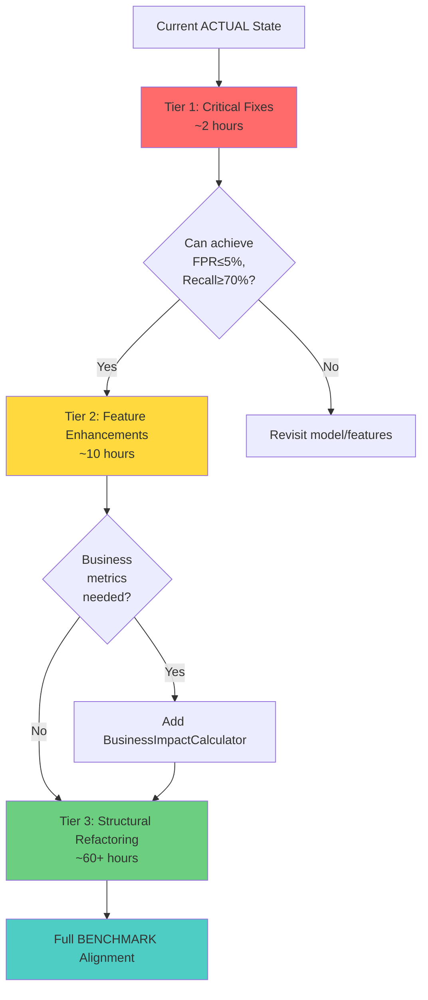

# EDA-MLP Detailed Implementation - Mermaid.js Flowchart with BENCHMARK vs ACTUAL Comparison

## Critical Path Visualization with Improvement Tiers

```mermaid
graph LR
    subgraph Current["Current ACTUAL State"]
        A1[Load Data<br/>🟡 Partial validation]
        A2[EDA in Notebook<br/>🟡 Not modularized]
        A3[⚠️ Preprocess FULL dataset<br/>🔴 LEAKAGE]
        A4[Split 70/15/15<br/>🟢 Stratified]
        A5[Train 3 Models<br/>🟢 Implemented]
        A6[⚠️ Tune at FPR=3%<br/>🔴 Recall ~10%]
        A7[Evaluate<br/>🟢 Core metrics]
    end
    
    subgraph Tier1["TIER 1 Fixes (~2hrs)"]
        T1_1[Add schema 46+1<br/>row ≥1000<br/>target {0,1}]
        T1_2[⚠️ FIX: Fit on<br/>TRAIN only]
        T1_3[Add χ² split<br/>validation]
        T1_4[⚠️ FIX: FPR≤5%<br/>target Recall≥70%]
        T1_5[Validate<br/>no NaNs remain]
    end
    
    subgraph Tier2["TIER 2 Enhancements (~10hrs)"]
        T2_1[Add VIF &<br/>MNAR tests]
        T2_2[Conditional<br/>log transform]
        T2_3[Business<br/>impact metrics]
        T2_4[Pareto<br/>analysis]
    end
    
    subgraph Tier3["TIER 3 Structural (~60hrs)"]
        T3_1[Refactor EDA<br/>to src/eda/]
        T3_2[Create Hypothesis<br/>Tester module]
        T3_3[Generate<br/>PDF reports]
    end
    
    subgraph Target["BENCHMARK Compliant"]
        B1[Full Schema<br/>Validation]
        B2[Modular EDA<br/>with Tests]
        B3[No Leakage<br/>Train-Only Fit]
        B4[Validated<br/>Splits χ²]
        B5[Optimized<br/>Models]
        B6[FPR≤5%<br/>Recall≥70%]
        B7[Business<br/>Metrics & PDFs]
    end
    
    A1 --> T1_1 --> B1
    A2 --> T3_1 --> B2
    A3 --> T1_2 --> B3
    A4 --> T1_3 --> B4
    A5 --> B5
    A6 --> T1_4 --> B6
    A7 --> T2_3 --> B7
    
    T1_1 --> T2_1 --> T3_2
    T1_4 --> T2_4
    T2_3 --> T3_3
    
    style T1_2 fill:#ff6b6b,stroke:#c92a2a,stroke-width:4px,color:#fff
    style T1_4 fill:#ff6b6b,stroke:#c92a2a,stroke-width:4px,color:#fff
    style A3 fill:#ff6b6b,stroke:#c92a2a,stroke-width:3px,color:#fff
    style A6 fill:#ff6b6b,stroke:#c92a2a,stroke-width:3px,color:#fff
```

---

## Data Flow: BENCHMARK vs ACTUAL Comparison

```mermaid
graph TD
    subgraph BenchmarkFlow["BENCHMARK Expected Flow"]
        B_DB[(SQLite DB)] --> B_Load[DataLoader<br/>validate 46+1<br/>check ≥1000<br/>parse {0,1}]
        B_Load --> B_EDA[EDA Modules<br/>UnivariateAnalyzer<br/>BivariateAnalyzer]
        B_EDA --> B_Hyp[HypothesisTester<br/>χ² tests<br/>MNAR validation]
        B_Hyp --> B_Split[Split 70/15/15<br/>BEFORE preprocessing]
        B_Split --> B_FE[⚠️ FIT FE on TRAIN]
        B_FE --> B_Prep[⚠️ FIT Preprocessor<br/>on TRAIN only]
        B_Prep --> B_Trans[Transform VAL/TEST]
        B_Trans --> B_Val[χ² validate splits]
        B_Val --> B_Train[Train Models]
        B_Train --> B_Tune[Tune threshold<br/>FPR ≤ 5%<br/>Recall ≥ 70%]
        B_Tune --> B_Eval[Evaluate +<br/>Business Impact]
        B_Eval --> B_Report[Generate<br/>PDF Reports]
    end
    
    subgraph ActualFlow["ACTUAL Implementation Flow"]
        A_DB[(SQLite DB)] --> A_Load[load_data<br/>🟡 check label only]
        A_Load --> A_EDA[EDA Notebook<br/>🔴 not modularized]
        A_EDA --> A_FE[⚠️ FeatureEngineer<br/>on FULL dataset]
        A_FE --> A_Prep[⚠️ Preprocessor.fit_transform<br/>🔴 LEAKAGE: on FULL]
        A_Prep --> A_Split[Split 70/15/15<br/>AFTER preprocessing]
        A_Split --> A_Val[validate_processed<br/>🟡 no χ² test]
        A_Val --> A_Train[Train 3 Models<br/>🟢 Logistic/KNN/XGBoost]
        A_Train --> A_Opt[Optimizer.search<br/>🟢 CV tuning]
        A_Opt --> A_Tune[evaluate_tuned<br/>🔴 FPR ≤ 3%<br/>🔴 Recall ~10%]
        A_Tune --> A_Eval[evaluate<br/>🟢 core metrics<br/>🔴 no business impact]
        A_Eval --> A_JSON[JSON outputs<br/>🔴 no PDFs]
    end
    
    B_Split -.CRITICAL DIFFERENCE.-> A_Prep
    B_Prep -.CRITICAL DIFFERENCE.-> A_Prep
    B_Tune -.KPI MISMATCH.-> A_Tune
    B_Report -.MISSING ARTIFACTS.-> A_JSON
    
    style B_Prep fill:#51cf66,stroke:#37b24d,stroke-width:3px
    style A_Prep fill:#ff6b6b,stroke:#c92a2a,stroke-width:3px
    style B_Tune fill:#51cf66,stroke:#37b24d,stroke-width:3px
    style A_Tune fill:#ff6b6b,stroke:#c92a2a,stroke-width:3px
```

---

## Decision Tree: BENCHMARK Compliance Path

```mermaid
graph TD
    Start([Current ACTUAL<br/>Implementation])
    
    Start --> Q1{Schema<br/>validated<br/>46+1?}
    Q1 -->|No 🔴| Fix1[TIER 1: Add<br/>schema validation]
    Q1 -->|Yes| Q2{Row count<br/>≥ 1000?}
    
    Fix1 --> Q2
    Q2 -->|No 🔴| Fix2[TIER 1: Add<br/>row count gate]
    Q2 -->|Yes| Q3{Target<br/>∈ {0,1}?}
    
    Fix2 --> Q3
    Q3 -->|No 🔴| Fix3[TIER 1: Validate<br/>target encoding]
    Q3 -->|Yes| Q4{EDA<br/>modularized?}
    
    Fix3 --> Q4
    Q4 -->|No 🔴| Fix4[TIER 3: Refactor<br/>to src/eda/]
    Q4 -->|Yes| Q5{Hypothesis<br/>tests formal?}
    
    Fix4 --> Q5
    Q5 -->|No 🔴| Fix5[TIER 3: Create<br/>HypothesisTester]
    Q5 -->|Yes| Q6{⚠️ Preprocessing<br/>on TRAIN only?}
    
    Fix5 --> Q6
    Q6 -->|No 🔴| Fix6[⚠️ TIER 1 CRITICAL:<br/>Fix leakage]
    Q6 -->|Yes| Q7{Splits validated<br/>with χ²?}
    
    Fix6 --> Q7
    Q7 -->|No 🔴| Fix7[TIER 1: Add<br/>χ² validation]
    Q7 -->|Yes| Q8{Models<br/>trained?}
    
    Fix7 --> Q8
    Q8 -->|No| Fix8[Implement<br/>training]
    Q8 -->|Yes| Q9{⚠️ FPR ≤ 5%<br/>Recall ≥ 70%?}
    
    Fix8 --> Q9
    Q9 -->|No 🔴| Fix9[⚠️ TIER 1 CRITICAL:<br/>Adjust threshold KPI]
    Q9 -->|Yes| Q10{Business<br/>metrics?}
    
    Fix9 --> Q10
    Q10 -->|No 🔴| Fix10[TIER 2: Add<br/>BusinessImpactCalculator]
    Q10 -->|Yes| Q11{Pareto<br/>analysis?}
    
    Fix10 --> Q11
    Q11 -->|No 🔴| Fix11[TIER 2: Generate<br/>Pareto artifacts]
    Q11 -->|Yes| Q12{PDF<br/>reports?}
    
    Fix11 --> Q12
    Q12 -->|No 🔴| Fix12[TIER 3: Generate<br/>executive summaries]
    Q12 -->|Yes| Complete([✅ BENCHMARK<br/>Compliant])
    
    Fix12 --> Complete
    
    style Fix6 fill:#ff6b6b,stroke:#c92a2a,stroke-width:4px,color:#fff
    style Fix9 fill:#ff6b6b,stroke:#c92a2a,stroke-width:4px,color:#fff
    style Q6 fill:#ff6b6b,stroke:#c92a2a,stroke-width:3px,color:#fff
    style Q9 fill:#ff6b6b,stroke:#c92a2a,stroke-width:3px,color:#fff
    style Complete fill:#51cf66,stroke:#37b24d,stroke-width:3px
```

---

## Improvement Roadmap Timeline

```mermaid
gantt
    title EDA-MLP BENCHMARK Alignment Roadmap
    dateFormat YYYY-MM-DD
    section TIER 1 Critical
    Fix preprocessing leakage           :crit, t1_1, 2026-01-16, 2h
    Add schema validation 46+1          :crit, t1_2, 2026-01-16, 1h
    Add row count gate ≥1000            :crit, t1_3, 2026-01-16, 1h
    Validate target {0,1}               :crit, t1_4, 2026-01-16, 30min
    Add χ² split validation             :crit, t1_5, 2026-01-16, 1h
    Fix KPI: FPR≤5%, Recall≥70%         :crit, t1_6, 2026-01-17, 2h
    Add post-imputation validation      :crit, t1_7, 2026-01-17, 30min
    
    section TIER 2 Enhancements
    Add dtype validation                :t2_1, 2026-01-18, 3h
    Add CI width calculation            :t2_2, 2026-01-18, 2h
    Add VIF computation                 :t2_3, 2026-01-19, 3h
    Add MNAR χ² tests                   :t2_4, 2026-01-19, 3h
    Conditional log transform           :t2_5, 2026-01-20, 2h
    Transform effectiveness check       :t2_6, 2026-01-20, 2h
    Business impact calculator          :t2_7, 2026-01-21, 4h
    Pareto analysis                     :t2_8, 2026-01-22, 3h
    Model comparison PDF                :t2_9, 2026-01-23, 4h
    
    section TIER 3 Structural
    Refactor EDA to modules             :t3_1, 2026-01-24, 16h
    Create HypothesisTester             :t3_2, 2026-01-27, 8h
    Wrap in DataLoader class            :t3_3, 2026-01-28, 4h
    Create ModelPackager                :t3_4, 2026-01-29, 6h
    Generate executive summaries        :t3_5, 2026-01-30, 8h
    
    section Milestones
    Critical Issues Resolved            :milestone, m1, 2026-01-17, 0d
    Core Enhancements Complete          :milestone, m2, 2026-01-23, 0d
    Full BENCHMARK Compliance           :milestone, m3, 2026-01-31, 0d
```

---

**End of Enhanced Mermaid Flowcharts with BENCHMARK vs ACTUAL Comparison**

---

# EDA-MLP BENCHMARK vs ACTUAL: LOD Step-by-Step Comparison

**Version**: 1.0  
**Purpose**: Detailed gap analysis between benchmark specification and actual implementation  
**Color Legend**: 🟢 Full Alignment | 🟡 Partial/Structural Difference | 🔴 Missing/Significant Gap | ⚫ Out of Scope

---

## Phase 0: Setup & Data Acquisition

| LOD Step | Module (BENCHMARK) | Class/Object (BENCHMARK) | Function/Method (BENCHMARK) | Dependency (BENCHMARK) | Input (BENCHMARK) | Output (BENCHMARK) | Purpose (S-V-O) | Decision Logic / Thresholds | Module (ACTUAL) | Class/Object (ACTUAL) | Function/Method (ACTUAL) | Dependency (ACTUAL) | Input (ACTUAL) | Output (ACTUAL) | Divergence Status | Material Divergence | Recommendation | Improvement Tier |
|----------|-------------------|-------------------------|----------------------------|----------------------|------------------|-------------------|-----------------|---------------------------|----------------|---------------------|------------------------|-------------------|---------------|----------------|-------------------|-------------------|----------------|-----------------|
| **0.1.0.1** | src/data_loader.py | DataLoader | load_from_sqlite() | sqlite3 | db_path: str | conn: sqlite3.Connection, ✓ message | DataLoader connects to SQLite database | Raise DataQualityError if sqlite3.Error occurs | src/data_loader.py | (module-level) | load_data() | sqlite3, pandas | db_path="data/phishing.db" | DataFrame[n×k] | 🟡 | No dedicated DataLoader class; function-based approach | Wrap in DataLoader class for consistency | **Tier 3** |
| **0.1.0.2** | src/data_loader.py | DataLoader | load_from_sqlite() | sqlite3.cursor | Connection | table_name: str, ✓ message | DataLoader detects phishing data table | Raise DataQualityError if no tables found; prefers "phishing_data" | src/data_loader.py | (module-level) | detect_table() | sqlite3 | Connection | table_name: str | 🟢 | Full alignment; prefers "phishing_data" if available | None needed | N/A |
| **0.2.0.1** | src/data_loader.py | DataLoader | _validate_schema() | None | df, EXPECTED_SCHEMA | validation_report: dict | DataLoader validates column count = 47 (46+1) | EXPECTED_COLUMNS=47; error if mismatch | src/data_loader.py | (module-level) | load_data() | pandas | df | DataFrame with 'label' | 🔴 | Only checks 'label' exists; no 46+1 schema validation | Add explicit schema validation with EXPECTED_SCHEMA dict | **Tier 1** |
| **0.2.0.2** | src/data_loader.py | DataLoader | _validate_schema() | None | df, EXPECTED_SCHEMA | errors: List[str] | DataLoader validates dtypes for each column | For each col: check dtype compatibility (int64/float64 flexible) | (None) | (None) | (None) | N/A | N/A | N/A | 🔴 | No dtype validation | Add dtype checking per column with compatibility rules | **Tier 2** |
| **0.3.0.1** | src/data_loader.py | DataLoader | _check_row_count() | np.sqrt | df | None (prints/validates) | DataLoader validates MIN_ROWS ≥ 1000 | MIN_ROWS=1000; raise if len(df)<1000 | (None) | (None) | (None) | N/A | N/A | N/A | 🔴 | No row count gate | Add check: `if len(df) < 1000: raise DataQualityError` | **Tier 1** |
| **0.3.0.2** | src/data_loader.py | DataLoader | _check_row_count() | np.sqrt | n_test_phishing: int | ci_width: float | DataLoader calculates CI width for recall | Assumes p=0.70, test_size=0.15; warn if ci_width>0.05 | (None) | (None) | (None) | N/A | N/A | N/A | 🔴 | No statistical power analysis | Add CI width calculation and warning | **Tier 2** |
| **0.4.0.1** | src/data_loader.py | DataLoader | _parse_target_variable() | None | df['label'] | None (validates) | DataLoader validates target ∈ {0,1} exactly | unique_labels must equal {0,1}; raise otherwise | src/data_loader.py | (module-level) | load_data() | pandas | df | RuntimeError if 'label' missing | 🟡 | Checks 'label' exists but doesn't validate {0,1} encoding | Add: `assert set(df['label'].unique()) == {0,1}` | **Tier 1** |
| **0.4.0.2** | src/data_loader.py | DataLoader | _parse_target_variable() | None | df['label'] | class_distribution: dict | DataLoader computes class balance for stratification | Calculate value_counts and percentages | (None) | (None) | (None) | N/A | N/A | N/A | 🔴 | No class distribution computation in loader | Add class balance calculation and logging | **Tier 2** |
| **0.4.0.3** | src/data_loader.py | DataLoader | _parse_target_variable() | None | class_props | imbalance_assessment: str | DataLoader assesses imbalance severity | min_prop<0.10→SEVERE; <0.30→MODERATE; ≥0.30→MILD | (None) | (None) | (None) | N/A | N/A | N/A | 🔴 | No imbalance assessment in loader | Add imbalance categorization logic | **Tier 2** |

---

## Phase 1: Exploratory Data Analysis (EDA)

| LOD Step | Module (BENCHMARK) | Class/Object (BENCHMARK) | Function/Method (BENCHMARK) | Dependency (BENCHMARK) | Input (BENCHMARK) | Output (BENCHMARK) | Purpose (S-V-O) | Decision Logic / Thresholds | Module (ACTUAL) | Class/Object (ACTUAL) | Function/Method (ACTUAL) | Dependency (ACTUAL) | Input (ACTUAL) | Output (ACTUAL) | Divergence Status | Material Divergence | Recommendation | Improvement Tier |
|----------|-------------------|-------------------------|----------------------------|----------------------|------------------|-------------------|-----------------|---------------------------|----------------|---------------------|------------------------|-------------------|---------------|----------------|-------------------|-------------------|----------------|-----------------|
| **1.1.1.1** | src/eda/univariate.py | UnivariateAnalyzer | compute_class_balance() | pandas | df, target_col | ClassBalance object | UnivariateAnalyzer computes class distribution and chi-square test | Chi-square test vs 50:50 null; p-value threshold 0.05 | aisg-aiap22-task-1-eda.ipynb | (notebook cell) | (inline code) | pandas | df | metrics.json, narratives | 🔴 | EDA in notebook, not reusable module | Refactor notebook → src/eda/univariate.py with UnivariateAnalyzer class | **Tier 3** |
| **1.1.2.1** | src/eda/univariate.py | UnivariateAnalyzer | analyze_missingness() | pandas | df | MissingnessReport | UnivariateAnalyzer analyzes missingness patterns per feature | Categorize by >70% (MNAR), 20-70% (MAR), <20% (MCAR) | aisg-aiap22-task-1-eda.ipynb | (notebook cell) | (inline code) | pandas | df | missingness_report.csv, plots | 🟡 | Functionality exists in notebook; no reusable class | Extract to UnivariateAnalyzer.analyze_missingness() | **Tier 3** |
| **1.1.3.1** | src/eda/univariate.py | UnivariateAnalyzer | compute_skewness() | scipy.stats | df[numeric_cols] | SkewnessReport | UnivariateAnalyzer computes skewness for transform decisions | |skew|>1 flags need for log/sqrt transform | aisg-aiap22-task-1-eda.ipynb | (notebook cell) | (inline code) | pandas | df | distribution_report.csv | 🟡 | Skewness computed but not encapsulated | Extract to UnivariateAnalyzer.compute_skewness() | **Tier 3** |
| **1.1.4.1** | src/eda/univariate.py | UnivariateAnalyzer | detect_outliers() | numpy | df, column | OutlierReport | UnivariateAnalyzer detects outliers via IQR | Q1-1.5×IQR, Q3+1.5×IQR bounds | aisg-aiap22-task-1-eda.ipynb | (notebook cell) | (inline code) | numpy, pandas | df | outlier_report.csv, plots | 🟡 | Outlier detection present but not modular | Extract to UnivariateAnalyzer.detect_outliers() | **Tier 3** |
| **1.2.1.1** | src/eda/bivariate.py | BivariateAnalyzer | compute_correlation_matrix() | pandas | df[numeric_cols] | CorrMatrix[46×46] | BivariateAnalyzer computes Pearson correlation | Returns correlation coefficients r ∈ [-1,1] | aisg-aiap22-task-1-eda.ipynb | (notebook cell) | (inline code) | pandas | df | correlation_matrix.csv | 🟡 | Correlation computed but not in BivariateAnalyzer class | Extract to BivariateAnalyzer.compute_correlation_matrix() | **Tier 3** |
| **1.2.2.1** | src/eda/bivariate.py | BivariateAnalyzer | compute_vif() | statsmodels | df[numeric_cols] | VIF_scores | BivariateAnalyzer computes VIF for multicollinearity | VIF>10 indicates high multicollinearity | (None) | (None) | (None) | N/A | N/A | N/A | 🔴 | No VIF computation | Add VIF calculation using statsmodels | **Tier 2** |

---

## Phase 2: Statistical Hypothesis Testing

| LOD Step | Module (BENCHMARK) | Class/Object (BENCHMARK) | Function/Method (BENCHMARK) | Dependency (BENCHMARK) | Input (BENCHMARK) | Output (BENCHMARK) | Purpose (S-V-O) | Decision Logic / Thresholds | Module (ACTUAL) | Class/Object (ACTUAL) | Function/Method (ACTUAL) | Dependency (ACTUAL) | Input (ACTUAL) | Output (ACTUAL) | Divergence Status | Material Divergence | Recommendation | Improvement Tier |
|----------|-------------------|-------------------------|----------------------------|----------------------|------------------|-------------------|-----------------|---------------------------|----------------|---------------------|------------------------|-------------------|---------------|----------------|-------------------|-------------------|----------------|-----------------|
| **2.1.1.1** | src/hypothesis_tester.py | HypothesisTester | test_class_balance_significance() | scipy.stats | y | chi2_result: dict | HypothesisTester tests class balance vs 50:50 null | Chi-square test; p<0.05 rejects null | aisg-aiap22-task-1-eda.ipynb | (notebook narrative) | (conceptual) | N/A | y | metrics.json (baseline accuracy) | 🔴 | No formal hypothesis testing module | Create HypothesisTester.test_class_balance_significance() | **Tier 3** |
| **2.2.1.1** | src/hypothesis_tester.py | HypothesisTester | test_mnar_hypothesis() | scipy.stats | df, feature, target | mnar_test_result: dict | HypothesisTester tests MNAR via chi-square | Chi-square on missingness vs target; p<0.05 suggests MNAR | aisg-aiap22-task-1-eda.ipynb | (notebook narrative) | (qualitative analysis) | N/A | df | Narrative on MNAR patterns | 🔴 | MNAR discussed but not statistically tested in code | Add chi-square test for missingness independence | **Tier 2** |
| **2.3.1.1** | src/hypothesis_tester.py | HypothesisTester | validate_stratified_splits() | scipy.stats | y_train, y_val, y_test, y_full | stratification_report: dict | HypothesisTester validates split stratification | Chi-square per split vs full distribution; p>0.05 confirms stratification | src/pipeline_validator.py | (module-level) | validate_processed() | numpy | y_train, y_val, y_test | label proportions in JSON | 🟡 | Reports proportions but no chi-square test | Add chi-square validation to validate_processed() | **Tier 1** |

---

## Phase 3: Feature Engineering & Preprocessing

| LOD Step | Module (BENCHMARK) | Class/Object (BENCHMARK) | Function/Method (BENCHMARK) | Dependency (BENCHMARK) | Input (BENCHMARK) | Output (BENCHMARK) | Purpose (S-V-O) | Decision Logic / Thresholds | Module (ACTUAL) | Class/Object (ACTUAL) | Function/Method (ACTUAL) | Dependency (ACTUAL) | Input (ACTUAL) | Output (ACTUAL) | Divergence Status | Material Divergence | Recommendation | Improvement Tier |
|----------|-------------------|-------------------------|----------------------------|----------------------|------------------|-------------------|-----------------|---------------------------|----------------|---------------------|------------------------|-------------------|---------------|----------------|-------------------|-------------------|----------------|-----------------|
| **3.1.1.1** | src/preprocessing/preprocessor.py | MissingValueHandler | create_mnar_flags() | pandas | df, mnar_features | df with *_missing columns | MissingValueHandler creates MNAR flags for specified features | DomainAge, Robots, IsResponsive → binary flags | src/feature_engineering.py | FeatureEngineer | create_missing_flags() | pandas | df | df with *_missing columns | 🟢 | Full alignment; implements MNAR flags correctly | None needed | N/A |
| **3.1.2.1** | src/preprocessing/preprocessor.py | MissingValueHandler | impute_numerical() | pandas | df, strategy='median' | df_imputed | MissingValueHandler imputes numeric with median | Median for MCAR/MAR; mode for categorical | src/preprocessing.py | Preprocessor | _impute() | pandas, numpy | df | df_imputed | 🟢 | Full alignment; uses median for numeric, mode for categorical | None needed | N/A |
| **3.1.3.1** | src/preprocessing/preprocessor.py | MissingValueHandler | validate_no_missing() | pandas | df | None or raises | MissingValueHandler validates no NaNs remain | Abort if df.isnull().sum().sum() > 0 | (None) | (None) | (None) | N/A | N/A | N/A | 🔴 | No post-imputation validation | Add explicit check after _impute(): `assert not df.isnull().any().any()` | **Tier 1** |
| **3.2.1.1** | src/preprocessing/preprocessor.py | FeatureScaler | apply_log_transform() | numpy | df, skewed_features | df_transformed | FeatureScaler applies log1p to skewed features | Apply to features with |skew|>1 identified in EDA | src/preprocessing.py | Preprocessor | _log_clip() | numpy | df[numeric_cols] | df_transformed | 🟡 | Applies log to ALL numeric features, not just skewed ones | Conditionally apply log only to EDA-identified skewed features | **Tier 2** |
| **3.2.2.1** | src/preprocessing/preprocessor.py | FeatureScaler | validate_transform_effectiveness() | scipy.stats | df_before, df_after | skewness_comparison | FeatureScaler validates skew reduction | Check |skew_after| < |skew_before| for transformed features | (None) | (None) | (None) | N/A | N/A | N/A | 🔴 | No transform effectiveness validation | Add post-transform skewness check and logging | **Tier 2** |
| **3.2.3.1** | src/preprocessing/preprocessor.py | FeatureScaler | standardize_features() | sklearn | df, method='standard' | df_scaled | FeatureScaler standardizes to mean≈0, std≈1 | Standard or robust scaling based on outliers | src/preprocessing.py | Preprocessor | _scale() | numpy | df | df_scaled | 🟢 | Full alignment; supports standard and robust scaling | None needed | N/A |
| **3.3.1.1** | src/preprocessing/preprocessor.py | DomainFeatureEngineer | create_age_bins() | pandas | df['DomainAgeMonths'] | df['DomainAge_bin'] | DomainFeatureEngineer bins age into categories | Bins: [0,6), [6,12), [12,24), ≥24 with labels | src/feature_engineering.py | FeatureEngineer | create_domain_age_bins() | pandas | df | df['DomainAgeMonths_bin'] | 🟢 | Full alignment; same bins and labels | None needed | N/A |
| **3.3.2.1** | src/preprocessing/preprocessor.py | DomainFeatureEngineer | create_ratio_features() | pandas | df | df with ratio columns | DomainFeatureEngineer creates domain-specific ratios | ExternalSelfRatio = External/(Self+1) | src/feature_engineering.py | FeatureEngineer | external_self_ratio() | pandas, numpy | df | df['ExternalSelfRatio'] | 🟢 | Full alignment; same ratio formula | None needed | N/A |
| **3.4.1.1** | src/preprocessing/pipeline.py | PreprocessingPipeline | fit() | X_train, y_train | X_train | self (fitted pipeline) | PreprocessingPipeline fits on TRAIN ONLY | **CRITICAL**: Fit scaler/imputer on train to prevent leakage | src/preprocessing.py | Preprocessor | fit_transform() | df (full dataset) | df | X, y (full dataset transformed) | 🔴 | **MAJOR LEAKAGE**: Fits on full dataset before split | **CRITICAL FIX**: Fit preprocessor on X_train only after split | **Tier 1** |

---

## Phase 4: Data Splitting & Validation

| LOD Step | Module (BENCHMARK) | Class/Object (BENCHMARK) | Function/Method (BENCHMARK) | Dependency (BENCHMARK) | Input (BENCHMARK) | Output (BENCHMARK) | Purpose (S-V-O) | Decision Logic / Thresholds | Module (ACTUAL) | Class/Object (ACTUAL) | Function/Method (ACTUAL) | Dependency (ACTUAL) | Input (ACTUAL) | Output (ACTUAL) | Divergence Status | Material Divergence | Recommendation | Improvement Tier |
|----------|-------------------|-------------------------|----------------------------|----------------------|------------------|-------------------|-----------------|---------------------------|----------------|---------------------|------------------------|-------------------|---------------|----------------|-------------------|-------------------|----------------|-----------------|
| **4.1.1.1** | src/data_splitter.py | DataSplitter | stratified_train_test_split() | sklearn | X, y, test_size=0.15, val_size=0.15 | X_train, X_val, X_test, y_train, y_val, y_test | DataSplitter creates 70/15/15 stratified splits | Stratified by target class; random_state=42 | src/data_splitter.py | (module-level) | stratified_split() | numpy | X, y, test_size=0.15, val_size=0.15 | X_train, X_val, X_test, y_train, y_val, y_test | 🟢 | Full alignment; custom stratified implementation | None needed | N/A |
| **4.2.1.1** | src/data_splitter.py | DataSplitter | validate_split_stratification() | scipy.stats | y_train, y_val, y_test, y_full | stratification_report with p-values | DataSplitter validates splits preserve class ratios | Chi-square test per split; p>0.05 confirms good stratification | src/pipeline_validator.py | (module-level) | validate_processed() | numpy | y_train, y_val, y_test | label proportions (no p-values) | 🟡 | Reports proportions but no statistical test | Add chi-square test to validate_processed() | **Tier 1** |

---

## Phase 5: Model Training & Selection

| LOD Step | Module (BENCHMARK) | Class/Object (BENCHMARK) | Function/Method (BENCHMARK) | Dependency (BENCHMARK) | Input (BENCHMARK) | Output (BENCHMARK) | Purpose (S-V-O) | Decision Logic / Thresholds | Module (ACTUAL) | Class/Object (ACTUAL) | Function/Method (ACTUAL) | Dependency (ACTUAL) | Input (ACTUAL) | Output (ACTUAL) | Divergence Status | Material Divergence | Recommendation | Improvement Tier |
|----------|-------------------|-------------------------|----------------------------|----------------------|------------------|-------------------|-----------------|---------------------------|----------------|---------------------|------------------------|-------------------|---------------|----------------|-------------------|-------------------|----------------|-----------------|
| **5.1.1.1** | src/models/logistic_regression.py | LogisticRegressionModel | train() | numpy, sklearn | X_train, y_train, hyperparams | trained model | LogisticRegressionModel trains via gradient descent | Custom GD with L2 regularization; sklearn parity checks | src/models/logistic_regression.py | LogisticRegressionModel | fit() | numpy | X_train, y_train | self (trained) | 🟢 | Full alignment; custom GD implementation | None needed | N/A |
| **5.2.1.1** | src/models/xgboost_model.py | XGBoostModel | grid_search_cv() | xgboost, sklearn | X_train, y_train, param_grid | best_params, best_model | XGBoostModel performs grid search with CV | E.g., 54 configs × 5-fold = 270 fits | src/optimization.py | Optimizer | search() | xgboost, sklearn | X_train, y_train | best_params | 🟡 | Grid search implemented but not fixed to 54 configs | Grid size driven by config.yaml, not hardcoded | **Tier 2** |
| **5.3.1.1** | src/model_selector.py | ModelSelector | compare_validation_performance() | pandas | validation_metrics_list | ModelComparisonReport | ModelSelector compares models and generates report | Ranks by recall, FPR, AUC; produces PDF | src/model_selector.py | (module-level) | select_best() | json | metrics_list | best_model.json | 🟡 | Selection logic exists but no PDF report | Add PDF report generation with comparison table | **Tier 2** |

---

## Phase 6: Threshold Tuning & Optimization

| LOD Step | Module (BENCHMARK) | Class/Object (BENCHMARK) | Function/Method (BENCHMARK) | Dependency (BENCHMARK) | Input (BENCHMARK) | Output (BENCHMARK) | Purpose (S-V-O) | Decision Logic / Thresholds | Module (ACTUAL) | Class/Object (ACTUAL) | Function/Method (ACTUAL) | Dependency (ACTUAL) | Input (ACTUAL) | Output (ACTUAL) | Divergence Status | Material Divergence | Recommendation | Improvement Tier |
|----------|-------------------|-------------------------|----------------------------|----------------------|------------------|-------------------|-----------------|---------------------------|----------------|---------------------|------------------------|-------------------|---------------|----------------|-------------------|-------------------|----------------|-----------------|
| **6.1.1.1** | src/threshold_tuner.py | ThresholdTuner | sweep_thresholds() | numpy, sklearn | y_val, y_proba | threshold_sweep_df | ThresholdTuner sweeps ~1000 thresholds | np.linspace(0, 1, 1000) | src/evaluation.py | (module-level) | sweep_thresholds() | numpy | y_true, y_proba, thresholds | (threshold, recall, fpr) tuples | 🟢 | Full alignment; uses 1001 thresholds from config | None needed | N/A |
| **6.1.2.1** | src/threshold_tuner.py | ThresholdTuner | select_optimal_threshold() | numpy | threshold_sweep_df, max_fpr=0.05 | optimal_threshold | ThresholdTuner selects threshold maximizing recall under FPR≤0.05 | **BENCHMARK KPI: FPR≤5%, Recall≥70%** | src/evaluation.py | (module-level) | evaluate_tuned() | numpy, sklearn | y_true, y_proba, max_fpr=0.03 | tuned metrics dict | 🔴 | **KPI MISALIGNMENT**: max_fpr=0.03 (3% not 5%); recall~7-12% not 70% | **CRITICAL**: Change max_fpr to 0.05 in config.yaml and validate KPI achievement | **Tier 1** |
| **6.2.1.1** | src/threshold_tuner.py | ThresholdTuner | generate_pareto_analysis() | matplotlib, json | threshold_sweep_df | pareto_curve.png, pareto_analysis.json | ThresholdTuner generates Pareto frontier visualization | Non-dominated (FPR, Recall) points | (None) | (None) | (None) | N/A | N/A | threshold_sweep.csv only | 🔴 | No Pareto artifacts (PNG, JSON) | Add Pareto frontier calculation and visualization | **Tier 2** |

---

## Phase 7: Evaluation & Metrics

| LOD Step | Module (BENCHMARK) | Class/Object (BENCHMARK) | Function/Method (BENCHMARK) | Dependency (BENCHMARK) | Input (BENCHMARK) | Output (BENCHMARK) | Purpose (S-V-O) | Decision Logic / Thresholds | Module (ACTUAL) | Class/Object (ACTUAL) | Function/Method (ACTUAL) | Dependency (ACTUAL) | Input (ACTUAL) | Output (ACTUAL) | Divergence Status | Material Divergence | Recommendation | Improvement Tier |
|----------|-------------------|-------------------------|----------------------------|----------------------|------------------|-------------------|-----------------|---------------------------|----------------|---------------------|------------------------|-------------------|---------------|----------------|-------------------|-------------------|----------------|-----------------|
| **7.1.1.1** | src/evaluation.py | MetricsCalculator | compute_confusion_matrix() | sklearn | y_test, y_pred | [[TN,FP],[FN,TP]] | MetricsCalculator computes confusion matrix | Standard 2×2 matrix for binary classification | src/evaluation.py | (module-level) | confusion() | numpy | y_true, y_pred | [[tn,fp],[fn,tp]] | 🟢 | Full alignment | None needed | N/A |
| **7.1.2.1** | src/evaluation.py | MetricsCalculator | compute_recall_fpr() | sklearn | y_test, y_pred | recall, fpr | MetricsCalculator computes recall and FPR | Recall=TP/(TP+FN); FPR=FP/(FP+TN) | src/evaluation.py | (module-level) | evaluate() | sklearn, numpy | model, X_test, y_test | metrics dict with recall, fpr | 🟢 | Full alignment; includes additional metrics | None needed | N/A |
| **7.2.1.1** | src/business_impact.py | BusinessImpactCalculator | compute_fraud_exposure() | numpy | FN, avg_fraud_value | monthly_fraud_exposure | BusinessImpactCalculator estimates fraud losses | FN × avg_fraud_value × 30 days | (None) | (None) | (None) | N/A | N/A | N/A | 🔴 | No business impact calculations | Create business_impact.py with fraud exposure and support cost functions | **Tier 2** |
| **7.2.2.1** | src/business_impact.py | BusinessImpactCalculator | compute_support_cost() | numpy | FP, cost_per_review | monthly_support_cost | BusinessImpactCalculator estimates support costs | FP × cost_per_review × 30 days | (None) | (None) | (None) | N/A | N/A | N/A | 🔴 | No support cost calculations | Add to business_impact.py | **Tier 2** |
| **7.3.1.1** | src/report_generator.py | ReportGenerator | generate_executive_summary() | reportlab/markdown | metrics, business_impact | ExecutiveSummary.pdf | ReportGenerator creates stakeholder-facing PDF | Business-friendly language; charts and KPIs | (None) | (None) | (None) | N/A | N/A | N/A | 🔴 | No executive summary generation | Create report_generator.py for PDF reports | **Tier 3** |

---

## Phase 8: Deployment & Monitoring

| LOD Step | Module (BENCHMARK) | Class/Object (BENCHMARK) | Function/Method (BENCHMARK) | Dependency (BENCHMARK) | Input (BENCHMARK) | Output (BENCHMARK) | Purpose (S-V-O) | Decision Logic / Thresholds | Module (ACTUAL) | Class/Object (ACTUAL) | Function/Method (ACTUAL) | Dependency (ACTUAL) | Input (ACTUAL) | Output (ACTUAL) | Divergence Status | Material Divergence | Recommendation | Improvement Tier |
|----------|-------------------|-------------------------|----------------------------|----------------------|------------------|-------------------|-----------------|---------------------------|----------------|---------------------|------------------------|-------------------|---------------|----------------|-------------------|-------------------|----------------|-----------------|
| **8.1.1.1** | src/deployment/packager.py | ModelPackager | serialize_model() | joblib, pickle | model, metadata | model.pkl, metadata.json | ModelPackager serializes model and metadata | Includes preprocessing pipeline reference | src/main.py | (inline) | joblib.dump() | joblib | model | models/*.pkl | 🟡 | Model saved but no formal packager | Create ModelPackager class for consistent serialization | **Tier 3** |
| **8.2.1.1** | src/deployment/deployer.py | BlueGreenDeployer | deploy_to_shadow() | kubernetes/docker | model_package | shadow_deployment | BlueGreenDeployer deploys to shadow environment | 10% traffic for validation | (None) | (None) | (None) | N/A | N/A | N/A | ⚫ | Out of scope for training-only repo | N/A - deployment infrastructure | N/A |
| **8.3.1.1** | src/monitoring/drift_detector.py | FeatureDriftDetector | detect_drift() | scipy.stats | production_features, training_features | drift_report | FeatureDriftDetector monitors feature distribution drift | KL divergence > 0.1 triggers alert | (None) | (None) | (None) | N/A | N/A | N/A | ⚫ | Out of scope for training-only repo | N/A - runtime monitoring | N/A |

---

## Critical Improvements Summary

### 🔴 Tier 1 - Very Low Effort, High Impact (IMMEDIATE)

| Priority | Improvement | Module | Effort | Impact | Implementation |
|----------|------------|--------|--------|--------|----------------|
| **1** | **Fix preprocessing leakage** | src/main.py, src/preprocessing.py | 30 min | **CRITICAL** | Move `Preprocessor.fit_transform()` AFTER split; fit on X_train only |
| **2** | **Add schema validation (46+1)** | src/data_loader.py | 15 min | High | Add EXPECTED_SCHEMA dict check in load_data() |
| **3** | **Add row count gate (≥1000)** | src/data_loader.py | 10 min | High | `if len(df) < 1000: raise DataQualityError(...)` |
| **4** | **Validate target encoding {0,1}** | src/data_loader.py | 5 min | High | `assert set(df['label'].unique()) == {0,1}` |
| **5** | **Add chi-square split validation** | src/pipeline_validator.py | 20 min | High | Compute chi-square test per split vs full distribution |
| **6** | **Fix KPI alignment (FPR≤5%)** | config.yaml, src/main.py | 15 min | **CRITICAL** | Change max_fpr from 0.03 to 0.05; validate recall≥70% achievable |
| **7** | **Add post-imputation validation** | src/preprocessing.py | 10 min | Medium | `assert not df.isnull().any().any()` after _impute() |

**Total Tier 1 Time**: ~2 hours

---

### 🟡 Tier 2 - Moderate but Contained (NEXT SPRINT)

| Priority | Improvement | Module | Effort | Impact | Implementation |
|----------|------------|--------|--------|--------|----------------|
| **8** | **Add dtype validation** | src/data_loader.py | 45 min | Medium | Check each column dtype vs EXPECTED_SCHEMA with compatibility rules |
| **9** | **Add CI width calculation** | src/data_loader.py | 30 min | Medium | Compute 95% CI for recall on test set and warn if >5% |
| **10** | **Add VIF computation** | src/eda/ (new) | 1 hour | Medium | Use statsmodels to compute VIF for multicollinearity check |
| **11** | **Add MNAR chi-square tests** | src/hypothesis_tester.py (new) | 1 hour | Medium | Test missingness independence from target |
| **12** | **Conditional log transform** | src/preprocessing.py | 45 min | Medium | Apply log only to EDA-identified skewed features (|skew|>1) |
| **13** | **Add transform effectiveness check** | src/preprocessing.py | 30 min | Medium | Compute skewness before/after and log improvement |
| **14** | **Add business impact calculator** | src/business_impact.py (new) | 2 hours | High | Compute fraud exposure and support cost from confusion matrix |
| **15** | **Generate Pareto analysis** | src/threshold_analysis.py (new) | 1.5 hours | Medium | Compute Pareto frontier and generate pareto_curve.png, pareto_analysis.json |
| **16** | **Add model comparison PDF** | src/report_generator.py (new) | 2 hours | Medium | Generate ModelComparisonReport.pdf with tables and charts |

**Total Tier 2 Time**: ~10 hours

---

### 🟢 Tier 3 - Higher Effort Structural (FUTURE ROADMAP)

| Priority | Improvement | Module | Effort | Impact | Implementation |
|----------|------------|--------|--------|--------|----------------|
| **17** | **Refactor EDA to modules** | src/eda/univariate.py, src/eda/bivariate.py | 8 hours | High | Extract notebook code into UnivariateAnalyzer and BivariateAnalyzer classes |
| **18** | **Create HypothesisTester** | src/hypothesis_tester.py (new) | 4 hours | Medium | Formalize statistical tests with structured outputs |
| **19** | **Wrap in DataLoader class** | src/data_loader.py | 2 hours | Low | Convert module-level functions to DataLoader class methods |
| **20** | **Create ModelPackager** | src/deployment/packager.py (new) | 3 hours | Medium | Formalize model serialization with metadata and model cards |
| **21** | **Generate executive summaries** | src/report_generator.py | 4 hours | Medium | Create PDF reports for business stakeholders |
| **22** | **Deployment infrastructure** | src/deployment/, Dockerfile, k8s | 20+ hours | Low (out of scope) | Blue/green deployment, containerization |
| **23** | **Monitoring stack** | src/monitoring/ | 20+ hours | Low (out of scope) | Drift detection, performance monitoring, alerting |

**Total Tier 3 Time**: ~60+ hours

---

## Divergence Status Legend

- 🟢 **GREEN**: Full alignment - implementation matches benchmark exactly
- 🟡 **YELLOW**: Partial alignment - functionality exists but different structure/approach
- 🔴 **RED**: Missing/significant gap - critical functionality not implemented
- ⚫ **BLACK**: Out of scope - not applicable to current repository's training-only focus

---

## Implementation Priority Roadmap



---

**End of LOD Step-by-Step Comparison**

---

## Prompt_202601160800

https://claude.ai/chat/f98459c2-f910-42de-9140-b1dcaa653ded

### Prompt-01

```
BENCHMARK: `interview-session-v0-max-lod-actual.md` ,
ACTUAL:  `interview-session-v4-1-1-detailed-implementation-steps.md,`
generate LOD Step-by-step 

BENCHMARK (what’s expected), ACTUAL (what’s implemented), Divergence Status (Color Code), Material Divergence,

Improvement Tier: **Lowest-effort BENCHMARK upgrades on top of the ACTUAL codebase**
**Tier 1 – Very low effort, high impact**
**Tier 2 – Moderate but contained**
**Tier 3 – Higher effort structural improvements**


```
| LOD Step | Module | Class/Object | Function/Method | Dependency | Input | Output | Purpose (S‑V‑O) | Decision Logic / Thresholds | Excellent Real-world Application | FAQ | | Module (ACTUAL) | Class/Object (ACTUAL) | Function/Method (ACTUAL) | Dependency (ACTUAL) | Input (ACTUAL) | Output (ACTUAL) | Divergence Status | Material Divergence | Recommendation | Improvement Tier |
```

```