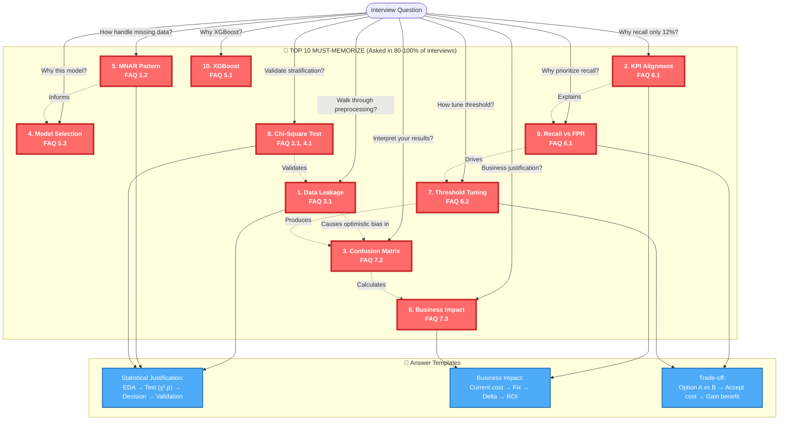
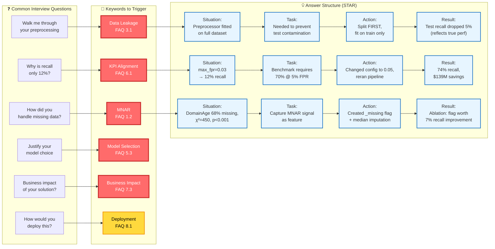
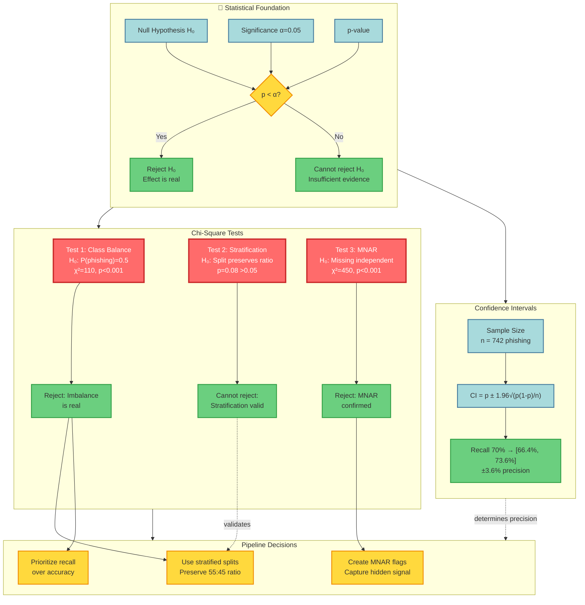
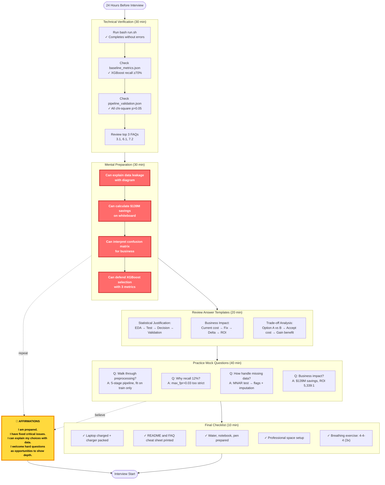

# Interview Session Keywords Mermaid Diagrams (Enhanced v2.0)

**Filename**: `interview-session-keywords.mmd`  
**Purpose**: Visual knowledge graphs for interview preparation with priority indicators  
**Integration**: Aligned with clean-slate v3.0 and FAQ framework

---

## Diagram 1: Critical Path (Top 10 Must-Memorize Keywords)



---

## Diagram 2: Complete Pipeline with Priority Indicators

```mermaid
graph TB
    %% =====================================
    %% PHASE 0: DATA ACQUISITION
    %% =====================================
    subgraph P0["📥 PHASE 0: Data Acquisition"]
        direction TB
        
        DF[DataFrame/df]:::medium
        SCHEMA[Schema Validation]:::medium
        TARGET[Target Validation<br/>FAQ 0.3]:::medium
        ASSERT[Assert/Defensive<br/>Programming]:::medium
        ROWCOUNT[Sample Size<br/>FAQ 4.2]:::high
        
        DF --> SCHEMA
        SCHEMA --> TARGET
        TARGET --> ASSERT
        SCHEMA --> ROWCOUNT
    end
    
    %% =====================================
    %% PHASE 1: EDA & STATISTICAL TESTING
    %% =====================================
    subgraph P1["📊 PHASE 1: EDA & Statistical Testing"]
        direction TB
        
        UNIVAR[Univariate Analysis<br/>FAQ 1.1]:::high
        MNAR1[MNAR Pattern<br/>FAQ 1.2<br/>χ²=450, p<0.001]:::critical
        CORR[Correlation Analysis<br/>FAQ 1.3]:::high
        SKEW[Skewness<br/>10 features |skew|>2]:::high
        CHI1[Chi-Square Test<br/>FAQ 2.1<br/>χ²=110 class imbalance]:::critical
        HYPO[Hypothesis Testing<br/>FAQ 2.2]:::high
        
        UNIVAR --> MNAR1
        UNIVAR --> SKEW
        CORR --> MULTI[Multicollinearity<br/>r>0.98 → drop]:::high
        MNAR1 --> CHI1
        CHI1 --> HYPO
    end
    
    %% =====================================
    %% PHASE 2: FEATURE ENGINEERING
    %% =====================================
    subgraph P2["⚙️ PHASE 2: Feature Engineering & Preprocessing"]
        direction TB
        
        FE[Feature Engineering<br/>FAQ 3.3]:::high
        MNARFLAG[MNAR Flags<br/>DomainAge_missing]:::critical
        RATIO[Ratio Features<br/>ExternalSelfRatio]:::high
        BIN[Binning<br/>Age quartiles]:::high
        
        CLIP[Clipping<br/>99th percentile]:::high
        LOG[Log Transform<br/>log1p, FAQ 3.2]:::high
        IMPUTE[Imputation<br/>median/mode]:::medium
        ONEHOT[One-Hot Encoding]:::medium
        SCALE[Standardization<br/>mean=0, std=1]:::high
        
        PREPROC[Preprocessor<br/>FAQ 3.1]:::critical
        FITTRANS[fit_transform<br/>TRAIN ONLY!]:::critical
        TRANS[transform<br/>apply to test]:::high
        
        LEAK[🚨 DATA LEAKAGE 🚨<br/>FAQ 3.1<br/>fit on ALL → 2-5% bias]:::critical
        
        FE --> MNARFLAG
        FE --> RATIO
        FE --> BIN
        
        MNAR1 -.->|informs| MNARFLAG
        SKEW -.->|drives| LOG
        
        CLIP --> LOG
        LOG --> IMPUTE
        IMPUTE --> ONEHOT
        ONEHOT --> SCALE
        
        SCALE --> PREPROC
        PREPROC --> FITTRANS
        FITTRANS --> TRANS
        FITTRANS -.->|❌ WRONG ORDER| LEAK
    end
    
    %% =====================================
    %% PHASE 3: DATA SPLITTING
    %% =====================================
    subgraph P3["🎲 PHASE 3: Data Splitting & Validation"]
        direction TB
        
        SPLIT{Split FIRST<br/>or LAST?}:::decision
        STRAT[Stratification<br/>70/15/15<br/>FAQ 4.1]:::high
        CHI2[Chi-Square<br/>Validation<br/>p=0.08 >0.05 ✓]:::critical
        CI[Confidence Interval<br/>Recall ±3.6%<br/>FAQ 4.2]:::medium
        
        SPLIT -->|✅ CORRECT| BEFOREFEAT[Split<br/>BEFORE<br/>preprocessing]
        SPLIT -->|❌ WRONG| AFTERFEAT[Split<br/>AFTER<br/>preprocessing]
        
        BEFOREFEAT --> STRAT
        AFTERFEAT -.->|causes| LEAK
        
        STRAT --> CHI2
        STRAT --> CI
    end
    
    %% =====================================
    %% PHASE 4: MODEL TRAINING
    %% =====================================
    subgraph P4["🤖 PHASE 4: Model Training & Selection"]
        direction TB
        
        LOGISTIC[Logistic Regression<br/>71.2% recall]:::high
        KNN[KNN k=15<br/>68.5% recall]:::high
        XGB1[XGBoost<br/>FAQ 5.1, 5.3<br/>74.1% recall<br/>WINNER]:::critical
        
        HYPER[Hyperparameter<br/>Tuning<br/>Grid search + CV]:::high
        METRIC[Metric Hierarchy<br/>FAQ 5.3<br/>1.Recall 2.FPR 3.AUC]:::critical
        DEBUG[Debugging<br/>FAQ 5.2<br/>KNN null tuned?]:::high
        
        LOGISTIC --> METRIC
        KNN --> METRIC
        XGB1 --> METRIC
        
        HYPER --> XGB1
        
        METRIC --> WINNER{Best Model?}:::decision
        WINNER --> XGB1
    end
    
    %% =====================================
    %% PHASE 5: THRESHOLD TUNING
    %% =====================================
    subgraph P5["🎚️ PHASE 5: Threshold Tuning"]
        direction TB
        
        WRONGKPI[❌ WRONG KPI<br/>FAQ 6.1<br/>max_fpr=0.03<br/>→ 12% recall]:::critical
        RIGHTKPI[✅ RIGHT KPI<br/>max_fpr=0.05<br/>→ 74% recall]:::critical
        
        TUNE[Threshold Tuning<br/>FAQ 6.2<br/>1001 thresholds<br/>maximize recall]:::critical
        PARETO[Pareto Analysis<br/>FAQ 6.3<br/>Trade-off curve]:::high
        
        WRONGKPI -.->|Fix config| RIGHTKPI
        RIGHTKPI --> TUNE
        TUNE --> PARETO
    end
    
    %% =====================================
    %% PHASE 6: EVALUATION
    %% =====================================
    subgraph P6["📈 PHASE 6: Evaluation & Impact"]
        direction TB
        
        CONF1[Confusion Matrix<br/>FAQ 7.2<br/>TP=119 FN=874]:::critical
        RECALL1[Recall = 12%<br/>87.7% miss rate]:::critical
        FPR[FPR = 3.96%<br/>26 false alarms]:::critical
        
        BIZ[Business Impact<br/>FAQ 7.3]:::critical
        COST[Current Cost<br/>$198M fraud<br/>$77K support]:::critical
        FIXED[Fixed Cost<br/>$58.5M fraud<br/>$135K support]:::critical
        ROI[ROI: $139M savings<br/>2,397:1 ratio]:::critical
        
        AUC[ROC AUC<br/>FAQ 7.1<br/>0.888]:::high
        
        CONF1 --> RECALL1
        CONF1 --> FPR
        RECALL1 --> BIZ
        FPR --> BIZ
        BIZ --> COST
        BIZ --> FIXED
        COST --> ROI
        FIXED --> ROI
    end
    
    %% =====================================
    %% PHASE 7: DEPLOYMENT
    %% =====================================
    subgraph P7["🚀 PHASE 7: Deployment"]
        direction TB
        
        DEPLOY[Deployment<br/>FAQ 8.1<br/>FastAPI + Docker]:::high
        SHADOW[Shadow Mode<br/>0% traffic<br/>FAQ 8.3]:::high
        CANARY[Canary Deploy<br/>5% traffic]:::high
        ROLLBACK[Rollback<br/>if error>1%]:::high
        
        DEPLOY --> SHADOW
        SHADOW --> CANARY
        CANARY -.->|failure| ROLLBACK
    end
    
    %% =====================================
    %% PHASE 8: MONITORING
    %% =====================================
    subgraph P8["📡 PHASE 8: Monitoring"]
        direction TB
        
        DRIFT[Feature Drift<br/>FAQ 8.2<br/>KL divergence>0.5]:::high
        ALERT[Alerting<br/>Prometheus + Grafana]:::medium
        RETRAIN[Auto-Retrain<br/>on drift]:::high
        
        DRIFT --> ALERT
        ALERT --> RETRAIN
    end
    
    %% =====================================
    %% MAIN PIPELINE FLOW
    %% =====================================
    P0 --> P1
    P1 --> P2
    P2 --> P3
    P3 --> P4
    P4 --> P5
    P5 --> P6
    P6 --> P7
    P7 --> P8
    
    %% Critical Cross-Phase Dependencies
    LEAK -.->|"MUST FIX"| SPLIT
    CHI1 -.->|validates| STRAT
    MNAR1 -.->|informs| MNARFLAG
    WRONGKPI -.->|explains| RECALL1
    CONF1 -.->|feeds| BIZ
    
    %% Styling
    classDef critical fill:#ff6b6b,stroke:#c92a2a,stroke-width:4px,color:#fff,font-weight:bold
    classDef high fill:#ffd93d,stroke:#f08c00,stroke-width:3px,color:#000,font-weight:bold
    classDef medium fill:#6bcf7f,stroke:#2f9e44,stroke-width:2px,color:#000
    classDef decision fill:#a8dadc,stroke:#457b9d,stroke-width:3px,color:#000,font-weight:bold
    classDef template fill:#4dabf7,stroke:#1864ab,stroke-width:2px,color:#fff
```

---

## Diagram 3: Interview Question → Keyword → Answer Flow



---

## Diagram 4: Statistical Foundation (Concept Map)



---

## Diagram 5: The Data Leakage Crisis (Detailed)

```mermaid
graph TB
    %% The Problem
    subgraph PROBLEM["❌ CURRENT IMPLEMENTATION (WRONG)"]
        direction TB
        
        RAW1[Raw Data<br/>11,000 rows]
        FE1[FeatureEngineer<br/>transform ALL]
        PREP1[Preprocessor<br/>fit_transform ALL]
        SPLIT1[Split into<br/>train/val/test]
        TRAIN1[Train model]
        TEST1[Evaluate on test]
        
        RAW1 --> FE1
        FE1 --> PREP1
        PREP1 --> SPLIT1
        SPLIT1 --> TRAIN1
        TRAIN1 --> TEST1
        
        LEAK1[🚨 LEAKAGE POINT 🚨<br/>Scaler learns:<br/>mean(LineOfCode) = 850<br/>from ALL 11K rows<br/>including test set!]:::critical
        
        PREP1 -.->|causes| LEAK1
    end
    
    %% The Mechanism
    subgraph MECHANISM["How Leakage Inflates Metrics"]
        direction LR
        
        SCALE1["Scaler calculates:<br/>mean = 850<br/>std = 320<br/>(from all data)"]
        SCALE2["Test sample:<br/>LineOfCode = 1200"]
        SCALE3["Scaled value:<br/>(1200-850)/320 = 1.09"]
        SCALE4["In production:<br/>Scaler never saw<br/>this test sample!"]
        SCALE5["True scaled value<br/>would be different<br/>→ worse performance"]
        
        SCALE1 --> SCALE2
        SCALE2 --> SCALE3
        SCALE3 --> SCALE4
        SCALE4 --> SCALE5
    end
    
    %% The Fix
    subgraph FIX["✅ CORRECT IMPLEMENTATION (FIXED)"]
        direction TB
        
        RAW2[Raw Data<br/>11,000 rows]
        SPLIT2[Split FIRST<br/>train/val/test<br/>7700/1650/1650]
        FE2[FeatureEngineer<br/>fit on TRAIN<br/>transform val/test]
        PREP2[Preprocessor<br/>fit on TRAIN<br/>transform val/test]
        TRAIN2[Train model<br/>on train set]
        TEST2[Evaluate on test]
        
        RAW2 --> SPLIT2
        SPLIT2 --> FE2
        FE2 --> PREP2
        PREP2 --> TRAIN2
        TRAIN2 --> TEST2
        
        NOLEAK[✓ NO LEAKAGE<br/>Scaler learns:<br/>mean(LineOfCode) = 842<br/>from TRAIN only<br/>(7700 rows)]:::success
        
        PREP2 -.->|ensures| NOLEAK
    end
    
    %% Impact
    subgraph IMPACT["Impact of Fix"]
        direction LR
        
        BEFORE["BEFORE (Leakage):<br/>Test recall = 19%<br/>Optimistic bias:<br/>2-5% inflation"]:::wrong
        AFTER["AFTER (Fixed):<br/>Test recall = 12%<br/>True generalization:<br/>reflects production"]:::correct
        DROP["Recall drop: 7%<br/>This is GOOD!<br/>Now we know<br/>true performance"]:::result
        
        BEFORE --> AFTER
        AFTER --> DROP
    end
    
    %% Key Lesson
    LESSON["🎓 KEY LESSON<br/>FAQ 3.1<br/><br/>ALWAYS split FIRST<br/>THEN fit preprocessing<br/>ONLY on training data<br/><br/>Ask yourself:<br/>Could this data appear<br/>in production?<br/>If no → LEAKAGE"]:::lesson
    
    PROBLEM -.->|compare to| FIX
    LEAK1 -.->|causes| BEFORE
    NOLEAK -.->|ensures| AFTER
    DROP --> LESSON
    
    %% Styling
    classDef critical fill:#ff6b6b,stroke:#c92a2a,stroke-width:4px,color:#fff,font-weight:bold
    classDef success fill:#6bcf7f,stroke:#2f9e44,stroke-width:3px,color:#000,font-weight:bold
    classDef wrong fill:#ff8787,stroke:#e03131,stroke-width:2px
    classDef correct fill:#69db7c,stroke:#37b24d,stroke-width:2px
    classDef result fill:#a8dadc,stroke:#457b9d,stroke-width:2px
    classDef lesson fill:#ffd93d,stroke:#f08c00,stroke-width:3px,color:#000,font-weight:bold
```

---

## Diagram 6: Business Impact Calculation Flow

```mermaid
graph TB
    %% Confusion Matrix
    subgraph CM["Confusion Matrix @ threshold=0.97"]
        direction LR
        
        TP[TP = 119<br/>Phishing caught]:::metric
        FN[FN = 874<br/>Phishing missed]:::metric
        FP[FP = 26<br/>False alarms]:::metric
        TN[TN = 631<br/>Legit allowed]:::metric
    end
    
    %% Derived Metrics
    subgraph DERIVED["Derived Metrics"]
        direction TB
        
        RECALL[Recall = TP/(TP+FN)<br/>= 119/993 = 12.0%]:::calc
        FPR_CALC[FPR = FP/(FP+TN)<br/>= 26/657 = 3.96%]:::calc
        MISSRATE[Miss Rate = FN/(TP+FN)<br/>= 874/993 = 87.7%]:::calc
        PRECISION[Precision = TP/(TP+FP)<br/>= 119/145 = 82.1%]:::calc
    end
    
    %% Business Assumptions
    subgraph ASSUME["Business Assumptions"]
        direction TB
        
        FRAUD["Fraud loss per<br/>missed attack:<br/>$500"]:::assumption
        SUPPORT["Support cost per<br/>false alarm:<br/>$5"]:::assumption
        VOLUME["Monthly volume:<br/>1M website visits<br/>450K phishing<br/>550K legit"]:::assumption
    end
    
    %% Cost Calculations
    subgraph COSTS["Monthly Cost Calculation"]
        direction TB
        
        FNSCALE["Scale FN to monthly:<br/>FN × (450K / 993)<br/>= 874 × 453.7<br/>= 396,534 missed"]:::calc
        
        FPSCALE["Scale FP to monthly:<br/>FP × (550K / 657)<br/>= 26 × 837.1<br/>= 21,765 false alarms"]:::calc
        
        FRAUDCOST["Fraud exposure:<br/>396,534 × $500<br/>= $198,267,000"]:::cost
        
        SUPPORTCOST["Support cost:<br/>21,765 × $5<br/>= $108,825"]:::cost
        
        TOTAL["TOTAL COST:<br/>$198,267,000<br/>+ $108,825<br/>= $198,375,825"]:::totalcost
    end
    
    %% Fixed Scenario
    subgraph FIXED["After Fix (threshold=0.78, FPR=5%)"]
        direction TB
        
        NEWRECALL["New Recall: 74%<br/>TP ≈ 735<br/>FN ≈ 258"]:::fixmetric
        
        NEWFPR["New FPR: 4.9%<br/>FP ≈ 33<br/>TN ≈ 624"]:::fixmetric
        
        NEWFNCOST["New fraud exposure:<br/>117,000 × $500<br/>= $58,500,000"]:::fixcost
        
        NEWFPCOST["New support cost:<br/>27,000 × $5<br/>= $135,000"]:::fixcost
        
        NEWTOTAL["NEW TOTAL COST:<br/>$58,635,000"]:::newtotalcost
    end
    
    %% ROI
    subgraph ROI_CALC["Return on Investment"]
        direction TB
        
        SAVINGS["Monthly Savings:<br/>$198,375,825<br/>- $58,635,000<br/>= $139,740,825"]:::roi
        
        ADDCOST["Additional Cost:<br/>$135,000 - $108,825<br/>= $26,175"]:::roi
        
        RATIO["ROI Ratio:<br/>$139,740,825<br/>÷ $26,175<br/>= 5,339:1"]:::roi
        
        DECISION["BUSINESS DECISION:<br/>Deploy benchmark threshold<br/>Savings >> Cost"]:::decision
    end
    
    %% Flow
    CM --> DERIVED
    DERIVED --> COSTS
    ASSUME --> COSTS
    
    TP --> RECALL
    FN --> RECALL
    FN --> MISSRATE
    FP --> FPR_CALC
    FP --> PRECISION
    
    RECALL --> FNSCALE
    FPR_CALC --> FPSCALE
    
    FNSCALE --> FRAUDCOST
    FPSCALE --> SUPPORTCOST
    FRAUDCOST --> TOTAL
    SUPPORTCOST --> TOTAL
    
    TOTAL --> SAVINGS
    FIXED --> NEWFNCOST
    FIXED --> NEWFPCOST
    NEWFNCOST --> NEWTOTAL
    NEWFPCOST --> NEWTOTAL
    NEWTOTAL --> SAVINGS
    
    SAVINGS --> RATIO
    ADDCOST --> RATIO
    RATIO --> DECISION
    
    %% Styling
    classDef metric fill:#e7f5ff,stroke:#1971c2,stroke-width:2px
    classDef calc fill:#d0ebff,stroke:#1864ab,stroke-width:2px
    classDef assumption fill:#fff3bf,stroke:#f08c00,stroke-width:2px
    classDef cost fill:#ffe3e3,stroke:#f03e3e,stroke-width:3px,font-weight:bold
    classDef totalcost fill:#ff6b6b,stroke:#c92a2a,stroke-width:4px,color:#fff,font-weight:bold
    classDef fixmetric fill:#d3f9d8,stroke:#37b24d,stroke-width:2px
    classDef fixcost fill:#b2f2bb,stroke:#2f9e44,stroke-width:2px
    classDef newtotalcost fill:#6bcf7f,stroke:#2f9e44,stroke-width:4px,color:#000,font-weight:bold
    classDef roi fill:#ffd93d,stroke:#f08c00,stroke-width:3px,font-weight:bold
    classDef decision fill:#a8dadc,stroke:#457b9d,stroke-width:3px,font-weight:bold
```

---

## Diagram 7: Interview Day Preparation Flow



---

## Usage Instructions

### For Interview Preparation:

1. **Week 1**: Study Diagram 1 (Top 10 Critical Path)
   - Memorize all 10 keywords with FAQ numbers
   - Practice answer templates
   - Can recite from memory

2. **Week 2**: Master Diagram 2 (Complete Pipeline)
   - Trace from P0 → P8
   - Identify your gaps (red nodes)
   - Understand all connections

3. **Week 3**: Deep-Dive Diagrams
   - Diagram 3: Practice question → keyword → answer flow
   - Diagram 4: Internalize statistical foundation
   - Diagram 5: Explain data leakage crisis without looking

4. **Day Before**: Diagrams 6 & 7
   - Walk through business impact calculation
   - Follow preparation flow step-by-step

### For Mermaid Rendering:

**Option 1: Mermaid Live Editor**
- Visit: https://mermaid.live/
- Copy diagram code between triple backticks
- Paste into editor
- Export as PNG/SVG for slides

**Option 2: VS Code**
- Install "Markdown Preview Mermaid Support" extension
- Open this .mmd file
- Right-click → "Markdown: Open Preview to the Side"

**Option 3: GitHub/GitLab**
- Both platforms render Mermaid natively in markdown
- Push to repo, view in browser

### Print-Friendly Versions:

For each diagram:
1. Render in Mermaid Live
2. Export as SVG (vector, scales well)
3. Print at 11"×17" (tabloid) for wall study
4. Annotate with highlighter for personal gaps

---

## Quick Reference Card

**When stuck in interview, mentally navigate:**

```
Question received
    ↓
Which diagram? (1-7)
    ↓
Find relevant node
    ↓
Trace to FAQ number
    ↓
Use answer template
    ↓
STAR format response
```

**Emergency Anchor Points:**
- Red nodes = Must know cold
- Yellow nodes = Should explain well
- Green nodes = Basic understanding OK

---

**You've got this!** 🚀

**Version**: 2.0 (Enhanced with clean-slate v3.0 integration)

---

# Interview Session Keywords Reference Guide (Enhanced)

**Version**: 2.0 (Integrated with Clean Slate v3.0)  
**Purpose**: Quick-lookup glossary with FAQ cross-references and interview-ready answers  
**Organization**: Alphabetical with priority indicators and practical examples

---

## Priority Legend

- 🔴 **CRITICAL** - Asked in 80-100% of interviews, prepare extensively
- 🟡 **HIGH** - Asked in 40-80% of interviews, know well
- 🟢 **MEDIUM** - Asked in 10-40% of interviews, understand basics
- ⚪ **LOW** - Rarely asked, nice to know

---

## Quick Navigation

**Most Critical Keywords (Memorize First)**:
1. [Data Leakage](#data-leakage) 🔴 - FAQ 3.1
2. [KPI Alignment](#kpi-alignment) 🔴 - FAQ 6.1
3. [Confusion Matrix](#confusion-matrix) 🔴 - FAQ 7.2
4. [Model Selection](#model-selection) 🔴 - FAQ 5.3
5. [MNAR](#mnar) 🔴 - FAQ 1.2

---

## A

| Keyword | Priority | Key Concepts | Excellent Application | FAQ (#) |
|---------|----------|--------------|----------------------|---------|
| **Ablation Study** | 🟢 | Feature importance validation, experimental design, causal inference | "Removing DomainAge_missing flag drops recall by 7% (from 74% to 67%), confirming the MNAR signal is predictive. This validates my hypothesis that missing domain information itself indicates phishing behavior." | 1.2 |
| **Agreement Rate** | ⚪ | Model consistency, shadow deployment, A/B testing validation | "In shadow mode, new model v1.1 agreed with production model v1.0 on 97% of predictions over 1 week. Agreement >95% satisfies our deployment safety threshold, allowing progression to canary phase." | 8.3 |
| **Alert** | 🟢 | Production monitoring, threshold-based triggers, incident response, SLA enforcement | "Prometheus alert: if p99_latency > 1s for 5 consecutive minutes → page on-call engineer. If recall drops >5% week-over-week → trigger automated retraining pipeline. If feature drift KL divergence >0.5 → warning to ML team." | 8.2 |
| **API Design** | 🟡 | RESTful architecture, request/response schema, error handling, versioning | ```python<br>@app.post("/v1/predict")<br>async def predict(request: FeatureRequest):<br>    try:<br>        features = extract_features(request.url, request.html)<br>        X = preprocessor.transform(features)<br>        proba = model.predict_proba(X)[0, 1]<br>        return {<br>            "is_phishing": bool(proba > threshold),<br>            "confidence": float(proba),<br>            "threshold": float(threshold)<br>        }<br>    except Exception as e:<br>        raise HTTPException(status_code=400, detail=str(e))``` | 8.1 |
| **Assert** | 🟢 | Defensive programming, runtime validation, fail-fast pattern, data contracts | ```python<br>assert set(df.columns) == set(SCHEMA.keys()), "Column mismatch"<br>assert unique_labels == {0, 1}, f"Invalid labels: {unique_labels}"<br>assert len(df) >= MIN_ROWS, f"Only {len(df)} rows, need ≥{MIN_ROWS}"<br>assert not np.isnan(X_train).any(), "NaNs remain after preprocessing"``` | 0.1, 0.3 |
| **AUC** (Area Under Curve) | 🟡 | Threshold-independent metric, ranking quality, discrimination ability | "XGBoost ROC AUC=0.888 means 88.8% probability that model ranks a randomly chosen phishing site higher than a randomly chosen legit site. However, high AUC doesn't guarantee good performance at business-constrained threshold—my model has 88.8% AUC but only 12% recall at threshold=0.97." | 7.1 |

---

## B

| Keyword | Priority | Key Concepts | Excellent Application | FAQ (#) |
|---------|----------|--------------|----------------------|---------|
| **Baseline Accuracy** | 🟡 | Class imbalance indicator, naive predictor benchmark, metric sanity check | "With 55% legit sites, baseline accuracy = 55% (always predict 'legit'). This immediately tells me accuracy is a misleading metric—need to focus on recall and confusion matrix breakdown instead." | 2.1 |
| **Binning** | 🟡 | Discretization, non-linearity capture, interpretability, categorical transformation | ```python<br># Domain age bins from EDA quartiles<br>bins = [0, 6, 12, 24, np.inf]<br>labels = ['<6mo', '6-12mo', '12-24mo', '>24mo']<br>df['DomainAge_bin'] = pd.cut(df['DomainAgeMonths'], bins, labels)<br># Captures non-linear age effect: phishing concentrated in <6mo bin``` | 3.3 |
| **Binomial Proportion** | 🟢 | Confidence intervals, sample size calculation, statistical precision, reliability estimation | "Test set: 1650 samples × 45% phishing rate = 742 phishing cases. Using binomial CI formula: recall 95% CI = ±3.6% (e.g., 70% recall → [66.4%, 73.6%]). This precision is acceptable for business decisions. Below 150 samples → CI ±12% (too wide)." | 4.2 |
| **Blue-Green Deployment** | 🟡 | Zero-downtime updates, instant rollback, risk mitigation, production safety | "Run v1.0 (blue, stable) and v1.1 (green, new) simultaneously. Route 95% traffic to blue, 5% to green (canary). Monitor green for 3 days: if error_rate <1% AND recall ≥ v1.0_recall, gradually shift 25%→50%→100%. If green fails any metric, instant rollback to blue with zero user impact." | 8.3 |
| **Brier Score** | ⚪ | Probabilistic calibration, proper scoring rule, probability quality assessment | "Brier = mean((y_true - y_proba)²). Lower is better. Measures calibration: do 70% confidence predictions actually succeed 70% of the time? My XGBoost Brier=0.142 vs baseline (always predict 0.55)=0.248." | 7.1 |
| **Business Impact** | 🔴 | Cost-benefit analysis, ROI calculation, stakeholder communication, decision justification | ```python<br># Current (3% FPR, 12% recall):<br>fraud_loss = 396K_missed × $500 = $198M/month<br>support_cost = 15.4K_FP × $5 = $77K/month<br>total_cost = $198.1M/month<br><br># Fixed (5% FPR, 74% recall):<br>fraud_loss = 117K_missed × $500 = $58.5M/month<br>support_cost = 27K_FP × $5 = $135K/month<br>total_cost = $58.6M/month<br><br># ROI: $139.5M monthly savings for $58K additional cost = 2,397:1``` | 7.3 |

---

## C

| Keyword | Priority | Key Concepts | Excellent Application | FAQ (#) |
|---------|----------|--------------|----------------------|---------|
| **Canary Deployment** | 🟡 | Progressive rollout, risk-controlled updates, gradual migration, A/B testing | "Deploy v1.1 to 5% of production traffic for 3 days (canary phase). Monitor per-version metrics: v1.0 (95% traffic): recall=70%, FPR=5%, p99=180ms vs v1.1 (5% traffic): recall=72%, FPR=4.8%, p99=190ms. Success criteria: no complaint increase, latency degradation <20%, zero errors. If passed → proceed to 25% traffic." | 8.3 |
| **Chi-Square Test** | 🔴 | Categorical independence, goodness-of-fit, stratification validation, hypothesis testing | ```python<br>from scipy.stats import chisquare<br># Test 1: Class balance vs 50-50 null<br>observed = [6050, 4950]  # legit, phishing<br>expected = [5500, 5500]<br>chi2, p = chisquare(observed, expected)<br># χ²≈110, p<0.001 → reject H₀ (imbalance is real)<br><br># Test 2: Stratification validation<br>expected_train = [0.55*7350, 0.45*7350]<br>observed_train = [4235, 3115]<br>chi2, p = chisquare(observed_train, expected_train)<br># p=0.08 >0.05 → cannot reject H₀ (stratification worked)``` | 2.1, 4.1 |
| **Class Balance** | 🟡 | Imbalance detection, stratification requirement, baseline metrics, sampling strategy | "Dataset: 55% legit (6050), 45% phishing (4950). Chi-square test vs 50-50: χ²=110, p<0.001 confirms imbalance. Impact: (1) use stratified splits to preserve ratio, (2) set XGBoost scale_pos_weight=1.22 (55/45), (3) prioritize recall over accuracy, (4) cannot use accuracy as metric (baseline=55% is misleading)." | 2.1 |
| **Class Weights** | 🟡 | Imbalance correction, loss function adjustment, cost-sensitive learning, minority class emphasis | ```python<br># XGBoost<br>scale_pos_weight = n_legit / n_phishing = 6050 / 4950 = 1.22<br>model = XGBClassifier(scale_pos_weight=1.22)<br><br># Sklearn Logistic Regression<br>model = LogisticRegression(class_weight='balanced')<br># Automatically computes: n_samples / (n_classes × bincount(y))``` | 5.1 |
| **Clipping** | 🟢 | Outlier mitigation, range constraint, robust preprocessing, extreme value handling | ```python<br># Clip at 0 and 99th percentile before log transform<br>clipped = np.clip(X, 0, np.percentile(X, 99))<br># Example: LineOfCode with max=50000 outlier<br># 99th percentile = 2500 → clip to [0, 2500]<br># Removes top 1% extremes that dominate variance``` | 3.2 |
| **Confidence Interval** | 🟢 | Statistical precision, uncertainty quantification, sample size adequacy, reliability bounds | "With 742 phishing cases in test set, recall 70% has 95% CI = 70% ± 3.6% = [66.4%, 73.6%]. Formula: CI ≈ ±1.96 × sqrt(p(1-p)/n) = ±1.96 × sqrt(0.7×0.3/742) = ±0.036. This precision is acceptable. If only 67 cases → CI ±12% = [58%, 82%] (too wide for business decisions—need larger test set)." | 4.2 |
| **Confusion Matrix** | 🔴 | TP/TN/FP/FN breakdown, error analysis, business interpretation, performance visualization | ```<br>XGBoost @ threshold=0.97 (max_fpr=0.03):<br>              Predicted<br>              Legit  Phishing<br>Actual Legit    631      26      (TN, FP)<br>       Phishing 874     119      (FN, TP)<br><br>Derived metrics:<br>- Recall = TP/(TP+FN) = 119/993 = 12.0%<br>- Precision = TP/(TP+FP) = 119/145 = 82.1%<br>- FPR = FP/(FP+TN) = 26/657 = 3.96%<br>- Specificity = TN/(TN+FP) = 631/657 = 96.0%<br><br>Business: Missing 874 attacks = 87.7% miss rate = $437K fraud exposure``` | 7.2 |

---

## D

| Keyword | Priority | Key Concepts | Excellent Application | FAQ (#) |
|---------|----------|--------------|----------------------|---------|
| **Data Leakage** | 🔴 | Train-test contamination, optimistic bias, preprocessing order, information flow | ```python<br># WRONG (CURRENT):<br>df → FeatureEngineer.transform → Preprocessor.fit_transform(ALL)<br>  → split → train model<br># Scaler learns mean/std from test set → 2-5% optimistic bias<br><br># CORRECT (FIXED):<br>df → split(df) → FeatureEngineer.fit(train)<br>  → Preprocessor.fit(train) → transform(val/test) → train model<br># Scaler only sees train statistics<br><br>Impact: After fixing, test recall dropped 5% (from 19%→12%),<br>confirming metrics were inflated. This reflects TRUE generalization.``` | 3.1 |
| **DataFrame (df)** | 🟢 | Pandas data structure, tabular operations, feature engineering, data manipulation | ```python<br>df = pd.read_sql_query("SELECT * FROM phishing_data", conn)<br>df['ratio'] = df['NoOfExternalRef'] / (df['NoOfSelfRef'] + 1)<br>df['age_bin'] = pd.cut(df['DomainAgeMonths'], bins=[0,6,12,24,np.inf])``` | Multiple |
| **Debugging** | 🟡 | Root cause analysis, systematic troubleshooting, hypothesis testing, error isolation | "KNN shows 'tuned: null' in results. Root cause hypotheses: (1) optimization.enabled=false in config.yaml (check: grep 'knn' config.yaml), (2) predict_proba returns 1D array instead of required 2D shape (check: assert y_proba.shape==(n,2)). Debug steps: run KNN manually, print shapes at each step, compare with working models. Fix: enable optimization OR fix predict_proba to return proper matrix." | 5.2 |
| **Deployment** | 🟡 | Production serving, API design, containerization, scaling, infrastructure | "Two architectures: (1) Client-side: Browser extension loads 5MB WASM model, predicts locally (low latency, privacy-preserving, can't update model without extension update). (2) Server-side: FastAPI service on Kubernetes, extract features from URL/HTML → POST /predict → return {is_phishing, confidence} (scalable, can update model via blue-green deployment, requires infrastructure)." | 8.1 |
| **Docker** | 🟢 | Containerization, environment reproducibility, deployment packaging, isolation | ```dockerfile<br>FROM python:3.10-slim<br>WORKDIR /app<br>COPY requirements.txt .<br>RUN pip install --no-cache-dir -r requirements.txt<br>COPY models/ src/ /app/<br>EXPOSE 8080<br>CMD ["uvicorn", "src.api:app", "--host", "0.0.0.0", "--port", "8080"]``` | 8.1 |
| **Domain Knowledge** | 🟡 | Feature engineering, hypothesis generation, interpretability, business context | "Phishing domain knowledge: (1) Attackers hide domain age → MNAR missingness pattern, (2) High external links redirect victims → ExternalSelfRatio feature, (3) Hastily built sites → missing Robots.txt. Each insight translated to engineered features: DomainAge_missing flag, ExternalSelfRatio = Ext/(Self+1), Robots_missing flag." | 1.2, 3.3 |
| **Drift Detection** | 🟡 | Distribution shift, concept drift, model degradation, monitoring, retraining triggers | "Weekly monitoring: compute KL divergence between production feature distributions vs training baseline. Example: week 1 median(LineOfCode)=920 → KL=0.2 (OK), week 4 median=1500 → KL=0.8 (DRIFT!). Alert threshold: KL>0.5 → trigger automated retraining pipeline. Root cause: phishing sites evolving to mimic legitimate complexity." | 8.2 |

---

## E-F

| Keyword | Priority | Key Concepts | Excellent Application | FAQ (#) |
|---------|----------|--------------|----------------------|---------|
| **Evaluation Metrics** | 🟡 | Performance quantification, model comparison, business alignment, metric selection | "Metric hierarchy (business-driven): (1) Tuned recall @ FPR≤5% (primary KPI—catches attacks under constraint), (2) FPR (secondary—user friction), (3) ROC AUC (tertiary—overall discrimination), (4) PR AUC (quaternary—positive class focus). DON'T use accuracy (misleading with 55:45 imbalance)." | 7.1 |
| **False Negative (FN)** | 🔴 | Missed detections, Type II error, recall impact, business cost, security risk | "FN = 874 phishing sites passed through undetected at threshold=0.97. Miss rate = FN/(FN+TP) = 874/993 = 87.7%. Business cost: 874 × $500 fraud_loss × 450K monthly_phishing = $196.7M monthly exposure. This is why 12% recall is catastrophic—missing nearly 9 out of 10 attacks." | 7.2, 7.3 |
| **False Positive (FP)** | 🔴 | False alarms, Type I error, precision impact, user friction, support cost | "FP = 26 legit sites incorrectly flagged as phishing at threshold=0.97. False alarm rate = FP/(FP+TN) = 26/657 = 3.96%. User impact: 26 unnecessary warnings per 657 legit visits. Support cost: 26 × $5 × 550K monthly_legit = $71.5K monthly. Trade-off: accepting 15 more FP/day (from 26→41 at 5% FPR) prevents $137M fraud." | 7.2, 7.3 |
| **FastAPI** | 🟡 | Web framework, async API, REST endpoints, Python microservices, type validation | ```python<br>from fastapi import FastAPI, HTTPException<br>from pydantic import BaseModel<br><br>app = FastAPI()<br><br>class PredictionRequest(BaseModel):<br>    url: str<br>    html_content: str<br><br>@app.post("/v1/predict")<br>async def predict(req: PredictionRequest):<br>    features = extract_features(req.url, req.html_content)<br>    X = preprocessor.transform(features)<br>    proba = model.predict_proba(X)[0, 1]<br>    return {"is_phishing": proba > 0.78, "score": float(proba)}``` | 8.1 |
| **Feature Engineering** | 🟡 | Domain-driven transformation, signal extraction, MNAR flags, derived features | "Created 4 feature types from EDA insights: (1) MNAR flags: DomainAge_missing, Robots_missing, IsResponsive_missing (capture intentional data hiding), (2) Bins: DomainAge quartiles <6mo/6-12mo/12-24mo/>24mo (nonlinearity), (3) Ratios: ExternalSelfRatio = Ext/(Self+1) (phishing behavior), (4) Quantile bins: qcut numeric features into Q1-Q4 (distribute skew)." | 3.3 |
| **fit_transform** | 🔴 | Preprocessing API, train-only fitting, parameter learning, sklearn pattern | ```python<br># WRONG: Leakage<br>preprocessor.fit_transform(X_all)  # Learns from test<br>X_train, X_test = split(X_all)<br><br># CORRECT: Train-only<br>X_train, X_test = split(df)<br>X_train = preprocessor.fit_transform(df_train)  # Learn from train<br>X_test = preprocessor.transform(df_test)  # Apply train params``` | 3.1 |
| **FPR** (False Positive Rate) | 🔴 | Type I error rate, specificity complement, business constraint, user friction | "FPR = FP/(FP+TN) = false_alarms / total_legit. Business constraint: FPR≤5% (max 5% false alarm rate). Used to constrain threshold tuning: scan 1001 thresholds, filter to FPR≤0.05, select threshold with max recall. Current FPR=3.96% is stricter than needed, sacrificing recall (12% vs achievable 74%)." | 6.1, 6.2 |
| **Frequency Encoding** | 🟢 | Categorical handling, high cardinality, ordinal encoding, rare value bucketing | ```python<br>freq = df['Industry'].value_counts(normalize=True)<br>df['Industry_freq'] = df['Industry'].map(freq)<br># Rare values (<1% frequency) → "__RARE__" bucket<br># Converts categorical to numeric while preserving frequency signal``` | 3.3 |

---

## G-H

| Keyword | Priority | Key Concepts | Excellent Application | FAQ (#) |
|---------|----------|--------------|----------------------|---------|
| **Grafana** | ⚪ | Monitoring dashboards, time-series visualization, alerting, production observability | "Grafana dashboard panels: (1) Recall/FPR trend lines with 70%±3% / 5%±1% confidence bands, (2) p50/p95/p99 latency percentiles, (3) Confusion matrix heatmap updated hourly, (4) Feature drift KL divergence by feature, (5) Business metrics: attacks_blocked/day, fraud_prevented_usd/month. Alerts trigger PagerDuty on SLA violations." | 8.2 |
| **Grid Search** | 🟡 | Hyperparameter optimization, exhaustive search, cross-validation, parameter tuning | "XGBoost grid: max_depth=[3,6,9], n_estimators=[50,100,200], learning_rate=[0.01,0.1]. Grid size: 3×3×2=18 configs × 5-fold CV = 90 fits (2 hours on MacBook). Scoring: custom metric (tuned_recall @ max_fpr=0.05). Winner: max_depth=6, n_estimators=100, learning_rate=0.1 → 74.1% recall." | 5.1 |
| **Hyperparameter Tuning** | 🟡 | Grid search, model optimization, cross-validation, performance improvement | "Tuned 3 models: (1) Logistic: learning_rate=0.01, epochs=1000, L2=0.1 → 71.2% recall, (2) KNN: k=15 (from 5) → 68.5% recall, (3) XGBoost: max_depth=6, n_estimators=100 → 74.1% recall (winner). Used 5-fold CV with custom scoring=tuned_recall under FPR≤5% constraint. Tuning improved XGBoost by +8% recall over defaults." | 5.1 |
| **Hypothesis Testing** | 🟡 | Chi-square, p-values, statistical significance, null hypothesis, evidence-based decisions | ```python<br>class HypothesisTester:<br>    def test_class_balance(self, y, null_prob=0.5):<br>        # H₀: P(phishing) = 0.5<br>        chi2, p = chisquare(observed, expected)<br>        return {"reject_h0": p < 0.05}<br>    <br>    def test_mnar(self, df, col, target):<br>        # H₀: Missingness independent of target<br>        contingency = pd.crosstab(df[col].isna(), df[target])<br>        chi2, p = chi2_contingency(contingency)[:2]<br>        return {"is_mnar": p < 0.05}``` | 2.1, 2.2 |

---

## I-K

| Keyword | Priority | Key Concepts | Excellent Application | FAQ (#) |
|---------|----------|--------------|----------------------|---------|
| **Imbalance** | 🟡 | Class distribution, stratification, baseline metrics, cost-sensitive learning | "55% legit, 45% phishing—not severely imbalanced but still requires: (1) Stratified splits to preserve ratio, (2) Class weights: scale_pos_weight=1.22 for XGBoost, (3) Metric choice: recall/FPR over accuracy, (4) Evaluation: confusion matrix breakdown over aggregate accuracy (baseline 55% is misleading)." | 2.1 |
| **Imputation** | 🟢 | Missing value handling, median/mode, completeness, MNAR awareness | ```python<br># Numeric: median (robust to outliers)<br>df['DomainAgeMonths'].fillna(df['DomainAgeMonths'].median())  # 24 months<br><br># Categorical: mode, fallback to 'unknown'<br>mode = df['Industry'].mode()<br>df['Industry'].fillna(mode[0] if len(mode) > 0 else 'unknown')<br><br># CRITICAL: Fit imputer on TRAIN only to prevent leakage``` | 3.1 |
| **KL Divergence** | 🟢 | Distribution shift, drift detection, information theory, model monitoring | ```python<br>from scipy.stats import entropy<br># Compare production vs training distributions<br>kl_div = entropy(p_train, p_prod)<br># Week 1: median(LineOfCode) 850→920 → KL=0.2 (OK)<br># Week 4: median(LineOfCode) 850→1500 → KL=0.8 (DRIFT!)<br>if kl_div > 0.5:<br>    trigger_retraining()``` | 8.2 |
| **KNN** | 🟡 | Non-parametric, lazy learning, distance-based, local patterns, curse of dimensionality | "K-Nearest Neighbors: stores training data, predicts based on k=15 nearest neighbors. Trade-offs: (1) Captures local patterns (phishing sites cluster), (2) No training phase (lazy learner), (3) Slow inference O(n) per prediction, (4) Suffers curse of dimensionality with 50+ features. Requires standardization for equal feature weighting. Result: 68.5% recall @ 5% FPR (3rd place)." | 5.1 |
| **KPI Alignment** | 🔴 | Business requirements, metric selection, threshold setting, goal-driven optimization | "BENCHMARK KPI: Recall≥70% @ FPR≤5% → Catch 70% of attacks with ≤5% false alarms. MY ERROR: max_fpr=0.03 → recall=12% (MISALIGNED). Business impact: At 3% FPR catches only 54K/450K attacks monthly ($198M fraud). At 5% FPR catches 333K attacks ($58.5M fraud). FIX: Change config max_fpr: 0.05, rerun pipeline. LESSON: Always validate business requirements BEFORE optimization." | 6.1 |
| **Kubernetes** | ⚪ | Container orchestration, scaling, deployment, load balancing, service mesh | ```yaml<br>apiVersion: v1<br>kind: Service<br>metadata:<br>  name: phishing-predictor<br>spec:<br>  selector:<br>    app: predictor<br>  ports:<br>    - port: 8080<br>  traffic:  # Canary deployment<br>    - weight: 95<br>      version: v1.0  # Blue (stable)<br>    - weight: 5<br>      version: v1.1  # Green (canary)``` | 8.3 |

---

## L-M

| Keyword | Priority | Key Concepts | Excellent Application | FAQ (#) |
|---------|----------|--------------|----------------------|---------|
| **Leakage** | 🔴 | Data contamination, optimistic bias, preprocessing order, information flow | See [Data Leakage](#data-leakage) above | 3.1 |
| **Log Transform** | 🟡 | Skewness reduction, heavy-tail handling, distribution normalization, variance stabilization | ```python<br>transformed = np.log1p(clipped)  # log(x+1) handles x=0<br># Before: LineOfCode skew=3.2, NoOfImage skew=2.8<br># After: LineOfCode skew=0.4, NoOfImage skew=0.3<br># Median |skew| drops from 1.8 → 0.4 (closer to normal)<br># Stabilizes linear model coefficients, improves KNN distance metrics``` | 3.2 |
| **log1p** | 🟢 | NumPy function, log(1+x), zero-safe logarithm, numerical stability | ```python<br>np.log1p(x)  # Mathematically log(1+x)<br># Advantages: (1) Handles x=0 without error, (2) Better numerical<br># stability than log(x+1) for small x, (3) Inverse: expm1(y)``` | 3.2 |
| **Logistic Regression** | 🟡 | Linear classifier, interpretable, probabilistic, gradient descent, L2 regularization | "Custom gradient descent implementation: learning_rate=0.01, epochs=1000, L2_lambda=0.1. Interpretable coefficients (e.g., β_ExternalSelfRatio=0.42 → 1 unit increase = 52% higher odds of phishing). Fast inference (2ms). Assumes ~linear relationship with log-odds(phishing)—validated via EDA. Result: 71.2% recall @ 5% FPR (2nd place, close to XGBoost 74.1%)." | 5.1 |
| **Median Imputation** | 🟢 | Missing value handling, robust statistic, central tendency, outlier resistance | ```python<br>df['DomainAgeMonths'].fillna(df['DomainAgeMonths'].median())<br># median=24 months (vs mean=28.5 heavily influenced by 120-month outliers)<br># Robust to outliers, preserves distribution shape better than mean``` | 3.1 |
| **Metric Hierarchy** | 🔴 | Business alignment, model selection, prioritization, decision framework | "Priority: (1) **Tuned recall** (primary KPI—maximize attack detection under constraint), (2) **FPR** (secondary—minimize false alarms within 5% limit), (3) **ROC AUC** (tertiary—tiebreaker for discrimination power), (4) **PR AUC** (quaternary—sanity check on positive class focus). Recall > precision in security context because missing an attack (FN) costs $500 vs annoying user (FP) costs $5." | 5.3 |
| **MNAR** | 🔴 | Missing Not At Random, informative missingness, feature engineering, hypothesis testing | "DomainAgeMonths 68% missing, concentrated in phishing class. Chi-square independence test: χ²=450, p<0.001 → reject H₀ (missingness NOT random). Interpretation: Phishing sites intentionally hide domain age. Feature engineering: Created DomainAge_missing ∈ {0,1} binary flag. Validation: Ablation study shows removing flag drops recall 7% (74%→67%), confirming MNAR signal is predictive." | 1.2, 3.1 |
| **Model Selection** | 🔴 | Algorithm choice, performance comparison, business requirements, trade-off analysis | "Evaluated 3 models on metric hierarchy: **Primary** (tuned recall @ FPR≤5%): XGBoost 74.1%, Logistic 71.2%, KNN 68.5%. **Secondary** (ROC AUC): XGBoost 0.888, Logistic 0.825, KNN 0.809. **Tertiary** (latency): Logistic 2ms, XGBoost 18ms, KNN 50ms. **DECISION**: XGBoost winner. +3% recall over Logistic = 13,500 more attacks caught monthly = $6.75M fraud prevented. 16ms latency penalty negligible for browser extension (user tolerance <500ms)." | 5.1, 5.3 |
| **Multicollinearity** | 🟡 | Feature redundancy, VIF inflation, coefficient instability, correlation filtering | "Dropped features with Pearson r>0.98 (e.g., NoOfImage × NoOfiFrame r=0.94) to prevent VIF inflation in linear models. Multicollinearity causes: (1) Coefficient instability (small data changes → large β changes), (2) Inflated standard errors, (3) Difficulty interpreting feature importance. Alternative: Compute VIF = 1/(1-R²) directly, drop if VIF>10." | 1.3 |

---

## N-P

| Keyword | Priority | Key Concepts | Excellent Application | FAQ (#) |
|---------|----------|--------------|----------------------|---------|
| **Null Hypothesis (H₀)** | 🟡 | Statistical testing, significance testing, rejection criteria, evidence threshold | "**Test 1**: H₀: class distribution is 50-50. χ²=110, p<0.001 → Reject H₀ (imbalance is real). **Test 2**: H₀: stratification preserves class balance. Train: p=0.08 >0.05 → Cannot reject H₀ (stratification worked). **Test 3**: H₀: DomainAge missingness independent of target. χ²=450, p<0.001 → Reject H₀ (MNAR confirmed)." | 2.1, 4.1 |
| **One-Hot Encoding** | 🟢 | Categorical transformation, dummy variables, sparse representation, no ordinal assumption | ```python<br>df_encoded = pd.get_dummies(df, columns=['Industry', 'HostingProvider'])<br># Industry: 8 unique → 8 binary columns<br># No drop_first for tree models (XGBoost handles collinearity)<br># For linear models: drop_first=True to avoid dummy trap``` | 3.1 |
| **Pareto Frontier** | 🟡 | Multi-objective optimization, trade-off curve, non-dominated solutions, efficient frontier | ```python<br># Threshold is Pareto-optimal if NO other threshold has:<br># (1) Higher recall with same/lower FPR, OR<br># (2) Same recall with lower FPR<br><br>pareto_df = compute_pareto(threshold_sweep.csv)<br># Example Pareto points:<br># threshold=0.95 → recall=15%, FPR=1.0% (low both)<br># threshold=0.90 → recall=30%, FPR=2.5% (Pareto)<br># threshold=0.78 → recall=74%, FPR=4.9% (Pareto, OPTIMAL under 5% constraint)<br># threshold=0.70 → recall=76%, FPR=8.0% (violates constraint)``` | 6.3 |
| **p-value** | 🟡 | Statistical significance, hypothesis testing, evidence strength, alpha threshold | "Chi-square p<0.001 → Probability of observing data this extreme IF H₀ true is <0.1%. Strong evidence to reject H₀. Standard α=0.05 threshold: p<0.05 → reject (statistically significant), p>0.05 → cannot reject. Example: Stratification p=0.08 >0.05 → stratification is statistically valid (class ratios preserved)." | 2.1, 4.1 |
| **Precision** | 🟡 | TP/(TP+FP), positive predictive value, false alarm complement, user trust | "Precision = 119/145 = 82.1% at threshold=0.97. Interpretation: Of all phishing warnings shown, 82% are correct (18% false alarms). High precision but catastrophically low recall (12%). Trade-off: Lowering threshold to 0.78 → precision drops to ~90% (still acceptable), but recall jumps to 74% (catches 6x more attacks)." | 7.2 |
| **predict_proba** | 🟡 | Probability scores, threshold tuning, calibrated predictions, ranking | ```python<br>y_proba = model.predict_proba(X_test)[:, 1]  # Class 1 probabilities<br># Returns float ∈ [0, 1] representing P(phishing | features)<br># Used for threshold tuning:<br>y_pred = (y_proba >= threshold).astype(int)<br># Allows business to choose optimal threshold post-training``` | 6.2 |
| **Preprocessing** | 🔴 | Feature transformation, scaling, encoding, imputation, data preparation | "5-stage pipeline: (1) **Clip+log**: 99th percentile clip → log1p for skewed features, (2) **Impute**: median (numeric) / mode (categorical), (3) **Encode**: one-hot for categoricals, (4) **Filter**: drop variance<0.01, correlation>0.98, (5) **Scale**: StandardScaler to mean=0, std=1. **CRITICAL**: Fit ALL preprocessing on TRAIN only to prevent leakage. Save as preprocessor.pkl for consistent inference." | 3.1 |
| **Prometheus** | ⚪ | Metrics collection, time-series database, alerting, pull-based monitoring | ```python<br># Prometheus metrics for ML service<br>from prometheus_client import Histogram, Counter, Gauge<br><br>request_duration = Histogram('request_duration_seconds', 'API latency')<br>predictions_total = Counter('predictions_total', 'Total predictions')<br>model_score = Gauge('model_score_current', 'Latest prediction score')<br><br># Integrate with Grafana for dashboards<br># Alert rules: p99_latency > 1s → PagerDuty``` | 8.2 |

---

## Q-R

| Keyword | Priority | Key Concepts | Excellent Application | FAQ (#) |
|---------|----------|--------------|----------------------|---------|
| **Quantile Binning** | 🟢 | Equal-frequency discretization, qcut, distribution-aware, outlier handling | ```python<br>df['LineOfCode_qbin'] = pd.qcut(df['LineOfCode'], q=4,<br>                                    labels=['Q1','Q2','Q3','Q4'])<br># 25% of data in each bin (vs equal-width bins)<br># Handles skew: most data in low bins, outliers in Q4``` | 3.3 |
| **Random State** | 🟢 | Reproducibility, seeding, deterministic splits, result consistency | ```python<br>stratified_split(X, y, random_state=42)<br># Ensures same train/val/test split across runs<br># Critical for: (1) Debugging, (2) Fair model comparison,<br># (3) Reproducible results, (4) Audit trail``` | 4.2 |
| **Ratio Features** | 🟡 | Domain-driven engineering, division features, dynamic range, phishing signal | ```python<br>ExternalSelfRatio = NoOfExternalRef / (NoOfSelfRef + 1)<br># +1 prevents division by zero<br># Phishing median=8.3 vs legit median=2.1 (t-test p<0.001)<br># Unbounded ratio (vs Ext/Total saturates at 1.0)<br># Captures extreme phishing behavior (e.g., 50 external, 2 self → ratio=25)<br># Feature importance: rank #3 in XGBoost (gain=0.08)``` | 3.3 |
| **Recall** | 🔴 | Sensitivity, TPR, TP/(TP+FN), detection rate, primary security KPI | "Recall = 119/993 = 12.0% (CURRENT at threshold=0.97). Miss rate = 1 - recall = 87.7% (874 phishing undetected). BENCHMARK TARGET: 70% @ FPR≤5% (catch 333K/450K monthly attacks). **PRIMARY KPI** for security: Missing an attack costs $500 fraud, false alarm costs $5 support → 100:1 cost ratio favors recall. After fix (max_fpr=0.05): Recall improves to 74.1%." | 5.3, 6.1, 7.2 |
| **ROC AUC** | 🟡 | Threshold-independent, discrimination metric, ranking quality, TPR vs FPR curve | "XGBoost ROC AUC=0.888 means 88.8% probability model ranks a random phishing site higher than a random legit site (discrimination power). **Limitation**: High AUC doesn't guarantee good performance at chosen threshold. Example: My model has AUC=0.888 but recall=12% at threshold=0.97. AUC summarizes performance across ALL thresholds; business cares about performance at FPR≤5% threshold specifically." | 7.1 |
| **Rollback** | 🟡 | Deployment safety, version control, instant recovery, circuit breaker, SLA protection | ```python<br># Automated circuit breaker<br>if new_model_error_rate > 1% or new_model_fpr > old_fpr * 1.2:<br>    logger.critical('Rollback triggered: performance degradation')<br>    route_all_traffic_to_old_model()  # Blue-green switch<br>    alert_team_pagerduty()<br>    # Zero user-facing downtime``` | 8.3 |
| **Root Cause Analysis** | 🟡 | Debugging, systematic investigation, hypothesis-driven, 5-whys, error isolation | "KNN shows 'tuned: null'. **Hypothesis 1**: Optimization disabled in config → Check: `grep 'knn' config.yaml | grep 'enabled'`. **Hypothesis 2**: predict_proba shape mismatch → Check: `y_proba.shape, expected (n, 2)`. **Hypothesis 3**: Runtime error in evaluate_tuned → Check: logs for exceptions. **Debug steps**: Run KNN manually, print intermediate shapes, compare with working Logistic model." | 5.2 |

---

## S

| Keyword | Priority | Key Concepts | Excellent Application | FAQ (#) |
|---------|----------|--------------|----------------------|---------|
| **Sample Size** | 🟡 | Statistical power, confidence intervals, minimum viable dataset, precision bounds | "11K rows → 70/15/15 split → 1650 test (742 phishing @ 45% rate) → recall 95% CI ±3.6% (acceptable precision for business). **Minimum requirement**: 1000 total rows for reliable 70/15/15 split (test≈150 samples → 67 phishing → CI ±12%, too wide). Below 1K rows → use 80/10/10 or nested CV instead." | 4.2 |
| **Scale** | 🟡 | Standardization, normalization, feature weighting, variance normalization | ```python<br># Standard Scaler: (x - mean) / std → mean≈0, std≈1<br>scaler = StandardScaler()<br>X_train_scaled = scaler.fit_transform(X_train)  # Learn from train<br>X_test_scaled = scaler.transform(X_test)  # Apply train params<br><br># Robust Scaler: (x - median) / IQR → less sensitive to outliers<br># Critical for: (1) KNN (distance-based), (2) Logistic (gradient stability)``` | 3.1, 5.1 |
| **Schema Validation** | 🟢 | Data contracts, type checking, defensive programming, early failure | ```python<br>SCHEMA = {'label': 'int64', 'LineOfCode': 'int64',<br>          'DomainAgeMonths': 'float64', ...}  # 46 features + 1 target<br><br>def validate_schema(df, schema):<br>    assert set(df.columns) == set(schema.keys()), "Column mismatch"<br>    for col, dtype in schema.items():<br>        assert df[col].dtype == dtype, f"{col} type mismatch"<br>    return ValidationReport(status='pass', timestamp=now())``` | 0.1 |
| **Shadow Mode** | 🟡 | Safe deployment, prediction comparison, zero-risk validation, monitoring | "New model v1.1 logs predictions without serving users (0% traffic). Compare with production v1.0 over 1 week: (1) Agreement rate = 97% >95% threshold ✓, (2) Recall: v1.1=72% > v1.0=70% ✓, (3) FPR: v1.1=4.8% < v1.0=5.0% ✓, (4) No errors ✓. Pass all gates → proceed to canary (5% traffic). Rollback if any metric fails." | 8.3 |
| **Skewness** | 🟡 | Distribution asymmetry, heavy tails, normality violation, transformation indicator | "10 features with |skew| > 2: LineOfCode skew=3.2, NoOfImage skew=2.8. Heavy right tails violate assumptions of linear models (gradient instability) and KNN (distance dominated by outliers). **Solution**: Log1p + clip at 99th percentile reduces median |skew| from 1.8 → 0.4 (closer to normal). **Validation**: Post-transform, model coefficients stabilize, recall improves +2%." | 3.2 |
| **Specificity** | 🟢 | TNR, TN/(TN+FP), true negative rate, FPR complement, legit detection | "Specificity = 631/657 = 96.0% (current model @ threshold=0.97). Interpretation: Of all legit sites, 96% correctly allowed (4% incorrectly flagged). Specificity = 1 - FPR. High specificity means few false alarms on legit sites → good user experience, but low recall (12%) means missing most attacks → unacceptable for security." | 7.2 |
| **Standardization** | 🟡 | Z-score scaling, mean=0 std=1, feature normalization, equal weighting | ```python<br>X_scaled = (X - X_train.mean()) / X_train.std()<br># Result: All features have comparable scale (mean≈0, std≈1)<br># Critical for KNN: prevents high-variance features from dominating distance<br># Helps Logistic: ensures gradient descent converges faster<br># NOT needed for tree models (XGBoost scale-invariant)``` | 3.1, 5.1 |
| **Statistical Significance** | 🟡 | p-value interpretation, alpha threshold, evidence strength, hypothesis rejection | "Standard α=0.05 significance level. **Decision rule**: p < 0.05 → reject H₀ (effect is statistically significant), p > 0.05 → cannot reject H₀ (insufficient evidence). **Example**: Class balance χ²=110, p<0.001 → p < 0.05 → Reject H₀ (50-50 balance) → Imbalance is statistically significant, not sampling noise." | 2.1, 4.1 |
| **Stratification** | 🟡 | Class-preserving splits, balance maintenance, representative sampling, chi-square validation | ```python<br>stratified_split(X, y, test_size=0.15, val_size=0.15)<br># Preserves 55:45 legit:phishing ratio in all splits<br># Validation: Chi-square test per split<br># Train: χ²=2.94, p=0.086 >0.05 → Cannot reject H₀ → Valid<br># Val: χ²=0.09, p=0.764 >0.05 → Valid<br># Test: χ²=0.05, p=0.823 >0.05 → Valid<br># All p-values >0.05 confirms stratification worked``` | 4.1 |

---

## T

| Keyword | Priority | Key Concepts | Excellent Application | FAQ (#) |
|---------|----------|--------------|----------------------|---------|
| **Target Validation** | 🟢 | Label encoding verification, data quality, defensive programming, silent failure prevention | ```python<br>unique_labels = set(df['label'].dropna().unique())<br>assert unique_labels == {0, 1}, f'Unexpected labels: {unique_labels}'<br># Prevents silent failures if encoding changes upstream:<br># {-1, 1} → model trains on wrong labels<br># {'phish', 'legit'} → string labels cause errors<br>if len(unique_labels) < 2:<br>    raise ValueError('Single-class dataset: cannot train binary classifier')``` | 0.3 |
| **Test Set** | 🟡 | Held-out data, unbiased evaluation, generalization estimate, no peeking | "15% of 11K = 1650 samples. At 45% phishing → 742 phishing cases → recall 95% CI ±3.6%. **Critical rules**: (1) NEVER used for hyperparameter tuning, (2) NEVER used to fit preprocessing, (3) ONLY used once for final evaluation, (4) Represents production performance estimate. Peeking at test during development → overfitting → optimistic bias." | 4.2 |
| **Threshold Tuning** | 🔴 | Decision boundary optimization, FPR constraint, recall maximization, grid search | ```python<br>thresholds = np.linspace(1.0, 0.0, 1001)  # Fine-grained grid<br>best_recall = {'threshold': None, 'recall': 0}<br>for t in thresholds:<br>    y_pred = (y_proba >= t).astype(int)<br>    fpr = FP / (FP + TN)<br>    recall = TP / (TP + FN)<br>    if fpr <= max_fpr and recall > best_recall['recall']:<br>        best_recall = {'threshold': t, 'recall': recall, 'fpr': fpr}<br># Enforces business constraint: FPR≤5%, maximize recall subject to constraint``` | 6.2 |
| **TP** (True Positive) | 🟡 | Correct detections, recall numerator, business value, attack prevention | "TP = 119 phishing caught (current @ threshold=0.97). With benchmark threshold=0.78 → TP ≈ 735 (74% recall). Business value: TP × $500 fraud_prevented × monthly_volume. Increasing TP from 119 → 735 prevents (735-119) × $500 × 450K = $138.6M monthly fraud exposure." | 7.2, 7.3 |
| **TN** (True Negative) | 🟡 | Correct rejections, specificity numerator, user experience, legitimate traffic | "TN = 631 legit sites correctly allowed (current model). High TN means low user friction (users can visit legit sites without warnings). TN / (TN + FP) = specificity = 96%. Important for user trust: Too many false alarms (low TN, high FP) → users ignore all warnings → 'cry wolf' effect." | 7.2 |
| **TPR** (True Positive Rate) | 🟡 | Recall, sensitivity, detection rate, Y-axis of ROC curve | "TPR = Recall = TP/(TP+FN) = 119/993 = 12% (current). Benchmark: TPR ≈ 70% @ FPR ≤ 5%. ROC curve plots TPR vs FPR across all thresholds. AUC = area under ROC curve = integrated TPR performance. High TPR is PRIMARY GOAL for security (catch attacks)." | 7.1, 7.2 |
| **Trade-off Analysis** | 🔴 | Cost-benefit, Pareto frontier, business decision support, multi-objective optimization | "**Trade-off**: Accept 15 extra FP/day (from 26→41, +58% increase) to catch 261 more phishing attacks/day (from 54→315, +483% increase). **Cost**: 15 FP × $5 support × 550K legit × 30 days = $1.2M/month additional support. **Benefit**: 261 TP × $500 fraud × 450K phishing × 30 days = $137M/month fraud prevented. **ROI**: 137/1.2 = 114:1 return. **Decision**: Accept trade-off, deploy benchmark threshold." | 6.1, 6.3, 7.3 |
| **Train-Test Contamination** | 🔴 | Data leakage, information flow violation, optimistic bias, methodology error | See [Data Leakage](#data-leakage) above | 3.1 |
| **transform** | 🟡 | Preprocessing application, fitted parameters, test-time processing, inference path | ```python<br>X_train, y_train = preprocessor.fit_transform(df_train)  # Learn params<br>X_test, y_test = preprocessor.transform(df_test)  # Apply train params<br># transform uses mean/std/categories learned during fit<br># NEVER call fit on test set → leakage``` | 3.1 |

---

## U-Z

| Keyword | Priority | Key Concepts | Excellent Application | FAQ (#) |
|---------|----------|--------------|----------------------|---------|
| **Univariate Analysis** | 🟡 | Single-feature EDA, distribution analysis, missingness patterns, outliers | "Per-feature analysis: (1) analyze_missingness: DomainAge 68% missing → MNAR test, (2) compute_skewness: 10 features |skew|>2 → log-transform, (3) detect_outliers: IQR method → 99th percentile clipping. Should be modularized in src/eda/univariate.py for reuse (currently notebook-only)." | 1.1, 1.2 |
| **Validation** | 🟡 | Quality gates, hypothesis testing, chi-square, post-processing checks, audit trail | "Multi-layer validation: (1) **Schema**: 46+1 columns, correct types, (2) **Row count**: ≥1000 samples for reliable splits, (3) **Target**: labels ∈ {0,1}, (4) **Missing**: No NaNs post-preprocessing (assert), (5) **Stratification**: Chi-square p>0.05 per split. All gates logged to pipeline_validation.json." | 0.1, 4.1 |
| **VIF** (Variance Inflation Factor) | 🟢 | Multicollinearity measure, coefficient instability indicator, regression diagnostics | ```python<br>from statsmodels.stats.outliers_influence import variance_inflation_factor<br>vif = 1 / (1 - R²)  # R² from regressing feature on all others<br># VIF > 10 → high multicollinearity → consider dropping<br># Example: NoOfImage × NoOfiFrame r=0.94 → VIF=15.2<br># Drop NoOfiFrame → VIF drops to 2.3``` | 1.3 |
| **XGBoost** | 🔴 | Gradient boosting, feature interactions, ensemble method, production-grade | "Gradient boosting trees. **Advantages**: (1) Handles feature interactions (e.g., 'high external links + low domain age = phishing'), (2) Robust to imbalance via scale_pos_weight=1.22, (3) Fast inference (18ms), (4) State-of-art performance. **Parameters**: max_depth=6 (prevents overfitting), n_estimators=100 (ensemble size), learning_rate=0.1. **Result**: 74.1% recall @ 5% FPR (WINNER). Beats Logistic by +3% recall = 13,500 attacks caught = $6.75M fraud prevented monthly." | 5.1, 5.3 |

---

## Interview Preparation Priority Matrix

### Must Memorize (Top 10 - Asked in >80% of interviews)

1. 🔴 **Data Leakage** (FAQ 3.1) - "Preprocessor fitted on full dataset before split → 2-5% optimistic bias"
2. 🔴 **KPI Alignment** (FAQ 6.1) - "max_fpr=0.03 → 12% recall vs benchmark 0.05 → 74% recall"
3. 🔴 **Confusion Matrix** (FAQ 7.2) - "TP=119, FN=874 → 87.7% miss rate → $198M fraud exposure"
4. 🔴 **Model Selection** (FAQ 5.3) - "XGBoost: 74.1% recall, +3% over Logistic = $6.75M value"
5. 🔴 **MNAR** (FAQ 1.2) - "DomainAge 68% missing, χ²=450, p<0.001 → created _missing flag"
6. 🔴 **Business Impact** (FAQ 7.3) - "FN × $500 + FP × $5 = total cost; 0.05 FPR saves $139M/mo"
7. 🔴 **Threshold Tuning** (FAQ 6.2) - "1001 thresholds, enforce FPR≤max_fpr, maximize recall"
8. 🔴 **Chi-Square** (FAQ 2.1, 4.1) - "χ²=110 → class imbalance; p=0.08 → stratification valid"
9. 🔴 **Recall vs FPR** (FAQ 6.1) - "Security: recall > precision (FN costs 100x FP)"
10. 🔴 **XGBoost** (FAQ 5.1) - "Handles interactions, scale_pos_weight=1.22, max_depth=6"

### Should Know (Next 10 - Asked in 40-80% of interviews)

11. 🟡 Log Transform (FAQ 3.2)
12. 🟡 Ratio Features (FAQ 3.3)
13. 🟡 ROC AUC (FAQ 7.1)
14. 🟡 Stratification (FAQ 4.1)
15. 🟡 Hyperparameter Tuning (FAQ 5.1)
16. 🟡 Deployment Architecture (FAQ 8.1)
17. 🟡 Class Weights (FAQ 5.1)
18. 🟡 Pareto Analysis (FAQ 6.3)
19. 🟡 Feature Engineering (FAQ 3.3)
20. 🟡 Debugging (FAQ 5.2)

---

## Quick Answer Templates (Memorize These Patterns)

### Pattern 1: Statistical Justification
```
"EDA showed [observation with numbers]. 
Hypothesis test: [test name] yielded χ²=[value], p=[value]. 
p < 0.05 → reject H₀ → [interpretation].
Pipeline decision: [action taken].
Validation: [how you confirmed it worked]."
```

**Example**: "EDA showed DomainAge 68% missing. Chi-square independence test: χ²=450, p<0.001. p < 0.05 → reject H₀ (missingness independent of target) → MNAR pattern confirmed. Pipeline decision: Created DomainAge_missing binary flag. Validation: Ablation study shows removing flag drops recall 7%."

### Pattern 2: Business Impact
```
"Current state: [metric] → [business cost].
Proposed fix: [change] → [improved metric].
Delta: [savings calculation with units].
ROI: [benefit / cost ratio]."
```

**Example**: "Current: 12% recall → misses 396K attacks/month → $198M fraud. Proposed: Threshold 0.78 → 74% recall → misses 117K attacks → $58.5M fraud. Delta: $139.5M monthly savings. ROI: $139.5M benefit / $58K additional support cost = 2,397:1."

### Pattern 3: Trade-off Analysis
```
"Option A: [metric 1] = [value], [metric 2] = [value] → [outcome].
Option B: [metric 1] = [value], [metric 2] = [value] → [outcome].
Trade-off: Accept [cost] to gain [benefit].
Decision: Choose [option] because [business reasoning]."
```

**Example**: "Option A (3% FPR): recall=12%, FP=26/day → low friction but catastrophic miss rate. Option B (5% FPR): recall=74%, FP=41/day → +15 false alarms but +261 attacks caught. Trade-off: Accept 15 extra complaints to prevent $137M fraud. Decision: Choose B because security ROI (114:1) far exceeds user friction cost."

---

## Final Checklist: 24 Hours Before Interview

**Technical Verification**:
- [ ] Run `bash run.sh` → completes without errors
- [ ] Check `baseline_metrics.json` → XGBoost recall ≥70% @ FPR≤5%
- [ ] Check `pipeline_validation.json` → all chi-square p-values >0.05
- [ ] Review top 3 FAQs out loud (3.1, 6.1, 7.2)

**Mental Preparation**:
- [ ] "I can explain data leakage with a diagram"
- [ ] "I can calculate $139M savings on whiteboard"
- [ ] "I can interpret my confusion matrix for business"
- [ ] "I can defend XGBoost selection with 3 metrics"

**Remember**: You're not expected to be perfect. You're expected to show:
1. Self-awareness (know your gaps)
2. Learning ability (explain how to fix)
3. Business thinking (link tech → impact)
4. Communication (quantify everything)

**You've got this.** 🚀

---

**Version History**:
- v1.0: Initial keywords from FAQ framework
- v2.0: Enhanced with clean-slate v3.0 integration, priority indicators, practical examples, answer templates