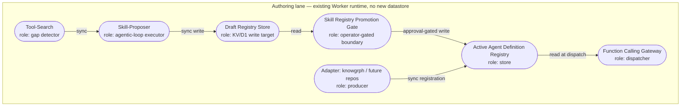

> **Update note**: this section-set is authored as new content to merge into the existing `acos-agentic-runtime-ready-production-verified-prd-tad-adr.md`. The current file could not be retrieved (not resolvable at the expected repository paths), so `version`, ADR numbering, and the Readiness Gap Matrix below are scoped **locally to this update** — reconcile against the live file's actual version and ADR sequence before merging, per the Phase 4 versioning directive.

---

## Feature: Native Skill-Creation/Refinement Harness

### Problem Statement

Today, ACOS's Agent Definition registry and Function Calling Gateway allowlist are hand-authored per capability. Adding a new tool surface — whether a new knowgrph MCP tool or a whole new product adapter — requires a human to write the Agent Definition, wire the allowlist entry, and update routing by hand. A comparable capability gap exists in the self-improving personal agent runtime category (**reference implementation**: Hermes Agent, MIT-licensed), which closes this gap with a self-improving skill-creation/refinement loop. Adopting that pattern by copying its code or taking it as an external runtime dependency would introduce a second orchestration model alongside ACOS's own harness contract, split ownership of the Agent Definition registry across two systems, and contradict the explicit "not a self-modifying or self-improving system" framing already adopted for knowgrph. The problem: ACOS needs a **native**, fully-owned skill-proposal and refinement loop, gated by ACOS's own Deploy Boundary and Readiness Ladder, so new capabilities can be *proposed* autonomously while remaining *promoted* only under explicit operator approval.

### Personas

- **Solo Founder / AI Orchestrator** (primary) — wants candidate capabilities proposed from observed gaps instead of hand-authoring every Agent Definition, without losing approval control.
- **Adapter owner** (knowgrph today; any future repo — SME care agent, oil-palm plantation agent, etc.) — wants their MCP tool surface discoverable and registrable as an Agent Definition + tool allowlist entry without editing ACOS core routing code.

### User Journey Stage

Sits at the **Follow-on: Live orchestration proof** tier of Agent-Platform Readiness (spend-bearing, loop-bearing) — it depends on Must-tier Gateway federation already being in place, and depends on Follow-on Track 1 (spend safety) per the canonical execution order.

### User Stories

1. **As the Solo Founder**, I want ACOS to draft a candidate Agent Definition from an observed capability gap, **so that** I review and approve rather than hand-author every registration.
2. **As an adapter owner**, I want to register my product's MCP tools as an Agent Definition + tool allowlist entry through a stable interface, **so that** ACOS core never special-cases my product by name.
3. **As the Solo Founder**, I want the refinement loop to re-evaluate an already-registered skill's VCCs on a bounded schedule, **so that** stale registrations are flagged rather than silently trusted.

### Acceptance Criteria

**AC-1 — Draft proposal, no auto-registration**
**Given** a capability gap surfaced by the existing tool-search layer, **When** the skill-creation loop proposes a candidate Agent Definition, **Then** the proposal is written as a `status: proposed` draft artifact, not registered into the active registry.
> **VCC**: `Verify a draft Agent Definition file is emitted with status: proposed, iteration count ≤ stated bound recorded in trace.jsonl, and diff of the active registry file is empty`

**AC-2 — Promotion requires an operator-gated boundary**
**Given** a draft Agent Definition, **When** an operator approves it through the Skill Registry Promotion boundary, **Then** the definition is promoted into the active registry and its tool allowlist entry is added for its owning adapter.
> **VCC**: `Verify the promoted definition appears in the active registry, the allowlist entry references it, and the promotion record names the boundary, Evidence Reference, and operator instruction reference`

**AC-3 — No approval, no mutation**
**Given** no operator approval before the loop's bound is reached, **When** the skill-creation loop exits, **Then** no registry mutation occurs.
> **VCC**: `Verify active registry diff is empty and a skill-creation: unapproved status is logged with iteration count`

**AC-4 — Refinement re-derives, never hand-edits, the rung**
**Given** the refinement loop re-runs against an active skill's VCCs, **When** its Evidence References change, **Then** the skill's readiness rung is re-derived, never authored by hand.
> **VCC**: `Verify the rung field changes only as a diff-traceable side effect of a changed Evidence Reference set`

**AC-5 — Adapter registration touches no core routing code**
**Given** a new product repo registers an adapter, **When** it declares its Agent Definition + tool allowlist entry via the Invocation Surface Contract, **Then** it becomes callable without any change to ACOS's shared entrypoint.
> **VCC**: `Verify the shared entrypoint file diff is empty after a new adapter registers; only files owned by that adapter change`

### Success Metrics

| Metric | Baseline | Target | Timeline |
|--------|----------|--------|----------|
| Hand-authored Agent Definitions per new capability | 1 (100% manual) | ≤1 draft review, 0 manual authoring | Post Must-tier ship |
| Readiness rung (local / delivered) | `undocumented` / `undocumented` | `runtime-ready` / `production-verified` | Per Follow-on Track 2 exit |
| Time-to-value (TTV steps, operator approving one proposed skill) | n/a (capability doesn't exist) | ≤ 3 steps | Phase 3 validation |
| Time-to-value (TTV elapsed) | n/a | ≤ 5 min | Phase 3 validation |
| Token cost / month (skill-creation loop at expected gap-detection frequency) | $0 (unbuilt) | within Follow-on token budget (see Orchestration/Harness Flow below) | Sprint 1 post-ship |
| Monthly TCO | $0 | $0 incremental (reuses existing Worker/KV/D1; no new datastore, no new vendor) | Ongoing |
| ROI Score | — | Above solo-dev threshold once ≥2 adapters register (validates genericity — see prior harness/adapter extraction decision) | Post second-adapter proof |

### MoSCoW Priority

- **Must**: draft-proposal loop (read-only, non-mutating until approval); Skill Registry Promotion boundary (Deploy-Boundary-pattern gate: name, Evidence Reference, operator instruction, rollback); Agent Definition schema extended with `status: proposed | active | deprecated`.
- **Should**: refinement loop re-evaluating active skills' VCCs on a bounded schedule (timed-loop VCC mechanism, per Autonomous Implementation Verification reference implementations).
- **Could**: cross-adapter skill suggestion — proposing a skill for one adapter based on a pattern already proven in another.
- **Won't (this increment)**: fully autonomous promotion with no operator gate — explicitly forbidden by the Deploy Boundary "closed by default" rule; any dependency on, or vendoring of, an external self-improving agent-runtime package.

### Min-Viable Scope

Draft-proposal loop + Skill Registry Promotion boundary + schema extension, proven against the existing knowgrph adapter only. Refinement loop and cross-adapter suggestion are explicitly excluded from Must-tier scope.

### Out of Scope

- Any code path importing, wrapping, or calling out to Hermes Agent or an equivalent external self-improving agent-runtime package (see ADR-1).
- Auto-promotion without an operator instruction reference.
- A second Agent Definition registry maintained outside ACOS harness code.

### Dependencies

- Existing `agent-definitions` registry, `tool-search.js`, `function-calling*.js`, `guardrails-human-review.js` (all already provider-neutral per prior harness/adapter extraction).
- Must-tier Gateway federation and Follow-on Track 1 (spend safety) already `runtime-ready`, per the canonical execution order — this feature must not start before those exit criteria pass.

### Open Questions

- Does the Skill Registry Promotion boundary reuse the existing Deploy Boundary Contract fields verbatim, or does it need a fifth field for "proposing mechanism identity" to keep proposer and evaluator provably distinct at the schema level, not just procedurally? *(Tracked — resolve before Phase 3 sign-off.)*

---

## Architecture: Native Skill-Creation/Refinement Harness

### Overview

**From** an observed capability gap or adapter registration request **to** an operator-approved, registered Agent Definition + tool allowlist entry: System → Tool-Search (gap detection) → Skill-Proposer harness (agentic loop, bounded) → Draft Registry Store → Skill Registry Promotion boundary (operator-gated) → Active Agent Definition Registry → Function Calling Gateway allowlist → delivers a callable capability with zero core-routing changes.

### Journey → System Mapping

| Journey Stage | Workflow | Data Flow | Orchestration/Harness Flow | Topology Node(s) | Component |
|---|---|---|---|---|---|
| Solo Founder reviews a proposed skill | Skill Proposal Review | Draft Registry Store → Operator UI projection | Skill-Creation/Refinement Loop | Skill-Proposer, Draft Registry Store | Skill-Proposer harness |
| Adapter owner registers a new product | Adapter Registration | Adapter → Invocation Register → Active Registry | (non-loop; direct registration) | Adapter, Active Agent Definition Registry | Adapter Registration Interface |

### Topology

**Version**: 1 — 2026-08-17
**Boundaries**: Authoring lane (all nodes below run in-repo / in the deployed Worker's existing runtime; no new external service boundary is introduced)

| Node | Role | Type | Lane | Connects to | Connection type | Data residency |
|---|---|---|---|---|---|---|
| Tool-Search | Producer (gap signal) | Existing function | Authoring | Skill-Proposer | Sync call | N/A (stateless) |
| Skill-Proposer | Router/Executor | Harness + model | Authoring | Draft Registry Store | Sync call, writes | Cloudflare (existing KV/D1) |
| Draft Registry Store | Store | Existing KV/D1 namespace | Authoring | Skill Registry Promotion Gate | Read by gate | Cloudflare (existing) |
| Skill Registry Promotion Gate | Gateway | Existing Deploy-Boundary-pattern check | Authoring | Active Agent Definition Registry | Approval-gated write | Cloudflare (existing) |
| Active Agent Definition Registry | Store | Existing registry | Authoring | Function Calling Gateway | Read at dispatch | Cloudflare (existing) |
| Adapter (e.g. knowgrph) | Producer (registration) | External product repo | Authoring | Invocation Register, Active Registry | Sync registration call | Adapter-owned |

**Version notes**: Initial topology for this feature; no prior version exists. Reuses every existing Cloudflare-hosted node; adds no new persistent datastore, consistent with the Agentic OS Status Surface aggregation rule.

### Orchestration/Harness Flows

**Pipeline**: Skill-Creation/Refinement Loop
**Topology pattern**: Agentic loop | **Max iterations**: 5 per detected gap | **Circuit-breaker**: stop after 2 consecutive iterations with no new candidate, or max iterations reached
**Token budget**: ~800 prompt + ~400 completion tokens @ target 40% cache hit rate = est. $0.002–0.004/call (Workers AI free-tier Neurons cover early volume; see ADR-1 TCO Impact)

| Role | Component | Input schema | Output schema | Cost log | Fallback |
|------|-----------|-------------|--------------|----------|----------|
| Dispatcher | Tool-Search gap detector | `{ gap_signal }` | `{ candidate_scope }` | — | Reject with typed error; no loop starts |
| Executor | Skill-Proposer harness + model | `{ candidate_scope }` | `{ draft_agent_definition, rationale, confidence }` | ✓ required | Degraded: emit no-draft status, upstream error propagated |
| Observer | Cost log / trace.jsonl | `{ cost_log_stream }` | `{ metric, alert }` | — | Silent fail; gap flagged in monitoring |
| Consumer | Draft Registry Store | `{ draft_agent_definition }` | `{ stored_draft, status: proposed }` | — | Upstream error propagation |

**Happy path**: gap detected → Skill-Proposer drafts candidate → Harness validates output schema → cost log emitted → draft stored with `status: proposed` → operator reviews via Skill Registry Promotion Gate → approved draft promoted to Active Registry + allowlist entry added.
**Alternate paths**: no candidate found in an iteration → loop continues up to bound; malformed draft → Harness rejects before store write, retries up to bound.
**Error paths**: model unavailable → Executor fallback emits no-draft status, no partial write; cost-log emission fails → Observer silent-fails, pipeline continues, gap flagged.
**Postconditions**: either a `status: proposed` draft exists with a cost log entry, or no registry state changed at all — no partial promotion is reachable.

### Component Specifications

**Component**: Skill-Proposer Harness
**Responsibility**: Skill-Proposer harness drafts a candidate Agent Definition from a stated capability gap.
**Interfaces**: `propose(gap_signal) → draft_agent_definition`
**Dependencies**: Tool-Search, Draft Registry Store, existing model-provider registry
**Configuration**: max iterations, circuit-breaker condition, model provider binding
**FOSS / Vendor**: FOSS, native — no external agent-runtime dependency (see ADR-1)
**Harness Contract**:
  - Input schema: `{ gap_signal: typed }`
  - Output schema: `{ draft_agent_definition: typed, rationale: string, confidence: float }`
  - Cost log fields: `{ model, prompt_tokens, completion_tokens, cache_hits, estimated_cost_usd }`
  - Fallback path: emit `no-draft` status; upstream error propagation
**Token Budget**: ~800 prompt + ~400 completion @ 40% cache hit rate ≈ $0.002–0.004/request
**Orchestration Topology**: Agentic loop, max 5 iterations, circuit-breaker per Orchestration/Harness Flow above
**VCC Conditions**: AC-1, AC-3 (see Acceptance Criteria)
**Evidence References**: *(none yet — capability unbuilt; local rung `spec-complete`)*
**Readiness rung**: Local: `spec-complete` / Delivered: `undocumented`

**Component**: Skill Registry Promotion Gate
**Responsibility**: Gate promotes a draft Agent Definition to the active registry only under a referenced operator instruction.
**Interfaces**: `promote(draft_id, operator_instruction_ref) → promotion_record`
**Dependencies**: Draft Registry Store, Active Agent Definition Registry
**Configuration**: none externalized beyond the standard Deploy Boundary Contract fields
**FOSS / Vendor**: FOSS, native — reuses existing Deploy Boundary Contract pattern
**VCC Conditions**: AC-2, AC-3
**Evidence References**: *(none yet)*
**Readiness rung**: Local: `spec-complete` / Delivered: `undocumented`

**Component**: Adapter Registration Interface
**Responsibility**: Interface lets any product repo register an Agent Definition + tool allowlist entry without modifying ACOS core routing.
**Interfaces**: `register(agent_definition, tool_allowlist_entry) → registration_record`
**Dependencies**: Active Agent Definition Registry, Function Calling Gateway, Invocation Register
**Configuration**: adapter identity, owning route/tag/binding namespace
**FOSS / Vendor**: FOSS, native
**VCC Conditions**: AC-5
**Evidence References**: *(none yet — knowgrph adapter migration pending per prior harness/adapter extraction plan)*
**Readiness rung**: Local: `spec-complete` / Delivered: `undocumented`

### Integration Contracts

**Interface**: Skill-Proposer → Draft Registry Store | **Protocol**: internal function call (in-Worker) | **Format**: JSON (typed) | **Errors**: typed rejection, no partial write

**Interface**: Adapter → Active Agent Definition Registry | **Protocol**: internal function call (in-Worker) or MCP tool call for external adapters | **Format**: JSON (typed, matches Invocation Surface Contract tool-identity schema) | **Errors**: typed rejection; unregistered adapter identity is an `unfederated-tool` finding

### Architectural Decisions

See ADR-1 (native harness, Hermes dependency forbidden) and ADR-2 (adapter registration model) below.

### Quality Attributes

| Attribute | Scenario | Pattern | Validation |
|---|---|---|---|
| Performance | Gap-to-draft latency under normal load | Bounded agentic loop, cached model calls | Timed loop test, p95 latency check |
| Scalability | N adapters registering concurrently | Stateless registration interface, existing KV/D1 | Load test with simulated concurrent adapters |
| Security | Unapproved draft reaching Active Registry | Deploy-Boundary-pattern gate, closed by default | Attempt promotion with no operator instruction ref; expect rejection |
| Observability | Silent loop runaway | Iteration count + circuit-breaker logged to trace.jsonl per call | Inspect trace.jsonl after forced no-candidate run |
| Token Cost | Gap-detection frequency → monthly spend | Harness + 40% cache-hit target + bounded loop | Cost log sampling; alert on p95 overrun |
| Offline Behaviour | Connectivity loss mid-proposal | Loop fails closed; no partial draft persisted | Airplane-mode pass on Skill-Proposer call |
| TCO | 12-month projected spend vs zero-TCO target | Reuses existing Worker/KV/D1; no new vendor | Monthly cost audit; ADR-1 review |
| Device Reach | Operator approval surface | Reuses existing Operator UI projection (Follow-on Track 3); no native-only APIs | Cross-device manual pass |

### Deployment Strategy

Ships inside the existing agentic-canvas-os Worker deploy pipeline; no new service to stand up. Rollback path: revert to the pre-feature Worker build via the existing release workflow's rollback statement — draft/registry schema additions are additive, so rollback does not require a data migration.

### Architecture Diagrams

See Topology `flowchart TB` above and the Orchestration/Harness Flow role table.

### Component Inventory

| Layer | Component | File / Module | Local rung | Delivered rung |
|-------|-----------|---------------|------------|----------------|
| Harness | Skill-Proposer | `skill-proposer.js` *(new)* | `spec-complete` | `undocumented` |
| Harness | Skill Registry Promotion Gate | `skill-registry-gate.js` *(new)* | `spec-complete` | `undocumented` |
| Harness | Adapter Registration Interface | `adapter-registration.js` *(new)* | `spec-complete` | `undocumented` |
| Adapter | knowgrph adapter migration | `adapters/knowgrph/*` *(pending prior extraction plan)* | `spec-complete` | `undocumented` |

### Deploy Boundary Register

*One row per boundary. State reads `closed` unless an operator instruction is referenced.*

| Boundary | From lane | To lane | Evidence Reference | Operator instruction | Rollback statement | State |
|---|---|---|---|---|---|---|
| Skill Registry Promotion *(Deploy-Boundary-pattern gate; not one of the three canonical lanes — governs Draft → Active within the Authoring lane)* | Draft | Active | *(pending — capability unbuilt)* | `none` | Revert registry diff; drop promoted entry | `closed` |
| Authoring → Mirror *(reaffirmed, unchanged by this feature)* | Authoring | Mirror | Per existing release workflow | Per existing release workflow | Per existing release workflow | `closed` |
| Mirror → Delivery *(reaffirmed, unchanged by this feature)* | Mirror | Delivery | Per existing release workflow | Per existing release workflow | Per existing release workflow | `closed` |

### Invocation Register: Native Skill-Creation/Refinement Harness

| Route | Kind | Owner | Typed arguments | Trust boundary | Token cost |
|---|---|---|---|---|---|
| `/propose-skill` | Command | Skill-Proposer Harness | `{ gap_signal }` | approval-gated | harness-dependent (see Token Budget) |
| `#skill-candidate` | Tag | Skill Registry Promotion Gate | — | read | 0 |
| `@skill-registry` | Binding | Active Agent Definition Registry | — | read | 0 |
| `acos.skill_proposer.propose` | Tool identity | Skill-Proposer Harness | `{ gap_signal }` | approval-gated | harness-dependent |
| `acos.skill_registry.promote` | Tool identity | Skill Registry Promotion Gate | `{ draft_id, operator_instruction_ref }` | approval-gated | 0 (gate logic only) |
| `acos.adapter.register` | Tool identity | Adapter Registration Interface | `{ agent_definition, tool_allowlist_entry }` | approval-gated | 0 (registration only) |

---

## ADR-1: Native Skill-Creation/Refinement Harness (Hermes Dependency Forbidden)

**Status**: Accepted
**Date**: 2026-08-17

### Context

ACOS needs a skill-creation/refinement capability to stop hand-authoring every Agent Definition. A reference implementation exists in the self-improving personal agent runtime category (**reference implementation**: Hermes Agent, MIT-licensed, self-hosted, multi-platform messaging gateway). Copying its code or taking it as an external runtime dependency would: (a) introduce a second orchestration model alongside ACOS's own harness/readiness-ladder contract, violating single-owner-per-contract; (b) couple ACOS's Must/Follow-on readiness sequencing to an external project's release cadence and design choices, outside ACOS's own audited harness code; (c) risk inheriting a self-modifying/self-improving framing that knowgrph's own documentation already explicitly disclaims.

### Decision

Build the skill-creation/refinement loop natively inside agentic-canvas-os harness code, reusing existing primitives (Agent Definition registry, Function Calling Gateway, guardrails-human-review, tool-search, Readiness Ladder, Deploy Boundary Contract) rather than depending on, wrapping, or vendoring any external self-improving agent-runtime package, including but not limited to Hermes Agent.

### Alternatives Considered

1. **Depend on Hermes Agent (or equivalent) as an external package/service**: Pros — faster initial build; proven skill-evolution loop pattern. Cons — second orchestration model outside ACOS's own harness/readiness-ladder contract; couples ACOS's Must-tier sequencing to an external project's cadence; contradicts the "not self-modifying" framing already adopted for knowgrph; complicates evaluator-independence (Hermes's self-improvement loop would need to be re-audited against ACOS's own evaluator-independence rule rather than inheriting it by construction.)
2. **Native ACOS-owned loop (chosen)**: Pros — single owned contract; deterministic evaluator (Skill Registry Promotion Gate) stays mechanically separate from the proposer (Skill-Proposer harness), satisfying the Autonomous Implementation Verification evaluator-independence rule by construction; fully covered by the existing Readiness Ladder and Deploy Boundary machinery; zero new licensing or governance surface. Cons — more build time than adopting an existing loop; ACOS must design and prove its own proposer→evaluator separation rather than inheriting one.

### Rationale

Native construction is the only option that keeps a single owner per contract (the harness/readiness-ladder machinery ACOS already has), keeps the evaluator mechanically distinct from the implementer without relying on an external project's own separation, and avoids re-introducing the self-modifying framing knowgrph has already deliberately rejected. This is the min-viable-max-value and harness-first choice: it reuses more existing ACOS code than it adds.

### TCO Impact

*Both options are hosted on the existing Cloudflare Worker; the material delta is build hours and governance risk, not infrastructure or egress cost.*

| Dimension | Chosen: Native harness [Managed/Serverless, same Worker] | Hermes-dependent [Managed/Serverless, external service] | Delta / 12 months |
|---|---|---|---|
| Infra cost | $0 (existing Worker) | $0–low (self-hosted per Hermes's own model) | ~$0 |
| Egress cost | $0 | $0 (self-hosted) | $0 |
| Token cost | Per Orchestration/Harness Flow budget above | Comparable, opaque to ACOS's own cost log until re-instrumented | Unmeasured risk, not a cost |
| Ops burden | Low — one owned codebase, one release cadence | Medium — second codebase/release cadence to track and re-audit on every Hermes release | + ops burden |
| Vendor risk | Low | Medium — external project's design and governance choices propagate into ACOS's Must-tier readiness | + vendor risk |

### Consequences

- **Positive**: single owned contract; evaluator independence holds by construction; no new license/governance surface; conformant with `duplicate-owner` and `vendor-coupling` avoidance.
- **Negative**: more build hours upfront than adopting an existing loop; ACOS carries full responsibility for proving its own proposer/evaluator separation.
- **Neutral**: does not preclude studying Hermes's skill-loop design as a reference pattern (already permitted under the guideline's neutrality contract) — only forbids depending on or vendoring its code.

---

## ADR-2: knowgrph (and Future Repos) as Registered Agent Definition + Tool Allowlist Entries

**Status**: Accepted
**Date**: 2026-08-17

### Context

Builds on the prior harness/adapter extraction decision (agentic-canvas-os split into `harness/` core + `adapters/[product]/`). This ADR formalizes that every downstream product — knowgrph today, and any future repo (SME care agent, oil-palm plantation agent, etc.) — registers into ACOS purely as an Agent Definition + tool allowlist entry via the Invocation Surface Contract, never by ACOS special-casing the product in core routing code.

### Decision

Every downstream product registers via: (1) an Agent Definition record (typed capability descriptor), (2) a tool allowlist entry per the Function Calling Gateway contract, and (3) an Invocation Register entry (route/tag/binding/tool-identity, each declared in exactly one register, federated in the capability catalog per the Gateway Federation Contract). No product-specific code lives in ACOS's shared entrypoint; adapters own their own registration, consistent with AC-5.

### Alternatives Considered

1. **Hardcoded per-product routes in core** (status quo prior to the harness/adapter extraction): Pros — simplest for a single consumer. Cons — every new product requires editing shared entrypoint code; does not scale past one consumer; directly caused the coupling identified in the prior harness/adapter review.
2. **Registered Agent Definition + tool allowlist entry (chosen)**: Pros — new products register without touching ACOS core; validates the harness/adapter boundary drawn in the prior extraction; matches the Invocation Surface Contract's ownership model exactly. Cons — requires every adapter to implement the registration interface correctly; a malformed registration surfaces as `unfederated-tool` or `uncatalogued-tool` rather than a silent core-code bug.

### Rationale

This is the same boundary the prior harness/adapter extraction argued for, now made a formal, checkable contract: registration is the *only* way a product becomes callable, which is what makes the second-adapter proof (the actual test of whether the harness/adapter boundary was drawn correctly) meaningful.

### TCO Impact

| Dimension | Chosen: Registered adapter [Managed/Serverless, same Worker] | Hardcoded per-product routes [Managed/Serverless, same Worker] | Delta / 12 months |
|---|---|---|---|
| Infra cost | $0 | $0 | $0 |
| Egress cost | $0 | $0 | $0 |
| Token cost | $0 (registration is not a model call) | $0 | $0 |
| Ops burden | Low — new adapter needs no core change | Rising — every new adapter edits shared entrypoint, growing merge-conflict surface | − ops burden with registered model |
| Vendor risk | Low | Low, but growing coupling risk as adapter count rises | − risk with registered model |

### Consequences

- **Positive**: unbounded adapter growth without shared-entrypoint edits; each adapter's readiness rung tracked independently in the Component Inventory.
- **Negative**: registration interface itself becomes a shared contract that must not break — any change to it is now a cross-adapter concern.
- **Neutral**: does not change the knowgrph adapter's own internal MCP tool implementations, only how they're declared to ACOS.

---

## Readiness Gap Matrix

| Workstream | Local rung | Delivered rung | Gap | Priority | Exit criteria (VCC) |
|---|---|---|---|---|---|
| Skill-Proposer harness (draft loop) | `spec-complete` | `undocumented` | No Evidence Reference yet; AC-1 unproven | major | AC-1 VCC passes on a clean environment |
| Skill Registry Promotion Gate | `spec-complete` | `undocumented` | No Evidence Reference yet; AC-2/AC-3 unproven | major | AC-2, AC-3 VCCs pass |
| Adapter Registration Interface | `spec-complete` | `undocumented` | No Evidence Reference yet; AC-5 unproven | major | AC-5 VCC passes against knowgrph adapter |
| knowgrph adapter migration (prerequisite) | `spec-complete` | `undocumented` | Depends on prior harness/adapter extraction landing first | blocker | Prior extraction's own VCC set passes |
| Second-adapter proof (validates genericity) | `undocumented` | `undocumented` | No second adapter attempted yet | minor | A distinct product (e.g. SME care agent) registers with zero shared-entrypoint diff |

---

*End of update content. Merge into the live `acos-agentic-runtime-ready-production-verified-prd-tad-adr.md`, reconcile `version` and ADR numbering against the current file, and re-run the alignment check per Phase 3 before baselining.*
