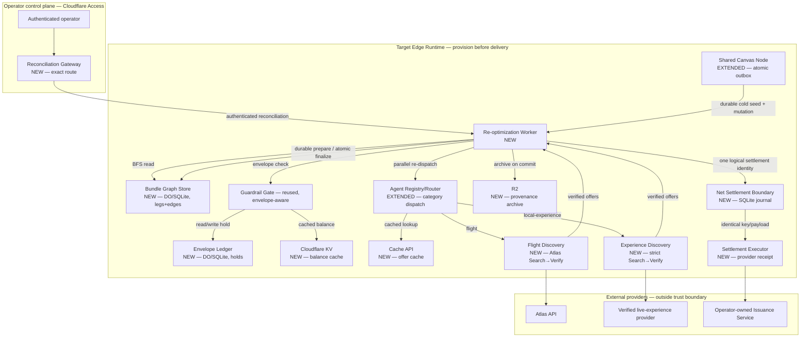

# Knowgrph Agentic Travel Commerce Platform — Combined PRD/TAD/ADR

**Conformance note**: authors against `prd-tad-adr-guidelines.md` v1.7.0. `universal_scope: false` — every dependency named is a real chosen one, introduced under "reference implementation" per the Scope & Neutrality Contract, not a swappable neutral example.

**Supersession note (v1.0.0)**: this document consolidates and supersedes `knowgrph-agentic-travel-agencies-prd-tad-adr.md` (v0.6.0) and `knowgrph-agentic-commerce-platform-prd-tad-adr.md` (v0.1.0). Neither prior document is invalidated — their components, ADRs, and inherited readiness rungs are carried forward by reference, not re-derived — this document adds three things neither prior one had: (1) the L4 Bundle Re-Optimization and Budget Envelope primitives, (2) a dedicated cache/computation/memory performance strategy, (3) an infrastructure ADR retiring Oracle Always Free ARM.

**Implementation reconciliation note (v1.4.0)**: the hot path and post-audit storage protections have reproducible local Evidence References, so the canonical Readiness Ladder rung is `dev-proven`. The source contains the service-only Shared Canvas Node → travel-commerce binding, atomic outbox/cold seed, provider-receipt contract, strict Search→Verify identity, reconciliation custody, bounded authenticated storage reads, versioned terminal-Hold replay retention, a clean-install browser/presenter demo path, explicit deadline races that do not depend on upstream abort cooperation, and clean audits for both committed dependency graphs. Protected readiness PR #818 is merged into `main` at `ed06fb5d56529a23ea03540ae2f3d4bf85410f1e`. This is integrated source, not a production-deployment candidate: the evidence does not prove a live provider effect, Cloudflare deployment, configured external provider contracts, capacity telemetry, or live production behavior. Raw media delivery/mutations and anonymous document sharing deliberately fail closed pending their respective signed-capability and publication-ACL contracts. `delivered_rung` remains `undocumented`.

---

## Feature: Agentic-Era OTA — Positioning Note

**What changed, and what didn't.** Neither prior document is wrong; this is a reframing, not a rebuild. A traditional OTA (Expedia, Agoda, Skyscanner) is a human-browses-results-and-clicks-checkout interface over a GDS. What this platform is building is different in kind, not just interface: the *principal* browsing and clicking is an agent, the *inventory* is discovered through a marketplace of registered agents (not one hardcoded GDS integration), and the *dependency structure between legs of a trip* is a first-class object the platform reasons over autonomously — not something a human re-plans by hand when a flight delays. "Agentic-era OTA" names that shift precisely: same job-to-be-done (book a trip that works), fundamentally different execution substrate (agents transacting through a guardrail-enforced marketplace, not a human clicking through search results). The two features below are the concrete mechanism that makes that claim true rather than aspirational.

---

## Feature: Bundle Re-Optimization Engine (L4)

### Problem Statement
Today, when one leg of a multi-leg trip changes — a flight delays, a hotel room type disappears, a local-experience slot fills — the burden of figuring out what else needs to change falls on the human principal or, at best, on a single-leg "suggest alternative" flow (L1 on the breakthrough rubric this feature was scoped against). The itinerary's legs are causally dependent on each other (a delayed arrival breaks a booked transfer time; a cancelled hotel night breaks an experience booked for that evening), but nothing in the current architecture treats that dependency structure as something to reason over. The gap is between "detect and suggest" and "autonomously re-plan every downstream leg and settle the fare difference in real time" — the L4 bar this feature is built to clear.

### Personas
Reused from the travel-agencies document: Shopper-Agent Principal, Merchant/OTA Operator.

### User Journey Stage
Sits entirely inside **Complete** (post-booking) — this feature activates only after a bundle has committed legs, which is why it's additive to the existing Discover→Engage→Complete flow rather than a new stage.

### User Stories

**US-1 — As a** Shopper-Agent Principal **I want** a change to one committed leg to automatically trigger re-planning of only the legs causally downstream of it **So that** I don't have to manually notice and fix every knock-on effect myself.
> **VCC translation**: `Verify, for every re-optimization event, the affected-leg set returned equals exactly the set reachable via outgoing edges from the changed leg — no unaffected sibling leg is touched, and no downstream leg is skipped`

**US-2 — As a** Shopper-Agent Principal **I want** the entire affected set to be re-quoted, approved, and settled as one atomic operation **So that** I never end up in a half-changed state where some downstream legs updated and others didn't.
> **VCC translation**: `Verify zero bundle states exist where some legs in the computed affected set are committed to new offers and others remain committed to stale offers — the transaction is atomic across the whole affected set or it is fully rolled back`

**US-3 — As a** Shopper-Agent Principal **I want** one net settlement call for the whole cascade instead of one settlement per changed leg **So that** re-planning a 4-leg cascade costs one card top-up/refund action, not four.
> **VCC translation**: `Verify one distinct Issuance Service settlement operation and idempotency key per non-zero re-optimization event, regardless of affected-leg-set size; the first definitive success path uses one transport call, while ambiguous recovery may retry only the identical operation and records every attempt`

### Success Metrics

| Metric | Baseline | Target | Timeline |
|---|---|---|---|
| Affected-set walk latency (≤8-leg bundle, in-DO) | N/A | < 50ms | at first Evidence Reference |
| Distinct net-settlement operations per cascade | N (one per leg) | 1 idempotency key, regardless of affected-set size; every transport attempt recorded | at first Evidence Reference |
| Partial-commit incidents | N/A | 0 — hard invariant, not a target to approach | ongoing |
| Rollback correctness | N/A | 100% of rejected affected-sets fully revert to prior committed state | at first Evidence Reference |

### MoSCoW Priority
**Must**: affected-set BFS bounded to downstream-only legs; atomic all-or-nothing commit across the affected set.
**Must**: one idempotent net-settlement operation per cascade (US-3) — one first-path transport call, never one call per leg; an ambiguous outcome may retry only that same operation.
**Should**: parallel re-dispatch of affected legs via `Promise.all` against Agent Registry/Router, rather than sequential re-quoting.
**Could**: cached topological order maintained incrementally in DO storage, avoiding a full recompute per event.
**Won't (this increment)**: bundles exceeding roughly 20 legs, or bundles spanning multiple principals — flagged as an explicit scale boundary (see Performance Enhancement, below) rather than silently assumed away.

### Min-Viable Scope
A single bundle (flight + one downstream leg, e.g. a local experience whose start time depends on arrival) with one upstream change triggering one downstream re-plan and one idempotent net-settlement operation, running entirely on the D0/Router/Guardrail Gate/Issuance Service chain already spec'd — no new external vendor integration required.

### Out of Scope
Cross-principal bundles (group trips — routed to the Split-Pay roadmap item instead); bundles beyond the ~20-leg scale boundary; re-optimization triggered by anything other than a Shared Canvas Node mutation event (e.g., proactive speculative re-planning ahead of a predicted delay is a separate, future feature).

### Dependencies
Existing public operations remain compatible: Shared Canvas Node, Agent Registry/Router, Guardrail Gate, Issuance Service, and Settlement Verifier. Production-safe travel wiring is additive and isolated: Shared Canvas accepted-event outbox/cold seed, Router travel dispatch, provider adapters, provider-backed net settlement, and reconciliation operator ingress. New core state: Bundle Graph Store (see Component Specifications).

### Operator Decisions For v1
- **Trigger sensitivity**: every validated, unique Shared Canvas mutation event triggers one bounded Cascade. There is no materiality threshold in v1. Event-key idempotence suppresses duplicates; it is not a threshold.
- **Rollback notification**: return the rollback outcome to the caller and persist it to the Session Log, with the same outcome available over the bundle's hibernatable WebSocket projection. V1 sends no separate Notification Dispatcher message and creates no synchronous out-of-band notification dependency.

**Settlement safety refinement**: a definitive non-retryable pre-effect rejection rolls back the prepared Cascade and releases its Holds. A timeout, abort, network error, HTTP 408/429/5xx, untyped conflict, or malformed/ambiguous success remains durably pending with the prior graph projection visible and the Holds protected; recovery reuses the identical idempotency key and request identity. A typed idempotency-conflict HTTP 409 enters reconciliation rather than retrying forever. A journal row is never proof that money moved: Production settlement succeeds only from a provider-backed receipt whose amount, currency, sign, identities, settlement ID, and provider reference all match. If an attempt may have moved money and cannot be safely finalized, its Holds enter non-expiring quarantine and remain unavailable until a separately authenticated, audited, idempotent operator `commit` or `release` decision converges the ledger and graph.

---

## Feature: Budget Envelope Ledger (supporting primitive)

### Problem Statement
A Shopper-Agent Principal's spend guardrail is not really a single static number checked once — it's a shared, mutable constraint across every concurrent in-flight transaction from every registered agent. The current Guardrail Gate spec checks a budget at the moment of one offer; it does not yet model *reserved-but-not-yet-settled* holds from other concurrent agents, which is exactly the gap that would let two agents independently "pass" a guardrail check against the same remaining budget and jointly overspend it. This is the primitive Bundle Re-Optimization's US-3 settlement claim depends on being true in real time, not scripted.

### Personas
Shopper-Agent Principal (protected), Platform Operator (auditor of envelope state via Marketplace Registry Canvas).

### User Journey Stage
**Engage** — sits directly inside the existing Guardrail Gate step, as its underlying data model rather than a new stage.

### User Stories

**US-1 — As a** Shopper-Agent Principal **I want** every offer from any registered agent to atomically check-and-reserve against my true remaining budget, accounting for every other concurrent hold **So that** two simultaneous agent offers can never jointly overspend my limit.
> **VCC translation**: `Verify, for every accepted offer, available_balance at accept-time equals total_budget minus the sum of all reserved, quarantined, or committed holds that existed at that instant — no accepted offer ever exceeds that computed available_balance`

**US-2 — As a** Shopper-Agent Principal **I want** a released or rolled-back leg's held funds to become available to other in-flight agents immediately **So that** a rejected re-plan doesn't leave my budget artificially locked.
> **VCC translation**: `Verify the latency between a hold transitioning to released and that amount reappearing in available_balance is bounded by the Durable Object's own write-then-read consistency — no externally observable staleness window`

### Success Metrics

| Metric | Baseline | Target | Timeline |
|---|---|---|---|
| Envelope check latency (DO-local, no D1 hop) | N/A | < 10ms | at first Evidence Reference |
| Over-envelope commits | N/A | 0 — hard invariant | ongoing |
| Hold-release-to-availability latency | N/A | bounded by DO write/read consistency, no externally observable staleness | at first Evidence Reference |

### MoSCoW Priority
**Must**: atomic check-and-reserve, one Durable Object instance per `principal_id` serializing ordinary registered-agent offers and Cascade reservations against the same Available Balance.
**Must**: normal hold lifecycle (`reserved → committed`, `reserved → released`) plus non-expiring reconciliation custody (`reserved → quarantined → committed|released`) after a possibly applied settlement.
**Must**: Agent Registry/Router returns an ordinary Edge-Orchestrator offer only through the same-lane envelope-aware Guardrail entrypoint; the internal Reopt Worker route remains separate and its complete affected set is reserved atomically before preparation.
**Should**: KV-cached `available_balance` read for the Guardrail Gate's fast path, falling back to the DO on cache miss.
**Could**: multi-currency envelope support — explicitly the same gap flagged as Platform Roadmap-adjacent (multi-asset netting), not solved here.
**Won't (this increment)**: cross-principal pooled envelopes (a group wallet — this is the Split-Pay roadmap item's actual data model, deliberately not built early here).

### Min-Viable Scope
One `envelope`/`holds` pair scoped to a single principal, exercised by mixed concurrent ordinary registered-agent offers and Cascade reservations to prove the atomicity claim (US-1) is neither a single-request nor cascade-only claim.

### Out of Scope
Multi-currency netting, cross-principal pooling, dispute/chargeback-triggered hold adjustments (Platform Roadmap Phase 3–4 territory).

### Dependencies
Reused: Guardrail Gate (consumer of `available_balance`). New: Durable-Object-backed `envelope`/`holds` storage (see Component Specifications).

### Operator Decision For v1
- **Balance exposure**: `available_balance` is server-side only. The Shopper Client receives no direct balance-read route or auth scope; the Guardrail Gate consumes the authoritative Envelope Ledger value.

---

## Architecture: Flat Adjacency Tables, DO-Colocated Ledger, and the Cache Layer

### Overview
Two data-model decisions anchor this document, both driven by the explicit constraint of forbidding a dedicated graph database: bundle dependency structure is stored as flat `legs`/`edges` relational tables and walked in-memory via bounded BFS (O(affected), not a graph-engine traversal), and the envelope ledger is a plain hold-based accounting model — the same pattern a bank uses for pending authorizations, not a graph problem at all. Both live inside Durable Object storage rather than D1, colocating compute with state on the hot path. This section also folds in the Performance Enhancement recommendations (cache, computation, memory) requested alongside these features, since they're inseparable from making the L4 real-time settlement claim actually true.

### Journey → System Mapping

| Journey Stage | Workflow | Data Flow | Orchestration/Harness Flow | Topology Node(s) | Component |
|---|---|---|---|---|---|
| Complete (post-booking) | Bundle Re-Optimization Workflow | mutation event → affected-set BFS → parallel re-quote → durable prepare → one idempotent net-settlement operation → atomic finalize | Bundle Re-Optimization Pipeline | Bundle Graph Store, Agent Registry/Router | Re-optimization Worker |
| Engage | Envelope Check Workflow | offer → check-and-reserve → hold → commit/release | Envelope Check Pipeline | Envelope Ledger (DO) | Guardrail Gate *(reused, now envelope-aware)* |

### Topology

| Node | Role | Type | Lane | Connects to | Connection type | Data residency |
|---|---|---|---|---|---|---|
| **[new]** Bundle Graph Store | Store | Durable Object (SQLite storage) | Authoring→Delivery | Shared Canvas Node (trigger), Re-optimization Worker | Sync, in-DO | Edge (Cloudflare region) |
| **[new]** Envelope Ledger | Store | Durable Object (SQLite storage) | Authoring→Delivery | Guardrail Gate | Sync, in-DO | Edge (Cloudflare region) |
| **[new]** Re-optimization Worker | Executor | Worker | Authoring→Delivery | Bundle Graph Store, Agent Registry/Router, Guardrail Gate, isolated net-settlement boundary | Sync (BFS + `Promise.all` dispatch) | Edge (Cloudflare region) |
| **[new]** Cloudflare KV (envelope cache) | Cache | KV | Delivery | Guardrail Gate | Async, edge-read | Edge (global) |
| **[new]** Cloudflare Cache API (offer cache) | Cache | Workers Cache | Delivery | Discovery Harnesses | Async, edge-read, stale-while-revalidate | Edge (regional) |
| **[new]** R2 (bundle/provenance archive) | Store | Object storage | Delivery | Re-optimization Worker (write-once on commit) | Async, write-behind | Edge (Cloudflare region) |
| Shared Canvas travel outbox *(additive)* | Trigger | Durable Object outbox | Authoring→Delivery | Re-optimization Worker | service binding, retryable | Edge |
| Agent Registry/Router *(inherited operations preserved; travel route/cache added)* | Router | Worker / Durable Object | Authoring→Delivery | category-specific Discovery adapters | service binding | Edge |
| **[new]** Envelope-aware Guardrail entrypoint | Executor | Named same-lane Worker entrypoint | Authoring→Delivery | inherited Guardrail Gate, Envelope Ledger | RPC/service binding | Edge |
| **[new]** Flight Discovery adapter | Executor | Service-only Worker | Authoring→Delivery | Atlas Search→Verify | bounded HTTPS | Edge → external |
| **[new]** Live-experience Discovery adapter | Executor | Service-only Worker | Authoring→Delivery | verified live-experience Search→Verify provider | bounded authenticated HTTPS | Edge → external |
| **[new]** Net-settlement boundary | Executor/store | Service-only Worker + SQLite DO | Authoring→Delivery | Re-optimization Worker, settlement executor | service binding | Edge |
| **[new]** Settlement executor | Executor | Service-only Worker | Authoring→Delivery | operator-owned Issuance Service | bounded authenticated HTTPS | Edge → external |
| **[new]** Reconciliation operator gateway | Control plane | Access-protected Worker | Authoring→Delivery | Re-optimization Worker | exact service-binding route | Edge |
| Guardrail Gate *(reused, now envelope-aware)* | Router | Deterministic component | Authoring→Delivery | Envelope Ledger *(new dependency)* | Sync | Edge |
| Issuance Service, Settlement Verifier, Shared Canvas Node, Notification Dispatcher *(inherited operations preserved; travel adapters/outbox are additive)* | — | — | — | — | — | — |



The experience node is a first-party service-only adapter, not a fabricated provider claim. It validates the exact catalogue, location, date, local time, provider, product, party, currency, and safe-integer minor price across Search and Verify, and MCP binds it separately in Production and staging. Its committed sentinel configuration keeps the readiness chain unavailable until an operator supplies a real live-experience origin, catalogue, credential, and successful Search→Verify UAT. The operator gateway likewise remains unavailable until its Access issuer/audience/JWKS configuration, exact route, service binding, and distinct reconciliation token are provisioned.

### Orchestration/Harness Flows

**Pipeline**: Bundle Re-Optimization Pipeline *(new)*
**Topology pattern**: Fan-out/fan-in, bounded | **Max iterations**: 1 pass per triggering event (no recursive re-optimization within a single event) | **Circuit-breaker**: any affected leg's re-quote rejection aborts the whole affected set — rollback, not partial retry
**Token budget**: 0 prompt + 0 completion = **$0.00/call** — BFS and commit logic are deterministic; only the Discovery Harness re-quotes downstream may carry their own existing token cost, unchanged from the travel document

| Role | Component | Input schema | Output schema | Cost log | Fallback |
|---|---|---|---|---|---|
| Dispatcher | Re-optimization Worker | mutation event (changed `leg_id`) | affected-leg set | — | No-op if changed leg has no outgoing edges |
| Consumer | Bundle Graph Store | affected-leg set + new offers | durable prepare, atomic finalize, or rollback | — | Definitive rejection restores prior committed projection; ambiguous settlement stays pending |
| Consumer | Envelope Ledger | net delta amount | hold update | — | Reject commit, trigger rollback |

**Pipeline**: Envelope Check Pipeline *(new)*
**Topology pattern**: Sequential, DO-serialized | **Max iterations**: N/A | **Circuit-breaker**: N/A
**Token budget**: $0.00 — deterministic ledger arithmetic

| Role | Component | Input schema | Output schema | Cost log | Fallback |
|---|---|---|---|---|---|
| Dispatcher | Guardrail Gate *(reused, extended)* | offer amount | pass/reject | — | Reject on any ambiguity — fail closed, matching the travel document's existing fail-closed posture |
| Consumer | Envelope Ledger | reserve/commit/release instruction | updated hold state | — | N/A |

### Component Specifications

**Component**: Bundle Graph Store *(new)*
**Responsibility**: holds `legs`/`edges` for one `bundle_id`, exposes a bounded BFS over outgoing edges from a given leg, and commits/rolls back the affected set atomically.
**Interfaces**: DO storage (SQLite), read by Re-optimization Worker, written on commit
**Dependencies**: Shared Canvas Node (upstream trigger)
**Configuration**: scale boundary asserted at ~20 legs/edges per bundle — beyond that, sharding/pagination is the fix, not a graph engine (see ADR-4)
**FOSS/Vendor**: FOSS — Cloudflare Durable Objects, no new vendor
**Readiness rung**: Local: `dev-proven` / Delivered: `undocumented`

**Component**: Envelope Ledger *(new)*
**Responsibility**: holds `envelope`/`holds` for one `principal_id`, exposes atomic check-and-reserve, transitions normal Holds through `reserved → committed|released`, and preserves possibly effected settlements through non-expiring `quarantined → committed|released` operator custody.
**Interfaces**: DO storage (SQLite), consumed by Guardrail Gate; KV as a read-through cache for `available_balance`
**Dependencies**: none new
**FOSS/Vendor**: FOSS — Cloudflare Durable Objects + KV, no new vendor
**Readiness rung**: Local: `dev-proven` / Delivered: `undocumented`

**Component**: Re-optimization Worker *(new)*
**Responsibility**: orchestrates the whole cascade — BFS, parallel re-dispatch, envelope check, durable prepare, one idempotent net-settlement operation, atomic finalize, and R2 archive write.
**Interfaces**: calls Bundle Graph Store, Agent Registry/Router, Guardrail Gate, and the isolated net-settlement boundary
**Dependencies**: all of the above, each reused or new-and-specified in this document
**FOSS/Vendor**: FOSS — plain Cloudflare Worker
**Readiness rung**: Local: `dev-proven` / Delivered: `undocumented`

**Inherited compatibility boundary — see prior documents for full specs**: every previously published operation on Shared Canvas Node Store, Agent Registry/Router, Discovery Harnesses, Issuance Service, Settlement Verifier, Notification Dispatcher, Marketplace Registry Canvas, and Guardrail Gate remains compatible. Travel-specific outbox, routing, provider-adapter, settlement, and operator operations use separately named additive contracts.

### Component Inventory

| Layer | Component | Local rung | Delivered rung | Source |
|---|---|---|---|---|
| Edge | Bundle Graph Store | `dev-proven` | `undocumented` | local Worker/DO evidence recorded below |
| Edge | Envelope Ledger | `dev-proven` | `undocumented` | local Worker/DO evidence recorded below |
| Edge | Re-optimization Worker | `dev-proven` | `undocumented` | local Worker evidence recorded below |
| Edge | Guardrail Gate (envelope-aware extension) | `dev-proven` | `undocumented` | local adapter evidence; base logic inherited from travel doc v0.6.0 |
| Edge | Envelope-aware Guardrail named entrypoint | `dev-proven` | `undocumented` | local same-lane service-binding and atomic-reservation evidence |
| Edge | Balance Cache, Offer Cache, Provenance Archive | `dev-proven` | `undocumented` | local cache/archive evidence recorded below |
| Edge | Inference Router and model-license filter | `dev-proven` | `undocumented` | local routing/license evidence recorded below |
| Edge | Agent Registry/Router inherited operations | `spec-complete` | `undocumented` | inherited unchanged, commerce-platform doc v0.1.0 |
| Edge | Agent Registry/Router travel route and Agent Definition cache extension | `dev-proven` | `undocumented` | local additive route, category binding, guarded-offer, memory/KV cache, and invalidation evidence |
| Edge | Authenticated registered-offer ingress | `dev-proven` | `undocumented` | local `travel-commerce-ingress.mjs` auth-before-body, credential stripping, identity overwrite, and Guardrail dispatch evidence |
| Edge | Marketplace Registry Canvas | `spec-complete` | `undocumented` | inherited unchanged, commerce-platform doc v0.1.0 |
| Edge | Shared Canvas Node Store | `dev-proven` | `undocumented` | inherited, travel doc v0.6.0 |
| Edge | Shared Canvas travel outbox and cold-seed adapter | `dev-proven` | `undocumented` | local additive integration evidence; base store inherited from travel doc v0.6.0 |
| Edge support | Storage public-route security and bounded reads | `dev-proven` | `undocumented` | local auth-before-body, workspace roles, bounded sync/document/crawler and Canvas-client evidence; pull/export above the documented limit return `413` pending keyset pagination, and raw media/mutations plus anonymous sharing deliberately fail closed pending signed-capability/publication-ACL contracts |
| Edge support | Streaming JSON boundary helpers | `dev-proven` | `undocumented` | local travel, MCP, discovery/payment request and response ceiling evidence; owned by the boundary using each helper |
| Harness | Flight Discovery adapter | `dev-proven` | `undocumented` | local Atlas Search→Verify contract evidence |
| Harness | Live-experience Discovery adapter | `dev-proven` | `undocumented` | local strict Search→Verify contract evidence |
| Harness | Net-settlement boundary | `dev-proven` | `undocumented` | local service-only journal/idempotency evidence; journal alone is not effect proof |
| Harness | Settlement executor | `dev-proven` | `undocumented` | local exact provider-receipt contract evidence |
| Control plane | Reconciliation operator gateway | `dev-proven` | `undocumented` | local Access JWT, exact-route, custody, and convergence evidence |
| Edge support | Workers AI Free overflow Worker | `dev-proven` | `undocumented` | local token-authenticated proxy, bounded request/readiness, runtime tests, and pinned Apache-2.0 model-manifest evidence; live quota and provider probe receipts remain open |
| Evidence surface | Deterministic CLI, browser verifier, and headed presenter | `dev-proven` | `undocumented` | local bounded evidence lifecycle; the automated offline proof and headed presenter use distinct browser contexts |
| Delivery control | Protected travel-mesh release controller | `spec-complete` | `undocumented` | upgrade-only local source/workflow contract; requires nine serving baselines plus a distinct authorized bootstrap receipt and infers no protected candidate, deployment, probe, or rollback receipt |
| Harness | Discovery Harnesses, Issuance Service, Settlement Verifier, Notification Dispatcher | mixed, see prior docs | `undocumented` | inherited, travel doc v0.6.0 |

The protected controller does not create a first Production mesh. A separate human-authorized bootstrap process must provision the exact nine Workers, namespaces, D1/R2/KV resources, routes/domains, Workers AI Free policy, and one 100%-active baseline per Worker, then issue `knowgrph-travel-mesh-bootstrap-receipt/v2` through protected `TRAVEL_MESH_BOOTSTRAP_RECEIPT_JSON`. That provisioning receipt is a prerequisite to, and remains distinct from, the ten protected/delivery receipts below.

### Deploy Boundary Register

| Boundary | From lane | To lane | Evidence Reference | Operator instruction | Rollback statement | State |
|---|---|---|---|---|---|---|
| Bundle commit: affected-set → committed | Authoring | Mirror | `check:atomic-commit` and `check:net-settlement` local Evidence References; no promotion receipt | Prepare only when every affected leg passes; definitive pre-effect rejection rolls back, while ambiguous settlement remains pending for same-key recovery | Revert to captured prior Legs only when no ambiguous payment effect exists; otherwise require reconciliation | `closed` |
| Envelope mutation: offer → hold | Authoring | Mirror | `check:envelope-atomicity` and `check:hold-lifecycle` local Evidence References; no promotion receipt | Reserve only through the DO-serialized check-and-reserve path; no direct hold-table writes outside it | Transition the hold to `released`; no funds-in-flight risk since this is a reservation ledger, not the settlement call itself | `closed` |

---

## Performance Enhancement: Cache, Computation, Memory

### Cache

| Layer | Recommendation | Rationale | Cost |
|---|---|---|---|
| Durable Object storage (SQLite) | Store `legs`/`edges` and `envelope`/`holds` directly in DO storage, not D1 | Colocated with the actor — zero network hop on the hot read/write path; DO's single-threaded-per-key model gives atomicity D1 would need explicit transactions to match | $0, within existing DO budget |
| Cloudflare KV | Cache `available_balance` per principal | Sub-ms edge reads for the Guardrail Gate's fast path; falls back to the DO on miss, never trusted as the source of truth | Free tier sufficient at MVP volume |
| Cloudflare Cache API | Cache Discovery Harness offers, short TTL (30–60s), stale-while-revalidate | Re-optimization's re-quote step is the single biggest external-latency and external-rate-limit cost in the whole cascade; most re-plans re-query the same route/item within seconds of the original quote | $0, Workers-native |
| R2 | Archive committed bundle snapshots and provenance receipts, not kept indefinitely in D1/DO | Keeps hot-path storage bounded to *active* bundles only; no egress fee from R2 to Workers | Free tier (10GB) likely sufficient at MVP scale |

### Computation

| Area | Recommendation | Rationale |
|---|---|---|
| Affected-set walk | BFS bounded to downstream-only nodes reachable from the changed leg | O(affected), not O(V+E) of the whole bundle — the actual mechanism behind US-1's precision claim |
| Re-dispatch | `Promise.all` across all affected legs' Discovery Harness calls | Wall-clock re-optimization time becomes the slowest single leg, not the sum of all legs |
| Registry lookups | Cache Agent Definition lookups in Worker memory + KV, invalidated only on (de)registration | Registration changes are rare relative to routing volume; avoids re-hitting the Agent Definition Validator's storage on every dispatch |
| Topological order | Maintain incrementally in DO storage alongside `edges`, updated on insert rather than recomputed per event | Amortizes sort cost across a burst of mutation events instead of paying it per event |

### Memory

| Area | Recommendation | Rationale |
|---|---|---|
| DO in-memory adjacency list | Build once per DO wake, hold in the isolate's JS heap for the DO's active lifetime | Avoids rebuilding from storage on every event within one re-optimization burst |
| Hibernatable WebSockets | Use for Shared Canvas Node's client push | Idle DOs release from memory/billing without losing state — SQLite storage reloads cheaply on wake, no cold-rebuild logic required |
| Explicit scale boundary | State the ~20-leg/edge assumption openly rather than letting it be silently implied | This is what "forbid complex graph architecture" actually means in practice — the constraint is honest because its limit is written down, not because the limit doesn't exist |

---

## Business Readiness: ROI, Time-to-Value, and TCO

| Measure | Current evidence-backed value | Production boundary |
|---|---|---|
| Provisional ROI score | **8/10**: 4/4 risk reduction (atomic spend and settlement custody), 2/3 operator-effort reduction (automated bounded re-plan, manual reconciliation retained), 2/3 customer-value proof (complete local demo, no live-provider conversion evidence) | Re-score only after provider UAT and live conversion/support telemetry. |
| Time to first local value | **≤15 minutes** from a locked clean checkout to dependency install plus the deterministic or browser demo on the reference workstation | Production time-to-value is not yet measurable because provider credentials, bootstrap receipt, authorization, and live verification are open gates. Once provisioned, the protected controller has a 45-minute verification ceiling and a 120-minute deployment ceiling. |
| Incremental monthly / 12-month infrastructure TCO at MVP policy ceiling | **$0 / $0** for the documented reference volume while Durable Objects, KV, R2, D1, and Workers AI remain inside their explicit free allocations | This excludes existing platform baseline, external-provider/payment fees, and overages. Capacity exhaustion fails closed; no unmeasured paid-overage assumption is part of readiness. |

The score and TCO are decision aids, not delivery receipts. A Production promotion must replace the conditional free-allocation hypothesis with observed request, storage, neuron, cold-start, and provider-fee telemetry.

---

## ADR-1: Durable Object SQLite Storage over D1 for Hot-Path Ledger and Graph State
**Status**: Accepted (source-implemented; protected delivery and live-runtime receipts pending)
**Date**: 2026-08-19

### Context
`legs`/`edges` and `envelope`/`holds` are both per-key hot-path state needing atomic read-modify-write under concurrent access.

### Decision
Use each Durable Object's own SQLite-backed storage for these tables; reserve D1 for cross-key aggregate/reporting queries (platform-wide audit, operator dashboard rollups) where DO-per-key sharding is the wrong shape.

### Alternatives Considered
1. **D1 only**: Pros — one storage system to reason about; Cons — an extra network hop on every hot-path mutation, and DO's single-threaded actor model already gives atomicity for free that D1 would need explicit transaction handling to match.
2. **KV only**: Pros — global edge reads; Cons — eventually consistent, unsuited to strict read-after-write ledger correctness (holds could double-spend across edge locations).

### Rationale
Matches the "colocate compute with state" principle already used for Shared Canvas Node Store; zero new vendor, reuses DO infra already budgeted in prior documents.

### TCO Impact

| Dimension | Chosen: DO SQLite | Alternative: D1 only | Alternative: KV only |
|---|---|---|---|
| Infra cost | $0 (within DO budget) | $0 | $0 |
| Latency | Lowest (in-isolate) | +1 network hop per mutation | Fast reads, unsafe writes |
| Ops burden | Low | Low | Medium (consistency workarounds needed) |

### Consequences
- **Positive**: lowest-latency hot path, atomicity without explicit locking.
- **Negative**: two storage systems (DO SQLite + D1) to reason about instead of one — mitigated by the explicit split rule stated above.
- **Neutral**: D1's role shrinks to genuinely aggregate-only queries.

---

## ADR-2: Edge Cache Layering (KV + Cache API + R2) for Offers and Provenance
**Status**: Accepted (source-implemented; protected delivery and live-runtime receipts pending)
**Date**: 2026-08-19

### Context
Re-optimization's re-quote step and the envelope's balance reads are both latency- and external-rate-limit-sensitive; uncached, every re-plan re-hits Atlas/eBay directly and every balance check re-hits a DO.

### Decision
Layer three purpose-fit Cloudflare caches: KV for tiny hot ledger values, Cache API for short-TTL external offer data, R2 for cold provenance archives.

### Alternatives Considered
1. **No caching**: Pros — simplest; Cons — slowest, and repeatedly burns external API rate limits (Atlas, eBay) on re-quotes that are often identical within seconds.
2. **R2-only for everything**: Pros — one storage system; Cons — R2 reads aren't as fast as KV for tiny hot values, wrong tool for the balance-cache use case.

### Rationale
Each cache is matched to its data's actual access pattern (tiny/hot, medium/short-lived, large/cold) rather than defaulting to one system for convenience.

### TCO Impact

| Dimension | Chosen: three-layer cache | Alternative: no caching | Alternative: R2-only |
|---|---|---|---|
| Infra cost | $0 (all within free tiers at MVP scale) | $0, but higher external-API usage | $0, wrong-shaped latency |
| External rate-limit risk | Low | High | Medium |
| Ops burden | Low-medium (three systems, each simple) | Low | Low |

### Consequences
- **Positive**: cuts external API load, cuts ledger read latency.
- **Negative**: cache invalidation logic (TTL + stale-while-revalidate) is a real correctness surface to test, not free.
- **Neutral**: none of the three introduce a new vendor — all Cloudflare-native.

---

## ADR-3: Oracle Always Free ARM Retirement — Cloudflare Workers AI Free Primary and Bounded Overflow Worker
**Status**: Accepted (source-implemented; protected delivery and live-runtime receipts pending)
**Date**: 2026-08-19

### Context
Oracle Always Free Ampere ARM (hosting Ollama for local-first inference) was already silently downgraded once — 4 OCPU/24GB reduced to 2 OCPU/12GB in June 2026 — while sitting on the critical path for probe-tree L1 inference calls. That is the same "free-tier goodwill without an exit plan" risk this document already flagged for Alibaba Cloud's trial-credit-based complementary role. Continuing to depend on Oracle for anything load-bearing repeats a known failure mode rather than learning from it.

### Decision
Retire Oracle from the critical path entirely. **Primary**: Cloudflare Workers AI Free for probe-tree L1 inference and agentic-commerce reasoning, with the `@cf/openai/gpt-oss-20b` allowlist and a 10,000 daily-neuron policy. **Overflow**: a separate token-authenticated Cloudflare Worker calls the same Workers AI binding with bounded request/response handling. This preserves an explicit overload boundary without a Cloudflare Containers entitlement, image, or paid compute dependency.

**FOSS-hard-gate flag, stated explicitly**: Workers AI's catalog includes models under non-OSI licenses (Llama ships under Meta's community license, not MIT/Apache-2.0). This decision constrains model selection to Apache-2.0/MIT-licensed weights only within Workers AI's catalog — a real filtering step at deployment time, not a blanket "any hosted model qualifies."

### Alternatives Considered
1. **Stay on Oracle, treat the downgrade as a one-time event**: Pros — zero migration work; Cons — already proven unreliable once, no reason to expect the "always free" promise holds going forward, and it remains a fourth vendor outside the Cloudflare-primary consolidation the rest of this platform is moving toward.
2. **Groq free-tier API for open-weight models**: Pros — generous free rate limits today; Cons — same free-tier-goodwill risk class as Oracle and Alibaba, now the third time this exact pattern has been flagged across this platform's documents.
3. **Cloudflare Containers running self-hosted Ollama**: Pros — broader self-hosted model flexibility; Cons — requires Containers entitlement, image provenance, and metered compute, which are outside this Free-policy reference implementation.
4. **Self-hosted always-on hardware (e.g. home server)**: Pros — true zero recurring vendor cost; Cons — breaks the "zero-infra" (no physical ops) spirit present everywhere else in this stack, introduces a personal-hardware reliability risk not present anywhere else in the architecture.

### Rationale
Consolidating onto Cloudflare-primary reduces vendor count and ops surface — itself a reliability win independent of raw dollar cost — while the explicit Apache-2.0/MIT filtering step keeps the FOSS-hard-gate honest rather than assumed.

### TCO Impact

| Dimension | Chosen: Workers AI Free primary / bounded Worker overflow | Alternative: Oracle-continued | Alternative: Groq free-tier | Alternative: Containers or self-hosted hardware |
|---|---|---|---|---|
| Infra cost | $0 within the explicit 10,000 daily-neuron policy; fail closed above it | $0 nominally, proven unreliable | $0 nominally, same risk class as Oracle | Container compute/image or hardware/electricity cost |
| Ops burden | Low (no VM, SSH, image, or Container lifecycle) | Medium (VM ops, already caused one incident) | Low, but no self-host fallback if terms change | Medium-high (container/image or physical maintenance) |
| Vendor risk | Low (Cloudflare-primary, already trusted) | Proven medium-high (one downgrade already occurred) | Medium (unproven long-term commitment) | Low vendor risk, high personal-ops risk |
| FOSS compliance | Explicit Apache-2.0 allowlist, verified in the model manifest | N/A (self-hosted, any Apache/MIT model) | N/A (depends on Groq's hosted catalog) | N/A (self-hosted, any Apache/MIT model) |

### Consequences
- **Positive**: one fewer vendor, no VM/image/container ops burden, and model licensing is an explicit filter rather than an assumption.
- **Negative**: free capacity is a bounded policy, not a general inference entitlement; exhaustion fails closed until an Operator deliberately changes the policy.
- **Neutral**: workloads outside the allowlist remain out of scope until a separately approved provider or self-hosted design is specified.

---

## ADR-4: Flat Adjacency Tables over a Dedicated Graph Database (Formalizing the Explicit Constraint)
**Status**: Accepted (per direct instruction — complex graph db/architecture forbidden)
**Date**: 2026-08-19

### Context
Bundle re-optimization's dependency-graph semantics could tempt a dedicated graph database or a graph-native engine. This ADR exists to make the reasoning explicit rather than leaving "no graph DB" as an unexplained constraint.

### Decision
`legs`/`edges` flat relational tables, walked via in-memory bounded BFS, scoped one Durable Object per `bundle_id`. No dedicated graph engine, at any layer.

### Alternatives Considered
1. **Neo4j or similar dedicated graph database**: Pros — native graph query language, built-in cycle detection; Cons — not FOSS-hard-gate-clean in its most useful (Enterprise) tier, introduces an entirely new infra category, and solves a problem this platform doesn't have at single-digit-node bundle scale.
2. **A future Cloudflare-native graph primitive, if one emerges**: Pros — would stay within the Cloudflare-primary boundary; Cons — doesn't exist as a stable primitive today, and even if it did, would be built for graphs with thousands of nodes, not the single digits this platform actually has.

### Rationale
The same "new consumer of an existing dependency, not a new dependency" logic used in every prior ADR across both source documents, reapplied here and made explicit because it was directly instructed rather than left implicit.

### TCO Impact
Zero new infra category, zero new vendor, zero new query language to learn or audit — the cost of *not* doing this would be a second data-access paradigm running alongside D1/DO/KV for a problem already solvable with BFS over a handful of rows.

### Consequences
- **Positive**: zero new infra category or vendor.
- **Negative**: an explicit scale boundary (~20 legs/edges) exists and must be watched, not silently assumed to hold forever.
- **Neutral**: if that boundary is ever hit, the fix is sharding/pagination of the flat tables — not adopting a graph database, which would still be the wrong tool at that scale.

---

## Local Implementation Evidence

All Evidence References below are authoring-surface results. The canonical record shape is `knowgrph-travel-commerce-check-evidence/v1`, emitted as `TRAVEL_COMMERCE_EVIDENCE`; the deterministic demo additionally emits `knowgrph-travel-commerce-demo-evidence/v1`, and the browser verifier emits `knowgrph-travel-commerce-browser-evidence/v1`. Property runs keep shrinking enabled and print replayable seeds.

Run from the Knowgrph authoring checkout:

```sh
export KNOWGRPH_ROOT="$GITHUB_ROOT/knowgrph"
npm --prefix "$KNOWGRPH_ROOT" run check:agentic-travel-commerce-platform
```

The aggregate command owns supply-chain audit, type generation/checking, TypeScript checks, the local Cloudflare Worker suite, Shared Canvas trigger/crash/readiness checks, storage authorization/SQL-stream bounds and bounded Canvas client cases, MCP/discovery/payment/provider-executor contracts, the pinned overflow-model manifest check, the executable browser demo, and default/staging/production **dry-run packaging only**. The fourteen requirement checks remain independently invocable as `npm run check:affected-set`, `check:atomic-commit`, `check:net-settlement`, `check:envelope-atomicity`, `check:hold-lifecycle`, `check:cascade-bounds`, `check:scale-boundary`, `check:storage-placement`, `check:edge-cache`, `check:cost-observability`, `check:inference-license`, `check:reused-interfaces`, `check:deploy-boundary`, and `check:replan-surface`.

Those fourteen commands are base routing anchors, not blanket proof for every additive acceptance criterion. The exact emitted `requirements` array is authoritative for each named record; `design.md` and `tasks.md` separately name supplemental aggregate/focused evidence or an explicit no-record boundary for structural concurrency, provider receipts and custody, registered ordinary offers, runtime-instance cache isolation, and current-increment inventory review.

Recorded property seeds for the local evidence set are:

| Property | Seed | Runs |
|---|---:|---:|
| CP-1 downstream precision / CP-2 single-visit arm | `1604337636` / `1384604211` | 300 / 200 |
| CP-3 atomic commit | `238718612` | 500 |
| CP-4 rollback fidelity | `311963087` | 200 |
| CP-5 one net settlement | `134344832` | 400 |
| CP-6 concurrent envelope | `1223867732` | 600 |
| CP-7/CP-8 hold lifecycle | `1719948052` | 300 |
| CP-9 event idempotence | `493726138` | 200 |
| CP-10 round trip | `802819226` | 200 |
| CP-11 cache non-authority | `1262333962` | 200 |
| CP-12 stale-offer handling | `57866863` | 200 |
| CP-13 structural rejection | `1458004169` | 400 |
| CP-14 cost observability | `1543679184` | 200 |
| CP-15 non-empty DAG insertion-order confluence | `1604493119` | 300 |
| CP-16 archive write-once | `235111037` | 200 |

The exact final-byte aggregate authoring gate passed in the owned task worktree on 2026-08-20: root and standalone Canvas all-dependency/production-only audits each reported `0` vulnerabilities; collaboration passed 79/79; travel runtime/evidence passed 25 files / 80 tests; MCP 112/112; flight 11/11; experience 11/11; payment 61/61; net settlement 17/17; Strytree 9/9; settlement executor 9/9; operator 7/7; overflow 5/5; Shared Canvas 14/14 plus PBT 2/2; storage 42/42; Canvas build/smoke; the clean-install browser demo; and every configured Worker dry-run. The audit remediation locally proves bounded/authenticated storage reads, SQL preflight limits, cancellation of oversized streams, terminal-Hold replay retention, and a fail-closed public-media/public-sharing boundary. These checks validate policy and the review candidate's authoring state—not a deployed production candidate.

### Canonical Runtime and Review Progress (2026-08-20)

| Evidence | Verified status | Boundary |
|---|---|---|
| Protected travel integration | Knowgrph PR [#814](https://github.com/huijoohwee/knowgrph/pull/814) merged at `7e46ea130cec7de6b8fe4e4aaf9a74ea0c612953`; readiness PR [#818](https://github.com/huijoohwee/knowgrph/pull/818) then merged into protected `main` at `ed06fb5d56529a23ea03540ae2f3d4bf85410f1e`. | The merged code is not a Production deployment. |
| Reviewed readiness candidate | PR #818 review head `332b4ac87104837e351cf1e38457ebaf1d1753d7` passed its scoped aggregate, both committed dependency-graph audits, local runtime review, and protected [Integration Gate run 32389800051](https://github.com/huijoohwee/knowgrph/actions/runs/32389800051). GitHub squash integration produced protected-main candidate `ed06fb5d56529a23ea03540ae2f3d4bf85410f1e`, and protected-main [Integration run 32426575086](https://github.com/huijoohwee/knowgrph/actions/runs/32426575086) then passed every step, including the XR v2 runtime review-candidate gate and browser-observation upload. | Squash integration changes the candidate identity, so the branch-head local-review receipt cannot authorize Production for `ed06fb5d`; the main Integration receipt is sealed, but no authoritative exact-main `turn:end`, Production authorization, or deployment receipt exists. |
| Global release control | Agentic Canvas OS PR [#569](https://github.com/huijoohwee/agentic-canvas-os/pull/569) merged at `f25253255e56a30d1425db947cfa161ca8bae2c0`. | The global rule governs future release handoffs; it does not manufacture provider credentials, bootstrap state, or release receipts. |
| Canonical local runtime | An isolated run-scoped stack for protected main `ed06fb5d56529a23ea03540ae2f3d4bf85410f1e` completed local migrations, authenticated two browser peers, connected both room transports, returned a `200` storage capability probe, and hydrated pinned Agentic Canvas OS/catalog `8233d269b1011d670ff5331dc34a8c13df730861` fresh in one attempt with one shared verification digest. | This is executable local runtime evidence, but not yet the authoritative `turn:end` local-review candidate: upstream Agentic Canvas OS protected main has advanced to `5d169bf5ac7e392fd8ffe0b32d047f78fc2465b5`, and the canonical sibling checkout is dirty with a preserved user TODO change. |
| Public preflight | Read-only unauthenticated probes found the configured MCP readyz route returning `404`, the operator readyz route protected by Cloudflare Access, and `storage.airvio.co` not resolving. | These are negative preflight observations, not a substitute for the authorized authenticated public/browser verification receipt. |
| Release plan | `node scripts/travel-mesh-release.mjs validate` passed for the nine-unit upgrade-only mesh: settlement executor, net settlement, flight discovery, experience discovery, overflow, travel commerce, MCP, operator gateway, and storage. | Validation neither provisions a first mesh nor uploads, activates, routes, or probes a Production version. |
| Unmerged follow-up | Knowgrph PR [#817](https://github.com/huijoohwee/knowgrph/pull/817) is an open draft and is excluded from the reviewed Production frontier. | It receives no delivery or runtime credit here. |

### Production Preparation Progress (2026-08-20)

A read-only inventory of the protected GitHub Production contract reports **32 variables and 19 secrets** required by the controller, with **25 variables and 10 secrets** currently available across the permitted scopes. Within that total, the exact travel-mesh environment contract has **24/31 variables and 9/18 secrets**; the remaining one variable and one secret are non-mesh controller controls. It is not proof that the referenced Cloudflare resources, providers, routes, or credentials are live. No Worker, route, Pages artifact, mirror, or provider endpoint was deployed or altered during this work.

The seven missing variables are `TRAVEL_EXPERIENCE_PROVIDER_BASE_URL`, `TRAVEL_EXPERIENCE_PROVIDER_ID`, `TRAVEL_EXPERIENCE_PROVIDER_SEARCH_PATH`, `TRAVEL_EXPERIENCE_PROVIDER_VERIFY_PATH`, `TRAVEL_EXPERIENCE_ROUTE_CATALOGUE_JSON`, `TRAVEL_ISSUANCE_SERVICE_BASE_URL`, and `TRAVEL_MESH_BOOTSTRAP_RECEIPT_JSON`. The nine missing secrets are `SHARED_NODE_TRAVEL_BUNDLE_MAP_JSON`, the six Atlas fields (`TRAVEL_ATLAS_API_BASE_URL`, client ID/secret, route catalogue, search path, and verify path), `TRAVEL_EXPERIENCE_PROVIDER_API_TOKEN`, and `TRAVEL_ISSUANCE_SERVICE_AUTH_TOKEN`.

The latest protected release attempt remained fail closed before deployment because its protected configuration was incomplete. That run also exposed avoidable Cloudflare inventory fan-out after the configuration failure, producing systemic authentication/rate-limit responses. PR #818 now validates the complete protected contract before any remote inventory call, serializes the read-only inventory, and stops after the first systemic Cloudflare access failure. Its focused release-controller suite passes 10/10 and proves zero remote calls for incomplete configuration, a maximum of one in-flight inventory request, and exactly one request before an authentication/rate-limit short circuit. This hardening does not fill the missing configuration, create a bootstrap receipt, or authorize a deployment.

The bootstrap receipt cannot be truthfully issued until a separately human-authorized process establishes all nine Workers' 100%-active baselines, exact routes/domains, and the prerequisite resource inventory. Its exact contract is `knowgrph-travel-mesh-bootstrap-receipt/v2`, including the Workers AI Free resource `{models:["@cf/openai/gpt-oss-20b"],dailyNeuronLimit:10000}` and digests for probes, routes, and disabled Worker subdomains/previews; no Container image or entitlement is part of this reference implementation. Even after configuration and bootstrap, provider UAT, Durable Object capacity/cold-start telemetry, Deployment, State Reconciliation, Live Verification, Publication, and Rollback receipts remain distinct open gates. This result earns `dev-proven`, not `runtime-ready` or `delivered`.

## Alignment Note (condensed)

This document remains a consolidation checkpoint rather than a from-zero spec. Coverage is unchanged: 2 Features, 1 combined Architecture section, a dedicated Performance Enhancement section, and 4 ADRs. V1.4.0 reconciles protected integrations, the current clean-install demo/runtime work, the Free Workers AI and bootstrap-v2 policy, and the still non-delivered Production boundary without widening delivery authority or changing the three v1 operator decisions. The Bundle Graph Store, Envelope Ledger, Re-optimization Worker, cache/archive units, inference route, envelope-aware Guardrail extension, and audited storage protections are `dev-proven`; inherited components retain their previously earned rungs. `delivered_rung` remains `undocumented` throughout.

### Next Steps

1. Preserve the completed Task 1.2 money-branding contract: every operational `*Minor` field remains validated `MinorUnits`, `bundle-types.ts` remains type-only, and the runtime reconciliation union remains closed without weakening recovery safety.
2. Preserve bounded storage protections and terminal-Hold replay retention; design and deliver keyset pagination/continuation for larger sync, document, and crawler result sets.
3. Define signed workspace-bound media/R2 ownership and publication-ACL contracts before enabling raw media, media mutation, or anonymous sharing.
4. Keep both independently committed dependency graphs in the supply-chain gate and fail promotion if either all-dependency or production-only audit reports a finding.
5. Provide the seven missing Production variables, nine missing secrets, and exact external provider/issuance contracts. Keep every dependency fail closed until its live capability probe passes.
6. Separately bootstrap the nine production Worker baselines and exact route/domain/resource inventory, then issue the distinct authorized `knowgrph-travel-mesh-bootstrap-receipt/v2` including the Workers AI Free policy and resource digests. The ordinary protected release controller remains upgrade-only.
7. On an exact, human-authorized candidate, run provider UAT and measure discovery→ledger→settlement→archive p95; then capture Deployment, State Reconciliation, Live Verification, Publication, and rollback receipts before separately authorizing Production.
