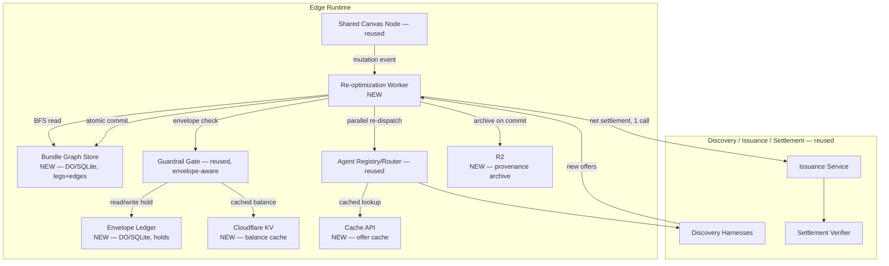

# Knowgrph Agentic Travel Commerce Platform — Combined PRD/TAD/ADR

**Conformance note**: authors against `prd-tad-adr-guidelines.md` v1.7.0. `universal_scope: false` — every dependency named is a real chosen one, introduced under "reference implementation" per the Scope & Neutrality Contract, not a swappable neutral example.

**Supersession note (v1.0.0)**: this document consolidates and supersedes `knowgrph-agentic-travel-agencies-prd-tad-adr.md` (v0.6.0) and `knowgrph-agentic-commerce-platform-prd-tad-adr.md` (v0.1.0). Neither prior document is invalidated — their components, ADRs, and inherited readiness rungs are carried forward by reference, not re-derived — this document adds three things neither prior one had: (1) the L4 Bundle Re-Optimization and Budget Envelope primitives, (2) a dedicated cache/computation/memory performance strategy, (3) an infrastructure ADR retiring Oracle Always Free ARM. As with the marketplace document before it, `local_rung: spec-complete` applies only to what's genuinely new here; every reused component keeps whatever rung it already earned.

---

## Feature: Agentic-Era OTA — Positioning Note

**What changed, and what didn't.** Neither prior document is wrong; this is a reframing, not a rebuild. A traditional OTA (Expedia, Agoda, Skyscanner) is a human-browses-results-and-clicks-checkout interface over a GDS. What this platform is building is different in kind, not just interface: the *principal* browsing and clicking is an agent, the *inventory* is discovered through a marketplace of registered agents (not one hardcoded GDS integration), and the *dependency structure between legs of a trip* is a first-class object the platform reasons over autonomously — not something a human re-plans by hand when a flight delays. "Agentic-era OTA" names that shift precisely: same job-to-be-done (book a trip that works), fundamentally different execution substrate (agents transacting through a guardrail-enforced marketplace, not a human clicking through search results). The two features below are the concrete mechanism that makes that claim true rather than aspirational.

---

## Feature: Bundle Re-Optimization Engine (L4)

### Problem Statement
Today, when one leg of a multi-leg trip changes — a flight delays, a hotel room type disappears, a local-experience slot fills — the burden of figuring out what else needs to change falls on the human principal or, at best, on a single-leg "suggest alternative" flow (L1 on the breakthrough rubric this feature was scoped against). The itinerary's legs are causally dependent on each other (a delayed arrival breaks a booked transfer time; a cancelled hotel night breaks an experience booked for that evening), but nothing in the current architecture treats that dependency structure as something to reason over. The gap is between "detect and suggest" and "autonomously re-plan every downstream leg and settle the fare difference in real time" — the L4 bar this feature is built to clear.

### Personas
Reused from the travel-agencies document: Shopper-Agent Principal, Merchant/OTA Operator.

### User Journey Stage
Sits entirely inside **Complete** (post-booking) — this feature activates only after a bundle has committed legs, which is why it's additive to the existing Discover→Engage→Complete flow rather than a new stage.

### User Stories

**US-1 — As a** Shopper-Agent Principal **I want** a change to one committed leg to automatically trigger re-planning of only the legs causally downstream of it **So that** I don't have to manually notice and fix every knock-on effect myself.
> **VCC translation**: `Verify, for every re-optimization event, the affected-leg set returned equals exactly the set reachable via outgoing edges from the changed leg — no unaffected sibling leg is touched, and no downstream leg is skipped`

**US-2 — As a** Shopper-Agent Principal **I want** the entire affected set to be re-quoted, approved, and settled as one atomic operation **So that** I never end up in a half-changed state where some downstream legs updated and others didn't.
> **VCC translation**: `Verify zero bundle states exist where some legs in the computed affected set are committed to new offers and others remain committed to stale offers — the transaction is atomic across the whole affected set or it is fully rolled back`

**US-3 — As a** Shopper-Agent Principal **I want** one net settlement call for the whole cascade instead of one settlement per changed leg **So that** re-planning a 4-leg cascade costs one card top-up/refund action, not four.
> **VCC translation**: `Verify the count of Issuance Service settlement calls per re-optimization event equals 1, regardless of the affected-leg-set size`

### Success Metrics

| Metric | Baseline | Target | Timeline |
|---|---|---|---|
| Affected-set walk latency (≤8-leg bundle, in-DO) | N/A | < 50ms | at first Evidence Reference |
| Settlement calls per cascade | N (one per leg) | 1, regardless of affected-set size | at first Evidence Reference |
| Partial-commit incidents | N/A | 0 — hard invariant, not a target to approach | ongoing |
| Rollback correctness | N/A | 100% of rejected affected-sets fully revert to prior committed state | at first Evidence Reference |

### MoSCoW Priority
**Must**: affected-set BFS bounded to downstream-only legs; atomic all-or-nothing commit across the affected set.
**Must**: single net settlement call per cascade (US-3) — this is the literal L4 claim; without it this is L3 at best.
**Should**: parallel re-dispatch of affected legs via `Promise.all` against Agent Registry/Router, rather than sequential re-quoting.
**Could**: cached topological order maintained incrementally in DO storage, avoiding a full recompute per event.
**Won't (this increment)**: bundles exceeding roughly 20 legs, or bundles spanning multiple principals — flagged as an explicit scale boundary (see Performance Enhancement, below) rather than silently assumed away.

### Min-Viable Scope
A single bundle (flight + one downstream leg, e.g. a local experience whose start time depends on arrival) with one upstream change triggering one downstream re-plan and one net settlement call, running entirely on the D0/Router/Guardrail Gate/Issuance Service chain already spec'd — no new external vendor integration required.

### Out of Scope
Cross-principal bundles (group trips — routed to the Split-Pay roadmap item instead); bundles beyond the ~20-leg scale boundary; re-optimization triggered by anything other than a Shared Canvas Node mutation event (e.g., proactive speculative re-planning ahead of a predicted delay is a separate, future feature).

### Dependencies
Reused, unmodified: Shared Canvas Node (mutation-event trigger), Agent Registry/Router (re-dispatch target), Guardrail Gate, Issuance Service, Settlement Verifier. New: Bundle Graph Store (see Component Specifications).

### Open Questions
- What counts as a "change" worth triggering re-optimization — any offer delta, or only deltas past some materiality threshold? An overly sensitive trigger could cascade on noise.
- Does a rejected re-plan (US-2's rollback path) need to notify the principal synchronously, or can it queue through the existing Notification Dispatcher pipeline?

---

## Feature: Budget Envelope Ledger (supporting primitive)

### Problem Statement
A Shopper-Agent Principal's spend guardrail is not really a single static number checked once — it's a shared, mutable constraint across every concurrent in-flight transaction from every registered agent. The current Guardrail Gate spec checks a budget at the moment of one offer; it does not yet model *reserved-but-not-yet-settled* holds from other concurrent agents, which is exactly the gap that would let two agents independently "pass" a guardrail check against the same remaining budget and jointly overspend it. This is the primitive Bundle Re-Optimization's US-3 settlement claim depends on being true in real time, not scripted.

### Personas
Shopper-Agent Principal (protected), Platform Operator (auditor of envelope state via Marketplace Registry Canvas).

### User Journey Stage
**Engage** — sits directly inside the existing Guardrail Gate step, as its underlying data model rather than a new stage.

### User Stories

**US-1 — As a** Shopper-Agent Principal **I want** every offer from any registered agent to atomically check-and-reserve against my true remaining budget, accounting for every other concurrent hold **So that** two simultaneous agent offers can never jointly overspend my limit.
> **VCC translation**: `Verify, for every accepted offer, available_balance at accept-time equals total_budget minus the sum of all reserved-or-committed holds that existed at that instant — no accepted offer ever exceeds that computed available_balance`

**US-2 — As a** Shopper-Agent Principal **I want** a released or rolled-back leg's held funds to become available to other in-flight agents immediately **So that** a rejected re-plan doesn't leave my budget artificially locked.
> **VCC translation**: `Verify the latency between a hold transitioning to released and that amount reappearing in available_balance is bounded by the Durable Object's own write-then-read consistency — no externally observable staleness window`

### Success Metrics

| Metric | Baseline | Target | Timeline |
|---|---|---|---|
| Envelope check latency (DO-local, no D1 hop) | N/A | < 10ms | at first Evidence Reference |
| Over-envelope commits | N/A | 0 — hard invariant | ongoing |
| Hold-release-to-availability latency | N/A | bounded by DO write/read consistency, no externally observable staleness | at first Evidence Reference |

### MoSCoW Priority
**Must**: atomic check-and-reserve, one Durable Object instance per `principal_id` serializing all mutations for that principal.
**Must**: hold lifecycle (`reserved → committed`, `reserved → released`).
**Should**: KV-cached `available_balance` read for the Guardrail Gate's fast path, falling back to the DO on cache miss.
**Could**: multi-currency envelope support — explicitly the same gap flagged as Platform Roadmap-adjacent (multi-asset netting), not solved here.
**Won't (this increment)**: cross-principal pooled envelopes (a group wallet — this is the Split-Pay roadmap item's actual data model, deliberately not built early here).

### Min-Viable Scope
One `envelope`/`holds` pair scoped to a single principal, exercised by at least two concurrent simulated offers to prove the atomicity claim (US-1) isn't just true in the single-request case.

### Out of Scope
Multi-currency netting, cross-principal pooling, dispute/chargeback-triggered hold adjustments (Platform Roadmap Phase 3–4 territory).

### Dependencies
Reused: Guardrail Gate (consumer of `available_balance`). New: Durable-Object-backed `envelope`/`holds` storage (see Component Specifications).

### Open Questions
- Should `available_balance` be exposed to the Shopper Client directly (transparency) or only ever consumed server-side by the Guardrail Gate? Affects whether KV-cached reads need any client-facing auth scope at all.

---

## Architecture: Flat Adjacency Tables, DO-Colocated Ledger, and the Cache Layer

### Overview
Two data-model decisions anchor this document, both driven by the explicit constraint of forbidding a dedicated graph database: bundle dependency structure is stored as flat `legs`/`edges` relational tables and walked in-memory via bounded BFS (O(affected), not a graph-engine traversal), and the envelope ledger is a plain hold-based accounting model — the same pattern a bank uses for pending authorizations, not a graph problem at all. Both live inside Durable Object storage rather than D1, colocating compute with state on the hot path. This section also folds in the Performance Enhancement recommendations (cache, computation, memory) requested alongside these features, since they're inseparable from making the L4 real-time settlement claim actually true.

### Journey → System Mapping

| Journey Stage | Workflow | Data Flow | Orchestration/Harness Flow | Topology Node(s) | Component |
|---|---|---|---|---|---|
| Complete (post-booking) | Bundle Re-Optimization Workflow | mutation event → affected-set BFS → parallel re-quote → atomic commit → net settlement | Bundle Re-Optimization Pipeline | Bundle Graph Store, Agent Registry/Router | Re-optimization Worker |
| Engage | Envelope Check Workflow | offer → check-and-reserve → hold → commit/release | Envelope Check Pipeline | Envelope Ledger (DO) | Guardrail Gate *(reused, now envelope-aware)* |

### Topology

| Node | Role | Type | Lane | Connects to | Connection type | Data residency |
|---|---|---|---|---|---|---|
| **[new]** Bundle Graph Store | Store | Durable Object (SQLite storage) | Authoring→Delivery | Shared Canvas Node (trigger), Re-optimization Worker | Sync, in-DO | Edge (Cloudflare region) |
| **[new]** Envelope Ledger | Store | Durable Object (SQLite storage) | Authoring→Delivery | Guardrail Gate | Sync, in-DO | Edge (Cloudflare region) |
| **[new]** Re-optimization Worker | Executor | Worker | Authoring→Delivery | Bundle Graph Store, Agent Registry/Router, Guardrail Gate, Issuance Service | Sync (BFS + `Promise.all` dispatch) | Edge (Cloudflare region) |
| **[new]** Cloudflare KV (envelope cache) | Cache | KV | Delivery | Guardrail Gate | Async, edge-read | Edge (global) |
| **[new]** Cloudflare Cache API (offer cache) | Cache | Workers Cache | Delivery | Discovery Harnesses | Async, edge-read, stale-while-revalidate | Edge (regional) |
| **[new]** R2 (bundle/provenance archive) | Store | Object storage | Delivery | Re-optimization Worker (write-once on commit) | Async, write-behind | Edge (Cloudflare region) |
| Agent Registry/Router *(reused, unmodified)* | Router | Durable Object | Authoring→Delivery | — | — | Edge |
| Guardrail Gate *(reused, now envelope-aware)* | Router | Deterministic component | Authoring→Delivery | Envelope Ledger *(new dependency)* | Sync | Edge |
| Issuance Service, Settlement Verifier, Shared Canvas Node, Notification Dispatcher *(all reused, unmodified)* | — | — | — | — | — | — |

### Orchestration/Harness Flows

**Pipeline**: Bundle Re-Optimization Pipeline *(new)*
**Topology pattern**: Fan-out/fan-in, bounded | **Max iterations**: 1 pass per triggering event (no recursive re-optimization within a single event) | **Circuit-breaker**: any affected leg's re-quote rejection aborts the whole affected set — rollback, not partial retry
**Token budget**: 0 prompt + 0 completion = **$0.00/call** — BFS and commit logic are deterministic; only the Discovery Harness re-quotes downstream may carry their own existing token cost, unchanged from the travel document

| Role | Component | Input schema | Output schema | Cost log | Fallback |
|---|---|---|---|---|---|
| Dispatcher | Re-optimization Worker | mutation event (changed `leg_id`) | affected-leg set | — | No-op if changed leg has no outgoing edges |
| Consumer | Bundle Graph Store | affected-leg set + new offers | commit or rollback | — | Rollback to prior committed snapshot |
| Consumer | Envelope Ledger | net delta amount | hold update | — | Reject commit, trigger rollback |

**Pipeline**: Envelope Check Pipeline *(new)*
**Topology pattern**: Sequential, DO-serialized | **Max iterations**: N/A | **Circuit-breaker**: N/A
**Token budget**: $0.00 — deterministic ledger arithmetic

| Role | Component | Input schema | Output schema | Cost log | Fallback |
|---|---|---|---|---|---|
| Dispatcher | Guardrail Gate *(reused, extended)* | offer amount | pass/reject | — | Reject on any ambiguity — fail closed, matching the travel document's existing fail-closed posture |
| Consumer | Envelope Ledger | reserve/commit/release instruction | updated hold state | — | N/A |

### Component Specifications

**Component**: Bundle Graph Store *(new)*
**Responsibility**: holds `legs`/`edges` for one `bundle_id`, exposes a bounded BFS over outgoing edges from a given leg, and commits/rolls back the affected set atomically.
**Interfaces**: DO storage (SQLite), read by Re-optimization Worker, written on commit
**Dependencies**: Shared Canvas Node (upstream trigger)
**Configuration**: scale boundary asserted at ~20 legs/edges per bundle — beyond that, sharding/pagination is the fix, not a graph engine (see ADR-4)
**FOSS/Vendor**: FOSS — Cloudflare Durable Objects, no new vendor
**Readiness rung**: Local: `spec-complete` / Delivered: `undocumented`

**Component**: Envelope Ledger *(new)*
**Responsibility**: holds `envelope`/`holds` for one `principal_id`, exposes atomic check-and-reserve, and transitions holds through `reserved → committed`/`released`.
**Interfaces**: DO storage (SQLite), consumed by Guardrail Gate; KV as a read-through cache for `available_balance`
**Dependencies**: none new
**FOSS/Vendor**: FOSS — Cloudflare Durable Objects + KV, no new vendor
**Readiness rung**: Local: `spec-complete` / Delivered: `undocumented`

**Component**: Re-optimization Worker *(new)*
**Responsibility**: orchestrates the whole cascade — BFS, parallel re-dispatch, envelope check, atomic commit, single net settlement call, R2 archive write.
**Interfaces**: calls Bundle Graph Store, Agent Registry/Router, Guardrail Gate, Issuance Service
**Dependencies**: all of the above, each reused or new-and-specified in this document
**FOSS/Vendor**: FOSS — plain Cloudflare Worker
**Readiness rung**: Local: `spec-complete` / Delivered: `undocumented`

**Reused components (unchanged interfaces, extended data dependency only for Guardrail Gate) — see prior documents for full specs**: Shared Canvas Node Store, Agent Registry/Router, Discovery Harnesses, Issuance Service, Settlement Verifier, Notification Dispatcher, Marketplace Registry Canvas.

### Component Inventory

| Layer | Component | Local rung | Delivered rung | Source |
|---|---|---|---|---|
| Edge | Bundle Graph Store | `spec-complete` | `undocumented` | this document |
| Edge | Envelope Ledger | `spec-complete` | `undocumented` | this document |
| Edge | Re-optimization Worker | `spec-complete` | `undocumented` | this document |
| Edge | Guardrail Gate (envelope-aware extension) | `spec-complete` *(extension unbuilt; base logic `dev-proven`)* | `undocumented` | extended here, inherited from travel doc v0.6.0 |
| Edge | Agent Registry/Router, Marketplace Registry Canvas | `spec-complete` | `undocumented` | inherited, commerce-platform doc v0.1.0 |
| Edge | Shared Canvas Node Store | `dev-proven` | `undocumented` | inherited, travel doc v0.6.0 |
| Harness | Discovery Harnesses, Issuance Service, Settlement Verifier, Notification Dispatcher | mixed, see prior docs | `undocumented` | inherited, travel doc v0.6.0 |

### Deploy Boundary Register

| Boundary | From lane | To lane | Evidence Reference | Operator instruction | Rollback statement | State |
|---|---|---|---|---|---|---|
| Bundle commit: affected-set → committed | Authoring | Mirror | none yet — Re-optimization Worker not built | Commit only when every affected leg's re-quote passes the envelope check; any single rejection rolls back the whole affected set | Revert Bundle Graph Store to its last committed snapshot via DO storage versioning | `closed` |
| Envelope mutation: offer → hold | Authoring | Mirror | none yet — Envelope Ledger not built | Reserve only through the DO-serialized check-and-reserve path; no direct hold-table writes outside it | Transition the hold to `released`; no funds-in-flight risk since this is a reservation ledger, not the settlement call itself | `closed` |

---

## Performance Enhancement: Cache, Computation, Memory

### Cache

| Layer | Recommendation | Rationale | Cost |
|---|---|---|---|
| Durable Object storage (SQLite) | Store `legs`/`edges` and `envelope`/`holds` directly in DO storage, not D1 | Colocated with the actor — zero network hop on the hot read/write path; DO's single-threaded-per-key model gives atomicity D1 would need explicit transactions to match | $0, within existing DO budget |
| Cloudflare KV | Cache `available_balance` per principal | Sub-ms edge reads for the Guardrail Gate's fast path; falls back to the DO on miss, never trusted as the source of truth | Free tier sufficient at MVP volume |
| Cloudflare Cache API | Cache Discovery Harness offers, short TTL (30–60s), stale-while-revalidate | Re-optimization's re-quote step is the single biggest external-latency and external-rate-limit cost in the whole cascade; most re-plans re-query the same route/item within seconds of the original quote | $0, Workers-native |
| R2 | Archive committed bundle snapshots and provenance receipts, not kept indefinitely in D1/DO | Keeps hot-path storage bounded to *active* bundles only; no egress fee from R2 to Workers | Free tier (10GB) likely sufficient at MVP scale |

### Computation

| Area | Recommendation | Rationale |
|---|---|---|
| Affected-set walk | BFS bounded to downstream-only nodes reachable from the changed leg | O(affected), not O(V+E) of the whole bundle — the actual mechanism behind US-1's precision claim |
| Re-dispatch | `Promise.all` across all affected legs' Discovery Harness calls | Wall-clock re-optimization time becomes the slowest single leg, not the sum of all legs |
| Registry lookups | Cache Agent Definition lookups in Worker memory + KV, invalidated only on (de)registration | Registration changes are rare relative to routing volume; avoids re-hitting the Agent Definition Validator's storage on every dispatch |
| Topological order | Maintain incrementally in DO storage alongside `edges`, updated on insert rather than recomputed per event | Amortizes sort cost across a burst of mutation events instead of paying it per event |

### Memory

| Area | Recommendation | Rationale |
|---|---|---|
| DO in-memory adjacency list | Build once per DO wake, hold in the isolate's JS heap for the DO's active lifetime | Avoids rebuilding from storage on every event within one re-optimization burst |
| Hibernatable WebSockets | Use for Shared Canvas Node's client push | Idle DOs release from memory/billing without losing state — SQLite storage reloads cheaply on wake, no cold-rebuild logic required |
| Explicit scale boundary | State the ~20-leg/edge assumption openly rather than letting it be silently implied | This is what "forbid complex graph architecture" actually means in practice — the constraint is honest because its limit is written down, not because the limit doesn't exist |

---

## ADR-1: Durable Object SQLite Storage over D1 for Hot-Path Ledger and Graph State
**Status**: Proposed
**Date**: 2026-08-19

### Context
`legs`/`edges` and `envelope`/`holds` are both per-key hot-path state needing atomic read-modify-write under concurrent access.

### Decision
Use each Durable Object's own SQLite-backed storage for these tables; reserve D1 for cross-key aggregate/reporting queries (platform-wide audit, operator dashboard rollups) where DO-per-key sharding is the wrong shape.

### Alternatives Considered
1. **D1 only**: Pros — one storage system to reason about; Cons — an extra network hop on every hot-path mutation, and DO's single-threaded actor model already gives atomicity for free that D1 would need explicit transaction handling to match.
2. **KV only**: Pros — global edge reads; Cons — eventually consistent, unsuited to strict read-after-write ledger correctness (holds could double-spend across edge locations).

### Rationale
Matches the "colocate compute with state" principle already used for Shared Canvas Node Store; zero new vendor, reuses DO infra already budgeted in prior documents.

### TCO Impact

| Dimension | Chosen: DO SQLite | Alternative: D1 only | Alternative: KV only |
|---|---|---|---|
| Infra cost | $0 (within DO budget) | $0 | $0 |
| Latency | Lowest (in-isolate) | +1 network hop per mutation | Fast reads, unsafe writes |
| Ops burden | Low | Low | Medium (consistency workarounds needed) |

### Consequences
- **Positive**: lowest-latency hot path, atomicity without explicit locking.
- **Negative**: two storage systems (DO SQLite + D1) to reason about instead of one — mitigated by the explicit split rule stated above.
- **Neutral**: D1's role shrinks to genuinely aggregate-only queries.

---

## ADR-2: Edge Cache Layering (KV + Cache API + R2) for Offers and Provenance
**Status**: Proposed
**Date**: 2026-08-19

### Context
Re-optimization's re-quote step and the envelope's balance reads are both latency- and external-rate-limit-sensitive; uncached, every re-plan re-hits Atlas/eBay directly and every balance check re-hits a DO.

### Decision
Layer three purpose-fit Cloudflare caches: KV for tiny hot ledger values, Cache API for short-TTL external offer data, R2 for cold provenance archives.

### Alternatives Considered
1. **No caching**: Pros — simplest; Cons — slowest, and repeatedly burns external API rate limits (Atlas, eBay) on re-quotes that are often identical within seconds.
2. **R2-only for everything**: Pros — one storage system; Cons — R2 reads aren't as fast as KV for tiny hot values, wrong tool for the balance-cache use case.

### Rationale
Each cache is matched to its data's actual access pattern (tiny/hot, medium/short-lived, large/cold) rather than defaulting to one system for convenience.

### TCO Impact

| Dimension | Chosen: three-layer cache | Alternative: no caching | Alternative: R2-only |
|---|---|---|---|
| Infra cost | $0 (all within free tiers at MVP scale) | $0, but higher external-API usage | $0, wrong-shaped latency |
| External rate-limit risk | Low | High | Medium |
| Ops burden | Low-medium (three systems, each simple) | Low | Low |

### Consequences
- **Positive**: cuts external API load, cuts ledger read latency.
- **Negative**: cache invalidation logic (TTL + stale-while-revalidate) is a real correctness surface to test, not free.
- **Neutral**: none of the three introduce a new vendor — all Cloudflare-native.

---

## ADR-3: Oracle Always Free ARM Retirement — Cloudflare Workers AI Primary, Cloudflare Containers Overflow
**Status**: Proposed
**Date**: 2026-08-19

### Context
Oracle Always Free Ampere ARM (hosting Ollama for local-first inference) was already silently downgraded once — 4 OCPU/24GB reduced to 2 OCPU/12GB in June 2026 — while sitting on the critical path for probe-tree L1 inference calls. That is the same "free-tier goodwill without an exit plan" risk this document already flagged for Alibaba Cloud's trial-credit-based complementary role. Continuing to depend on Oracle for anything load-bearing repeats a known failure mode rather than learning from it.

### Decision
Retire Oracle from the critical path entirely. **Primary**: Cloudflare Workers AI for probe-tree L1 inference and any agentic-commerce reasoning calls — consolidates onto the already-trusted Cloudflare-primary stack, eliminating a fourth infra vendor and its SSH/VM ops burden. **Overflow**: Cloudflare Containers running self-hosted Ollama directly, for any model or workload Workers AI's hosted catalog doesn't cover — preserves full model flexibility without leaving the Cloudflare-primary boundary.

**FOSS-hard-gate flag, stated explicitly**: Workers AI's catalog includes models under non-OSI licenses (Llama ships under Meta's community license, not MIT/Apache-2.0). This decision constrains model selection to Apache-2.0/MIT-licensed weights only within Workers AI's catalog — a real filtering step at deployment time, not a blanket "any hosted model qualifies."

### Alternatives Considered
1. **Stay on Oracle, treat the downgrade as a one-time event**: Pros — zero migration work; Cons — already proven unreliable once, no reason to expect the "always free" promise holds going forward, and it remains a fourth vendor outside the Cloudflare-primary consolidation the rest of this platform is moving toward.
2. **Groq free-tier API for open-weight models**: Pros — generous free rate limits today; Cons — same free-tier-goodwill risk class as Oracle and Alibaba, now the third time this exact pattern has been flagged across this platform's documents.
3. **Self-hosted always-on hardware (e.g. home server)**: Pros — true zero recurring vendor cost; Cons — breaks the "zero-infra" (no physical ops) spirit present everywhere else in this stack, introduces a personal-hardware reliability risk not present anywhere else in the architecture.

### Rationale
Consolidating onto Cloudflare-primary reduces vendor count and ops surface — itself a reliability win independent of raw dollar cost — while the explicit Apache-2.0/MIT filtering step keeps the FOSS-hard-gate honest rather than assumed.

### TCO Impact

| Dimension | Chosen: Workers AI primary / Containers overflow | Alternative: Oracle-continued | Alternative: Groq free-tier | Alternative: self-hosted hardware |
|---|---|---|---|---|
| Infra cost | $0 up to free daily neuron allocation, metered beyond it; Containers metered by compute-time | $0 nominally, proven unreliable | $0 nominally, same risk class as Oracle | ~$0 recurring, but real hardware + electricity cost |
| Ops burden | Low (no VM/SSH management) | Medium (VM ops, already caused one incident) | Low, but no self-host fallback if terms change | High (physical maintenance, uptime risk) |
| Vendor risk | Low (Cloudflare-primary, already trusted) | Proven medium-high (one downgrade already occurred) | Medium (unproven long-term commitment) | Low vendor risk, high personal-ops risk |
| FOSS compliance | Requires explicit per-model license filtering (stated above) | N/A (self-hosted, any Apache/MIT model) | N/A (depends on Groq's hosted catalog) | N/A (self-hosted, any Apache/MIT model) |

### Consequences
- **Positive**: one fewer vendor, no VM ops burden, model licensing now an explicit filter instead of an unexamined assumption.
- **Negative**: this is not a strictly cheaper reference than Oracle's original promise — Workers AI's free allocation is metered beyond a threshold, and Containers overflow is real metered compute. It is a more honest and consolidated one, not a free one.
- **Neutral**: Ollama-compatible model flexibility is preserved via the Containers overflow path for anything Workers AI's catalog can't serve or doesn't license cleanly.

---

## ADR-4: Flat Adjacency Tables over a Dedicated Graph Database (Formalizing the Explicit Constraint)
**Status**: Accepted (per direct instruction — complex graph db/architecture forbidden)
**Date**: 2026-08-19

### Context
Bundle re-optimization's dependency-graph semantics could tempt a dedicated graph database or a graph-native engine. This ADR exists to make the reasoning explicit rather than leaving "no graph DB" as an unexplained constraint.

### Decision
`legs`/`edges` flat relational tables, walked via in-memory bounded BFS, scoped one Durable Object per `bundle_id`. No dedicated graph engine, at any layer.

### Alternatives Considered
1. **Neo4j or similar dedicated graph database**: Pros — native graph query language, built-in cycle detection; Cons — not FOSS-hard-gate-clean in its most useful (Enterprise) tier, introduces an entirely new infra category, and solves a problem this platform doesn't have at single-digit-node bundle scale.
2. **A future Cloudflare-native graph primitive, if one emerges**: Pros — would stay within the Cloudflare-primary boundary; Cons — doesn't exist as a stable primitive today, and even if it did, would be built for graphs with thousands of nodes, not the single digits this platform actually has.

### Rationale
The same "new consumer of an existing dependency, not a new dependency" logic used in every prior ADR across both source documents, reapplied here and made explicit because it was directly instructed rather than left implicit.

### TCO Impact
Zero new infra category, zero new vendor, zero new query language to learn or audit — the cost of *not* doing this would be a second data-access paradigm running alongside D1/DO/KV for a problem already solvable with BFS over a handful of rows.

### Consequences
- **Positive**: zero new infra category or vendor.
- **Negative**: an explicit scale boundary (~20 legs/edges) exists and must be watched, not silently assumed to hold forever.
- **Neutral**: if that boundary is ever hit, the fix is sharding/pagination of the flat tables — not adopting a graph database, which would still be the wrong tool at that scale.

---

## Alignment Note (condensed)

This document is a consolidation checkpoint, not a from-zero spec — v1.0.0, authored 2026-08-19, zero Evidence References of its own. Coverage: 2 new Features (10 PRD-template fields combined) + 1 combined Architecture section (7 TAD-template fields) + a dedicated Performance Enhancement section + 4 ADRs, all present. `local_rung: spec-complete` applies only to the genuinely new components (Bundle Graph Store, Envelope Ledger, Re-optimization Worker, the three cache layers, and the envelope-aware extension to Guardrail Gate); every other component inherits its rung from `knowgrph-agentic-travel-agencies-prd-tad-adr.md` v0.6.0 or `knowgrph-agentic-commerce-platform-prd-tad-adr.md` v0.1.0 without being re-claimed here. `delivered_rung` remains `undocumented` throughout.

### Next Steps

1. Implement Envelope Ledger first — it's the smaller, self-contained primitive, and Bundle Re-Optimization's real-time settlement claim is only true because the envelope check underneath it is genuinely atomic.
2. Implement Bundle Graph Store and Re-optimization Worker against a 2-leg MVP bundle (flight + one downstream leg).
3. Wire the three cache layers (KV, Cache API, R2) after the core hot path is dev-proven, not before — caching a component that doesn't exist yet is premature optimization against this document's own discipline.
4. Execute the Oracle retirement (ADR-3) as an independent workstream — filter Workers AI's model catalog to Apache-2.0/MIT entries explicitly before routing any probe-tree L1 call through it.
5. Record first Evidence References for all of the above before opening any Platform Roadmap Phase 2+ item.
