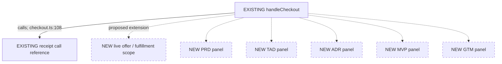
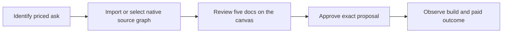
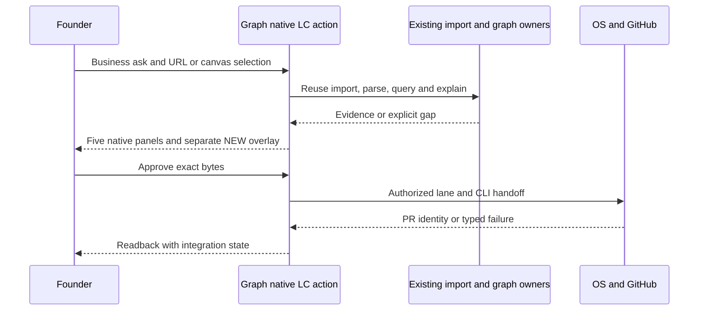
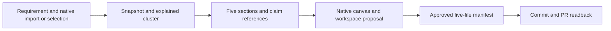
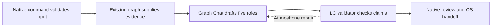
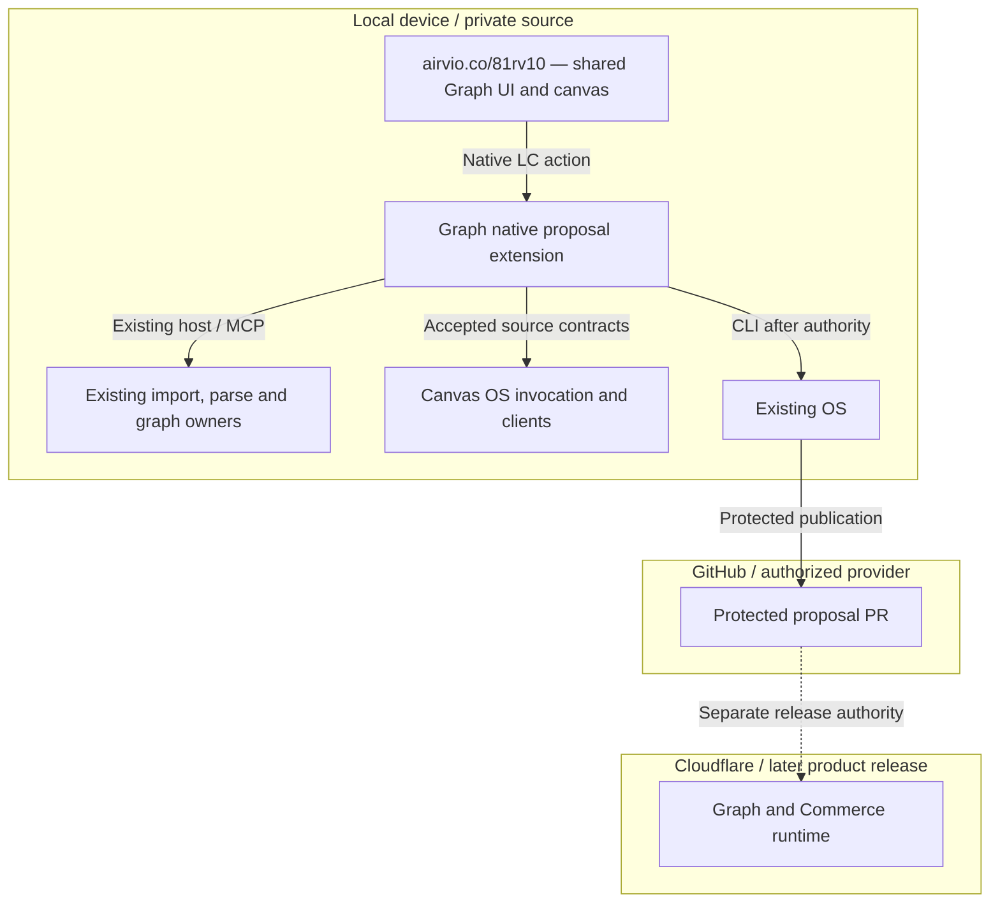

## Current completion evidence - reference implementation

The five roles now join `launch-copilot@0.3.1`; earlier grounding observations retain their original revisions. The operator authorized completion, checks, PR integration and worktree cleanup on 2026-09-12. Acquisition retention merged through [PR 971](https://github.com/huijoohwee/agentic-graph/pull/971) as `bb9040b85cf13ceef40b494e75d2e64d7058d9e2` after [Integration Gate passed](https://github.com/huijoohwee/agentic-graph/actions/runs/34689521375). This is canonical Dev-source proof; the released route evidence below retains its earlier revision.
The source-owned `/81rv10/` entry was released by [run 34686475374](https://github.com/huijoohwee/agentic-graph/actions/runs/34686475374) from Graph `7fb85741121d8c2886027e4a630d013ba91c1027` and Canvas `c2c61a35aa6da17e034cdd429c787442ec562573`. The generated Prod mirror [PR 66](https://github.com/huijoohwee/huijoohwee/pull/66) and public route agreed on the entry bytes; public publication checks passed 65/65. This proves the released entry/topology, not LC's unimplemented T4 proposal-publication path, paid demand or deferred live-model walkthrough.


# Launch Copilot — grounded PRD-TAD-ADR-MVP-GTM

Turn a solopreneur's business ask into a source-grounded, cost-bounded proposal inside the existing agentic-graph workspace, then use the approved proposal to build, launch and validate one paid outcome. Import URL (including GitHub repository URLs), Import folder, the knowledge graph, source records, nodes/clusters/edges, Chat and the canvas supply the working environment. Agentic Canvas OS supplies the shared ingest/parse invocation and client contracts. The proposal makes existing capability, proposed work and uncertainty inspectable before technical plans are approved.

**Current position:** native r3 proposals are implemented in Graph `d8bf68fc3e7ccfb26a9a77aebad5cf4d0eb2c911`, consuming the Canvas OS contract at `c2c61a35aa6da17e034cdd429c787442ec562573`. Existing Import URL → Codebase graph, selected-node/cluster/edge grounding, `outline`/`draft`, five RichMediaPanels, a separate proposed-work overlay, reopen and five-file export are present [G20][G21][G22][A8]. **Approval → protected proposal PR → integration is not implemented.** Live OpenAI drafting remains deferred. Acquisition provenance is now retained in canonical snapshots and proposals at `bb9040b85cf13ceef40b494e75d2e64d7058d9e2`; the earlier ER-10 probe below predates this fix.

**Product and output ownership:** Launch Copilot's product repository is `/Users/katrina/Documents/GitHub/81rv10`, whose canonical source remains README-only [L1]. Graph owns its application runtime. The user selected the already-enrolled `agentic-graph` repository for future proposal output; `81rv10` no longer needs enrollment for that step. The public sample `anthropics/commerce-agents` is reference-only evidence, never the owned product implementation. The core rehearsal guide is [demo.md](demo.md).

**Single-product-surface requirement (latest audit):** the complete user journey must remain at `https://airvio.co/81rv10/`: requirement → native Import URL invoked through its validated MCP/WebMCP action → Graph/Commerce source or approved capabilities → Graph node/cluster/edge and grounded Probe-Tree → five proposal panels/review. `/Users/katrina/Documents/GitHub/agentic-graph` identifies the existing execution owner, not a browser-reachable endpoint. Reuse that runtime behind an authorized connection; no second application, required Graph URL navigation or manual copy between source/probe views. This is the target, **not current deployed behavior**. The [single-surface audit in demo.md](demo.md#single-product-surface-audit) records route, host-transport and Probe-Tree gaps. Local diagnostic steps do not satisfy this acceptance criterion.

**Historical r3 grounding-pass authorization (superseded by the completion grant above):** edit this draft and `demo.md`; read actual source and use existing inspection tools with temporary evidence/cache output. Do not modify application code, dependencies, configuration, Git lifecycle, other tasks, deployment or outreach. Earlier implementation authorization does not override this pass's explicit source freeze.

This combined draft remains the authoring SSOT at `launch-copilot@r3`; all five roles retain specification version `0.3.0`. This is an evidence refresh, not a new runtime version. Specification completeness, locally tested code, protected Dev integration, live drafting, deployment and payer evidence are separate states. The three-hour experiment's full win condition remains **business ask → grounded five-file proposal integrated through a protected PR**; today's native review/export subset does not satisfy that final transition.

## PRD — buyer value before technical selection

### Problem, buyer and offer hypothesis

The initial buyer hypothesis is a solo founder of an agent service, agent commerce product or marketplace who must decide what to build before committing scarce development money or time. Their job is to turn one priced customer request into a small, implementable and launchable slice. An implementer is a secondary reader, not a second product persona.

The candidate pain is paying for discovery twice: first an attractive plan, then engineering work that discovers missing checkout, permissions, fulfillment or deployment capability. **No customer interview, paid commitment or measured rework cost was supplied.** This is a hypothesis, not validated high WTP. Source evidence can demonstrate implementation gaps; it cannot establish buyer pain or demand.

**Initial offer to test:** a fixed-scope, repository-grounded launch proposal: five linked documents, an existing/proposed canvas, named source owners, acceptance checks and a short review. Test **S$200 per proposal**, including one correction round, as an explicit price hypothesis. Do not build recurring billing before a buyer accepts this service. Quote build/launch execution separately after grounding.

| Candidate job | Pain / WTP assumption | Existing leverage | Decision for this revision |
|---|---|---|---|
| Scope one sellable agent-commerce offer before commissioning implementation | Avoid wasted build spend; buyer and cost unverified | Commerce checkout/receipt, Graph query, OS handoff [C1][G1][O1] | First validation hypothesis; smallest inspectable reuse path |
| Give an AI agent bounded purchase/payment authority | Prevent uncontrolled spend and ambiguous settlement; demand unverified | Separate Commerce control plane and Graph payment owners [C2][G7] | Ground as a proposed use case; do not conflate sandbox checkout with delegated live payment |
| Launch a general agent marketplace or new agent OS | Broad discovery/distribution ambition; repeated buyer task unverified | Several independently owned systems | Defer until one paid loop repeats; no new universal controller |
**Story:** As a solo founder, I want to import my repository into the existing graph workspace, select the relevant node, cluster or edge, and describe a customer requirement so that I can approve a bounded build and credible launch experiment against my current system.

### Required outcome and scope

| ID / priority | Given → when → then | Verifiable completion condition (VCC) | Design / task / decision |
|---|---|---|---|
| LC-01 / Must | Given Import URL with a GitHub repository URL, Import folder, or an existing source-bound graph selection and a requirement, when grounding runs, then reuse native ingestion/query/explain and return bounded source evidence | Repository graph import retains source commit, parser/snapshot identity and completeness; re-query/explain selected IDs at that snapshot; distinguish ordinary URL/file import from a structural code graph; empty, stale, partial, cancelled and unsupported cases remain visible; inspected application source unchanged | T1 / R1 / A1 |
| LC-02 / Must | Given that evidence, when composition completes, then all five roles agree on scope, criteria, decisions and GTM | Exactly PRD/TAD/ADR/MVP/GTM; identical continuity/revision joins; every structured technical claim has a verified source reference or `new`; reviewer checks entailment; invented IDs rejected | T2 / R2 / A2 |
| LC-03 / Must | Given a source-bound node/cluster/edge selection at `/81rv10/`, when proposal and Probe-Tree are viewed in the same native canvas, then a founder can distinguish existing capability, decisions and proposed work | Reuse Graph selection/layout/rendering and five RichMediaPanels; real graph remains read-only; NEW overlay uses separate identity and dashed/text distinction; every panel links to relevant source IDs; Probe-Tree binds the same source identity without source mutation; reload preserves graph/proposal/decision joins and edits; preview failure restores prior canvas state | T3 / R3 / A2 |
| LC-04 / Must | Given reviewed exact document bytes, when the permitted handoff succeeds, then five files appear in one protected PR and integration is separately observable | Five exact paths and hashes match reviewed content; duplicate submission does not duplicate a PR; cancellation/stale approval writes nothing; merged status requires provider observation plus content proof | T4 / R4–R5 / A3 |
| LC-05 / Must | Given mobile or disconnected use, when drafting/reviewing, then the user retains local work and sees unavailable actions | At a 390 px viewport all review controls are usable; offline drafts and cached evidence remain readable; reconnect refreshes source/authority; no offline remote write/payment; budget/abort checks pass | T1–T4 / R1–R4 / A4 |
| LC-06 / Must for launch, later than demo | Given an authorized product slice, when released, then entry → offer → confirmation → fulfillment → receipt → readback completes with recovery | Run full selected product-owner suites and a delivery-surface walkthrough at exact deployment identity; exercise decline, cancellation, lost response, duplicate/reordered events and retry; verify rollback | T5 / R6–R7 / A4 |
| LC-07 / Must for commercial claim | Given a real prospect and priced offer, when the prospect accepts delivery, then actual revenue and delivery cost can be measured | Prospect permission/reference, priced acceptance, collected payment reference, accepted outcome and support/build cost; repeat-use observation recorded separately | T5 / R8 / A4 |
All Must pain assumptions retain an open validation finding. LC-01–LC-05 define the proposal MVP; LC-06 defines runtime completion, and LC-07 defines commercial evidence. None is satisfied merely by this draft or by upstream tests.

**Should:** reuse native source/workspace persistence, source caches, resumable handoff, the current Chat model connection and readable mobile panels. **Could:** compare two genuinely contested MVP slices after buyer evidence. **Won't this increment:** a separate Launch Copilot server/UI, copied renderer, new parser/index/graph store, duplicate import/clone pipeline, provider proxy, tool registry or payment ledger; Storyboard polish, parallel writing lanes, external GTM posting, universal marketplace, background polling, wallet provisioning or live money movement.

### Success measures and economics

| Measure | Observed baseline | Proposed target / stop condition |
|---|---|---|
| First useful evidence | Historical local proof: 11 Commerce files indexed in about 0.47 s; excludes acquisition, startup, model, UI and full-repository cost | Warm existing snapshot → useful cluster <30 s; measure GitHub acquisition, cold parse and projection separately; unchanged snapshots reuse owner caches |
| Proposal TTV | Native Commerce browser subset previously recorded; this sample’s combined UI/model/PR flow unexecuted | Cluster → five documents <90 s; machine time <3 min excluding human review and provider queues |
| Human steps | Unmeasured | Enter ask → inspect/revise → approve proposal; payment and deployment retain their own required authority |
| Landed outcome | Native implementation PRs merged; no five-document proposal PR | One protected proposal PR with five files; integration latency measured separately |
| Model economics | Native outline uses 0 model calls; `draft` transport/validation tested with a stub, live OpenAI deferred | Current implementation: one attempt, no repair/fallback; prompt ≤8,000 UTF-8 bytes, output ≤6,000 tokens and ≤24,000 structured bytes. Original ceiling ≤28k total tokens remains a bound, not measured usage or permission to add retries |
| TCO / ROI | Hardware, operator time, token rates, support and demand unmeasured | Zero new paid infrastructure/dependencies; no unapproved model spend; measure total cost, not a false $0 TCO |
| Buyer validation | No named payer, accepted price or collected revenue | Five permissioned conversations; seek two paid pilots before SaaS packaging; revisit offer if none accepts |
| Delivery economics | No observed service margin | Record collected revenue minus payment fees, inference/hosting and valued operator/support time; measure again on repeat use |

Priority follows scope, dependency and reuse evidence, not an invented ROI number. The shared ROI formula remains uncomputed while reach, impact and cost are unknown. Price and pilot counts are experiment choices, not market facts. Loading authoring guidance also consumes context; that cost is currently unmeasured.

## TAD — source ownership, contracts and proposed composition

### Codebase grounding record

Revision lineage: r1/`0.1.0` SHA-256 `5506520b419748a3cc4a547f1bea1bc8ae8c2e0e9b3089677c5788ce76b7d7d0`; input r2/`0.2.0` SHA-256 `51df5c14f2360fc7784aadc6da498e3ed6f3e5f617c83e1ff7a20aa909718ddf`. r3 changes the implementation topology to native owner enhancement while retaining the business-first intent and historical proof. The table below records canonical HEADs re-observed for this grounding pass. Historical r2/r3 probes retain their original revisions and are not retroactively attributed to these HEADs. These are source bindings, not new dependency pins or deployed-parity proof.

| Repository | Observed HEAD | Bounded role |
|---|---|---|
| `81rv10` | `2edb9b2aa1db1a355bd0bad0539485688b03da8e` | Product identity; README only; runtime and selected proposal output belong to Graph |
| `agentic-os` | `817c1da8dac21d688d7c531b234482c64ee4340b` | Lifecycle, context, generation, ranker |
| `agentic-graph` | `d8bf68fc3e7ccfb26a9a77aebad5cf4d0eb2c911` | Native r3 runtime, selected proposal output and release owner |
| `agentic-canvas-os` | `c2c61a35aa6da17e034cdd429c787442ec562573` | Accepted r3 proposal contract plus existing ingest/parse and validating clients |
| `agentic-commerce-os` | `37d1e2a2e3a0efa4f9c5f44c457efa3234d86ad9` | Buyer loop and commerce runtime |
| `huijoohwee.github.io` | `e8d2a10a8d3e5735c43edf350a22523df05fdf91` | Shared authoring semantics |
| `huijoohwee` | `6f1d5d0ef0d6345a3b066bb7029e08dcf6b68077` | Generated mirror |
| `GameXR` | `8334355dc2c1f9bdf463ba102a63b5a3ac579d89` | Optional spatial surface; excluded from MVP |

All eight canonical application/upstream repositories were clean at this pass’s initial observation; active linked worktrees are separate and preserved. `joohwee` already had four untracked archival/draft directories, which are preserved. No canonical fetch or source synchronization was performed. The historical r2 parser reported TypeScript **5.8.3** against manifest **5.9.3**; that observation belongs only to its old probe. Fresh sample evidence records the parser actually used, without claiming clean-install equivalence.

| Claim | Disposition | Exact owner and implication |
|---|---|---|
| Canonical `81rv10` supplies the native runtime | **Not established** | [L1] is the README-only baseline. Native runtime belongs in Graph; separate implementation work is outside this revision's audit |
| Import URL must be built for Launch Copilot | **Contradicted** | [G9][G10][G13]: Graph already owns URL/file import, explicit Codebase graph mode, GitHub source handling, command resolution and local acquisition |
| Canvas OS owns a second executable ingest/parser engine | **Contradicted** | [A2][A3]: Canvas OS owns invocation/client validation; Graph owns acquisition, executable parse, graph artifacts and projection |
| Any imported URL or visual cluster proves a structural dependency graph | **Contradicted** | [G9][G11][G13]: ordinary workspace import, source graph import and display grouping have distinct identities; require a digest-bound graph and explained edge evidence |
| Reusable deterministic query/explain exists | **Confirmed** | [G1][G2]: local runtime and tool schemas; source probe and 109-test owner suite below |
| Calling query with only requirement keywords is sufficient | **Contradicted** | [G2]: query requires `graphId`, `expectedSnapshotDigest`, `mode`; explain also requires `edgeId`. Acquire/reuse a scoped snapshot first |
| Parser is necessarily tree-sitter | **Contradicted** | [G3]: this JS/TS path uses the local TypeScript AST; coverage/fidelity is parser-specific. No new parser needed |
| Determinism guarantees complete business impact | **Contradicted** | Query reports bounds, certainty and completeness. A lexical hit is a candidate; a call-reference edge is not automatically a resolved runtime dependency |
| Existing Canvas client can query any hosted MCP endpoint | **Contradicted** | [A1]: agent-graph calls explicitly require a loopback hostname; retain local-host routing. Hosted parity needs separate work/evidence |
| Existing document format and RichMediaPanel can be reused | **Implemented natively** | [G21]: five panels, persisted Markdown, retained source projection and separate `lc:` overlay; [G23] tests source isolation and exact export |
| Proposed styling and evidence use the same serializer | **Contradicted** | [G4] drops edge properties; native LC [G21] retains overlay/evidence in its workspace sidecar and uses existing renderer paths. NEW nodes and proposed relations are dashed; source evidence stays in the immutable snapshot. A connector is not an evidence store |
| Citation-constrained five-doc composition already exists | **Source-confirmed; live model unverified** | [A8][G20][G22]: one Canvas-owned prompt/validator, existing OpenAI Chat transport, five roles; `reference` cannot support owned `nodeIds` claims. Human review still checks entailment |
| MCP approval can invoke an existing OS land tool | **Contradicted** | [O1]: MCP has lane creation with optional `writePaths`, no `land`. [O2] owns CLI staging/commit/push/provider handoff; [G20][G22] expose no approval/publication command. A gate-to-CLI adapter remains new |
| OS always lands through a native merge queue | **Contradicted** | Historical doctor/status observed protected-PR policy with native queue not selected. Graph’s existing profile is the selected output target [G24]; the new review-to-CLI adapter remains absent |
| A PR opening means the files are landed on protected main | **Contradicted** | [O2][O5]: publication, provider integration and exact content proof are different results |
| Commerce code establishes paid demand or live-money readiness | **Contradicted** | [C1]: local-first checkout explicitly requires sandbox/test configuration and emits `realMoney:false`; [C3] records historical sandbox evidence, not customer revenue |
| Preferred Cloudflare Wallets is proven available for the first paid loop | **Not established** | Historical r2 observation of [W1]: handle reservation only, without send/receive/hold capability. Recheck availability before payment design; keep it optional and deferred |
| Dev → mirror → Cloudflare is automatically a deploy order | **Contradicted** | [G6][M1]: Graph owns protected release; its workflow performs deployment/verification and generated mirror publication. Mirror paths are not an editable downstream fix |
| All seven consumers use today's OS HEAD | **Contradicted** | Six consumer manifests pin OS `13c3839aba7fc64bf94f93aa29b1239ab929840d`, not observed `817c1da…`; existing composition lock [O6] also binds earlier owner revisions. Availability must be checked at the consuming pin |

The shared companions previously called “unavailable” are present in `huijoohwee.github.io/guidelines`. This pass consulted the parent, templates, grounding, CID, readiness, verification, economics, maturity and diagram identity/class rules [D1][D2][D3]. Remaining conformance checks are unexecuted, not missing files. Reuse the existing composition lock and shared check catalog; this scoped claim record does not replace either.

### Current external sample — source evidence before the plan

**Buyer hypothesis:** a solo merchant wants fewer abandoned shopping sessions. Inspect product discovery, cart review and the host-checkout boundary before estimating one paid pilot. `anthropics/commerce-agents` is a reference blueprint: importing it does not make its implementation ours, prove the buyer pain, or supply live settlement. Its own checkout boundary delegates completion to the host [X1][X2]. No sample package, Claude runtime, key or plugin is installed or invoked.

ER-10 uses the existing canonical Graph acquisition/runtime and current Canvas client/contract, with a temporary inspection cache and **zero model calls**. Exact source and probe identity:

| Observation | Actual value / limit |
|---|---|
| Sample repository / commit | `https://github.com/anthropics/commerce-agents` at `fd4d59224ab96b43c6dc6888207c67b3bd5a24cf` |
| Graph / snapshot | `kg:graph:bd4c600bc7511009657e693fe5e1b1ab` / `ee8d5923f4e7e983992c0187732ef87f5426ebd36826bf5e748ee518c901fb33` |
| Acquisition + ingest observation | 32.499 s for this local run; 571 admitted files, 39,235 nodes, 38,921 edges; admitted corpus complete, no skipped/unsupported files; not an SLA or UI latency |
| Parser coverage | 213 Python AST, 210 TypeScript AST, 46 Markdown, 62 JSON, 13 config, **27 inventory-only** files; inventory does not prove code dependencies |
| Actual AST runtime | Python stdlib `sys-3-9-6-final-0`; TypeScript `5.8.3`; registry digest `90762e49bf7cef50adaa16dd8762977c3e36006151b8a0380e0ddfb36f82a445` |
| Initial raw canvas projection | 1,000 nodes / 525 edges, `projection_limit`; `StorefrontBackend`, `checkout_handoff`, `CheckoutButton` and the selected declaration edge are absent from it |
| Search quality | `checkout cart StorefrontBackend` returns noisy test/example references; refine with `checkout_handoff` and inspect exact returned evidence. Full corpus completeness and query/projection truncation are separate |
| Native proposal host, explicit source selection | `reference` request with real method/edge IDs returned 8 evidence nodes, 1 explained edge, five files and a 5,868-byte prompt; `truncated:true`, `sourceCommit:null`, publication `not-admitted`; runtime-only, not a browser selection walkthrough |
| Commit retention boundary | At the recorded ER-10 revision, the response reported the commit but stored manifest/proposal omitted it. PR 971 later corrected retention; this historical probe does not prove the corrected panel receipt |

**Real cluster:** `StorefrontBackend` (`kg:codeclass:cdc8fb02190fcaf85f0f8a64`) → `StorefrontBackend.checkout_handoff` (`kg:codemethod:4fc32aa707fc8956c7ee9b18`), in [backend.py at lines 120–128][X2]. `kg:edge:31086f0d0a2187300d637e7b2725` is an exact `python.declaration.ast` / `containsDeclaration` edge. It proves method membership in the class; it does not prove an implemented payment provider. Source SHA-256: `e1c272f78f37966169442614d3416f90602a6a1dd2a20fcb895de2a24a2d33be`.

A second extracted edge, `kg:edge:dab011cdb514313e1621bbf0fa1d`, describes `_get_cart` → `self._backend.get_cart` at [executor.py:156][X3]. Its target is a `CodeCallReference`; exact syntax evidence does not establish resolved runtime dispatch. Relevant reference boundaries also live in [gates.py][X4] and the sample [cart/checkout presentation][X5]. New owned work must name its implementation owner, dependency and future acceptance check; no `billing.py`, `TeamSeats`, receipts or seat limits are inferred from the sample.

An additional no-selection native host probe used: “Help a solo merchant offer checkout_handoff after cart review; identify NEW host integration and a paid-pilot check.” It returned seven nodes and five outlines, including `checkout_handoff`, but its sole explained edge was unrelated marketing-document containment. The native evidence projection can supply these returned nodes to the renderer [G28]; a subsequent visible source selection may refine them. That follow-up UI action was **not tested**. Merely obtaining one explained edge does not prove it supports the checkout claim. Preserve the buyer’s original request and record any explicit clarification instead of silently rewriting it for search.

Stable probe receipt: [commerce-agents-audit.json](../../.artifacts/launch-copilot-grounding-20260912/commerce-agents-audit.json). Raw cache/probe paths and script/source digests are recorded there. Only inspection artifacts were created; sample application code was neither installed nor executed.

The current MCP-equivalent query is `{graphId, expectedSnapshotDigest, mode:"search", query:"checkout_handoff", limit:6}`. Follow a returned node with `mode:"neighbors", from:<actual ID>, maxDepth:1`, then `explain_edge` with the same graph/snapshot and actual edge ID. The probe called the existing runtime/host implementation directly; it did not install or expose another MCP service. The browser command does not accept arbitrary node IDs, and the native import bridge does not expose `include/ref/subpath` controls. Missing visible selection is a UI proof gap, not permission to inject a fake graph or promise unsupported import controls.

### Historical owned-source impact sample


Historical r2 probe: executed the existing Graph runtime locally with an external temporary output root. `81rv10/README.md` produced 3 document/inventory nodes and 2 document edges; search for `checkout receipt payment` returned **zero hits**. It must not fabricate `billing.py`, `TeamSeats` or checkout implementation in the empty product repository. This probe was not rerun for r3.

For Commerce, explicitly scoped ingestion to `src/local-first/*.ts` and `src/core/checkout*.ts`, capped at 200 files, 2 MB total, 200 kB/file and 30 s. Result: **11 files, 75,877 admitted bytes, 802 nodes, 798 edges**, `complete:true` within those includes. This is not whole-repository completeness. Search used `limit:8`; bounded search truncation remains visible. Snapshot identity:

```text
graphId: kg:graph:d3891791ba63f6c4cdfa20e94c69d45d
snapshotDigest: 737ead515860dd0dd5971d707f7bb9af3205bbc233d640abd33070a5e8aa8680
source node: kg:codefunction:6f09646cc17a4e2ff0f01d87 (handleCheckout)
target node: kg:codecallreference:1c148b6f19c3392e1fe65084 (receipt call reference)
edge: kg:edge:0eef5fcea3f6bfd1ad8f30751fc0
source: agentic-commerce-os/src/local-first/checkout.ts:108
source SHA-256: fe8b803398ad3f9e7d73576f176d4fe5cfca4af4d9ef99a105fa52313c0c1458
rule: typescript.call.ast; certainty: exact; excerpt: receipt
excerpt SHA-256: 6f32860910ca0fb2a20c7fda143666b09dbf8db5238195c90a586fb542ff0cad
parser: local-typescript-ast / 1.1.0+typescript-5.8.3+canonical-node-output-v1
parser digest: b140e2eb34dce5acec8940acd57d4f15284dc9968640cbf9f83387cac61c9872
```

`explain_edge` returned the same source span and hashes. A query using an all-zero expected digest returned `ok:false`, `stale_snapshot_digest`. The `receipt` function declaration is a distinct node (`kg:codefunction:3741c598cf99cf0ca8929a33` at line 63); its outgoing-neighbor query was empty. Do not draw a resolved-call edge to that declaration without separate evidence.

A real example requirement is: **“Help me launch one sellable agent-assisted service with reviewed checkout, downloadable delivery and a receipt.”** The source supports sandbox checkout and receipt/delivery mechanisms; live collection, a buyer-selected offer and Launch Copilot itself remain proposed. A small evidenced cluster identifies dependencies and uncertainty; it does not prove a build-time estimate.

**Diagram LC-G** · Class: Component topology · Notation: flowchart TB · Version: 3 — 2026-09-12. Caption: The solid relationship is an actually explained source edge; dashed attachments are proposed work and document panels, not extracted dependencies.



| Node | Evidence / role |
|---|---|
| HC | Actual function node and source identity above |
| RC | Actual call-reference node; no invented resolved declaration edge |
| Live | Proposed product scope, subject to buyer/implementation validation |
| P | Proposed PRD panel, LC-01–LC-07 |
| T | Proposed TAD panel, T1–T5 |
| A | Proposed ADR panel, A1–A4 |
| M | Proposed MVP panel, R1–R8/M0–M5 |
| G | Proposed GTM panel, priced offer and evidence gaps |

This Markdown diagram is a review aid; it is not a running RichMediaPanel canvas or proof that Graph's renderer supports the proposed styling.

### Native entry, source and canvas reuse

| Existing owner / source | Reuse in Launch Copilot | Required boundary or new delta |
|---|---|---|
| Graph Launch → Import URL, including Codebase graph mode [G9] | Import an owned GitHub repository or reopen its existing graph; Import folder remains the local-source entry | Reuse URL classification and Skills & Commands resolution; do not add an LC importer, clone command, modal or MCP server |
| Graph host adapter and repository acquisition [G10][G17] | Existing same-origin host capability check, bounded acquisition, source commit, parse progress and cancellation | URL acquisition is a network stage; local parsing is separate. Retain host/DNS/path/credential policy and immutable revision/cache verification |
| Canvas OS ingest/parse client and grammar [A2][A3] | `ingestAgenticGraph`, `generateAgenticGraphParser`, `queryAgenticGraph`, `explainAgenticGraphEdge` with exact request/result validation | Defaults reuse existing parsers. Generate an inert parser registry only when explicitly needed and supported; never copy an external parser or make generation implicit |
| Graph projection, selection and Source Files receipt [G11][G12][G14] | Existing nodes, edges, group selection, incremental preview, restore-on-failure and import record | Derive a bounded selection for grounding. A visual cluster is a selection/group, not a new semantic graph or evidence of dependency |
| Graph Chat and RichMediaPanel [G20][G21][A8] | Existing provider/model route, five document panels, native canvas and workspace controls | Native r3 prompt/validator/overlay now exists; live provider execution and remaining acceptance still need proof |
| Canvas OS application/review/discovery owners [A4][A5][A6] | Exact component planning, reviewer lifecycle and lazy tool disclosure when needed | Reuse compatible owners with explicit adapters; application composition is not five-document generation, and review is not OS publication authority |

**Native journey:** state the buyer’s ask first, then import `https://github.com/anthropics/commerce-agents` through Launch → Import URL → Codebase graph. Inspect the Source Files receipt and select real nodes/cluster/edges. Use `/launch-copilot outline reference <business ask>` in existing Chat for deterministic evidence and five editable outline panels. `draft reference` reuses the existing OpenAI connection only when live drafting is authorized and available. Reference evidence explains a design; owned implementation remains NEW. For later owned-source grounding use an authorized owned repo and `owned`. The original requirement stays in the retained request [G20][G22].

General web/GitHub file import remains on its existing workspace route [G13]. The guarded browser tool `agentic-graph.control_local_import_url` and `/ingest-url @url:… @reference-policy #canvas` route through the same native Import URL owner [G19]; source-backed codebase ingestion uses the distinct `agentic-graph.agent_graph.ingest` contract. Metadata resolution alone executes neither. A webpage/file result must not be silently relabelled a fully parsed repository graph.

**External-source rule:** an explicitly imported public repository may be read as reference evidence; acquisition into the owner's bounded inspection cache is not permission to vendor its code, install/run it, copy its prompts/schemas/tests/UI/assets, or depend on its package/service. Record reference-only versus implementation-owner provenance in the proposed evidence binding. Only selected, authorized owned source can support a claim of reusable local implementation. PR Lens, Graft, Graphify, Repomix, LangChain and other public projects remain conceptual references; no compatibility alias, dependency or copied implementation is introduced.

### Components and smallest new delta

| ID | Responsibility / SVO | Existing source to reuse | Proposed delta and accountable owner |
|---|---|---|---|
| T1 | Grounder retrieves requirement evidence | Native import/query/explain + Canvas validating client [G22][A2] | **Implemented subset:** requirement/selection → ≤12 nodes, ≤20 explained edges, one-hop neighborhood. **Completed:** acquisition-retention patch merged in PR 971; historical sample coverage remains bounded as recorded below |
| T2 | Composer drafts the joined proposal | Native Chat [G20], Canvas proposal contract [A8], semantics [D2] | **Implemented subset:** on-demand prompt, five roles and structured claim validation; one existing OpenAI transport attempt, no repair. **Remaining:** deferred live drafting and semantic review |
| T3 | Projector displays the proposal | Native renderer, panels and workspace [G21][G23] | **Implemented subset:** separate NEW overlay, five panels, edits/reopen/source retention/exact export. **Remaining:** sample-specific UI evidence; outline content still requires authorship/review; phone review uses native editor because canvas card positions remain desktop-sized |
| T4 | Handoff adapter publishes reviewed documents | Existing review [A5], workspace plan/apply [G8], OS lifecycle [O1][O2][O5] | **Enhance Graph:** map exact reviewed proposal to the existing local host/OS lane handoff. **Canvas OS:** shared effect/readback contract. Selected output repo `agentic-graph` already owns its profile/checks and will own five proposal files |
| T5 | Product owners execute and validate the launch | Commerce [C1][C2][C3], Graph release/payment [G6][G7], OS lifecycle [O2][O5] | **Later authorized work:** selected implementation and runtime gaps stay with their original owners; no new checkout or ledger inside Launch Copilot |

`agentic-graph` is the LC application surface and executable source owner; `agentic-canvas-os` owns shared vocabulary, contracts, validating clients and applicable review/tool primitives; `agentic-os` retains all lifecycle authority. `81rv10` retains product identity; Graph is the runtime and selected proposal-output owner. `huijoohwee.github.io` owns shared authoring semantics; Commerce owns buyer-loop behavior; `huijoohwee` is a generated mirror. GameXR has no MVP dependency. Fix the nearest existing owner, consume its accepted revision and preserve cross-repository source locks; never patch generated mirrors or copy modules into another repository.

### Interface and truth contract

1. **Intake/acquire:** reuse native Import URL, including GitHub repository classification and Codebase graph mode, Import folder, or a captured existing source selection. Bind requirement, source role/owner, repository URL or local source, resolved commit and selected node/edge/group membership. Preserve original business intent. Reject unsafe/credential-bearing URLs, traversal, symlink escape, secrets and oversized inputs through existing owners; imported text never authorizes commands. Acquisition and Source Files receipts may create owner-managed artifacts, but must not modify inspected application source.
2. **Parse/ground:** use the current validated parser registry and snapshot; ingest only when absent/stale or explicitly refreshed. Graph owns executable parsing; Canvas OS forwards and validates ingest/parse contracts. Call `agentic-graph.agent_graph.query` with `{graphId, expectedSnapshotDigest, mode:"search", query, limit}`; expand the native selection using the implemented `neighbors` mode, then explain each selected real edge. Cap the proposal evidence slice at 12 nodes, 20 edges and depth 1 without truncating/replacing the canonical graph; retain omitted/ambiguous/incomplete flags. Reuse Graph's cache and Source Files receipt rather than a new LC index or store.
3. **Fallback:** use OS source-hashed context search or `rg -n` over selected files. Show file/line matches and source hashes, with **no inferred structural edges**. This is a degraded evidence list, not parity with graph grounding. `graft grep`/`ask` is not established tooling in the inspected owners.
4. **Compose:** lazy-load one Canvas-owned proposal/prompt contract through the existing Graph composer; bind its accepted contract revision. Use the current authorized Graph Chat provider, endpoint, model and credential owner; no copied keys, new proxy or separate provider selector. Proposed payload carries requirement, CID/revision, source bindings/roles, selected IDs, gaps and budgets. Output carries five Markdown sections, structured claims, proposed changes and unresolved questions. Existing claims resolve to owned-source evidence; reference-only inspiration stays labelled external. NEW claims name owner, dependency and future check. Additional repositories need separately admitted evidence.
5. **Validate:** independently check reference membership, source/snapshot equality, supported claim type, five-role joins, bounded output and path allowlist. Citation syntax alone cannot prove semantic entailment or every sentence's truth. Technical prose must be backed by the structured claim set and reviewed against excerpts; unsupported promises stay open. One repair attempt maximum.
6. **Project/persist:** retain the native imported graph's read-only identity, snapshot, nodes and explained edges [G11][G18]; do not flip its flag or insert proposed edges into canonical evidence. Render a separately identified LC overlay using the same Graph renderer, group/selection controls and five RichMediaPanels. Attach panels and NEW nodes to actual evidence IDs; label proposed relations distinctly and use dashed styling where supported. Persist the proposal through existing workspace/document owners and reopen it without re-import or model call. [G4] strips edge properties, so keep canonical evidence in the graph snapshot and preserved node properties/references. Test overlay isolation, source links, reload and actual style support; a renderer gap remains a Graph-owned gap.
7. **Approve and hand off:** bind review to five content hashes, revision, selected source snapshots, target repo, base revision and exact paths `docs/proposals/<slug>/{prd,tad,adr,mvp,gtm}.md`. Validate slug/path scope and refresh freshness before effects. A review click is not a forged OS authority receipt. Admit one docs-only lane through the existing profile, write/verify the five files there, run owner checks, then invoke existing `land --message` as an argument array. Do not invent an MCP land endpoint.
8. **Read back:** record reviewed → files written → committed → PR opened → integrated separately. On timeout inspect actual lane/commit/PR state before retry; never blindly create another lane. A Git commit publishes five files together, but individual file writes are not a five-file transaction. Incomplete staging stays unpublishable and resumable. After integration retain exact proof; cleanup, deployment and payment are separate authorized effects.

The first implementation uses one active run/writer per proposal and the existing native application lifecycle. Reuse [A4] for exact component sequencing only if needed; a single composition pass does not justify another workflow engine. Reuse [A5][A6] where their configured owner contracts fit. Additional reasoning roles do not require concurrent agents. Repomix-inspired native packing is optional source export, not structural graph evidence; its in-worktree artifact policy is not an external-cache fallback. No external project is installed or invoked.

### Shared CID, RAO and SVO

**Context:** native Graph import/parse/projection and Canvas OS contracts exist; integrated LC-01–LC-07 and payer evidence remain unverified. **Intent:** minimize the cost of reaching one trustworthy, sellable MVP in that existing workspace. **Directive DIR-LC-01:** enhance source owners, ground the ask, compose and review one bounded proposal, and execute later transitions only against accepted exact revisions and authority. These meanings consume [D2]; `continuity_id` is a join key, not a replacement definition of CID.

| Task | Role = subject; action = verb + object | Observable outcome / check | Dependency / scope |
|---|---|---|---|
| R1 | Grounder retrieves source evidence | LC-01: resolvable cluster or explicit empty/degraded result | T1, A1; source reads, owner-managed cache and passive import receipt |
| R2 | Composer drafts proposal sections | LC-02: five joined sections and checked claim references | R1, T2, A2; no inspected application-source writes |
| R3 | Projector renders proposal view | LC-03/05: inspectable existing/new distinction and mobile review | R2, T3, A2; native persisted proposal/overlay; canonical evidence unchanged |
| R4 | Handoff adapter publishes reviewed proposal | LC-04: exact five-file PR, no unrelated paths | R3 + user authorization/profile, T4, A3 |
| R5 | Lifecycle observer verifies integration | LC-04: provider observation and exact-content proof | R4, O5; PR-open alone fails |
| R6 | Implementer builds accepted slice | LC-06: complete owner checks at selected candidate | Separate implementation authorization, T5, A4 |
| R7 | Release owner verifies deployed loop | LC-06: delivery identity, failure/recovery and rollback proof | R6 + release authority; mirror remains generated |
| R8 | Operator validates paid acceptance | LC-07: accepted outcome, real payment and cost evidence | Permissioned prospect + selected rail; repeat separately |

The object is the artifact being transformed or inspected; the outcome is its observed result. All five roles consume these task IDs and the same criteria instead of authoring parallel RAO lists.

### Five flow views

These are specification diagrams, not executed canvas evidence. T1–T3 now have a native implementation; T4 approval/publication remains proposed. NEW product-work labels never imply existing source. Arrows describe specified flow unless explicitly called source evidence; diagram inventory counts are notation, not a runtime receipt.

**Diagram LC-J** · Class: Journey stage map · Notation: flowchart LR · Version: 3 — 2026-09-12. Caption: User Journey Flow moves the founder from a priced ask to reviewable scope and an authorized outcome.



| Node | Stage / criterion |
|---|---|
| J1 | Prospect/problem, LC-07 |
| J2 | Grounding, LC-01 |
| J3 | Review, LC-02/03/05 |
| J4 | Handoff, LC-04 |
| J5 | Later authorized build/launch, LC-06/07 |

**Diagram LC-W** · Class: User workflow · Notation: sequenceDiagram · Version: 3 — 2026-09-12. Caption: Workflow Flow separates founder review from source evidence and protected publication.



| Actor | Happy / alternate / error path |
|---|---|
| F | Reviews; revises; cancels before effects |
| L | Drafts; degrades to file evidence; stops on stale source |
| G | Returns exact snapshot; empty result; digest/coverage refusal |
| O | Publishes protected PR; provider wait; preserves partial-effect evidence |

**Diagram LC-D** · Class: Data flow · Notation: flowchart LR · Version: 3 — 2026-09-12. Caption: Data Flow keeps the requirement, evidence, proposed claims and exported bytes separately identifiable.



| Node | Contract owner / criterion |
|---|---|
| D1 | G9/G10/G13 native input plus implemented T1 binding; LC-01 |
| D2 | G1/G2 snapshot; LC-01 |
| D3 | implemented T2 proposal output, D2 semantics; LC-02 |
| D4 | G4/G5/G11/G12 + implemented T3 overlay; LC-03 |
| D5 | NEW T4 exact-byte binding; LC-04 |
| D6 | O2/O5 effect evidence; LC-04 |

**Diagram LC-H** · Class: Orchestration / harness flow · Notation: flowchart LR · Version: 3 — 2026-09-12. Caption: Orchestration/Harness Flow bounds inference and prevents invalid evidence from reaching publication.



| Node | Input → output / fallback |
|---|---|
| H1 | Requirement → bounded request; invalid input stops before model |
| H2 | Request → scoped cluster; file-only evidence or explicit empty result |
| H3 | Evidence → five roles plus cost log; cancellation/provider failure retains draft |
| H4 | Claims → checked joins and findings; one repair then stop |
| H5 | Checked output → preview; effects require exact reviewed scope |

Sequential topology. One repair is the specification ceiling shown in LC-H; current r3 performs **zero repairs**, retaining an outline after any failed drafting attempt [G20]. Cost log uses the existing model owner's identity, usage and retries without double-counting nested calls; include acquisition/parse/query/compose/render latency and cache hits. Configure owner retry/fallback behavior within the same call/token/deadline budget; stop if that cannot be enforced through its supported interface. Unknown prices remain unknown. Local query/validation needs no model, but current LC refuses fresh grounding/drafting when the browser is offline and supports only the existing OpenAI route for `draft`. Offline reopen/edit/export remain available; local-model composition is an unimplemented future alternative. Live OpenAI verification is deferred; no separate connection or credential configuration is introduced here.

**Diagram LC-T** · Class: Runtime topology · Notation: flowchart TB · Version: 3 — 2026-09-12. Caption: Launch Copilot extends the existing Graph application using Canvas OS contracts; no separate 81rv10 server or canvas is introduced.



| Node | Component / placement / residency |
|---|---|
| TBrowser | T1/T3; one `/81rv10/` product UI using Graph workspace/canvas; production host and source-bound Probe-Tree joins remain missing |
| THost | T1–T4; lazy Graph feature glue, structured output and review binding inside existing runtime |
| TGraph | G1/G9/G10; existing import/acquisition, executable parsers, query/explain and bounded cache |
| TContract | A2/A3; Canvas OS canonical grammar, parser/ingest request/result validation; no second engine |
| TOS | O1/O2; existing local lifecycle CLI |
| TGitHub | T4; selected output repo `agentic-graph`; remote reviewed docs according to visibility |
| TProduct | T5; later authorized product deployment, no arbitrary local filesystem access |

A phone cannot reach the desktop's loopback by using its own localhost. Reuse existing Graph responsive views and workspace storage for mobile/offline review; verify them for LC documents. The native host bridge is a Vite **Dev-only** plugin (`apply: serve`, `configureServer`) and is excluded from the production build [G25]. A same-origin flag or public `/81rv10` page does not supply that server endpoint. Existing route/publisher code reuses the shared Graph entry [G26]; fresh production import/ground/draft parity remains unestablished. Remote phone-triggered acquisition needs the existing deployment/auth owner to expose an authorized supported transport; do not relax loopback or enable a new server. Reconnect refreshes evidence and approval identity before effects. Model egress remains bound to the existing authorized connection and selected source.

| Diagram | Surface | Authored nodes / edges / clusters | Canvas projection |
|---|---|---|---|
| LC-G | Markdown evidence/proposal view | 8 / 7 / 0 | Unverified |
| LC-J | Markdown specification | 5 / 4 / 0 | Unverified |
| LC-W | Markdown specification | 4 participants / 8 messages / 0 | Non-projecting sequence view |
| LC-D | Markdown specification | 6 / 5 / 0 | Unverified |
| LC-H | Markdown specification | 5 / 5 / 0 | Unverified |
| LC-T | Markdown specification | 7 / 6 / 3 | Unverified |

### Deployment and failure boundaries

The native LC surface follows Graph's existing Dev → protected integration → authorized release/mirror pipeline [G6]. `npm run dev:apex` and `npm run dev` serve the existing Graph workspace; LC is already a lazy feature of that workspace [G20][G21]. Canvas OS contract revisions must be accepted through the current source-consistency/catalog gate before their Graph consumer is promoted. `81rv10` needs no independent frontend, development port, provider proxy or Cloudflare deployment for this MVP. The generated `huijoohwee/agentic-graph` mirror remains downstream output.

| Boundary | Current state / required evidence | Recovery owner |
|---|---|---|
| Draft → native Graph/Canvas OS enhancement | T1–T3 source integrated in earlier PRs; current pass changes documents only. Retention remains uncommitted and T4 absent | Graph/Canvas OS source owners; existing OS governance |
| Reviewed docs → protected PR → integration | Closed: exact content approval, valid OS profile/trust, checks and provider proof required | O2/O5; inspect existing effects before retry |
| Dev source → Cloudflare delivery | Closed: candidate-specific release authority, full owner checks, live identity/smoke and rollback receipt required | G6 / Commerce release owner |
| Graph generated output → huijoohwee mirror | Closed: protected release output and mirror acceptance required | G6/M1; regenerate from upstream, no manual patches |
| Agent offer → real payment | Closed: selected supported rail, buyer confirmation, amount/currency, policy limits and provider settlement proof | Commerce/payment owners; reconcile, do not blindly recharge |

A separate Lane & deploy boundary diagram is deferred until the first promotion is authorized; no promotion is performed here. Public route equivalence among `airvio.co`, `/agentic-commerce-os/` and `/agentic-graph` is not freshly tested in this pass.

## ADR — bounded Constraints ↔ Argumentation ↔ Outranking

Decisions apply to `launch-copilot@r3` and can reopen when cited evidence changes. A1/A2 now have native implementation evidence; A3’s review-to-PR step and A4’s paid validation remain proposed. Reasoning roles are constraints reviewer, argument reviewer and comparator; independent checks determine mechanical results. This is a multi-role reasoning pipeline, not a mandate for concurrent agents. Reuse [O7] for evidence-backed selection; do not build another ranker.

| ID / choice | Constraints and admitted alternatives | Support / attack / comparison | Consequence and reopen condition |
|---|---|---|---|
| A1 / Native source acquisition and graph first | Reuse existing Import URL/GitHub/folder, source selection, ingest/parse and explained graph; forbid external-project code/dependency and second engine | Native source flow already binds acquisition, parser, snapshot and projection. File search is an honest no-edge degradation inside the same workspace; external Graft/Graphify/PR Lens integration adds forbidden dependency and duplication | Existing requirement-to-evidence binding; preserve external reference provenance and finish acquisition identity retention. Reopen source-owner contract if current scope/transport cannot admit the input |
| A2 / One native composition pass and same canvas | Five joined roles; current Chat connection; immutable evidence; same renderer/workspace/selection and five RichMediaPanels | One pass reduces repeated context; five dependent calls remain an alternative only after measured quality evidence. An independent 81rv10 UI/server duplicates existing owners and is excluded. One repair maximum; membership alone cannot prove prose truth | Existing Graph proposal host/overlay plus Canvas-owned prompt/validator; preserve read-only graph identity. Reopen on measured quality or owner-interface failure |
| A3 / Native review then OS protected handoff | Reuse compatible Canvas OS review and Graph workspace/host interfaces; exact scope, one writer, preserved effects | Native UI review grants only its specific action; OS profile/trust/checks still govern publication. MCP lacks land; no copied lifecycle controller or direct canonical write | The user selected Graph’s existing enrolled profile; exact review and a thin Graph-to-OS binding are still required. External provider waits have no fixed ETA |
| A4 / Validate a paid service before platform expansion | No invented demand, no new paid infrastructure, existing product owners retained; distinguish cash from sandbox | Proposal service minimizes new transaction machinery; full marketplace increases unresolved scope. These are hypotheses, not a verified commercial ranking. Graph/Commerce mechanisms support investigation, not WTP. Wallets funds-transfer availability was absent in the historical r2 observation [W1] and requires rechecking | Test a priced offer early, collect through an operator-selected supported rail after authorization; reopen on actual payer/runtime evidence |

OS `npm run feature:rank` returned `no-admissible-candidate` (exit 2) against its existing catalog; it did **not** evaluate Launch Copilot as a submitted candidate. Retain that fail-closed result; do not substitute it for demand validation or claim a selected winner.

**Deployment/TCO alternatives:** use existing Graph Dev runtime and existing deployment surfaces with LC loaded on demand. Local hardware, power, maintenance and model costs remain unmeasured. Cloudflare/GitHub hosted services are not themselves FOSS; existing approved free-tier deployment and auth owners retain their limits and gates. Podman is optional for owner checks that require isolation. No new LC hosting service, external package/project dependency, copied implementation or speculative savings claim is admitted. Reuse existing dependencies without treating this revision as authority to install or upgrade them.

**FOSS references, conceptual only:** Aider's [repository map][F1] illustrates bounded code context; GitHub [Spec Kit][F2] illustrates artifact-driven specification. Neither is installed, vendored or copied; their public designs are comparison inputs, not evidence that our integration exists. Our primary grounding remains the inspected owner code.

## MVP — three-hour proof, then the authorized launch sprint

### Three-hour proposal experiment

| Time cap | Work after authorization | Exit condition / honest fallback |
|---|---|---|
| Hour 1 | Verify current Graph/Canvas OS compatibility; reuse Import URL → Codebase graph or selected snapshot; inspect exact query/explain output; keep external sample `reference` | LC-01 native source proof and retained import receipt. No alternate importer/server if setup blocks; after 20 min, use available native file evidence or record the host prerequisite |
| Hour 2 | Reuse current composer, shared prompt/claim check, NEW overlay and five RichMediaPanels; review content and source joins instead of rebuilding them | LC-02/03: real source IDs, five roles, native selection, reload and evidence isolation. If model unavailable, preserve a clearly labelled editable outline; AI composition remains unverified |
| Hour 3 | After code authorization, implement the missing exact-content review-to-OS adapter within the remaining 153 lines; invoke only after it exists and passes checks | Graph already has the selected output profile. LC-04 still needs five-file approval, replay/failure checks and provider/content proof. Otherwise retain exact export and report PR/integration incomplete |

Budget across Graph and Canvas OS together: **at most six new product modules, 900 added implementation/test lines total, fewer than 600 lines/file, zero new runtime packages and zero always-load bytes**. Prefer extending an existing owner over adding a module; lazy-load full LC contracts/UI beyond the existing entry and measure any loader/catalog delta. These are stop limits, not estimates. Use one active source-writer lane at a time under each repo's existing rules, sequencing required Canvas OS contract and Graph consumer changes with exact revision joins. No simultaneous lane fan-out, independent 81rv10 runtime, copied registry or renderer. Refresh scope/time on missing prerequisites or budget overrun; preserve unrelated task work.

**Observed budget finding:** the earlier implementation report measured a 1,485-byte minified entry/state/render delta (513-byte concatenated gzip estimate) while full LC modules remain lazy. This is not zero always-loaded bytes and is not a production bundle measurement. Keep the original zero-byte requirement visible as an open discrepancy; this document does not waive it. The 900 added implementation/test line ceiling remains unchanged [G27].

**Core demo today:** buyer ask → import the Anthropic sample as `reference` → inspect actual coverage and select returned nodes/edge → `outline reference` → five editable panels with NEW owned integration scope → edit/reopen/export. The old separate manual Probe-Tree exploration in [demo.md](demo.md) remains a diagnostic only; it does not meet the latest single-product-surface requirement. **Remaining win condition:** exact approval → five-file protected PR → provider/content integration proof. No approval command exists yet; do not stage an export as publication or invent a direct-commit bypass.

### Complete 0→1 loop beyond the demo

Run the following bounded milestones under the existing Commerce sprint [C3], avoiding another competing backlog. Provisional engineering cap is **40 operator hours over 10 working days**, refreshed after the first grounding/build estimate; prospect, provider and approval waits have conditions and recheck triggers, not completion promises.

| Milestone | Observable output | Owner / gate |
|---|---|---|
| M0 / validate offer | Named prospect, workaround/frequency/cost, acceptance criterion, priced response | Operator; LC-07, no automated outreach |
| M1 / approve proposal | Five-file proposal, native graph/overlay and exact scope | Graph runtime + Canvas OS contract; output repo `agentic-graph`; LC-01–LC-05; later build authorization remains separate |
| M2 / build one vertical slice | Existing offer/discovery → reviewed action → durable outcome → receipt/readback; only required source-owner changes | Commerce/Graph; LC-06, protected source integration |
| M3 / prove runtime | Full owner suites, mobile/offline/reconnect, error/replay checks, deployment identity and rollback | Existing release owner; LC-06 and explicit promotion |
| M4 / deliver and collect | Accepted real prospect outcome and collected payment; costs reconciled | Operator + payment owner; LC-07; sandbox evidence insufficient |
| M5 / repeat or stop | Repeat usage, delivery/support cost and retention evidence | Expand only on value or measured bottleneck; revise offer if no priced acceptance |

### Validation record and remaining full-suite work

| Evidence / invocation | Historical r2 result on 2026-09-12 | What it proves / limits |
|---|---|---|
| ER-01: OS `node bin/agentic-os.mjs doctor` and `status` | Exit 0; shallow invariants hold; no active lanes; native queue not selected; 3 open PRs in bounded observation | Current OS harness observation only; no 81rv10 enrollment or byte-level clean proof |
| ER-02: OS `npm run check` | Exit 0; evaluators passed; 4/98 selected suites, 28 tests passed, 94 suites skipped; evaluator 2.63 s | Existing affected/safety checks, not full OS suite or LC acceptance |
| ER-03: Graph `npm run agent-graph:check` | Exit 0; 107 graph tests + 2 projection tests, zero failures; about 34.8 s across runners | Existing graph suite, including stdio tests; actual LC intake/transport still absent |
| ER-04: Canvas `node --test __tests__/agentic-graph-mcp-client.test.mjs` | Exit 0; 20/20 tests, about 0.09 s | Existing client contracts; not hosted transport or phone usability |
| ER-05: Graph `node --test contracts/__tests__/agentic-os-document.schema.test.mjs` | Exit 0; 21/21 tests, about 0.10 s | Existing document normalization/round-trip; not visual rendering or metadata beyond its contract |
| ER-06: existing `createAgentGraphRuntime().run(...)` probe | 81rv10 zero keyword hits; Commerce 11 files/802 nodes/798 edges; query/explain succeeded; stale digest rejected | Actual selected source, using runtime implementation directly rather than an attached session MCP connector; scope/pins above |
| ER-07: OS `npm run feature:rank` | Exit 2; `no-admissible-candidate` | Existing catalog lacks an admissible winner; no LC demand claim |
| ER-08: draft/source integrity audit | 25 source links matched exact Git blobs and local bytes; repository heads/status unchanged; final syntax audit recorded below | Links, joins and untouched-source check; no execution authority |

**Current grounding-pass checks:** Canvas `node --test __tests__/launch-copilot-contract.test.mjs` passed **2/2**. Canonical Graph’s existing `launchCopilot.test.ts` passed **1 composite test**, using real temporary graph ingestion, shared validation, native workspace persistence/export and a local OpenAI transport stub. ER-10 above separately exercised the actual sample through canonical acquisition/query/explain/proposal code with no model. Full CI and browser/production/model/publication E2E were not rerun. The earlier retention lane’s passing full integration suite is historical evidence for its uncommitted patch, not proof that canonical retained-commit behavior exists.

The following are required later, **not claimed as run now**: native Import URL/GitHub + Import folder + existing-node/cluster/edge selection → ingest/parse → query/explain → current Chat → five panels/NEW overlay → native persistence/reload → approve → five-file PR → integration e2e. Exercise ordinary URL import versus codebase graph routing, repeated import/cache reuse, source/ref/parser drift, unsupported source, empty/truncated results, import cancellation/preview restoration, selection changes, reference-only provenance, prompt injection, claim laundering, output bounds, partial effects and duplicate approval. Run 390 px mobile and offline/reconnect flows, current Chat unavailable/abort behavior, selected product runtime/paid-loop suites and delivery rollback. Snapshot bytes and read-only projection identity must remain unchanged when proposal nodes/panels are edited. Existing import, canvas, node/edge/group selection and other Chat modes must retain their behavior.

Reuse owner tests including Graph `agentGraphLaunchIntegration`, `agentGraphImportUrlSurfaces`, `agentGraphHostAdapterProgress`, `agentGraphWorkspaceArtifact`, `agentGraphProjectionCompatibility`, `nativeImportUrlInvocation` and `importUrlWebMcpTools`, plus actual GraphCanvas/RichMediaPanel/workspace/Chat checks. These file families already exist; new LC assertions belong beside their owner behaviors. Use `agentic-os/test/repositories.json` and `observe --checks` to select intact umbrella suites, binding exact source/runtime versions, commands, durations and coverage. Do not replace native browser/e2e proof with a mock canvas or an independent LC web server.

For later code changes: OS `npm run check` plus full `check:all` when required by its selection policy; Graph's required umbrella checks plus `npm run agent-graph:check` and affected native import/renderer/browser owners; Canvas `npm run check` for its changed contracts/client; Commerce `npm run check` and `npm run test:e2e:dev` only when the paid-loop source is changed; mirror `npm run runtime:check` only on authorized generated output. Missing prerequisites remain blockers; a smaller suite cannot stand in for full required coverage. This grounding pass runs source/document checks, targeted existing contract/proposal tests and a model-free sample runtime probe; it makes no ecosystem or production-ready verdict.

### Reproduction boundary

ER-06 is historical, using local `81rv10/README.md` and Commerce `src/local-first/*.ts` / `src/core/checkout*.ts`. Its counts must not be substituted for ER-10. The fresh sample’s audit receipt records the existing acquisition/runtime/host invocations, source hashes and temporary proof paths. Reuse those owners and a new inspection cache for a rerun; do not install the sample or copy its code into Launch Copilot.

## GTM — sell the avoided mistake, validate the whole loop

The message hypothesis is: **“Import your repository, point to the part you want to change, and see the real code, missing work and launch proposal together before funding the build.”** Demonstrate the existing Graph workspace with the prospect's permitted source and honest uncertainty. Launch Copilot is a native proposal capability in that workspace; `81rv10` can identify/package the offer without introducing another app or making an unsupported standalone-runtime claim.

| Stage | Concrete experiment | Evidence and stop condition |
|---|---|---|
| Reach | After outreach authorization, invite five reachable solo founders with an agent-commerce request and repo access | Permissioned conversation references; no assumed existing OS/Graph customer base |
| Diagnose | Ask about the latest delayed or mis-scoped build, workaround, frequency, actual spend/time and decision-maker | Record their facts separately from our interpretation; reject non-problems |
| Price | Offer one S$200 grounded proposal with scope/review terms | Accepted/declined/objection and reason; a polite compliment is not WTP |
| Deliver | Return five reviewed roles, the existing source cluster plus separate NEW overlay in Graph, and a bounded build option; export exact reviewed files; publication remains separately gated | Prospect acceptance against their criterion; measure import-to-evidence, proposal and delivery/support time |
| Build/launch | If separately commissioned, execute M2–M3 through existing owners | Runtime evidence before production claims; actual supported payment rail before collection |
| Collect/repeat | Record real payment and ask for the next request | Collected amount/currency/reference and repeat outcome; no test receipts as revenue |

No customer contact, public post, invoice or charge is sent in this pass. Acquisition channel, willingness to pay and conversion remain unvalidated. The operator can sell a scoped service before SaaS infrastructure; that is a proposed route to evidence, not proof that it is the highest-WTP market.

Agent economics belong in the same proposal: estimate action frequency, spend limits, provider/model cost, payment fees, gross contribution and exception/support time. Populate estimates from the prospect and measured runs, carry uncertainty, then compare collected revenue with observed cost. Existing checkout/finalization/reconciliation owners retain payment state; Launch Copilot does not create a financial ledger.

### Experience assessment and open findings

At `launch-copilot@r3`, environment = source-inspected native Graph/Canvas OS owners plus retained historical component results. **Core Requirements & Functionality, Innovation & Theme Alignment, Technical Execution & Integration, and Usefulness & Agentic Experience remain `unassessed`.** No native LC walkthrough was executed for this document revision. Product owner closes the first/third via LC-01–LC-06 walkthroughs; operator closes second/fourth through the priced prospect study. Readiness, experience, payment mechanism, demand and revenue remain separate.

This is a scoped grounding review, not an exhaustive conformance audit. Types below reuse the shared vocabulary [D3]; rule locators point to the owning sections. Unchecked rules are not reported as zero findings.

| Finding / severity | Owner rule / affected claim | Resolution required |
|---|---|---|
| `unproven-claim` / blocker for full proposal completion | [Grounding seam][D1], LC-01/04/06 | Integrate retained acquisition identity, implement T4 against enrolled Graph, prove exact proposal PR/integration, then separately validate runtime |
| `unproven-claim` / open LC-01/03 | ER-10, source relevance and visible selection | Initial projection omits the desired checkout entity; automatic grounding found it but explained an unrelated edge. Verify native refinement and relevant edge selection before claiming the exact browser scene; owners: Graph query/projection/selection |
| `pain-point-not-validated` / open commercial gate | [Pain mapping][D1], all Must pain assumptions | Real prospect/workaround and priced evidence; owner: operator |
| `unproven-claim` / open | [Time-to-value][D1], <3 min / three-hour plan / production loop | Measured LC walkthrough and engineering estimate; owner: product |
| `unproven-claim` / open | [Readiness and verification][D3], live Chat, sample UI coverage, mobile transport/production routes | Reuse existing native isolation/export test evidence; execute the remaining sample-specific/live/runtime checks only with applicable authority |
| `missing-economics-metric` / open | [Economics][D4], ROI/TCO/model and guideline-load cost | Measure host/session usage, operator cost and demand before numeric ranking |

**Remaining product implementation scope after the authorized retention completion:** establish the single-product transport and source-bound Probe-Tree joins in their existing owners (scope/fit not yet estimated); preserve the tested acquisition-retention patch; resolve its existing writer overlap through the responsible lifecycle owner; then implement T4 exact-file approval, replay-safe OS handoff and provider/content readback against Graph’s existing profile. Do not recreate T1–T3, adopt a web template, create a second 81rv10 runtime or copy the sample. The prior implementation used 693 added code/test lines; retention adds 54 locally (**747/900**, **153 remain**, four new product modules so far). No limit is raised here. Live OpenAI verification stays deferred. OS internals, payments, dependencies, deployment and mirrors remain outside this document-only task.

### Draft verification and evidence continuity

Historical ER-08 applies to r2, not an r3 test run: 25 commit-qualified source links matched Git/local bytes; 28 references resolved; five role revisions were `0.2.0`; the ER-06 probe reproduced its counts and stale-snapshot refusal. Those results establish prior component/source evidence, not native LC integration.

ER-09 (r3 authoring): source inspection identifies the native import, acquisition, parse contract, graph preview/projection, source receipt, selection and Chat owners named above. The Canvas audit's read-only resolver probes found `/graphify`, `/graft`, `/pr-lens` absent and native graph/query, repository packing, application composition, human review and tool search tokens resolvable as metadata. Imports confirmed native graph-client/review/tool-search interfaces without calling a model or running their effects. Document checks passed: parsed YAML; five role revisions joined at `0.3.0`; 45 reference definitions with no duplicate or missing citation IDs; 42 commit-bound source files matched exact Git blobs/local bytes and valid line anchors; six diagram inventories matched their tables. The superseded standalone-runtime plan is replaced throughout PRD/TAD/ADR/MVP/GTM. Public reference URLs were not freshly validated. That historical ER-09 did not claim native LC browser, acquisition, model, publication or production proof; the new runtime-only ER-10 sample probe has its own boundary.

ER-11 (current document validation): YAML parsed; five role revisions remain `0.3.0`; both files’ reference IDs and code fences passed. Commit-bound local source citations were checked against Git blobs and valid line anchors. All eight canonical application/upstream HEADs and clean status matched before/after observations. This pass changed only the two requested Markdown drafts and created inspection/validation artifacts; no implementation, profile, Git lifecycle, deployment or live-model operation occurred.

The six diagrams are r3 specification views, with explicit identities and inventories. They are not execution receipts. The prior headless Mermaid/DOMPurify limitation is retained; diagram rendering was not re-run here. Full guideline conformance, semantic claim review and native Launch Copilot e2e remain open at the named owners.

## Source links

Source links bind inspected files to exact commits. Public Wallets/FOSS references retain their historical 2026-09-12 observation and need rechecking before use; no external-project adoption is proposed. r3 adds native owner links, not dependencies.

[L1]: https://github.com/huijoohwee/81rv10/blob/2edb9b2aa1db1a355bd0bad0539485688b03da8e/README.md#L1
[G1]: https://github.com/huijoohwee/agentic-graph/blob/ddfb165472ce20a2fe4ebca9b799d32c86cb052d/mcp/agent-graph/runtime.mjs#L537
[G2]: https://github.com/huijoohwee/agentic-graph/blob/ddfb165472ce20a2fe4ebca9b799d32c86cb052d/mcp/agent-graph-tool-contract.js#L215
[G3]: https://github.com/huijoohwee/agentic-graph/blob/ddfb165472ce20a2fe4ebca9b799d32c86cb052d/mcp/agent-graph/typescript-parser.mjs#L1
[G4]: https://github.com/huijoohwee/agentic-graph/blob/ddfb165472ce20a2fe4ebca9b799d32c86cb052d/contracts/agentic-os-document.schema.js#L151
[G5]: https://github.com/huijoohwee/agentic-graph/blob/ddfb165472ce20a2fe4ebca9b799d32c86cb052d/canvas/src/components/RichMediaPanel.tsx#L1
[G6]: https://github.com/huijoohwee/agentic-graph/blob/ddfb165472ce20a2fe4ebca9b799d32c86cb052d/.github/workflows/release.yml#L1
[G7]: https://github.com/huijoohwee/agentic-graph/blob/ddfb165472ce20a2fe4ebca9b799d32c86cb052d/canvas/src/features/agent-ready/agentic-graph-local-mcp-tool-names.mjs#L70
[G8]: https://github.com/huijoohwee/agentic-graph/blob/ddfb165472ce20a2fe4ebca9b799d32c86cb052d/mcp/workspace-artifact-runtime.js#L1
[G9]: https://github.com/huijoohwee/agentic-graph/blob/ddfb165472ce20a2fe4ebca9b799d32c86cb052d/canvas/src/lib/toolbar/LaunchDropdownImportUrlItem.tsx#L183
[G10]: https://github.com/huijoohwee/agentic-graph/blob/ddfb165472ce20a2fe4ebca9b799d32c86cb052d/canvas/src/features/agent-graph/agentGraphHostAdapter.ts#L424
[G11]: https://github.com/huijoohwee/agentic-graph/blob/ddfb165472ce20a2fe4ebca9b799d32c86cb052d/canvas/src/features/agent-graph/agentGraphCanvasProjection.ts#L500
[G12]: https://github.com/huijoohwee/agentic-graph/blob/ddfb165472ce20a2fe4ebca9b799d32c86cb052d/canvas/src/features/agent-graph/agentGraphWorkspaceArtifact.ts#L107
[G13]: https://github.com/huijoohwee/agentic-graph/blob/ddfb165472ce20a2fe4ebca9b799d32c86cb052d/canvas/src/features/markdown-workspace/workspaceImport/urlImport.ts#L35
[G14]: https://github.com/huijoohwee/agentic-graph/blob/ddfb165472ce20a2fe4ebca9b799d32c86cb052d/canvas/src/components/GraphCanvas/zoomController.ts#L56
[G15]: https://github.com/huijoohwee/agentic-graph/blob/ddfb165472ce20a2fe4ebca9b799d32c86cb052d/canvas/src/features/chat/floatingPanelChat/floatingPanelChatSubmitTransport.ts#L1
[G16]: https://github.com/huijoohwee/agentic-graph/blob/ddfb165472ce20a2fe4ebca9b799d32c86cb052d/canvas/src/features/agent-graph/agentGraphLaunchHostBridge.ts#L10
[G17]: https://github.com/huijoohwee/agentic-graph/blob/ddfb165472ce20a2fe4ebca9b799d32c86cb052d/mcp/agent-graph/repository-acquisition.mjs#L457
[G18]: https://github.com/huijoohwee/agentic-graph/blob/ddfb165472ce20a2fe4ebca9b799d32c86cb052d/canvas/src/features/agent-graph/agentGraphProjectionPolicy.ts#L63
[G19]: https://github.com/huijoohwee/agentic-graph/blob/ddfb165472ce20a2fe4ebca9b799d32c86cb052d/canvas/src/features/agent-ready/importUrlWebMcpTools.ts#L18
[A1]: https://github.com/huijoohwee/agentic-canvas-os/blob/821415e48c59de96f7184a2b32d1597727698558/src/agentic-graph-mcp-client.js#L250
[A2]: https://github.com/huijoohwee/agentic-canvas-os/blob/821415e48c59de96f7184a2b32d1597727698558/docs/AGENTIC-GRAPH.md#L29
[A3]: https://github.com/huijoohwee/agentic-canvas-os/blob/821415e48c59de96f7184a2b32d1597727698558/src/agentic-graph-mcp-contract.js#L129
[A4]: https://github.com/huijoohwee/agentic-canvas-os/blob/821415e48c59de96f7184a2b32d1597727698558/docs/APPLICATION-COMPOSITION.md#L27
[A5]: https://github.com/huijoohwee/agentic-canvas-os/blob/821415e48c59de96f7184a2b32d1597727698558/agent-api/src/guardrails-human-review.js#L253
[A6]: https://github.com/huijoohwee/agentic-canvas-os/blob/821415e48c59de96f7184a2b32d1597727698558/agent-api/src/tool-search.js#L273
[A7]: https://github.com/huijoohwee/agentic-canvas-os/blob/821415e48c59de96f7184a2b32d1597727698558/docs/PROMPT-PRESETS.md#L1
[O1]: https://github.com/huijoohwee/agentic-os/blob/817c1da8dac21d688d7c531b234482c64ee4340b/src/mcp-server.mjs#L36
[O2]: https://github.com/huijoohwee/agentic-os/blob/817c1da8dac21d688d7c531b234482c64ee4340b/bin/agentic-os.mjs#L161
[O3]: https://github.com/huijoohwee/agentic-os/blob/817c1da8dac21d688d7c531b234482c64ee4340b/bin/agentic-os-generation.mjs#L132
[O4]: https://github.com/huijoohwee/agentic-os/blob/817c1da8dac21d688d7c531b234482c64ee4340b/guides/CONTEXT.md#L1
[O5]: https://github.com/huijoohwee/agentic-os/blob/817c1da8dac21d688d7c531b234482c64ee4340b/src/completion.mjs#L1
[O6]: https://github.com/huijoohwee/agentic-os/blob/817c1da8dac21d688d7c531b234482c64ee4340b/catalog/composition-source-lock.json#L1
[O7]: https://github.com/huijoohwee/agentic-os/blob/817c1da8dac21d688d7c531b234482c64ee4340b/src/rank.mjs#L1
[C1]: https://github.com/huijoohwee/agentic-commerce-os/blob/37d1e2a2e3a0efa4f9c5f44c457efa3234d86ad9/src/local-first/checkout.ts#L59
[C2]: https://github.com/huijoohwee/agentic-commerce-os/blob/37d1e2a2e3a0efa4f9c5f44c457efa3234d86ad9/src/core/checkout-session.ts#L1
[C3]: https://github.com/huijoohwee/agentic-commerce-os/blob/37d1e2a2e3a0efa4f9c5f44c457efa3234d86ad9/docs/prd-tad-adr-mvp-gtm-handoff.md#L1
[M1]: https://github.com/huijoohwee/huijoohwee/blob/6f1d5d0ef0d6345a3b066bb7029e08dcf6b68077/AGENTS.md#L1
[D1]: https://github.com/huijoohwee/huijoohwee.github.io/blob/e8d2a10a8d3e5735c43edf350a22523df05fdf91/guidelines/prd-tad-adr-mvp-gtm-guidelines.md#L1
[D2]: https://github.com/huijoohwee/huijoohwee.github.io/blob/e8d2a10a8d3e5735c43edf350a22523df05fdf91/guidelines/cid-guidelines.md#L1
[D3]: https://github.com/huijoohwee/huijoohwee.github.io/blob/e8d2a10a8d3e5735c43edf350a22523df05fdf91/guidelines/prd-tad-adr-mvp-gtm-verification.md#L1
[D4]: https://github.com/huijoohwee/huijoohwee.github.io/blob/e8d2a10a8d3e5735c43edf350a22523df05fdf91/guidelines/prd-tad-adr-mvp-gtm-economics.md#L1
[W1]: https://developers.cloudflare.com/wallets/
[F1]: https://github.com/Aider-AI/aider/blob/main/aider/website/docs/repomap.md
[F2]: https://github.com/github/spec-kit

[G20]: https://github.com/huijoohwee/agentic-graph/blob/d8bf68fc3e7ccfb26a9a77aebad5cf4d0eb2c911/canvas/src/features/agent-graph/launchCopilotInvocation.ts#L11
[G21]: https://github.com/huijoohwee/agentic-graph/blob/d8bf68fc3e7ccfb26a9a77aebad5cf4d0eb2c911/canvas/src/features/agent-graph/launchCopilotWorkspace.ts#L21
[G22]: https://github.com/huijoohwee/agentic-graph/blob/d8bf68fc3e7ccfb26a9a77aebad5cf4d0eb2c911/canvas/viteAgentGraphProposal.ts#L22
[G23]: https://github.com/huijoohwee/agentic-graph/blob/d8bf68fc3e7ccfb26a9a77aebad5cf4d0eb2c911/canvas/src/__tests__/launchCopilot.test.ts#L22
[G24]: https://github.com/huijoohwee/agentic-graph/blob/d8bf68fc3e7ccfb26a9a77aebad5cf4d0eb2c911/.agentic-os.json#L1
[A8]: https://github.com/huijoohwee/agentic-canvas-os/blob/c2c61a35aa6da17e034cdd429c787442ec562573/src/launch-copilot-contract.js#L1
[G25]: https://github.com/huijoohwee/agentic-graph/blob/d8bf68fc3e7ccfb26a9a77aebad5cf4d0eb2c911/canvas/viteAgentGraphBridge.ts#L580
[G26]: https://github.com/huijoohwee/agentic-graph/blob/d8bf68fc3e7ccfb26a9a77aebad5cf4d0eb2c911/docs/81rv10-production-entry.md#L3
[G27]: https://github.com/huijoohwee/agentic-graph/blob/d8bf68fc3e7ccfb26a9a77aebad5cf4d0eb2c911/docs/launch-copilot.md#L88
[X1]: https://github.com/anthropics/commerce-agents/blob/fd4d59224ab96b43c6dc6888207c67b3bd5a24cf/README.md
[X2]: https://github.com/anthropics/commerce-agents/blob/fd4d59224ab96b43c6dc6888207c67b3bd5a24cf/shopping-agent/core/shopping_agent/backend.py#L120
[X3]: https://github.com/anthropics/commerce-agents/blob/fd4d59224ab96b43c6dc6888207c67b3bd5a24cf/shopping-agent/core/shopping_agent/executor.py#L156
[X4]: https://github.com/anthropics/commerce-agents/blob/fd4d59224ab96b43c6dc6888207c67b3bd5a24cf/shopping-agent/core/shopping_agent/gates.py#L1
[X5]: https://github.com/anthropics/commerce-agents/blob/fd4d59224ab96b43c6dc6888207c67b3bd5a24cf/examples/web-shared/storefront/bag.tsx#L1
[G28]: https://github.com/huijoohwee/agentic-graph/blob/d8bf68fc3e7ccfb26a9a77aebad5cf4d0eb2c911/canvas/src/hooks/active-graph-data/useActiveGraphRenderData.impl.ts#L223
