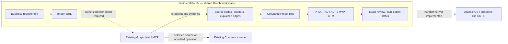

# 81rv10 · Launch Copilot

**Turn a business requirement into a launch proposal grounded in real code — before a single line of new code is written.**

Every product decision costs two things a business can't get back: time and credibility with the first
buyer. Launch Copilot exists to compress the gap between "we have an idea" and "we know what to build,
what already exists, and what's worth testing with a paying customer" — by grounding that decision in the
actual codebase, not a slide deck. It starts with the buyer's problem, inspects the relevant system, and
joins PRD → TAD → ADR → MVP scope → GTM around one shared body of evidence and decisions, so the business
case and the engineering case never drift apart.

The canvas makes that reasoning inspectable: real source nodes and explained edges, a separate
proposed-work overlay, and five editable document panels a buyer, an investor, or an engineering lead can
all read the same way. Source evidence supports an implementation estimate; it does not by itself
establish customer demand, willingness to pay, or production readiness — those are tracked and reported
separately, on purpose, so a business case is never overstated by a code graph.

**Status: native proposal prototype, specification `launch-copilot@r3` / `0.3.0`. The complete public
product journey is not ready.** See the dated implementation and deployment boundaries below — this
README states exactly what a buyer or reviewer can rely on today, and what remains a target.

## Why this matters to a business

Most "build vs. buy vs. defer" decisions are made on incomplete information: what's already built is
guessed at, not verified; the MVP boundary is negotiated by opinion, not evidence; and go-to-market
planning starts only after engineering has already committed weeks of work. Launch Copilot's target
journey collapses that sequence into one evidence-linked pass, so a business requirement produces a
launch proposal — not just a spec — with its build cost, reuse opportunities, and open commercial
questions visible in the same place.

## One product page

The required user experience stays at **[airvio.co/81rv10/](https://airvio.co/81rv10/)**:

1. Describe a business requirement and import a permitted repository through the existing Graph Import URL action.
2. Inspect the knowledge graph; select a node, cluster or edge and retrieve its source explanation.
3. Use source-bound Probe-Tree questions to resolve scope without losing the original requirement.
4. Review five native document panels beside the immutable source and separately identified NEW work.
5. Approve the exact files, publish through Agentic OS, and observe PR and integration status in the product.

This is the **target journey**, not a claim that every step is implemented. A buyer or reviewer should
not need a separate Graph application, a localhost tab, or manual copying between source and Probe-Tree
views to trust the output. Internal services and shared assets retain their existing owners and paths.



Diagram: target ownership and flow. An arrow does not establish a deployed connection or grant authority
to execute an operation.

## Existing owners

| Owner | Responsibility |
|---|---|
| **This repository, `81rv10`** | Launch Copilot product identity and overview. It has no independent application runtime. |
| [agentic-graph][graph-guide] | Existing Import URL, acquisition, parsers, knowledge graph, query/explain, selection, Chat, canvas, proposal workspace and release publisher. Also the selected repository for future proposal output. |
| [agentic-canvas-os][proposal-contract] | Shared ingest/parse and validating clients; the joined five-role prompt and proposal contract. |
| [agentic-commerce-os][commerce] | Permitted commerce source evidence and separately authorized commerce operations. Importing its source is distinct from invoking a live operation. |
| [agentic-os][os] | Writer admission, protected publication and integration evidence. A product review does not replace its authority or checks. |
| [huijoohwee][mirror] | Generated production mirror. Graph's publisher owns the future `81rv10/index.html`, using the shared Graph build and assets. |

Fix behavior in its source owner and regenerate publication output. Do not hand-edit the mirror or
introduce a second importer, parser, renderer, model proxy, ledger or Launch Copilot server. No external
template adoption, copied implementation or new external-project dependency is required.

## MVP: what a buyer can rely on today

The MVP boundary is drawn where verified evidence stops and where a commercial claim would otherwise
outrun what's actually built. This table is the audit a business stakeholder should read before citing
Launch Copilot's output in a customer conversation, a board deck, or a pilot agreement.

Source audit baseline: Graph [`d8bf68fc`][graph-revision] and Canvas OS [`c2c61a35`][canvas-revision],
inspected on **2026-09-12**.

| Capability | Audited state |
|---|---|
| Native repository import, deterministic query and explained edges | Implemented in Graph. Native proposal grounding bounds its evidence to 12 nodes, 20 explained edges and a one-hop neighborhood. |
| Five documents on the source canvas | Implemented with native `RichMediaPanel` widgets, solid evidence relationships and a separate dashed NEW overlay. The source graph remains read-only. |
| Outline, edits, reopen and export | Implemented. An outline contains editable placeholders and grounding receipts; it is not a finished AI-written plan. |
| AI drafting | One attempt through the existing authorized OpenAI Chat connection; invalid or failed drafting retains a labelled outline. Live OpenAI verification is deferred. |
| Public entry | Routing/publisher source is merged. At **2026-09-12 06:18 UTC**, both `/81rv10` URLs returned 404 and the observed production mirror had no `81rv10` directory. This is a dated observation, not a live status badge. |
| Public page → existing Graph host | Missing authorized transport. The current import/proposal bridge is Dev-only; the public browser's same-origin request does not reach a desktop filesystem path. |
| Grounded Probe-Tree on the same canvas | Missing source-snapshot/selection binding and overlay publication. Generic Probe-Tree exists, but its current authored-widget workflow is not this integrated journey. Its MCP bridge is also Dev-only. |
| Acquisition commit in retained proposal evidence | Canonical proposal evidence still reports it as unknown. The separately tested retention patch is uncommitted and must not be presented as integrated. |
| Exact approval → five-file PR → integration | Not implemented. There are no native Launch Copilot `review`, `approve` or `status` commands yet. Export does not publish or merge. |

**Reading this table as an MVP gate**: the top four rows are the buyer-facing proposal loop — the part a
customer conversation can already be grounded in. The bottom five rows are the path to a public,
self-serve product and are explicitly not yet part of any commercial claim. Treat any pitch, demo script,
or pilot pitch that implies the bottom five rows as a `blocker`-severity overstatement against this
README, not a rounding error.

The [product-entry contract][entry], [native invocation][invocation], [proposal host][proposal-host] and
[Probe-Tree bridge][probe-bridge] define these boundaries. Serving shared HTML alone does not supply the
host APIs.

## Try the existing local prototype

This is a **development diagnostic**, not completion of the public product journey — useful for
validating the buyer-facing proposal loop before it has a public entry point. Use an already provisioned
sibling Graph checkout and its existing dependency and source checks:

```sh
cd ../agentic-graph
npm run dev
```

Open the URL printed by Graph. In **Launch → Import URL**, select **Codebase graph** and import the
sample [anthropics/commerce-agents][sample]. Inspect the import receipt and actual available source
selection before submitting this in native Chat:

```text
/launch-copilot outline reference Help a solo merchant reduce abandoned shopping sessions with product discovery and cart review. Hand checkout to the existing host. Distinguish external reference contracts from NEW owned integrations and define one paid-pilot acceptance check.
```

Use `reference` for the sample; its code is not owned implementation. Use `owned` only for separately
imported, authorized implementation source. The MCP/WebMCP import action must also resolve to repository
ingestion: the current structured action has no Codebase graph mode field, and a bare GitHub URL is not
automatically equivalent to choosing that UI mode. See the existing [import dispatcher][import-dispatch].

Review and author the five scaffold documents. Substitute the returned CID and submit these commands
separately:

```text
/launch-copilot reopen <CID>
/launch-copilot export <CID>
```

`draft` may replace `outline` when the existing OpenAI connection and model use are authorized. It makes
no automatic repair or provider switch. Retained documents can be reviewed and exported offline; fresh
grounding and drafting require the native host. For phone review, use Graph's existing workspace editor
rather than assuming desktop canvas cards fit the screen.

## Sample evidence and its limits

The model-free audit acquired [commerce-agents at `fd4d5922`][sample] through Graph's existing inspection
cache. It admitted 571 files and produced 39,235 nodes and 38,921 edges. Python and TypeScript AST
parsing succeeded; 27 files provided inventory-only evidence.

One real relationship is [`StorefrontBackend` → `checkout_handoff`][sample-backend]: an exact Python
declaration-containment edge. It proves where the method is declared, not a payment execution path. The
sample delegates checkout completion to its host — this is the kind of distinction a business stakeholder
needs made explicit before treating a code relationship as evidence of a working payment flow: no live
payment or merchant demand is established by this edge.

The initial display was capped at 1,000 nodes and omitted that backend. A runtime call with explicit real
IDs returned relevant evidence and five outlines, but the corresponding browser selection has not been
verified. Automatic grounding found the method alongside an unrelated explained edge. Refine and inspect
relevance; neither a non-empty graph nor an explained edge alone proves the proposed business impact.

Import external repositories only as permitted reference evidence. Do not install or execute the sample,
copy its code/prompts/assets, or treat reference claims as reusable owned implementation. A complete
admitted corpus can still have limited parser fidelity and truncated query/display results.

## Proposal artifact and completion

Native drafts live in Graph's existing workspace under `/notes/proposals/<CID>/`. A sidecar retains
evidence and layout; it is not a sixth exported document. The ZIP contains exactly:

```text
docs/proposals/<CID>/prd.md
docs/proposals/<CID>/tad.md
docs/proposals/<CID>/adr.md
docs/proposals/<CID>/mvp.md
docs/proposals/<CID>/gtm.md
```

The five roles share the requirement, continuity/revision, source identity and review context. Technical
claims must cite verified owned evidence or name NEW work with an owner, dependency and future check. A
reviewer — whether an engineer, an investor, or a pilot customer's technical buyer — still checks what
each source actually supports.

## GTM: the win condition and what's still missing to reach it

The win condition is **business ask in → source-grounded five-document proposal integrated through a
protected PR out**, with the whole interaction at `/81rv10/`. That end-to-end loop is the actual
commercial product; everything upstream of it (import, canvas, grounding, drafting) is infrastructure in
service of that one deliverable reaching a buyer's hands with a build cost and a reuse story attached.

To close that loop, the missing adapter must:
- bind approval to exact paths and content hashes, source/revision, output repository and base,
- preserve partial effects,
- prevent duplicate publication, and
- verify provider state and integrated bytes separately.

Agentic OS owns publication through its existing CLI; there is no MCP `land` tool to assume — this is a
named, closed-by-default gate, not an implementation detail to paper over in a pitch.

Build, release, payment and outreach each require their own authorization and evidence beyond this
repository's scope. An exported proposal, a merged implementation PR, or a sandbox receipt does not by
itself prove a production-ready paid business — that claim requires its own separate, evidenced GTM
motion: a named buyer segment, a stated price point or pilot commitment, and an observed paid or
committed outcome, none of which this README asserts exist yet.

## Validation and implementation bounds

The grounding audit passed the existing Canvas proposal contract tests (**2/2**) and Graph's native
proposal composite test (**1**, including temporary ingestion, shared validation, source isolation,
persistence/export and a local provider stub). The real sample acquisition/query/explain/proposal probe
used no model. These results do not establish the public browser journey, live drafting or protected
proposal publication — and should not be cited as such in any external-facing GTM material.

The original experiment remains capped at **900 added implementation/test lines, six new product modules
and zero new dependencies**. The integrated prototype used 693 lines; uncommitted retention adds 54,
leaving 153 if retained. Public host transport and grounded Probe-Tree work have not been shown to fit
that remainder. Full LC modules load on demand, but the measured entry/state/render delta is nonzero; the
original zero always-loaded-byte goal remains an open discrepancy. See the [native verification and
budget record][graph-guide].

[graph-guide]: https://github.com/huijoohwee/agentic-graph/blob/d8bf68fc3e7ccfb26a9a77aebad5cf4d0eb2c911/docs/launch-copilot.md
[proposal-contract]: https://github.com/huijoohwee/agentic-canvas-os/blob/c2c61a35aa6da17e034cdd429c787442ec562573/src/launch-copilot-contract.js
[commerce]: https://github.com/huijoohwee/agentic-commerce-os/blob/37d1e2a2e3a0efa4f9c5f44c457efa3234d86ad9/src/local-first/checkout.ts
[os]: https://github.com/huijoohwee/agentic-os/blob/817c1da8dac21d688d7c531b234482c64ee4340b/docs/START-WORKFLOW.md
[mirror]: https://github.com/huijoohwee/huijoohwee
[graph-revision]: https://github.com/huijoohwee/agentic-graph/commit/d8bf68fc3e7ccfb26a9a77aebad5cf4d0eb2c911
[canvas-revision]: https://github.com/huijoohwee/agentic-canvas-os/commit/c2c61a35aa6da17e034cdd429c787442ec562573
[entry]: https://github.com/huijoohwee/agentic-graph/blob/d8bf68fc3e7ccfb26a9a77aebad5cf4d0eb2c911/docs/81rv10-production-entry.md
[invocation]: https://github.com/huijoohwee/agentic-graph/blob/d8bf68fc3e7ccfb26a9a77aebad5cf4d0eb2c911/canvas/src/features/agent-graph/launchCopilotInvocation.ts
[proposal-host]: https://github.com/huijoohwee/agentic-graph/blob/d8bf68fc3e7ccfb26a9a77aebad5cf4d0eb2c911/canvas/viteAgentGraphProposal.ts
[probe-bridge]: https://github.com/huijoohwee/agentic-graph/blob/d8bf68fc3e7ccfb26a9a77aebad5cf4d0eb2c911/canvas/viteProbeTreeMcpBridge.ts
[sample]: https://github.com/anthropics/commerce-agents/tree/fd4d59224ab96b43c6dc6888207c67b3bd5a24cf
[sample-backend]: https://github.com/anthropics/commerce-agents/blob/fd4d59224ab96b43c6dc6888207c67b3bd5a24cf/shopping-agent/core/shopping_agent/backend.py#L120
[import-dispatch]: https://github.com/huijoohwee/agentic-graph/blob/d8bf68fc3e7ccfb26a9a77aebad5cf4d0eb2c911/canvas/src/lib/toolbar/launchImportDispatch.ts
