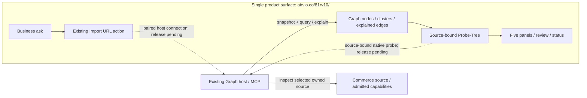
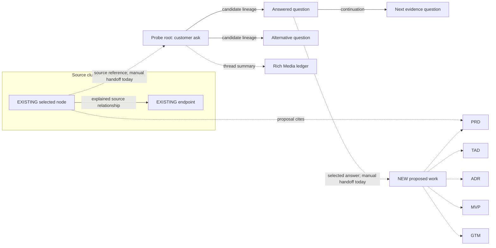

# Launch Copilot: business ask → real source graph → five-document proposal

**Start with a solo merchant’s business problem, then inspect the sample repository to test the plan.** Native proposals return real evidence and five editable PRD/TAD/ADR/MVP/GTM panels with a separate proposed-work overlay. Edit, reopen and export remain available. PR 974 adds canonical Graph Dev review/approve/status commands [S18]; the successful proposal-publication walkthrough and full public journey remain unverified.

Launch Copilot’s product repository is `/Users/katrina/Documents/GitHub/81rv10` (README-only canonical source). The existing Graph workspace owns its runtime; Graph is also the user-approved future proposal-output repository. `anthropics/commerce-agents` supplies **reference-only** evidence. No external code, prompts, dependencies or runtime are adopted.

**Required product journey:** all intake, source inspection, node/cluster/edge selection, Probe-Tree, proposal review and status stay inside `airvio.co/81rv10/`. Graph and Commerce are internal source/capability owners. The local steps 1–3 → 8 and manual Probe-Tree steps 4–7 below are retained as **diagnostics**, not a passing product demo. The latest requirement supersedes treating a manual two-document Probe-Tree handoff as sufficient.

Companion to [Launch Copilot LC-01 — PRD/TAD/ADR/MVP/GTM](20260912T140000Z-launch-copilot-lc01.md). That r3 draft remains the specification and historical evidence record. This runbook uses the later local Graph implementation listed above; its own version does not revise the five-role specification.

**Presenter opening:** “A solo merchant wants fewer abandoned shopping sessions. Before proposing a build, I’ll inspect product discovery, cart review and the handoff to host checkout. I’ll separate reference designs from the integrations we still need to own.”

## Single-product-surface audit

The table below is the earlier baseline audit. The r3.2 source increment now supplies the host transport, bare GitHub classification and source-bound Probe-Tree. Deployment and public execution proof remain pending; use the current rehearsal below after the protected candidate is released.

**Historical verdict before the public-flow increment: the end-to-end journey was not implemented/deployed.** `huijoohwee/81rv10` is generated publication output, not a new runtime or a GitHub page to embed. Its source owner is Graph. Loading shared `/agentic-graph/` assets behind `/81rv10/` is compatible with staying on one product page [S12].

| Required step | Observed state | Missing owner work / acceptance |
|---|---|---|
| Open `airvio.co/81rv10/` | The earlier 2026-09-12 404 is superseded by [release 34686475374](https://github.com/huijoohwee/agentic-graph/actions/runs/34686475374) at Graph `7fb857411` and generated mirror [PR 66](https://github.com/huijoohwee/huijoohwee/pull/66). Entry publication passed 65/65 checks in that release | The released entry is not the newer Dev handoff or proof of host transport; use the protected release owner for subsequent deployment |
| Invoke existing Graph Import URL by MCP/WebMCP | `agentic-graph.control_local_import_url` executes in the active browser workspace. Its Graph adapter calls origin-root `/__agentic_graph_agent_graph`, so the public page targets **airvio.co**, not the desktop path [S13][S14] | Existing owner needs a configured, authenticated product-session connection to the authorized Graph host. Filesystem paths and MCP tool names supply no transport. Same-origin configuration alone installs no server |
| Ensure GitHub import means codebase ingestion | UI Codebase graph sets the repository flag; structured import has no codebase-mode input and only auto-classifies explicit `.git` URLs as repositories [S15] | Reuse a supported repository invocation/binding and verify graph result identity. Bare URL import must not silently become ordinary document import |
| Ground Graph/Commerce evidence in the product workspace | Graph query/explain and native node/edge/cluster selection exist; LC binds one graph/snapshot/source role per request | If Commerce is source evidence, import it through existing owners. If a Commerce operation is needed, its existing operation/result contract needs a separate admitted binding; current LC does not invoke Commerce. Multiple independently acquired sources are not automatically joined |
| Render knowledge graph and five proposal panels | Existing Graph renderer and LC overlay already separate solid evidence from dashed proposed work [S4] | Serve through the same product workspace; retain current sample relevance/projection findings. Shared HTML does not provide the Dev host APIs |
| Ground Probe-Tree on that same canvas | Probe generation uses a second Dev-only MCP bridge. Its context contract carries widget/thread text and budgets, not LC graph/snapshot/ownership/selection bindings. Materialization edits an authored draft [S16][S17] | Extend existing selection/validation and mutable overlay/workspace owners; keep imported evidence read-only. Bind answers back to the original ask and source snapshot without manual copying |
| Approve/publish/read back without leaving the product | Canonical Dev has exact-file review, approval and status through OS [S18]; public transport and actual proposal effect proof remain missing | Keep UI review/status under `/81rv10/`; OS owns effects and Graph remains the output repository |

HTTP capability probes did not produce a validated capability response; Cloudflare returned 403/1010 to the audit client on the correct `/capability` paths. That is an access observation, not proof that a production MCP service exists or a reason to weaken origin checks. Source independently proves the current import/proposal and Probe-Tree bridges are Vite Dev-only. [HTTP receipt](../../.artifacts/launch-copilot-grounding-20260912/single-surface-http-audit.json); [dated provider readback](../../.artifacts/launch-copilot-grounding-20260912/single-surface-provider-readback.json)



Diagram LC-DEMO-02 · Target ownership view · 7 nodes / 7 edges / 1 UI group. This is not execution evidence. Existing internal API/asset paths are compatible with one product page. The proposed-work overlay remains separate from immutable source. The historical experiment reached **899/900 implementation/test lines**. The operator subsequently authorized full public completion beyond that line cap; six product modules and zero new dependencies remain the boundaries.

## Current public rehearsal (r3.2)

Integrated source: Graph [PR 975](https://github.com/huijoohwee/agentic-graph/pull/975), merge `d003fc2663a5d842c9865a1e6fdceb5063e2368c`; its exact source candidate `733de70fc8e6f227e57670c65e2eed0044f682cf` passed the [Integration Gate](https://github.com/huijoohwee/agentic-graph/actions/runs/34732276515). The [local static-build observation](../../.artifacts/launch-copilot-public-20260913/browser-observation.json) records actual pairing, 571-file sample import, five panels, persisted inline editing and offline export. This establishes the local public-shaped flow; deployment, live OpenAI and a real proposal PR have separate gates.

The merged revision passed [main CI](https://github.com/huijoohwee/agentic-graph/actions/runs/34733324598). Its [protected release run](https://github.com/huijoohwee/agentic-graph/actions/runs/34734306773) stopped at schema-map parity (49 missing document nodes); no deployment occurred. The existing schema owner is being synchronized before a new candidate run.

The schema mismatch was repaired by [schema PR 227](https://github.com/huijoohwee/huijoohwee.github.io/pull/227), merged as `204afd42933899a9e3676f459abc8359ae948531`. The generator now reports 289 nodes and zero differences. [Fresh release run 34735549245](https://github.com/huijoohwee/agentic-graph/actions/runs/34735549245) passed integration, build, schema parity and the isolated browser gate for Graph `d003fc266` with that repaired dependency. It is awaiting explicit human production authorization; nothing has been deployed by this run.


Use the exact protected release candidate and its matching canonical Graph host. The operator pairs the existing host once; the user then stays at `https://airvio.co/81rv10/`. Follow the [source-owned pairing guide](../../agentic-graph/docs/launch-copilot.md#pair-the-existing-host). No API key or control-plane bearer is pasted into Chat; only the short-lived pairing credential is submitted with `/launch-copilot connect <code>`.

1. Import `https://github.com/anthropics/commerce-agents` with native Import URL. Inspect the commit-bound Source Files receipt and relevant real nodes/edges. Treat this repository as reference-only.
2. In native Chat run `/launch-copilot outline reference <business requirement>`. This produces a labelled editable outline without a model call. Record the returned CID and inspect the five panels beside solid source evidence and dashed NEW work.
3. When live OpenAI verification is authorized, use `draft`, `/launch-copilot probe <CID>` and `/launch-copilot refine <CID>`. Answer a question on its native card, select it and invoke `probe` to continue that branch. The original ask, selected source and answers stay joined without copying to a second document. Current live model verification is expressly deferred.
4. Edit, reopen and export the proposal. Check exactly five files and selected text versions. Retained questions/answers are sidecar evidence, not extra exported proposal documents. Repeat review at 390 px and offline; reconnect before fresh grounding or remote effects.
5. Run `/launch-copilot review <CID>` against the enrolled Graph output repository. Review every file, hash and source/base identity before submitting the prepared approval command. Use `/launch-copilot status <CID>` to verify the actual PR and exact integrated bytes. Export, fixture success and an implementation PR do not count as a published proposal.

Local broker tests cover authorization, replay refusal, hibernation, expiry, streamed bytes and cancellation. Native tests cover two Probe-Tree levels, answer editing, refinement and failure preservation with provider fixtures. Record separate browser, deployment and actual-proposal receipts before marking the corresponding gates passed. The older manual steps below are historical diagnostics, superseded for the product rehearsal by this source-bound flow.

## Historical local diagnostics

## What this demo can show

| Part | Source-observed behavior | Evidence boundary |
|---|---|---|
| Import URL → visualization | Native **Launch → Import URL → Codebase graph**, repository acquisition, parse/projection progress and Source Files receipt | Ordinary webpage/file import has a separate route. A displayed graph does not establish complete repository coverage. [S1][S2] |
| Node / cluster / edge → proposal | Native selection feeds `/launch-copilot outline` or `draft`; the host grounds the selection and returns five RichMediaPanels with a separate NEW overlay | Completed source corpus required; its display projection and bounded evidence can still be truncated. [S3][S4] |
| Widget → Probe-Tree | **Run** generates accepted question cards, candidate relationships and a Rich Media ledger; answering a child and running it continues that branch | Requires a working model route. The **Probe-Tree** toolbar button reveals already accepted branches; it does not generate them. [S5][S6][S7] |
| Source selection → probe → revised proposal | The operator transfers source references into an authored Widget and carries the selected answer back to Launch Copilot | Automatic selection binding, a shared LC/probe overlay, and persisted cross-view joins have not been established by this inspection. |
| Reopen / export | Retained proposal files, source projection, edits and panel positions; exact five-file ZIP | Export does not publish a PR. Live drafting and this combined E2E still need a recorded run. [S3][S4][S8] |

The retained local Probe-Tree diagnostic uses **two native canvas documents in one Graph workspace**: the immutable codebase view with its LC overlay, and a writable Probe-Tree view with explicit source references. This is not compliance with the required same-canvas source/Probe-Tree join; the target is pictured above. Do not unlock the imported graph or silently insert generated questions into its source evidence.

## Start from zero

For local diagnostics only, use a fresh workspace with no imported source graph, existing proposal or pre-generated branches. A passing localhost run does not satisfy the `/81rv10/` product gate. Preserve any unrelated workspace. In an already provisioned Graph Dev checkout, start the existing application and open the local URL printed by Vite:

```sh
cd /Users/katrina/Documents/GitHub/agentic-graph
npm run dev
```

Record the actual running build and source commit before recording; the local commit in this document is a source-inspection baseline, not proof of the browser's runtime identity. Use the existing native acquisition host and parser. These endpoints are Vite Dev-only and excluded from the static build [S9]. A public `/81rv10` page or an arbitrary open local tab is not proof of the correct runtime. A missing host is a prerequisite failure; no standalone Launch Copilot app is introduced.

| Input | Demo value |
|---|---|
| Repository URL | `https://github.com/anthropics/commerce-agents` |
| Source role | **`reference`** for this external sample. Use `owned` only for separately imported, authorized implementation source |
| Original customer ask | “Help a solo merchant reduce abandoned shopping sessions with product discovery and cart review. Hand checkout to the existing host. Distinguish external reference contracts from NEW owned integrations and define one paid-pilot acceptance check.” |
| First evidence search | Start with `checkout cart StorefrontBackend`, then refine to `checkout_handoff`; broad terms returned noisy test/example references in the recorded probe |
| Initial mode | `outline`: local editable proposal, no LC model call |
| Interactive probe / optional AI draft | Existing authorized Chat model route; LC `draft` currently requires the existing OpenAI connection |
| Core deliverable | Source receipt + inspectable selection + PRD/TAD/ADR/MVP/GTM + reopen/export evidence; protected PR/integration remains a gap |

The repository URL is a live input. Reuse the returned IDs, hashes and coverage; do not paste the parent draft's historical graph IDs or promise its old node counts. Sandbox checkout evidence does not establish live collection or customer demand.

## Recorded sample preflight — runtime proof, browser rehearsal pending

The [plan’s ER-10 sample evidence](20260912T140000Z-launch-copilot-lc01.md#current-external-sample--source-evidence-before-the-plan) is the source record for this scenario: sample commit `fd4d59224ab96b43c6dc6888207c67b3bd5a24cf`, 571 admitted files, 39,235 graph nodes and 38,921 edges. Python and TypeScript AST parsing succeeded; 27 other files have inventory-only evidence. This was a fresh model-free runtime probe, not an executed browser demo.

The initial projection contains only **1,000 nodes / 525 edges**. The inspected `StorefrontBackend.checkout_handoff` method and its declaration edge are **not initially visible**. A current host call with explicit real IDs returns eight evidence nodes, one explained edge and five scaffold documents, but that does not prove the native UI can select those IDs from the initial projection. The existing Chat command has no ID argument, and the import UI exposes no arbitrary subtree/include controls.

For the exact sample scene, first confirm the returned target is visible/selectable through existing native controls. If it is absent, record the selection gap and demonstrate the raw query/explanation as separate source evidence; do not narrate an invisible node click, silently replace the original business ask, or claim that the runtime-only call completed the browser journey. A broad keyword hit alone is not proof of business impact. The core demo remains pending wherever this gap prevents the actual source-selection step.

A separate automatic host probe with the narrower ask recorded in ER-10 found `checkout_handoff` without explicit IDs, but its single explained edge was unrelated marketing-document containment. The returned evidence can feed the native overlay; selecting that newly revealed method in the UI still needs verification. Do not count an unrelated explained edge as checkout proof.

The historical ER-10 receipt predates acquisition retention in PR 971. Current Graph retains the acquired commit in its snapshot and native proposal files; the earlier `sourceCommit:null` is no longer the current behavior. The [historical probe receipt](../../.artifacts/launch-copilot-grounding-20260912/commerce-agents-audit.json) remains unchanged. Existing Canvas contract tests passed 2/2 and the Graph native proposal composite test passed during that audit with a local provider stub only.

### Current review candidate — 2026-09-13

The [review package](../../.artifacts/launch-copilot-completion-20260913/REVIEW.md) contains a Codex-authored, Canvas-validated `solo-checkout-pilot` proposal with five exact files and a native ZIP. The current sample import retained commit `fd4d59224ab96b43c6dc6888207c67b3bd5a24cf`; grounding selected eight nodes and the actual `StorefrontBackend` → `checkout_handoff` declaration edge. The native Node/JSDOM workspace check passed five panels, separate proposed work, offline edit/reopen/export and unchanged source hashes. This does not prove browser selection or a 390-pixel walkthrough.

The initial longer candidate exceeded the existing 160,000-byte workspace bound and was rejected. The final documents fit at 143,184 retained bytes. Exact-file review accepted the final candidate; changing PRD invalidated approval and status remained `not-started`. No human approval, proposal lane, PR, live OpenAI call or production effect occurred. The prepared offer/price remain hypotheses. Public transport, grounded Probe-Tree and the original zero always-loaded-byte discrepancy remain open; the 899/900 implementation count is unchanged.

## Presenter walkthrough

Allow roughly 8–10 minutes of narration, plus actual acquisition and model waiting time. This is a pacing guide, not a measured latency claim. Keep progress and failures visible in the recording.

### 1. Import the URL and watch the canvas form

1. Show the empty source canvas.
2. Open **Launch → Import URL**, paste the repository URL, select **Codebase graph**, and press **Import**.
3. Show acquisition, parsing and graph projection progress. Wait for the completed graph; an incremental preview is not the completed source snapshot.
4. Open the import's **Source Files** record. Record the source URL, graph identity, snapshot digest, parser identity, admitted scope, counts and completeness exposed by the receipt. Preserve missing fields as unknown.

**Say:** “The URL becomes source records, code entities and relationships. Each claim we make next must stay attached to this snapshot.”

**Visible checkpoint:** a non-empty knowledge graph plus its import receipt. If ordinary URL import produced only a Markdown document, return to **Codebase graph**. Within a codebase graph, some files legitimately use inventory-only parsing; show that limitation rather than relabelling it as AST coverage. The import response and separate probe capture the acquisition commit, but the current LC host does not retain it in its stored proposal evidence. Do not turn snapshot hashes into a fabricated commit-qualified native receipt. [S1][S2][S8]

### 2. Show the same system at node, cluster and edge level

Use the native selection and zoom controls. First check the projection limit described above. Find checkout-related entities through the existing search/navigation surfaces and inspect their source records. Names below are search hints, **not guaranteed visible targets**; the actual import owns the IDs and relationships. Stop this exact scene if the required source entity is absent.

| Selection | On-screen action | Explain to the viewer | Capture |
|---|---|---|---|
| **Node** | Select an actually visible checkout-related node; only use `StorefrontBackend` if the native view has surfaced it; inspect path and type | “This is one code entity. Its file and source identity make the claim inspectable.” | Actual node ID, type, source path and available source digest/span |
| **Cluster** | Select a native group or a bounded set of related checkout/receipt nodes; use zoom to selection | “This is the working scope for the customer request.” | Group ID if present, exact member IDs and visible omissions; a visual grouping alone proves no dependency |
| **Edge** | Select one real relationship in that scope; retain its endpoints for grounding in the next step | “We will inspect why this relationship exists, including its rule and certainty.” | Actual edge ID and endpoint IDs; later pair it with the host's explanation |

**Say:** “A node tells me what I am looking at. A cluster bounds the work. An explained edge tells me why two entities are related.”

The earlier owned-Commerce example used a TypeScript call-reference edge. Do not transplant its `handleCheckout` IDs or receipt semantics into this Python-heavy sample. The fresh probe parsed Python with the existing stdlib AST owner and TypeScript with the existing local AST owner. `containsDeclaration` proves a declaration’s membership; a `calls` edge ending at `CodeCallReference` proves an extracted call site, not a resolved runtime callee. Inventory-only files establish no AST dependency. Never invent seat/billing models.

### 3. Ground the selection and reveal the first five panels

Keep the chosen source selection stable and submit this exact command in native **Chat**:

```text
/launch-copilot outline reference Help a solo merchant reduce abandoned shopping sessions with product discovery and cart review. Hand checkout to the existing host. Distinguish external reference contracts from NEW owned integrations and define one paid-pilot acceptance check.
```

Show the returned evidence counts, truncation flag and generated CID. Read the PRD/TAD/ADR/MVP/GTM scaffold panels and inspect the retained evidence in **Source Files → notes → proposals → CID → launch-copilot.json** when the panel text alone does not expose an edge explanation. Keep this first CID so the original graph/proposal can be reopened after probing.

**Visible checkpoint:** real source entities remain identifiable; five editable panels and separately identified `lc:` NEW nodes/relations appear. The initial outline is a scaffold: one requirement-based placeholder per role, NEW owner/dependency/check placeholders and the grounding receipt. It does not automatically write a finished PRD or GTM plan. Complete the content manually for a no-model demonstration, or leave the AI drafting checkpoint pending [S10].

Confirm the selected edge's explanation includes its actual endpoints and available source/rule/certainty evidence. If there are no explained edges, show that result and select another supported relationship; do not manufacture a connector to complete the scene. The implementation bounds proposal evidence to 12 nodes and 20 edges with a one-hop neighborhood; these are not limits on the stored source graph. [S3][S4][S8]

### Optional 4. Turn an evidence gap into a Probe-Tree root

Open a separate writable authored canvas document in the same workspace. Use the native **Widgets** palette and **Storyboard** canvas surface to add a **Widget Card Type 0**. Keep the source graph available through its retained proposal CID. Title the new card **Launch scope — cart review to host checkout**.

Paste the following into the card's Prompt, replacing every angle-bracket field with observed values. This is an explicit operator handoff; these references are context, not automatically validated graph bindings.

```text
/agentic-graph.probe-tree

Original customer ask: Help a solo merchant reduce abandoned shopping sessions with product discovery and cart review. Hand checkout to the existing host.
Source role: reference
Repository: https://github.com/anthropics/commerce-agents
Source graph: <actual graphId>
Snapshot: <actual snapshotDigest>
Selected node IDs: <actual IDs>
Selected cluster: <actual group ID and members, or explicit selected member list>
Selected edge: <actual edge ID, endpoints, explanation rule and certainty>
Source excerpts: <short inspected excerpts with file/span and available digest>
Known gaps: <observed limitations; retain unknowns>

Ask 2-4 distinct next questions that narrow this launch decision. Each question should have 2-4 concise suggested answers plus Other, explain why the answer matters, and name the evidence still needed. Keep source facts, customer decisions and proposed implementation separate. The sample is reference-only and its checkout hands a cart to the host. Do not claim live payment, production authorization or proven demand.
```

Press the selected Widget's **Run**. A successful response creates context-specific **Probe-Tree Type 2** question cards and the thread's Rich Media ledger. Show a question, its rationale, the required evidence, and its candidate connection. The authored root text remains intact. [S5][S6]

**Say:** “The graph gives us facts. These branches ask the questions the code cannot answer for the customer.”

The **Probe-Tree** toolbar button can reveal accepted branches after generation. It does not seed example branches or call the model. If Run cannot obtain an accepted response, show the failure; this part of the demo has not passed. [S7]

### Optional 5. Answer one branch and follow its consequences

Choose a generated question about delivery, confirmation or recovery. Its exact wording must come from the accepted run. These are illustrative reviewer expectations, not canned model output:

| Possible question | Example answer choices | Evidence still needed |
|---|---|---|
| What must the host receive from cart review? | One cart handoff; seller-specific handoffs; operator review; Other | Actual backend contract and the merchant’s acceptance criterion |
| What must be confirmed before handoff? | Product variants/quantities; quoted totals; both; Other | Actual source fields and host validation; no payment receipt is assumed |
| What should happen if confirmation is lost? | Read back status before retry; operator review; Other | Current retry/deduplication behavior and a failure-path test |

1. Select one or more numbered answers, or enter **Other**. Show the committed numbered **Output** on that card.
2. Press **Run on that answered child**. Show that the next accepted cards descend from that child and preserve the original thread root.
3. Open the Rich Media ledger and compare it with the visible branch. Explain the new unanswered question and its required evidence.

**Visible checkpoint:** two levels of branching, the chosen answer retained on its parent, and semantic candidate edges pointing to the correct children. These edges mean question lineage; they do not become code dependencies. The runtime may draw connectors through a coordinator panel for layout, while the semantic parent remains the source/answered card. [S5][S6]

Stop after one useful continuation for the demo. The runtime's depth limit is eight; LC's one-call drafting policy does not describe the separate Probe-Tree provider/MCP attempts. Record the actual route, attempts and usage when available. Live OpenAI testing is deferred in this task; do not run the optional model steps as part of this grounding pass. [S6][S8]

### Optional 6. Bring the decision back to the source canvas

Save the authored probe document through the native workspace controls and retain its document identity, root/child IDs and committed answer. In Chat, reopen the original proposal, substituting the CID returned in step 3:

```text
/launch-copilot reopen <CID>
```

Reselect the relevant **source** nodes, cluster or edge after reopening; reopening initially selects proposal panels. Carry the original customer ask, the chosen probe answer, its provenance and remaining unknowns into a new request. For example, **only if the actual selected answer supports this scope**:

```text
/launch-copilot outline reference Help a solo merchant reduce abandoned shopping sessions with product discovery and cart review. Hand checkout to the existing host. The customer selected review before host checkout and readback before retrying a lost confirmation. Treat these as requested behavior. Cite the external sample as reference-only, mark owned integrations NEW, and include acceptance checks for duplicate handoff and recovery. Live collection and demand remain unverified.
```

Append the actual probe document/root/child references and exact committed answer to that request before submission. The new run returns a new CID; record its relationship to the initial CID and probe document in the PRD review notes. This linkage is operator-authored in this rehearsal.

For a live AI composition demonstration, replace `outline` with `draft` and use the existing authorized OpenAI Chat connection. Show the actual model receipt or the labelled fallback outline. Review claim meaning against the source; validated IDs alone do not establish that a statement is true. [S3][S8]

### Optional 7. Walk the completed visualization

| Canvas object | What the founder should be able to read |
|---|---|
| Source node | A real reference capability and source identity; not owned implementation |
| Selected cluster | The bounded implementation scope and omissions |
| Explained source edge | Why two source entities are connected and with what certainty |
| Probe root and answered branch | The original ask, the customer decision, and the next unresolved question |
| NEW work node / proposal relation | Proposed work, its owner, dependency and future check |
| PRD panel | Buyer, outcome, chosen scope and acceptance criteria |
| TAD panel | Reference boundaries, selected owned integration owner and missing work |
| ADR panel | Chosen approach, alternatives and tradeoffs |
| MVP panel | Smallest deliverable and checks for success, failure and recovery |
| GTM panel | Offer hypothesis, permissioned validation and missing demand/payment evidence |

The following is the **intended unified-canvas composition**, not an execution receipt or an importable code graph. In the current rehearsal, show its source/proposal and probe sections in their two native documents with the manual references visible.



Diagram LC-DEMO-01 · Composition view · Version 1, 2026-09-12. Inventory: 13 nodes and 13 edges; `S` is a visual group. Solid relationships inside `S` represent inspected source evidence; solid relationships outside it represent probe lineage. Dashed relationships are references/proposed work. Labels carry meaning independently of color. Actual evidence IDs and per-document citations come from the run, not these diagram aliases.

**Say:** “We can now separate what the repository proves, what the customer chose, and what still needs to be built.”

### 8. Edit, reopen and export

Edit one PRD acceptance criterion, wait for the workspace save, then reload and reopen the final CID. Verify the edit, source identity and panel positions survived without re-importing or regenerating the proposal. If optional steps 4–7 ran, reopen the probe document separately and verify its answer and lineage; LC reopen does not itself restore or validate that separate document.

```text
/launch-copilot reopen <final-CID>
/launch-copilot export <final-CID>
```

Submit these as separate Chat commands. Inspect the ZIP for exactly `docs/proposals/<final-CID>/{prd,tad,adr,mvp,gtm}.md` and compare the edited text. The proposal sidecar and Probe-Tree document are not sixth/seventh proposal exports. Keep the latter as separate demo evidence. Export's reported SHA-256 binds the serialized five-file content set; do not label it the raw ZIP-byte hash. [S4]

For the mobile extension, use **Workspace View → Editor Workspace → Source Files → notes → proposals → CID** at 390 × 844. Read/edit retained Markdown offline; reopening/exporting retained work does not establish fresh source evidence. Fresh grounding and unavailable model calls remain blocked. [S8]

## Failure and recovery beats

| Trigger | Required visible behavior |
|---|---|
| Cold import command resolution times out | Keep the error visible; allow the workspace to settle and retry explicitly. Current owner documentation reports an intermittent eight-second resolver deadline. |
| Host unavailable, unsupported source, cancelled or partial import | Show the failure/completeness result and preserved prior canvas; a partial preview does not pass the source-grounding gate. |
| No matching source entity or explained edge | Show an empty result/gap. Change the supported selection or keep the missing capability NEW. |
| Source or selection changes during LC grounding | Cancel/refuse the stale run; reselect and re-ground. |
| Probe model unavailable or output rejected | Keep authored input and accepted prior branches; show failure. Do not replace the run with the example questions above. |
| Probe reaches depth eight | Show the visible stop instead of extending indefinitely. |
| LC draft fails or returns invalid claims | Retain the labelled editable outline; do not describe it as successful AI composition. |
| Reload loses probe lineage, proposal text or identity | Record the failing surface and keep the combined E2E open. |

## Acceptance and run receipt

**Required product gate:** record the complete run inside `https://airvio.co/81rv10/`, with actual production build/mirror identity and authorized host identity; Import URL must invoke the existing graph owner, source/selection/Probe-Tree/documents must remain joined in the same workspace view, and edits/reopen must retain those joins. No mandatory localhost tab, separate app or manual source-to-probe copy may substitute for this gate. Current audit: **not passed**.

The sample-specific **browser** checks below are pending; any fresh runtime-only probe is recorded separately below and does not close these UI checks. The source owner's earlier documented browser/component checks are useful context, not evidence that this combined scenario ran here. The parent draft's LC criteria remain the governing product requirements.

- [ ] **D0 / zero state:** recording starts without imported source, proposal panels or generated branches.
- [ ] **D1 / LC-01:** a real Import URL run reaches a graph and receipt, with coverage and unknowns visible.
- [ ] **D2 / LC-01:** node, group/member selection and edge selection are each inspectable. During rehearsal, exercise each selection mode in its own outline run and compare the captured request to the returned evidence.
- [ ] **D3 / LC-01/03:** selected IDs and explained edge evidence join the current snapshot; source graph identity/bytes remain unchanged through proposal and probe edits.
- [ ] **D4 / optional probe:** an actual accepted model/MCP response produces 2–4 context-specific cards, answer choices, candidate edges and a ledger; no prefilled answers impersonate user decisions.
- [ ] **D5 / optional probe:** one committed answer drives a second-level child, preserving parent/root identity and visible lineage.
- [ ] **D6 / LC-02/03:** original ask plus any explicitly chosen optional answer reach five reviewed panels; existing claims are source-backed and proposed work is marked NEW.
- [ ] **D7 / LC-03/05:** proposal edits survive reopen; optional probe answers use their separate native reopen path; mobile/offline extension is recorded separately if claimed.
- [ ] **D8 / LC-04 export subset:** the ZIP contains the exact five reviewed files. Protected publication/integration remains outside this demo result.

Record: run date and build identity; imported URL and admitted scope; graph/snapshot/parser identities; actual node/group/member/edge IDs; initial/final CIDs; probe document/root/answered-child IDs; exact selected answer; model route/attempts/usage or unknown; acquisition/parse/ground/probe/render times; evidence paths or recording timestamps; export content-set digest; pass/fail per check and unresolved findings. Store actual values only after the run.

**Required unified probe-canvas completion gate:** the Graph owner must establish a writable probe overlay that binds source selections without changing the canonical graph, returns chosen answers to LC with original intent and snapshot checks, and persists the cross-view identities. Until that same-canvas path is implemented and exercised, describe that extension as a **manual native rehearsal**. The core LC source/proposal overlay already shares one native canvas. Neither this document nor export closes LC-04 publication, LC-06 deployed delivery, or LC-07 commercial validation.

## Remaining publication step

Canonical Graph now supports `/launch-copilot review <CID>`, `/launch-copilot approve <CID> <signature>` and `/launch-copilot status <CID>` [S18]. Review reopens the exact workspace files and binds their hashes, source/contract identity and the enrolled Graph target/base. Only submit the prepared approval command after reviewing all five files. OS creates one scoped lane and protected PR; status separately verifies provider state and exact merged bytes. Changed or expired approval is refused. After accepted approval, a disconnect does not cancel an operation already in flight; use status before recovery. The read-only smoke proved review and changed-content refusal without creating a lane. A successful real proposal PR/integration walkthrough remains unexecuted. Retention is merged in PR 971; the earlier writer overlap is resolved. The public-flow source increment now supplies host pairing and joined Probe-Tree. The actual protected release and public walkthrough must still be verified before this is a passing `/81rv10/` demo.

## Inspected source references

These links bind the controls and boundaries above to files inspected locally at Graph commit `d8bf68fc3e7ccfb26a9a77aebad5cf4d0eb2c911`. Source inspection does not prove deployed parity. No application code, configuration, deployment or customer outreach is changed by this companion.

[S1]: https://github.com/huijoohwee/agentic-graph/blob/d8bf68fc3e7ccfb26a9a77aebad5cf4d0eb2c911/canvas/src/lib/toolbar/LaunchDropdownImportUrlItem.tsx
[S2]: https://github.com/huijoohwee/agentic-graph/blob/d8bf68fc3e7ccfb26a9a77aebad5cf4d0eb2c911/canvas/src/features/agent-graph/agentGraphProjectionPolicy.ts
[S3]: https://github.com/huijoohwee/agentic-graph/blob/d8bf68fc3e7ccfb26a9a77aebad5cf4d0eb2c911/canvas/src/features/agent-graph/launchCopilotInvocation.ts
[S4]: https://github.com/huijoohwee/agentic-graph/blob/d8bf68fc3e7ccfb26a9a77aebad5cf4d0eb2c911/canvas/src/features/agent-graph/launchCopilotWorkspace.ts
[S5]: https://github.com/huijoohwee/agentic-graph/blob/d8bf68fc3e7ccfb26a9a77aebad5cf4d0eb2c911/canvas/src/features/agent-ready/probeTreeContract.mjs
[S6]: https://github.com/huijoohwee/agentic-graph/blob/d8bf68fc3e7ccfb26a9a77aebad5cf4d0eb2c911/canvas/src/components/StoryboardWidgetCanvas/runtime/storyboardWidgetWorkflowProbeTreeRun.ts
[S7]: https://github.com/huijoohwee/agentic-graph/blob/d8bf68fc3e7ccfb26a9a77aebad5cf4d0eb2c911/canvas/src/components/StoryboardCanvas/storyboardProbeTreeInvocationAction.ts
[S8]: https://github.com/huijoohwee/agentic-graph/blob/d8bf68fc3e7ccfb26a9a77aebad5cf4d0eb2c911/docs/launch-copilot.md

[S9]: https://github.com/huijoohwee/agentic-graph/blob/d8bf68fc3e7ccfb26a9a77aebad5cf4d0eb2c911/canvas/viteAgentGraphBridge.ts#L580
[S10]: https://github.com/huijoohwee/agentic-canvas-os/blob/c2c61a35aa6da17e034cdd429c787442ec562573/src/launch-copilot-contract.js#L64
[S11]: https://github.com/huijoohwee/agentic-graph/blob/d8bf68fc3e7ccfb26a9a77aebad5cf4d0eb2c911/canvas/viteAgentGraphProposal.ts#L37
[S12]: https://github.com/huijoohwee/agentic-graph/blob/d8bf68fc3e7ccfb26a9a77aebad5cf4d0eb2c911/docs/81rv10-production-entry.md#L3
[S13]: https://github.com/huijoohwee/agentic-graph/blob/d8bf68fc3e7ccfb26a9a77aebad5cf4d0eb2c911/canvas/src/features/agent-ready/importUrlWebMcpTools.ts#L18
[S14]: https://github.com/huijoohwee/agentic-graph/blob/d8bf68fc3e7ccfb26a9a77aebad5cf4d0eb2c911/canvas/src/features/agent-graph/agentGraphHostAdapter.ts#L238
[S15]: https://github.com/huijoohwee/agentic-graph/blob/d8bf68fc3e7ccfb26a9a77aebad5cf4d0eb2c911/canvas/src/lib/toolbar/launchImportDispatch.ts#L72
[S16]: https://github.com/huijoohwee/agentic-graph/blob/d8bf68fc3e7ccfb26a9a77aebad5cf4d0eb2c911/canvas/viteProbeTreeMcpBridge.ts#L176
[S17]: https://github.com/huijoohwee/agentic-graph/blob/d8bf68fc3e7ccfb26a9a77aebad5cf4d0eb2c911/canvas/src/features/agent-ready/probeTreeMcpBridgeContract.ts#L17

[S18]: https://github.com/huijoohwee/agentic-graph/blob/c0ec2dfa02d2338af3ad5202ad6ca882a6de5e06/docs/launch-copilot.md#L28
