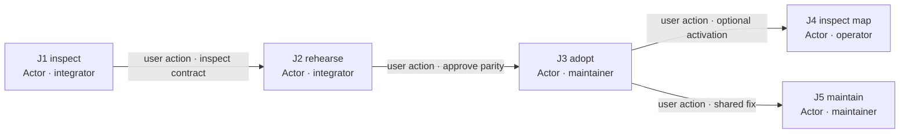
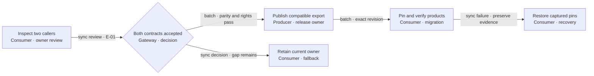
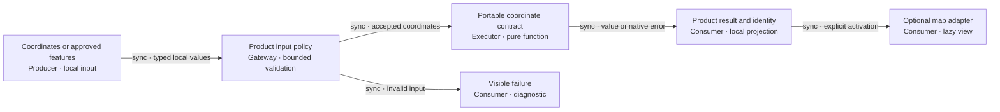
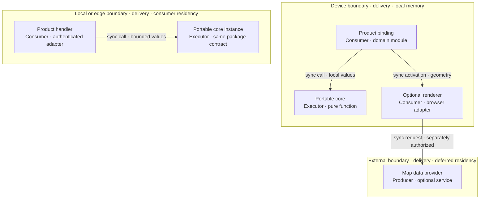

# Reference implementation — agentic-geo

Authoring contract: [PRD, TAD & ADR Guidelines 3.5.0][guide].

**Join: `AGENTIC-GEO-001@0.3.2`, all five roles.** MIT coordinate core source integrated at `3256385c98864dbfde7a4e3fd1a1e5901f20f294`; both direct caller contracts are owner-approved. Both product migrations and the ownership catalog are protected-source integrated and canonically synchronized. [Implementation receipts and open gates](prd-tad-adr-mvp-gtm-agentic-geo-evidence.md) distinguish source, local UI and delivery evidence.

The owner selected MIT, approved the public repository/profile and both direct caller contracts, then approved exact core integration on 2026-11-16. Graph migrates native polygon/map callers; Commerce adds an explicit, bounded, transient listing-region longitude preview. Local parity, shared cases, browser proof and exact protected owner checks pass. The owner accepted the technical core MVP and explicitly moved human TTV and real shared-fix economics to tracked post-adoption measurements; no saving or delivery claim follows.

## Scope, continuity and next outcome

`AGENTIC-GEO-001@0.3.2` owns the shared-library boundary and its migration decisions only. Existing product plans continue owning product requirements, data policy, deployment and rollback. Source owners remain unchanged until an accepted migration names the exact export, consumer pins, deletion and rollback evidence. No second editable schema or product roadmap is created.

**0, captured baseline:** coordinate helpers were graph-workspace coupled; independent demand and savings were unmeasured. **1, technical MVP accepted:** Graph and Commerce now consume the same protected portable coordinate core, pass its compatibility cases, and retain product policy and persisted formats. PD-01 below tracks human TTV and one real subsequent shared-fix cycle after adoption; their future evidence is not asserted by source integration.

H-01/E-01 feasibility is resolved for the selected core: two approved direct callers, frozen parity and no reverse imports. The next uncertainty is real reuse saving; PD-01 assigns its first observed shared-fix cycle to the Maintainer. Stop expansion on nonpositive net saving or incompatible semantics; retain product-local policy.

**Bounds:** original authoring: 30 active min, one file <600 lines/60,000 B. Implementation: 45 active min plus a 20-minute refresh for native checks/CI; ≤55 changed files, ≤65 kB authored additions, four new runtime modules maximum, zero paid/provider runtime effects. Companion retains receipts, failures and open gates; no saving or whole-MVP completion is inferred.

## From-0-to-1 coverage record

Source for each row: this join and the named anchor. Coverage is disposition, not acceptance or readiness.

| ID | Decision | Source section@0.3.2 | Evidence / gap and dependency | Accountable function | Next check / trigger |
|---|---|---|---|---|---|
| C01 | covered | PRD | two integrated consumer roles; buyer pain/WTP unvalidated | Product Manager | PD-01 and consenting operator trial |
| C02 | deferred | GTM | narrow operator segment stated; market size unnecessary for extraction decision; two-method sizing lacks sources | Product Manager | size before any market-sized claim or audience handoff |
| C03 | covered | ADR; GTM | direct reuse, local adapter and extraction compared; price is a test hypothesis | Architect | accepted contracts and protected adoption recorded; revisit new callers |
| C04 | covered | PRD; MVP | journeys/VCCs plus native parity, local browser/edge and mobile/offline proof | QA Engineer | VCC-01…08 |
| C05 | covered | TAD; native grounding | portable export and both consumer migrations integrated; one verified implementation | Architect | import and compatibility audit |
| C06 | covered | quality and economics | failure, privacy, FOSS, spend and cancellation constraints; no AI runtime | Engineering Lead | source-rights and bounded-input review |
| C07 | covered | ADR | technical core decisions accepted; recovery rehearsed; later adapters deferred | Architect | independent pre-baseline review |
| C08 | covered | MVP | two-consumer core integrated; package, clean technical rehearsal and source receipts recorded | Engineering Lead | clean-environment rehearsal |
| C09 | covered | GTM | manual pilot channel, activation, conversion, repeat/support measures; all unvalidated | Product Manager | register trial before observation |
| C10 | covered | operations and authority | manual release/support, capacity, supplier exits and incident ownership specified | Maintainer | first integration/support cycle |
| C11 | covered | quality and economics; native grounding | owner approved MIT for the extracted symbols; unrelated source rights are not inferred | Maintainer | rights review before any additional extraction |
| C12 | deferred | quality and economics | incomplete discovery sketch only; full linked statements need real price, volume and cost inputs | Financial Modeler | model before a financial or funding decision |
| C13 | not-applicable | GTM | no capital raise or paid infrastructure proposed; reviewer function: Stakeholder, review pending | Stakeholder | reassess on a funding/spend proposal |
| C14 | covered | operations and authority | four protected source integrations/synchronizations; no product deployment selected | Release Owner | exact authorized transition |
| C15 | deferred | GTM | deck/business-plan/financial-model projections not requested; dependency: an audience decision | Technical Writer | produce only when that decision is named |
| C16 | covered | Roadmap; verification | thresholds, known gaps and one bounded next action recorded | Maintainer | PD-01 human rehearsal and first real shared-fix cycle |

**Counts:** 16/16 dispositioned; 12/15 applicable covered; 3 deferred; 1 not applicable. All five roles consume this exact revision. Local/delivered readiness remains `undocumented` / `undocumented`.

## PRD

Users: multi-product integrators and place/area viewers. Possible payer: an operator buying assisted setup. Workarounds: existing workspace reuse, product adapters or an embed. No quote, ticket or paid outcome establishes buyer pain yet.

### Journey before stories

| Stage | User action and observable value | Alternate / failure | Reach and first-value target |
|---|---|---|---|
| J1 inspect | integrator locates the owned export, compatibility cases and supported versions | missing second consumer → retain current owner | local/headless; ≤2 actions / 5 minutes, unmeasured |
| J2 rehearse | integrator evaluates approved coordinates/regions in a clean consumer environment | malformed/oversized input → explicit error; source unchanged | browser and supported local/edge runtime; ≤3 actions / 10 minutes, unmeasured |
| J3 adopt | integrator pins the accepted revision and verifies the existing product journey | mismatch → restore prior pin, no partial ownership transfer | two products; ≤4 actions / 30 minutes after prerequisites, unmeasured |
| J4 inspect map | operator explicitly loads the optional map, selects an approved feature and sees its source | unavailable tiles → bounded local geometry/fallback with visible degraded state | 360/1280 px, touch/keyboard, labelled controls; ≤3 actions / 3 seconds warm data paint target |
| J5 maintain | maintainer releases one compatible fix and verifies both consumers | stale candidate/cancelled selection → ignore stale result; keep predecessor | exact pins/checks; saved effort measured over one shared-fix cycle |

J4 is a later renderer increment; core import must not require its rendering resources. Persistent offline reload, offline tiles and physical-device capability are separate acceptance profiles.

### Pain-to-feature mapping

| Pain / status | Hook → break → fix → close | Reuse/build and priority rationale |
|---|---|---|
| PP-01 / unvalidated | “Change shared geo behavior once” → product coupling makes adoption uncertain → portable export plus two caller contracts → both products pass one compatibility corpus | reuse coordinate primitives; build only compatible boundary/consumer bindings; first because closest to inspected code |
| PP-02 / unvalidated | “Pay only the runtime cost you need” → lightweight consumers can inherit renderer/browser dependencies → isolated core and explicit lazy adapters → headless use loads no renderer | reuse existing lazy-load and dependency-deduplication owners; renderer extraction waits for measurement |
| PP-03 / unvalidated | “Keep trusted place behavior during upgrades” → divergent policy or migration changes precision/identity → preserve product policy and wire contracts → outputs/errors/digests retain accepted semantics | reuse product validation/selection; build parity and rollback evidence; no universal merchant schema |

| Story | MoSCoW / journey / pain | Given → when → then | VCC / design |
|---|---|---|---|
| PRD-01 | Must / J1–J3 / PP-01 | As an integrator I want an owned portable contract so that two products can reuse a fix. Given two accepted callers, when they adopt one exact export, then the same coordinate compatibility cases pass in both. | VCC-01 / TAD-C1,C3; ADR-01 |
| PRD-02 | Must / J2 / PP-02 | As a local/edge developer I want minimal imports so that coordinate processing needs no browser or map engine. Given a core import, when its dependency closure and runtime are inspected, then there are no UI/graph/renderer/host-specific imports or model/network calls. | VCC-02 / TAD-C1; ADR-02 |
| PRD-03 | Must / J3,J5 / PP-03 | As a maintainer I want safe adoption so that existing users keep their results. Given the frozen native behavior cases, when migration and rollback run, then accepted/rejected inputs, error classes/messages, output ordering and applicable digests match; replaced implementations are removed. | VCC-03 / TAD-C3; ADR-03 |
| PRD-04 | Should, later / J4 / PP-02 | As an operator I want an explicitly loaded map so that small devices avoid unnecessary startup work. Given loaded local features, when I activate the existing map adapter, then one renderer mounts and selection/fallback remain usable. | VCC-04 / TAD-C2,C3; ADR-02 |
| PRD-05 | Should, later / J4 / PP-03 | As an operator I want source and approved precision preserved so that a shared library does not bypass my product's data policy. Given a reviewed file, when a consumer renders/exports it, then its existing identity, provenance, withholding and approval checks still hold. | VCC-05 / TAD-C3; ADR-03 |
| PRD-06 | Could, later / J1 | As an agent integrator I want discoverable geographic capabilities through existing gateways; machine binding follows an actual caller need and registered authority. | VCC-06 / TAD-C4; ADR-04 |

**Won't this increment:** new geocoder/search service, route/ETA/coverage computation, tile hosting, datasets or scraping; universal POI/listing schema; payment/unlock; persistent storage; native app; model inference; new tool gateway or lifecycle controller. An unvalidated Must remains pre-baseline until evidence or an explicit tracked product decision resolves it.

### Success metrics and ROI hypotheses

Targets are unmeasured proposals. The required mixed-unit ROI index is prioritization, not monetary return. `score = impact × reach / (build hours + monthly provider TCO + monthly serving-token cost)`. Use impact=3/5 and reach=2 intended consumer teams for initial comparison; both are unsourced hypotheses. FOSS/local effects require provider TCO=0 and runtime-model cost=0; maintainer time is not free.

| Feature | Build-hour hypothesis / ROI index | Baseline → proposed target / window |
|---|---|---|
| PRD-01 | 3 h → 3×2/(3+0+0)=2.0 | independent consumers: 0 proven → 2 accepted callers at MVP; clean TTV ≤30 min after prerequisites |
| PRD-02 | 1 h → 6/(1+0+0)=6.0 | core import closure unmeasured → zero heavy/runtime-effect dependencies at MVP; J2 TTV ≤10 min |
| PRD-03 | 2 h → 6/(2+0+0)=3.0 | compatibility/migration time unknown → zero unapproved behavior changes, one implementation, tested rollback; J5 support/fix time no worse over one cycle |
| PRD-04 | 4 h → 6/(4+0+0)=1.5 | renderer payload/paint unknown → explicit lazy activation, ≤500,000 B per emitted chunk, ≤3 s warm data paint; J4 TTV ≤3 actions |
| PRD-05 | 2 h → 6/(2+0+0)=3.0 | policy integration time unknown → unchanged product approval/provenance cases; J4 ≤10 min permitted-file task |

Proposed selection threshold: score ≥2 for the first slice, subject to pain, dependency and safety gates. PRD-04's lower score and unresolved rendering closure keep it later; mandatory safety checks cannot be dropped to inflate ROI. Sessions, support, install/CI cost, p95 and saving remain unknown. VCC-07 times J1–J3 in a clean environment before baseline; VCC-08 measures the same shared-fix journey before/after adoption.

## TAD

Consumes PRD `AGENTIC-GEO-001@0.3.2`. Native bindings are labelled reference implementations. Products retain runtime data and effect authority; build dependencies remain acyclic.

### Component inventory, contracts and reuse

| Component / responsibility | Interface, origin and smallest delta | Local / delivered rung | Boundary and check |
|---|---|---|---|
| TAD-C1 portable core validates/computes coordinates | source-owned extraction completed at `agentic-geo/core`; native normalization, wrapped span and unwrapping preserved | undocumented / undocumented formal plan ratings; technical MVP accepted under PD-01 | no DOM, graph types, renderer, filesystem, provider SDK or network; VCC-01/02 |
| TAD-C2 optional adapter projects map geometry | defer extraction; existing renderer/area/fallback owners continue running in products | undocumented / undocumented for extraction | explicit browser activation, one live host per view, disposal/cancellation; VCC-04 |
| TAD-C3 product binding associates domain identity | retain-local/contract-only adapter; consume core outputs through exact versioned exports | undocumented / undocumented formal plan ratings; binding integrations evidenced | listing rules, approvals, graph projection, selection, persisted state and UI callbacks stay with product; VCC-03/05 |
| TAD-C4 existing invocation adapter dispatches existing capabilities | reuse existing registry/schema/handler; no new library tool server | undocumented / undocumented for new geo federation | discovery/read-only/unsupported modes explicit; VCC-06 |
| TAD-C5 existing release controller publishes exact source | reuse consumer governance, protected review, affected CI and rollback owner | undocumented / undocumented formal plan ratings; protected source release evidenced | no custom publisher/ledger; VCC-03/08 |

Preserve native symbol names, math and errors initially. Normalization returns [-180,180), converts -0 to 0 and throws native RangeError on non-finite input. Span requires ≥1 finite longitude, deduplicates and preserves native shortest-wrap/tie behavior; unwrapping consumes its west bound. Never mutate caller arrays. Incompatible changes require an accepted contract version.

Core MVP accepts coordinates and longitude arrays only. It does not parse operator files, change a product's GeoJSON schema, generalize private geometry or decide publication rights. Full region validation/representative-point helpers, geometry adapters and shared format primitives are later candidates, each requiring its own parity/consumer evidence. Product-specific categories, source IDs, approvals, attribution and persisted records remain product-owned.

**Resource contract:** initial core production module ≤30,000 uncompressed UTF-8 bytes; zero production dependencies; no load-time effects; consumer arrays ≤1,024 longitude values in the initial negotiated profile. A product adapter enforces its cap before invoking native-compatible functions; do not silently narrow existing callers. Later operator input/output each ≤500,000 B and result display ≤50 follow their existing product contract, not a new universal geo limit. All authored files <600 lines; every lazy runtime chunk <500 kB; fail the affected rollout rather than claim an oversized vendor exception is compliance.

Compatibility cases include ±180/±540, -0, duplicates, unsorted input, antimeridian spans, empty input, NaN/infinities, nonnumeric values and immutable input; exact native errors, ordering/tie cases and applicable deterministic bytes/digests are frozen before moving code. Pure synchronous functions are single-pass requests with no retry/state; cancellation belongs to product async imports/selections using generation/AbortSignal guards. Migration must preserve their cancellation and stale-result behavior.

### Five-flow applicability and diagrams — reference implementation

All diagrams join `AGENTIC-GEO-001@0.3.2`, target the declared Flowchart canvas and static Markdown renderer, and contain proposed behavior only. Mermaid flowcharts use labelled solid arrows for the stated synchronous/batch/user transitions; no unlabelled or renderer-inferred relationship is intended. Data/harness classification is anchored to J1–J5. Zero model calls/tokens are permitted for diagram parsing/projection/rendering.

| Feature | Journey | Workflow | Data | Harness | Topology |
|---|---|---|---|---|---|
| PRD-01…03 | applicable J1–J3,J5 / DG-01 | applicable adoption/recovery / DG-02 | applicable J2 / DG-03 | N/A: deterministic library, no AI control path | applicable package/product/runtime boundaries / DG-04 |
| PRD-04/05, later | applicable J4 / DG-01 | applicable explicit activation/cancel / DG-02 | applicable approved geometry / DG-03 | N/A: existing product handlers; no model introduced | applicable device optional renderer / DG-04 |
| PRD-06, deferred | applicable J1 / same discovery stage | applicable only after registered caller contract | applicable existing typed envelopes | N/A until a separate AI pipeline is admitted | reuse existing gateway; no new node/service |

**Diagram DG-01** · Class: Journey stage map · Notation: Mermaid flowchart LR · Surface: Flowchart · Version: 1 — 2026-11-16. Caption: integrators reach first shared value before optional map or paid-pilot work.

**Diagram DG-02** · Class: User workflow · Notation: Mermaid flowchart LR instead of sequenceDiagram to preserve node-link projection · Surface: Flowchart · Version: 1 — 2026-11-16. Caption: adoption is gated on two callers and parity, with a native reuse path on failure.

**Diagram DG-03** · Class: Data flow · Notation: Mermaid flowchart LR · Surface: Flowchart · Version: 1 — 2026-11-16. Caption: local typed data flows through bounded math while domain policy remains in each consumer.

**Diagram DG-04** · Class: Runtime topology · Notation: Mermaid flowchart TB · Surface: Flowchart · Version: 1 — 2026-11-16. Caption: core execution stays on device/local/edge, with optional external maps behind consumer authority.

| Diagram | Projects | Nodes / edges / clusters, expected | Named check / observation |
|---|---|---|---|
| DG-01 | yes | 5 / 4 / 0 | E-DIAG and native parser: observed pass |
| DG-02 | yes | 6 / 5 / 0 | E-DIAG and native parser: observed pass |
| DG-03 | yes | 6 / 5 / 0 | E-DIAG and native parser: observed pass |
| DG-04 | yes | 6 / 4 / 3 | E-DIAG and native parser: observed pass |

DG-04 topology inventory maps t1/t4→TAD-C3, t2/t5→C1, t3→C2 and t6→deferred provider port. Storage is existing product-owned local/device storage or its separately selected edge owner; the shared library creates no store. J2/J3 use no remote service; external provider data/residency is unresolved and that seam remains closed. Diagram descriptions/tables provide text alternatives on mobile/offline; native parser counts match E-DIAG, excluding explicit document/cluster-membership edges. Static rendering was checked separately; this is not a live product acceptance run.

Build/release dependency order: independent portable contracts → optional adapters → product bindings/views; shared visual controls feed views through their own released package. No portable core dependency on a product, design system, storage engine or provider. Runtime reply arrows do not create reverse build dependencies.

### Ecosystem, lifecycle and invocation — reference implementation

| Participant / job | Value / payer | Component and native source join | Interface / authority | Evidence / exit |
|---|---|---|---|---|
| Integrator / adopt coordinate behavior | less coupling / internal team | C1,C3; G-01…03 below | public export; local computation only | both callers integrated at one protected pin; captured predecessor on failure |
| Operator / inspect permitted places | usable map / potential pilot payer | C3; G-04 product policy | existing UI and explicit file approval | no buyer/rights trial; product owns removal/retention |
| Maintainer / fix and release | one compatible correction / internal team | C5; existing OS workflow | exact source and affected checks; no inferred deploy grant | new package release absent; retain predecessor |
| Agent / discover existing capability | typed supported operation / none on reads | C4; G-05 | existing Graph MCP/browser command owner | no new standalone geo tool; unsupported modes explicit |
| Provider / supply optional map data | conditional service / no paid effect allowed | C2 port, deferred | separately verified consumer identity, rights and hard-$0/deny-at-quota gate | no selected provider; local-data fallback |
| Assurance / review parity and rights | bounded evidence / no payment claim | existing checks and independent Evaluator | read evidence only; no authority issuance | semantic review pending; reject unexplained differences |

Developer path: export/version discovery → local fixture rehearsal → existing authenticated handler where applicable → selection/cancel events → exact pin/state reconciliation → existing support → compatible retirement. No new SDK, registry, portal, event store or permission engine.

| Capability identity | Actual surface / owning handler | Mode and constraints | Extraction status |
|---|---|---|---|
| `geo.coordinate` | proposed library core export / C1 | planned synchronous local read/compute; no authentication/effect token or model | not implemented in new package; E-01 prerequisite |
| `geo.mode` | existing `/geo on|off` / Graph invocation runtime | supported existing local view preference | retain owner; no new slash route |
| `geo.layer` | existing `#<tag> show|hide` / Graph invocation runtime | supported local visibility | retain owner |
| `geo.fit` | existing `@<geo-node-id>` / Graph bounds/selection handler | supported only for resolvable geographic node | retain graph-specific identity |
| `geo.command` | existing `agentic-graph.geospatial.command` MCP / validated command handler | supported existing envelope/deep link; no remote publication authority | no generic tool parity claimed |
| library HTTP / WebMCP | no standalone surface; consumer adapters only | unsupported until actual caller, schema, registry and handler are admitted | deferred; discovery grants no writes |

No AI pipeline or runtime loop: harness flow N/A. OS status, agent discovery and gateway federation each remain local/delivered `undocumented`; importing a library transfers no gateway readiness. Existing ADLC bounds authoring to three alignment iterations, stopping on no finding reduction in two cycles.

## Quality, economics and obligations

This section consumes `AGENTIC-GEO-001@0.3.2`; all values below are limits or hypotheses unless labelled measured.

| Scenario | Required handling / observable check | Owner / recovery |
|---|---|---|
| invalid/non-finite/oversized input | native error parity and caller bounds; no fetch, mutation or silent truncation | C1/C3; preserve source and diagnostic |
| wrap/antimeridian/tie cases | same canonical longitude/span, source-order invariance where native contract promises it | C1; frozen native corpus, no guessed algorithm replacement |
| precision/contact/licence mismatch | product allowlist, withholding, attribution and rights review remain effective; core is not a sanitizer | C3; reject import/publication, restore accepted data |
| stale async selection/disposed map | product generation and disposal guards ignore late results; only one current view host | C2/C3; no stale state commit |
| offline or provider unavailable | coordinate core and already loaded data continue locally; label missing tiles; no offline reload/tile-pack promise | C2/C3; existing fallback, local-only rehearsal |
| version/lock drift | exact export/pin/schema version and complete compatibility report before adoption | C5; prior immutable pins and persisted-format compatibility |
| dependency licence unknown | inspect exact source/dependency notices and obtain required grant before extraction/distribution | Maintainer; no assumption from a public repository or common ownership |
| provider fee/headroom unknown | stop the dependent call; require exact current hard-$0 or deny-at-quota evidence under governing runtime policy | consumer effect owner; no paid plan/add-on/overage |

No new database/service. The owner selected MIT for the extracted coordinate core on 2026-11-16; use the existing FOSS toolchain and preserve applicable notices. Preserve copyright/attribution/provenance; conflicting restrictions stop adoption.

| Deployment variant | 12-month provider-cost hypothesis | Ops/time and token treatment | Disposition |
|---|---|---|---|
| local/device library | 0 incremental provider cost if entirely local; existing device/electricity unmeasured | no runtime model; install, maintenance and support time measured separately | selected MVP model |
| existing edge consumer embedding core | incremental cost unknown until current entitlement/headroom proof | existing consumer ops, CI and requests; no new service; no runtime model | conditional later consumer profile |
| managed geo API | unknown; not selected or purchased | provider rights/quota/cost/exit need evidence | Won't this increment |
| self-managed dedicated map/tile service | hardware/hosting/storage/egress/ops unknown | patch/backup/failover responsibility; no model needed | Won't this increment |
| consolidated existing host for map data | unknown incremental share; do not sum duplicated host costs | shared-host ops allocation and limits must be measured | deferred, not blended with local variant |

Economic gate: measured saved integration/fix/support minutes exceed migration/pin/release/CI overhead over an agreed horizon. Break-even cycles = migration minutes / positive net minutes saved per cycle; zero/negative saving means no finite break-even. Unknown inputs imply no saving. Money, energy, time and tokens stay separate. Core runtime model calls are 0. The companion joins execution costs: CI job time measured; historical operator/model cash telemetry missing.

Incomplete financial sketch: $1 is an offer hypothesis; volume, conversion, support, recognition/cash timing and recurring revenue are unknown. No full statements/market claim. The companion links the execution-cost ledger, failed work and explicit telemetry gaps; no new telemetry backend.

## ADR

ADR-01…04 are **Accepted for the selected technical core MVP**, dated 2026-11-16, consuming `AGENTIC-GEO-001@0.3.2`. Their later renderer/provider/invocation extensions remain deferred. PD-01 records the owner’s explicit post-adoption measurement decision; it supplies no missing measurement or production grant.

| Constraint | Gate |
|---|---|
| K1 spend and rights | free/FOSS only, exact source/dependency licence proof; no paid effect or unknown provider headroom |
| K2 portable boundary | no product/UI/DOM/host-specific/renderer/provider dependency or load-time effect in core |
| K3 real reuse | two concrete owner-approved consumer call sites and one compatible contract, not two names or embeds |
| K4 preservation | native behavior/error/identity/digest/limit/cancel parity; deletion and rollback evidence |
| K5 resources | source/file/module/chunk caps and clean TTV measured; no regression in mobile explicit loading |

**ADR-01 repository/extraction.** Selected: dedicated `agentic-geo` owner for the three compatible coordinate helpers after MIT rights, two approved real callers and E-01 parity evidence. Direct workspace reuse remains the tested recovery alternative; contract-only adapters are eligible when semantics hold; domain policy remains local. Copying/permanent forks fail K3/K4 and paid hosting fails K1. The original K1–K5 → buyer evidence → reuse-adjusted change → accepted outcome order remains the expansion gate; the owner explicitly accepted this technical foundation while PD-01 tracks human TTV and economics after adoption. Pure-math extraction and local policy retention are complementary. No contested argument; any contest goes to an independent Evaluator. FOSS recovery retains native source under the verified grant. Source/CI/migration costs are incurred work, not evidence of saving. Revisit on incompatible callers or nonpositive net saving; restore captured source/pins while retaining independently approved renderer alignment.

**ADR-02 package boundaries.** Core is pure; adapters/public entry points optional. MVP exports only accepted core, no empty stubs. FOSS alternative: existing workspace plus lazy adapter; provider cost may match, overhead differs. Renderer/provider choice deferred. Graph-facing hash/layer/state imports need a neutral owner before movement. Revisit on measured payload need; recover exact pins/lazy-load boundary.

**ADR-03 compatibility/ownership.** One implementation/check set moved after parity; products retain policy, data, association and effects. Preserve native symbols/wire schemas. FOSS alternative: contract-only adapter calling the current owner. Temporary shim requires actual callers, replacement pin, retirement trigger and zero-old-import check. Revisit incompatible policy; restore predecessor pins/code without parallel masters or user-data overwrite.

**ADR-04 invocation/effects.** No new endpoint, server, registry implementation, invocation parser or approval path. The existing owner catalog gained one source-only geo contract; consumer handlers own effects; new bindings require a caller/registered contract. FOSS alternative: existing invocation adapter. No hosted cost selected. Revisit on integration pain; remove the binding without removing local exports. Publication/production keep separate gates.

Selection cap: ≤45 active minutes, ≤12,000 advisory tokens, ≤3 iterations; stop after two without reduced uncertainty. Missing feasibility stays unresolved.

## MVP

**Slice:** PRD-01…03 → C1/C3/C5 → ADR-01…03 at `AGENTIC-GEO-001@0.3.2`: one portable coordinate core, two approved direct consumer bindings, one compatibility corpus, exact pins and one verified migration/rollback. A map-renderer extraction is not required to prove the first core boundary. A later map slice consumes PRD-04/05; it cannot inherit current product screenshots as proof of a new package.

| VCC | Measurable end state / stated check | Constraint / evidence state |
|---|---|---|
| VCC-01 | two owner-approved product call sites import one exact core export and pass the same valid/invalid corpus | pass for selected technical scope: two real callers, common corpus, exact pin and protected checks; no embed counted |
| VCC-02 | dependency closure and headless/browser/selected-edge smoke show zero prohibited imports, network/model calls and load-time mutations | pass in named local runtimes: core 2,037 B, zero production dependencies; hosted edge delivery not asserted |
| VCC-03 | frozen native parity, exact-pin migration and rollback pass; old implementation count is zero after verified cutover | pass for source cutover/reversion: native parity, restored consumer imports/manifests/locks, affected builds/cases and Commerce mobile/offline browser recovery; warm dependencies, not a clean install or applied product rollback |
| VCC-04 | later browser run at 360/1280 px shows explicit activation, one host, selection/disposal and local-data fallback | optional imports only; chunks <500 kB; pending new-package browser evidence |
| VCC-05 | later product approval/provenance/allowlist cases pass unchanged after adoption | real rights review separate; no automatic publication; pending |
| VCC-06 | any future route resolves to exactly one catalogued schema/handler and rejects unsupported/unauthorized effects | no new route in MVP; deferred acceptance, not a satisfied condition |
| VCC-07 | clean integrator J1–J3 rehearsal emits action count/time within PRD targets | agent-run technical rehearsal measured; human J1–J3 record deferred by explicit PD-01 acceptance decision |
| VCC-08 | same shared-fix journey records before/after fix, CI, release and support minutes, with positive net saving or an explicit retain-local decision | include migration/failed work; PD-01 tracks the real cycle after adoption; no saving asserted |

### Demo skeleton

Each Must has a 60-second feature budget; every row sums to 60. Reveals are scoped to the feature's own VCC.

| Must | Hook | Probe | Reveal | Domain action | Close |
|---|---|---|---|---|---|
| PRD-01 | 5 s: one change | 10 s: inspect two accepted callers | 15 s: VCC-01 parity output | 20 s: evaluate same antimeridian input in both consumers | 10 s: inspect exact pins |
| PRD-02 | 5 s: small local core | 10 s: inspect dependency closure | 15 s: VCC-02 zero heavy/effect dependencies | 20 s: import and compute with network disabled | 10 s: inspect size/result |
| PRD-03 | 5 s: safe upgrade | 10 s: inspect frozen compatibility cases | 15 s: VCC-03 acceptance/deletion evidence | 20 s: restore prior pin and repeat cases | 10 s: inspect preserved product data |

**Maturity assessment:** actual domain object is a product-associated geographic coordinate/region with provenance, not an agent or payment. User/job/environment are the integrator and operator journeys above. At this revision the four rubric ratings are all `unassessed`: Core Requirements & Functionality; Innovation & Theme Alignment; Technical Execution & Integration; Usefulness & Agentic Experience. No contiguous capability level, averaged score or experience claim is inferred. Gap owner: independent Evaluator; next check: observed two-consumer task in its intended environment, then apply [the rubric][rubric] with exact source and Evidence References. No new agent behavior is required to improve a novelty score.

## Roadmap

One roadmap owned by this join; prior local-directory and consumer roadmaps remain owners of their separate product work. Rank pain/WTP first, then near-built reuse/minimum change, then distance to a paid accepted outcome. Current pain remains unvalidated; the order below is a feasibility hypothesis, not a demand ranking.

| Phase / outcome | Pain / reuse / smallest delta / owner | Prerequisite and exit | ETA and caps / wait | Stop / recovery |
|---|---|---|---|---|
| P0 two-consumer decision | PP-01; reuse native exports/tests and existing commerce owner; approve two caller contracts / Architect | rights record + E-01 / VCC-01 feasibility | estimate 45 active min; ≤4 inspected/changed contract files, ≤12 kB authored delta, 0 runtime modules/deps, ≤12k advisory tokens, $0 | no second accepted caller or incompatible semantics → retain current owner; recheck on concrete caller request |
| P1 first core release | PP-01/02; move native coordinate functions/tests, exact package export/pin / source maintainer | P0 passes; exact repository/source authority / VCC-02 and core parity | estimate ≤2 active h per slice, ≤3 runtime modules, ≤30 kB core, ≤30k advisory tokens, $0; always-load heavy deps 0 | rights/import/byte failure → stop export, retain predecessor |
| P2 two product migrations | PP-03; smallest product-owned adapters, pins and old-code removal / product maintainers | P1 exact export/checks / VCC-01/03/07 | estimate ≤2 active h per product; ≤5 files and ≤20 kB authored delta each, ≤2 adapter modules, 0 new deps, ≤30k advisory tokens, $0 | parity or data drift → restore captured pins/data-compatible code; no parallel master |
| P3 optional map adapters | PP-02/03 only after measured need; reuse current renderer, fallback, selection and design controls / map maintainer | P2 acceptance and measured closure/payload need / VCC-04/05 | discovery estimate 45 min; implementation caps set before admission; every chunk <500 kB, explicit touch activation | unresolved graph coupling, mobile or chunk regression → keep renderer local |
| P0b paid pilot; post-adoption economics | same operator setup journey; existing manual offer and consumer product / Product Manager | existing product task, rights/consent; no extraction prerequisite / paid result; VCC-08 after adoption | ≤60 active min per trial, ≤5 prospects, 14-day observation window; replies are external waits, recheck on reply; no automated outreach | zero acceptance after 5 offers or net saving ≤0 → revise offer or stop expansion |

Deferred/Won't: renderer/provider extraction before P3; full polygon math before parity/second caller; new HTTP/MCP/WebMCP server; hosted maps, geocoding, routing, country datasets, payments and offline tile packs. Maintainer opens a successor Context on incompatible semantics, rights/cost drift, negative reuse economics or an invalidated Must pain; update the affected owner, never a parallel backlog.

## GTM

No standalone library buyer is demonstrated; first-dollar hypotheses concern operator outcomes, not installs.

| Rank / stream | Existing segment evidence | Mechanism / demand | Revenue recognized / cash collected |
|---|---|---|---|
| 1 / manual $1 permitted-place setup/export pilot | intended directory/listing operators; no interviews or price acceptance | mechanism-proven: no; demand-validated: no | none / none |
| 2 / repeat integration/support service | only after observed repeat work and positive net savings | no / no | none / none |
| 3 / hosted map or proprietary data product | no demonstrated segment; rights/hosting/$0 unknown | deferred / no | none / none |

ADR-01 constraints gate channels/prices: manual delivery is conditional on rights/consent; hosted service fails unresolved rights/cost. The existing manual outcome is nearest to a collected dollar; buyer segments stay incomparable without WTP. FOSS access and assistance differ; no subscription/payment integration/dependency is added.

Register H-01/E-01 and H-02/E-02 using the existing [learning records][lean] before observing results; no second learning schema. H-02: one operator will accept a completed setup outcome for $1. E-02: with consent, observe ≤5 task trials and explicit offers; continue on ≥3 concrete unprompted pain reports and ≥1 actual paid acceptance; revise if requested outcome differs; stop/pivot after zero paid acceptance in five offers. Window: 14 days after recruitment, not an ETA for replies. Proposed thresholds are not demand evidence.

Activation: approved file/task outcome. Record completion/time, help, costs, refusal and actual cash separately. Retention: second successful task; support: minutes including failed/repeated work. No recurring-revenue, market, saving, forecast or compliance claim. C02/C12/C15 require sourced sizing/model/projections before dependent audience/financial decisions.

## Operations and authority — reference implementation

START readmitted this document into the existing Joohwee lane at `0331abd2c662a247928caa14798f771286c6b0c2`, workflow digest `f5a6621972880862e0f588d6ac8d238f374502ab34b398953475acaf3186677a`, write digest `cc7eb2b7a16684d649c896d8174e76c7d15a038be04cc0111e7830dfdefd184a`. Prior draft/listing bytes and admitted mission root remain unchanged.

Implementation follows existing `agentic-os/docs/START-WORKFLOW.md`, `adlc-guidelines.md`, `RELEASE-WORKFLOW.md` and consumer product/deploy/rollback contracts; update the existing composition ownership/lock through its source owner before cutover. `agentic-design-system` owns shared controls/themes; `agentic-base` owns its general engine/views; `agentic-canvas-os` retains its product/client seam; `agentic-graph` and `agentic-commerce-os` retain their domain data and release authority. The public MIT `agentic-geo` repository is enrolled with the reviewed consumer profile. Core #1, ownership #703, Graph #1973 and Commerce #277 are integrated; all four canonical checkouts are synchronized and tracked-clean. Existing lifecycle commands own release; there is no new publisher, deployed service or inherited consumer delivery authority.

| Lane / boundary | Named gate and required evidence | Rollback / operator instruction / state |
|---|---|---|
| authoring → source integration | HG-01: accepted caller/rights contracts; exact candidate and green owner checks | reviewed source revert and captured pins / exact authority, green checks and source receipts recorded / complete for selected technical scope |
| integrated source → read-only mirror/package distribution | HG-02: exact export, permission/licence, deterministic artifact and protected release evidence | previous immutable package/source pin / both consumers pin protected core `3256385`; source adoption complete |
| mirror → product delivery | HG-03: consumer-specific exact candidate, current baseline, authorized controller and live identity | captured consumer predecessor and persisted-data compatibility / none / closed |
| provider/data publication | HG-04: reviewed source/precision/attribution and current effect-specific $0 proof | stop calls, retain local data, owner unpublish/revert / none / closed |

HG-01…04 remain effect-specific. The implementation request selected source implementation; subsequent owner approvals cover MIT, enrollment, both caller contracts and exact core integration. The selected source integrations and synchronization have exact authority, green proof and separate receipts. Provider calls and production rollout remain unselected. Separate receipts bind source, integration, cleanup, delivery and rollback. No force push, arbitrary cleanup or deletion of unintegrated work.

Capacity: one author in separate admitted owner lanes; no new agent/service. Existing issue/evidence owner retains incident input/version/error/predecessor. Retirement requires caller inventory/rollback window. External wait: human rehearsal and a real post-adoption shared-fix event; named owners/triggers are in PD-01 in the companion. No ETA is assigned to those observations.

### Planning record — 2026-11-16

| PRD-TAD-ADR-MVP-GTM | CID | RAO | Updated Date |
|---|---|---|---|
| `AGENTIC-GEO-001@0.3.2` | C: protected MIT core, approved callers and local parity/UI proof. I: share one portable implementation. D: require exact consumer integration evidence; retain product policy and closed delivery/provider gates. | R: Geospatial capability architecture. A: migrate direct callers through native owner lanes. O: source core integrated; protected source integrated; deferred measurements and delivery boundaries tracked in the evidence companion. | 2026-11-16 |

## Native grounding and migration bindings — reference implementation

2026-11-16 grounding covers affected interfaces and captured predecessors. Consume the [composition snapshot][grounding]; accepted rights, current pins and callers join the protected source receipts in the companion.

| Evidence ID / exact source | Inspected capability / current consumers | Decision and check / limit |
|---|---|---|
| G-01: `agentic-graph@675d0ad10eea5d57fe101c1fb5d4318a804a7ff5`, `grph-shared/src/geospatial/regionalPoiGeometry.ts`; `regionalPoiGeo.ts`; package export `grph-shared/geospatial/regionalPoiGeo` | native normalize/span/unwrap, polygon validation and representative-point helpers; no import lines in the 571-line geometry module; profile factory and graph map code consume shared geography | historical predecessor: its first three functions are now in protected `agentic-geo/core`; full polygon/representative algorithms remain Graph-owned and unextracted. Existing `node --test grph-shared/__tests__/regional-poi-geo.test.mjs` after the package build is a native check, not new-package proof |
| G-02: same revision, `gympgrph/src/maplibreLayers.ts`, package; `canvas/src/lib/toolbar/ToolbarToolMenuGeoView.tsx`; `canvas/vite.config.ts` | map layers import Graph-owned shared hash/enhanced-layer contracts; Geo panel/directory lazy load; current app dedupes renderer dependencies | retain local now; do not drag these imports into core or claim renderer extraction is ready. Existing geo/POI browser evidence belongs to the original product |
| G-03: `agentic-commerce-os@71d92b305fe41a927a2b740ef38267e6e61be234`, `package.json`, bounded `src`/`test` search excluding generated bundles | no match for geospatial, GeoJSON, MapLibre, latitude/longitude, coordinates or delivery-area/zone patterns in that inspected scope | historical protected-source baseline. The owner-approved transient listing-longitude preview is now implemented in Commerce PR #277; its integrated source and exact evidence are in the companion |
| G-04: Graph revision above, `canvas/src/features/geospatial/localPoiDirectoryModel.ts`, `localPoiDirectoryRuntime.ts`, `canvas/src/lib/graph/io/geojsonToGraphData.ts` and Local POI Directory owner plan 1.0.10 | validator/manifest, product categories/approvals, graph projection and existing map/selection; UI and CLI already share one policy owner | retain-local; no new universal POI schema, store or migration of raw operator data. Later adoption must rerun product approval/projection cases |
| G-05: same Graph revision, `canvas/src/features/geospatial/geoInvocationRuntime.ts`, `mcp/geospatial-layer-runtime.js` | existing `/geo`, `#tag`, `@node` and MCP dispatch ownership | reuse handler/catalog; package does not create a route or tool identity |
| G-06: `agentic-design-system@7fae5884f7024c1ddd029ef058a3e7758614f73b`, package export `./react/panels`; Graph Canvas exact pin is that SHA | current shared panel/control upstream | reuse released UI directly in consumer/adapters; core has no UI dependency |
| G-07: `agentic-base@9170a1de4ae290ad3a077af976813e70b3a7552d`, `src/index.mjs`; Graph consumes Base `5f5a76d8d1cb955c8d1ce2a6277bd21ed7dd065f` | general engine, memory/IndexedDB adapters and data projectors; current Graph controls imports are subject to Design System ownership cutover | retain owner/pins; do not add a geo store or imply local HEAD is the installed dependency |
| G-08: `agentic-canvas-os@f6d61d582ac1121151bf0ba9b20365588435bb43`, `src/agentic-graph-mcp-client.js`, package description | existing facade reexports OS-owned Graph MCP client; product embeds/calls Graph | future integration consumer only; an embed is not second direct core adoption |
| G-09: `agentic-os@45ea0e1f4a87976c4427a6a393dfffcbdb6c5a6a`, shared UI ownership and START/ADLC/RELEASE | lifecycle and exclusive Design System shared-UI ownership | reuse; no new release ledger or inferred effect grant |

Existing geo integration plan `geostack@0.4.1` and its evidence companion remain [local product-integration context](prd-tad-adr-mvp-gtm-geostack.md), not an alternative shared-package design. Graph PR #1974 integrated the separately evidenced region-projection fix as `2335267d9da9d77fb77b9df705f67927f9933931`; exact source and cleanup receipts are in the companion. Consume an exact protected successor only after its separate integration, or explicitly bind its current-byte hashes for a local test. This specification does not overwrite those files, erase history or transfer its readiness to the proposed package.

**Rights:** the original source inspection found no general grant for the geometry file. The owner then explicitly selected MIT and approved extraction of the three named helpers on 2026-11-16. The package preserves provenance and an MIT notice; no unrelated Graph code or broader licence conclusion is included.

Proposed bindings are `agentic-geo/core` first, then separately admitted `agentic-geo/maplibre` and `agentic-geo/svg`; provider ports remain optional and unselected. `agentic-graph` retains graph types/selection/GeoJSON product policy, `agentic-commerce-os` retains listing/merchant/delivery rules, and both consume public exports by exact accepted pins. No sibling source imports or reverse dependencies. Freeze before/after source trees and caller inventories, move the accepted implementation/tests once, update each consumer lock and remove the prior implementation with its tested replacement. Temporary shims require a caller list, deletion trigger and proof; they are not a legacy variant strategy.

## Verification, findings and handoff — reference implementation

Governing local guideline file is `/Users/huijoohwee/Documents/GitHub/huijoohwee.github.io/guidelines/prd-tad-adr-mvp-gtm-guidelines.md`, version 3.5.0, repository `99ea1f49211361528256045719b54f1634eee41a`, SHA-256 `4c7b9cfce239e0fba3b1ef560aba81e634dbea7d18213a2d1c7d7261736d8541`. Its file is unchanged locally; unrelated guideline edits were not consumed as authority. Modules used: templates 1.6.0, verification 1.3.3, economics 1.2.0, maturity 1.0.0, planning record 1.1.4, grounding 1.2.1, plus CID/readiness/diagram owner sections. The existing authoring guideline is the source, not a copied rule implementation.

| Evidence / scope | Named invocable check and result | Surface / what it proves |
|---|---|---|
| E-DOC / document structure | `node "$CHECK" "$DOC"`: 15/15 structure/receipt-join checks passed; prior geo authoring snapshots retained | authoring only; not semantic baseline or product VCC-01…08 |
| E-DIAG / DG-01…04 | `DIAGRAM_REGISTER=1 node scripts/check-diagram-canvas-render.mjs "$DOC"`; passed, 4 diagrams, 23 leaf nodes/18 authored edges/3 clusters, 0 findings | authoring, deterministic projection counts; 0 model calls/prompt/completion tokens |
| E-NATIVE / G-01 | 3,038 frozen-native comparisons; Graph shared suite 124 tests; Commerce geo checks 26 tests | local parity plus protected consumer integration; applied product rollback/delivery remain separate |
| E-ROLLBACK / VCC-03 | `node .artifacts/agentic-geo/rehearse-consumer-rollback.mjs` from workspace root; both consumer source reversions pass; exact receipt and scope in companion | isolated local source recovery, no deployment/applied rollback |
| E-RELEASE / package and consumers | core PR #1 integrated at `3256385c98864dbfde7a4e3fd1a1e5901f20f294`; ownership #703, Graph #1973 and Commerce #277 integrated and synchronized | selected technical source scope complete; production delivery remains separate |

Check locators: `CHECK=/Users/huijoohwee/Documents/GitHub/.artifacts/agentic-geo/check-spec.mjs`; `DOC` is this file’s absolute path; run E-DIAG from `/Users/huijoohwee/Documents/GitHub/huijoohwee.github.io`. Native `parseMermaidFrontmatter` projected each block with the same 23/18/3 counts; 32 membership edges are additional parser structure, not authored links. The earlier generic JSON adapter returned zero and was replaced by the correct Mermaid parser; its result is not render evidence. Static Mermaid rendering produced four SVGs under `/Users/huijoohwee/Documents/GitHub/.artifacts/agentic-geo/`, with network blocked and 0 model calls.

Readiness: core has protected source and local headless/browser/edge evidence. Both consumer migrations have local tests, live UI evidence and protected integration receipts. Technical MVP acceptance is the owner’s explicit PD-01 decision. Formal combined-plan local/delivered ratings remain `undocumented` pending independent semantic/readiness assessment and later delivery evidence. A clean agent-run install/corpus rehearsal is measured separately from human TTV. Savings/shared-fix economics and delivery remain unproved.

### Author review findings

This is a bounded pre-baseline author review, not an independent Evaluator verdict or whole-union conformance claim. Each record uses exactly the six fields from verification 1.3.3; missing independent evidence keeps baseline closed. Rule text is summarized beside the Rule ID to bind its ordinal to guideline 3.5.0.

| Finding Type | Severity | Rule anchor | Artifact reference | Evidence excerpt | Remediation |
|---|---|---|---|---|---|
| pain-point-not-validated | major | pain-point-to-feature-mapping#3 — label pain until observed evidence | PRD PP-01…03 | “No quote, ticket or paid outcome establishes buyer pain yet.” | specification change: incorporate consenting operator/integrator pain evidence before baseline |
| unimplemented-guideline | major | validation-checklist#1 — require current continuity and independent evidence before baseline | MVP VCC-01/03/07/08 | “Independent semantic/readiness assessment remains unassessed.” | locally reproducible check: obtain the independent assessment and keep PD-01 measurement deferrals explicit |
| missing-economics-metric | major | time-to-value#2 — validate TTV before sign-off | PRD J1–J3; VCC-07 | “VCC-07 times J1–J3 in a clean environment before baseline” | locally reproducible check: perform the named clean consumer rehearsal and record steps/time |
| monetization-demand-unvalidated | major | monetization#1 — separate mechanism, demand, recognized revenue and cash | GTM stream 1 | “mechanism-proven: no; demand-validated: no” | specification change: join an observed trial/offer result without inventing payment |

Bounded author review counts: the four types above each have 1 tracked pre-baseline finding. Each remaining authoring/diagram/canvas type below has count **0 observed** in this scoped review; this is not an independent semantic verdict. Execution-domain findings remain unassessed.

The complete zero-count vocabulary from the scoped author review is retained in the [evidence companion](prd-tad-adr-mvp-gtm-agentic-geo-evidence.md#scoped-author-review-zero-counts); implementation execution domains remain unassessed.

Scoped structural coverage: 15/15 scoped checks surfaced (identity, revision join, coverage domains, pain/story/VCC links, ownership, grounding, flow applicability, diagram projection, boundaries, budgets, roadmap, finding shape, current handoff, consumer rollback and cost-ledger joins); advisory checks: 0. This bounded denominator does not represent the full guideline union. Independent baseline alignment, clean TTV and consumer/rights acceptance remain open; no global zero-blocker or complete-conformance claim.

Local profile/release assertions, whitespace and scoped checks pass. The owner selected finishing, publication and END of the pending Graph/Joohwee lanes. Exact review/check/integration/cleanup receipts remain separate; the companion records their current scope.

**Next action:** Maintainer records PD-01 human TTV and the first real shared-fix cycle on their named triggers. MIT, both caller contracts, repository enrollment and four protected source integrations/synchronizations are complete. Renderer/gateway expansion and product delivery retain their own gates; formal readiness remains unassessed.

[guide]: https://github.com/huijoohwee/huijoohwee.github.io/blob/99ea1f49211361528256045719b54f1634eee41a/guidelines/prd-tad-adr-mvp-gtm-guidelines.md
[rubric]: https://github.com/huijoohwee/huijoohwee.github.io/blob/99ea1f49211361528256045719b54f1634eee41a/guidelines/prd-tad-adr-mvp-gtm-maturity.md
[lean]: https://github.com/huijoohwee/huijoohwee.github.io/blob/99ea1f49211361528256045719b54f1634eee41a/guidelines/lean-startup-guidelines.md
[grounding]: https://github.com/huijoohwee/huijoohwee.github.io/blob/99ea1f49211361528256045719b54f1634eee41a/guidelines/prd-tad-adr-mvp-gtm-codebase-grounding.md
