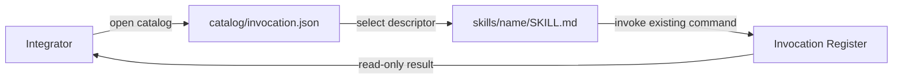
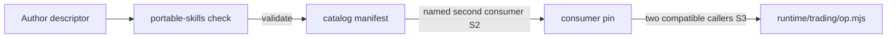

# Agentic Trading Skills: native gateway consumer

`AGENTIC-TRADING-SKILLS-001@0.11.0` accompanies [Trading 0.15.0](./prd-tad-adr-mvp-gtm-agentic-trading.md). OS owns one portable instruction and catalog identity. Trading owns the operations, ledger, market adapters and results. VCC-14 covers the released synthetic desk. VCC-15–18 specify the additional behavior a consumer must demonstrate for full laboratory parity.

Trading admits API and MCP through one signed-grant boundary (Product E-42/E-44). Outbound mappings, connected rights and host binding require independent qualification. Graph Integrations can present admitted capabilities through Design System. The skill discovers and explains them with `authority: false`. Product-local scope and S1 ownership continue to apply.

**Release status, 21 November 2026.** E-28 records the native desk instruction source, offline installation and local ZIP inspection. Product E-46 records local synthetic desk behavior. E-09–27 describe earlier candidates and specification work. Operator-attested external runtime, provider permissions, Cloud package acceptance and commercial adoption remain open.

## Decision record (ranked next outcome)

| Field | Value |
|---|---|
| Next outcome | An integrator can discover the desk, show its state to an observer and reproduce one historical result without changing a paper balance. Verify the browser and native callers against the same Trading revision. |
| Riskiest uncertainty | The canonical inbound gateway now exists implemented-local (Product E-42/E-44) and the general provider-mapping definition registry is implemented-local (Product E-49, successor lane, pending landing); per-provider connected conformance, per-environment rights, least privilege, simulator enforcement and $0 remain unproven. Demand remains unvalidated. |
| Cheapest sufficient test | Review exact native bytes without provider execution; reuse the implemented-local API/MCP parity/refusal fixtures (Product E-42/E-44) and plan outbound mapping-refusal fixtures, then reuse the packager/inspector and separately authorized host/read qualification. |
| Threshold / window | E-19 is pre-gateway only; E-22 verifies revised native bytes locally. R-GW inbound parity is implemented-local (Product E-42/E-44); outbound mapping/connected conformance remains pending and distinct from R1–R4. S2 requires a named independent second consumer; S3 requires two compatible callers. |
| Stop / revisit | Stop extraction if no second consumer is named (retain-local); revisit at discovery, baseline, MVP acceptance, audience handoff. |
| Bounds | Active time ≤ 4 h; one Markdown file < 600 lines and ≤ 90 KiB; zero new runtime modules at S1; token spend $0; no deployment; FOSS-only. |

## Reference implementation — PRD

### Vision, user, and job

Make reusable trading capability a **shared, headless, invocable asset** owned once and consumed by
many products. The immediate user is an **integrator/maintainer** of a second agentic product who
needs trading capability without re-implementing or forking it. The beneficiary is the end operator
who gets consistent, provider-neutral behavior across products.

### Pain-point-to-feature mapping (all `unvalidated`)

| Pain | Hook | Break | Fix | Close | Min-time-resource-max-value |
|---|---|---|---|---|---|
| P1 Duplicated trading logic drifts across products (`unvalidated`) | "Reuse one trading skill everywhere" | Clients duplicate signals/risk and bypass a single owner | OS descriptor/instructions consumed against Trading-owned canonical admission/policy | One instruction identity; product-local policy; two compatible callers before pure extraction | Reuse `skills/` and `catalog/`; no new OS runtime or registry at S1 |
| P2 Provider-specific instructions couple reuse to one environment (`unvalidated`) | "Use one native gateway consumer" | Transport, credentials and rights differ; copied instructions drift | Provider-neutral instructions; Trading owns gateway and explicit provider mappings | Native bytes reviewed; inbound parity and outbound mappings qualified separately | Existing OS seams only; gateway extension pending, no provider library or external skill dependency |
| P3 Trading policy leaks into shared utilities (`unvalidated`) | "Keep the core portable" | Domain rules/secrets/effects contaminate browser-safe utilities | Separate pure contract from domain owner and adapters; policy stays local | Effect-free core; dependency direction portable → domain → adapter → view | Reuse Functions portable-call pattern; build no domain logic into the core |

No quotes, tickets, or measured behavior are recorded; all pain is `unvalidated`. P1 is a bounded
learning hypothesis at baseline, not validated demand. `demand-proven` is reserved for paid-customer
evidence and is not claimed.

### MoSCoW stories

| ID | Priority | Story | Acceptance (VCC join) |
|---|---|---|---|
| PRD-SKL-01 | Must | As an integrator I can discover a trading skill descriptor offline from one centralized catalog | VCC-01, VCC-05 |
| PRD-SKL-02 | Must | As a maintainer I can validate one skill package through the portable-skills contract | VCC-02, VCC-08 |
| PRD-SKL-03 | Must | As a reviewer I can confirm the core is provider-neutral, headless, and effect-free | VCC-03, VCC-04 |
| PRD-SKL-04 | Must | As an owner I can confirm OS solely owns portable instructions/catalog while Trading owns canonical gateway admission, policy, ledger, signed read envelope/guard and provider mappings; all instruction clients are consumers | VCC-07 |
| PRD-SKL-05 | Should | As a second consumer I can pin a shared pure operation once two compatible callers exist | VCC-06 (gated S3) |
| PRD-SKL-06 | Won't (this increment) | Extract all trading domain logic into the shared core | Retain-local per ADR-03 |
| PRD-SKL-07 | Must (event runtime) | As the operator I can trace reviewed native bytes through archive acceptance to the actual executing host's discovery, binding, documented transport and independently verified auth | VCC-09/10; R1–R3 |
| PRD-SKL-08 | Must (event runtime) | As the reviewer I can reproduce pinned delegation, independent signed veto, safe refusal and rollback without giving an agent direct broker-write authority | VCC-11/12; R4 |
| PRD-SKL-09 | Must (gateway target) | As a consumer I use one canonical operation/admission contract over inbound API or MCP without embedding provider adapters; each outbound REST/MCP mapping is admitted independently | VCC-13; R-GW (inbound parity implemented-local; mapping/connected pending) |
| PRD-SKL-10 | Must | Guide market, portfolio, research and prediction workflows through discovered Trading operations. Report the data source, result and available authority before interpreting a result or requesting an effect. | VCC-14 for the local baseline. VCC-15–18 and Product VCC-40–46 for full parity. |

### Success metrics and Time-to-Value

| Metric | Target (estimate, unvalidated) | Method |
|---|---|---|
| TTV (integrator) | ≤ 10 min from opening the catalog to discovering and invoking one pinned skill capability offline | Clean-environment local rehearsal; zero token cost; no auth |
| Discovery cost | 0 tokens / $0 per read | Offline catalog read; metadata-first |
| Duplicate owners | 0 new registries; one capability identity | Invocation Register join check |
| Drift after reuse | Unknown — measure failed/repeated actions before/after | GTM experiment H2; not yet measured |

The historical release harness completed its canonical route check in 0.277 s (E-12); this is not a current candidate result. Human setup, host discovery and verification still need a timed integrator session.

### Verification conditions (VCCs)

E-11/12/14 retain baseline S1 results; E-19 retains the later **pre-gateway** bytes/digest/install results. Neither validates the new gateway-consumer revision, qualifies a connected host or proves instruction-following behavior. R-GW is independent of package, host and connected acceptance.

| VCC | Condition | Evidence Reference | State |
|---|---|---|---|
| VCC-01 | Offline discovery returns a stable ID, owner, description, source and SHA-256. | E-11/12, `/skill.discover` | Passed with zero model tokens and zero estimated cost. |
| VCC-02 | The installed export resolves, the descriptor matches the YAML, and loading checks the exact entrypoint bytes. The standalone skill resolves its resources. | E-11/12, portable skills contract | Passed after packing and installing offline. Unknown IDs, changed bytes and missing files each produced the expected error. |
| VCC-03 | The portable descriptor and instructions are provider-neutral and headless. Reading either grants no effects. | E-11/12, descriptor and entrypoint inspection | Verified for S1. The routes return `authority: false`. |
| VCC-04 | Shared operation is effect-free (no I/O/model/DOM/global state), typed input/output, bounded, deterministic digest | E-04 (G4), check `purity-contract` | deferred to S3; not run |
| VCC-05 | The command, read-only semantic and skill binding resolve one identity through the existing Invocation Register. | E-11/12, invocation and portable-package checks | Passed for discovery and load. |
| VCC-06 | Extraction deferred until two concrete consumers with compatible contracts (S3); second-product adoption requires a named consumer and a verified pin (S2) | E-06 (G4), check `reuse-gate` | gated; not satisfied |
| VCC-07 | OS solely owns portable instructions/catalog; Trading owns canonical gateway admission, account policy, SQLite ledger, signed read envelope/single paper guard and provider mappings. Native/third-party instruction clients consume, never adapt providers or authorize execution. | G6/G7/G9; E-17–19 | Target contract; no new OS registry/runtime or external skill prerequisite. E-19 is pre-gateway; E-22 verifies revised bytes/digest. |
| VCC-08 | Historical local proof, new native source, gateway conformance, package/host/connected qualification, delivery and demand carry separate status. | E-09–21 | E-11/12/14 are baseline S1; E-19/20 pre-gateway; E-22 current local checks, E-23 final validation. Direct connector smoke is not gateway proof; connected status UNQUALIFIED. |
| VCC-09 | Review native source identity and complete bytes, standalone entrypoint <8192 bytes, dependency/resource closure and rights. Use the existing product packager and inspector for strict YAML/name, compressed/expanded bounds and rejection of traversal, symlinks, duplicates, missing resources and secrets. | R1/R2; E-17 | Product packaging seam exists; optional Python dependencies absent in default interpreter; no new archive/test acceptance claimed. |
| VCC-10 | Resolve the native skill in the actual executing host/store; for Cloud retain actual `skill_id`, immutable version and content readback, bind the executing Agent and inspect a fresh Session. Verify that environment's documented transport/runtime/auth with a harmless admitted read. | R3; Trading RT-02/04/05 | Pending; no upload or provider execution in this revision. MCP-only needs no CLI; absent required capability yields a typed gap, not fallback. |
| VCC-11 | Coordinator explicitly delegates; pinned child outputs join by immutable input/policy/account binding. Independent authenticated risk can veto; forged files, stale verdicts and direct execution bypass fail the external guard. | R4; Trading VCC-25/34 | Pending; independent conversations alone do not provide enforcement. |
| VCC-12 | Before/after configuration and effective hashes match intended edits; fixed four-prompt evaluation, new Session snapshots, per-Thread events, resource digests and restore of the predecessor are retained. | R4; Trading VCC-26/33 | Pending joined receipts; historical fixture version strings are not host provenance. |
| VCC-13 | Inbound API/MCP have identical canonical admission outcomes; outbound REST/MCP mappings independently match provider/adapter/schema/mapping pins, operation, environment/account or public-data scope, rights, freshness/delay, quota and $0. Unknowns, passthrough, token forwarding and silent fallback fail closed. | R-GW; G9 | Inbound API/MCP parity/refusal/isolation/precision/restart conformance IMPLEMENTED-LOCAL and passing (Product E-42, 10 tests); outbound provider-mapping conformance and connected qualification still pending; independent of package/host/connected acceptance. |
| VCC-14 | Parity consumer guidance covers Product PRD-TRD-09 groups (a)–(i) through admitted operations only; experiment/prediction surfaces hold no dispatch authority; paper writes stay behind the single guard; no reference name/copy/dependency appears in native bytes or payloads. | Product VCC-39, E-28 | IMPLEMENTED-LOCAL. Portable discovery/load, archived instruction bytes and local gateway behavior verified. |
| VCC-15 | On landing, discover capabilities and enter the desk. On the desk, independently exercise all 22 actions mapped below. Verify feature detection, one registration per action, abort on navigation, ordinary-browser fallback and equivalent human/API/MCP results. | Product VCC-40–42 | Required. Synthetic API/MCP proof covers only the existing operations. |
| VCC-16 | Obtain a read-only observer link. Follow the same market context, chart overlays and sanitized activities from a second device. Attempt a write and an expired read, then verify the owner session remains intact. | Product VCC-43 | Required. A loopback owner cookie supplies no observer proof. |
| VCC-17 | Save a Python strategy by hash, run one historical hypothesis and all 20, poll, cancel and overlay markers. Explain technical outcome, input quality, risk and profitability separately, including missing data, modeled costs and cache provenance. | Product VCC-44–46 | Required. A browser signal run or a synthetic report cannot qualify a historical result. |
| VCC-18 | Inspect both spot and perpetual accounts. Require direct owner intent for each paper mutation, submit once and reuse the request binding after timeout. Test an over-limit order, a reduce-only reversal, a mismatched retry, ambiguous instructions and an untrusted label that requests a trade. | Product VCC-41/42 | Required. Every refused case preserves the prior ledger revision. |

## Reference implementation — TAD

### Codebase Grounding Record (historical observations; current owner-supplied facts)

| ID | Input | Exact source / revision | Inspected fact | Disposition |
|---|---|---|---|---|
| G1 | Skill package seam | `agentic-os@abcbfc6dc5e9e3c5f4ccb91bd5a7cdfed39408fc:skills/` | `canvas`, `esp-idf`, `software-forensics`, each `SKILL.md` with YAML `name`+`description`; subpath exports `./skills/<name>/SKILL.md` (+ `esp-idf/references/*`) | reuse (existing owner) |
| G2 | Catalog manifests | `agentic-os@abcbfc6:catalog/invocation.json`, `catalog/features.json`, `catalog/composition-source-lock.json` | invocation schema `agentic-os-invocation-catalog/v1`, entryCount 36, digest `sha256:aa9adef3…b5abc5`; features schema `agentic-os-feature-catalog/v1`, profile `fossOnly:true`, `maxIncrementalSpendUsd:0`, `deploymentAllowed:false`, entryCount 5, digest `sha256:17714ee4…25d985`; composition lock artifacts `{blob, owner, path}` | reuse (manifest precedent) |
| G3 | Runtime + admission seams | `agentic-os@abcbfc6:package.json`, `runtime/adapters/` | exports `./agents/skill-registry-gate`, `./agents/skill-proposer` — the **Agent-Definition** proposed→active promotion path (operator-gated, tool allowlists), *not* `SKILL.md` admission; also `./context/*`, `./planning/*`, `./forensics/source-evidence`, `./agent-docs/SKILLS.md`; `runtime/agents/docs/SKILLS.md` schema `agentic-canvas-os-skills/v1`, `publish_policy: Dev-only until explicit operator approval` | reuse (Agent-Definition path; separate from portable skills) |
| G4 | Functions consolidation pattern | `huijoohwee.github.io@f07f1a3c:docs/documents/prd-tad-adr-mvp-gtm-agentic-functions.md` (`AGENTIC-FUNCTIONS-001@0.1.1`) | T3 `catalog/functions.json` discovery gated S2 (named second consumer); T4 `runtime/functions/sum.mjs` + export `agentic-os/functions/sum` gated S3 (two callers); ADR-04 keep existing repos; portable call = ordered 0–512 finite binary64, effect-free. `runtime/functions/` and `catalog/functions.json` **absent** at `abcbfc6` (deferred) | reuse pattern; not native proof |
| G5 | Authoring contracts | `huijoohwee.github.io@f07f1a3c:guidelines/prd-tad-adr-mvp-gtm-guidelines.md` (v3.5.1, blob `392fcda1…`, last commit `fc53dc02…`), `skill-guidelines.md`, `skill-repo-map.md`, `codebase-neutrality-guidelines.md` | < 600 lines/file; frontmatter contract; C01–C16; one owner per capability; configuration-driven repo identification; no path-derived claims; brands only under reference-implementation label | govern (this doc) |
| G6 | Trading domain owner | Paired `AGENTIC-TRADING-HYBRID-001@0.15.0`; implementation context at Trading `173e71f2a4d48f61f17b3bf85266965b7f6a3924` (E-17) | Trading owns policy, SQLite ledger, signed telemetry/read envelope, single paper guard and mappings. Packager/inspector, Forward config/diff/GETs and injected-broker guard exist; the canonical inbound gateway is implemented-local, merged into Trading main (Product E-42/E-44), and the general provider-mapping definition registry is implemented-local on a successor lane (Product E-49, pending landing) while per-provider connected conformance remains a target. Real paper dispatch is implemented-local as a labelled simulation (Product E-44); deployed dispatch and complete scheduler/child fetching remain absent | retain-local; owner-supplied facts, not new validation |
| G7 | Native instructions and consumer boundary | OS baseline `11c8fde490e1af2622d465ff2b98e7e1930095c3`; active `trading-native-runtime` lane (E-18) | Same six-section `skills/trading/SKILL.md` and catalog identity; Gateway-consumer instructions are 8170 bytes (E-22). No provider endpoints/adapters or mandatory CLI in native contract; simulator rights independent of live flags | extend sole OS owner; E-22 bytes/digest/tests passed locally, no new runtime/registry |
| G8 | Portable skill contract + install/run | historical `agentic-os@abcbfc6:__tests__/portable-skills.test.mjs`, `package.json`; E-11/12 baseline release | `npm pack` → offline install → `import.meta.resolve("agentic-os/skills/<name>/SKILL.md")`; `dependencies: {}`; `files` ships `skills/`; resources <8192 bytes; standalone directory; no external relative links. Package resolution alone does not prove host skill-store discovery | reuse historical seam; recheck candidate and explicit host target |
| G9 | Gateway implementation gap | Owner-supplied current Trading code reality: `runtime/mcp-read.mjs`, `runtime/http.mjs`, `scripts/runtime.mjs`; inbound `runtime/gateway.mjs`, `gateway-http.mjs`, `gateway-mcp.mjs` merged into Trading main (Product E-42/E-44) | Fixed-provider outbound MCP read client; GET/HEAD-only HTTP readback; provider-specific configuration slot. The inbound API/MCP operation service is now implemented-local over one admission/ledger with signed-grant verification, a bridged PROVIDER reader path and a local paper transport behind the single guard; the general provider-mapping definition registry is implemented-local (Product E-49, successor lane, pending landing) and per-provider connected conformance is still open | Existing outbound seams are not a universal gateway; inbound parity implemented-local, provider-mapping registry implemented-local but connected qualification remains a gap (R-GW outbound pending); handbook 3.1–9 audit (Product E-43) recorded MOCK-only wiring, superseded by E-44, and the Graph MainPanel Integrations centralization landed via Graph PR #2049 (declarative `SETTINGS_OWNERSHIP_RULES` registry + brand-neutral Trading Runtime Gateway MCP doc surface; Product E-49), connected wiring pending |

G1–G3, G5 and G8 retain baseline observations; G4 is a pattern, not native proof. G6/G9 are bounded owner-supplied implementation facts. E-19 validates only the pre-gateway source/install path; E-22 validates G7's new native revision locally, not gateway execution. Earlier external-source research is superseded, not recast as native implementation evidence.

### Division of Work — ownership and reuse record

| Capability | Owner | Source / export / revision | Current consumers | Decision | Smallest delta | Named check |
|---|---|---|---|---|---|---|
| Native instructions/package | `agentic-os` alone | `./skills/trading/SKILL.md`; E-11 baseline, E-18 lane | Native host/client as consumer; host separately qualified | extend-owner | Same six sections, ≤8191 bytes; handbook 3.1–9; gateway-consumer instructions, no provider library | `portable-skills` (E-22 local pass) |
| Skill discovery catalog | `agentic-os` alone | Descriptor on `@skill:` in `catalog/invocation.json` | Offline discovery/load | extend-owner | Hash exact new bytes; metadata grants no authorization; no new registry | `catalog-read` |
| Shared pure operation | `agentic-os` | Future `runtime/trading/<op>.mjs` + export `agentic-os/trading/<op>` | none yet | defer (S3) | Effect-free only after two compatible callers; no module now, no gateway/policy extraction | `purity-contract` |
| Instruction discovery/load routing | `agentic-os` | `catalog/invocation.json`, `bin/agentic-os-invocation.mjs` at E-11 | Packaged CLI | extend-owner | Existing two read commands and selector only; not gateway execution routing | `invocation-join` |
| Portable skill validation | `agentic-os` | `__tests__/portable-skills.test.mjs`; E-19 pre-gateway | Packaged CLI and standalone instructions | extend-owner | Explicit offline target, zero dependencies, bounds/digest/refusals; native owner refreshes evidence | `portable-skills` |
| Agent-Definition promotion | `agentic-os` | `./agents/skill-registry-gate`, `./agents/skill-proposer` @ `abcbfc6` | runtime agent definitions | defer (separate path) | Not portable-skill or gateway admission | `skill-registry-gate` |
| Canonical gateway admission | Trading alone | Product 0.15.0; inbound implemented-local (E-42/E-44), G9 provider-mapping registry implemented-local (E-29) | Native skills and third-party instruction clients (consumers; host binding pending) | retain-local; inbound implemented-local, mappings pending | One admission/policy/ledger boundary for inbound API+MCP; no second authority in client/OS | `gateway-conformance` (R-GW inbound parity implemented-local; mapping/connected pending) |
| Provider mappings and outbound adapters | Trading; providers own their external interface schemas only | G9 limited current clients; future explicit provider/adapter/schema/mapping pins | Product outbound mappings only in target design | retain-local; pending | Independently admit REST/MCP by operation/environment/scope/rights; never embed mappings/endpoints in native instructions | `provider-mapping` (pending) |
| Archive construction/inspection | Trading | `scripts/package-skill.py`, `scripts/inspect-skill.py` at E-17 | reviewed native archive | reuse | Complete byte digests and nested producer provenance; missing parser dependencies block qualification | `native-package-review` |
| Trading policy and effects | Trading alone | `AGENTIC-TRADING-HYBRID-001@0.15.0`; existing E-17 seams | Product; instruction clients consume admitted results only | retain-local | Account isolation, SQLite ledger, signed reads/independent veto, single paper guard, schedule/dashboard; no duplicate in OS | `ownership-seam` |

Target dependency direction: instruction consumer → Trading canonical gateway → independently admitted product mapping/adapter → provider. The effect-free utility dependency rule remains portable → domain → adapter → view; neither permits provider SDKs, secrets or execution authority in a skill/core. Share by declared export or versioned protocol, never sibling source imports. Consumer metadata can request a supported operation, not select an arbitrary endpoint/tool/command or mint admission.

### Invocation Register

| Route | Kind | Capability identity | Mode | Authority | Owner / schema |
|---|---|---|---|---|---|
| `/skill.discover` | command | trading-skill discovery | read-only | none (metadata) | `catalog/invocation.json` |
| `/skill.load` | command | trading-skill package load | read-only | none | `catalog/invocation.json` |
| `#read-only` | semantic | discovery/load posture | read-only | none | `catalog/invocation.json` |
| `@skill:` | binding | select one descriptor | read-only command option | none | `catalog/invocation.json` |
| skill route `skills/<name>/SKILL.md` | skill | one validated instruction package | consumer guidance only | none; not a provider adapter | package export `./skills/<name>/SKILL.md` + `portable-skills` |
| Inbound API / MCP (implemented-local routes `/api/gateway`, `/mcp`) | product protocol | same canonical Trading operation | one admission boundary | only explicit product admission; never discovery | Trading-owned gateway contract (Product E-42/E-44); R-GW inbound parity implemented-local, mapping/connected pending |
| Outbound REST / MCP (target mappings) | product transport | pinned provider-specific mapping of admitted operation | independently admitted | no inherited inbound authority | Trading-owned provider/adapter/schema/mapping pins; G9 limits |

The OS register identifies instructions, not provider tools or execution rights. Native skills and third-party instruction clients are consumers; discovery may inventory supported operations, schemas and transport metadata but cannot authorize them. The inbound gateway is implemented-local in Trading (Product E-42/E-44), not a new OS registry or a deployed/cloud service. An inbound MCP caller does not imply outbound MCP support (nor API imply REST); each outbound mapping needs separate admission. Live-order routes/scopes are **out of scope**. Default read-only/mock; simulator rights, account/environment, independent signed veto, operator grant and single product paper guard are separate checks. `live-trade:false` neither proves paper tools absent nor grants simulator rights. Offline discovery/load costs zero model tokens; connected rights, freshness/delay, quota and $0 must be evidenced.

### Flow classification (five types)

| Flow type | Applicable? | View / reason |
|---|---|---|
| User journey | yes | D1 — integrator discovers → loads → invokes one capability offline |
| Workflow | yes | D2 — author descriptor → portable-skills check → catalog read → consumer pin |
| Data flow | yes | D3 — descriptor metadata → catalog manifest → consumer; no secret/effect data in core |
| Orchestration / harness | yes | D4 — target consumer → one admission boundary → independently admitted transport; typed output/cost/refusal, bounded loop |
| Topology | not applicable to this spec edit | No DEPLOYED/cloud gateway; the inbound API/MCP gateway is implemented-local in Trading's separate `trading-runtime-implementation` lane (Product E-42/E-44), a new local runtime surface only. Deploy Boundary closed (no deployment). Outbound provider mappings remain specified, not implemented. |






### Contract, failure, and budgets

These are contract obligations: the inbound boundary is implemented-local (Product E-42/E-44), while G9's outbound clients still do not implement provider mappings.

- **One canonical boundary:** normalize inbound API/MCP requests to the same typed operation contract and Trading admission/policy/ledger decisions. Instruction clients carry no provider library, endpoint, tool-name translation, credential logic or execution authority. No copied provider instructions, mandatory CLI or external-skill dependency.
- **Independent mappings:** before dispatch, match approved provider identity and adapter/schema/mapping revisions/digests, canonical operation, selected outbound REST/MCP transport, environment, authenticated caller and account binding **or explicit public-data scope**. Bind policy/input revisions too; mismatched, unknown or unsupported pins/operations/scopes fail closed. Inventory is metadata, not admission or compatibility proof.
- **Rights and evidence:** verify interface/data rights, permissions, freshness/observed time/expiry, delay class, quotas and $0 for that exact mapping and environment. Public data is not an inferred account entitlement or proof of free use. Unknown rights, quota, fees or freshness block connected use; no broadening scope to succeed.
- **No passthrough/fallback:** validate incoming gateway token audience; reject raw endpoint/tool/command passthrough, incoming token forwarding to providers, guessed capabilities and silent provider/transport switching. Product credentials stay server-side and are independently scoped; inbound auth cannot substitute for outbound auth. Changing provider/transport requires explicit mapping review and re-admission, not a skill fork.
- **Honest output:** typed results/refusals include provenance, selected pins, timestamps/delay, unknowns and cost evidence. Preserve supplied numeric precision and units; never synthesize precision, prices, timestamps or freshness. Missing categories remain typed gaps; an unavailable provider can leave offline metadata readable, never create an effect path.
- **Isolation and enforcement:** bind account-scoped reads/caches/intents/ledger records to the exact account/environment; never reuse another account's credentials, receipts or risk approval. Keep public-data scope explicit. Paper requires independent signed risk veto, expiring operator grant and the single Trading paper guard; live routes/scopes remain excluded. An instruction or discovery result is never a grant.
- **Uncertainty and bounds:** preserve durable deduplication, reservations, ledger/checkpoint and `RELEASE_UNKNOWN` across timeouts, restart and rollback; reconcile authoritatively before any new dispatch, never auto-resubmit. Emit cost/refusal logs; bound every loop and circuit-breaker. Read-only/mock is an explicit safe state, not silent transport fallback. S1 token spend $0, ≤1 validation pass, ≤4 h active.

**R-GW · Gateway conformance acceptance (separate gate).** Inbound API/MCP parity, refusal and ledger outcomes for equivalent canonical inputs are implemented-local and passing (Product E-42/E-44); outbound tests must independently exercise each supported provider/REST/MCP mapping and pin drift, unsupported operations, account/public-scope isolation, expired rights/data, quota/$0 failures, passthrough/token-forwarding denial, no silent fallback and precision preservation. Include signed veto/single-guard enforcement and duplicate/uncertain/restart cases. Retain exact code/schema/mapping fixtures and receipts. Inbound parity/refusal/isolation/precision/restart tests are **implemented-local**; outbound provider-mapping conformance remains **pending**, and mock conformance would not prove real-provider compatibility. Package acceptance, host binding, a direct connector read and connected execution cannot substitute for R-GW, nor can R-GW substitute for them.

### Install and run mechanics (native package; historical S1 seam)

- **Store**: OS `skills/trading/SKILL.md` remains the sole portable instruction source: same six sections,
  ≤8191 bytes, zero runtime dependencies and no external relative links. Any resource meets the portable
  size bound. E-22 records refreshed catalog digest, unchanged entry count and tests for the new bytes;
  E-19's 8169-byte digest is pre-gateway history. No new runtime module, registry or provider endpoint.
- **Package resolution**: E-22 repeats `npm pack` → offline install →
  `import.meta.resolve("agentic-os/skills/trading/SKILL.md")`. Rehearse only in an explicit absolute
  install target with an available local tarball, no implicit global/home target or dependency fetch.
  npm installation/export resolution alone is **not** executing-host skill-store discovery.
- **Host installation**: name the exact host, user/project scope and absolute skill-store target;
  admit reviewed native bytes through that host's documented local mechanism. Verify discovery and
  loading in the actual executing session. Do not install an external skill or infer host binding from
  a package on disk. For Cloud, R2/R3 separately require immutable native ZIP acceptance and binding.
- **Run (gateway target)**: inventory quote, news, digest, sentiment and unusual-activity metadata;
  absent categories stay typed gaps. Consume only admitted canonical operations, not raw provider tools.
  Match provider/adapter/schema/mapping pins, operation, environment/account or public-data scope,
  rights, freshness/delay, quota and $0; qualify inbound and outbound separately. MCP requires no CLI.
  The inbound gateway is implemented-local (Product E-42/E-44); G9's outbound clients are not a provider-mapping gateway. Do not fabricate a route or bypass admission with a direct connector.
- **Paper boundary**: default read-only/mock; separately check documented simulator rights and a
  SIMULATE account even when `live-trade:false`. That flag is not proof of unavailable paper tools.
  Paper effects require independent risk, expiring operator grant and the product guard; no live scopes.
- **Admission check**: rerun existing `portable-skills` for candidate bytes/digest, offline resolution,
  zero dependencies, bounded standalone resources and failures. Agent-Definition promotion remains
  a separate path; native package checks do not prove host auth or connected readiness.

From an `agentic-os` checkout, run the following commands. Quoting the semantic keeps `#` literal in a shell. The installed `agentic-os` binary accepts the same arguments.

```sh
node bin/agentic-os.mjs /skill.discover '#read-only' '@skill:trading'
node bin/agentic-os.mjs /skill.load '#read-only' '@skill:trading'
```

Discovery returns metadata. Load verifies the file and returns its instructions. The documented failure codes are `skill-unavailable`, `skill-digest-mismatch` and `skill-source-unavailable`.

### Event runtime contract — handbook 3.1–9 (native source; connected UNQUALIFIED)

Trading alone owns RT-01–RT-10, canonical gateway admission, account policy, SQLite ledger, signed read envelope/independent veto, single paper guard, provider mappings/transports, scheduler and execution authority. OS solely owns portable instructions/catalog and their validation, not an adapter library or gateway runtime. Native skills and third-party instruction clients are consumers only; no provider endpoints or command passthrough in native contracts. This companion defines qualification, not implementation: the inbound gateway is implemented-local (Product E-42/E-44) and G9's provider-mapping definition registry is implemented-local (Product E-49, pending landing), while R-GW outbound/connected conformance remains open. Multiple agents in one product neither satisfy independently named S2 adoption nor justify S3's two-compatible-caller extraction.

| Layer / handbook | Artifact and owner | Required proof / boundary |
|---|---|---|
| Native skill / S1 | OS `trading` descriptor and digest-verified first-party entrypoint | Consumer only; discover/load grant no effects. E-14 is baseline, E-19 pre-gateway; E-22 supplies revised count/digest/install/load evidence. |
| Gateway / cross-cutting | Trading canonical API/MCP admission (inbound implemented-local, Product E-42) and independently pinned outbound REST/MCP mappings (target) | R-GW inbound parity implemented-local, separate from archive/host/run gates; the general provider-mapping definition registry is implemented-local (G9, Product E-49, pending landing), connected conformance open. |
| Desktop connector / 3.1 | Documented session connector; future product-admitted mapping is separate | Verify schema/runtime/auth and all admission evidence. E-21 direct read is bounded connector smoke, not an admitted gateway call; tool inventory grants no rights. |
| Desktop native skill / 3.2 | OS standalone `skills/trading/SKILL.md` installed to an explicitly named host store | Resolve reviewed bytes in the executing session; no external wrapper/install dependency. Package resolution is not host discovery. |
| Cloud control / 3.3 | Operator-admitted control interface for the chosen host | Verify actual availability, identity and readback of the intended template/environment; local source does not prove remote control access. |
| Cloud credentials / 4.1 | Operator-owned session Vault and Agent-specific tool permissions; product-held outbound credentials | Desktop login is not inherited. Gateway grants/config/identity and outbound mapping rights must agree independently; never forward incoming tokens. No mandatory CLI or native provider endpoints. |
| Cloud native skill / 4.2 | Native archive produced by the existing product packager, accepted as an immutable version | R1–R4 separate source review, ZIP validation, host acceptance/content readback, Agent binding and execution. |
| Channel / 5 | Optional paired channel, outside the skill package | Approved destination and harmless delivery proof; no order/mandate authority via chat; secrets never in skill files. |
| Schedule / 6 | One coordinator's bounded schedule and durable product checkpoint | Self-contained inputs, IANA timezone/window, concurrency one, finite attempts/cost, config bindings and distinct trigger/run/delivery states; inspect child Threads. Verify the reference host's disputed `start_at`/`stop_at` create-schema support before recurring activation. Manual-first; enforce an independent exclusive UTC cutoff at trusted dispatch, retain in-flight uncertainty, handle holidays/DST and persist events/cursors/deduplication atomically. No competing child schedules. |
| Dashboard / 7 | Existing product views over server-redacted signed observations | Credentials stay server-only; product owns adapter/provenance/redaction. No raw Vault/account secrets or skill-side dashboard implementation. |
| Versioning and collaboration / 8–9 | Product-owned independent role outputs and sanitized config history | Exact child/skill versions, effective hashes, actual Thread events, independent veto, external guard and rollback; shared files are not a trust boundary. |

**Per-environment transport/auth qualification.** Inbound API and MCP must share Trading's canonical admission; outbound REST and MCP require independently reviewed mappings, not caller-selected raw tools or implicit protocol pairing. Match provider/adapter/schema/mapping pins, operation, environment/account or public-data scope, authenticated identity, rights, freshness/delay, quotas and $0. Desktop auth, Cloud Vault and product outbound credentials are not interchangeable; never forward incoming tokens. Missing/unsupported evidence yields a typed refusal with no account, scope, provider or transport fallback. MCP needs no CLI install/login; no new CLI installation is authorized. The inbound boundary is implemented-local (Product E-42/E-44); outbound provider mappings remain a target contract, not current G9 capability.

**Select only permitted categories.** Quote, news, digest, sentiment and unusual-activity reads are portable categories, not provider skill dependencies or authorization. Missing data/categories remain unknown, without synthetic precision. Independently check simulator rights: `live-trade:false` neither proves paper tools absent nor authorizes use. No live scopes; paper writes go only through the single external Trading guard with isolated account/policy, independent signed risk veto and expiring operator grant. Never give a sandbox a direct-write bypass credential. E-21's user-requested direct Desktop read supplies no gateway admission, Cloud, scope/rights/delay/$0, account-access or order proof.

**Desk guidance and operation map.** Use `/skill.discover #read-only @skill:trading` and digest-checked load for instructions. Read the current capability descriptor from Trading. The table names user actions, leaving wire names to the existing gateway. The landing route supplies discovery and entry. The five groups below account for the 22 desk actions required by VCC-15. Each browser action reads or updates the same state the owner sees.

| Surface | Required desk actions | Consumer contract |
|---|---|---|
| Discovery and context (5) | Describe capabilities, obtain the observer session, search instruments, set instrument/type/timeframe, replace the full indicator selection. | Show data source and freshness. An empty selection clears studies. A fixture is identified as synthetic even during stream playback. |
| Market inspection (3) | Inspect completed chart bars and markers, inspect depth and imbalance, inspect trades and aggressor volumes. | Distinguish forming and closed bars, report venue/type and UTC interval. Bound and paginate results. Treat labels as untrusted data. |
| Paper account (7) | Read the account, page history, place an order, cancel an order, add virtual funds, record a prediction, reset the session. | Explain cash, contracts, margin, fees and funding using the same revision. Bind the precise effect and retry key to owner intent. Require the displayed reset phrase. Every write goes through Trading’s simulation guard. |
| Research authoring and execution (4) | List built-in and saved strategies, save named source, queue one historical run, queue the complete regression. | Show all 20 catalog rows, dependencies and availability. Saving validates and versions source. Research has its own initial capital and cannot dispatch paper orders. |
| Research follow-up (3) | Read run progress/result, overlay the stored signals on the matching chart, cancel a queued or running job. | Report last observed state, requested/actual dates, UTC annual and walk-forward metrics, assumptions and artifact hash. A cached result identifies its source run, scientific hash and immutable artifact. A blocked row has a reason and an unknown return. |

| Gate | Procedure and retained evidence | Pass / refusal |
|---|---|---|
| R-GW · Gateway conformance | Product-owned API/MCP parity (inbound implemented-local) and independently pinned REST/MCP provider-mapping tests (future), including all contract refusal/isolation/veto/uncertainty cases above. | Inbound parity/refusal/isolation/precision/restart IMPLEMENTED-LOCAL and passing (Product E-42/E-44, 14 tests); the provider-mapping definition registry is implemented-local (Product E-49); outbound per-provider conformance and connected qualification still pending. Separate from R1–R4: package/host/direct-read receipts cannot qualify a gateway; universal is an extension target only. Handbook 3.1–9 audit (Product E-43) recorded MOCK-only wiring; E-44 adds signed-grant admission and local paper transport, connected-unqualified; E-48 adds operation-shaped provider market reads (`read.catalog`/`candles`/`ticker`/`depth`/`tape`; `read.studies` stays local) through `createMcpMarketReadAdapter`/`createMarketReadBoundary` on the shared `runtime-budget/` $0 counter (4-test market-read suite; runtime 345 tests/337 pass; full check 394/386 pass; 8 optional-parser skips), connected-unqualified, merged into Trading main at `70c130e9` (PR #4); the provider-mapping definition registry is implemented-local (Product E-49, successor lane, pending landing); Graph MainPanel Integrations centralization landed via Graph PR #2049 (declarative `SETTINGS_OWNERSHIP_RULES` registry + brand-neutral Trading Runtime Gateway MCP doc surface), connected wiring pending. Local workspace guidance is verified at E-28 and Product E-46. |
| R1 · Native source review | Review OS YAML identity, same six-section source, complete inventory/digests, resource/dependency closure, rights and consumer-only safety instructions. Record producer commit, candidate changes, reviewer and UTC; verify ≤8191 bytes and exact catalog digest. Review Trading-owned mapping pins/transport/auth separately. | No provider execution or installation. Unknown rights, runtime, cost or bypass blocks use. Baseline commit does not identify changed bytes; E-19 cannot identify the new gateway revision. |
| R2 · Native archive qualification | Reuse Trading `scripts/package-skill.py` with reviewed native source ZIP and review JSON; independently inspect output ZIP with `scripts/inspect-skill.py`. Retain source/archive/per-file digests and review manifest. Review schema `skill-package-review/v1` uses `upstream.repository` and exact `upstream.revision` for the OS producer, not an external skill prerequisite; `source_sha256` and complete `source_files` identify bytes. An uncommitted candidate is not the base commit's archive: retain its separate digest and require reviewed source/provenance before packaging, never fabricate a Git pin. | One top-level folder equal to YAML `name`; strict YAML/name ≤64 chars matching `^[a-z0-9][a-z0-9_-]*$`, nonempty description ≤5120 chars. Confirm host compressed/expanded byte limits (handbook ceiling 50 MB each; stay below both). Reject traversal, symlinks, duplicate members, missing links, corrupt ZIPs, secrets and Git/OS debris. No skill execution, dependency installation or automatic upload. |
| R3 · Executing-host binding/auth | Name host/store target; discover/load reviewed bytes there. For authorized Cloud acceptance retain actual `skill_id`, immutable opaque string `version`, downloaded content digests and timestamp; bind exact version to the executing Agent and inspect a fresh Session. Verify runtime, inbound gateway auth and independently admitted outbound mapping with a harmless read, when implemented/authorized. | npm install, ZIP acceptance or metadata hash alone is insufficient. Keep versions lossless, verify bytes. MCP requires no CLI. Missing credential/runtime/scope gives a typed failure; E-21 direct connector smoke is not this receipt. Acceptance alone is `PACKAGE_ACCEPTED`, connected status UNQUALIFIED. |
| R4 · Joined qualified runs | Join R-GW and native candidate/package/host receipts with product candidate, strategy/policy/evaluator, provider/adapter/schema/mapping pins, operation, isolated account/environment or public scope, rights/freshness/quota/$0, effective config, child versions, resources and expiring grants. Retain independent-role outputs, bounded coordinator/optional channel, signed redacted telemetry, per-Thread events and EV-01–04 before/after rollback. | Required RT/host evidence must pass; no implicit `latest`, stale resource, token forwarding, risk bypass or ambiguous effect. Mocks/injected broker are not real paper transport; paper needs separately documented simulator rights, signed veto and single external guard. Preserve ledger/uncertainty across restart. |

At Trading `173e71f2a4d48f61f17b3bf85266965b7f6a3924`, the existing packager interface is `python3 scripts/package-skill.py --source <native-source.zip> --review <review.json> --output <native.zip>`; the current tree also exposes `--source-archive`. `python3 scripts/inspect-skill.py <native.zip>` remains the separate local validator. These are product-owned tools, not installers, rights grants or uploaders; reuse them rather than adding a registry or OS packager. The default interpreter lacks `yaml` and `markdown_it`; E-19 records eight corresponding test skips. R2 is blocked until an approved dependency environment and native archive review are available. No dependency installation or validated native ZIP is claimed.

### Structured roles, ownership and enforcement

These role outputs are obligations on **product-owned envelopes**, not new OS implementations or host API objects. The paper join includes `schema`, `run_id`, `decision_id`, `environment=SIMULATE`, `account_alias`, `profile`, `strategy_revision`, `policy_revision`, `evaluator_revision`, `snapshot_digest`, observed/expiry UTC and source references. Gateway targets additionally bind operation, provider/adapter/schema/mapping pins and admission evidence. Public-data reads use explicit public scope, never an invented account binding or account grant. Product validation rejects missing, mismatched or expired fields and cross-account reuse. Credentials resolve only behind the product boundary; sanitized provider provenance releases no secrets. The implemented-local inbound gateway (Product E-42/E-44) and existing signed telemetry/guard (E-17) still do not qualify joined host execution or connected provider mappings.

| Role | Structured output / file ownership | Capabilities and forbidden paths |
|---|---|---|
| Coordinator | Delegation plan and final run summary; owns only its summary artifact | Explicitly delegate research, await independent risk, then request guard evaluation; no broker credentials, direct orders, approval minting or policy edits. A selected child list alone does not cause delegation. |
| Researcher | `CANDIDATE` or `NO_TRADE`, source/time/freshness, signal, invalidation and unknowns; owns only research output | Admitted read-only market/news tools; no paper/live write, risk-file changes or execution claims. Missing evidence remains unknown. |
| Risk auditor | `APPROVE`, `REJECT` or `UNKNOWN`, isolated account/intent/input/policy digest, limits, reasons and expiry; owns only risk output and drawdown report | Independent signed veto is final. Trading authenticates reviewer principal/runtime and retains approval outside shared files; distinct conversations alone are insufficient. Research-authored JSON or cross-account approval is never accepted. |
| Paper executor | Bound intent reference to the external guard; guard returns `BLOCKED`, `NO_TRADE`, confirmed broker-state receipt or `RELEASE_UNKNOWN` | Guard interface only; no direct broker MCP/API/CLI writes or credentials, arbitrary network/shell bypass or self-approval. Only the guard owns durable intents, reservations, deduplication and final decision/execution log. |
| Advisor (optional) | Second-opinion text only; no authoritative files | No tools or actions. Advice never substitutes for risk approval or guard evaluation. |

Treat a host's shared filesystem and session-bound Vaults as shared trust surfaces even with distinct conversations; verify actual isolation rather than inferring it from roles. File ownership prevents collisions, not bypass. Broker-write credentials and trusted risk approvals must be inaccessible from the shared sandbox; test tool/permission and generic shell/network bypass denial. A provider adapter with direct-write ability belongs behind the external guard, never as an agent bypass tool. If isolation cannot be demonstrated, remain read-only/mock. Do not weaken native safety instructions to achieve a pass.

The single Trading writer emits one structured decision record for every proposal, rejection, abstention, skipped trigger, approval, dispatch uncertainty and reconciliation. Records join the common envelope to authenticated actor/runtime, outcome/reason, source event and intent ID, previous head and output digest. Use idempotent stable IDs and atomic checkpoint updates; agents submit observations, not concurrent appends to one shared log. Do not commit raw account logs; the submission includes only owner-approved redacted projections. A named risk role and a recomputable hash alone prove neither identity nor approval.

### Configuration capture, regression and rollback

Retain sanitized retrieved agent configurations as clearly fenced **data**, apart from editor instructions, only under separate configuration-change authority. Capture retrieved UTC, Agent ID, host-returned version, local revision and change summary per agent. The handbook's local `AGENTS.md` convention grants no editing permission here; this revision changes no config/AGENTS files. Never import exported prompts as instructions to the current assistant.

The portable contract requires documented delegation capability, explicit child bindings/versions and least-privilege tools, not a host-specific broad shell/write preset. In the Cloud reference mapping, `agent_toolset_20260401` and `multiagent.agents` identify that delegation seam; numeric child versions and opaque string skill versions follow the host schema. Product-owned Forward config/diff/GETs exist (E-17). Read back Template, Identity overrides and compiled effective config; retain hashes and actual fresh Session snapshots, preserving intended arrays on update. Compiled config is not a writable Forward request. Re-read/diff conflicts; pause admission, account for in-flight work and verify a new Session before reopening. Complete scheduler/child fetching and the previously recorded schema discrepancy remain qualification gates, not solved by native instructions.

| Fixed evaluation | Required output / negative assertion |
|---|---|
| EV-01 · Eligible fresh fixture | Research candidate → independent approval → mock guard permitted result; bind every revision and retain at most one intent. This does not authorize a provider order. |
| EV-02 · Independent risk veto | A plausible candidate violates the explicit fixture risk limit; auditor rejects, coordinator cannot override, executor makes zero dispatch calls. |
| EV-03 · Missing/stale data | Expired quote, missing delay class or missing selected-transport capability/auth gives `UNKNOWN`/typed failure and no trade. No invented data, wider scopes or mandatory CLI for MCP-only use. |
| EV-04 · Duplicate/uncertain/restart | Redeliver the event and inject a response timeout then restart; one persistent intent, halted new dispatch and authoritative readback required, with no automatic resubmission. |

Run these same fixtures before and after every prompt/model/skill/child/tool/resource change; compare structured safety results and provenance, not prose equality or claimed returns. Local mocks test the contract; an admitted Cloud run must separately demonstrate delegation and tool denial. Collect main and child Thread events rather than treating main-stream completion or `requires_action` as the whole result. Roll back through the predecessor configuration and pinned skill versions, verify a fresh Session and preserve ledger/cursor/uncertainty; never reset a paper account or retry an uncertain order as a rollback.

### Gates and Deploy Boundary

G0–G3 retain historical results; E-19 is pre-gateway only. E-22 repeats native source/digest/install/discovery checks for the revised local candidate, without canonical integration or host qualification. R-GW inbound parity is implemented-local (Product E-42/E-44); outbound provider-mapping conformance remains independent and unimplemented, and R1–R4 remain separately unqualified, with R2 dependency-gated. Connected status stays UNQUALIFIED.

| Gate | Condition | State |
|---|---|---|
| G0 grounding | Pin source and owner | S1 source and contract identified (E-11). |
| G1 descriptor | Match the catalog binding to the packaged YAML | Passed (E-11/12). |
| G2 admission | Resolve the installed and standalone skill | Passed offline (E-11/12). |
| G3 discovery | Read metadata and verify selected bytes | Passed on canonical source (E-12); no authorization. |
| R-GW gateway conformance | Same inbound API/MCP admission; independently tested provider/REST/MCP mappings | Inbound API/MCP parity IMPLEMENTED-LOCAL (Product E-42/E-44); the provider-mapping definition registry is implemented-local (Product E-49, pending landing), per-provider REST/MCP mapping conformance tests pending; separate from package/host/connected gates. Handbook 3.1–9 audit (Product E-43) recorded MOCK-only wiring, superseded by E-44's signed-grant admission and local paper transport; Graph MainPanel Integrations centralization landed via Graph PR #2049 (declarative registry + brand-neutral Trading Runtime Gateway MCP doc surface; Product E-49), connected wiring pending. |
| S2 second consumer | Independently named second product/integrator pins the descriptor | Open under H1; not satisfied by multiple agents or transports. |
| S3 two callers | Two compatible contracts justify extraction | Open under VCC-04/06. |
| Deploy Boundary | Separate delivery receipt and authority | Closed for hosted delivery. |

All three lanes (authoring / mirror / delivery) are documented; no authoring-lane command mutates a
mirror or delivery surface. Deployment stays closed absent a referenced operator instruction.

## Reference implementation — ADR

| ADR | Decision | Alternatives | Consequences | Recovery / revisit |
|---|---|---|---|---|
| ADR-01 | OS solely owns portable instructions and existing catalog | New repo, copied provider instructions or per-product forks | Same six-section ≤8191-byte skill; no new OS runtime/registry; native and third-party clients are consumers, not adapter libraries | Restore reviewed bytes/digest; recheck exact candidate; reuse gates S2/S3 |
| ADR-02 | Discovery inventories metadata; only Trading gateway admission can authorize canonical operations | Discovery/tool listing or package loading treated as permission | One inbound API/MCP boundary; metadata never grants effects | Keep boundary even after reuse; unknown admission remains refused |
| ADR-03 | Extract only domain-agnostic, two-compatible-caller-proven pure operations; gateway/policy/ledger/mappings retain-local | Extract all trading logic into OS | `universal_scope: false` remains product-local; no extraction by branding a gateway universal | Retain-local without independently named S2 consumer and S3 contracts |
| ADR-04 | Provider-neutral gateway consumers; Trading owns outbound REST/MCP mappings | External skill dependency, provider library in native skill, mandatory CLI | Match provider/adapter/schema/mapping pins independently of inbound transport; no native provider endpoints or lock-in | Re-admit mappings/config on change; no raw passthrough, token forwarding or silent provider/transport fallback |
| ADR-05 | Effect-free utilities; secrets/effects stay behind Trading's product boundary | Provider-coupled core or consumer-side credentials | Portable → domain → adapter → view; account/public scope isolated, no synthetic precision | Provider change needs mapping review, not instruction fork; reject core effects |
| ADR-06 | Existing OS Invocation Register owns instruction discovery/load only | New skill-specific execution registry | Trading canonical gateway is product-owned protocol, not an OS provider registry; no new registry here | Restore reviewed entries/digests; retain single ownership |
| ADR-07 | Separate gateway conformance, native package, host and connected gates | Treat npm resolution, ZIP acceptance or direct read as universal compatibility | R-GW inbound parity is implemented-local (Product E-42/E-44); outbound provider-mapping/connected conformance and R1–R4 remain separate; the provider-mapping definition registry is implemented-local in Trading (Product E-49), not in OS instructions | Restore qualified pins; G9 gaps and unknown rights/cost remain blocked |
| ADR-08 | Independent signed veto and one external paper guard; shared files untrusted | Direct paper CLI/MCP writes, self-approval or editable reviewer labels | No bypass credential; isolated accounts, expiring grants and durable ledger; no multiagent claim from fixtures | Preserve uncertainty/checkpoint on timeout/restart/rollback; authoritative reconciliation, no automatic resubmission |
| ADR-09 | “Universal” is a provider-neutral extension target, not compatibility evidence | Call current fixed-provider clients a universal gateway | G9 has outbound MCP, GET/HEAD readback and a provider config slot plus the implemented-local inbound gateway (Product E-42/E-44); inbound API/MCP parity passes locally, provider-mapping/connected tests pending | Qualify each explicit mapping under R-GW and each environment under R3/R4; unknown/unsupported stays refused |
| ADR-10 | Project discovered capabilities through the existing OS skill. Trading owns schemas, observer access, research jobs and guard. | Forked browser tools, research formulas in instructions or a skill-specific account | Use `agentic-design-system` controls, `agentic-base` record/activity views and `agentic-sheets` research workbooks. Reuse their existing contracts and extend the owning component for any missing primitive. |

## Reference implementation — MVP

### Smallest validated slice (S1 native extension)

The baseline proved one discoverable descriptor + one `SKILL.md`, read offline at zero model-token cost.
E-19's later 8169-byte install/discovery/load evidence is **pre-gateway**, not new-candidate acceptance.
OS's revised six-section 8170-byte gateway-consumer skill passed targeted install/load checks at E-22; E-23 records final affected validation.
Trading owns canonical admission/policy/ledger/mappings; its inbound gateway service and R-GW inbound parity tests are implemented-local (Product E-42/E-44); the general provider-mapping definition registry is implemented-local (Product E-49, pending landing) while per-provider connected qualification is not implemented.
S1 answers "can one instruction package be discovered and validated?", not gateway compatibility, host/connected readiness or demand.
No new OS runtime, registry, repo or deployment. Handbook 3.1–9 and independent S2/S3 gates remain intact.

### Criterion-to-evidence joins (baseline only; not current candidate acceptance)

| Criterion | VCC | Evidence | Local rung | Delivered rung | Gap |
|---|---|---|---|---|---|
| Descriptor discovery | VCC-01 | E-11/12 | runtime-ready | undocumented | Human TTV open |
| Package load and validation | VCC-02 | E-11/12 | runtime-ready | undocumented | Hosted delivery open |
| Neutral S1 instructions and read authority | VCC-03 | E-11/12 | dev-proven | undocumented | Pure operation gated separately under VCC-04 |
| One invocation identity | VCC-05 | E-11/12 | runtime-ready | undocumented | Second consumer open |
| Ownership and extraction | VCC-06/07 | E-07/11/13 (historical), E-17/18 (current owner reports) | dev-proven (baseline) | undocumented | Native ownership corrected; candidate checks, per-host qualification and compatible callers open |
| Evidence-derived status | VCC-08 | E-10–13 | dev-proven | undocumented | Demand and deployment open |

### Demo Skeleton (S1, time-boxed ≤ 10 min total)

**Full laboratory acceptance demo (target).** A human opens the desk, an agent selects a perpetual market and studies, and a second device follows the restricted observer view. Inspect completed bars, book and tape. Run a dated hypothesis on documented research capital, poll and overlay the result, then explain a blocked hypothesis. Repeat for cache provenance and verify the same account revision. Separately approve one paper order, replay its key and reconcile exactly one fill. Record the user’s time to reproduce the result and whether they would pay $1 for the report.

| Beat | Bound | Action | Anchor |
|---|---|---|---|
| Hook | ≤ 1 min | "One trading skill, owned once, reused everywhere" | P1 |
| Probe | ≤ 2 min | Open the centralized catalog offline; show one descriptor with exact pin | VCC-01 |
| Reveal | ≤ 2 min | Portable-skills check validates the matching `SKILL.md`; zero token cost | VCC-02 (Reveal = VCC) |
| [domain action] | ≤ 3 min | Invoke the skill's read-only discovery route through the existing Invocation Register | VCC-05 |
| Close | ≤ 2 min | Show sole OS instruction owner and Trading gateway/policy/guard owner; explicitly show implemented-local inbound R-GW parity and pending mapping/host/connected evidence, no compatibility or external-dependency claim | VCC-07/13 |

`[domain action]` is the product's own discovery invocation; no device or channel is hardcoded.

### Roadmap

| Phase / outcome | Pain evidence / rank | Reuse / new delta / owner | Prerequisite / exit VCC | Bounds / wait | Stop, recovery / next check |
|---|---|---|---|---|---|
| S1 native instructions + descriptor | P1/P2 | OS owner updates same six-section `skills/trading/SKILL.md`, existing digest and portable tests only | Baseline E-11/12; E-19/20 pre-gateway. E-22 revised count/hash/install/load pass; final affected validation at E-23 | Explicit offline target, zero runtime dependencies/model tokens, ≤8191 bytes | No new runtime/registry; skills and third-party instruction clients remain consumers only. |
| S2 independent adoption | P1 | Independently named second product pins reviewed descriptor/package | Named owner, compatible interface and working independent-consumer receipt | Not unlocked by R-GW or R1–R4 | Multiple roles/transports in Trading do not satisfy this gate. |
| S3 shared pure operation | P1/P3 (needs two callers) | Future effect-free operation/export only after compatible contracts | Two concrete compatible callers; VCC-04/06 independent of gateway/host qualification | Deferred; no module now | Retain-local without evidence; Trading gateway/policy/ledger/mappings never migrate by implication. |
| R-GW gateway conformance | Portability/safety target | Trading-owned canonical API/MCP admission (inbound implemented-local) and independently pinned outbound REST/MCP mappings | VCC-13; inbound parity/refusal/isolation/precision/restart implemented-local, outbound mapping/veto tests future | Inbound parity IMPLEMENTED-LOCAL (Product E-42/E-44); provider-mapping definition registry implemented-local (Product E-49), per-provider conformance tests pending; no compatibility claim | Separate from package/host/connected; G9 outbound clients are not a gateway. Handbook 3.1–9 audit (Product E-43) recorded MOCK-only wiring, superseded by E-44's signed-grant admission and local paper transport; Graph MainPanel Integrations centralization landed via Graph PR #2049 (Product E-49), connected wiring pending. |
| R1 native source review | Safety/portability, not demand | OS owns reviewed instruction bytes/catalog; Trading owns gateway/mapping contract | VCC-07/09; inventory, actual producer/candidate digests, rights/runtime review | No provider effect | Unknown rights/runtime/cost blocks; no provider endpoints/copied instructions in native contract. |
| R2 native archive qualification | Package integrity | Existing Trading packager + inspector with review JSON; no new packager | VCC-09; approved Python environment, reviewed native ZIP and negative cases | Default interpreter lacks optional deps; gate, not success promise | Re-estimate after 90 active minutes; no install/upload; never fake a candidate Git pin. |
| R3 actual host qualification | Desktop/Cloud independence | Authorized native host binding; inbound auth and independent outbound mapping admission; immutable Cloud acceptance where used | VCC-10; exact bytes, fresh session, harmless admitted gateway read once available | Separate rights/cost/auth/upload authority; no ETA | npm install and E-21 direct smoke insufficient; no CLI prerequisite; restore binding on drift. |
| R4 joined qualification | Reproducible independent roles | Product signed reads, SQLite ledger and single guard; real dispatch/scheduler/child fetch remain gaps | R-GW plus VCC-11/12 and RT rows; EV-01–04, signed/redacted events and rollback | Bounded coordinator; optional channel; no activation here | Connected UNQUALIFIED; read-only/mock until qualified, preserving account isolation, ledger and uncertainty. |

### Recommended next steps — full moomoo OpenAPI coverage (N1–N7)

Grounded in the landed state at E-29/Product E-49: Graph PR #2049 (`8c2a4f522`) shipped the declarative `SETTINGS_OWNERSHIP_RULES` registry and a brand-neutral Trading Runtime Gateway MCP doc surface; Trading PR #4 (`70c130e9`) landed E-48 operation-shaped reads (`read.catalog`/`candles`/`ticker`/`depth`/`tape`); the general provider-mapping definition registry (`runtime/provider-mapping.mjs`, `trading-provider-definition/v1`) is implemented-local on successor lane `provider-definition-registry` (`e7efc7c`). These increments move from implemented-local toward full, qualified moomoo OpenAPI feature coverage. They are recommendations, not receipts: code steps stay branch-local until admitted; operator steps are user actions and are never fabricated.

| Step | Outcome / smallest delta | Owner | Prerequisite / exit evidence | Gate kind |
|---|---|---|---|---|
| N1 land definition registry | Base-refresh the successor lane (squash broke ancestry) and merge `createProviderRegistry` fail-closed binding/isolation to Trading main | Trading maintainer + operator | Native-admission `lane-alignment --readmit` + fresh protected PR; R-GW mapping-binding refusal/isolation tests green on main | Code + external-authority Integration Gate |
| N2 expand operation-shaped reads | Add semantic reads beyond catalog/candles/ticker/depth/tape: capital flow, news, IPO calendars, plate/sector membership, financials, then account funds/positions/cash-log/order-fees; each a reviewed brand-neutral definition (adapter/schema/mapping digests, allowlist, $0 reservation) bound fail-closed | Trading | Per-operation mapping conformance on generated MOCK fixtures (R-GW outbound); semantic names only, no provider prose/schema copied; connected still gated | Code; conformance fixtures |
| N3 connected qualification | OAuth/Vault sign-in, effective scopes/session, rights/$0 hard-cap and paper-account alias receipts; one admitted read per operation with schema/source-time/delay class | Operator (user actions) | RT-01/04, VCC-20/23/31 connected receipts on a single candidate; browser OAuth completed by user, tokens never in chat/logs/shared files | Operator gate; not fabricatable |
| N4 deployed isolation + canary | Admit deployed isolation for the local paper transport outside the shared sandbox; principal separation, bypass denial, pinned child handoffs, veto/no-trade, restart on mocks; then a separately authorized practice canary | Security/operator | RT-10, VCC-25/34; no live route; guard code is not deployed isolation | Operator gate; separate authorization |
| N5 Graph connected wiring | Bind the landed Trading Runtime Gateway doc surface to admitted gateway reads through the declarative registry; verify redaction/scope/age/stale-offline at 360 px and desktop | Graph integration owner | RT-08, VCC-20/27/31; separate Graph lane admission + Integration Gate; no PAT/OAuth/raw account ID in assets/storage/cache; after N3 | Cross-repo code + Integration Gate |
| N6 native consumer + host R1–R4 | OS skill stays a consumer; refresh digest/install/load on the current candidate; R1 source review, R2 native ZIP (approved Python env), R3 actual Desktop/Cloud host binding, R4 joined qualification | OS maintainer + operator | VCC-07/09/10/11/12; no provider endpoints/CLI in native bytes; npm resolution alone is not host acceptance | Package/host gates; operator upload |
| N7 independent adoption + parity | Name one concrete second consumer (S2); two compatible callers justify any pure-operation extraction (S3); VCC-39–46 laboratory parity on one runtime candidate | Product/GTM | H1 named adoption with compatible contract; demand/cash remain open; retain-local without a named consumer | Adoption gate; unvalidated |

Sequence: N1→N2 (code, branch-local until admitted), then N3/N4 (operator gates), then N5 (cross-repo wiring after qualification), then N6/N7. The readiness rung stays **implemented-local / connected-unqualified** until every RT row carries a candidate-bound receipt on the same revision; `runtime-ready` is not inferred from merged code or passing checks. Source integration, protected merge, canonical sync, deployment and publication remain distinct receipts; this spec lane commits branch-local within its two writePaths and claims no push/deploy/orders.

## Reference implementation — GTM

### Buyer hypothesis and experiments (all unvalidated)

Buyer hypothesis: an integrator/maintainer of a second agentic product values a centralized,
provider-neutral trading skill enough to adopt and pin it. No payment, demand, or revenue is claimed.

| ID | Hypothesis | Cheapest test | Threshold | Window | Stop / revisit |
|---|---|---|---|---|---|
| H1 | A second product will consume a centralized descriptor | name one concrete second consumer; admit its pin | one named consumer with compatible contract | discovery → S2 | no consumer → retain-local |
| H2 | Reuse reduces integration time / failed actions | measure before/after on the same buyer journey | measurable reduction (value unknown) | S2 → S3 | no reduction → reconsider extraction |
| H3 | Integrators will pay for maintained trading skills | interview / pre-order signal (no charge) | explicit WTP signal | post-S3 | no signal → monetization stays deferred |

### Monetization

`mechanism-proven`: not applicable yet (no payment mechanism built). `demand-validated`: unvalidated
(no experiment result). **Monetization is explicitly deferred.** Recognized revenue and collected
payment are both $0 and unclaimed. Stream ordering by distance to a real first dollar: (1) maintained
skill subscription, (2) integration support — both hypothetical, neither validated. Under the $0/FOSS
scope, unknown fees, sponsorship, or paid infrastructure cannot silently enter the MVP; sponsored
credits require terms confirmation and remain unclaimed.

### Economics

Unit economics, TCO per deployment model, and cash timing are **unknown** and labelled unknown. No
serving-token cost is incurred at S1 (offline, zero token). The Financial Model ADLC Cost Ledger
consumes execution receipts by exact reference; E-11/12 record engineering outcomes. Revenue, collected cash and human time savings remain unmeasured. Utility counts, shared imports and passing checks prove neither payment, demand nor revenue.

## Reference implementation — coverage and evidence

### C01–C16 coverage record

| ID | Domain | Disposition | Evidence / reason | Owner | Revisit |
|---|---|---|---|---|---|
| C01 | Purpose, customer, pain | covered | PRD vision + P1–P3 (unvalidated) | Product | MVP acceptance |
| C02 | Market and timing | deferred | no sizing yet; hypothesis only; two methods pending | GTM | H1 result |
| C03 | Offer and alternatives | covered | offer = centralized skill; alternatives = fork/copy/retain-local (ADR-01/04) | Product+ADR | S2 |
| C04 | Product and experience | covered | journeys D1, Must stories, offline reach, TTV row, VCCs | Product | Phase 3 |
| C05 | Architecture and data | covered | TAD owners, flows D1–D4, dependency direction, boundaries | TAD | S3 |
| C06 | Quality, security, AI | covered | failure cases, secrets excluded, purity, fallback, license/quota | TAD | S3 |
| C07 | Decisions and tradeoffs | covered | ADR-01–09 with alternatives/consequences/recovery; universal target vs implemented gateway separated | ADR | material change |
| C08 | Smallest validated slice | covered | MVP S1 + criterion-to-evidence + demo skeleton | MVP | acceptance |
| C09 | Acquisition–retention | deferred | channel/activation unvalidated; H1–H3 defined | GTM | H1/H2 |
| C10 | Business operations | deferred | support/incident process not yet needed at S1 | TAD+GTM | S2 |
| C11 | Organization and obligations | covered | one native instruction owner; package rights and documented provider-interface/data terms; no entity/IP change | TAD+ADR | adoption |
| C12 | Financial viability | deferred | economics unknown; $0 scope; no statements yet | GTM+TAD | H3 |
| C13 | Capital and milestones | not-applicable | bootstrap $0/FOSS; no funding ask; reviewer: Product | GTM+ADR | if funding sought |
| C14 | ADLC execution | covered | Historical S1 integration E-11/12 is separate from native lanes E-18; Product E-49 records landed Graph/Trading integration. This 0.11.0 increment is branch-local; no current publication; hosted delivery closed. | ADLC | current validation/handoff |
| C15 | Audience projections | deferred | deck/BP/FM not needed for an integrator decision yet | Venture | audience handoff |
| C16 | Learning and next increment | covered | N1–N7 roadmap toward full moomoo OpenAPI coverage; separate R-GW conformance, R1–R4 package/host/run and S1→S3 adoption gates; risk register/stop thresholds | MVP+GTM | each increment |

Counts: dispositioned **16 / 16**; covered **10** (C01, C03, C04, C05, C06, C07, C08, C11, C14, C16);
deferred **5** (C02, C09, C10, C12, C15); not-applicable **1** (C13). Covered applicable domains:
**10 / 15** (C13 not applicable). Each deferral carries a reason, dependency, owner, and revisit trigger;
C13 inapplicability carries a rationale and reviewer (Product).

### Evidence register

E-09–E-16 are preserved **historical** records, not fresh results or current lock/tracked-state attestations. External-source research is superseded, not renamed as native proof. E-17/18 preserve owner-supplied source/lane context; **E-19 is pre-gateway historical validation**, including its exact bytes/hashes/counts. E-20 records the pre-gateway full pass; E-22 records the revised native candidate's targeted checks, with final affected validation separately at E-23. E-21 is a direct connector observation, not gateway admission or host/connected qualification. E-24 records the implemented-local inbound gateway in Trading (Product E-42/E-44), not native skill execution or connected qualification. E-26 records the committed candidate's signed-grant admission, local paper transport and binding/consent (Product E-44), still not native execution or connected qualification. E-27 records the parity reference review as specification evidence (Product E-45), not native execution. E-29 records the landed Graph/Trading integration and the implemented-local provider-mapping definition registry (Product E-49), not native execution or connected qualification.

| ID | Kind | Source / identity | State |
|---|---|---|---|
| E-01 | grounding | G1/G2 `agentic-os@abcbfc6` skills + catalog manifests | observed |
| E-02 | grounding | G1/G3/G8 `SKILL.md` shape + `portable-skills` contract test | observed |
| E-03 | grounding | G5 neutrality guideline @ `f07f1a3c` | observed |
| E-04 | pattern | G4 Functions portable-call pattern (not native proof) | documented; deferred S3 |
| E-05 | grounding | G2 `catalog/invocation.json` entryCount 36 | observed |
| E-06 | gate | G4 S2/S3 reuse gates | gated; unsatisfied |
| E-07 | historical grounding | Original domain ownership and external-source review | Historical only; current native ownership supersedes external dependencies under G6/G7 and ADR-04. |
| E-08 | self | this specification's status honesty | covered |
| E-09 | historical local packaging | `node --test __tests__/portable-skills.test.mjs`; repeated in E-10 | Historical passes for canvas + trading: offline install, export resolution, zero runtime dependencies, bounded standalone resources; no runtime invocation proof. |
| E-10 | historical full validation | `npm run check:all`; exact receipt below | Interrupted: 220 suites passed, no reported assertion failures; `lane-records` timed out after 540 s; remaining suites unproven. |
| E-11 | historical source release | OS PR #708 merged at `11c8fde490e1af2622d465ff2b98e7e1930095c3`. Existing Invocation Register owned both commands and descriptor; package exported matching Markdown. | Source integrated/canonical synced and main CI passed then, not for this candidate. [Source release](https://github.com/huijoohwee/agentic-os/pull/708) · [CI](https://github.com/huijoohwee/agentic-os/actions/runs/44663203963) |
| E-12 | historical offline runtime/package | Canonical release rehearsal denied network access. Discover/load returned one `trading` descriptor, zero tokens and zero estimated USD. The 3,346-byte load hashed to `3c623704643a1c309916e3c964d8f83640947f0eaa93199448fc6c3f826b93a4`. | All 12 invocation/portable-package checks passed at that revision only. [Contract test](https://github.com/huijoohwee/agentic-os/blob/11c8fde490e1af2622d465ff2b98e7e1930095c3/__tests__/portable-skills.test.mjs) |
| E-13 | historical companion product | Trading `0d5a4dbc545de786a51e748c9ec463cf3179ed44` owned replay, audit and local worksheets; two skill routes checked alongside the released dashboard. | Product UI evidence is separate from independent adoption. Historical E-30–32 in `AGENTIC-TRADING-HYBRID-001@0.6.0`; no current product acceptance claim. |
| E-14 | historical native route check | OS `11c8fde490e1af2622d465ff2b98e7e1930095c3`; both documented CLI routes returned `ok:true`, `authority:false`, the 3,346-byte digest and zero model-token/estimated-cost records on 20 November 2026. | Baseline S1 only; no revised-native check, new install, provider read or Cloud runtime proof. |
| E-15 | historical event-runtime grounding | Trading `0d5a4dbc545de786a51e748c9ec463cf3179ed44` then had a local ZIP inspector and synthetic binding/schedule/role fixtures. Cloud schemas and external runtime guidance were researched (historical companion E-33/34). | External-source runtime assumptions are superseded, not native dependencies. Shared-sandbox and schedule-schema concerns remain; E-17 supplies newer local implementation facts, not connected proof. |
| E-16 | historical documentation START | Both then-tracked specification paths were admitted from `joohwee@32194632cac1a3798d78fd31857c98d57765e174` into `trading-runtime-readiness` (historical product E-35). | That command retained allocation and exited 1 on `blocked-start-lock-integrity`; no deletion/publication/completion claimed then. Not a current lock, allocation or tracked-state claim; E-18 supersedes the handoff lane. |
| E-17 | pre-gateway product context (owner-supplied) | Trading `173e71f2a4d48f61f17b3bf85266965b7f6a3924`, then-paired spec `AGENTIC-TRADING-HYBRID-001@0.7.0`: native ZIP packager/inspector, Forward config/diff/GETs, signed telemetry/read envelope and paper guard with injected broker. | These local seams are implemented, not the future gateway/framework (G9). No real paper dispatch or complete scheduler/child fetching. Python packaging deps absent; E-19 local tests are historical, remotely unqualified. |
| E-18 | current native lanes (owner-supplied, 21 November 2026) | Newly STARTed OS `device-0232231d4a19--trading-native-runtime` at baseline `11c8fde490e1af2622d465ff2b98e7e1930095c3` and Trading `device-0232231d4a19--trading-native-specs`; preserved-original skill spec admitted in the latter. | Both START commands succeeded. This Trading lane contains both specification edits; OS lane contains the entrypoint, catalog digest and portable tests. No canonical edits, commit, publication or connected readiness claimed. |
| E-19 | historical pre-gateway candidate validation, 21 November 2026 | Shell-resolved Node `v25.6.1`; then-uncommitted OS candidate over `11c8fde490e1af2622d465ff2b98e7e1930095c3`: 8,169-byte native entrypoint SHA-256 `7fc0ad86b63995fe21540f6fbb6cabbdb86ababd12f7cdc7070e74a01d67d614`; catalog digest `f7eadd3e499cfd54a1c020a2d54487f6a6fee1cb60de8dc0d0aefa9d2cb2ee25`. `node --test __tests__/portable-skills.test.mjs __tests__/invocation-core.test.mjs __tests__/invocation.test.mjs` passed 27/27, no skips; direct discover/load returned the same digest, `authority:false`, zero tokens/cost. | Local tarball install used `--offline --ignore-scripts`; standalone resources, bounds, metadata, tampered/missing-source refusal passed. Trading `npm run check:runtime` at `173e71f2a4d48f61f17b3bf85266965b7f6a3924` passed 310/318, failed 0, skipped 8 because `yaml`/`markdown_it` are absent. Pre-gateway install/load only: no new-candidate validation, gateway/parity/mapping proof, validated ZIP, host discovery, behavioral proof, Cloud acceptance or provider execution. OS owner must refresh count/hash/digest after new tests. |
| E-21 | bounded direct Desktop connector smoke (user-requested; owner-supplied) | Read-only equity quote returned successfully; provider observation timestamp `2026-11-20T21:00Z`. No provider identity, endpoint, secrets or full price payload is needed here. | Direct connector observation only, not an admitted gateway call. No Cloud proof, scope/rights/delay/quota/$0 qualification, account access or order authority follows; no new smoke run in this edit. |

**E-20 · Pre-gateway OS affected validation.** The first `npm run check` exhausted its unchanged 540-second budget after 67 successful checks; four in-flight suites timed out without assertion-failure counts. The same-command retry passed 91 selected suites plus evaluators (92 checks, 67 exact-fingerprint reuses, 433.90 s), without changing limits or bypassing failures. Source digest `5677163cdf6bfc0c0f2f63a2d55cd3e1f9af87daf4f8db7fb3766e737b9f203b` identifies the earlier 8,169-byte candidate only.

**E-22 · Revised native gateway-consumer validation.** At OS base `11c8fde490e1af2622d465ff2b98e7e1930095c3`, uncommitted native skill is 8,170 bytes, SHA-256 `337c959a376f35267318c74d570df40974a875c8e26cab350cab1f9c079039be`; catalog digest `fb951885c75934c2845ac443b411e95c9529a3b77442c4ede2fe3dacac9164ab`. The same three targeted suites passed 27/27, no skips; isolated offline npm installation, standalone resolution and direct discover/load matched these bytes with `authority:false` and zero reported model cost. Added assertions check instruction/package shape, not gateway conformance or agent behavior. Fresh Trading runtime checks again passed 310/318, failed 0, skipped 8 for absent optional parsers; no new browser evidence or validated native ZIP. No provider compatibility or Cloud authority follows.

**E-23 · Final candidate affected validation.** The first `npm run check` against E-22's exact OS source stopped at the unchanged 540-second budget (`blocked-test-time-budget`; 542.49 seconds elapsed): 91 suites selected, 28 check results, four reused passes, three timed-out checks and no reported assertion failure. The unchanged retry **passed** (exit 0): 91 suites plus evaluators, 92 successful check results, 25 exact-fingerprint reused passes, 251.80 seconds elapsed and no failed checks. Both runs bind source digest `20cf51ceaf55d32658e6e95ef5716ced07d1f0b1e072ea028f1acf247b28d6bc`, distinct from historical E-20, at OS HEAD `11c8fde490e1af2622d465ff2b98e7e1930095c3` under Node `v25.6.1`. No timeout, test selection or validation policy was relaxed. This qualifies local affected checks only, not gateway implementation, native ZIP/host acceptance or connected readiness.

**E-24 · Inbound gateway implemented-local in Trading (consumer boundary).** The native skill remains a CONSUMER only; the canonical inbound gateway it targets is now implemented-local in the separate admitted `trading-runtime-implementation` lane (Product E-42, base `173e71f2a4d48f61f17b3bf85266965b7f6a3924`, uncommitted; combined source digest `504c25cd9059c0335d29169a1c02212019f010606500e2fa262a3fe7fb76fcf6`). Trading runtime suite 328 tests/320 pass/0 fail/8 optional-parser skips; gateway conformance 10/10; live API+MCP smoke OK at one ledger revision with decimal string preserved and idempotent retry. R-GW inbound parity/refusal/isolation/precision/restart is IMPLEMENTED-LOCAL; outbound provider-mapping conformance, connected qualification, native package/host acceptance (R1–R4) and a committed revision remain open. No new OS runtime module or registry; `universal_scope: false`. No commit/push/deploy/orders.
**E-25 · Handbook 3.1–9 audit and MainPanel centralization target (consumer boundary).** The native skill remains a CONSUMER only. Product E-43 records a local provider CLI read-only quote (quote:read/trade:false), a local `npm run dev` dashboard smoke and a handbook 3.1–9 audit: the inbound gateway is implemented-local but MOCK-only, with no PROVIDER reader bridge and admission proof/$0 verification pending. The host Graph MainPanel Integrations surface centralizes rendering on Design System primitives but lacks a provider-neutral trading gateway integration and a declarative provider registry (hardcoded ownership allowlist) — a cross-repo target requiring Graph lane admission + Integration Gate, not performed. R-GW inbound parity is implemented-local; outbound mapping/connected/package/host (R1–R4) and a committed revision remain open. No new OS runtime module or registry; `universal_scope: false`. No commit/push/deploy/orders.
**E-26 · Committed gateway candidate: signed-grant admission, local paper transport, binding/consent (consumer boundary).** The native skill remains a CONSUMER only. Product E-44 records implementation-lane commit `e5eadd275aee3dc458469c264c53bc38b06d49f2` (base `173e71f2a4d48f61f17b3bf85266965b7f6a3924`, branch-local, unpushed): gateway admission verifies signed operator grants and cost/rights/account(/isolation) proofs for connected reads and writes, binds read allowlists/mapping digests and ledgers cost proofs against the single durable $0 counter; the gateway command bridges the reviewed provider read adapter/importer and instantiates an operational local paper exchange behind the single guard; `bind-roles`/`schedule-consent` record authority:false configurations without activation. Runtime suite 341 tests/333 pass/0 fail/8 optional-parser skips; full check 371/363/0; gateway conformance 14/14, paper cycle 5/5, roles/consent 4/4; live HTTP/MCP rehearsal passed with market-closed paper gating on the real clock. R-GW inbound parity/refusal/isolation/precision/restart remains IMPLEMENTED-LOCAL; outbound provider-mapping conformance, connected operator receipts, native package/host acceptance (R1–R4) and deployed isolation remain open. No new OS runtime module or registry; `universal_scope: false`. No push/deploy/orders. **E-27 · Feature-parity reference review (consumer boundary).** Product E-45 records a bounded offline review of a local snapshot of an external paper-trading laboratory reference; the capability inventory is specified neutrally at Product PRD-TRD-09/VCC-39 and traced here at PRD-SKL-10/VCC-14. The native skill remains a CONSUMER only: parity guidance uses admitted semantic operations, experiment/prediction surfaces hold no dispatch authority, and no reference name, code copy or external dependency enters native bytes. SPECIFIED-TARGET; no parity implementation, native-byte change or connected qualification is claimed. No push/deploy/orders.
**E-28 · Native consumer, local package.** OS candidate `72218f232780287798b398177444a939593f94ea` contains the 8,094-byte instruction with SHA-256 `f9394281a4cd9ee0c98c2a9ddce331c80bdadf7744aade6d01f58776f2ed2328`. The 27 targeted invocation/package tests pass. The existing packager and inspector validate an offline ZIP containing the instruction and its MIT notice, SHA-256 `6d0a21d77bd31d64047a9f93a034ead47be9bc51bc4a7b51c3c54f98965b016d`. The integrated OS revision is `a5d8f7afca3d1a3109d5d7f3ec9869685d1c235d`. Its pinned skill, catalog and license match the tested candidate. Both protected checks passed on [OS PR 710](https://github.com/huijoohwee/agentic-os/pull/710). Local archive validation grants no host upload, credential or order authority.
**E-29 · Graph/Trading integration landed; provider-mapping registry implemented-local (consumer boundary).** The native skill remains a CONSUMER only. Product E-49 records Graph PR #2049 merged at `8c2a4f522a08b3ea827a3235745d213ec65e939d` (declarative `SETTINGS_OWNERSHIP_RULES` registry replacing the hardcoded ownership allowlist + brand-neutral Trading Runtime Gateway MCP doc surface in Integrations settings) and Trading PR #4 merged at `70c130e9c941fcfc4433ec6e912c3716a1a32103` (E-48 operation-shaped market reads). The general provider-mapping definition registry (`runtime/provider-mapping.mjs`, `trading-provider-definition/v1`, `createProviderRegistry` fail-closed binding + per-provider isolation, metadata-only discovery, `hard_cap_usd:0`) is implemented-local on successor lane `provider-definition-registry` (`e7efc7c`), pending a native-admission base refresh and fresh protected PR. These are source-integration/implemented-local receipts, not native execution, host acceptance or connected qualification; the N1–N7 roadmap above tracks the remaining increments. No native-byte change, new OS runtime module or registry; `universal_scope: false`. No push/deploy/orders.
E-09/10 describe the pre-release worktree at base `abcbfc6`, with skill digest `b20e50373f4feee8ba8cb5aa809446883a9189be9c52ea9bc7ae3912c42a6cac`. E-10 ended at `1795134646654` with exit 1 in `check-1402974a85a4e1df60a2c238.log` under `.workspace/.artifacts/agent-observability-economy-20260916/validation-2e87fea4e340300c602b6eb9/`. E-11/12 identify the subsequent green release and canonical run. The reproducible release receipt is `.workspace/.artifacts/trading-release-20261120/023952Z/canonical-skill-routes.json` under the shared workspace root.

### Risk register

| Risk | Likelihood | Impact | Mitigation | Owner |
|---|---|---|---|---|
| No second consumer materializes | medium | extraction wasted | gate S2/S3; retain-local default | Product |
| Provider interface/auth drifts per host | medium | stale mapping or privilege mismatch | Trading-owned provider/adapter/schema/mapping pins; independent operation/environment/scope/rights/freshness/quota/$0 admission; no silent fallback | TAD |
| Universal gateway mistaken for implemented compatibility | high | bypass or unsupported execution | G9 provider-mapping gaps; R-GW inbound parity implemented-local, provider-mapping tests pending, separate from package/host/direct-read evidence | TAD |
| Domain policy leaks into core | medium | portability lost | purity contract; dependency direction | TAD |
| Second registry created | low | duplicate-owner | extend `invocation.json` only | TAD |
| Overclaimed readiness | medium | unproven-claim | evidence-derived rungs; proposed labels | Product |

### Historical planning record (`AGENTIC-TRADING-SKILLS-001@0.8.0`)

| PRD-TAD-ADR-MVP-GTM | CID | RAO | Updated Date |
|---|---|---|---|
| PRD | Context: inbound gateway implemented-local (Product E-42/E-44), connected UNQUALIFIED, parity workspace specified (Product E-45); Intent: OS instruction consumers, Trading authority; Directive: VCC-01–14 | Role: Product; Action: neutralize provider coupling and specify parity consumer guidance; Outcome: discovery never authorizes, universal not proven compatibility, parity a specified target | 2026-11-21 |
| TAD | Context: G9 outbound clients plus implemented-local inbound gateway; Intent: canonical API/MCP admission with independent REST/MCP mappings; Directive: G1–G9, handbook 3.1–9 | Role: TAD; Action: specify pins/refusals/isolation and separate R-GW; Outcome: no new OS runtime/registry, passthrough or mandatory CLI | 2026-11-21 |
| ADR | Context: consumer vs authority boundary; Intent: one OS instruction/catalog owner, Trading gateway/policy/ledger/mappings owner; Directive: ADR-01–09 | Role: ADR; Action: preserve signed veto/single guard and uncertainty; Outcome: product-local rule and explicit re-admission | 2026-11-21 |
| MVP | Context: E-19/20 pre-gateway, E-22 native pass, E-23 final validation, E-24/26 inbound gateway + local paper transport implemented-local, E-27 parity review, Python gate; Intent: bounded honest qualification; Directive: R-GW, R1–R4, EV-01–04, independent S2/S3 | Role: MVP; Action: separate conformance/package/host/connected evidence; Outcome: inbound parity implemented-local; outbound mapping/connected tests and parity implementation not claimed | 2026-11-21 |
| GTM | Context: buyer hypothesis; Intent: learn before extraction; Directive: H1–H3, monetization deferred | Role: GTM; Action: seek a timed named independent adoption; Outcome: demand and cash remain open | 2026-11-21 |

### Git handoff and provenance

**Historical 0.8.0 handoff.** The original lane, candidate pins and receipt boundaries remain recorded in the 0.8.0 revision of this document at Trading `94ee095`. E-19–27 retain the historical validation results.

**Current handoff.** Trading `453ed2f` and OS `a5d8f7a` establish the native synthetic baseline (E-28, Product E-46). Product E-47 defines the full parity review. Collect VCC-15–18 evidence on a single runtime candidate before advancing the consumer claim. Host qualification, provider rights, independent risk isolation and adoption remain open. See the [November 21 historical qualification](../README.md#historical-qualification-on-the-current-worktree) for current local evidence and outstanding data rights. **0.11.0 handoff (E-29).** Graph PR #2049 (`8c2a4f522`) and Trading PR #4 (`70c130e9`) are merged; the provider-mapping definition registry is implemented-local on successor lane `provider-definition-registry` (`e7efc7c`), awaiting a native-admission base refresh and fresh protected PR. The N1–N7 roadmap tracks next steps toward full moomoo OpenAPI coverage. This increment is branch-local in the admitted authoring lane (writePaths: this file and the Trading draft); publication and canonical sync are separate gates.
