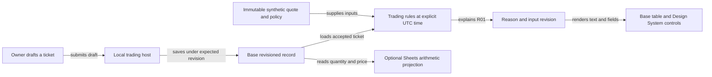
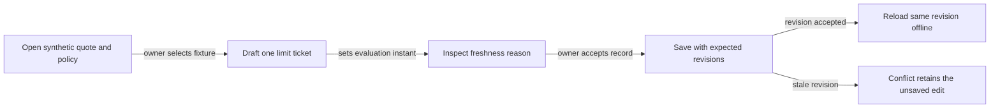

# Agentic Trading Platform — provider-neutral API/MCP gateway

**Decision.** Trading owns the domain API and MCP entry points, grants, risk policy, ledger and reconciliation. It consumes released connector profiles and field conversions from `agentic-gateway`. Other trading providers can implement the same semantic operations after independent qualification. The native skill and Graph consume admitted results. [Integration roadmap](#moomoo-integration-roadmap)

**First result for the owner.** On phone or desktop, open a synthetic quote and draft ticket, explain freshness, then reopen the accepted revision offline without an account, cloud resource, model or Graph installation. Later, a first-party OS native skill or another admitted client uses the same semantic gateway contract; connected reads and guarded effects remain separately gated.

**Decision record.** `AGENTIC-TRADING-HYBRID-001@0.20.0` pairs with [Trading Skills 0.16.0](./prd-tad-adr-mvp-gtm-agentic-trading-skills.md). First deliver one traceable quote from the hosted MCP endpoint, then extend by operation. Local OpenD already supplies a bounded desktop display read. Full laboratory acceptance still requires VCC-39–46. See E-57 below.

**E-55 · Trusted ticker receipt, 23 November 2026.** Trading `78d4fec` dispatched one `read.ticker` quote to the local MCP conformance feed. HTTP and MCP returned the same request ID, result and ledger revision (2). The 830-byte Ed25519 receipt preserved the exact price of `321.123456789012345600 USD`. Graph `209f2e04f` verified the signature and reopened the receipt in desktop Chrome after tab closure, with networking disabled and zero host requests. It rejected an edited price and purged the expired receipt both while open and on cold reopen. The synthetic receipt remained available. Trading passed 397 tests with 8 skips. Graph passed four receipt tests, 11 affected checks and its production build. This conformance run made zero live calls. N3 remains the hosted MCP and ledger qualification. The phone handoff is deferred. [Trading conformance test](https://github.com/huijoohwee/agentic-trading-platform/blob/78d4fec8bda9e8583eb158356e0a7ba24f905989/test/provider-ticker-receipt.test.mjs) · [Desktop verification](/Users/huijoohwee/Documents/GitHub/.workspace/.artifacts/trading-ticker-fixture/20261123-provider-npcLi9/verification.json)

**E-56 · REST-only earnings calendar and evidence-led coverage, 23 November 2026.** Trading `4db0b21` admitted a reviewed REST transport (protocol `1.0`, GET-only, offline schema, `ret_code` mapping) beside MCP and mapped `read.calendar` from `api/quote/calendar/earnings-calendar.md`, preserving market-local dates, Unix-microsecond publication time, session and null estimates over a ≤7-day inclusive window. The loopback gateway returned three synthetic rows and refused an over-window request with `INVALID_PARAMETER`; HTTP and MCP agreed. A new evidence-led inventory groups 25 feature families over 305 known sources (196 imported, 109 incomplete): mapped 2, candidate 20, paper-candidate 1, excluded 2, each pinned to an on-disk SHA-256 and verified MCP tools, with live order dispatch excluded from the $0 read-only scope. Graph `33c955a4e` replays the exported 532-byte calendar receipt in MainPanel → Integrations, re-verifies its sorted-key SHA-256 in browser, restores it after reload and relabels it offline. Live Chrome confirmed the desk coverage disclosure and calendar on desktop and 360 px, and Graph Integrations at 390 px without horizontal overflow; all requests stayed loopback and live moomoo calls numbered zero. Trading passed 408 tests with 8 skips plus the browser harness; Graph passed typecheck and six receipt/inventory tests. Connected qualification still waits on N3 operator receipts. [REST conformance](https://github.com/huijoohwee/agentic-trading-platform/blob/4db0b21d45c07cc89dead27d2dea13cacf7514bb/test/runtime-rest-market-read.test.mjs) · [Coverage inventory](https://github.com/huijoohwee/agentic-trading-platform/blob/4db0b21d45c07cc89dead27d2dea13cacf7514bb/src/provider-coverage.mjs)

## PRD — provider-neutral product

The immediate user is one self-directed owner who wants to explain a decision against the data available at the time. The broker remains authoritative for orders and fills. The proposed product records the owner’s inputs and checks them against owner-set limits. It supplies no trading recommendations or default policy values. Frequency, minutes lost, avoided errors and willingness to pay are unmeasured. **PRD-TRD-09 · Paper trading laboratory.** The desktop and mobile desk must cover the following cash-practice workflow and the public-market, perpetual, observer and historical research workflows in VCC-40–46. Trading owns its code and can run on an independent local installation. The cash-practice baseline comprises **(a)** a searchable instrument catalog (base/symbol/name) with featured selections, auto-add of the selected market and a bounded most-recent watchlist (cap 20), live ticker/24h change/high/low/volume, stream-status and measured event-latency display, endpoint fallback and auto-reconnect; **(b)** baseline candlestick charting across eleven timeframes (1m/5m/15m/30m/1h/2h/3h/4h/1d/1w/1M, locally aggregating any interval the source lacks natively) with forming-candle updates, bull/bear coloring, volume histogram, crosshair/grid/wheel-zoom/drag-pan/touch pinch, button/double-click/Escape expand, resizable indicator panes, buy/sell/short/cover strategy markers and a current-candle OHLC/% summary; **(c)** a versioned indicator library — EMA 20/50/200, SMA 50/200, Hull 55 ribbon, Supertrend (ATR 10 × 3), Ichimoku 9/26/52 (displacement 26), session VWAP, Bollinger 20 × 2σ, ATR 14, RSI 14, MACD 12/26/9, StochRSI 14/14/3/3, ADX/DMI 14 — with named presets (starter/trend/momentum/volatility) and clear-all; **(d)** paper market/limit/stop orders with quantity and trigger-price entry, estimated notional and fee (default 0.10% estimate), 25/50/75/100% allocation shortcuts, cash/quantity validation, weighted average entry, live unrealized and realized P&L, open-order cancel, automatic trigger checks, notifications, paper funds top-up and full session reset (default 100,000 paper balance); **(e)** microstructure: a top-20 book stream with ≥14 displayed bid/ask levels (price/amount/notional, cumulative depth, best bid/ask, spread, bid/ask pressure) and an aggregated public trade tape with time/price/amount/notional and buyer/seller-initiated aggressor interpretation; **(f)** portfolio equity/available cash/total-unrealized-realized P&L, per-asset holdings (quantity/average entry/mark value/open P&L), cash-vs-assets allocation, trade history with execution source and fee totals, closing-trade win rate and CSV journal export; **(g)** a sandboxed strategy experiment loop — owner-edited strategy code with line numbers and a worked crossover example, executed in an isolated worker with captured stdout/stderr, a bounded timeout (≤45 s), built-in moving-average/crossover helpers, signal validation and the buy/sell/short/cover vocabulary, chart markers and a simplified closed-trade report (count, wins/rate, net P&L per unit, return and max-drawdown estimates) — with **no auto-execution**: experiment signals never dispatch orders; **(h)** a manual prediction ledger — timestamped up/down calls, 5m–1w horizons, confidence slider, bounded hypothesis/model-version note (≤240 chars), entry price frozen from the live quote at record time, move-since-entry, tracking/correct/missed states and aggregate hit rate; **(i)** bounded durable session persistence (anonymous local session identity, debounced server-side saves, payload ≤500,000 chars, ≤1000 fills and ≤1000 equity samples, storage-status indicator) plus responsive desktop/mobile layout, live status footer and public-data failure notices. Real-account release keeps LIMIT-only and every existing guard (ADR-05/07); paper market/stop types, the short/cover report vocabulary and experiment signals stay inside simulation. Trigger monitoring may start active-symbol-only and must disclose that bound. Historical research must model and disclose execution costs and retain its equity curve (VCC-44/45). Paper partial fills and a live account equity-history chart remain optional. Frozen-expiry prediction scoring is implemented locally. Real-money settlement is outside the laboratory. E-46 records local acceptance.

| Rank | Buyer pain and evidence | Smallest response and success signal |
|---|---|---|
| 1 | The owner cannot reconstruct which quote, timestamp and policy drove a ticket. The existing brief requests this record. No timed observation exists. | Save one synthetic ticket and its input revision with Base. Reopen it offline and explain R01 from those same inputs. PRD-TRD-01/02/05 and VCC-21. |
| 2 | A stale, unlabelled or missing price can invalidate a check. The broker’s account-specific freshness fields are unknown. | Fail closed with an explicit reason. A small Sheets projection can show quantity × limit when both are known. PRD-TRD-02/04 and VCC-05/07. |
| 3 | Manual transcription makes mismatched fills and orphan orders hard to find. Its frequency is a hypothesis. | Compare synthetic history against explicitly bound ticket IDs. Only then assess the value of a read-only import. PRD-TRD-01/03 and VCC-01/03. |
| 4 | A duplicate or ambiguous release could affect real funds. The broker documents order tools. No incident or demand for automation was observed. | Keep order entry in the broker app. Evaluate a separate guard only after read-only evidence, mock rehearsal and explicit release authority. PRD-TRD-03/06 and VCC-12/13/19. |

### Stories and scope

- **PRD-TRD-01:** An owner, OS-native skill, admitted API/MCP client or bounded schedule requests semantic reads (quotes, positions, balances, orders) through the same admission and validation path. Rows bind run/source time/freshness; ingestion has no write scope. Qualified public research can be identity-free, without an invented account or simulator identity.
- **PRD-TRD-02:** The owner drafts a limit-order ticket and sees deterministic, versioned reasons before any order; equivalent API/MCP requests yield the same domain result or typed refusal.
- **PRD-TRD-03:** The owner releases an approved intent only through the single guard after gates, or orders in the provider app, then reconciles matched/different/unmatched orders including orphans. No client or adapter directly writes or silently falls back.
- **PRD-TRD-04:** A mobile-first dashboard shows exposure, concentration, freshness, ticket health, quotas/cost, headroom and halt state; admission stops before any free limit is exhausted. Unknown/unsupported data is explicit, not empty or zero.
- **PRD-TRD-05:** The owner can remain offline/manual without agent, schedule or execution, revoke grants without losing records, and select a newly qualified provider without changing domain rules. Designed portability requires new adapter conformance, never assumed compatibility.
- **PRD-TRD-06:** The owner uses reviewed version control, required checks and approval-gated promotion, can roll back, and can halt in one action; no specific development or runtime host is normative.
- **PRD-TRD-07 (reference event):** An eligible entrant uses the event's designated Desktop/Cloud hosts and SIMULATE account to research and demonstrate a strategy. Journal every accepted, rejected, skipped and uncertain decision; event identity is required only for this profile.
- **PRD-TRD-08 (reference event):** The entrant supplies the required host-generated presentation and reproducible agent package with attributable paper results, risk evidence and demo.

| Increment | In scope | Exit condition |
|---|---|---|
| First local fixture | One synthetic snapshot, one draft ticket, R01 and explicit evaluation time, reason display, revisioned save/reopen. Desktop and narrow mobile browser. | VCC-21, including offline reload and stale-write rejection. An R01 pass alone never approves a ticket. |
| Local assurance | R02–R09, reconciliation, audit integrity, cost record, synthetic import/export and independent expected results. Optional bounded arithmetic view. | VCC-01–03/05–09/15 on the relevant fixture bounds. The full workbook oracle has a separate qualification step. |
| Inbound gateway implemented-local; provider integration pending | Inbound API/MCP frontends over one domain boundary with a MOCK fixture reader, the single injected guard and the same SQLite ledger (E-42); reviewed REST/MCP provider-mapping adapters, optional scheduler and connected reads remain gated. Scope identity to public research or the bound account; prove isolation, $0 admission and recovery first. The PRD-TRD-09 parity workspace runs on a synthetic feed in the admitted implementation lane (E-46). | G0/G1/G5/G8, VCC-04/10/11/14/16/17/20 and VCC-35–38 (inbound parity/recovery implemented-local; provider-mapping/connected pending); VCC-39 synthetic desk implemented-local. Inbound gateway implemented-local only; no connected provider admitted. |
| Later real-account owner release | Deterministic, single-flight guard and capped limit order. The owner approves the exact payload. | ADR-05/07, G6/G7 and VCC-12/13/19. No unattended orders, AI-held write scope, market orders, amend, margin or derivatives. |
| Competition paper entry | PRD-TRD-07/08. Reuse the local ticket and qualify the event profile under ADR-08. Official account activity, Qoder runs and submission have separate gates. | VCC-23–30. This branch of the roadmap can finish entirely within SIMULATE. |

### Reference event profile — competition entry and calendar

The entrant is an individual, aged at least 18, resident in Singapore, with a valid Moomoo SG Universal Account, an approved registration and a Qoder account using the same Luma email. The broad invitation on the event page does not establish eligibility. Terms take precedence over publicity. The organiser can verify or disqualify entries, change rules and inspect configurations and records. Luma showed registration closed on the 19 November review. Record an existing acceptance or an organiser decision privately. Terms allow one personal prize per entrant. Advertised values combine cash and coupons in SGD. The organiser determines final awards and may review identity, trading records and agent evidence. Eligibility and access for this owner are unknown. [Organiser event page](https://luma.com/oezyv35j) · [Handbook and terms](https://moomoo-qoder-challenge-rgkelnyuzbm.qoder.website/)

| 2026 milestone | Participant outcome |
|---|---|
| 16 November, 18:00–21:00 SGT | Kickoff and briefing. The handbook links the Qoder deck, Moomoo deck and recording. |
| 17–28 November | Development and trading window. Account access was scheduled to roll out from 17 November at 11:00 SGT. Check the named account in the app and the exchange calendar for each session. |
| 30 November, 23:59 SGT | Submit via the form linked on Luma. Early submission is allowed. Record the submitted revision, retrievable judge link, timestamp and confirmation. |
| 8 December | Top ten present. Five highest final scores are eligible for awards under the terms. Simulated returns, leaderboard position and advertised prize value supply no product revenue evidence. |

The organiser describes a sponsored month of Pro with 2,000 included credits and a separate 1,500-credit offer. Record actual plan, expiry, current usage, available headroom, renewal settings and provider-enforced denial at zero. The project permits free-tier/FOSS tooling at zero cost and forbids paid plans, add-ons, purchases and overages. Leave the add-on unclaimed. Sponsored entitlement requires confirmation that its actual terms fit that policy. If required functionality is Pro-only on terms outside policy, mark Qoder participation blocked and continue the local rehearsal. An event credit allowance alone cannot pass admission.

Use one eligible entrant, enrolled account, phone number and device under the promotion rules. Treat the universal account as an eligibility prerequisite only. Bind competition tools solely to the non-resettable SIMULATE account. Practice on a separately identified paper account produces practice evidence only. Organiser records settle rankings and disputes. Respect the terms on permitted tools, personal data and promotional use, data rights, prizes and fair play. Reject resets, revival, account switching to replenish funds, impersonation and manipulation. Entrant review of terms and any disclosure precedes submission.

### Acceptance and economics

Baseline each metric with the first timed run. First local value target is ≤10 minutes from opening a prepared fixture to explaining and reopening a ticket. Record time, errors, reason understood, successful reopen and whether a second session is requested. An actual cloud cost, paid offer, settlement or return on investment needs its own evidence. `UNKNOWN` is a measurement state. The budget for each new infrastructure effect is $0.

VCC-23–30/33–34 are event-profile gates. **VCC-39 / 09 · Local cash desk.** Acceptance covers PRD-TRD-09 (a)–(i) on labelled synthetic data, a single paper guard, bounded persistence, research without dispatch and a LIMIT-only real-account path. E-46 covers desktop/mobile, gateway transport parity and session recovery. The additional requirements below belong to story 09 and require their own evidence.

| ID / PRD trace | Measurable end state and stated check | Constraint and current result |
|---|---|---|
| VCC-01 / 01/05 | Landing sheets flag and exclude seeded invalid rows (type, range, duplicate key, bad timestamp, text starting with `=`, `+`, `-` or `@`); re-importing the same `run_id` yields identical outputs; fixture of 20 valid and 5 invalid rows per entity | Passed on four fixture tables (E-27). |
| VCC-02 / 02 | Independently authored pass/fail fixtures exercise R01–R09 and their expected reason codes. Compare the trading core to the test-only Python oracle for the complete rule set. | Passed on dated decimal-oracle cases (E-27). Workbook open. |
| VCC-03 / 03 | Reconcile classifies matched, partial, side difference, symbol difference, out-of-limit fill, overfill, orphan order, and submitted-without-evidence; candidate matches never auto-bind | Fixture pass, including closed remainders and average-only evidence (E-27). |
| VCC-04 / 01 | For the selected provider's authentication method, prove read-only rights and CI-checked operation/endpoint allowlists; incoming audience-scoped identity is separate from downstream credentials. Public research may require neither user nor account identity. Prove write denial on mocks, never a live negative order probe. | Pending scope/isolation readback and allowlist scan; no token passthrough. |
| VCC-05 / 01/02 | A delayed, missing, future or over-age quote cannot produce an R01 PASS. At exactly the configured maximum age a valid realtime quote passes. Use the full timestamp for comparison. | Dated R01 fixtures passed (E-22). |
| VCC-06 / 02/05 | At one explicit UTC instant, compare core, independent Python reference and qualified offline workbook results across every supported full-export fixture. Verify the export recalculates and the health view fits a mobile viewport. | Full export and qualified workbook host pending. |
| VCC-07 / 04 | Dashboard totals equal Positions plus cash; missing price or FX excludes the row and marks equity unknown rather than defaulting to 1 or 0 | Passed on fixture with missing FX or price (E-27). |
| VCC-08 / 05 | After revoking the broker grants and switching `ctl_mode` to `MANUAL`, manual paste still produces outputs; restoring the last export preserves `Tickets`, `Audit_Log` and `Cost_Ledger` | Offline manual restore passed (E-27). Revocation open. |
| VCC-09 / 02/03 | Ticket state derives only from stage fields; post-approval edits to bound fields raise `EDIT_AFTER_APPROVAL`; approval while result is not PASS raises `APPROVED_WITH_FAIL`; supersession links keep a chain | Local flags exercised (E-27). Connected role checks open. |
| VCC-10 / 01/05 | Rehearsal ingestion against the mock broker stays within 12 tool calls and the chunk budgets, ends on the circuit-breaker for two consecutive errors, a scope error or any write-capable action, and emits typed rows, a manifest and a `Cost_Ledger` row | Mock passed (E-27). |
| VCC-11 / 01 | Under G5, qualify the reviewed REST/MCP read adapter, its authentication (if needed), semantic mappings and applicable account scope against the same domain contract. Record redacted evidence; changing provider or host requires requalification. | Pending admission; public research does not fabricate an account. |
| VCC-12 / 03 | Each ADR-05 gate has a pass and a fail fixture; a release is refused when any input is blank, UNKNOWN, stale or mismatched, and each refusal is logged with its reason | Mock broker only; Evaluator is not the guard author. Pending |
| VCC-13 / 03 | With injected timeouts, duplicate requests and retries on the mock broker, at most one order exists per `idem_key`; an ambiguous result yields `RELEASE_UNKNOWN`, halts further releases and is never retried automatically | Single account-scoped serialization required; host implementation unqualified. Pending |
| VCC-14 / 04 | Simulated missing proof, insufficient headroom or quota exhaustion prevents hosted effects before dispatch. Report usage and make the last validated local export available when the provider refuses reads. | Mock refusal passed (E-27/28). Hosted proof open. |
| VCC-15 / 02 | Changes, deletions and truncation in the audit chain are detected when checked against a separately retained trusted head and event count. Exports carry those witnesses. | Passed on local archives (E-27). |
| VCC-16 / 06 | A reviewed change passes tests, oracle parity, approved provider/host policy, shipped-dependency MIT/Apache-2.0 licence and secret scans; production promotion waits for owner approval of the exact environment/candidate | Scans cover lockfiles, configs, URLs and workflows. Reference deployment exclusions are profile-specific. Pending |
| VCC-17 / 05/06 | Rehearse halt, revoke, export, restore and rollback in the admitted environment. Block new imports and releases. Recover the previous verified head within 30 minutes on synthetic data without losing newer accepted events. | Local source rollback and recovery passed (E-27). Hosted revocation open. |
| VCC-19 / 01/03 | At G7, read back one separately authorized capped order and reconcile its actual broker state. Request cancellation only with separate authority and only if still cancellable. | Live, Phase 4 only. Fills cannot be reversed. Pending. |
| VCC-20 / 04 | Scan source, client payloads, logs, export, CI and ledger for credentials and account identifiers. Test encryption, grant isolation, revocation and redaction on the admitted adapter. | No secrets in ordinary data or output. Pending. |
| VCC-21 / 01/02/05 | In a primed mobile browser at 360 CSS px and on desktop, disconnect, draft one synthetic ticket, observe the R01 reason, reload offline and read the same accepted revision and inputs. A competing stale edit fails without partial changes. Check an over-age quote, a future timestamp and a missing freshness class. | Desktop and 360 px touch Chrome passed offline (E-22/27). Physical iPhone and human timing open. |
| VCC-22 / 02/06 | Inspect the resolved module graph, package pins and sealed assets. Each shared capability resolves to its declared owner once. Introduce an obsolete Base Sheets import or change a projected UI digest in a fixture and require rejection. | Owner pins, package integrity and offline projections passed for the released worksheets (E-30–32). Recheck notices and integrity when a pin changes. |
| VCC-23 / 07 | Present eligibility, same-email entitlement, hard zero-cost proof, separate Desktop and Cloud readbacks and an alias cross-checked against the official competition account. Fixtures with a live, practice, missing or changed account, disallowed scope or exhausted quota stop before any effect. | Fixture refusals passed (E-28). Entrant and account open. |
| VCC-24 / 07 | Replay the paper rule fixtures below, including exact limits, pending reservations, unknown inputs, fees, interest, exercise, forced liquidation and official settlement. Replaying fills/events twice leaves the same ledger, balances and decision reasons. | 59 fixture boundaries and A/B replay passed (E-28). Simulator open. |
| VCC-25 / 07 | A pinned Qoder coordinator delegates research and independent risk review. The paper executor receives an allowed, bound intent only. Prove one rejection, one no-trade, one permitted practice path and one ambiguous response. A second trigger creates no second order. | Fixture paths passed (E-28). Hosted sessions open. |
| VCC-26 / 07/08 | Verify the three offline timing cases in §6 below. For provider qualification, verify the selected skill archives, actual QCA upload/version, a completed bounded Forward Mode run via the §6 API contract (manual `/run`, `GET /schedule_runs/{id}`, `/pause`·`/unpause`, explicit API cron timezone, `session_mode`), delivery route, concurrency skip, resume from cursor and stop with an in-flight run. An optional Slack test returns a harmless reply only in its paired destination. | Local timing and schedule trace passed (E-25/28). The audit and schedule headings accepted pointer and touch input, and the timeline showed 13 receipts (E-31). Hosted usage and delivery remain open. |
| VCC-27 / 04/07 | On desktop and 360 px, read positions, open orders, net P&L, equity, drawdown and decision log from one versioned snapshot. Trace an observation to a run, rejection or fill. Offline mode shows the last validated snapshot and its age. | Desktop and 360 px touch browsers passed offline for source drill-down, chart changes, pivot controls, reload and numeric exports (E-30/31). Official account readback remains open. |
| VCC-28 / 02/03/08 | Restore a decision under run A after run B replaces the landing view. Reproduce A’s policy, inputs and evaluator. Test working/closed partials, an individual off-limit fill masked by its average, aggregate-only evidence and unknown freshness. | Local archive and fill cases passed (E-27/28). Workbook open. |
| VCC-29 / 07/08 | Reconcile daily net equity, risk and costs to SIMULATE readbacks. Separate practice from the scored period, weekly marks from the closing mark, and final-day after-hours fills from eligible results. Unknown metrics carry an explanation. | Organiser results take precedence. Pending. |
| VCC-30 / 08 | In a clean environment, unpack the pinned package, replay its redacted fixture and reproduce its report. Verify the Qoder-generated deck link as a judge, complete all four rubric rows and obtain separate owner approval and a Luma submission receipt. | Clean ZIP replay passed (E-28). Deck, judge link and submission open. |
| VCC-31 / 01/04/07 | Authenticate an asynchronous provider read, map actual schema/precision/freshness and atomically publish typed rows plus provenance. Test timeout, scope denial, partial pagination, unknown freshness, account drift, conflicting event bytes and literal text injection. Project the same accepted run with server-only secrets. | RT-01/04/08; `runtime/mcp-read.mjs` + `ingestion.mjs` and local projection implemented. Local runtime tests passed at E-37; admitted provider/schema readback pending. |
| VCC-32 / 01/07 | Restart the coordinator/worker between receive, append and checkpoint. Redeliver the same source event and overlap manual and scheduled work; retain one accepted event and no lost cursor. Inject dispatch uncertainty, preserve halt across restart and never resubmit automatically. | RT-07/10; `runtime/store.mjs` SQLite WAL/FULL transactions and Forward durable cursors implemented; injected-guard recovery tests present. E-37 covers local restart/overlap tests; actual coordinator receipts pending. |
| VCC-33 / 07 | Retrieve baseline, change one approved prompt, preserve tool/MCP/skill arrays, then compare effective config and new Session snapshots. Reject `latest`, changed resources, wrong child/skill versions and stale approval; restore predecessor through a new validated configuration. | RT-09; `runtime/forward.mjs` validates/diffs configuration and reads effective config. E-37 covers local configuration tests; roles remain unbound and actual Cloud snapshots/four fixed connected evaluations remain pending. |
| VCC-34 / 03/07 | Mock tests reject a research-authored risk file, fabricated role label, tampered/expired/revoked verdict, repeated approval, direct MCP/CLI bypass and a live/practice account under a competition grant. An authenticated independent reviewer can veto and the single paper guard alone can dispatch. | RT-10; `runtime/paper-guard.mjs` implements signed independent approval, durable reservations and uncertainty with an injected broker only. Mock tests passed at E-37; operational paper transport and deployed principal/bypass isolation pending. No live-account negative order test. |
| VCC-35 / 01/02/05 | API/MCP parity: replay identical semantic requests under identical bindings/time; compare typed results/refusals, provenance and the same accepted ledger revision. Retry across both frontends without duplicate events or effects. | IMPLEMENTED-LOCAL; inbound API/MCP parity at one accepted ledger revision with single dispatch and idempotent retry passes (E-42/E-44, 14-test conformance including signed-grant admission). Connected/provider-mapping qualification separate. |
| VCC-36 / 01/04/05 | Qualify each adapter/version with precision, market/session/date/delay/units, rights, bounded pagination and unsupported-operation fixtures. Changed protocol/schema/mapping digest refuses before dispatch; a second provider needs isolated mappings and its own conformance. | DESIGN ONLY; JSON numeric samples do not prove decimal-string mapping or portability. |
| VCC-37 / 01/03/05 | Mock wrong audience, expired/revoked identity, cross-account/provider/mode/cursor reuse, arbitrary endpoint/tool/command, token passthrough and direct-write/fallback attempts. Prove read/write credential and principal isolation; public research needs no invented simulator account. | DESIGN ONLY; no live negative order probes, no claimed provider-plugin isolation. |
| VCC-38 / 01/03/06 | Inject timeout/restart at receive/append/checkpoint/reserve/dispatch; overlap API/MCP/manual/scheduled requests. Preserve one event/intent, cursor and halt; conflicting idempotency bytes refuse, uncertain writes never auto-retry. | IMPLEMENTED-LOCAL; gateway restart/uncertainty/idempotency conformance passes (E-42): finalized result preserved, RELEASE_UNKNOWN halt blocks dispatch, changed bytes conflict, no auto-resubmit. External exactly-once/connected proof separate. |
| VCC-40 / 09 · Public market | Search the active quote-currency universe and select spot or a USD-settled perpetual. Bind venue, instrument type, interval and data time to ticker, book, tape and chart. Support the eleven baseline intervals plus 10m. Aggregate 10m from 5m and 3h from 1h on UTC boundaries. | Compare OHLCV and volume sums to independently grouped bars. Inspect 20 closed bars while the final bar moves, 20 book levels with spread/imbalance, and buy/sell aggressor volumes. Switch venue/type during reconnect and discard stale events. Include qualified public feed and archive receipts, rights and a hard $0 cap. Label offline replay and stale, missing or partial observations. |
| VCC-41 / 09 · Perpetual paper account | Migrate a saved cash account in place. Track spot separately from signed contracts with margin, same-side weighted entry, reductions, reversals, realized/open P&L, fees and timestamped funding debits/credits. The paper guard enforces at most 2× gross portfolio leverage across orders. | Open, add, partly close, reverse and flatten a contract. A reduce-only order may shrink or close, never open, grow or cross zero. Refuse excessive leverage, test pending limits/stops at fill, retry across restart and reconcile NAV including funding once. Compare old spot cash, history and open orders before/after migration. Research capital stays separate. |
| VCC-42 / 09 · Browser tools | Detect the host’s WebMCP API on the top document, including its supported model-context binding. Advertise read-only and untrusted-content annotations and enforce strict schemas before calling a handler. Landing exposes two actions (discover, enter). The desk exposes all 22 meanings in Skills VCC-15 through the same operations, validation and resulting revisions used by human UI, API and MCP. Context and indicator replacement update the visible chart atomically. | Exercise both routes, navigation, reload and teardown with one registration per action. Test an ordinary browser, unknown fields, malformed inputs, read pagination, cancellation, expired scope, replay and a new payload under an old key. Mark external data and user code untrusted. Require direct owner intent for paper effects and the exact displayed session-reset phrase. Return typed success with provenance/warnings or a refusal with retryability and missing prerequisites. Strip stale registrations on route changes. |
| VCC-43 / 09 · Observer and activity | Owner can open/resume a 24-hour session, open or collapse its newest-first activity console and share an expiring, high-entropy read-only view across devices. Render public market context, candles, indicators, signals and an allowlisted paper summary (virtual cash, equity, positions, recent fills, working orders and prediction count), the selected tab, active run and research status. Annotate activity with actor (human, agent or system), UTC time, operation, outcome, elapsed time and related run ID where available. | A second device sees the owner change timeframe and overlay. Reconnect from the latest accepted sequence, avoiding duplicate events. Deny reads after expiry and every observer mutation at the server. Store only a token digest on the server. Verify that prompts, code, keys, owner identity, private balances and request secrets never enter events or exports. |
| VCC-44 / 09 · Research runs | Save owner-scoped, named and hash-versioned Python source. Support browser-local Python with functions, imports and common scientific array operations against closed OHLCV bars, a versioned offline package inventory, bounded stdout/stderr, timeout, restart and validated markers. Independently queue one historical hypothesis or the full catalog with explicit dates, market, interval and research capital. Return a run ID, poll, cancel, recover across restart and overlay entry/exit/stop/target markers on its source chart. | Test Python functions/imports beyond the current subset and offline dependency loading. Hosted arbitrary code stays disabled until isolation and resource bounds are verified. Enforce the rolling anonymous limit of 30 new research runs per 24 hours atomically. Retry, cancellation and a failed run preserve the account revision. |
| VCC-45 / 09 · Historical evidence | Default to 2021-01-01 through the last completed UTC month. Verify partition checksums and venue-bound as-of joins across spot/perpetual candles, funding, open interest, taker volume and multiple assets. Record source, requested/actual span, time units, gaps, duplicates, cutoff and observed or modeled costs. Use next-open fills after a closed signal, 0.5% equity risk divided by stop distance, at most 2× exposure and stop-first on a bar touching both exits. | Independently reproduce directional and portfolio results. Report return and CAGR alongside exposure, turnover, drawdown and trade count. Show win rate, expectancy, profit factor and risk-adjusted performance (Sharpe, Sortino and Calmar). Itemize fees, funding, spread and slippage. Show UTC annual and rolling out-of-sample periods (24 calendar months of warm-up, 6 of test, advance 6). Disclose missing inputs, fixed-universe bias and previews. |
| VCC-46 / 09 · Results and reproducibility | Persist an immutable compressed artifact containing manifests, parameters, assumptions, warnings, exact windows, signals, trades/rebalances, costs and equity history. Hash scientific inputs/results independently of run IDs, retrieval time and cache metadata. Expose queued, running and cancelled states and distinguish successful completion, technical failure, partial data and blocked data. Retain profitability separately. | Run cold and warm with the same inputs. The second run retains its own trace and identifies the original artifact and identical scientific hash. Changed data, parameters or engine version miss the cache. Corrupt or missing bytes cannot be accepted. A completed regression returns 20 rows including unavailable hypotheses with reasons and unknown returns. Preserve blocked rows 15, 17 and 20 until verified datasets meet their respective contracts. Treat an incomplete preview as partial and report its actual window. Verify partial preview, blocked data, failure and cancellation separately. |

**Research catalog for VCC-44–46.** Each numbered hypothesis has a versioned instrument class, timeframe, parameter set, required datasets, entry/exit rules and independent expected signal fixture. In the table, R means the initial risk per trade and ATR uses 14 bars unless another period is specified. IDs also identify blocked rows. The default qualification basket uses BTC, ETH and SOL where specified below. Other markets require explicit bindings.

| ID | Hypothesis and example qualifying input | Acceptance fixture for an independently authored implementation |
|---|---|---|
| 1 | BTC perpetual, 1h trend crossover | Cross EMA20/50 with RSI14 above 55 (below 45 for short), rising ADX14 above 20 for three bars, volume above its 20-bar median and a daily EMA200 trend filter. Check 1.5 ATR stop, 3 ATR target and 48h expiry. |
| 2 | BTC perpetual, 4h compression followed by breakout | A 20-bar channel break follows band width below its trailing 180-day 20th percentile. Use the daily EMA100 and its 20-day slope. Check the opposite 10-bar boundary, 20-bar timeout and 2 ATR initial stop. |
| 3 | ETH perpetual, 1h trend pullback | Daily EMA50 exceeds EMA200 and four-hour EMA20 rises. Require an hourly pullback to EMA20 that holds EMA50, RSI14 recovery above 50 and a high break. Verify the wider swing/1.5 ATR stop and 2.5 ATR trail after one unit of risk. |
| 4 | SOL perpetual, 1h retest | In a daily uptrend, a seven-day high breaks and holds on a retest within 12h. Require volume at least 1.5× its 20h median. Fixture checks stop below the retest by 1.25 ATR and target at three units of risk. |
| 5 | ETH perpetual, 30m volatility squeeze | Require eight bars with Bollinger(20,2) inside Keltner(20,1.5 ATR). Break both with confirming EMA50 slope and volume above 1.5× the 30-bar median. Check 1.5 ATR stop and the 3R or EMA20 exit. |
| 6 | BTC perpetual, 5m VWAP reversion | Anchor at UTC midnight and require hourly ADX14 below 18. A move outside 2.5 volume-weighted standard deviations followed by a close inside 2 triggers entry. Use VWAP target, 3.5-deviation stop and 24-bar timeout on either side. |
| 7 | ETH perpetual, 15m prior-day sweep | Require a prior UTC extreme to be breached and reclaimed, wick/body ≥1.5 and RSI divergence from the prior 20-bar swing. Check a half-ATR stop beyond the sweep and exits at VWAP or prior-day midpoint. |
| 8 | BTC spot, daily short-period RSI | In a rising 200-day average regime, three lower closes and RSI2 below 5 qualify a long. Check exit on RSI2 above 70, close above SMA5 or day five, and a 2 ATR protective stop. |
| 9 | BTC perpetual, 15m opening range | Compute the first UTC hour. Between 01:00 and 08:00 require a range break and twice typical volume for that time slot over 30 days. Allow one trade per day. Check midpoint stop and two range widths as target. |
| 10 | BTC perpetual, 1h capitulation | Join venue funding at/below its 180-day fifth percentile with a 24h open-interest drop ≥10%. Check a down bar wider than 2 ATR closing in its top 40%, high-break entry, low stop and 2.5R/48h exit. |
| 11 | ETH perpetual, 4h crowded breakdown | Funding exceeds its annual 95th percentile, open-interest z-score exceeds 2 and the market made a 20-day high within 48h. Confirm a high-volume close below EMA20. Check short risk above the high and exit at 3R or median funding. |
| 12 | BTC matched spot/perpetual carry | Long spot and short equal notional when liquid, basis is positive and annualized funding exceeds 20%. Rebalance delta daily. Test exit on negative basis or seven-day median funding below 5%. Account separately for borrow and rebalancing costs. |
| 13 | ETH/BTC two-leg reversion, 4h | Fit a 60-day log-price hedge. Check stationarity at 5% and half-life between 6h and five days. Enter beta-neutral beyond ±2.25 residual deviations, exit inside ±0.5, stop at ±3.5 or ten days. |
| 14 | Weekly cross-sectional momentum | Require 180 days of history and select 20 contracts by trailing 30-day median notional. Rank lagged return over volatility, balance five longs and five shorts by inverse volatility and BTC beta. Assign partial data quality and disclose survivorship bias for a fixed 21-member universe. |
| 15 | Cross-asset liquidation reversal | Require verified liquidation history. Across ten liquid contracts, combine an hourly market-adjusted residual beyond 3σ, volume above 3× seasonal median and open-interest fall ≥5%. Exit on convergence or six hours. Missing liquidation history yields a blocked row. |
| 16 | BTC impulse and ETH/SOL lag, 5m | Estimate 30-day betas. A BTC move above 1% in 15m must hold a six-hour range break for two bars. Test a 0.75% lag versus implied return and exit on convergence, 45 minutes or a 1 ATR stop. |
| 17 | Tick-level BTC queue imbalance | Require replayable top-ten depth, aggressor trades and timestamps. Test 65% book and buyer-flow thresholds, microprice above midpoint and a one-tick spread. Compare 50/100/250/500 ms latency with 15-second, two-tick gain and one-tick loss exits. Aggregate depth alone yields a blocked row. |
| 18 | BTC aggressor-volume divergence, 1m | A five-bar swing makes a new price low while cumulative volume delta rises and open interest falls. Confirm a break of the intervening high. Check swing stop and VWAP or 2.5R target. Mirror for shorts. |
| 19 | Monthly BTC/ETH/SOL spot rotation | Rank 90-day return divided by realized volatility. Hold the winner only above a rising SMA200, else cash. Check 15% target volatility, maximum 1× allocation and UTC month-end rebalance. |
| 20 | Delta-hedged BTC options premium | Require dated bid/ask quotes and Greeks for all four legs. At 30–45 days to expiry, check implied volatility at least 12 points over 21-day realized and above its annual 70th percentile. Test short 25-delta legs, long 10-delta wings, daily hedge, half-credit profit, one-credit loss and exit seven days before expiry. Missing quotes or Greeks yield a blocked row. |

## TAD — provider-neutral gateway design

### Reference implementation evidence — codebase grounding and source ownership

Each link identifies inspected source bytes. A repository revision identifies the review baseline. A consumer pin identifies the older or equal revision that consumer actually resolves. They can differ.

| Canonical owner | Existing contract and evidence | Trading use and boundary |
|---|---|---|
| `agentic-design-system` | Owns the shared dashboard layout, cards, keyboard-accessible tab list, range chart, typography and line heights. [Dashboard](https://github.com/huijoohwee/agentic-design-system/blob/83de261f8f3ddf66ed41e5370b6811f498788b40/site/dashboard.mjs) · [Tab list](https://github.com/huijoohwee/agentic-design-system/blob/83de261f8f3ddf66ed41e5370b6811f498788b40/site/floating-panel.js) | Trading supplies labels, evidence and callbacks. Ticket, audit and replay share the same label and value typography. |
| `agentic-base` | Owns revisioned records, the matrix projector, browser tables and the line, area and column charts shared with Graph. [Record API](https://github.com/huijoohwee/agentic-base/blob/2f891a6193b2f937275bd04f6b28dd8e67a98454/src/index.mjs) · [Chart adapter](https://github.com/huijoohwee/agentic-base/blob/2f891a6193b2f937275bd04f6b28dd8e67a98454/packages/views-react/src/browser/DashboardChartBrowser.tsx) | Persist accepted tickets under expected revisions in local IndexedDB. Trading owns validation and uses UTC timestamp text for instants. Base projects evidence rows and pivot cells. |
| `agentic-sheets` | Owns `sheets/workbook/v1`. A blank sheet starts at 32 × 16. With `fitToCells`, an export fits its occupied rows and columns within 512 rows, 128 columns, 4,096 grid cells, 512 populated cells and 64 formulas. [Core](https://github.com/huijoohwee/agentic-sheets/blob/349b43ccadbec4edf107cfef9f0c09fc1715f9f2/sheets/core.mjs) · [Bounds](https://github.com/huijoohwee/agentic-sheets/blob/349b43ccadbec4edf107cfef9f0c09fc1715f9f2/sheets/schema.mjs) | Calculate ticket notional on demand and export one typed sheet per replay projection. Sheets or Base can open an editable clone. Trading keeps the verified replay as the evidence record. |
| `agentic-graph` | Already consumes Base and Design System. Owns code-source ingest, query and explained edges, plus a controller that verifies immutable Sheets artifact blobs. [Consumer pins](https://github.com/huijoohwee/agentic-graph/blob/9bfc5d2c08dbb026d41cba29ddb46255a84f1b16/package.json) · [Source-graph tools](https://github.com/huijoohwee/agentic-graph/blob/9bfc5d2c08dbb026d41cba29ddb46255a84f1b16/mcp/agent-graph-tool-contract.js) · [Sheets release controller](https://github.com/huijoohwee/agentic-graph/blob/9bfc5d2c08dbb026d41cba29ddb46255a84f1b16/scripts/production-sheets.mjs) | Optional source provenance for reviewing the implementation. Keep quotes, account data, individual tickets and credentials out of Graph. Its Sheets route belongs to Sheets. A future public demo needs its own admitted artifact, route and rollback receipt. |
| `huijoohwee.github.io` | Owns the joined planning guideline, grounding companion, related Sheets specification and its own Pages deploy boundary. [Grounding procedure](https://github.com/huijoohwee/huijoohwee.github.io/blob/f07f1a3c27d6936f86233d750d8db7b7690d5fb4/guidelines/prd-tad-adr-mvp-gtm-codebase-grounding.md) · [Sheets decision](https://github.com/huijoohwee/huijoohwee.github.io/blob/f07f1a3c27d6936f86233d750d8db7b7690d5fb4/docs/documents/prd-tad-adr-mvp-gtm-agentic-sheets.md) · [Pages payload](https://github.com/huijoohwee/huijoohwee.github.io/blob/f07f1a3c27d6936f86233d750d8db7b7690d5fb4/docs/DEPLOY-WORKFLOW.md) | Link to the guideline and existing product contracts. Do not copy this plan there. The `joohwee` draft is outside that Pages payload. The separate `huijoohwee/huijoohwee` site mirror is generated output under its release controller. |
| `agentic-os` | Owns native `skills/trading/SKILL.md`, START/RELEASE, invocation semantics and platform governance. Portable skill policy stays provider-neutral; domain rules, transport, persistence and guard stay in Trading. The compatibility client in Canvas points back to OS. [START](https://github.com/huijoohwee/agentic-os/blob/d3430c8da71b0128b644040bfd1ef32d9f36c50e/docs/START-WORKFLOW.md) · [Invocation catalog](https://github.com/huijoohwee/agentic-os/blob/d3430c8da71b0128b644040bfd1ef32d9f36c50e/catalog/invocation.json) · [Canvas forwarding export](https://github.com/huijoohwee/agentic-canvas-os/blob/d3e0310d3f6abaff05abf791384b43648ab58a25/src/agentic-graph-mcp-client.js) | Reuse OS for admission, checks and release evidence. Reserve MCP/WebMCP or `/`, `@` and `#` bindings for an evidenced read-only job. Any admitted binding calls the same headless query. No trading command grammar, graph client or agent service in the first load. |
| `agentic-commerce-os` | Its revenue ledger records settlements and markups. [Ledger source](https://github.com/huijoohwee/agentic-commerce-os/blob/aa4151f82816c0e18796549a2be0e861d0e772d7/src/core/revenue-ledger.ts) | Trading’s loopback runner imports Commerce’s pinned local-first content security policies for browser annotations. The Commerce revenue ledger is separate from Trading audit events. A future customer payment belongs to the commerce owner. |

**Resolved ownership.** The E-30 baseline Trading `0d5a4dbc` records Base `2f891a61`, Sheets `349b43cc`, Design System `83de261f` and Commerce policy `aa4151f8`; these are historical consumer evidence, not fresh pin qualification. Current Trading `173e71f2` adds the local runtime described below. Recheck owner pins and sealed assets when qualifying that candidate. Graph’s Agent Mission and Trading use the shared dashboard layout. Worksheet settings and trading measures belong to Trading. All chart and table assets ship locally. [Graph Mission consumer](https://github.com/huijoohwee/agentic-graph/blob/ee50ff102d5c00a9e98aa194e4b7524999f7ecbf/canvas/src/features/agent-ready/AgentMissionDashboardView.tsx)

### Product contracts and dependency direction

| Owner or adapter | Input → output | Write authority and failure |
|---|---|---|
| Trading core, local ticket and cash audit | Validated snapshot, ticket, policy revision, explicit UTC evaluation instant → per-rule result, reasons and reconciliation result | Pure functions. No DOM, database, wall clock, provider SDK or token. Same inputs give the same output in the CLI fixture and browser. |
| Local browser and headless fixture tests | A synthetic ticket change with expected revisions → accepted record or typed conflict | Use Base’s public engine. Store ticket fields together with fixture ID, immutable fixture digest and policy revision. Reload resolves that exact fixture or reports missing evidence. Recompute reasons from accepted data. On conflict retain the unsaved edit and require a fresh read. |
| Views | Accepted snapshot → Base table and Design System details. On-demand Sheets arithmetic → display values | Views emit intents back to the trading host. No second writer, spreadsheet save, sync service or round-trip through a spreadsheet editor. |
| Implemented-local inward API and MCP frontends | Semantic operation + validated request + applicable caller binding → same admitted domain result, provenance or typed refusal | SAME admission, policy, authoritative ledger and idempotency over one shared core (E-42); neither frontend, OS skill nor another client gets its own writer or direct provider route. Inbound gateway implemented-local with signed-grant admission; the PROVIDER reader bridge is wired but connected reads stay gated on operator OAuth/Vault and rights/$0 receipts. |
| Planned outward reviewed REST/MCP adapters | Admitted semantic request + pinned capability record → allowlisted provider request → validated canonical result | Separate from skill clients; isolated mappings and adapter conformance per provider/version. No raw tool proxy, caller-selected endpoint, silent fallback or direct write. Writes require the existing single guard and separate effect authority. |
| Existing local store / guard evidence | `runtime/store.mjs` supplies SQLite WAL/FULL events, snapshots, intents and cursors; `paper-guard.mjs:32–323` supplies one injected-broker guard with signed verdicts, reservations and uncertainty | Reuse these owners; no new ledger/rules engine. Synthetic browser records cannot dispatch. Cash stock/ETF LIMIT only; operational local paper transport is implemented-local (E-44), with no hosted admission or deployed isolation proof. ADR-05/07/08 remain gates. |

Clients and host adapters depend on Trading's headless domain; the domain never depends on a host, skill or Graph. Base/Design System own records/views; Sheets loads on demand. OS retains the sole instruction/catalog owner. Shared owners never import Trading; missing generic APIs are repaired there. Only reviewed contract adapters translate provider fields; no vendored engines, competing themes/renderers, legacy Base `./sheets`, private archives, copied handlers or second production ledger (VCC-22). The PRD-TRD-09 parity workspace adds no second ledger, rules engine or reference dependency: catalog/chart/indicator/depth/tape surfaces project accepted events through the same owners, paper order types extend the single guard's simulation boundary, and the strategy-experiment and prediction-ledger surfaces are owner research tools with no dispatch authority (VCC-39).

### Compact gateway contract — implemented-local, connected unqualified

- **Semantic surface:** quote/research, position, balance and order-history reads; ticket evaluation, reconciliation and separately gated intent release. API operations and MCP tools encode the same implemented request (`contract_version`, `request_id`, `capability_digest`, `operation`, `scope`, `inputs`, `deadline_utc`) and result (`request_id`, `status`, `data` or `error`, `provenance`, applicable `ledger_revision`); these are domain fields, not existing endpoints or provider schemas. Admission resolves a reviewed capability and policy before dispatch; public research may be anonymous and identity-free when rights/cost permit. Private reads/writes require audience-scoped incoming identity bound to the exact permitted account/mode.
- **Capability record:** bind provider ID, adapter version+digest, transport/protocol version+digest, schema and mapping digests, account mode and opaque alias (explicitly not applicable for identity-free public research), endpoint allowlist, rights/delay evidence, quotas/cost/headroom, supported operations and qualification status/receipt/expiry. Bind each request and result to that record's digest; missing, expired or changed evidence refuses the dependent effect. A signed local envelope proves only its stated scope, not provider auth or event eligibility.
- **Trust separation:** incoming identity authenticates only to the gateway audience; downstream credentials are separately held by the trusted adapter/guard and never passed through from callers. No caller-supplied endpoint, raw command/tool proxy, client-held write credential, direct write route or fallback to another account/provider/transport. Read and write credentials/principals stay isolated; only the single guard dispatches approved writes. OS instructions/catalog confer no authority and create no registry, rules engine or ledger. The [MCP authorization security requirements](https://modelcontextprotocol.io/specification/2026-07-28/basic/authorization/security-considerations) require audience validation and separate downstream tokens; this does not upgrade the existing client's pinned protocol.
- **Data fidelity:** preserve decimal strings/scale without binary-float rounding, currency/quantity/source units, instrument/market/session, source trading date and original timestamp units plus normalized UTC, observation time, source revision/digest and delay/rights provenance. Unknowns stay explicit; source numeric JSON alone proves no lossless decimal mapping. Where exact conversion cannot be evidenced, return precision-unknown or refuse dependent decisions; never synthesize zero or realtime status.
- **Pagination/refusal:** bounded opaque cursors bind capability/provider/account/mode/query/schema, expiry and page/row/call budgets; reject tampering, scope reuse and partial imports. Return typed `UNSUPPORTED`, `UNQUALIFIED`, `UNAUTHORIZED`, `SCHEMA_DRIFT`, `PRECISION_UNKNOWN`, `STALE`, `BUDGET_HALT` or `RELEASE_UNKNOWN` with safe reasons/provenance; unsupported is never an empty success or zeros. Retain the last complete accepted snapshot.
- **Durability/conformance:** both frontends use the same account-scoped lock, event identities and intent idempotency; public research has a non-account research scope. Identical retries return existing results, changed bytes conflict, unresolved writes persist halt and never auto-resubmit. VCC-35–38 gate API/MCP parity, schema drift, cross-account isolation and timeout/restart recovery. Every new provider requires reviewed isolated mappings and conformance; portability is designed, not proven.
- **Reference adapter evidence (E-36):** `runtime/http.mjs:6–24` implements GET/HEAD `/api/runtime` readback ONLY. `runtime/mcp-read.mjs:5` fixes one provider origin and `:58–154` is an outbound client, not a gateway MCP server; `scripts/runtime.mjs:43–49` uses `config.moomoo`. `runtime/core.mjs:33–58` has signed grant/proof checks for its scoped profile, not universal account prerequisites. No generic provider plugins or provider-mapping framework existed at E-36 (historical pre-gateway fact); E-50 now records the provider-mapping definition registry landed on Trading main at `58d46ff` (PR #5), and E-42 records the implemented-local inbound gateway (`runtime/gateway.mjs`, `gateway-http.mjs`, `gateway-mcp.mjs`) sharing one admission/ledger. This spec lane adds no runtime files; the gateway candidate merged into Trading main at `b0b80d2c17080792a6145dd86c50605f124c18a1` (E-44).



*D-01. First local read and write paths. Only the Base record accepts a ticket edit. Arrows denote data flow.*

### Full logical workbook and ledger contract

The following 14 named logical tabs include two policy tabs. They preserve the 0.2.0 export vocabulary for the later connected product. Landing, inputs and events may be stored. Positions, Checks, Reconcile and Dashboard are derived projections. The row counts describe full export targets. Neither the single-sheet Sheets adapter nor Base’s 2,000-record total is qualified to host this complete layout. The ticket fixture uses one ticket. The replay worksheets project events and account equity from the selected synthetic run.

| Tab | Role / writer | Row bound | Protection |
|---|---|---|---|
| `CTL` | Control; owner | 30 | Unlock only input cells below |
| `CFG_Limits`, `CFG_FX` | Policy inputs; owner (change logged) | 40 / 30 | Owner-only edit; each change adds an `Audit_Log` row |
| `IN_Quotes` | Landing; ingestion service or manual paste | 500 | Values columns unlocked; `calc_` columns locked |
| `IN_Positions` | Landing; same | 500 | Same |
| `IN_Balance` | Landing; same | 20 | Same |
| `IN_Orders` | Landing; same | 2,000 | Same |
| `Positions` | Calculation; formulas | 500 | Locked |
| `Tickets` | Owner drafts and requests approval. The trusted handler binds approval and release evidence. | 2,000 | Enforce field roles in the connected API. Export cells are display-only. |
| `Checks` | Calculation; formulas | 2,000 | Locked |
| `Reconcile` | Calculation; formulas | 2,000 | Locked |
| `Dashboard` | Read-only view | n/a | Locked |
| `Audit_Log` | Trading ledger appends validated owner and system events | 5,000 | Enforce append-only writes and verify the chain against the retained head. |
| `Cost_Ledger` | Receipts; owner | 2,000 | Append-only by convention |

`CTL` named cells: `ctl_schema_version`; `ctl_mode` (`READ_ONLY`, `MANUAL`, `SHADOW`, `LIVE_EXEC`, `LOCKED`, `SIMULATE`; `SIMULATE` binds exactly one explicitly labelled practice or competition account under ADR-08; `SHADOW` is read-only with release rehearsal on the mock, `LIVE_EXEC` needs G6); `ctl_halt` (`RUN` or `HALT`); `ctl_eval_ts_utc` (input text); `ctl_eval_num` (calculated serial from it). `CFG_Limits` rows are `key, value, unit, version, effective_utc, approved_by`; keys are `cfg_stale_min`, `cfg_max_position_pct`, `cfg_max_risk_pct`, `cfg_max_positions`, `cfg_max_daily_loss`, `cfg_min_cash_pct`, `cfg_price_band_pct`, `cfg_fee_per_order`, `cfg_slippage_bps`, `cfg_recon_tol_pct`, `cfg_recon_grace_min`, `cfg_base_ccy`, `cfg_exec_max_notional`, `cfg_exec_daily_cap`, `cfg_exec_max_orders_day`, `cfg_release_max_age_sec`, `cfg_stepup_min`, `cfg_budget_alarm_pct`. All ship blank; a blank key makes dependent rules UNKNOWN. `CFG_FX` rows are `ccy, rate_to_base, as_of_utc, source`, with the base currency listed explicitly at rate 1 and no default rate.

### Workbook layout: landing schemas

Landing sheets project the latest accepted snapshot. Every row carries `run_id`. Retain immutable source snapshots and canonical policy, time and evaluator inputs for every referenced decision alongside the 14 logical projections in a versioned export manifest. Preserve all referenced bytes or report incomplete evidence on restore. Formula columns are protected and text fields take literal values.

| Sheet / columns |
|---|
| `IN_Quotes`: A `run_id`, B `symbol_key` (`[MARKET].[TICKER]`, the workbook's own convention mapped by the importer), C `market`, D `ccy`, E `last`, F `prev_close`, G `quote_ts_utc`, H `source_id` (`MCP`, `MANUAL`), I `delay_class` (`realtime`, `delayed`, `unknown`); calc J `valid`, K `ts_num`, L `age_min` |
| `IN_Positions`: A `run_id`, B `account_alias`, C `symbol_key`, D `qty`, E `avg_cost`, F `ccy`, G `as_of_utc`; calc H `valid` |
| `IN_Balance`: A `run_id`, B `account_alias`, C `ccy`, D `cash`, E `total_assets`, F `as_of_utc`; calc G `valid`, H `cash_base` |
| `IN_Orders`: A `run_id`, B `broker_order_id`, C `account_alias`, D `symbol_key`, E `side`, F `order_type`, G `qty`, H `limit_price`, I `status_src`, J `filled_qty`, K `avg_fill_price`, L `created_utc`, M `updated_utc`; calc N `valid` |

Store execution-level evidence as records associated with `IN_Orders` by run, account alias and order ID. Each execution has its source ID, timestamp, quantity, price, currency, fee detail and evidence digest. Deduplicate by source identity. If the source has only cumulative quantity and average price, individual-fill limit compliance is `UNKNOWN`. Register fees and passive events once in the ledger.

`delay_class` is assigned by the harness from the tool output and is `unknown` when the output carries no freshness or entitlement field. `account_alias` is the owner's label, never a broker account number.

### Workbook layout: calculation, ticket and check sheets

`Positions` (rows 2–501): A `symbol_key`, B `qty`, C `ccy`, D `last`, E `prev_close`, F `quote_age_min`, G `fx`, H `mkt_value_base`, I `weight_pct`, J `day_pnl_base`, K `blocking_flags` (`NO_QUOTE`, `FX_MISSING`), L `info_flags` (`STALE`), M `weight_rank` (rank by weight with a row-number tie-break, read only by the dashboard). `calc_cash_base` sums `IN_Balance` `cash_base`; `calc_equity_base` is blank (unknown) whenever any `blocking_flags` or cash conversion is missing, otherwise value plus cash. `calc_day_pnl_base` sums `J` (unrealized from `prev_close`; realized P/L is not imported). `calc_open_count` counts held rows with `qty` above 0.

`Tickets` (rows 2–2001, owner input; eventual orders are `LIMIT` only): A `ticket_id` (`T-YYYYMMDD-NNN`), B `created_utc`, C `account_alias`, D `symbol_key`, E `side` (`BUY`, `SELL`), F `order_type`, G `qty`, H `limit_price`, I `stop_price` (owner risk stop, not an order), J `ccy`, K `expiry_utc`, L `rationale`, M `approved_by`, N `approved_utc`, O `approved_key` (server-derived binding at approval, display-only in exports), P `submitted_utc` (owner records after placing the order externally), Q `broker_order_id` (owner enters), R `supersedes`, S `void` (`VOID` or blank); execution-guard columns T `release_utc`, U `release_state` (`NONE`, `RELEASING`, `RELEASED`, `RELEASE_UNKNOWN`, `BLOCKED`) and V `idem_key` (unique release intent bound to the ticket and approval). An amendment is a new ticket whose `supersedes` names its predecessor; no ticket is edited after approval.

Extend the export after V with `input_run_id`, `snapshot_digest`, `policy_revision`, `evaluated_utc`, `evaluator_revision` and `decision_id`. The manifest resolves these references to the actual inputs, per-rule reasons, approval and audit events. Replaying run B or advancing the current clock must preserve the decision made under run A.

`Checks` (rows 2–2001, aligned to `Tickets`): A `ticket_id`, B `qrow` (quote match, 0 if none), C `last`, D `fx`, E `notional_base`, F–N rule results R01–R09, O `result`, P `reason_codes`, Q `state`, R `open_flag`, S `flags`.

| Rule | Passes when | UNKNOWN when |
|---|---|---|
| R01 Quote fresh | Valid matched realtime quote with exact age in [0, `cfg_stale_min`] | Missing/unknown freshness class, missing timestamp, bad row, future timestamp, missing evaluation time or blank threshold. A known delayed or over-age quote fails. |
| R02 Ticket and policy complete | Required ticket fields valid, ticket `ccy` in `CFG_FX`, every `cfg_` key used by R03–R09 non-blank | Never; failure is FAIL |
| R03 Position limit | BUY: post-fill weight ≤ `cfg_max_position_pct`; SELL: `qty` ≤ held (no short selling) | Equity unknown or key blank |
| R04 Risk per trade | BUY: stop below limit and (limit − stop) × qty × fx ≤ `cfg_max_risk_pct`% of equity | Stop, fx, equity or key missing; SELL passes |
| R05 Cash | BUY: cash − notional − fees ≥ `cfg_min_cash_pct`% of equity | Fees, cash or equity unknown |
| R06 Position count | BUY of an unheld symbol: open count + 1 ≤ `cfg_max_positions` | Key blank |
| R07 Daily-loss halt | BUY: `calc_day_pnl_base` > −`cfg_max_daily_loss` | P/L or key unknown |
| R08 Duplicate | No other open ticket with the same symbol, side, qty and limit | Never |
| R09 Price band | Limit within ±`cfg_price_band_pct`% of `last` | No quote or key blank |

R01–R09 describe the private cash-limit policy. In SIMULATE, select instrument-aware variants within the same evaluator for position treatment, quantity units, risk, fees, cash or margin and duplicate identity. A paper order requires both the versioned strategy checks and every applicable competition constraint. Unqualified capabilities remain replay-only. Keep market rules and the participant’s more conservative limits distinguishable in reason codes.

`result` is `HALT` when `ctl_halt` is `HALT`; else `FAIL` if any rule FAILs; else `REVIEW` if any is UNKNOWN; else `PASS`. `reason_codes` lists the non-PASS rule IDs. `state` derives, never an input: `VOID` if voided; else `RECONCILED` when `Reconcile` is `MATCHED` and the broker status is final; else the broker status once an order is matched (`FILLED`, `PARTIAL`, `CANCELLED`, `REJECTED`, `EXPIRED`); else `SUBMITTED` if `submitted_utc` is set or `release_state` is `RELEASED`; else `APPROVED` if `approved_utc` is set; else `DRAFT`. `open_flag` is 1 for `DRAFT`, `APPROVED`, `SUBMITTED` and a working `PARTIAL` with remaining quantity. A terminal cancellation closes its remainder and retains executed fills. An uncertain or unclassifiable disposition holds further dispatch for reconciliation. `flags` carries `EDIT_AFTER_APPROVAL`, `APPROVED_WITH_FAIL`, `NO_BROKER_EVIDENCE` (submitted and unmatched beyond `cfg_recon_grace_min`), `ORDER_NOT_FOUND`, `RELEASE_UNKNOWN` and `BUDGET_HALT`.

`Reconcile` (rows 2–2001, mirrors `IN_Orders`): A `broker_order_id`, B `trow` (match in `Tickets` column Q, 0 if none), C `ticket_id`, D `side_ok`, E `symbol_ok`, F `qty_state` (`OK`, `PARTIAL_OPEN`, `PARTIAL_CLOSED`, `OVERFILL`), G `price_state` (`OK`, `OUT_OF_LIMIT` for an observed BUY fill above or SELL fill below limit, or `UNKNOWN` for insufficient execution detail), H `match_state` (`MATCHED`, `ORPHAN_ORDER`, `SIDE_DIFF`, `SYMBOL_DIFF`, `OVERFILL`, `PRICE_OUT_OF_LIMIT`, `PARTIAL_OPEN`, `PARTIAL_CLOSED`, `INSUFFICIENT_EVIDENCE`), I `candidate_ticket` (advisory fuzzy suggestion by symbol, side and quantity; never binds). Binding happens only through the owner-entered `broker_order_id` or, for a released order, through the execution guard with provenance `RELEASE`.

`Dashboard`, top to bottom for a narrow screen: (1) header with `ctl_mode`, `ctl_halt`, evaluation time and workbook version; (2) data health: invalid-row counts per landing sheet, oldest quote age, `delayed` or `unknown` quote count, missing FX, `RECON_GAP`, orphan orders, `EDIT_AFTER_APPROVAL`, tickets in REVIEW or FAIL, budget headroom per limit, audit chain status; (3) tiles: equity, cash %, open positions, unrealized day P/L (blank when unknown); (4) top positions by weight via a rank helper in `Positions` with a row-number tie-break; (5) exposure by market and currency; (6) ticket counts by state. `Audit_Log` columns: `event_id`, `ts_utc`, `actor_type` (`HUMAN`, `AGENT` or `SYSTEM`), `actor_alias`, `action`, `entity`, `ref_id`, `rows`, `control_total`, `note`, `prev_hash`, `row_hash`. `Cost_Ledger` columns: `date`, `run_id`, `activity`, `active_min`, `tokens_in`, `tokens_out`, `token_source` (`MEASURED` or `UNKNOWN`), `tool_calls`, `provider_fees`, `other`, `note`. An unknown value is text `UNKNOWN`, never 0, and the dashboard counts unknowns.

For the event dashboard derive net return as (marked equity − initial virtual equity) / initial virtual equity when cash flows are accounted for. For a positive prior high-water mark, drawdown is (high-water mark − equity) / high-water mark. Display the maximum across dated marks and the provenance of the sampled series. Use measured provider equity when available. Leave a gap if a mark cannot be validated.

### Formula oracle and assurance

The full workbook patterns require cross-sheet lookups, conditionals, functions such as `INDEX` and `COUNTIFS`, and ranges up to 2,000 rows. Preserve them as examples for independent evaluation in a separately qualified offline workbook host. Agentic Sheets supplies bounded arithmetic and single-sheet evidence exports. Never silently truncate, approximate an unknown function or fork the Sheets parser to pass VCC-06. For the first slice, use independently authored expected R01 results, including the zero-age, threshold, future-time and missing-field cases.

```
K2 : =IF(J2<>"OK","",DATE(VALUE(LEFT(G2,4)),VALUE(MID(G2,6,2)),VALUE(MID(G2,9,2)))+TIME(VALUE(MID(G2,12,2)),VALUE(MID(G2,15,2)),VALUE(MID(G2,18,2))))
L2 : =IF(OR(K2="",ctl_eval_num="",K2>ctl_eval_num),"",(ctl_eval_num-K2)*1440)
J2 : =IF(B2="","",IF(AND(ISNUMBER(E2),E2>0,LEN(G2)=20,OR(I2="realtime",I2="delayed",I2="unknown"),COUNTIF($B$2:$B$501,B2)=1,LEFT(B2,1)<>"=",LEFT(B2,1)<>"+",LEFT(B2,1)<>"-",LEFT(B2,1)<>"@"),"OK","INVALID"))
Checks!F2 (R01): =IF(A2="","",IF(OR(B2=0,ctl_eval_num="",cfg_stale_min=""),"UNKNOWN",IF(OR(NOT(ISNUMBER(INDEX(IN_Quotes!$L$2:$L$501,B2))),INDEX(IN_Quotes!$I$2:$I$501,B2)="unknown",INDEX(IN_Quotes!$I$2:$I$501,B2)=""),"UNKNOWN",IF(AND(INDEX(IN_Quotes!$I$2:$I$501,B2)="realtime",ROUND(INDEX(IN_Quotes!$L$2:$L$501,B2)*60,0)<=cfg_stale_min*60),"PASS","FAIL"))))
Checks!I2 (R04): =IF(A2="","",IF(Tickets!E2<>"BUY","PASS",IF(OR(D2="",Tickets!I2="",cfg_max_risk_pct="",calc_equity_base=""),"UNKNOWN",IF(AND(Tickets!I2<Tickets!H2,(Tickets!H2-Tickets!I2)*Tickets!G2*D2<=cfg_max_risk_pct/100*calc_equity_base),"PASS","FAIL"))))
Checks!M2 (R08): =IF(A2="","",IF(COUNTIFS(Tickets!$A$2:$A$2001,"<>"&A2,Tickets!$D$2:$D$2001,Tickets!D2,Tickets!$E$2:$E$2001,Tickets!E2,Tickets!$G$2:$G$2001,Tickets!G2,Tickets!$H$2:$H$2001,Tickets!H2,$R$2:$R$2001,1)>0,"FAIL","PASS"))
```

The examples above are partial spreadsheet formulas. The input contract accepts whole UTC seconds. Rounding the spreadsheet serial difference back to whole seconds removes representation noise before the threshold comparison. R08 compares other ticket IDs within one account-scoped export. For a missing/invalid input or future source timestamp, validation rejects the row before the formula reads it. Bind an approval to a canonical encoding of every order-affecting field, owner, account, ticket ID, input and policy revisions, expiry and nonce. An editable spreadsheet cell or a concatenated display key cannot authorize an effect.

### Ingestion and data handling

Store normalized RFC3339 UTC instants as text alongside original source date/time, units, market/session and delay provenance; validate calendar dates and nonnegative elapsed time before rounding display age. Canonical prices/quantities use lossless decimal strings and explicit units/scale. Numeric workbook projections are presentation, not precision evidence or order authority. Validate tick/lot precision and provider semantics before accepting an intent. Account-scoped data uses opaque aliases; identity-free public research needs none. Tokens, credentials and account numbers stay out of rows, logs, projections, exports and Git.

For a connected read, stage rows keyed by `run_id`. Validate literal text, quote freshness, timestamp, numeric fields, uniqueness, row count and control totals. Reject spreadsheet formula-leading text in untrusted text columns and produce values-only exports. Commit an entire validated snapshot, its audit head and the `current_run` pointer together. Replaying identical content for the same run is idempotent. Reject reused IDs with different content or a stale pointer revision. Keep the last complete run readable after a failed or partial import.

Each admitted read run binds one account alias when account-scoped, otherwise an explicit public-research scope; bounds are ≤50 symbols, ≤30 days of applicable order history, ≤12 calls, ≤50 rows/chunk and ≤10 active minutes. A scope error, unallowlisted operation/endpoint or two consecutive transport errors ends the run; opaque pagination cannot enlarge budgets. Fit bounds to observed headroom. Renew any required grant only under its approved lifecycle; expiry stops dependent reads and retains manual operation. Manual imports still validate. An optional agent in the private real-account profile gets only a separately approved redacted export, never ledger write or release authority.

The full audit chain binds canonical event bytes and `prev_hash`. A trusted exported head and event count are needed to detect deletion of a suffix. Browser deletion and privileged rewriting remain possible. Keep the latest owner-controlled export separate from the source and verify its head on restore. A source rollback never deletes user storage or reverses a broker fill.

**Reference host adapter — unadmitted deployment candidate, not a product constraint.** If local use earns a connected phase, this Cloudflare-specific candidate maps the API and private dashboard to one Worker per environment; any admitted host must preserve the same API/MCP domain boundary. `BrokerLinkRead` is the read-only Durable Object. D1 stores accepted connected runs, tickets and audit events. Cron invokes reads only. Access gates the owner UI. An optional `ExecutionGuard` Durable Object is excluded from the deployment until G6. R2 backups require a separately verified $0 cap. The guaranteed fallback design is an owner-controlled local export. Static public shell assets must never contain account data.

Retain the earlier planning ceilings of ≤5,000 Worker requests, ≤1.5 million D1 rows read and ≤30,000 written per day, ≤2 production cron triggers, and ≤1 GB of optional backup storage. These are proposed application ceilings. Before admission compare each with current account-specific headroom, measured CPU on the largest permitted chunk and the provider-enforced billing boundary. Halve the batch or stay local if any bound fails.

### Competition paper ledger and rule fixtures

The event profile uses `environment=SIMULATE` and distinguishes practice from competition by event and bound account. Scope every key (run, execution, intent, position, decision and valuation) to that identity. The simulator owns fills, account balances, liquidations and settlement. Trading accepts typed observations, records their provenance and derives explanations. Keep a market timestamp, import timestamp, freshness class, currency, quantity unit, multiplier where applicable, evidence digest and source revision. Missing quote, volume, market cap, multiplier or buying-power evidence blocks only the decision that depends on it. Never infer a fill from a quote or a successful tool call.

| Paper terms | Policy and acceptance example |
|---|---|
| Products and market time | Eligible universe is US-listed stocks, ETFs and options. Verify listing, instrument class and actual supported session. Use `America/New_York`, session calendar and instrument availability within 04:00–20:00 ET (pre-market, regular and after-hours). Reject an out-of-session dispatch. Only stocks at USD 1 or above qualify. Stocks and options of companies below USD 500 million market cap are ineligible. Test USD 0.99/1.00 and company caps just below/at the floor. For ETFs obtain the applicable fund classification. |
| Starting cash and order counts | Start with USD 100,000 virtual capital. At most 200 executed orders per competition day and 100 simultaneously held positions. Cancelled/amended orders do not count as additional executions. Reconcile partials by stable order ID, reserve capacity for outstanding work and release unused reservations on terminal readback. Test 200/201 and 100/101, and cancellation after a partial. Confirm day rollover against the simulator. |
| Stock/ETF concentration | Apply 40% per stock or ETF on active increases. At inception that is USD 40,000 per ticker. Cash may be retained. Full initial deployment can use 40k/40k/20k across three concurrent names. Passive appreciation or exercise can leave an overweight holding. Flag it and block further increases. The formal text names initial assets while its explanation uses current value. Until clarified, an addition must pass both denominators. Retain both results and the simulator response. No forced sale solely for a passive breach. |
| Options concentration | Options are outside the stock/ETF 40% test. For one contract identity, include held contracts and pending opening orders against the 1,000-contract cap. Test 999 held plus 1 pending and then one additional opening contract. Identify contract, underlying, expiry, strike, put/call, side, opening/closing effect and actual multiplier. Each separately placed spread leg consumes its own order allowance. |
| Financing and liquidity | Event permits margin and shorts. Long initial/maintenance requirements are 50%/40%, short 60%/50%. The simulator charges financing at 4.8% per annum and short interest at 6.0% per annum daily after close. Record the financed/borrowed base, broker charge and day convention. Unknown accrual details stay unknown. Negative remaining liquidity during market hours can trigger forced liquidation. Reconcile it as a provider event and halt new risk until the readback agrees. |
| Fills and remainder | Matching depends on actual trade-by-trade volume. Price alone proves nothing. When volume × 20 is below order size a partial is possible. Seed 5 units of market volume and an order for 101. Do not predict the exact fill. Keep the remainder reserved until a fill or cancellation settles it. For a BUY limit of 25, fills of 5 at 24 and 5 at 26 must flag the second fill despite average 25. An average-only feed yields insufficient evidence. |
| Virtual stock fees | Commission USD 0, platform USD 0.99/order, sell-only activity fee USD 0.000166/share capped at USD 8.30/trade. A 100-share sell in one trade gives USD 0.0166 activity before simulator rounding. A 60,000-share sale hits the cap. Track fee scope to avoid charging the per-order fee on each partial. Confirm the ETF fee classification against simulator records. |
| Virtual option fees | Premium above USD 0.10 uses USD 0.65/contract, otherwise USD 0.15/contract. Minimum commission USD 1.99/order. Add USD 0.30 platform, USD 0.00279 activity and USD 0.015 regulatory per contract. For 10 contracts at premiums 0.10 and 0.11 expect totals USD 5.1679 and 9.6779 before provider rounding. Keep recorded fees, modelled slippage and infrastructure spend distinct. |
| Options expiry | At close on expiry, ITM options exercise automatically. Book the simulator’s resulting underlying trades if funded, or possible exercise and forced liquidation if short of funds. OTM contracts expire worthless. Index and stock options use the expiry-day market close for settlement valuation. Unspecified at-the-money handling, settlement mechanics and rounding require readback. Test funded, underfunded and worthless outcomes. |
| Corporate actions and delisting | Support dividends, splits, reverse splits and ticker changes as dated, idempotent events preserving cost history and symbol lineage. After delisting, block further trading and reconcile the virtual cash credit at the last close on the second business day. |
| Competition marks | Weekly returns use Friday 22:00 ET prices. Final valuation uses the regular-market closing prices of the final competition trading day, includes final-day option exercise and excludes trades executed in that day’s after-hours session from results. Store actual close, calendar and source. Keep all events for audit and preserve distinct weekly, final-ranked and later account values. |

The entrant versions an explicit strategy mandate covering thesis, eligible universe, data and freshness requirements, entry and exit conditions, invalidation, position sizing, cash/margin policy, take-profit/stop-loss response, portfolio drawdown and kill switch. A first replay can test whether a documented signal clears virtual fees and slippage against a cash baseline. Record both the predicted condition and the observation that falsifies it. For example, an offline-only trend fixture admits a candidate when two consecutive completed bars close above a pinned prior-session high. Missing bar data, a close back below the level or a risk veto invalidates it. Replay an entry, an exit and an abstention at the recorded observation times, sizing from the participant’s risk budget and available liquidity. Compare net outcome and maximum drawdown with the cash baseline. This is an unvalidated test hypothesis. The entrant sets all thresholds. A narrow cash-only stock/ETF mandate is valid. A strategy using short, leverage or options requires the corresponding event policy, instrument-specific rule results and margin tests. Never interpret a generic private-product rule that disallows shorting as evidence that an option or short trade passed.

### Invocation and gated effects

| Surface | MVP behavior and authority |
|---|---|
| Browser / local runner | Offline fixture and revisioned local save. One code path for validation and evaluation. Cache only the public static shell and bundled synthetic fixtures. Portability uses an explicit versioned export, with no cross-device synchronization implied. |
| Broker MCP | Private product read adapter under G5. The competition adapter follows ADR-08 and VCC-23/24. OQ-2 must establish specific tool IDs, schemas and scopes for each entity, especially order history. If history requires a write grant, keep it manual. |
| Skill discovery and load | OS resolves `/skill.discover` and `/skill.load` with `#read-only` and the `@skill:trading` selector. Metadata and verified Markdown are the respective outputs (E-29/32). MCP/WebMCP access to product data and broker effects have separate gates. |
| Scheduled read / manual bridge | A separately admitted Worker or a local read connector may feed the same validated import contract. A failed hosted OAuth probe selects a single read adapter. There is no parallel bridge/server product. |
| Real-account owner release / cancel | Broker app by default. G6 may admit one deterministic guard. A cancellation has its own instruction and readback. No AI route, webhook, schedule or spreadsheet can release or cancel an order. |

| Gate | Required evidence | Recovery |
|---|---|---|
| G0 · Accounts and budget | Before any hosted rehearsal, verify the owner’s second factor, owner-only access, least-privilege deploy token, exact provider $0 hard cap or denial, and headroom per effect. | Unknown entitlement or cost keeps the run local. Revoke an exposed credential. |
| G1 · Read grant | Owner consents to the minimum read scopes under G5. Capture scope and tool-list readback without tokens. | Revoke at the broker and return to manual import. |
| G2 · Policy change | Owner records old and new limits, FX, policy revision and effective time. | Restore the previous version as a new revision. |
| G3 · Approval | Bind actor, validated payload, revisions, timestamp and expiry to the approval. Any material edit voids it. | Void and supersede, then re-evaluate. |
| G4 · External order | Owner acts in the broker app and records a returned identifier. | Read actual broker state. Cancel only when possible and explicitly instructed. |
| G5 · Live read | Separate instruction names account alias, environment, scope and date. Rights, retention and market-data terms have been reviewed. | Lock ingestion, revoke and preserve last known evidence with its age. |
| G6 · Enable guarded release | OQ-1–OQ-4 answered, caps set, independent mock evaluation green, isolated grants proven, separate owner instruction for this effect. | Lock releases, disable the guard and revoke its write grant. |
| G7 · Canary | A separately authorized owner-present canary follows G6 and the mock and readback drills. | Immediately reconcile outstanding orders and fills. A fill is irreversible. |
| G8 · Promote | Exact source candidate, tests, immutable artifact, predecessor, environment, $0 protection and explicit promotion authority. Bind Dev, Prod and runtime readbacks separately. | Retain the prior verified version. Verify schema compatibility and post-recovery runtime before reopening. |

**Broker questions.** OQ-1 covers hosted OAuth client acceptance, redirect rules, refresh and independent grants. OQ-2 covers tool schemas, order-history scope and freshness fields. OQ-3 covers interactive trade-password handling with no stored password. OQ-4 covers paper/sandbox support and its semantics. For real-account integration, use only public documentation until G5. Mock tests and a successful login cannot answer these account-specific questions. If separate grants or unambiguous readback are unavailable, live execution stays closed.

G0–G8 govern their named effects. For the competition, validate the event admission and the simulator-only binding below. A competition receipt cannot satisfy G5, G6 or G7 for a real account.

### Reference implementation — Moomoo / Qoder Desktop and Cloud Agents integration

**Readiness definition.** `runtime-ready` for this event requires every required RT row below to pass against the same immutable candidate, admitted environment and current provider bindings. A row is `PASS`, `FAIL`, `BLOCKED` or explicitly `NOT_SELECTED`; local fixture evidence is labelled separately. An optional channel can be omitted with its judging tradeoff disclosed, but Desktop, Cloud, readback, versioned skills, independent risk and bounded orchestration cannot be waived. A configured connector is not proof of authentication, scopes, data rights, cost or execution. Completion of this document cannot raise a runtime rung.

Use both environments for a judged entry. Practice and competition use distinct bindings and grants. A transition requires owner selection and fresh alias verification. The local offline build and replay remain available whenever event access is unavailable. Moomoo, Qoder and optional Slack are external adapters, not skill owners or offline dependencies. Source policy: author native instructions from Trading contracts, the supplied handbook and official connector/API documentation; do not copy provider skill prose or treat it as a dependency. No provider skill installation is required; MCP-only use needs no provider CLI. CLI authentication and a historical local CLI quote prove neither MCP OAuth nor Cloud execution. The operator separately records connector scopes, provider authentication, paper-account identity, rights and hard-$0 enforcement; none can be inferred from the others.

| Handbook sections | Setup and observable completion |
|---|---|
| 1–2 · Entrant and account | Match Luma and Qoder email privately, inspect My Billing and recheck the cost boundary. In Moomoo open Discover → Paper Trade → Competition → Ongoing. Verify the named challenge and its Net Assets. Query available simulated accounts through the authorised connector and cross-check the dedicated identifier privately against the app. Bind one allowed alias. An account picker, paper flag alone or a working quote cannot select the scored account. |
| 3.1 · Desktop MCP | Open Trading in Qoder Desktop. Under Extensions → Connectors verify `moomoo Open API`, publisher Moomoo, endpoint `https://mcp.moomoo.com/mcp` and requested permissions. With separate authority install/consent through Moomoo ID, then enable the connector in the session tools selector. After scope/rights/cost admission, request one read-only `US.AAPL` quote and retain tool schema, source time and delay class; no account operation follows automatically. |
| Native 3.2 · Desktop skill substitute | Use OS `skills/trading/SKILL.md`, exported as `agentic-os/skills/trading/SKILL.md`, instead of a provider skill installation. Pin reviewed native bytes and resources; verify `/skill.discover #read-only @skill:trading` and `/skill.load #read-only @skill:trading`. OS package resolution is not Desktop installation: separately admit the host-native skill-store install/load, refresh discovery, compare the loaded digest and repeat a harmless admitted MCP read in that actual session. Capture Desktop template/skill/report provenance. |
| 3.3 · Cloud control connector | Verify the Qoder-published **Qoder Cloud Agents** plugin under Extensions → Plugins. Separately authorize installation if absent, reload and use a fresh session to verify its `qca` MCP connector and read back the selected template/environment. Native trading instructions guide the workflow but grant no authority; bundled provider instructions are not a required dependency. Local task completion is not Forward execution. |
| 4.1 · Cloud credentials | Forward Mode has its own container and Vault, not Desktop login. Add custom MCP OAuth for `https://mcp.moomoo.com/mcp`; leave Access Token and OAuth client fields empty for the documented consent flow. The Vault refreshes tokens without displaying them. Start with the FAQ’s Market Data selection; it can expose simulated-account tools. Inspect actual schemas/scopes, deselect unnecessary defaults and forbid live Accounts & Orders / Trade Execution consent. `trade:false` does not establish paper-permission failure and never justifies live-scope escalation. Attach the approved Vault to each template/session; an unattached session silently lacks tools. Separately verify Cloud auth, exact SIMULATE alias against the app, rights and hard-$0 proof. Unknown paper capability stays blocked pending evidence, not an order probe. |
| Native 4.2.1–4.2.2 · Package and bind | Package the pinned OS-native trading source with Trading `scripts/package-skill.py` and `inspect-skill.py`, following [QCA package rules](https://docs.qoder.com/cloud-agents/api/skills/schemas.md). Retain reviewed source ZIP, full inventory/hashes, rights/runtime evidence and manifest; output one `trading.zip` with root `trading/`, YAML `name: trading`, nonempty `description` and resolved resources. Compressed and expanded bytes must each be <50,000,000; reject secrets/debris and preserve safety text, recording only reviewed package-link relocation. Separately authorize console Skills → Create Skill upload; retain actual `skill_id`, opaque immutable version and content digest, explicitly bind it and inspect a fresh Cloud session. Package validation, upload acceptance and admitted MCP execution are distinct; no CLI installation is needed for MCP-only use. |
| 5 · Optional Slack channel | Configure the Forward template’s Channels tab with an approved Slack workspace. Each provider card holds up to five console-created bots. Use pairing mode—immutable after creation—plus Socket Mode, enabled events, installed bot and channel membership. Keep app and bot tokens in connector secret fields, omit user tokens and disable mirroring of thinking/tool calls. Verify a harmless paired reply before enabling redacted summaries. Chat input cannot release or cancel a paper order. Channel delivery counts toward the automation half of the usage score; a private session report works without Slack. |
| 6 · Bounded scheduling | For natural-language managed scheduling, enable Schedule on one coordinator template; direct HTTP API qualification follows the separate path in RT-07. Define purpose, inputs, output, destination, begin/end and IANA timezone. Use `America/New_York` for trading sessions and `Asia/Singapore` for deadlines; schedule by local calendar time, not fixed UTC, and avoid DST transition instants (`PT24H` ≠ daily local time). Weekday cron (`1-5`) is day-of-week only and does not exclude public holidays—pair it with the exchange calendar. Forward supports interval durations, five-field wall-clock cron, and one-off absolute timestamps via API. Configure template/identity files or API `resources` explicitly. Default fresh sessions need durable cursors and stable event IDs. Test a manual run before enabling a bounded schedule. |
| 6 · Schedule API contract | `POST https://api.qoder.com/api/v1/forward/schedules` takes `identity_id`, `template_id`, `environment_id`, `initial_events` (`type: user.message`), `trigger_policy` and `execution` (`session_mode` `new_session` default—no chat carryover—or `reuse_session`; `max_concurrent_runs` default 1). HTTP cron requires an explicit `timezone`; the NL `Asia/Shanghai` default does not apply. `once` needs an absolute future timestamp the caller computes. The handbook expects windows via `start_at`/`stop_at`; request acceptance is disputed, so those fields and the following three timing cases remain expectations pending RT-07 qualification, not verified provider behavior. Apply the source-discrepancy gate below: manual-first with no trading capability, independently enforced UTC cutoff, and no recurring activation until qualified. Manual test `POST /api/v1/forward/schedules/{id}/run`; results `GET /api/v1/forward/schedule_runs/{run_id}`; `/pause`·`/unpause` by ID. Creation or trigger success is not completion—check run status and errors. Five-minute around-clock = 288 triggers/day; size frequency and window to need. |
| 6 · Interval and clock-aligned cron | Use the handbook fixture in `Asia/Shanghai`. Created at 09:02 with no explicit start, `PT5M` schedules 09:07 and 09:12. Five-field `*/5 * * * *` schedules 09:05 and 09:10. Compare scheduled instants. A delayed start or completion leaves the interval anchored to creation and cron aligned to local clock minutes. |
| 6 · One-minute minimum | Reject a recurring `PT59S` interval. Accept `PT60S` and `PT1M` as the same cadence. With creation at 09:02:00, both first schedule 09:03:00. The fastest supported five-field cron, `* * * * *`, fires on each clock minute. A seconds-field expression is invalid. |
| 6 · Exclusive stop | Handbook expectation for RT-07 qualification after the manual-first gate, not an activation instruction: create before the 09:00–18:00 window on 1 May 2027 in `Asia/Shanghai`. For five-minute triggers, include `start_at` at 09:00 and the last due trigger at 17:55. Suppress 18:00 and every later trigger. If the 17:55 run is still executing at 18:00, it may finish. Confirm that run's actual disposition from Schedule Runs during provider qualification. [Handbook examples A and E](file:///Users/huijoohwee/Documents/GitHub/joohwee/undocumented-draft/moomoo-qoder-challenge-rgkelnyuzbm.qoder.website/index.md#L296) · [API timing rules](file:///Users/huijoohwee/Documents/GitHub/joohwee/undocumented-draft/moomoo-qoder-challenge-rgkelnyuzbm.qoder.website/index.md#L395) |
| 6 · Scheduled run evidence | Read back schedule ID, expression, zone and next trigger, then inspect Schedule Runs for completed status, output, credit usage and errors. A chat-created schedule returns to that conversation, an IM-originated one to its channel, and an API schedule needs an explicit sink or a run lookup. Keep concurrency one, record `concurrency_limit_reached` skips, and recover gaps without repeat dispatch. Pause/unpause by ID. Archive/delete stops future triggers. Separately reconcile in-flight work. |
| 7 · Dashboard | Reuse the Design System Mission shell and cards. Project positions, open orders, P&L, equity curve, drawdown, decision history, working quantity, account scope and Qoder run/credit health. Show observation time, data gaps and strategy version. For QCA sessions/events use a server-side read adapter at `https://api.qoder.com/api/v1/cloud` with an appropriately scoped PAT created at `qoder.com/cloud/pat-keys` (shown once, copy immediately), held server-side only in a `.env` listed in `.gitignore` or an approved vault—never committed or in client-side code. Only redacted, time-stamped records reach the browser or judge export. Screenshots or a local screen recording suffice. Qoder Sites hosting is optional and outside the current publication grant. |
| 8 · Tuning and provenance | Retrieve the current configuration into the project’s `AGENTS.md` (template, prompt, model, tool permissions, MCP connections, skill bindings, child versions) under private version control, with a timestamped comment per agent: `Retrieved at (UTC)`, `Agent ID`, `Cloud version` (the QCA-returned value, never manual), `Local revision`, `Change summary`. Keep exported prompt data distinct from instructions to the editor. Before update, diff against the retrieved configuration and retain the predecessor. After update, re-read the cloud version and bindings, confirm only intended changes applied, and carry over existing tool/MCP/skill arrays when replacing configuration. Pin the trading agent’s skill `version`; an unpinned `latest` binding can silently change behaviour mid-competition and when judges replay. Replay all four companion evaluations EV-01–EV-04 before and after each relevant change: eligible fresh fixture, independent risk veto, missing/stale data, and duplicate/uncertain/restart. Use measured usage and lighter models when the fixtures still pass. |
| 9 · Collaboration | The scheduled coordinator delegates a candidate and source references to a pinned researcher, seeks a veto-capable risk auditor in an independent session, then delivers only a bound approved intent to the paper executor. Define each structured output, file ownership and tool scope, and pin child agent versions instead of `latest` so a mid-competition edit cannot silently change a live session. Mark shared memory/wiki as context. An optional Advisor supplies a second opinion and has no action capability. The executor calls the single trading guard and writes a receipt. Only that guard can dispatch an authorised paper intent. |

### Runtime qualification matrix — handbook 3.1–9

At Trading `173e71f2`, local implementation supersedes E-33's 20 November absence findings: `runtime/mcp-read.mjs` + `ingestion.mjs` provide bounded signed provider reads; `store.mjs` persists events/cursors with SQLite WAL/FULL; `paper-guard.mjs` supplies an injected-broker guard; `forward.mjs` validates/diffs configurations, performs effective-config/Schedule Run GETs and ingests signed telemetry; `roles.json` is unbound, read-only and not deployable; `http.mjs` + `src/runtime-view.mjs` expose redacted local readback. Synthetic fixtures remain labelled synthetic. E-40 records fresh local runtime and native install/load checks, with ZIP-parser skips explicitly retained. The committed inbound gateway (E-42/E-44) verifies signed operator grants and cost/rights/account(/isolation) proofs at admission, binds read allowlists/mapping digests, and ledgers cost proofs while the domain boundary keeps the single $0 counter; the `gateway` command bridges the reviewed adapter/importer for PROVIDER reads and instantiates an operational local paper exchange behind the real guard, with `bind-roles`/`schedule-consent` recording authority:false configurations. E-48 extends the PROVIDER bridge to operation-shaped market reads (`read.catalog`/`read.candles`/`read.ticker`/`read.depth`/`read.tape`) through `createMcpMarketReadAdapter`/`createMarketReadBoundary`, reserving calls against the identical `runtime-budget/` $0 counter as snapshot reads; `read.studies` stays local; E-48 merged into Trading main at `70c130e9` (PR #4). The provider-mapping definition registry (`createProviderRegistry`, fail-closed capability binding, per-provider isolation) landed on Trading main at `58d46ff` via PR #5 (E-50) and is the seam for admitting each reviewed brand-neutral provider definition; connected mapping remains unqualified. Recommended next increments expand operation-shaped reads beyond catalog/candles/ticker/depth/tape to capital flow, news, IPO calendars, plate/sector membership and financials, then account funds/positions/cash-log/fee reads, each behind its own reviewed definition, allowlist and $0 reservation (RT-08, ADR-11; companion skills roadmap N2–N7, N1 landed). **LOCAL IMPLEMENTED / CONNECTED UNQUALIFIED** is not `runtime-ready`: connected OAuth/Vault, rights/$0 and alias receipts, deployed isolation and provider-mapping conformance remain missing.

| ID / handbook | Local implementation / evidence boundary | Owning delta and required external qualification |
|---|---|---|
| RT-01 / 3.1 MCP | Bounded outbound MCP client and signed ingestion implemented. E-39's direct Desktop quote succeeded, but did not exercise that runtime or establish admitted rights/$0, delay classification, account access or Cloud authentication. E-43's local CLI quote (quote:read) is a connector observation only — not admitted gateway/MCP OAuth/Cloud proof; the inbound gateway verifies signed grants and the PROVIDER reader bridge is wired (E-44); connected reads remain gated on operator OAuth/Vault and rights/$0/account receipts, not on missing local code. | Operator: verify publisher, OAuth, effective scopes and session enablement; after rights/$0 admission, retain one `US.AAPL` quote, schema, source time and delay class from the selected MCP runtime. Separately verify paper-account alias against the app before account operations. VCC-04/11/23/31. |
| RT-02 / native 3.2 | OS-native `skills/trading/SKILL.md`, package export and discover/load route exist; E-29/32 prove only their historical bytes. | Native skill maintainer: pin source/resources and verify current digest, rights, package resolution and actual Desktop install/load/read. Provider MCP/CLI remains an adapter; MCP-only use needs no provider skill or CLI. E-40 verifies current offline package/discovery/load, not host discovery or connected execution; use companion R1–R4. |
| RT-03 / 3.3 QCA plugin | No selected `qca` template/environment readback is recorded here; plugin installation is not established by local source. | Operator: verify Qoder publisher, install only with approval, reload and read selected template/environment through `qca` in a fresh session. No provider skill installation is a gate. Generic Desktop agents and local completion are not Forward evidence. |
| RT-04 / 4.1 Vault | Signed local grants are verified at gateway admission (E-44) and private config handling exists; `src/forward-bindings.mjs` fixture assertions still have `authority:false`. | Integration owner: capture Desktop and Cloud authentication/scopes independently, exact MCP URL, attached Vault, effective config and current SIMULATE alias. Market Data may permit paper tools; `trade:false` is not paper denial. Test missing Vault, expired consent and identity drift without requesting live privileges. Separate rights and hard-$0 evidence precede effects. VCC-20/23. |
| RT-05 / native 4.2.1–4.2.2 | `scripts/package-skill.py` + `inspect-skill.py` implement reviewed native-compatible ZIP packaging and hashes; tests exist. No new package pass or Cloud acceptance is claimed. | Maintainer: package exact OS source with retained reviewed ZIP/inventory, rights/runtime evidence, strict YAML/name/link checks, <50 MB compressed/expanded and preserved safety bytes. Operator separately uploads and retains actual `skill_id`, immutable version/content readback and fresh executing-session binding. VCC-26; companion VCC-09/10. |
| RT-06 / 5 Slack | No channel observation; optional and `NOT_SELECTED` by this revision. | Operator: if selected, pair an approved chat, keep tokens in secret fields and thinking/tool mirroring off. Prove harmless reply and redacted delivery; deny trade/mandate/other-destination requests. Otherwise use authenticated run lookup and disclose missing channel-score evidence. VCC-26. |
| RT-07 / 6 schedules | Local clock fixtures retain historical 13 receipts. `forward.mjs` implements Schedule Run GET and signed telemetry; `store.mjs` atomically persists cursors/events/deduplication. A local `schedule-consent` command records explicit operator consent (bounded trigger policy/window, replay-protected, `activated:false`/`can_schedule:false`); no schedule mutation/activation entrypoint exists (E-44). | Trading/QCA owner: qualify a harmless manual-only run, then separately admit a bounded coordinator schedule. Verify actual restart/redelivery/overlap, attempt/input/config, completion vs delivery, skips, pause/unpause and independent cutoff. Resolve the window-schema discrepancy before recurring activation. Local durable state alone is not Cloud continuity. VCC-26/31/32. |
| RT-08 / 7 dashboard | `runtime/http.mjs` offers authenticated same-origin GET/HEAD `/api/runtime` with `no-store`; `src/runtime-view.mjs` uses Base/Design System for redacted readback and last validated offline copy. It is not a general PAT proxy. The MainPanel Integrations centralization landed via Graph PR #2049 (merged at `8c2a4f522`): a declarative `SETTINGS_OWNERSHIP_RULES` registry replaces the hardcoded ownership allowlist and a brand-neutral Trading Runtime Gateway MCP doc surface (`tradingRuntimeGatewayDocs.ts`, area `Trading Runtime Gateway`) is surfaced in Integrations settings (E-49). That surface documents the local read-only gateway contract; it is not yet wired to connected provider reads. Next step: after connected qualification, bind the surface to admitted gateway reads and verify redaction, scope and age at 360 px and desktop. | Integration owner: qualify real provider observations and server-only credentials, then verify redaction, scope, age, stale/offline state at 360 px and desktop. No PAT/OAuth/raw account ID in assets, browser storage, service-worker cache or judge files; the Graph registry/doc surface landed via its own admitted lane (E-49) and connected wiring is a later increment. VCC-20/27/31. |
| RT-09 / 8 versions/tuning | `forward.mjs` validates pins, compares whole arrays, projects provenance and GETs effective config. `roles.json` remains a null-pin template; a local `bind-roles` command merges operator-signed bindings into an admissible BOUND_READ_ONLY configuration with `authority:false` (E-44), not deployed agents or writable Forward DSL. | Maintainer: separately capture sanitized baseline and timestamped per-agent provenance, preserve predecessor/arrays, verify actual effective config and new Session snapshots, compare EV-01–EV-04. No `AGENTS.md` edit or remote update authorized here; local tests passed at E-37; provider receipts pending. VCC-33. |
| RT-10 / 9 collaboration | `paper-guard.mjs` enforces independent signed verdicts, one-use approval, cash LIMIT reservations, uncertainty/halt and readback; an operational local paper exchange (`runtime/paper-broker.mjs`) supplies signed independent-integration observations behind that guard in the `gateway` command (E-44), a labelled MOCK simulation. Bound roles still deny scheduling/dispatch. | Security/operator: admit deployed isolation for the local paper transport outside the shared sandbox; prove authenticated principal separation and bypass denial, pinned child handoffs/Thread events, veto/no-trade and restart on mocks before a separately authorized practice canary. Guard code is not deployed isolation or paper execution. No live route. VCC-25/34. |

**Candidate-bound receipt.** The proposed local evidence envelope records `schema`, handbook/VCC ID, source revision, source kind (`SYNTHETIC` or authenticated provider observation), observed/expiry UTC times, environment, practice/competition alias, redacted provider references, tool-schema digest, grants/rights/cost proof references, template/effective-config digest, child and skill versions, run/session/thread/attempt, input/output digests, result, failure reason and reviewer. Private provider IDs resolve through the trusted adapter; public exports use aliases. This is a Trading contract, not a claimed provider response schema. Self-entered `REDACTED`, `PASS` or budget booleans cannot mint trusted provenance. Missing or changed bindings invalidate only dependent receipts and halt dependent effects.

**Source discrepancy requiring qualification (E-34).** The handbook and current Schedule schema list `start_at`/`stop_at`, but the current create endpoint says trigger requests accept only `type`, `expression`, `timezone`. Do not silently drop the bounds or claim the fixture proved API acceptance. Begin with documented `type: manual`, `max_concurrent_runs: 1`, `max_attempts: 1` and a bounded timeout under separate authority; verify the actual window request/readback with no trading capability before recurring activation. Independently enforce the mandate's UTC cutoff in the trusted admission/dispatch boundary. If provider cutoff behavior remains unresolved, recurring mode stays blocked. Schedule capability is required for natural-language managed tools; the HTTP API documentation says it is not required for direct API creation/run. Keep those paths distinct.

**Forward execution evidence (E-34).** Read `GET /api/v1/forward/identities/{identity_id}/templates/{template_id}/effective` to inspect compiled overrides and effective hashes; do not write that response back as raw Template/Identity DSL. Capture actual runtime snapshots as well. Pin numeric child Agent versions and opaque string Skill versions, not `latest`; updates do not rewrite existing Session snapshots. `initial_events_version` binds input per attempt, not the whole configuration; resource changes can occur without changing it. Retrieve the selected input with `include_initial_events=true`, retain mounted resource digests and compare every run with the admitted candidate. A completed Run and `push_status=succeeded` prove different things; missing usage is `UNKNOWN`. Main Session events are not the complete child history: inspect each Thread's events, and treat `requires_action` as waiting, not success.

**Shared-sandbox boundary (E-34).** Child Threads have independent conversations and Agent snapshots but share the Environment, filesystem and session-bound Vaults; Agent tool configuration and permission policy still apply. File ownership prevents collisions, not forgery or credential access. Keep broker-write credentials and trusted approval storage outside that sandbox. Deny direct write MCP tools and generic CLI/network paths that bypass the guard; do not place usable broker tokens in shared files/environment variables. The risk result is authenticated from the approved reviewer runtime and revalidated by the guard, never trusted from a filename or role string. If this cannot be enforced, run read-only/no-trade collaboration only; even a separate conversation or Session is not, by itself, an authorization boundary.

**Paper dispatch.** A separately granted paper session binds account, time window, strategy, independent risk verdict, limits and permitted actions. Each intent binds those revisions, decision, side, quantity, contract details and an idempotency key. Within the account lock, re-read the SIMULATE identity, halt, balances, open orders, reservations and rules before any outbound call. Deny on stale or unknown evidence, repeated or changed identity, missing risk verdict, expiry or cost uncertainty. Submit once and reconcile by stable IDs. Persist any ambiguous effect, freeze new submissions and resolve by simulator readback. A scheduled job, Slack message or research output cannot expand the mandate. At cut-off, pause schedules, reconcile in-flight orders and revoke event capabilities. No live route or credential is present in the challenge package.

Existing MCPs, local databases, research, document knowledge bases and Moomoo AI shortlists may be supplied as attributable inputs with rights and freshness evidence. Historical options data was unconfirmed in the briefing. Label backtests, missing history, quotes and official competition executions separately. Qoder Wake, a VPS, public GitHub, a public dashboard and new cloud storage are unnecessary. Mobile-linked Qoder is optional for the operator. The dashboard must still function on a narrow local browser.

## Reference implementation — ADR

| Decision | Selected approach and rationale | Rejected alternative, consequence and revisit |
|---|---|---|
| ADR-01 · Product and persistence | One trading domain over existing owners. Start with a private synthetic fixture on device. A later hosted account can admit one authoritative ledger with D1 as a candidate. | A new general-purpose platform, a trading fork in Base/Sheets/Graph and a shared editable workbook plus cloud ledger would duplicate owners. Revisit physical repository placement if an existing trading owner with the same contract is found. Migrate via one move and an exact pin. |
| ADR-02 · Read and write scopes | Start with fixtures. At G5 request only an admitted read capability, beginning with quotes. Require independent consent before additional account reads. | Reject `quote:write`, combined read/write ingestion tokens and open-ended tool discovery. If a read is unavailable under read-only scopes, use a validated manual import. |
| ADR-03 · Rule and workbook parity | One production rules implementation with explicit evaluation time. Independently authored expected results and a test-only Python reference check trading behavior. Full exported workbook parity has its own offline evaluator and complete fixture set. | A second shipped rule engine, hard-coded expected results derived from the engine, or unsupported Sheets formulas as a trading oracle fail the contract. Where parity is unproven the full workbook is export-only. |
| ADR-04 · Landing and audit | Validate typed input and source freshness, then atomically publish a complete run. The broker owns order facts. Trading owns local interpretation, policy, decision history and reconciliation. | Reject raw tool output as executable input, overwrite-on-retry and fuzzy automatic matches. Reopen the last validated run and surface missing evidence. |
| ADR-05 · Owner-bound release | Phase 4 only. Require a fresh owner step-up, current bound approval, eligible LIMIT order, all rules PASS, current caps and no open uncertain release. Serialize account-wide reservations and persist the unique intent before one outbound submission. | A local lock does not prove broker exactly-once delivery. Repeated clicks read the existing intent. A crash or timeout after dispatch produces `RELEASE_UNKNOWN` and blocks further releases until authoritative reconciliation. No automatic resubmission. |
| ADR-06 · Hosting, rights and budget | Local device first. GitHub and Cloudflare Free are the private product’s hosted candidates. Qoder Cloud Agents is an external event requirement scoped by ADR-08 and subject to the same cost policy. Verify MIT/Apache-2.0 rights for shipped code, notices and lockfile. Each effect needs fresh proof of both $0 enforcement and available headroom. | Exclude paid tiers, add-ons, overages, Vercel, Supabase, AWS, GCP, Google Sheets API and Apps Script. A free allowance or an application alarm cannot enforce a provider billing cap. Without proof for R2, export to an owner-controlled local file. |
| ADR-07 · Credentials | In the private real-account profile a later read connector holds only its own grant. A later execution guard holds only its own independently revocable grant, encrypted at rest and isolated from UI, CI, Graph, Sheets and AI clients. | Reject a combined grant as a substitute for isolation and reject stored trade passwords. If the broker cannot support the separation, retain manual order entry. Revoke each grant and verify that exports remain readable. |
| ADR-08 · Competition paper account | Reuse one headless policy, journal, guarded intent path and Design System dashboard. Bind the provider, environment, event, authorised alias and runtime template version on every competition run. Optional paper capabilities are policy inputs in this profile. | Reject a second trading engine, generic brokerage credentials, any live account or fallback account, public account data and duplicate scheduled writers. When evidence or authority expires, stop new effects, retain the journal and continue fixture replay. |
| ADR-09 · Replay worksheets | Trading projects verified events into worksheet views. Design System owns the tabs, layout and typography. Base owns the matrix and chart/table renderers. Sheets owns the editable export format. | Independent clones preserve source evidence. Change reusable renderers in their owner and test the Trading pin offline. The external showcase supplied interaction references only. |
| ADR-10 · Runtime proof and agent boundaries | Keep synthetic replay sealed. Qualify the implemented signed read adapter, durable checkpoint and injected-broker paper guard independently of provider setup. OS owns native instructions; Trading owns runtime; provider MCP/CLI is adapter-only. Authenticate independent risk outside shared threads; bind every runtime version and permission. | Reject role labels, editable JSON, ZIP acceptance, listed MCP tools or fixture passes as authority. No raw-write MCP/CLI bypass, required provider skill installation or required CLI for MCP-only use. Stay read-only whenever operational transport, principal separation, cost, runtime compatibility or cutoff behavior is unproven. RT-01–10 and VCC-31–34 govern admission. |
| ADR-11 · Two inbound surfaces, one domain | HTTP and MCP call Trading’s admission, grants and durable ledger. Reuse `agentic-gateway` for portable connector profiles and projections. Provider-specific Trading mappings bind those profiles to domain contracts. OS and Graph consume through the admitted route. | Pin the upstream package, reject conflicting implementations, and qualify each new transport under VCC-35–38. A resolver match grants no execution. Release the verified owner first and restore the previous pin on failure. [Resolver](https://github.com/huijoohwee/agentic-gateway/blob/563dab262dd6a7debd8d4e643505ec64666893e0/resolver.mjs) · [Domain gateway](https://github.com/huijoohwee/agentic-trading-platform/blob/afb60fbbc966010767adf5ac8e201d3bea06e214/runtime/gateway.mjs) |
| ADR-12 · Research and paper isolation | Extend Trading’s existing gateway, SQLite ledger and paper guard. A least-privilege, restartable research worker reads verified partitions and writes run metadata and immutable artifacts. A local queue, filesystem and imported checksummed partitions must reproduce historical runs offline at $0. Each live data adapter is replaceable and separately qualified. Hosted storage and compute are optional qualified adapters. | Base projects versioned records and activity, Design System owns accessible controls and responsive layouts, Sheets projects research and journal exports. Add generic missing primitives at their owner and pin them once. Ship independently authored Trading logic and locally bundled assets. No foreign service, source, tool registry, account ledger or chart fork is a prerequisite. |

**Repository choice.** Trading owns the event profile and its versioned fixtures (E-22/30). Store future versioned templates, fixtures and package recipes there. Generate the submission from an exact revision. The shared repositories retain their current owners and the checked-in profile expires independently of their releases.

**Reference execution sequence.** Acquire the account-wide serialization boundary first. Recheck session, mode, halt, unknown outcomes, ticket/policy/snapshot revisions and expiry inside it. Recompute R01–R09, validate instrument precision, reserve the per-order and daily caps and persist the unique `idem_key` and `RELEASING` together. Only then send once. Persist broker ID and readback, or lock on uncertainty. A restarted guard treats an unresolved intent as uncertain. It never infers a negative broker result from an empty read. Changing the intent requires new owner approval and authoritative resolution of the old intent.

```mermaid
flowchart LR
  ticket["Approved ticket"] -->|"requests release"| guard["Owner step-up and account checks under lock"] -->|"passes gates"| intent["Persist intent and reserve caps"] -->|"dispatches once"| call["One broker submission"]
  call -->|"acknowledged"| ack["Broker ID and confirmed readback"] -->|"records actual state"| audit["Append evidence and reconcile"]
  call -->|"ambiguous"| unknown["Uncertain or timeout"] -->|"persists uncertainty"| halt["Lock further releases and reconcile"]
```

*D-03. Proposed Phase 4 release and recovery. An acknowledged order can still fill partially, fill completely or be rejected. Only broker readback settles its state.*

## Reference implementation — MVP

| Order | Demonstration and affected checks | Gate to proceed |
|---|---|---|
| 1 · Local ticket | Draft, save, disconnect, reopen and reject a competing edit. VCC-05/21. | Verify on desktop and narrow mobile. Time the owner's explanation of R01. All nine rules are required for a cash-policy PASS. |
| 2 · Local audit | Evaluate, reconcile, halt and restore the synthetic run. VCC-01–03/05–09/15/22. | Reproduce inputs, policy, reasons and audit head. Qualify the workbook host separately. |
| Laboratory parity | From the landing page open the desk, share a restricted view to a second device, inspect a live perpetual and run the catalog. Poll one dated historical run, compare its cached artifact, overlay its signals and inspect a blocked row. Only then request one paper order and replay the request. | Capture VCC-39–46 at one candidate, including a 360 px touch view, an offline replay, zero account changes during research, one fill on retry and denial after observer expiry. Roll back to the prior reader and verify account and artifact hashes. |
| 3 · Hosted mock and read | Rehearse timeout, revocation, budget denial, rollback and readback. VCC-04/10/11/14/16/17/20. | G5 for broker access, G8 for promotion. Bind account, rights, limits, immutable candidate and predecessor. |
| 4 · Shadow and release | Run EXP-01 read-only. Exercise the independent mock evaluator and ambiguous responses. VCC-12/13/19. | ADR-05/07 and G6/G7. A real canary requires its own instruction. |
| Competition rehearsal | Replay VCC-24/25/27/28, restore the redacted package and compare each numeric boundary independently. | Preserve the verified ticket. Stop on a failed comparison. |
| Competition qualification | Verify Desktop, Vault, Cloud skills, scopes and practice alias. VCC-23/26. | Separately authorize a practice order, fill/close and readback before competition binding. Exclude practice results from scoring. |
| Competition run and freeze | Record decisions, fills, fees, drawdown and settlement under the paper mandate. VCC-25/27/29/30. | Stop at cutoff, owner stop or risk halt. Retain provider records and the judge-accessible package. |



*D-02. Local ticket journey. Saving an observation grants no approval or broker authority.*

**TEST fixture for the first run.** Use a synthetic `TEST.DEMO` quote stamped `09:00:00Z` on 2026-11-19 with a test-only five-minute threshold. At `09:05:00Z` a realtime quote passes R01. At `09:05:01Z` it fails, even if its displayed age rounds to 5.0 minutes. A missing freshness class cannot pass. A source instant later than the evaluation instant yields UNKNOWN. Reopen the saved revision at its recorded evaluation time before testing a new instant.

**Implementation budgets.** Re-estimate each increment after 90 active minutes. Keep each authored module below 600 lines and each sealed chunk below 500 kB. Replay views and Sheets exports load on demand. The largest shipped chunk in the verified package was the 335,678-byte Base browser adapter (E-32).

**Delivery and rollback.** A primed offline shell serves bundled assets. Validate keyboard and touch flow, 360 px layout and a genuinely disconnected reload. The loopback dev document permits the annotation overlay. The sealed offline package enforces its strict stylesheet policy (E-32). Source restoration uses the exact previous pin and asset digest. Preserve IndexedDB on source rollback and verify the old reader against the saved schema. A schema mismatch stops writes until an independently verified backup/restore or forward recovery is available. No trading route, service, deployment or product repository is created by adopting this plan.

### moomoo integration roadmap

**Reference implementation · E-57, 24 November 2026.** Trading `afb60fb` locks Gateway `563dab2`. The shareable replay and the local OpenD 10.12.7208 CLI have distinct evidence. Previous single-symbol reads returned HK.00700 (HK LV1) and US.AAPL (US LV3). Only the HK follow-up verified both sides. Bid and ask are independently nullable. The provider supplies a double, and currency, feed delay and per-quote Nasdaq Basic attribution remain unknown. This private display path has no Trading ledger receipt. [Trading qualification](https://github.com/huijoohwee/agentic-trading-platform/blob/afb60fbbc966010767adf5ac8e201d3bea06e214/qualification/moomoo/README.md) · [Gateway profile](https://github.com/huijoohwee/agentic-gateway/blob/563dab262dd6a7debd8d4e643505ec64666893e0/connectors/profiles.json)

**Coverage baseline · E-51/E-56.** The supplied mirror’s `huijoohwee/docs_/websites/open.moomoo.com/_import-index.md` has SHA-256 `dda1b306fc514df55ff9cc168e417dd26da716d91b2193ce27cb0b645d29b164`. Its 305 source URLs include 196 imported and 109 incomplete. The 196 saved pages comprise 140 quote, 25 securities trading, 19 crypto trading, nine simulated trading and three overview pages. Trading records 25 families: two mapped locally, 20 candidates, one paper candidate and two excluded. Six semantic reads are mapped locally: catalog, candles, ticker, depth, tape and REST earnings calendar. A source URL can document several operations. [Coverage inventory](https://github.com/huijoohwee/agentic-trading-platform/blob/afb60fbbc966010767adf5ac8e201d3bea06e214/src/provider-coverage.mjs) · [Provider API guide](https://open.moomoo.com/api/overview/api-reference)

| Sequence and owner | Deliverable | Evidence required to advance |
|---|---|---|
| N1 · Inventory and assign · Trading + Gateway | Reconcile every distinct REST method/path, push topic and advertised MCP tool against a dated source. De-duplicate locales, keep provider versions, record missing imports, and classify each route as mapped, candidate, blocked or excluded. Extend the existing family register. Gateway owns reusable provider descriptors, field conversion and transport fixtures. Trading owns the mapping to a domain operation and its permissions. | Each row names its owner, source/hash, transport, scope, units, quota, rights, evidence and next check. Add a protected consumer test for Trading’s exact Gateway manifest, lock and import. An edited fixture, fork or local override must fail. [Gateway exports](https://github.com/huijoohwee/agentic-gateway/blob/563dab262dd6a7debd8d4e643505ec64666893e0/package.json) · [Trading dependency](https://github.com/huijoohwee/agentic-trading-platform/blob/afb60fbbc966010767adf5ac8e201d3bea06e214/package.json) |
| N2 · Offline first · Gateway → Trading | Exercise `npm run quote:moomoo -- discover` and `npm run quote:moomoo -- replay HK.00700 qualification/moomoo/sdk-replay.json`. Keep `trading/moomoo-snapshot` a display profile. Admit it to Trading’s ticker contract only after each required field has a documented source and acceptable precision. Start from the existing signed synthetic ticker and REST calendar fixtures. | One request ID across inbound HTTP and MCP returns one result digest and ledger revision. The host refuses expired grants, wrong symbols, schema drift, unaccepted precision loss and reuse of an ID with altered inputs. Missing fields stay unknown. No external account is needed. [Quote reader](https://github.com/huijoohwee/agentic-trading-platform/blob/afb60fbbc966010767adf5ac8e201d3bea06e214/scripts/moomoo-quote.mjs) · [Receipt tests](https://github.com/huijoohwee/agentic-trading-platform/blob/afb60fbbc966010767adf5ac8e201d3bea06e214/test/provider-ticker-receipt.test.mjs) |
| N3 · First connected slice · operator + Trading | Bind one named host to `https://mcp.moomoo.com/mcp` over Streamable HTTP with OAuth and `quote:read`. Discover via `initialize`, `notifications/initialized` and `tools/list`. Review the exact descriptor and map the reviewed `quote_stock_quote` descriptor to `read.ticker`. The separate `quote_rt_ticker` tool supplies trade prints for `read.tape`. Budget discovery separately from one `tools/call` on an entitled symbol. The present adapter refuses a paginated tool list. Add bounded cursor handling and cycle tests before accepting such a catalog. | Require a current signed grant, private alias, market/display rights and provider-enforced $0 with headroom. Reserve calls durably before dispatch. Replay the same request through the second inbound surface with zero additional provider reads. Record source and capture times, precision, effective scope, candidate and expiry. Refuse missing rights, drift or an unknown fee. The named `mcp://moomoo` binding was unavailable during this review. [Hosted setup](https://open.moomoo.com/mcp-docs/quick-start) · [Tool inventory](https://open.moomoo.com/mcp-docs/available-tools) · [Admission code](https://github.com/huijoohwee/agentic-trading-platform/blob/afb60fbbc966010767adf5ac8e201d3bea06e214/runtime/mcp-market-read.mjs) |
| N2 expansion · Market and research reads · Gateway → Trading | Qualify one family at a time. Start with quotes, bars, book and tape, then calendars, flows, screener/rank, sectors, IPOs and news. Continue with company/financials, corporate actions, holders, macro, options/futures/ETFs, valuation, short interest, Stock Connect, chips/CBBC, crypto-market data and event contracts. Bind REST-only features explicitly, starting with the existing GET earnings calendar. | Test provider errors and no-data, pagination and limits, closed versus forming bars, currency/scale, timestamp units and zones, missing fields and stale data. The current registry selects one active definition per provider. Prove distinct, pinned bindings coexist for a multi-transport provider before enabling both. Preserve native refusals. [REST adapter](https://github.com/huijoohwee/agentic-trading-platform/blob/afb60fbbc966010767adf5ac8e201d3bea06e214/runtime/rest-market-read.mjs) · [API permissions](https://open.moomoo.com/api/overview/api-authority) · [Fees](https://open.moomoo.com/api/overview/api-fee) |
| N4a · Accounts and streaming · Trading + operator | Separate `trade:read` balances, positions, open/history orders and fills by account and environment. Give watchlist maintenance its own `quote:write` grant. Use the documented OAuth 2.1 authorization-code flow with PKCE for REST. Register quote and trade-event WebSocket profiles separately. Seed deterministic frames before a bounded entitled subscription. | Refuse cross-account reads and watchlist writes from a read grant. Verify heartbeat, bounded buffer, duplicates, disconnect, re-authentication, re-subscription and unsubscribe. Recover quote state from a snapshot and missed trade events from scoped REST history before advancing the cursor. [REST setup](https://open.moomoo.com/api/overview/getting-started) · [Quote push](https://open.moomoo.com/api/quote/push/overview) · [Trade events](https://open.moomoo.com/api/trading/trade_event_push/overview) |
| N4b · Broker simulation and live dispositions · Trading | Map the nine simulation pages to account, cash, position, buying power, open/history orders, place, modify and cancel. Exercise the mock broker first. Use provider simulation only with a verified simulator alias and an independently approved paper intent. Inventory securities and crypto order, confirmation and transfer effects separately as excluded from this $0 rollout. | Prove veto causes zero dispatches, duplicate intent produces one effect, restart preserves reservations and ambiguous outcomes halt and reconcile. Promotion of any live effect requires a separate product decision, rights, risk review and release authority. [Simulation order](https://open.moomoo.com/api/sim-trade/input-order) · [Paper guard](https://github.com/huijoohwee/agentic-trading-platform/blob/afb60fbbc966010767adf5ac8e201d3bea06e214/runtime/paper-guard.mjs) |
| N5–N7 · Consume, release and measure · Graph, OS and product | Graph consumes a minimal signed, rights-permitted receipt. OS supplies one native instruction and discovery identity. The companion plan owns Desktop, Cloud and browser qualification. Release Gateway first, advance Trading’s exact pin, then qualify each consumer. | Reject altered, expired and wrong-signer receipts, including offline reopen. Roll back the binding, pin and compatible projection together, keeping the ledger. Physical-device replay, an uncoached ≤10-minute finding and the $1 walkthrough remain deferred. [Skills roadmap](./prd-tad-adr-mvp-gtm-agentic-trading-skills.md#native-consumer-implementation-roadmap) |

**Completion rule.** Report source URLs reconciled / 305, operations with dispositions / distinct operations discovered, local contract passes / in-scope operations, and connected passes / supported operation–transport–host combinations. Publish numerator, denominator, revision and exclusions together. Every supported combination needs a positive and refusal receipt, rollback proof and an owner. For missing rights or budget record the recheck trigger. Start with one mapping, ≤90 active minutes, lazy loading, ≤500 kB per chunk and $0 provider spend.

**Reproduction and earlier evidence.** The current baseline passed 41 focused Trading tests and five Gateway connector tests without a provider call. Run `node --test test/runtime-moomoo-quote.test.mjs test/runtime-market-read.test.mjs test/runtime-rest-market-read.test.mjs test/runtime-provider-coverage.test.mjs test/runtime-provider-mapping.test.mjs test/runtime-gateway.test.mjs test/provider-ticker-receipt.test.mjs` in Trading and `node --test test/provider-connectors.test.mjs` in Gateway. Earlier E-51–54 retain the local dashboard, fixture, expiry, and offline replay observations. [Previous Trading owner edition](https://github.com/huijoohwee/agentic-trading-platform/blob/afb60fbbc966010767adf5ac8e201d3bea06e214/undocumented-draft/prd-tad-adr-mvp-gtm-agentic-trading.md) · [Earlier evidence register](https://github.com/huijoohwee/joohwee/blob/9898d47c02d3f3e920f4a4bff3f9f75459c67311/undocumented-draft/prd-tad-adr-mvp-gtm-agentic-trading.md#moomoo-integration-roadmap)

### Replay worksheets on a primed device

For a later local run, start `PORT=4182 npm run dev` from an admitted Trading checkout, not by editing canonical. Open [the replay dashboard](http://127.0.0.1:4182/#replay-dashboard), wait for **Offline ready**, disconnect, select **Run B · competition** and choose **Replay run**.

| Worksheet or control | What to verify |
|---|---|
| Source records | Open the same 26-event decision log used by the evidence panel. Select a row to inspect its timestamp, decision and equity. |
| Daily equity | Select one of six observed UTC dates to read opening, high, low and closing equity. **Inspect source events** filters the log to that date. |
| Event activity or Daily equity → Chart | In **Setup**, choose a line, area or column chart, a category (UTC date, event type or decision) and a measure. Daily equity also offers the equity-range chart. **Customize** changes the supported series color, gridlines and value readout. |
| Pivot table | In **Fields**, choose row and optional column dimensions, event count or an equity measure, and an event-type filter. **Options** controls descending rows and the grand total. Opening and closing equity follow replay sequence. An empty intersection has count zero and no observed equity. |
| Export to Sheets | The current chart or pivot exports native numbers and leaves missing equity blank. Import the JSON and choose **Replace with imported clone** in Sheets or Base. Settings persist per run and worksheet in the same browser tab. |

## Reference implementation — GTM

The first user is the owner. The alternative today is to keep a manual record and place orders in the broker app. The first offer is a private, self-hosted fixture that explains a ticket from recorded evidence. No fees, subscription, advice, returns or savings claim. A later integrator hypothesis is that one admitted API/MCP contract reduces provider-switching work; test it with a named second consumer and separately qualified adapter, not inferred demand from a quote or skill installation. Market size, repeat demand, support burden, data rights and jurisdictional obligations are open.

| Experiment | Observation | Decision |
|---|---|---|
| Local first value | In one ≤10-minute session, can the owner explain a failed freshness check and reopen the same synthetic decision? Trace one chart or pivot value to the recorded event and compare active minutes and corrections with a manual reconstruction. Human timing remains open. | Fix the first observed failure. If the owner sees no advantage after two sessions, stop before connecting an account. |
| First-dollar hypothesis | If the owner requests reuse, ask a potential second user whether they would pay $1 once for an offline ticket-reconciliation walkthrough using synthetic records. Record the verbatim response and whether a second session is requested. | A stated yes is willingness to pay. Actual paid demand requires a separately authorized offer, rights review and a settled receipt. No hosted payment or external outreach is part of this increment. |
| Research walkthrough | Test whether one self-directed researcher can explain a cached result, its data gap and its simulated costs to a read-only observer in three minutes. Ask whether they would pay $1 once for that reproducible report. | Record time, failure point, expressed willingness and any actual receipt separately. Until observed, demand is unknown. |
| EXP-01 · Two-week owner shadow run | After G5, count validated imports, manual fallbacks, unexplained orphan orders, rule failures, headroom and authority incidents. Record time spent, including reconciliation. Orders stay in the broker app. | Continue only with zero authority incidents, zero unexplained orphans, proven cost controls and passing checks for the admitted scope. Stop on scope drift, billing uncertainty or a material evidence gap. |

The owner operates the private tool. On incident, lock imports and releases, revoke any affected grant and reconcile against the broker app before reopening. Record unknown cost components and human effort separately. Downside is remaining offline indefinitely. The base case is useful private record-keeping. A paid offer and live execution each require separate evidence. CAC, LTV, margin, market size and returns cannot be estimated from code reuse.

### Judging evidence and submission package

| Criterion (organiser weights may change) | What the judge can inspect |
|---|---|
| Risk-adjusted return · 25% | Dated official competition equity and net return relative to USD 100,000, with peak-to-trough drawdown, exposure and fee/slippage assumptions. Show the equity sampling times, high-water mark, missing periods, benchmark where supported and effect of the final settlement. Label locally derived measures. The judging panel owns its score. |
| Qoder and Qoder Cloud Agent usage · 30% | Qoder Desktop build/refinement history, pinned Cloud templates/skills, agent handoffs, Schedule Runs, Slack channel delivery (automation), completed/rejected decisions, dashboard and reports. Trace one result through a redacted run ID. Record measured credits from account/workbench and Cloud Observability. |
| Strategy and risk design · 30% | Thesis, signal and invalidation, entry/exit, sizing and portfolio limits, drawdown response, kill switch, independent veto and a failed case. Explain how strategy risk affected results, including a justified decision to abstain. |
| Reusability and documentation · 15% | Named owners, versioned templates and skills, configuration examples with placeholders, reproducible scripts, fixture inputs, expected outputs, rollback and clean-run instructions. Verify a new evaluator can replay the example and locate the source evidence. |

Use the event listing’s fuller submission requirement and satisfy the FAQ’s readable-link minimum. Prepare a **Qoder-generated presentation deck and a runnable trading-agent package**, plus a judge-readable link to the deck or generated HTML report. Include the strategy, risk limits, evidence of both Qoder runtimes, dated decisions including rejections, actual fills and results, and a demo of a success, a failure and why each occurred. A screenshot or recording of the private dashboard is sufficient. Separate slides for practice, synthetic replay and competition results. When the account has no fills, disclose that outcome and demonstrate the other rubric evidence.

Generate one submission archive from the pinned Trading source, with a README, template and skill versions, dependency and fixture manifests, reproducible offline entry point, redacted logs/results, dashboard evidence and report/deck references. On a clean copy, replay without credentials, verify hashes and expected outcomes, and test judge-link readability without the entrant’s login. Describe optional, separately authorised provider setup. Exclude tokens, account numbers, private raw data, third-party material without redistribution rights and local secrets. A judge can reproduce the fixture without placing orders. The owner reviews the exact materials and permitted disclosures before submission through Luma. Retain the organiser confirmation and submitted artifact digest. Award decisions, eligibility and whether a submission was received come only from the organiser.

### Coverage and outstanding evidence

| Domain | Disposition | Next evidence |
|---|---|---|
| C01 Purpose and pain | Owner need specified, frequency unvalidated | Timed reconstruction and owner explanation |
| C02 Market and timing | Deferred | Dated demand evidence before expansion |
| C03 Offer and alternatives | Private fixture specified | First-dollar interview |
| C04 Product experience | Local VCC-21 and worksheet walkthrough passed (E-22/31) | Physical iPhone walkthrough and competition dashboard readback |
| C05 Architecture and data | Local VCC-22, adaptive exports and independent clone reopen passed (E-22/31); Graph declarative registry + gateway doc surface and Trading operation-shaped reads landed (E-49); provider-mapping definition registry landed on main (E-50) | Official account import, full workbook qualification, per-operation provider-mapping conformance and Graph connected wiring |
| C06 Quality, security and AI | Criteria specified | Independent fixtures, authority and recovery drills |
| C07 Decisions | ADR-01–12 record the product, runtime-proof and shared-owner decisions | Revisit if a named contract fails |
| C08 Smallest slice | Offline fixture verified on two viewport sizes | Timed owner explanation and reopen |
| C09 Acquisition and retention | Deferred | Repeat session and separately authorized outreach |
| C10 Operations | Lock, revoke, preserve and reconcile specified | Staging incident drill |
| C11 Organization and rights | Deferred | Assign a reviewer before G5, G6 or distribution |
| C12 Financial viability | Competition credits, awards and paper returns tracked separately from revenue | Provider cost enforcement and independently verified demand |
| C13 Capital | Outside the private increment | Revisit on a funding decision |
| C14 ADLC | Trading main synced to its local origin at E-30. The earlier backup receipt is scoped to E-22 | Candidate-specific checks, owner authority and receipts for each event effect |
| C15 Audience projections | Competition judges receive the pinned deck and package. Private product outreach stays deferred. | VCC-30 review and submission receipt |
| C16 Learning | Local experiment and EXP-01 specified; E-49 records the landed Graph/Trading integration; E-50 records the provider-mapping registry landing (PR #5, `58d46ff`) | Next increments N2–N7 (companion skills roadmap, N1 landed): expand operation-shaped moomoo reads, connected qualification, deployed isolation, Graph connected wiring; actual outcomes and continue/stop decision |

## Reference implementation — evidence and handoff

### Evidence register

The owner links in the TAD retain revisions reviewed on 2026-11-19. E-01–E-32 are historical evidence retained from the 19–20 November review/release sequence; their individual revisions, bounds and earlier dates remain controlling. E-33–E-35 record 20 November context, not current absence or lane status. E-36 is source inspection on 2026-11-21; E-37 records local tests and the uncommitted native candidate. This increment performs no provider/account calls. A historical local CLI quote is only that transport's observation, not MCP/Cloud authentication, paper authority or hard-$0 evidence. E-45 records the bounded local parity reference review; it is specification evidence, not a runtime or connected receipt.

| ID | Evidence and scope |
|---|---|
| E-01–E-21 | Historical broker and host observations, prior specification checks, Base and Sheets fixture receipts, and the original lane admission remain in the [immutable evidence register](https://github.com/huijoohwee/joohwee/blob/3c8e8a6263dd0e843fec65751d9b0d7a9640ef78/undocumented-draft/prd-tad-adr-mvp-gtm-agentic-trading.md#evidence-register). E-19 covers the Sheets consumer, E-20 the Base memory adapter and E-21 the planning lane. |
| E-22 | Trading `2ae80e5e6f84e09cfac78c783cf290e546d24710`. Six automated checks passed, plus desktop and 360 px touch Chrome with the HTTP server stopped. Verified R01, stale-write rejection, saved evidence, offline reopen, lazy Sheets and one Design System renderer. Sealed build `12dc88e9026dad0355ba19c18d06614b1c7aa68f5efb9b6bd37e5270b83942ca` contains 28 files. The private backup restored source. Competition results, data backup/restore and physical iPhone validation remain open. [Browser tests](https://github.com/huijoohwee/agentic-trading-platform/blob/2ae80e5e6f84e09cfac78c783cf290e546d24710/test/browser.mjs) |
| E-23 | Owner-supplied handbook snapshot, 19 November 2026, SHA-256 `c4897f407ceda995e1bacf7e62544b4bc9b132604c4be46cfa0bfb85168bfe36`. Sections 1–9 (lines 62–586) cover both tooling environments. Lines 587–724 cover the event and participation terms, 725–847 the simulator rules, and 849–1034 the FAQ and disclaimer. Recheck organiser amendments at admission and submission. Account entitlement and results require private readback. [Supplied local snapshot](/Users/huijoohwee/Documents/GitHub/joohwee/undocumented-draft/moomoo-qoder-challenge-rgkelnyuzbm.qoder.website/index.md) · [Organiser listing and submission form](https://luma.com/oezyv35j) |
| E-24 | Pre-revision audit of 0.3.0 reproduced the unknown-class R01 disagreement and working-partial R08 omission in isolated LibreOffice examples. An order average cannot resolve its individual fills. Five isolated LibreOffice cases passed against the revised R01/R08 formulas (unknown, delayed, exact threshold, over-age and future, paired with working or closed remainders). Decimal checks confirmed the option examples and stock sell-fee cap. Event-engine and full-workbook qualification under VCC-24/28 remain pending. |
| E-25 | Trading `c9e419222e768e4acfc27bc167784eb8835ed0bf`. Five offline VCC-26 tests passed with network access denied. They checked nominal interval and cron triggers, local clock alignment, the one-minute minimum, inclusive start and exclusive stop. All 20 Trading tests passed via `npm run check`. The sealed browser build retained its previous digest. A completed Forward Mode run and the disposition of in-flight work still require provider evidence. [Offline scheduling tests](/Users/huijoohwee/Documents/GitHub/agentic-trading-platform/test/forward-schedule.test.mjs) |
| E-26 | START admitted `agent/device-0232231d4a19/trading-handbook-support` against `joohwee@3c8e8a6263dd0e843fec65751d9b0d7a9640ef78` (origin/main) for this path alone, declared-mission. Input was the committed 0.4.0 draft, blob `89e7a4328042b9862d07c20e7c5c843684c55307`; a stale local selection bound to the closed `trading-platform-plan` lane was unset first, removing no authored bytes or branches. Local planning coverage revision only—no runtime, provider or competition receipt. |
| E-27 | Trading local candidate on `c9e419222e768e4acfc27bc167784eb8835ed0bf`, Git tree `cd611ace8d11c3d5cf1ce481683d96dec0f71919`. All 29 headless tests passed. Desktop and 360 px Chrome disconnected with the loopback server stopped. Both saved A, refused conflicting bytes, reopened halted B, rejected the wrong witness and restored A. Always-loaded journal sources grew 2,594 B. Audit and schedule code loads on demand. On loopback Chrome the E-22 build edited the saved ticket. Reinstalling the candidate recovered revision 2 and the separate audit run. |
| E-28 | Sealed build `2bf033f934439a5e5c2f68b7037b7b6c611abed251ed416087348281e2cf0cce` has 38 files, largest 27,415 B. Replay ZIP SHA-256 `08cce8810608b99b13c4ed7eb7697008c381c877b521c99d6d0e702a364a4638`, 97,630 B. A clean extraction verified 48 checksums, ran 22 tests with network denied and reproduced both 59-example runs. Six optional local skill-ZIP cases passed. Provider credits, downstream rights and submission remain unverified. |
| E-29 | Companion `AGENTIC-TRADING-SKILLS-001`: local OS tree `a0dbb6956eb9025b6e4c270ece3d88f795f9ba23`. Discovery finds the trading descriptor. Load verifies the 3,346 B skill against SHA-256 `3c623704643a1c309916e3c964d8f83640947f0eaa93199448fc6c3f826b93a4`. Twelve portable-package and invocation tests passed with network denied. OS validation passed all 258 suites (2,443 cases), reusing 203 checks. Receipt SHA-256 `a577f6dcdbc42badc2c09da838b407b2ae5fad2a439a7736b632f339f9ef4951`. S2/S3 await adoption. |
| E-30 | Trading `0d5a4dbc545de786a51e748c9ec463cf3179ed44` matched canonical `main` and its local bare origin. Design System #93 and Base #96/#97 integrated the shared tab and chart changes. The main checks passed on both owner pins. Graph’s Agent Mission rendered the shared layout. [Design change](https://github.com/huijoohwee/agentic-design-system/pull/93) · [Base chart adapter](https://github.com/huijoohwee/agentic-base/pull/96) · [Base chart axes](https://github.com/huijoohwee/agentic-base/pull/97) |
| E-31 | All 29 Trading headless tests passed. Desktop (1,152 px) and touch emulation (360 px) verified 26 synthetic events on six dates across 14 event types offline on port 4182. Both reported zero browser errors and zero external requests. The 8 × 15 pivot reopened in both Sheets and Base. The browser suite also verified a 60 × 4 export for all 59 rule boundaries. The audit reported `PASS · PRICE_OUT_OF_LIMIT` and the schedule showed 13 receipts. The regression entrypoints are `test/browser.mjs` and `test/worksheets-browser.mjs` at E-30. |
| E-32 | Replay ZIP SHA-256 `44ed41807a2164cbea2cb107f381c8812d277bbe0e81c3da4c02d07d92da7941`, 243,096 B. All 65 listed checksums and the ZIP integrity check passed. The sealed worksheet run reported zero CSP violations. OS PR #708 integrated the read-only skill at `11c8fde490e1af2622d465ff2b98e7e1930095c3`. The canonical route readback matched the E-29 digest. [Skill release](https://github.com/huijoohwee/agentic-os/pull/708) |
| E-33 | Historical source audit, 20 November 2026, Trading `0d5a4dbc545de786a51e748c9ec463cf3179ed44`: `src/landing.mjs:103–154` was synchronous synthetic ingestion; `src/forward-bindings.mjs:12–52` compared assertions with `authority:false`; `src/forward-rehearsal.mjs:20–43` held its cursor in memory; `src/replay.mjs:74–100` compared unauthenticated role labels; `scripts/serve.mjs:17–34` was static GET/HEAD. No project `AGENTS.md`, runtime templates or provider transport was found at that revision. Its `npm run check` passed 29/29 tests; browser evidence was E-31. These absence findings do not describe `173e71f2`; no fresh test pass is inferred. |
| E-34 | Historical public-documentation review, 20 November 2026: [QCA multiagent](https://docs.qoder.com/cloud-agents/multi-agents.md), [Skill schemas](https://docs.qoder.com/cloud-agents/api/skills/schemas.md), [effective config](https://docs.qoder.com/cloud-agents/api/forward/identities/effective.md), [Schedule create](https://docs.qoder.com/cloud-agents/api/forward/schedules/create.md), [Schedule schemas](https://docs.qoder.com/cloud-agents/api/forward/schedules/schemas.md). Context7 then corroborated QCA thread/version behavior; the supplied handbook hash matched E-23 then. Source policy for this spec is native OS instructions plus Trading contracts, supplied handbook and official connector/API documentation, not provider skill sources. RT-07 retains the schedule-window conflict. No account, entitlement, skill upload, Cloud execution or order was tested by that review. |
| E-35 | Historical 20 November START receipt only: OS `11c8fde490e1af2622d465ff2b98e7e1930095c3` created `agent/device-0232231d4a19/trading-runtime-readiness` from `joohwee@32194632cac1a3798d78fd31857c98d57765e174` with both specification paths reserved. Admission completed, but exit 1 reported `blocked-start-lock-integrity` during lock cleanup; `operationCompleted:true`, worktree and authored bytes retained. Lock was not removed or bypassed; integration/END was not claimed. This describes the earlier lane, not the current admitted lane or its lock/tracking state. |
| E-36 | Source inspection only, 21 November 2026, Trading HEAD `173e71f2a4d48f61f17b3bf85266965b7f6a3924`: inspected `runtime/mcp-read.mjs`, `ingestion.mjs`, `store.mjs`, `paper-guard.mjs`, `forward.mjs`, `roles.json`, `config.mjs`, `http.mjs`, `src/runtime-view.mjs`, `scripts/runtime.mjs`, `package-skill.py`, `inspect-skill.py` and package/test entrypoints. Native OS `skills/trading/SKILL.md`, package export and portable discover/load test exist; current native package digest/adoption needs its own receipt, not E-29/32's historical digest. Local code supports RT-01/02/05/07–10. E-37 supplies separate empirical checks; parser-dependent ZIP validation and host/Cloud/provider qualification remain pending. No operational paper transport or deployable role config is claimed. |
| E-37 | Local validation, 21 November 2026, shell-resolved Node `v25.6.1`: Trading `npm run check:runtime` at `173e71f2a4d48f61f17b3bf85266965b7f6a3924` passed 310/318 tests, failed 0, skipped 8 because `yaml` and `markdown_it` are absent. OS `node --test __tests__/portable-skills.test.mjs __tests__/invocation-core.test.mjs __tests__/invocation.test.mjs` passed 27/27 with no skips, including local tarball installation with `--offline --ignore-scripts`, package/standalone resource resolution, zero-cost/`authority:false` discovery/load, and tampered/missing source refusal. OS candidate is uncommitted over `11c8fde490e1af2622d465ff2b98e7e1930095c3`; native skill is 8,169 bytes, SHA-256 `7fc0ad86b63995fe21540f6fbb6cabbdb86ababd12f7cdc7070e74a01d67d614`, invocation catalog digest `f7eadd3e499cfd54a1c020a2d54487f6a6fee1cb60de8dc0d0aefa9d2cb2ee25`. Direct discover/load returned the same pin. This proves local installability and bounded instruction loading, not actual host discovery, Cloud acceptance, instruction-following behavior or connected readiness. |

**E-38 · Pre-gateway OS affected validation.** The first `npm run check` exhausted its unchanged 540-second budget after 67 successful checks; four in-flight suites timed out without assertion-failure counts. The same-command retry passed all 91 selected suites plus evaluators (92 checks, 67 exact-fingerprint reuses, 433.90 s), with no limit changes or failure bypass. Receipt source digest `5677163cdf6bfc0c0f2f63a2d55cd3e1f9af87daf4f8db7fb3766e737b9f203b` binds the earlier 8,169-byte candidate, not E-40's revised bytes.
**E-39 · Direct connector diagnostic.** One explicitly requested Desktop MCP quote returned success for `US.AAPL`: `last_price=342.56`, previous close `349.21`, source date `2026-11-20`, epoch milliseconds `1795208400000` = `2026-11-20T21:00:00Z`; observation `2026-11-21T00:22:05Z`. This bypassed no product guard: it was a separate manual connector diagnostic, not a gateway/admitted-runtime call. Delay classification, rights, headroom, provider-enforced $0, lossless decimal mapping, account access and Cloud authorization were not established; no subscription mutation or order occurred. Sanitized CLI metadata separately reported quote permission true/live-trade false, which proves neither MCP credential equivalence nor simulator denial.
**E-40 · Native gateway instructions, local only.** OS skill is 8,170 bytes, SHA-256 `337c959a376f35267318c74d570df40974a875c8e26cab350cab1f9c079039be`; catalog digest `fb951885c75934c2845ac443b411e95c9529a3b77442c4ede2fe3dacac9164ab`, uncommitted over `11c8fde490e1af2622d465ff2b98e7e1930095c3`. The three targeted suites passed 27/27, no skips; isolated offline npm install and direct discovery/load matched these bytes with `authority:false` and zero reported model cost. Assertions verify instruction/package shape, not API/MCP conformance or agent behavior. Fresh Trading `npm run check:runtime` again passed 310/318, failed 0, skipped 8 for absent optional parsers; no UI code changed or fresh browser proof is claimed.
**E-41 · Final candidate affected validation.** The first `npm run check` against E-40's exact OS source stopped at the unchanged 540-second budget (`blocked-test-time-budget`; 542.49 seconds elapsed): 91 suites selected, 28 check results, four reused passes, three timed-out checks and no reported assertion failure. The unchanged retry **passed** (exit 0): 91 suites plus evaluators, 92 successful check results, 25 exact-fingerprint reused passes, 251.80 seconds elapsed and no failed checks. Both runs bind source digest `20cf51ceaf55d32658e6e95ef5716ced07d1f0b1e072ea028f1acf247b28d6bc`, distinct from historical E-38, at OS HEAD `11c8fde490e1af2622d465ff2b98e7e1930095c3` under Node `v25.6.1`. No timeout, test selection or validation policy was relaxed. This qualifies local affected checks only, not gateway implementation, native ZIP/host acceptance or connected readiness.
**E-42 · Implemented-local inbound gateway (implementation lane working tree).** New `runtime/gateway.mjs` + `gateway-http.mjs` + `gateway-mcp.mjs` + `test/runtime-gateway.test.mjs` and a `scripts/runtime.mjs` `gateway` command (default port 4182, MOCK fixture reader, `guard: null`) in lane `trading-runtime-implementation` (branch `agent/device-0232231d4a19/trading-runtime-implementation`) at base `173e71f2a4d48f61f17b3bf85266965b7f6a3924`, uncommitted; combined source digest `504c25cd9059c0335d29169a1c02212019f010606500e2fa262a3fe7fb76fcf6`. Node `v25.6.1`: runtime suite 328 tests/320 pass/0 fail/8 optional-parser skips (was 318/310/8; +10 gateway tests, no regressions); gateway conformance 10/10 covering API/MCP parity at one ledger revision with single dispatch, wrong-audience/cross-account/raw-proxy/unknown-capability/unsupported/stale/schema-drift/precision-unknown typed refusals, idempotent retry + changed-bytes CONFLICTING_EVENT, restart recovery + RELEASE_UNKNOWN halt, single-guard writes never auto-resubmitted, metadata-only discovery and MCP pinned-protocol/unknown-method handling. Live HTTP smoke: API OK with decimal string `100.25` preserved (source MOCK, ledger_revision 2), idempotent retry same revision, capabilities metadata-only, MCP initialize negotiated `2025-11-25` and tools/call OK, write `release` REFUSED UNSUPPORTED without a qualified guard, wrong audience 401, far-future/millisecond deadline STALE. Inbound boundary IMPLEMENTED-LOCAL only: connected PROVIDER reads (MOCK reader wired), the provider-mapping framework, qualified write transport/effect authority, public identity-free research scope, Cloud, schedule consent, paper mandate and a committed native revision remain UNQUALIFIED/open. No commit/push/deploy/orders.
**E-43 · Local moomoo OpenAPI run, dev smoke and handbook 3.1–9 audit.** moomoo CLI v0.6.0 (darwin/arm64), configured api_base readback, logged in quote:read/trade:false, connectivity check ok (~66 ms), session token valid; read-only `US.AAPL` quote last 342.56 / prev close 349.21 (data date 2026-11-20), emitted as JSON numbers not decimal strings. `npm run dev` (`node scripts/serve.mjs`) served http://127.0.0.1:4182 dashboard HTTP 200 (Decision journal · Agentic Trading, ~6891 B); `/api/runtime` 503 in plain dev mode without a configured runtime/store (the configured path is the separate `runtime`/`gateway` command). Read-only audits confirmed RT-01–10: inbound gateway implemented-local (E-42) but the `gateway` command wires a MOCK fixture reader only (`read.fixture`, `guard:null`), PROVIDER reads and release/reconcile/halt refuse UNSUPPORTED; the reviewed outbound adapter (`createMcpReadAdapter`) and importer (`createReadImporter`) are not bridged into gateway readers and no signed grant/proofs are supplied; admission does not call verifyEnvelope/requireProofs or decrement remaining_calls, `qualification.status:'QUALIFIED'` is config-declared not a verified receipt, `mode:'public'` is refused; credential separation is correct (outbound adapter holds its own token as Bearer to the fixed MCP origin, redirect:'error', no passthrough; inbound holds only an audience token). `roles.json` unbound (LOCAL_TEMPLATE, null refs, evidence_ref:null, can_schedule:false); no operational paper transport/createPaperGuard outside tests. Graph MainPanel Integrations rendering is centralized on Design System primitives but has no provider-neutral trading gateway integration and no declarative provider registry (hardcoded ownership allowlist) — a cross-repo target requiring Graph lane admission + Integration Gate, not performed. CLI quote/dev smoke are local connector observations only, not MCP OAuth, Cloud, rights/$0 or admitted gateway proof. Blockers to fully runtime-ready remain: committed candidate revision, PROVIDER reader bridge + signed proofs, operational paper transport, gateway proof/$0 verification, bound roles + schedule consent, and external receipts (OAuth/Vault, rights/$0, alias, Cloud upload, plugin readback, optional Slack). No commit/push/deploy/orders. **E-44 · Committed gateway proofs, paper transport and local binding/consent.** Implementation lane `trading-runtime-implementation` commit `e5eadd275aee3dc458469c264c53bc38b06d49f2` (base `173e71f2a4d48f61f17b3bf85266965b7f6a3924`, branch-local, unpushed): gateway admission verifies Ed25519 operator grants (`verifyEnvelope`/`requireProofs`) for PROVIDER reads (cost/rights/account plus allowlist/mapping binding) and all writes (plus isolation), refuses forged/absent/expired/exhausted/out-of-allowlist grants before dispatch, and records `cost_proof`/`charged_calls` in finalized events while the importer/guard keep the single durable $0 counter; the `gateway` command bridges `createMcpReadAdapter`+`createReadImporter` into `read.snapshot` and instantiates `createPaperBroker` (signed independent-integration account/order observations, dedicated `paper-sim/` scope, immediate limit fills, idempotent submit) behind `createPaperGuard`; `bind-roles` stores an admissible BOUND_READ_ONLY configuration and `schedule-consent` records bounded operator consent, both replay-protected with `authority:false` and no activation. Node `v25.6.1`: `check:runtime` 341 tests/333 pass/0 fail/8 optional-parser skips; full `check` 371/363/0; gateway conformance 14/14, paper cycle 5/5, roles/consent 4/4. Live rehearsal over HTTP/MCP with generated keys: capabilities metadata-only, MOCK read OK (decimal `100.25`, ledger revision 2), signed paper release BLOCKED INELIGIBLE on the real Saturday 2026-11-21 clock (market-closed gating; the open-market FILLED cycle passes under the fixed 2026-11-19 test clock), halt OK/HALTED then HALTED refusals, MCP `2025-11-25`, bind-roles bound/admissible and consent CONSENT_RECORDED (`activated:false`, `can_schedule:false`). Fresh CLI read-only quote reconfirmed (quote:read, trade:false, last 342.56/prev close 349.21, data date 2026-11-20). Connected PROVIDER reads still require operator OAuth/Vault and rights/$0 receipts; provider-mapping conformance, deployed isolation, Cloud and external receipts remain UNQUALIFIED. No push/deploy/live orders. **E-45 · Bounded feature-parity reference review (specification only).** On 21 November 2026 a local snapshot copy of an external paper-trading laboratory product — its complete platform guide (snapshot dated 28 August 2026) and application source tree — was reviewed offline as inspiration for PRD-TRD-09/VCC-39. The review transcribed the capability inventory now specified neutrally: market catalog/search/watchlist, eleven-timeframe live charting with interaction and signal markers, the indicator library with presets, paper market/limit/stop execution with allocation shortcuts, fee estimation and funds add/reset, order-book depth and aggressor-labeled trade tape, portfolio analytics and CSV journal export, a sandboxed strategy experiment loop with a simplified report and no auto-execution, a manual prediction ledger with frozen entry and outcome scoring, bounded session persistence, and responsive/status UX. The reference's own unimplemented items (short positions beyond report vocabulary, slippage, partial fills, equity-history visualization, frozen-expiry scoring automation, authentication, real-exchange routing, deposits/withdrawals) are recorded as optional targets, not parity claims; its active-symbol-only trigger monitoring is a disclosed starting bound. No reference code was copied; no reference name, author or deployment URL enters this spec pair; hosting candidates remain the product's own independently reviewed choices (ADR-06), never a reference dependency; no runtime, build or data dependency on the reference or its hosting exists or is admitted. This lane (`trading-feature-parity`, base `b0b80d2c17080792a6145dd86c50605f124c18a1`, both prior lanes merged) changes only the two specifications; parity implementation remains a separately authorized increment. No provider/account calls, push, deploy or orders.
**E-46 · Synthetic desk and native consumer.** `src/market.mjs` supplies 24 searchable instruments, UTC calendar buckets and streaming ticker, depth and tape observations. `src/indicators.mjs` and `src/chart.mjs` render the 11 frames, versioned studies, volume, gestures and markers. The existing paper guard binds anonymous replays to a dedicated SIMULATE scope, serializes market/limit/stop, funding, cancellation, research and reset operations, and shares fill accounting with the broker. API and MCP use one admission path. Conditional monitoring is active-symbol-only. The selected Python subset runs in a bounded worker. Predictions score against the frozen expiry on the fixture path. The sealed browser reopens accepted Base readback offline and Sheets exports the paper journal. Desktop and 360px mobile tests exercise these paths. Headless tests cover formula boundaries, cash reservations, revision conflicts, retry/restart, isolation and API/MCP equivalence. Full connected-feed compatibility, external host execution, deployment and commercial demand require independent evidence. **E-49 · Graph/Trading integration landed; provider-mapping registry implemented-local (source-integration receipt, 22 November 2026).** Graph PR #2049 merged at `8c2a4f522a08b3ea827a3235745d213ec65e939d` (main tip `189c61626` via the separate shared-panel PR #2051): `canvas/src/features/panels/views/settingsOwnershipRegistry.ts` introduces the declarative `SETTINGS_OWNERSHIP_RULES` registry (`ownsSetting`/`isIntegrationsOwnedSetting`/`isMcpOwnedSetting`) replacing the hardcoded ownership allowlist, and `tradingRuntimeGatewayDocs.ts` surfaces a brand-neutral Trading Runtime Gateway MCP doc area (`Trading Runtime Gateway`, key prefix `tradingRuntimeGateway.`) in Integrations settings, with `settingsOwnershipRegistry.test.ts` and `mainPanelMcpTradingRuntimeGateway.test.tsx`. Trading PR #4 merged at `70c130e9c941fcfc4433ec6e912c3716a1a32103`, landing E-48's operation-shaped market reads. The Track 2 general provider-mapping framework is implemented-local on the successor `provider-definition-registry` lane (`e7efc7c`, base `1c295a2`): `runtime/provider-mapping.mjs` (`trading-provider-definition/v1`, `validateProviderDefinition`/`createProviderRegistry`) admits brand-neutral definitions in isolation and binds each gateway capability fail-closed (`PROVIDER_UNKNOWN`/`ADAPTER_DRIFT`/`SCHEMA_DRIFT`/`MAPPING_DRIFT`/`PROTOCOL_DRIFT`/`SCOPE_DENIED`), narrows-only operations/allowlist, metadata-only discovery, `hard_cap_usd:0`/`deny_at_exhaustion`, plus `test/runtime-provider-mapping.test.mjs`. The squash merge broke ancestry, so landing needs a native-admission base refresh (`lane-alignment --readmit`) and a fresh PR; protected merge is an external-authority gate. These are source-integration and implemented-local receipts only: no connected wiring, provider-mapping conformance, deployed isolation or runtime-ready claim; operator OAuth/Vault, rights/$0, paper-alias and Cloud receipts remain user gates. No provider prose/schema copied; no push/deploy/orders by this spec lane. **E-50 · Provider-mapping definition registry landed (protected-merge + canonical-sync + cleanup receipt, 22 November 2026 UTC).** The legacy successor lane `provider-definition-registry` (head `e7efc7c`, stale base `728da6b`) had no workflow mission for a squash-equivalent base refresh after PR #4; it was retired by native quarantine under explicit local-user consent (bytes/refs/objects retained, `branchRefsMutated:false`, `claimRetired:false`; durable abandonment receipt, planDigest `94f91c2c`). A fresh `provider-registry-integration` lane was admitted at current main `70c130e9` and re-applied the exact reviewed delta (tree byte-identical `adc266ae`, lane head `fb8428b`). Trading PR #5 passed the Integration Gate (run `45083574277`, conclusion success) and squash-merged to main `58d46ff779d3240b3200b677360560fdd40b10e3`; canonical main synced and `reap` proved exact-tree projection (10 paths). Governed cleanup (`complete-adlc --effects=cleanup --stopped`, planDigest `4faf9403`) closed the lane (`workspaceClosed:true`), quarantining projection+registration with no branch/object mutation. These are source-integration/protected-merge/canonical-sync/cleanup receipts only: per-provider connected conformance, operator OAuth/Vault, rights/$0, paper-alias, deployed isolation and Graph connected wiring remain open; formal authenticated claim-retirement remains an external authority-operator gate. No provider prose/schema copied; no deploy/orders by this spec lane.
Earlier release receipts are under `.workspace/.artifacts/trading-worksheets/2026-11-20T07-09-12-367Z/` in the shared workspace. Use `trading-sync.json` for source identity, `canonical-proof.json` for the live worksheets, `audit-schedule.json` for the marked targets, and `package-proof.json` and `strict-package.json` for the distributable.

### Product risk and recovery

| Risk | Owner and stop condition |
|---|---|
| R-01 / R-10 / R-14 / R-16 · Scope leaks, hosted OAuth fails, grant expires or a password must be stored | Operator locks the adapter and revokes credentials. Recheck provider support after OQ-1–OQ-4. Continue offline or with the broker app. |
| R-02 / R-07 · Invalid quote age or engine disagreement | Rules owner records the failing fixture. Fail closed for missing, future, delayed or stale inputs. Scope a parity claim to the engines and outputs exercised. |
| R-03 / R-08 / R-13 · Tampering, data disclosure, compromised credentials or deploy token | Operator locks writes, isolates the incident, verifies the chain against an owner-controlled export and rechecks broker state. Real financial data never enters a generated public artifact. |
| R-05 / R-06 / R-09 / R-15 · Unknown rights, spend, capacity or dependency licence | Rights and infrastructure owners defer the affected external effect. Recheck exact terms, zero-overage enforcement, dependency notices and observed headroom before admission. |
| R-11 · Ambiguous order | Guard records uncertainty durably and stops releases. Owner verifies broker state and reconciles before an explicit recovery decision. |
| R-17 · Competing owners or incompatible producer pins | Maintainer fails VCC-22, identifies the canonical owner, repairs there and tests one consumer pin. Revert the pin and matched assets on regression. |

**Git handoff.** Historical handoffs remain in E-27–35 and in Trading `94ee095` for the 0.12.0/0.8.0 specification pair. The original handbook landed in [PR #45](https://github.com/huijoohwee/joohwee/pull/45).

**Historical handoff (E-47).** At Trading `453ed2f`, inspect `src/market.mjs`, `src/practice-account.mjs`, `src/experiment.mjs`, `runtime/practice-http.mjs` and `test/desk-browser.mjs` for the VCC-39 baseline. On 21 November 2026 the deployed desk markup exposed 12 intervals and both market types. All 91 public repository files matched the supplied local snapshot by Git blob identity. Review of the controllers, tool declarations, session, archive and regression paths identified the additional VCC-40–46 behaviors. This specification establishes behavioral requirements. No upstream code, assets, names, service URLs or SDKs may enter product source, packages, metadata or exports. Runtime acceptance requires candidate-bound positive and refusal evidence for every row, including a qualified public feed, a second device and an independently reproduced archive run. Synthetic receipts and the 11-frame browser run cover only VCC-39. See the [November 21 historical qualification](https://github.com/huijoohwee/agentic-trading-platform/blob/58d46ff779d3240b3200b677360560fdd40b10e3/README.md#historical-qualification-on-the-current-worktree) for current local evidence and outstanding data rights. **0.15.0 handoff (E-49).** Graph PR #2049 (`8c2a4f522`) and Trading PR #4 (`70c130e9`) are merged; the Track 2 provider-mapping definition registry sits implemented-local on successor lane `provider-definition-registry` (`e7efc7c`), awaiting a native-admission base refresh and fresh protected PR. This 0.15.0 specification increment is branch-local in the admitted authoring lane (writePaths: this file and the companion skills draft); publication, canonical sync and the Track 2 landing are separate gates. Recommended next steps toward full moomoo OpenAPI coverage are tracked as N1–N7 in the companion skills roadmap and summarized in RT-08/ADR-11. **0.16.0 handoff (E-50).** The Track 2 provider-mapping definition registry landed on Trading main at `58d46ff` via PR #5 (Integration Gate run `45083574277` success); the legacy `provider-definition-registry` lane was retired by native quarantine and the integration lane closed by governed cleanup (E-50). This 0.16.0 increment is branch-local in the admitted authoring lane `device-0232231d4a19--moomoo-integration-roadmap` (writePaths: this file and the companion skills draft); publication and canonical sync are separate gates not authorized by this update. **0.19.1 handoff (E-55).** E-53 records the live dashboard and E-54 the synthetic replay. E-55 covers the signed provider format on desktop. The next live moomoo read needs the N3 host binding, display and retention rights, and the enforced $0 stop. The physical-phone handoff is deferred. [Integration roadmap](#moomoo-integration-roadmap) **0.20.0 handoff (E-56).** Trading `4db0b21` and Graph `33c955a4e` are branch-local on `agent/device-0232231d4a19/trusted-provider-receipt`; publication, canonical sync and protected landing remain separate gates not authorized by this update. E-56 adds the REST-only `read.calendar` mapping and the evidence-led coverage inventory to both surfaces; N3 connected qualification is unchanged.
