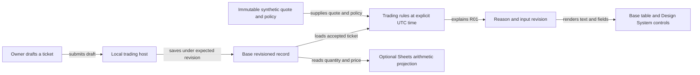
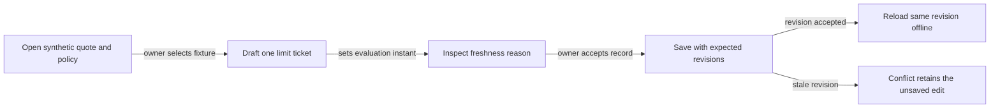

# Reference implementation — Agentic Trading Platform

**Decision.** The dedicated `agentic-trading-platform` repository owns trade tickets, snapshot validation, policy, reconciliation and trading audit events. Its existing owners supply the workbook engine, records, dashboard renderer, code graph and release workflow. The 2026 Moomoo × Qoder challenge adds one competition policy and provider adapters to that product.

**First result for the owner.** On a phone or desktop, open a synthetic quote and a draft ticket, see why the freshness check passed or failed, close the page and reopen the same accepted revision offline. No broker account, cloud resource, model or installation of the Graph application is needed. Read-only broker ingestion and owner-released execution remain later, independently gated outcomes.

**Decision record.** `AGENTIC-TRADING-HYBRID-001@0.6.0` defines the implementation and operator qualification needed for handbook **3.1 through 9**, paired with [Trading Skills 0.2.0](./prd-tad-adr-mvp-gtm-agentic-trading-skills.md). This revision updates two specifications only; it does not install connectors, change permissions, create cloud resources, submit orders or publish. The dated event profile expires at closeout.

**Evidence as of 20 November 2026.** Trading remains at `0d5a4dbc545de786a51e748c9ec463cf3179ed44`. Desktop and 360 px touch browsers previously verified the synthetic replay and worksheets offline (E-30–32); current source inspection and headless checks are E-33. The local product stays `dev-proven`, hosted delivery `undocumented`, and connected competition runtime **NOT READY**. Tool visibility, skill loading, fixture passes and written requirements are not authenticated provider execution. RT-01–RT-10 below name the remaining implementation and operator evidence; eligibility, actual account activity, physical-phone use, judging and paid demand stay separately unproven.

## Reference implementation — PRD

The immediate user is one self-directed owner who wants to explain a decision against the data available at the time. The broker remains authoritative for orders and fills. The proposed product records the owner’s inputs and checks them against owner-set limits. It supplies no trading recommendations or default policy values. Frequency, minutes lost, avoided errors and willingness to pay are unmeasured.

| Rank | Buyer pain and evidence | Smallest response and success signal |
|---|---|---|
| 1 | The owner cannot reconstruct which quote, timestamp and policy drove a ticket. The existing brief requests this record. No timed observation exists. | Save one synthetic ticket and its input revision with Base. Reopen it offline and explain R01 from those same inputs. PRD-TRD-01/02/05 and VCC-21. |
| 2 | A stale, unlabelled or missing price can invalidate a check. The broker’s account-specific freshness fields are unknown. | Fail closed with an explicit reason. A small Sheets projection can show quantity × limit when both are known. PRD-TRD-02/04 and VCC-05/07. |
| 3 | Manual transcription makes mismatched fills and orphan orders hard to find. Its frequency is a hypothesis. | Compare synthetic history against explicitly bound ticket IDs. Only then assess the value of a read-only import. PRD-TRD-01/03 and VCC-01/03. |
| 4 | A duplicate or ambiguous release could affect real funds. The broker documents order tools. No incident or demand for automation was observed. | Keep order entry in the broker app. Evaluate a separate guard only after read-only evidence, mock rehearsal and explicit release authority. PRD-TRD-03/06 and VCC-12/13/19. |

### Stories and scope

- **PRD-TRD-01:** The owner (or a scheduled run) lands a read-only snapshot of quotes, positions, balance and orders in the ledger, each row carrying run ID, source timestamp and freshness class, with no write scope in the ingestion path.
- **PRD-TRD-02:** The owner drafts a limit-order ticket and sees deterministic rule results with reason codes before any order is placed anywhere.
- **PRD-TRD-03:** The owner either releases an approved ticket through the guarded path (Phase 4, after gates) or places it in the broker app, and sees the ticket reconciled as matched, different or unmatched, including broker orders that had no ticket.
- **PRD-TRD-04:** The owner reads exposure, concentration, data freshness, open-ticket health, free-tier consumption, budget headroom and halt state on one mobile-first dashboard, and the runtime halts safely before any free limit is exhausted.
- **PRD-TRD-05:** The owner can run with no agent, no scheduled run and no execution path (manual paste, broker-app orders) and can revoke any grant without losing the record.
- **PRD-TRD-06:** The owner ships a change through a GitHub pull request with required checks and an approval-gated production promotion, can roll back, and can halt the runtime in one action.
- **PRD-TRD-07:** An eligible individual uses Qoder Desktop and Qoder Cloud Agents with official Moomoo tools to research, evaluate and demonstrate a strategy on one designated SIMULATE account. The journal identifies every accepted, rejected, skipped and uncertain decision.
- **PRD-TRD-08:** The entrant gives judges a readable Qoder-generated presentation and a runnable, reproducible agent package with attributable paper results, risk evidence and a demo.

| Increment | In scope | Exit condition |
|---|---|---|
| First local fixture | One synthetic snapshot, one draft ticket, R01 and explicit evaluation time, reason display, revisioned save/reopen. Desktop and narrow mobile browser. | VCC-21, including offline reload and stale-write rejection. An R01 pass alone never approves a ticket. |
| Local assurance | R02–R09, reconciliation, audit integrity, cost record, synthetic import/export and independent expected results. Optional bounded arithmetic view. | VCC-01–03/05–09/15 on the relevant fixture bounds. The full workbook oracle has a separate qualification step. |
| Later edge and broker integration | Authenticated read adapter, scheduler and a single private ledger for the connected account. Check isolation, $0 admission and recovery before any live read. | G0/G1/G5/G8 and VCC-04/10/11/14/16/17/20. |
| Later real-account owner release | Deterministic, single-flight guard and capped limit order. The owner approves the exact payload. | ADR-05/07, G6/G7 and VCC-12/13/19. No unattended orders, AI-held write scope, market orders, amend, margin or derivatives. |
| Competition paper entry | PRD-TRD-07/08. Reuse the local ticket and qualify the event profile under ADR-08. Official account activity, Qoder runs and submission have separate gates. | VCC-23–30. This branch of the roadmap can finish entirely within SIMULATE. |

### Competition entry and calendar

The entrant is an individual, aged at least 18, resident in Singapore, with a valid Moomoo SG Universal Account, an approved registration and a Qoder account using the same Luma email. The broad invitation on the event page does not establish eligibility. Terms take precedence over publicity. The organiser can verify or disqualify entries, change rules and inspect configurations and records. Luma showed registration closed on the 19 November review. Record an existing acceptance or an organiser decision privately. Terms allow one personal prize per entrant. Advertised values combine cash and coupons in SGD. The organiser determines final awards and may review identity, trading records and agent evidence. Eligibility and access for this owner are unknown. [Organiser event page](https://luma.com/oezyv35j) · [Handbook and terms](https://moomoo-qoder-challenge-rgkelnyuzbm.qoder.website/)

| 2026 milestone | Participant outcome |
|---|---|
| 16 November, 18:00–21:00 SGT | Kickoff and briefing. The handbook links the Qoder deck, Moomoo deck and recording. |
| 17–28 November | Development and trading window. Account access was scheduled to roll out from 17 November at 11:00 SGT. Check the named account in the app and the exchange calendar for each session. |
| 30 November, 23:59 SGT | Submit via the form linked on Luma. Early submission is allowed. Record the submitted revision, retrievable judge link, timestamp and confirmation. |
| 8 December | Top ten present. Five highest final scores are eligible for awards under the terms. Simulated returns, leaderboard position and advertised prize value supply no product revenue evidence. |

The organiser describes a sponsored month of Pro with 2,000 included credits and a separate 1,500-credit offer. Record actual plan, expiry, current usage, available headroom, renewal settings and provider-enforced denial at zero. The project permits free-tier/FOSS tooling at zero cost and forbids paid plans, add-ons, purchases and overages. Leave the add-on unclaimed. Sponsored entitlement requires confirmation that its actual terms fit that policy. If required functionality is Pro-only on terms outside policy, mark Qoder participation blocked and continue the local rehearsal. An event credit allowance alone cannot pass admission.

Use one eligible entrant, enrolled account, phone number and device under the promotion rules. Treat the universal account as an eligibility prerequisite only. Bind competition tools solely to the non-resettable SIMULATE account. Practice on a separately identified paper account produces practice evidence only. Organiser records settle rankings and disputes. Respect the terms on permitted tools, personal data and promotional use, data rights, prizes and fair play. Reject resets, revival, account switching to replenish funds, impersonation and manipulation. Entrant review of terms and any disclosure precedes submission.

### Acceptance and economics

Baseline each metric with the first timed run. First local value target is ≤10 minutes from opening a prepared fixture to explaining and reopening a ticket. Record time, errors, reason understood, successful reopen and whether a second session is requested. An actual cloud cost, paid offer, settlement or return on investment needs its own evidence. `UNKNOWN` is a measurement state. The budget for each new infrastructure effect is $0.

Each result names the boundary exercised. Connected and full-workbook qualification remain open. The IDs after the slash refer to PRD-TRD stories.

| ID / PRD trace | Measurable end state and stated check | Constraint and current result |
|---|---|---|
| VCC-01 / 01/05 | Landing sheets flag and exclude seeded invalid rows (type, range, duplicate key, bad timestamp, text starting with `=`, `+`, `-` or `@`); re-importing the same `run_id` yields identical outputs; fixture of 20 valid and 5 invalid rows per entity | Passed on four fixture tables (E-27). |
| VCC-02 / 02 | Independently authored pass/fail fixtures exercise R01–R09 and their expected reason codes. Compare the trading core to the test-only Python oracle for the complete rule set. | Passed on dated decimal-oracle cases (E-27). Workbook open. |
| VCC-03 / 03 | Reconcile classifies matched, partial, side difference, symbol difference, out-of-limit fill, overfill, orphan order, and submitted-without-evidence; candidate matches never auto-bind | Fixture pass, including closed remainders and average-only evidence (E-27). |
| VCC-04 / 01 | OAuth consent and the broker's token list show only read scopes until G6; the ingestion module's tool allowlist (CI-checked) contains no write-capable tool; tool-list readback shows no write capability on the read grant, or write calls fail for missing scope; no order attempt is made on a live account in this criterion | Pending scope readback and CI allowlist scan. |
| VCC-05 / 01/02 | A delayed, missing, future or over-age quote cannot produce an R01 PASS. At exactly the configured maximum age a valid realtime quote passes. Use the full timestamp for comparison. | Dated R01 fixtures passed (E-22). |
| VCC-06 / 02/05 | At one explicit UTC instant, compare core, independent Python reference and qualified offline workbook results across every supported full-export fixture. Verify the export recalculates and the health view fits a mobile viewport. | Full export and qualified workbook host pending. |
| VCC-07 / 04 | Dashboard totals equal Positions plus cash; missing price or FX excludes the row and marks equity unknown rather than defaulting to 1 or 0 | Passed on fixture with missing FX or price (E-27). |
| VCC-08 / 05 | After revoking the broker grants and switching `ctl_mode` to `MANUAL`, manual paste still produces outputs; restoring the last export preserves `Tickets`, `Audit_Log` and `Cost_Ledger` | Offline manual restore passed (E-27). Revocation open. |
| VCC-09 / 02/03 | Ticket state derives only from stage fields; post-approval edits to bound fields raise `EDIT_AFTER_APPROVAL`; approval while result is not PASS raises `APPROVED_WITH_FAIL`; supersession links keep a chain | Local flags exercised (E-27). Connected role checks open. |
| VCC-10 / 01/05 | Rehearsal ingestion against the mock broker stays within 12 tool calls and the chunk budgets, ends on the circuit-breaker for two consecutive errors, a scope error or any write-capable action, and emits typed rows, a manifest and a `Cost_Ledger` row | Mock passed (E-27). |
| VCC-11 / 01 | Under G5, verify a hosted read-only OAuth flow and account-specific tool schemas or qualify the single local read bridge against the same contract. Record the chosen adapter and redacted evidence. | Closed until admitted for this account. Pending. |
| VCC-12 / 03 | Each ADR-05 gate has a pass and a fail fixture; a release is refused when any input is blank, UNKNOWN, stale or mismatched, and each refusal is logged with its reason | Mock broker only; Evaluator is not the guard author. Pending |
| VCC-13 / 03 | With injected timeouts, duplicate requests and retries on the mock broker, at most one order exists per `idem_key`; an ambiguous result yields `RELEASE_UNKNOWN`, halts further releases and is never retried automatically | Single-flight by Durable Object. Pending |
| VCC-14 / 04 | Simulated missing proof, insufficient headroom or quota exhaustion prevents hosted effects before dispatch. Report usage and make the last validated local export available when the provider refuses reads. | Mock refusal passed (E-27/28). Hosted proof open. |
| VCC-15 / 02 | Changes, deletions and truncation in the audit chain are detected when checked against a separately retained trusted head and event count. Exports carry those witnesses. | Passed on local archives (E-27). |
| VCC-16 / 06 | A pull request passes required checks (tests, oracle parity, forbidden-vendor and forbidden-host scan, shipped-dependency licence scan MIT or Apache-2.0, secret scan); production deploy waits for owner approval of the `production` environment | Scans cover lockfiles, configs, URLs and workflows. Pending |
| VCC-17 / 05/06 | Rehearse halt, revoke, export, restore and rollback in the admitted environment. Block new imports and releases. Recover the previous verified head within 30 minutes on synthetic data without losing newer accepted events. | Local source rollback and recovery passed (E-27). Hosted revocation open. |
| VCC-19 / 01/03 | At G7, read back one separately authorized capped order and reconcile its actual broker state. Request cancellation only with separate authority and only if still cancellable. | Live, Phase 4 only. Fills cannot be reversed. Pending. |
| VCC-20 / 04 | Scan source, client payloads, logs, export, CI and ledger for credentials and account identifiers. Test encryption, grant isolation, revocation and redaction on the admitted adapter. | No secrets in ordinary data or output. Pending. |
| VCC-21 / 01/02/05 | In a primed mobile browser at 360 CSS px and on desktop, disconnect, draft one synthetic ticket, observe the R01 reason, reload offline and read the same accepted revision and inputs. A competing stale edit fails without partial changes. Check an over-age quote, a future timestamp and a missing freshness class. | Desktop and 360 px touch Chrome passed offline (E-22/27). Physical iPhone and human timing open. |
| VCC-22 / 02/06 | Inspect the resolved module graph, package pins and sealed assets. Each shared capability resolves to its declared owner once. Introduce an obsolete Base Sheets import or change a projected UI digest in a fixture and require rejection. | Owner pins, package integrity and offline projections passed for the released worksheets (E-30–32). Recheck notices and integrity when a pin changes. |
| VCC-23 / 07 | Present eligibility, same-email entitlement, hard zero-cost proof, separate Desktop and Cloud readbacks and an alias cross-checked against the official competition account. Fixtures with a live, practice, missing or changed account, disallowed scope or exhausted quota stop before any effect. | Fixture refusals passed (E-28). Entrant and account open. |
| VCC-24 / 07 | Replay the paper rule fixtures below, including exact limits, pending reservations, unknown inputs, fees, interest, exercise, forced liquidation and official settlement. Replaying fills/events twice leaves the same ledger, balances and decision reasons. | 59 fixture boundaries and A/B replay passed (E-28). Simulator open. |
| VCC-25 / 07 | A pinned Qoder coordinator delegates research and independent risk review. The paper executor receives an allowed, bound intent only. Prove one rejection, one no-trade, one permitted practice path and one ambiguous response. A second trigger creates no second order. | Fixture paths passed (E-28). Hosted sessions open. |
| VCC-26 / 07/08 | Verify the three offline timing cases in §6 below. For provider qualification, verify the selected skill archives, actual QCA upload/version, a completed bounded Forward Mode run via the §6 API contract (manual `/run`, `GET /schedule_runs/{id}`, `/pause`·`/unpause`, explicit API cron timezone, `session_mode`), delivery route, concurrency skip, resume from cursor and stop with an in-flight run. An optional Slack test returns a harmless reply only in its paired destination. | Local timing and schedule trace passed (E-25/28). The audit and schedule headings accepted pointer and touch input, and the timeline showed 13 receipts (E-31). Hosted usage and delivery remain open. |
| VCC-27 / 04/07 | On desktop and 360 px, read positions, open orders, net P&L, equity, drawdown and decision log from one versioned snapshot. Trace an observation to a run, rejection or fill. Offline mode shows the last validated snapshot and its age. | Desktop and 360 px touch browsers passed offline for source drill-down, chart changes, pivot controls, reload and numeric exports (E-30/31). Official account readback remains open. |
| VCC-28 / 02/03/08 | Restore a decision under run A after run B replaces the landing view. Reproduce A’s policy, inputs and evaluator. Test working/closed partials, an individual off-limit fill masked by its average, aggregate-only evidence and unknown freshness. | Local archive and fill cases passed (E-27/28). Workbook open. |
| VCC-29 / 07/08 | Reconcile daily net equity, risk and costs to SIMULATE readbacks. Separate practice from the scored period, weekly marks from the closing mark, and final-day after-hours fills from eligible results. Unknown metrics carry an explanation. | Organiser results take precedence. Pending. |
| VCC-30 / 08 | In a clean environment, unpack the pinned package, replay its redacted fixture and reproduce its report. Verify the Qoder-generated deck link as a judge, complete all four rubric rows and obtain separate owner approval and a Luma submission receipt. | Clean ZIP replay passed (E-28). Deck, judge link and submission open. |
| VCC-31 / 01/04/07 | Authenticate an asynchronous provider read, map actual schema/precision/freshness and atomically publish typed rows plus provenance. Test timeout, scope denial, partial pagination, unknown freshness, account drift, conflicting event bytes and literal text injection. Project the same accepted run with server-only secrets. | RT-01/04/08; synthetic landing is not this adapter. Pending implementation and admitted readback. |
| VCC-32 / 01/07 | Restart the coordinator/worker between receive, append and checkpoint. Redeliver the same source event and overlap manual and scheduled work; retain one accepted event and no lost cursor. Inject dispatch uncertainty, preserve halt across restart and never resubmit automatically. | RT-07/10; in-memory replay is not durable state. Pending. |
| VCC-33 / 07 | Retrieve baseline, change one approved prompt, preserve tool/MCP/skill arrays, then compare effective config and new Session snapshots. Reject `latest`, changed resources, wrong child/skill versions and stale approval; restore predecessor through a new validated configuration. | RT-09; four fixed prompt evaluations and actual Cloud readbacks pending. |
| VCC-34 / 03/07 | Mock tests reject a research-authored risk file, fabricated role label, tampered/expired/revoked verdict, repeated approval, direct MCP/CLI bypass and a live/practice account under a competition grant. An authenticated independent reviewer can veto and the single paper guard alone can dispatch. | RT-10; no operational guard or principal isolation exists yet. Pending; no live-account negative order test. |

## Reference implementation — TAD

### Codebase grounding and source ownership

Each link identifies inspected source bytes. A repository revision identifies the review baseline. A consumer pin identifies the older or equal revision that consumer actually resolves. They can differ.

| Canonical owner | Existing contract and evidence | Trading use and boundary |
|---|---|---|
| `agentic-design-system` | Owns the shared dashboard layout, cards, keyboard-accessible tab list, range chart, typography and line heights. [Dashboard](https://github.com/huijoohwee/agentic-design-system/blob/83de261f8f3ddf66ed41e5370b6811f498788b40/site/dashboard.mjs) · [Tab list](https://github.com/huijoohwee/agentic-design-system/blob/83de261f8f3ddf66ed41e5370b6811f498788b40/site/floating-panel.js) | Trading supplies labels, evidence and callbacks. Ticket, audit and replay share the same label and value typography. |
| `agentic-base` | Owns revisioned records, the matrix projector, browser tables and the line, area and column charts shared with Graph. [Record API](https://github.com/huijoohwee/agentic-base/blob/2f891a6193b2f937275bd04f6b28dd8e67a98454/src/index.mjs) · [Chart adapter](https://github.com/huijoohwee/agentic-base/blob/2f891a6193b2f937275bd04f6b28dd8e67a98454/packages/views-react/src/browser/DashboardChartBrowser.tsx) | Persist accepted tickets under expected revisions in local IndexedDB. Trading owns validation and uses UTC timestamp text for instants. Base projects evidence rows and pivot cells. |
| `agentic-sheets` | Owns `sheets/workbook/v1`. A blank sheet starts at 32 × 16. With `fitToCells`, an export fits its occupied rows and columns within 512 rows, 128 columns, 4,096 grid cells, 512 populated cells and 64 formulas. [Core](https://github.com/huijoohwee/agentic-sheets/blob/349b43ccadbec4edf107cfef9f0c09fc1715f9f2/sheets/core.mjs) · [Bounds](https://github.com/huijoohwee/agentic-sheets/blob/349b43ccadbec4edf107cfef9f0c09fc1715f9f2/sheets/schema.mjs) | Calculate ticket notional on demand and export one typed sheet per replay projection. Sheets or Base can open an editable clone. Trading keeps the verified replay as the evidence record. |
| `agentic-graph` | Already consumes Base and Design System. Owns code-source ingest, query and explained edges, plus a controller that verifies immutable Sheets artifact blobs. [Consumer pins](https://github.com/huijoohwee/agentic-graph/blob/9bfc5d2c08dbb026d41cba29ddb46255a84f1b16/package.json) · [Source-graph tools](https://github.com/huijoohwee/agentic-graph/blob/9bfc5d2c08dbb026d41cba29ddb46255a84f1b16/mcp/agent-graph-tool-contract.js) · [Sheets release controller](https://github.com/huijoohwee/agentic-graph/blob/9bfc5d2c08dbb026d41cba29ddb46255a84f1b16/scripts/production-sheets.mjs) | Optional source provenance for reviewing the implementation. Keep quotes, account data, individual tickets and credentials out of Graph. Its Sheets route belongs to Sheets. A future public demo needs its own admitted artifact, route and rollback receipt. |
| `huijoohwee.github.io` | Owns the joined planning guideline, grounding companion, related Sheets specification and its own Pages deploy boundary. [Grounding procedure](https://github.com/huijoohwee/huijoohwee.github.io/blob/f07f1a3c27d6936f86233d750d8db7b7690d5fb4/guidelines/prd-tad-adr-mvp-gtm-codebase-grounding.md) · [Sheets decision](https://github.com/huijoohwee/huijoohwee.github.io/blob/f07f1a3c27d6936f86233d750d8db7b7690d5fb4/docs/documents/prd-tad-adr-mvp-gtm-agentic-sheets.md) · [Pages payload](https://github.com/huijoohwee/huijoohwee.github.io/blob/f07f1a3c27d6936f86233d750d8db7b7690d5fb4/docs/DEPLOY-WORKFLOW.md) | Link to the guideline and existing product contracts. Do not copy this plan there. The `joohwee` draft is outside that Pages payload. The separate `huijoohwee/huijoohwee` site mirror is generated output under its release controller. |
| `agentic-os` | Owns START/RELEASE, invocation semantics and platform governance. The compatibility client in Canvas points back to OS. [START](https://github.com/huijoohwee/agentic-os/blob/d3430c8da71b0128b644040bfd1ef32d9f36c50e/docs/START-WORKFLOW.md) · [Invocation catalog](https://github.com/huijoohwee/agentic-os/blob/d3430c8da71b0128b644040bfd1ef32d9f36c50e/catalog/invocation.json) · [Canvas forwarding export](https://github.com/huijoohwee/agentic-canvas-os/blob/d3e0310d3f6abaff05abf791384b43648ab58a25/src/agentic-graph-mcp-client.js) | Reuse OS for admission, checks and release evidence. Reserve MCP/WebMCP or `/`, `@` and `#` bindings for an evidenced read-only job. Any admitted binding calls the same headless query. No trading command grammar, graph client or agent service in the first load. |
| `agentic-commerce-os` | Its revenue ledger records settlements and markups. [Ledger source](https://github.com/huijoohwee/agentic-commerce-os/blob/aa4151f82816c0e18796549a2be0e861d0e772d7/src/core/revenue-ledger.ts) | Trading’s loopback runner imports Commerce’s pinned local-first content security policies for browser annotations. The Commerce revenue ledger is separate from Trading audit events. A future customer payment belongs to the commerce owner. |

**Resolved ownership.** Trading `0d5a4dbc` pins Base `2f891a61`, Sheets `349b43cc` and Design System `83de261f` in `scripts/build.mjs`. Its dev runner reads Commerce policy at `aa4151f8`. Graph’s Agent Mission and Trading use the shared dashboard layout. Worksheet settings and trading measures belong to Trading. All chart and table assets ship locally. [Graph Mission consumer](https://github.com/huijoohwee/agentic-graph/blob/ee50ff102d5c00a9e98aa194e4b7524999f7ecbf/canvas/src/features/agent-ready/AgentMissionDashboardView.tsx)

### Product contracts and dependency direction

| Owner or adapter | Input → output | Write authority and failure |
|---|---|---|
| Trading core, local ticket and cash audit | Validated snapshot, ticket, policy revision, explicit UTC evaluation instant → per-rule result, reasons and reconciliation result | Pure functions. No DOM, database, wall clock, provider SDK or token. Same inputs give the same output in the CLI fixture and browser. |
| Local browser and headless fixture tests | A synthetic ticket change with expected revisions → accepted record or typed conflict | Use Base’s public engine. Store ticket fields together with fixture ID, immutable fixture digest and policy revision. Reload resolves that exact fixture or reports missing evidence. Recompute reasons from accepted data. On conflict retain the unsaved edit and require a fresh read. |
| Views | Accepted snapshot → Base table and Design System details. On-demand Sheets arithmetic → display values | Views emit intents back to the trading host. No second writer, spreadsheet save, sync service or round-trip through a spreadsheet editor. |
| Read adapter, later | Broker read tool → typed landing rows and manifest | Starts with an empty allowlist. Resolve exact read schemas and entitlements. Reject malformed/missing data and never acquire a write grant. |
| Connected ledger, later | Validated run or guarded command → atomic append, updated head and readback | One private trading authority per account. The local demo remains synthetic and cannot sync or replay commands into the account. Starting real-account storage needs an admitted schema, export/restore test, distinct identity and $0 proof. |
| Execution adapter, later | One owner-released, bound approval → one durable intent and broker readback or uncertain outcome | Exists only after G6. Single-flight per account serializes the budget and all releases. ADR-05 owns recovery. |

The browser and future Worker depend on the trading core. The core has no dependency on those hosts or on Graph. The browser imports Base and Design System and loads Sheets on demand for calculations and exports. Shared owners never import Trading. If a public API is missing, propose a generic change to its single owner. Only a contract adapter may translate trading fields. Vendored engines, competing themes/renderers, Base’s legacy `./sheets` entry, private archives, copied Graph handlers and a second production ledger fail VCC-22.



*D-01. First local read and write paths. Only the Base record accepts a ticket edit. Arrows denote data flow.*

### Full logical workbook and ledger contract

The following 14 named logical tabs include two policy tabs. They preserve the 0.2.0 export vocabulary for the later connected product. Landing, inputs and events may be stored. Positions, Checks, Reconcile and Dashboard are derived projections. The row counts describe full export targets. Neither the single-sheet Sheets adapter nor Base’s 2,000-record total is qualified to host this complete layout. The ticket fixture uses one ticket. The replay worksheets project events and account equity from the selected synthetic run.

| Tab | Role / writer | Row bound | Protection |
|---|---|---|---|
| `CTL` | Control; owner | 30 | Unlock only input cells below |
| `CFG_Limits`, `CFG_FX` | Policy inputs; owner (change logged) | 40 / 30 | Owner-only edit; each change adds an `Audit_Log` row |
| `IN_Quotes` | Landing; ingestion service or manual paste | 500 | Values columns unlocked; `calc_` columns locked |
| `IN_Positions` | Landing; same | 500 | Same |
| `IN_Balance` | Landing; same | 20 | Same |
| `IN_Orders` | Landing; same | 2,000 | Same |
| `Positions` | Calculation; formulas | 500 | Locked |
| `Tickets` | Owner drafts and requests approval. The trusted handler binds approval and release evidence. | 2,000 | Enforce field roles in the connected API. Export cells are display-only. |
| `Checks` | Calculation; formulas | 2,000 | Locked |
| `Reconcile` | Calculation; formulas | 2,000 | Locked |
| `Dashboard` | Read-only view | n/a | Locked |
| `Audit_Log` | Trading ledger appends validated owner and system events | 5,000 | Enforce append-only writes and verify the chain against the retained head. |
| `Cost_Ledger` | Receipts; owner | 2,000 | Append-only by convention |

`CTL` named cells: `ctl_schema_version`; `ctl_mode` (`READ_ONLY`, `MANUAL`, `SHADOW`, `LIVE_EXEC`, `LOCKED`, `SIMULATE`; `SIMULATE` binds exactly one explicitly labelled practice or competition account under ADR-08; `SHADOW` is read-only with release rehearsal on the mock, `LIVE_EXEC` needs G6); `ctl_halt` (`RUN` or `HALT`); `ctl_eval_ts_utc` (input text); `ctl_eval_num` (calculated serial from it). `CFG_Limits` rows are `key, value, unit, version, effective_utc, approved_by`; keys are `cfg_stale_min`, `cfg_max_position_pct`, `cfg_max_risk_pct`, `cfg_max_positions`, `cfg_max_daily_loss`, `cfg_min_cash_pct`, `cfg_price_band_pct`, `cfg_fee_per_order`, `cfg_slippage_bps`, `cfg_recon_tol_pct`, `cfg_recon_grace_min`, `cfg_base_ccy`, `cfg_exec_max_notional`, `cfg_exec_daily_cap`, `cfg_exec_max_orders_day`, `cfg_release_max_age_sec`, `cfg_stepup_min`, `cfg_budget_alarm_pct`. All ship blank; a blank key makes dependent rules UNKNOWN. `CFG_FX` rows are `ccy, rate_to_base, as_of_utc, source`, with the base currency listed explicitly at rate 1 and no default rate.

### Workbook layout: landing schemas

Landing sheets project the latest accepted snapshot. Every row carries `run_id`. Retain immutable source snapshots and canonical policy, time and evaluator inputs for every referenced decision alongside the 14 logical projections in a versioned export manifest. Preserve all referenced bytes or report incomplete evidence on restore. Formula columns are protected and text fields take literal values.

| Sheet / columns |
|---|
| `IN_Quotes`: A `run_id`, B `symbol_key` (`[MARKET].[TICKER]`, the workbook's own convention mapped by the importer), C `market`, D `ccy`, E `last`, F `prev_close`, G `quote_ts_utc`, H `source_id` (`MCP`, `MANUAL`), I `delay_class` (`realtime`, `delayed`, `unknown`); calc J `valid`, K `ts_num`, L `age_min` |
| `IN_Positions`: A `run_id`, B `account_alias`, C `symbol_key`, D `qty`, E `avg_cost`, F `ccy`, G `as_of_utc`; calc H `valid` |
| `IN_Balance`: A `run_id`, B `account_alias`, C `ccy`, D `cash`, E `total_assets`, F `as_of_utc`; calc G `valid`, H `cash_base` |
| `IN_Orders`: A `run_id`, B `broker_order_id`, C `account_alias`, D `symbol_key`, E `side`, F `order_type`, G `qty`, H `limit_price`, I `status_src`, J `filled_qty`, K `avg_fill_price`, L `created_utc`, M `updated_utc`; calc N `valid` |

Store execution-level evidence as records associated with `IN_Orders` by run, account alias and order ID. Each execution has its source ID, timestamp, quantity, price, currency, fee detail and evidence digest. Deduplicate by source identity. If the source has only cumulative quantity and average price, individual-fill limit compliance is `UNKNOWN`. Register fees and passive events once in the ledger.

`delay_class` is assigned by the harness from the tool output and is `unknown` when the output carries no freshness or entitlement field. `account_alias` is the owner's label, never a broker account number.

### Workbook layout: calculation, ticket and check sheets

`Positions` (rows 2–501): A `symbol_key`, B `qty`, C `ccy`, D `last`, E `prev_close`, F `quote_age_min`, G `fx`, H `mkt_value_base`, I `weight_pct`, J `day_pnl_base`, K `blocking_flags` (`NO_QUOTE`, `FX_MISSING`), L `info_flags` (`STALE`), M `weight_rank` (rank by weight with a row-number tie-break, read only by the dashboard). `calc_cash_base` sums `IN_Balance` `cash_base`; `calc_equity_base` is blank (unknown) whenever any `blocking_flags` or cash conversion is missing, otherwise value plus cash. `calc_day_pnl_base` sums `J` (unrealized from `prev_close`; realized P/L is not imported). `calc_open_count` counts held rows with `qty` above 0.

`Tickets` (rows 2–2001, owner input; eventual orders are `LIMIT` only): A `ticket_id` (`T-YYYYMMDD-NNN`), B `created_utc`, C `account_alias`, D `symbol_key`, E `side` (`BUY`, `SELL`), F `order_type`, G `qty`, H `limit_price`, I `stop_price` (owner risk stop, not an order), J `ccy`, K `expiry_utc`, L `rationale`, M `approved_by`, N `approved_utc`, O `approved_key` (server-derived binding at approval, display-only in exports), P `submitted_utc` (owner records after placing the order externally), Q `broker_order_id` (owner enters), R `supersedes`, S `void` (`VOID` or blank); execution-guard columns T `release_utc`, U `release_state` (`NONE`, `RELEASING`, `RELEASED`, `RELEASE_UNKNOWN`, `BLOCKED`) and V `idem_key` (unique release intent bound to the ticket and approval). An amendment is a new ticket whose `supersedes` names its predecessor; no ticket is edited after approval.

Extend the export after V with `input_run_id`, `snapshot_digest`, `policy_revision`, `evaluated_utc`, `evaluator_revision` and `decision_id`. The manifest resolves these references to the actual inputs, per-rule reasons, approval and audit events. Replaying run B or advancing the current clock must preserve the decision made under run A.

`Checks` (rows 2–2001, aligned to `Tickets`): A `ticket_id`, B `qrow` (quote match, 0 if none), C `last`, D `fx`, E `notional_base`, F–N rule results R01–R09, O `result`, P `reason_codes`, Q `state`, R `open_flag`, S `flags`.

| Rule | Passes when | UNKNOWN when |
|---|---|---|
| R01 Quote fresh | Valid matched realtime quote with exact age in [0, `cfg_stale_min`] | Missing/unknown freshness class, missing timestamp, bad row, future timestamp, missing evaluation time or blank threshold. A known delayed or over-age quote fails. |
| R02 Ticket and policy complete | Required ticket fields valid, ticket `ccy` in `CFG_FX`, every `cfg_` key used by R03–R09 non-blank | Never; failure is FAIL |
| R03 Position limit | BUY: post-fill weight ≤ `cfg_max_position_pct`; SELL: `qty` ≤ held (no short selling) | Equity unknown or key blank |
| R04 Risk per trade | BUY: stop below limit and (limit − stop) × qty × fx ≤ `cfg_max_risk_pct`% of equity | Stop, fx, equity or key missing; SELL passes |
| R05 Cash | BUY: cash − notional − fees ≥ `cfg_min_cash_pct`% of equity | Fees, cash or equity unknown |
| R06 Position count | BUY of an unheld symbol: open count + 1 ≤ `cfg_max_positions` | Key blank |
| R07 Daily-loss halt | BUY: `calc_day_pnl_base` > −`cfg_max_daily_loss` | P/L or key unknown |
| R08 Duplicate | No other open ticket with the same symbol, side, qty and limit | Never |
| R09 Price band | Limit within ±`cfg_price_band_pct`% of `last` | No quote or key blank |

R01–R09 describe the private cash-limit policy. In SIMULATE, select instrument-aware variants within the same evaluator for position treatment, quantity units, risk, fees, cash or margin and duplicate identity. A paper order requires both the versioned strategy checks and every applicable competition constraint. Unqualified capabilities remain replay-only. Keep market rules and the participant’s more conservative limits distinguishable in reason codes.

`result` is `HALT` when `ctl_halt` is `HALT`; else `FAIL` if any rule FAILs; else `REVIEW` if any is UNKNOWN; else `PASS`. `reason_codes` lists the non-PASS rule IDs. `state` derives, never an input: `VOID` if voided; else `RECONCILED` when `Reconcile` is `MATCHED` and the broker status is final; else the broker status once an order is matched (`FILLED`, `PARTIAL`, `CANCELLED`, `REJECTED`, `EXPIRED`); else `SUBMITTED` if `submitted_utc` is set or `release_state` is `RELEASED`; else `APPROVED` if `approved_utc` is set; else `DRAFT`. `open_flag` is 1 for `DRAFT`, `APPROVED`, `SUBMITTED` and a working `PARTIAL` with remaining quantity. A terminal cancellation closes its remainder and retains executed fills. An uncertain or unclassifiable disposition holds further dispatch for reconciliation. `flags` carries `EDIT_AFTER_APPROVAL`, `APPROVED_WITH_FAIL`, `NO_BROKER_EVIDENCE` (submitted and unmatched beyond `cfg_recon_grace_min`), `ORDER_NOT_FOUND`, `RELEASE_UNKNOWN` and `BUDGET_HALT`.

`Reconcile` (rows 2–2001, mirrors `IN_Orders`): A `broker_order_id`, B `trow` (match in `Tickets` column Q, 0 if none), C `ticket_id`, D `side_ok`, E `symbol_ok`, F `qty_state` (`OK`, `PARTIAL_OPEN`, `PARTIAL_CLOSED`, `OVERFILL`), G `price_state` (`OK`, `OUT_OF_LIMIT` for an observed BUY fill above or SELL fill below limit, or `UNKNOWN` for insufficient execution detail), H `match_state` (`MATCHED`, `ORPHAN_ORDER`, `SIDE_DIFF`, `SYMBOL_DIFF`, `OVERFILL`, `PRICE_OUT_OF_LIMIT`, `PARTIAL_OPEN`, `PARTIAL_CLOSED`, `INSUFFICIENT_EVIDENCE`), I `candidate_ticket` (advisory fuzzy suggestion by symbol, side and quantity; never binds). Binding happens only through the owner-entered `broker_order_id` or, for a released order, through the execution guard with provenance `RELEASE`.

`Dashboard`, top to bottom for a narrow screen: (1) header with `ctl_mode`, `ctl_halt`, evaluation time and workbook version; (2) data health: invalid-row counts per landing sheet, oldest quote age, `delayed` or `unknown` quote count, missing FX, `RECON_GAP`, orphan orders, `EDIT_AFTER_APPROVAL`, tickets in REVIEW or FAIL, budget headroom per limit, audit chain status; (3) tiles: equity, cash %, open positions, unrealized day P/L (blank when unknown); (4) top positions by weight via a rank helper in `Positions` with a row-number tie-break; (5) exposure by market and currency; (6) ticket counts by state. `Audit_Log` columns: `event_id`, `ts_utc`, `actor_type` (`HUMAN`, `AGENT` or `SYSTEM`), `actor_alias`, `action`, `entity`, `ref_id`, `rows`, `control_total`, `note`, `prev_hash`, `row_hash`. `Cost_Ledger` columns: `date`, `run_id`, `activity`, `active_min`, `tokens_in`, `tokens_out`, `token_source` (`MEASURED` or `UNKNOWN`), `tool_calls`, `provider_fees`, `other`, `note`. An unknown value is text `UNKNOWN`, never 0, and the dashboard counts unknowns.

For the event dashboard derive net return as (marked equity − initial virtual equity) / initial virtual equity when cash flows are accounted for. For a positive prior high-water mark, drawdown is (high-water mark − equity) / high-water mark. Display the maximum across dated marks and the provenance of the sampled series. Use measured provider equity when available. Leave a gap if a mark cannot be validated.

### Formula oracle and assurance

The full workbook patterns require cross-sheet lookups, conditionals, functions such as `INDEX` and `COUNTIFS`, and ranges up to 2,000 rows. Preserve them as examples for independent evaluation in a separately qualified offline workbook host. Agentic Sheets supplies bounded arithmetic and single-sheet evidence exports. Never silently truncate, approximate an unknown function or fork the Sheets parser to pass VCC-06. For the first slice, use independently authored expected R01 results, including the zero-age, threshold, future-time and missing-field cases.

```
K2 : =IF(J2<>"OK","",DATE(VALUE(LEFT(G2,4)),VALUE(MID(G2,6,2)),VALUE(MID(G2,9,2)))+TIME(VALUE(MID(G2,12,2)),VALUE(MID(G2,15,2)),VALUE(MID(G2,18,2))))
L2 : =IF(OR(K2="",ctl_eval_num="",K2>ctl_eval_num),"",(ctl_eval_num-K2)*1440)
J2 : =IF(B2="","",IF(AND(ISNUMBER(E2),E2>0,LEN(G2)=20,OR(I2="realtime",I2="delayed",I2="unknown"),COUNTIF($B$2:$B$501,B2)=1,LEFT(B2,1)<>"=",LEFT(B2,1)<>"+",LEFT(B2,1)<>"-",LEFT(B2,1)<>"@"),"OK","INVALID"))
Checks!F2 (R01): =IF(A2="","",IF(OR(B2=0,ctl_eval_num="",cfg_stale_min=""),"UNKNOWN",IF(OR(NOT(ISNUMBER(INDEX(IN_Quotes!$L$2:$L$501,B2))),INDEX(IN_Quotes!$I$2:$I$501,B2)="unknown",INDEX(IN_Quotes!$I$2:$I$501,B2)=""),"UNKNOWN",IF(AND(INDEX(IN_Quotes!$I$2:$I$501,B2)="realtime",ROUND(INDEX(IN_Quotes!$L$2:$L$501,B2)*60,0)<=cfg_stale_min*60),"PASS","FAIL"))))
Checks!I2 (R04): =IF(A2="","",IF(Tickets!E2<>"BUY","PASS",IF(OR(D2="",Tickets!I2="",cfg_max_risk_pct="",calc_equity_base=""),"UNKNOWN",IF(AND(Tickets!I2<Tickets!H2,(Tickets!H2-Tickets!I2)*Tickets!G2*D2<=cfg_max_risk_pct/100*calc_equity_base),"PASS","FAIL"))))
Checks!M2 (R08): =IF(A2="","",IF(COUNTIFS(Tickets!$A$2:$A$2001,"<>"&A2,Tickets!$D$2:$D$2001,Tickets!D2,Tickets!$E$2:$E$2001,Tickets!E2,Tickets!$G$2:$G$2001,Tickets!G2,Tickets!$H$2:$H$2001,Tickets!H2,$R$2:$R$2001,1)>0,"FAIL","PASS"))
```

The examples above are partial spreadsheet formulas. The input contract accepts whole UTC seconds. Rounding the spreadsheet serial difference back to whole seconds removes representation noise before the threshold comparison. R08 compares other ticket IDs within one account-scoped export. For a missing/invalid input or future source timestamp, validation rejects the row before the formula reads it. Bind an approval to a canonical encoding of every order-affecting field, owner, account, ticket ID, input and policy revisions, expiry and nonce. An editable spreadsheet cell or a concatenated display key cannot authorize an effect.

### Ingestion and data handling

Store RFC3339 UTC instants as text. Validate the actual calendar date and require nonnegative elapsed time before applying any rounded display age. Prices and quantities remain finite and typed. For the later order adapter, validate instrument tick/lot precision and broker semantics before accepting a candidate. The connected ledger uses alias-only identities. Tokens, credentials and account numbers stay out of rows, logs, projections, exports and Git.

For a connected read, stage rows keyed by `run_id`. Validate literal text, quote freshness, timestamp, numeric fields, uniqueness, row count and control totals. Reject spreadsheet formula-leading text in untrusted text columns and produce values-only exports. Commit an entire validated snapshot, its audit head and the `current_run` pointer together. Replaying identical content for the same run is idempotent. Reject reused IDs with different content or a stale pointer revision. Keep the last complete run readable after a failed or partial import.

Each later read run is bounded to one account alias, ≤50 symbols, ≤30 days of order history, ≤12 calls, ≤50 rows per chunk and ≤10 active minutes. A scope error, an unallowlisted tool or two consecutive tool errors ends the run. Design budgets must fit observed headroom. Renew a grant only under its operator-approved lifecycle. Expiry returns the account to manual operation. A manual import still requires schema validation. In the private real-account profile an optional agent may receive a separately approved redacted export and has no ledger write or release interface.

The full audit chain binds canonical event bytes and `prev_hash`. A trusted exported head and event count are needed to detect deletion of a suffix. Browser deletion and privileged rewriting remain possible. Keep the latest owner-controlled export separate from the source and verify its head on restore. A source rollback never deletes user storage or reverses a broker fill.

**Connected reference deployment.** If local use earns a connected phase, the candidate maps the authenticated API and private dashboard to one Worker per environment. `BrokerLinkRead` is the read-only Durable Object. D1 stores accepted connected runs, tickets and audit events. Cron invokes reads only. Access gates the owner UI. An optional `ExecutionGuard` Durable Object is excluded from the deployment until G6. R2 backups require a separately verified $0 cap. The guaranteed fallback design is an owner-controlled local export. Static public shell assets must never contain account data.

Retain the earlier planning ceilings of ≤5,000 Worker requests, ≤1.5 million D1 rows read and ≤30,000 written per day, ≤2 production cron triggers, and ≤1 GB of optional backup storage. These are proposed application ceilings. Before admission compare each with current account-specific headroom, measured CPU on the largest permitted chunk and the provider-enforced billing boundary. Halve the batch or stay local if any bound fails.

### Competition paper ledger and rule fixtures

The event profile uses `environment=SIMULATE` and distinguishes practice from competition by event and bound account. Scope every key (run, execution, intent, position, decision and valuation) to that identity. The simulator owns fills, account balances, liquidations and settlement. Trading accepts typed observations, records their provenance and derives explanations. Keep a market timestamp, import timestamp, freshness class, currency, quantity unit, multiplier where applicable, evidence digest and source revision. Missing quote, volume, market cap, multiplier or buying-power evidence blocks only the decision that depends on it. Never infer a fill from a quote or a successful tool call.

| Paper terms | Policy and acceptance example |
|---|---|
| Products and market time | Eligible universe is US-listed stocks, ETFs and options. Verify listing, instrument class and actual supported session. Use `America/New_York`, session calendar and instrument availability within 04:00–20:00 ET (pre-market, regular and after-hours). Reject an out-of-session dispatch. Only stocks at USD 1 or above qualify. Stocks and options of companies below USD 500 million market cap are ineligible. Test USD 0.99/1.00 and company caps just below/at the floor. For ETFs obtain the applicable fund classification. |
| Starting cash and order counts | Start with USD 100,000 virtual capital. At most 200 executed orders per competition day and 100 simultaneously held positions. Cancelled/amended orders do not count as additional executions. Reconcile partials by stable order ID, reserve capacity for outstanding work and release unused reservations on terminal readback. Test 200/201 and 100/101, and cancellation after a partial. Confirm day rollover against the simulator. |
| Stock/ETF concentration | Apply 40% per stock or ETF on active increases. At inception that is USD 40,000 per ticker. Cash may be retained. Full initial deployment can use 40k/40k/20k across three concurrent names. Passive appreciation or exercise can leave an overweight holding. Flag it and block further increases. The formal text names initial assets while its explanation uses current value. Until clarified, an addition must pass both denominators. Retain both results and the simulator response. No forced sale solely for a passive breach. |
| Options concentration | Options are outside the stock/ETF 40% test. For one contract identity, include held contracts and pending opening orders against the 1,000-contract cap. Test 999 held plus 1 pending and then one additional opening contract. Identify contract, underlying, expiry, strike, put/call, side, opening/closing effect and actual multiplier. Each separately placed spread leg consumes its own order allowance. |
| Financing and liquidity | Event permits margin and shorts. Long initial/maintenance requirements are 50%/40%, short 60%/50%. The simulator charges financing at 4.8% per annum and short interest at 6.0% per annum daily after close. Record the financed/borrowed base, broker charge and day convention. Unknown accrual details stay unknown. Negative remaining liquidity during market hours can trigger forced liquidation. Reconcile it as a provider event and halt new risk until the readback agrees. |
| Fills and remainder | Matching depends on actual trade-by-trade volume. Price alone proves nothing. When volume × 20 is below order size a partial is possible. Seed 5 units of market volume and an order for 101. Do not predict the exact fill. Keep the remainder reserved until a fill or cancellation settles it. For a BUY limit of 25, fills of 5 at 24 and 5 at 26 must flag the second fill despite average 25. An average-only feed yields insufficient evidence. |
| Virtual stock fees | Commission USD 0, platform USD 0.99/order, sell-only activity fee USD 0.000166/share capped at USD 8.30/trade. A 100-share sell in one trade gives USD 0.0166 activity before simulator rounding. A 60,000-share sale hits the cap. Track fee scope to avoid charging the per-order fee on each partial. Confirm the ETF fee classification against simulator records. |
| Virtual option fees | Premium above USD 0.10 uses USD 0.65/contract, otherwise USD 0.15/contract. Minimum commission USD 1.99/order. Add USD 0.30 platform, USD 0.00279 activity and USD 0.015 regulatory per contract. For 10 contracts at premiums 0.10 and 0.11 expect totals USD 5.1679 and 9.6779 before provider rounding. Keep recorded fees, modelled slippage and infrastructure spend distinct. |
| Options expiry | At close on expiry, ITM options exercise automatically. Book the simulator’s resulting underlying trades if funded, or possible exercise and forced liquidation if short of funds. OTM contracts expire worthless. Index and stock options use the expiry-day market close for settlement valuation. Unspecified at-the-money handling, settlement mechanics and rounding require readback. Test funded, underfunded and worthless outcomes. |
| Corporate actions and delisting | Support dividends, splits, reverse splits and ticker changes as dated, idempotent events preserving cost history and symbol lineage. After delisting, block further trading and reconcile the virtual cash credit at the last close on the second business day. |
| Competition marks | Weekly returns use Friday 22:00 ET prices. Final valuation uses the regular-market closing prices of the final competition trading day, includes final-day option exercise and excludes trades executed in that day’s after-hours session from results. Store actual close, calendar and source. Keep all events for audit and preserve distinct weekly, final-ranked and later account values. |

The entrant versions an explicit strategy mandate covering thesis, eligible universe, data and freshness requirements, entry and exit conditions, invalidation, position sizing, cash/margin policy, take-profit/stop-loss response, portfolio drawdown and kill switch. A first replay can test whether a documented signal clears virtual fees and slippage against a cash baseline. Record both the predicted condition and the observation that falsifies it. For example, an offline-only trend fixture admits a candidate when two consecutive completed bars close above a pinned prior-session high. Missing bar data, a close back below the level or a risk veto invalidates it. Replay an entry, an exit and an abstention at the recorded observation times, sizing from the participant’s risk budget and available liquidity. Compare net outcome and maximum drawdown with the cash baseline. This is an unvalidated test hypothesis. The entrant sets all thresholds. A narrow cash-only stock/ETF mandate is valid. A strategy using short, leverage or options requires the corresponding event policy, instrument-specific rule results and margin tests. Never interpret a generic private-product rule that disallows shorting as evidence that an option or short trade passed.

### Invocation and gated effects

| Surface | MVP behavior and authority |
|---|---|
| Browser / local runner | Offline fixture and revisioned local save. One code path for validation and evaluation. Cache only the public static shell and bundled synthetic fixtures. Portability uses an explicit versioned export, with no cross-device synchronization implied. |
| Broker MCP | Private product read adapter under G5. The competition adapter follows ADR-08 and VCC-23/24. OQ-2 must establish specific tool IDs, schemas and scopes for each entity, especially order history. If history requires a write grant, keep it manual. |
| Skill discovery and load | OS resolves `/skill.discover` and `/skill.load` with `#read-only` and the `@skill:trading` selector. Metadata and verified Markdown are the respective outputs (E-29/32). MCP/WebMCP access to product data and broker effects have separate gates. |
| Scheduled read / manual bridge | A separately admitted Worker or a local read connector may feed the same validated import contract. A failed hosted OAuth probe selects a single read adapter. There is no parallel bridge/server product. |
| Real-account owner release / cancel | Broker app by default. G6 may admit one deterministic guard. A cancellation has its own instruction and readback. No AI route, webhook, schedule or spreadsheet can release or cancel an order. |

| Gate | Required evidence | Recovery |
|---|---|---|
| G0 · Accounts and budget | Before any hosted rehearsal, verify the owner’s second factor, owner-only access, least-privilege deploy token, exact provider $0 hard cap or denial, and headroom per effect. | Unknown entitlement or cost keeps the run local. Revoke an exposed credential. |
| G1 · Read grant | Owner consents to the minimum read scopes under G5. Capture scope and tool-list readback without tokens. | Revoke at the broker and return to manual import. |
| G2 · Policy change | Owner records old and new limits, FX, policy revision and effective time. | Restore the previous version as a new revision. |
| G3 · Approval | Bind actor, validated payload, revisions, timestamp and expiry to the approval. Any material edit voids it. | Void and supersede, then re-evaluate. |
| G4 · External order | Owner acts in the broker app and records a returned identifier. | Read actual broker state. Cancel only when possible and explicitly instructed. |
| G5 · Live read | Separate instruction names account alias, environment, scope and date. Rights, retention and market-data terms have been reviewed. | Lock ingestion, revoke and preserve last known evidence with its age. |
| G6 · Enable guarded release | OQ-1–OQ-4 answered, caps set, independent mock evaluation green, isolated grants proven, separate owner instruction for this effect. | Lock releases, disable the guard and revoke its write grant. |
| G7 · Canary | A separately authorized owner-present canary follows G6 and the mock and readback drills. | Immediately reconcile outstanding orders and fills. A fill is irreversible. |
| G8 · Promote | Exact source candidate, tests, immutable artifact, predecessor, environment, $0 protection and explicit promotion authority. Bind Dev, Prod and runtime readbacks separately. | Retain the prior verified version. Verify schema compatibility and post-recovery runtime before reopening. |

**Broker questions.** OQ-1 covers hosted OAuth client acceptance, redirect rules, refresh and independent grants. OQ-2 covers tool schemas, order-history scope and freshness fields. OQ-3 covers interactive trade-password handling with no stored password. OQ-4 covers paper/sandbox support and its semantics. For real-account integration, use only public documentation until G5. Mock tests and a successful login cannot answer these account-specific questions. If separate grants or unambiguous readback are unavailable, live execution stays closed.

G0–G8 govern their named effects. For the competition, validate the event admission and the simulator-only binding below. A competition receipt cannot satisfy G5, G6 or G7 for a real account.

### Qoder Desktop and Cloud Agents integration

**Readiness definition.** `runtime-ready` for this event requires every required RT row below to pass against the same immutable candidate, admitted environment and current provider bindings. A row is `PASS`, `FAIL`, `BLOCKED` or explicitly `NOT_SELECTED`; local fixture evidence is labelled separately. An optional channel can be omitted with its judging tradeoff disclosed, but Desktop, Cloud, readback, versioned skills, independent risk and bounded orchestration cannot be waived. A configured connector is not proof of authentication, scopes, data rights, cost or execution. Completion of this document cannot raise a runtime rung.

Use both environments for a judged entry. Practice and competition use distinct bindings and grants. A transition requires owner selection and fresh alias verification. The local offline build and replay remain available whenever event access is unavailable. The three upstream providers (Moomoo, Qoder and optional Slack) are external adapters. They gain no place in the offline dependency graph or authority over the Trading ledger. The operator records timestamps, revisions, verified grants and redacted outcomes in each admission receipt.

| Handbook sections | Setup and observable completion |
|---|---|
| 1–2 · Entrant and account | Match Luma and Qoder email privately, inspect My Billing and recheck the cost boundary. In Moomoo open Discover → Paper Trade → Competition → Ongoing. Verify the named challenge and its Net Assets. Query available simulated accounts through the authorised connector and cross-check the dedicated identifier privately against the app. Bind one allowed alias. An account picker, paper flag alone or a working quote cannot select the scored account. |
| 3 · Desktop authoring | Open the existing Trading project in Qoder Desktop. Verify the `moomoo Open API` connector and `moomoo-skill` publisher Moomoo. Enable the session connector and test a read-only quote with a timestamp. The skill suite covers quotes, news, sentiment, unusual activity, simulated trading and grid strategy. Bind only the skills the mandate needs. Install the Qoder-published Cloud Agents plugin, reload and verify its `qca` connector and `qoder-cloud-agents` skill. Capture Desktop provenance for the template, skills and report. |
| 4.1 · Cloud credentials | Forward Mode has its own container and Vault. Create a custom MCP OAuth binding for `https://mcp.moomoo.com/mcp`, leaving manual token and OAuth client fields empty for the documented consent flow. The vault refreshes the token automatically and never displays it after authorisation—nothing to copy. Follow the FAQ’s Market Data selection and inspect the actual permissions. Deselect unnecessary defaults. Forbid live Accounts & Orders and Trade Execution scopes. Attach the approved Vault to every template/session needing Moomoo tools; a session without it silently has none. Verify tools and alias again from Cloud. If simulated account enumeration or paper actions require live privileges, stop. |
| 4.2 · Skills | Pin an approved upstream revision and follow [QCA package rules](https://docs.qoder.com/cloud-agents/api/skills/schemas.md). The inspected Moomoo hub revision `ec092d2b4c21868ae285f65d9b30f7adb44f860e` documents CLI-based quote/trading/Unusual skills, not automatic MCP-backed execution (E-34). Treat it as a candidate, not an adopted runtime. Generate one ZIP per selected skill; compressed and expanded content each within 50 MB, one root matching YAML `name`, required `description`, supporting files, working relative links and rights proof. Preserve original safety instructions and record package-only link relocation. Upload individually, retain actual immutable version/content evidence and bind explicitly. An archive's acceptance does not prove its CLI, dependencies or OAuth work in the Cloud container. |
| 5 · Optional Slack channel | Configure the Forward template’s Channels tab with an approved Slack workspace. Each provider card holds up to five console-created bots. Use pairing mode—immutable after creation—plus Socket Mode, enabled events, installed bot and channel membership. Keep app and bot tokens in connector secret fields, omit user tokens and disable mirroring of thinking/tool calls. Verify a harmless paired reply before enabling redacted summaries. Chat input cannot release or cancel a paper order. Channel delivery counts toward the automation half of the usage score; a private session report works without Slack. |
| 6 · Bounded scheduling | For natural-language managed scheduling, enable Schedule on one coordinator template; direct HTTP API qualification follows the separate path in RT-07. Define purpose, inputs, output, destination, begin/end and IANA timezone. Use `America/New_York` for trading sessions and `Asia/Singapore` for deadlines; schedule by local calendar time, not fixed UTC, and avoid DST transition instants (`PT24H` ≠ daily local time). Weekday cron (`1-5`) is day-of-week only and does not exclude public holidays—pair it with the exchange calendar. Forward supports interval durations, five-field wall-clock cron, and one-off absolute timestamps via API. Configure template/identity files or API `resources` explicitly. Default fresh sessions need durable cursors and stable event IDs. Test a manual run before enabling a bounded schedule. |
| 6 · Schedule API contract | `POST https://api.qoder.com/api/v1/forward/schedules` takes `identity_id`, `template_id`, `environment_id`, `initial_events` (`type: user.message`), `trigger_policy` and `execution` (`session_mode` `new_session` default—no chat carryover—or `reuse_session`; `max_concurrent_runs` default 1). HTTP cron requires an explicit `timezone`; the NL `Asia/Shanghai` default does not apply. `once` needs an absolute future timestamp the caller computes. The handbook expects windows via `start_at`/`stop_at`; request acceptance is disputed, so those fields and the following three timing cases remain expectations pending RT-07 qualification, not verified provider behavior. Apply the source-discrepancy gate below: manual-first with no trading capability, independently enforced UTC cutoff, and no recurring activation until qualified. Manual test `POST /api/v1/forward/schedules/{id}/run`; results `GET /api/v1/forward/schedule_runs/{run_id}`; `/pause`·`/unpause` by ID. Creation or trigger success is not completion—check run status and errors. Five-minute around-clock = 288 triggers/day; size frequency and window to need. |
| 6 · Interval and clock-aligned cron | Use the handbook fixture in `Asia/Shanghai`. Created at 09:02 with no explicit start, `PT5M` schedules 09:07 and 09:12. Five-field `*/5 * * * *` schedules 09:05 and 09:10. Compare scheduled instants. A delayed start or completion leaves the interval anchored to creation and cron aligned to local clock minutes. |
| 6 · One-minute minimum | Reject a recurring `PT59S` interval. Accept `PT60S` and `PT1M` as the same cadence. With creation at 09:02:00, both first schedule 09:03:00. The fastest supported five-field cron, `* * * * *`, fires on each clock minute. A seconds-field expression is invalid. |
| 6 · Exclusive stop | Handbook expectation for RT-07 qualification after the manual-first gate, not an activation instruction: create before the 09:00–18:00 window on 1 May 2027 in `Asia/Shanghai`. For five-minute triggers, include `start_at` at 09:00 and the last due trigger at 17:55. Suppress 18:00 and every later trigger. If the 17:55 run is still executing at 18:00, it may finish. Confirm that run's actual disposition from Schedule Runs during provider qualification. [Handbook examples A and E](file:///Users/huijoohwee/Documents/GitHub/joohwee/undocumented-draft/moomoo-qoder-challenge-rgkelnyuzbm.qoder.website/index.md#L296) · [API timing rules](file:///Users/huijoohwee/Documents/GitHub/joohwee/undocumented-draft/moomoo-qoder-challenge-rgkelnyuzbm.qoder.website/index.md#L395) |
| 6 · Scheduled run evidence | Read back schedule ID, expression, zone and next trigger, then inspect Schedule Runs for completed status, output, credit usage and errors. A chat-created schedule returns to that conversation, an IM-originated one to its channel, and an API schedule needs an explicit sink or a run lookup. Keep concurrency one, record `concurrency_limit_reached` skips, and recover gaps without repeat dispatch. Pause/unpause by ID. Archive/delete stops future triggers. Separately reconcile in-flight work. |
| 7 · Dashboard | Reuse the Design System Mission shell and cards. Project positions, open orders, P&L, equity curve, drawdown, decision history, working quantity, account scope and Qoder run/credit health. Show observation time, data gaps and strategy version. For QCA sessions/events use a server-side read adapter at `https://api.qoder.com/api/v1/cloud` with an appropriately scoped PAT created at `qoder.com/cloud/pat-keys` (shown once, copy immediately), held server-side only in a `.env` listed in `.gitignore` or an approved vault—never committed or in client-side code. Only redacted, time-stamped records reach the browser or judge export. Screenshots or a local screen recording suffice. Qoder Sites hosting is optional and outside the current publication grant. |
| 8 · Tuning and provenance | Retrieve the current configuration into the project’s `AGENTS.md` (template, prompt, model, tool permissions, MCP connections, skill bindings, child versions) under private version control, with a timestamped comment per agent: `Retrieved at (UTC)`, `Agent ID`, `Cloud version` (the QCA-returned value, never manual), `Local revision`, `Change summary`. Keep exported prompt data distinct from instructions to the editor. Before update, diff against the retrieved configuration and retain the predecessor. After update, re-read the cloud version and bindings, confirm only intended changes applied, and carry over existing tool/MCP/skill arrays when replacing configuration. Pin the trading agent’s skill `version`; an unpinned `latest` binding can silently change behaviour mid-competition and when judges replay. Replay all four companion evaluations EV-01–EV-04 before and after each relevant change: eligible fresh fixture, independent risk veto, missing/stale data, and duplicate/uncertain/restart. Use measured usage and lighter models when the fixtures still pass. |
| 9 · Collaboration | The scheduled coordinator delegates a candidate and source references to a pinned researcher, seeks a veto-capable risk auditor in an independent session, then delivers only a bound approved intent to the paper executor. Define each structured output, file ownership and tool scope, and pin child agent versions instead of `latest` so a mid-competition edit cannot silently change a live session. Mark shared memory/wiki as context. An optional Advisor supplies a second opinion and has no action capability. The executor calls the single trading guard and writes a receipt. Only that guard can dispatch an authorised paper intent. |

### Runtime qualification matrix — handbook 3.1–9

The inspected Trading source has no provider transport, runtime agent templates, project `AGENTS.md`, operational execution guard or durable Forward cursor. The read adapter accepts `SYNTHETIC` only; schedule requests are data, and binding booleans/role names are caller assertions (E-33). Preserve those fixtures; do not change their labels to claim connected support. The following rows are acceptance requirements, not completed setup.

| ID / handbook | Current evidence | Owning delta and required runtime receipt |
|---|---|---|
| RT-01 / 3.1 MCP | This Desktop session advertises Moomoo tools; no quote, grant or account call was made. | Operator: review official publisher, OAuth and session enablement; after read/cost admission, obtain one read-only `US.AAPL` quote with source time, delay class and actual tool schema. Independently verify paper-account alias against the app before any account operation. Missing freshness stays unknown. VCC-04/11/23. |
| RT-02 / 3.2 skill | `moomoo-skill` entrypoint is available; OS S1 discover/load pass. Neither proves the upstream skills execute. | Skill maintainer: inventory each selected upstream skill's exact revision, instructions, supporting files, runtime and license. Test the selected skill in its executing environment. CLI-based skills need their own admitted CLI/OAuth runtime; an MCP Vault does not supply CLI login. Use the companion's R1–R4 gates. |
| RT-03 / 3.3 QCA plugin | No `qca` connector or `qoder-cloud-agents` skill is exposed in this session's catalog; installation elsewhere is unknown. | Operator: verify Qoder publisher, install only with approval, reload and use a fresh session. Read back the selected template/environment through the actual QCA interface. Generic Desktop agents and local task completion are not Forward Mode evidence. |
| RT-04 / 4.1 Vault | `src/forward-bindings.mjs` compares supplied records with `authority:false`; synthetic Vault/PAT assertions are not readbacks. | Integration owner: capture separate Desktop and Cloud permissions, exact MCP URL, effective config and current account binding privately. Test missing Vault, expired consent, live account and identity drift refusals. Credential, rights and hard-$0 proof must precede effects. VCC-20/23. |
| RT-05 / 4.2.1–4.2.2 packages | `scripts/inspect-skill.py` validates local ZIP shape; no selected upstream archive or Cloud upload is proven. | Skill maintainer: one ZIP per skill, compressed and expanded size within 50 MB, strict YAML/name/link checks and preserved safety instructions; retain rights and transformation manifest. Operator uploads each separately and captures actual `skill_id`, immutable version and content readback, then verifies the executing agent's exact binding. VCC-26; companion VCC-09/10. |
| RT-06 / 5 Slack | No channel observation; optional and not selected by this revision. | Operator: if selected, pair a dedicated approved chat, keep tokens in secret fields and thinking/tool mirroring off. Prove a harmless reply and redacted delivery; reject requests to trade, change mandate or access another destination. Otherwise use authenticated run lookup and disclose missing channel-score evidence. VCC-26. |
| RT-07 / 6 schedules | Local clock tests and 13 synthetic receipts exist; no scheduler request is sent and the cursor is in memory. | Trading/QCA owner: qualify manual-only run first, then one separately authorized bounded coordinator schedule. Persist checkpoint, accepted events and deduplication atomically outside transient threads. Capture attempt, scheduled/start/end times, selected input/config, completed/error/skipped and delivery state; test restart, redelivery, overlap, pause/unpause and cutoff. Resolve the window-schema discrepancy below before activation. VCC-26/31/32. |
| RT-08 / 7 dashboard | Existing browser shows bundled synthetic records; loopback runner is static GET/HEAD, not a PAT proxy. | Trading integration owner: add one server-side authenticated read adapter, then project a versioned redacted snapshot through existing Base/Design System views. Never put PATs/OAuth/account IDs in assets, localStorage, service-worker cache or judge files. Verify real readback and stale/offline state at 360 px and desktop without weakening the sealed CSP. VCC-20/27/31. |
| RT-09 / 8 versions/tuning | Agent and skill versions in the fixtures are illustrative strings; no deployed configuration is captured. | Agent maintainer: retain sanitized current configuration and timestamped per-agent provenance in the project's `AGENTS.md` as quoted data, separately from Desktop instructions. Preserve predecessor and arrays, read back effective config and actual Session snapshots, then compare four fixed evaluations. No edit to `AGENTS.md` is authorized by this documentation task. VCC-33. |
| RT-10 / 9 collaboration | Replay's different research/risk labels are not distinct authenticated principals; no real handoff is observed. | Trading/security owner: coordinator delegates explicitly to pinned children, independent risk can veto, executor can call only the external paper guard. Verify child Thread events, role outputs and file ownership; attempt forged/replayed verdict and direct-write bypass using mocks. Approval must be authenticated outside the shared filesystem. VCC-25/34; companion role contract. |

**Candidate-bound receipt.** The proposed local evidence envelope records `schema`, handbook/VCC ID, source revision, source kind (`SYNTHETIC` or authenticated provider observation), observed/expiry UTC times, environment, practice/competition alias, redacted provider references, tool-schema digest, grants/rights/cost proof references, template/effective-config digest, child and skill versions, run/session/thread/attempt, input/output digests, result, failure reason and reviewer. Private provider IDs resolve through the trusted adapter; public exports use aliases. This is a Trading contract, not a claimed provider response schema. Self-entered `REDACTED`, `PASS` or budget booleans cannot mint trusted provenance. Missing or changed bindings invalidate only dependent receipts and halt dependent effects.

**Source discrepancy requiring qualification (E-34).** The handbook and current Schedule schema list `start_at`/`stop_at`, but the current create endpoint says trigger requests accept only `type`, `expression`, `timezone`. Do not silently drop the bounds or claim the fixture proved API acceptance. Begin with documented `type: manual`, `max_concurrent_runs: 1`, `max_attempts: 1` and a bounded timeout under separate authority; verify the actual window request/readback with no trading capability before recurring activation. Independently enforce the mandate's UTC cutoff in the trusted admission/dispatch boundary. If provider cutoff behavior remains unresolved, recurring mode stays blocked. Schedule capability is required for natural-language managed tools; the HTTP API documentation says it is not required for direct API creation/run. Keep those paths distinct.

**Forward execution evidence (E-34).** Read `GET /api/v1/forward/identities/{identity_id}/templates/{template_id}/effective` to inspect compiled overrides and effective hashes; do not write that response back as raw Template/Identity DSL. Capture actual runtime snapshots as well. Pin numeric child Agent versions and opaque string Skill versions, not `latest`; updates do not rewrite existing Session snapshots. `initial_events_version` binds input per attempt, not the whole configuration; resource changes can occur without changing it. Retrieve the selected input with `include_initial_events=true`, retain mounted resource digests and compare every run with the admitted candidate. A completed Run and `push_status=succeeded` prove different things; missing usage is `UNKNOWN`. Main Session events are not the complete child history: inspect each Thread's events, and treat `requires_action` as waiting, not success.

**Shared-sandbox boundary (E-34).** Child Threads have independent conversations and Agent snapshots but share the Environment, filesystem and session-bound Vaults; Agent tool configuration and permission policy still apply. File ownership prevents collisions, not forgery or credential access. Keep broker-write credentials and trusted approval storage outside that sandbox. Deny direct write MCP tools and generic CLI/network paths that bypass the guard; do not place usable broker tokens in shared files/environment variables. The risk result is authenticated from the approved reviewer runtime and revalidated by the guard, never trusted from a filename or role string. If this cannot be enforced, run read-only/no-trade collaboration only; even a separate conversation or Session is not, by itself, an authorization boundary.

**Paper dispatch.** A separately granted paper session binds account, time window, strategy, independent risk verdict, limits and permitted actions. Each intent binds those revisions, decision, side, quantity, contract details and an idempotency key. Within the account lock, re-read the SIMULATE identity, halt, balances, open orders, reservations and rules before any outbound call. Deny on stale or unknown evidence, repeated or changed identity, missing risk verdict, expiry or cost uncertainty. Submit once and reconcile by stable IDs. Persist any ambiguous effect, freeze new submissions and resolve by simulator readback. A scheduled job, Slack message or research output cannot expand the mandate. At cut-off, pause schedules, reconcile in-flight orders and revoke event capabilities. No live route or credential is present in the challenge package.

Existing MCPs, local databases, research, document knowledge bases and Moomoo AI shortlists may be supplied as attributable inputs with rights and freshness evidence. Historical options data was unconfirmed in the briefing. Label backtests, missing history, quotes and official competition executions separately. Qoder Wake, a VPS, public GitHub, a public dashboard and new cloud storage are unnecessary. Mobile-linked Qoder is optional for the operator. The dashboard must still function on a narrow local browser.

## Reference implementation — ADR

| Decision | Selected approach and rationale | Rejected alternative, consequence and revisit |
|---|---|---|
| ADR-01 · Product and persistence | One trading domain over existing owners. Start with a private synthetic fixture on device. A later hosted account can admit one authoritative ledger with D1 as a candidate. | A new general-purpose platform, a trading fork in Base/Sheets/Graph and a shared editable workbook plus cloud ledger would duplicate owners. Revisit physical repository placement if an existing trading owner with the same contract is found. Migrate via one move and an exact pin. |
| ADR-02 · Read and write scopes | Start with fixtures. At G5 request only an admitted read capability, beginning with quotes. Require independent consent before additional account reads. | Reject `quote:write`, combined read/write ingestion tokens and open-ended tool discovery. If a read is unavailable under read-only scopes, use a validated manual import. |
| ADR-03 · Rule and workbook parity | One production rules implementation with explicit evaluation time. Independently authored expected results and a test-only Python reference check trading behavior. Full exported workbook parity has its own offline evaluator and complete fixture set. | A second shipped rule engine, hard-coded expected results derived from the engine, or unsupported Sheets formulas as a trading oracle fail the contract. Where parity is unproven the full workbook is export-only. |
| ADR-04 · Landing and audit | Validate typed input and source freshness, then atomically publish a complete run. The broker owns order facts. Trading owns local interpretation, policy, decision history and reconciliation. | Reject raw tool output as executable input, overwrite-on-retry and fuzzy automatic matches. Reopen the last validated run and surface missing evidence. |
| ADR-05 · Owner-bound release | Phase 4 only. Require a fresh owner step-up, current bound approval, eligible LIMIT order, all rules PASS, current caps and no open uncertain release. Serialize account-wide reservations and persist the unique intent before one outbound submission. | A local lock does not prove broker exactly-once delivery. Repeated clicks read the existing intent. A crash or timeout after dispatch produces `RELEASE_UNKNOWN` and blocks further releases until authoritative reconciliation. No automatic resubmission. |
| ADR-06 · Hosting, rights and budget | Local device first. GitHub and Cloudflare Free are the private product’s hosted candidates. Qoder Cloud Agents is an external event requirement scoped by ADR-08 and subject to the same cost policy. Verify MIT/Apache-2.0 rights for shipped code, notices and lockfile. Each effect needs fresh proof of both $0 enforcement and available headroom. | Exclude paid tiers, add-ons, overages, Vercel, Supabase, AWS, GCP, Google Sheets API and Apps Script. A free allowance or an application alarm cannot enforce a provider billing cap. Without proof for R2, export to an owner-controlled local file. |
| ADR-07 · Credentials | In the private real-account profile a later read connector holds only its own grant. A later execution guard holds only its own independently revocable grant, encrypted at rest and isolated from UI, CI, Graph, Sheets and AI clients. | Reject a combined grant as a substitute for isolation and reject stored trade passwords. If the broker cannot support the separation, retain manual order entry. Revoke each grant and verify that exports remain readable. |
| ADR-08 · Competition paper account | Reuse one headless policy, journal, guarded intent path and Design System dashboard. Bind the provider, environment, event, authorised alias and runtime template version on every competition run. Optional paper capabilities are policy inputs in this profile. | Reject a second trading engine, generic brokerage credentials, any live account or fallback account, public account data and duplicate scheduled writers. When evidence or authority expires, stop new effects, retain the journal and continue fixture replay. |
| ADR-09 · Replay worksheets | Trading projects verified events into worksheet views. Design System owns the tabs, layout and typography. Base owns the matrix and chart/table renderers. Sheets owns the editable export format. | Independent clones preserve source evidence. Change reusable renderers in their owner and test the Trading pin offline. The external showcase supplied interaction references only. |
| ADR-10 · Runtime proof and agent boundaries | Keep synthetic replay sealed. Add provider observations through one authenticated adapter, durable checkpoint and external paper guard. Authenticate independent risk outside shared threads; bind every runtime version and permission. | Reject role labels, editable JSON, ZIP acceptance, listed MCP tools or passing fixture checks as authority. A raw-write CLI skill cannot bypass the guard. Stay read-only whenever principal separation, cost, runtime compatibility or cutoff behavior is unproven. RT-01–10 and VCC-31–34 govern admission. |

**Repository choice.** Trading owns the event profile and its versioned fixtures (E-22/30). Store future versioned templates, fixtures and package recipes there. Generate the submission from an exact revision. The shared repositories retain their current owners and the checked-in profile expires independently of their releases.

**Reference execution sequence.** Acquire the account-wide serialization boundary first. Recheck session, mode, halt, unknown outcomes, ticket/policy/snapshot revisions and expiry inside it. Recompute R01–R09, validate instrument precision, reserve the per-order and daily caps and persist the unique `idem_key` and `RELEASING` together. Only then send once. Persist broker ID and readback, or lock on uncertainty. A restarted guard treats an unresolved intent as uncertain. It never infers a negative broker result from an empty read. Changing the intent requires new owner approval and authoritative resolution of the old intent.

```mermaid
flowchart LR
  ticket["Approved ticket"]
  guard["Owner step-up and account checks under lock"]
  ticket -->|"requests release"| guard
  intent["Persist intent and reserve caps"]
  guard -->|"passes gates"| intent
  call["One broker submission"]
  intent -->|"dispatches once"| call
  ack["Broker ID and confirmed readback"]
  call -->|"acknowledged"| ack
  unknown["Uncertain or timeout"]
  call -->|"ambiguous"| unknown
  halt["Lock further releases and reconcile"]
  unknown -->|"persists uncertainty"| halt
  audit["Append evidence and reconcile"]
  ack -->|"records actual state"| audit
```

*D-03. Proposed Phase 4 release and recovery. An acknowledged order can still fill partially, fill completely or be rejected. Only broker readback settles its state.*

## Reference implementation — MVP

| Order | Demonstration and affected checks | Gate to proceed |
|---|---|---|
| 1 · Local ticket | Draft, save, disconnect, reopen and reject a competing edit. VCC-05/21. | Verify on desktop and narrow mobile. Time the owner's explanation of R01. All nine rules are required for a cash-policy PASS. |
| 2 · Local audit | Evaluate, reconcile, halt and restore the synthetic run. VCC-01–03/05–09/15/22. | Reproduce inputs, policy, reasons and audit head. Qualify the workbook host separately. |
| 3 · Hosted mock and read | Rehearse timeout, revocation, budget denial, rollback and readback. VCC-04/10/11/14/16/17/20. | G5 for broker access, G8 for promotion. Bind account, rights, limits, immutable candidate and predecessor. |
| 4 · Shadow and release | Run EXP-01 read-only. Exercise the independent mock evaluator and ambiguous responses. VCC-12/13/19. | ADR-05/07 and G6/G7. A real canary requires its own instruction. |
| Competition rehearsal | Replay VCC-24/25/27/28, restore the redacted package and compare each numeric boundary independently. | Preserve the verified ticket. Stop on a failed comparison. |
| Competition qualification | Verify Desktop, Vault, Cloud skills, scopes and practice alias. VCC-23/26. | Separately authorize a practice order, fill/close and readback before competition binding. Exclude practice results from scoring. |
| Competition run and freeze | Record decisions, fills, fees, drawdown and settlement under the paper mandate. VCC-25/27/29/30. | Stop at cutoff, owner stop or risk halt. Retain provider records and the judge-accessible package. |



*D-02. Local ticket journey. Saving an observation grants no approval or broker authority.*

**TEST fixture for the first run.** Use a synthetic `TEST.DEMO` quote stamped `09:00:00Z` on 2026-11-19 with a test-only five-minute threshold. At `09:05:00Z` a realtime quote passes R01. At `09:05:01Z` it fails, even if its displayed age rounds to 5.0 minutes. A missing freshness class cannot pass. A source instant later than the evaluation instant yields UNKNOWN. Reopen the saved revision at its recorded evaluation time before testing a new instant.

**Implementation budgets.** Re-estimate each increment after 90 active minutes. Keep each authored module below 600 lines and each sealed chunk below 500 kB. Replay views and Sheets exports load on demand. The largest shipped chunk in the verified package was the 335,678-byte Base browser adapter (E-32).

**Delivery and rollback.** A primed offline shell serves bundled assets. Validate keyboard and touch flow, 360 px layout and a genuinely disconnected reload. The loopback dev document permits the annotation overlay. The sealed offline package enforces its strict stylesheet policy (E-32). Source restoration uses the exact previous pin and asset digest. Preserve IndexedDB on source rollback and verify the old reader against the saved schema. A schema mismatch stops writes until an independently verified backup/restore or forward recovery is available. No trading route, service, deployment or product repository is created by adopting this plan.

### Runtime implementation sequence — not yet implemented

Use one Trading implementation lane per admitted write scope; this authoring lane changes no runtime code. Execute P1 and P2 before P3, then P4 before any paper dispatch; P5 qualifies the complete candidate. Reuse the current core and views, not a second trading engine or new platform. Budget each implementation increment to ≤90 active minutes before re-estimating, <600 lines/module and <500 kB/sealed chunk; unknown provider cost blocks external work without an ETA.

| Step / owner | Exact existing seam and smallest change | Exit / recovery |
|---|---|---|
| P1 · Trading ingestion | Extend the contract around `src/landing.mjs` with an asynchronous authenticated adapter and distinct provider envelope. `scripts/audit.mjs` remains the mock entrypoint. Retain precision, literal text and atomic snapshot rules; resolve exact tool schemas rather than guessing names. | VCC-31 and mock scope/timeout/pagination tests; preserve last verified run, revoke admitted read grant on drift. |
| P2 · Agent/skill maintainer | Add versioned role/configuration artifacts in Trading, not OS; use `src/forward-bindings.mjs` only for comparison and `scripts/inspect-skill.py` for local inspection. Follow companion R1–R3 for source pin, runtime/rights checks and separate Cloud acceptance. | RT-02–05/09 and Skills VCC-09/10; no `latest` or credential-bearing export; restore prior pins/configuration. |
| P3 · Trading/QCA integration | Adapt the `src/forward-rehearsal.mjs` event vocabulary to real telemetry and a durable account-scoped checkpoint/ledger; add a separate server-side read boundary beside, not inside, the static asset payload served by `scripts/serve.mjs`. Reuse Base records and the existing dashboard. | VCC-26/27/31/32; manual-only first, completed vs delivered state and usage unknowns visible; pause on config/cost drift. |
| P4 · Trading/security owner | Reuse `src/competition-rules.mjs` for deterministic checks, not `src/replay.mjs` as a broker client. Add one external single-flight paper guard, persistent reservations/uncertainty and authenticated one-use risk approval; exclude direct broker writes from every Agent. | VCC-25/32/34 on mocks, then separately authorized practice canary and authoritative readback. No real-account path. Unresolved outcome holds halt across restart. |
| P5 · Operator/reviewer | Run the same candidate through Desktop read, Cloud read, pinned skill, independent veto/no-trade, permitted practice path, schedule restart/cutoff, narrow-browser live projection and credential-free clean replay. Extend `scripts/package-replay.py` only with approved redacted artifacts and manifests. | Every required RT receipt passes; preserve local fallback, predecessor and witness. Official competition binding, recurring operation and submission each need separate authority. |

**Executable baseline now.** From Trading, `npm run check`, `npm run rehearsal -- --bindings`, `npm run rehearsal -- --schedule`, `npm run audit:local -- --mock` and `npm run package:replay` exercise existing local seams only. `npm run check:browser` verifies the UI when changed. No `connect`, `deploy`, `trade` or provider preflight command exists in this baseline. Runtime implementers must add and document real entrypoints with their tests; do not present a planned command or a synthetic archive as a working cloud agent.

### Replay worksheets on a primed device

Start `PORT=4182 npm run dev` from the canonical Trading checkout. Open [the replay dashboard](http://127.0.0.1:4182/#replay-dashboard), wait for **Offline ready**, disconnect, select **Run B · competition** and choose **Replay run**.

| Worksheet or control | What to verify |
|---|---|
| Source records | Open the same 26-event decision log used by the evidence panel. Select a row to inspect its timestamp, decision and equity. |
| Daily equity | Select one of six observed UTC dates to read opening, high, low and closing equity. **Inspect source events** filters the log to that date. |
| Event activity or Daily equity → Chart | In **Setup**, choose a line, area or column chart, a category (UTC date, event type or decision) and a measure. Daily equity also offers the equity-range chart. **Customize** changes the supported series color, gridlines and value readout. |
| Pivot table | In **Fields**, choose row and optional column dimensions, event count or an equity measure, and an event-type filter. **Options** controls descending rows and the grand total. Opening and closing equity follow replay sequence. An empty intersection has count zero and no observed equity. |
| Export to Sheets | The current chart or pivot exports native numbers and leaves missing equity blank. Import the JSON and choose **Replace with imported clone** in Sheets or Base. Settings persist per run and worksheet in the same browser tab. |

## Reference implementation — GTM

The first user is the owner. The alternative today is to keep a manual record and place orders in the broker app. The first offer is a private, self-hosted fixture that explains a ticket from recorded evidence. No fees, subscription, advice, returns or savings claim. Market size, repeat demand, support burden, data rights and jurisdictional obligations are open.

| Experiment | Observation | Decision |
|---|---|---|
| Local first value | In one ≤10-minute session, can the owner explain a failed freshness check and reopen the same synthetic decision? Trace one chart or pivot value to the recorded event and compare active minutes and corrections with a manual reconstruction. Human timing remains open. | Fix the first observed failure. If the owner sees no advantage after two sessions, stop before connecting an account. |
| First-dollar hypothesis | If the owner requests reuse, ask a potential second user whether they would pay $1 once for an offline ticket-reconciliation walkthrough using synthetic records. Record the verbatim response and whether a second session is requested. | A stated yes is willingness to pay. Actual paid demand requires a separately authorized offer, rights review and a settled receipt. No hosted payment or external outreach is part of this increment. |
| EXP-01 · Two-week owner shadow run | After G5, count validated imports, manual fallbacks, unexplained orphan orders, rule failures, headroom and authority incidents. Record time spent, including reconciliation. Orders stay in the broker app. | Continue only with zero authority incidents, zero unexplained orphans, proven cost controls and passing checks for the admitted scope. Stop on scope drift, billing uncertainty or a material evidence gap. |

The owner operates the private tool. On incident, lock imports and releases, revoke any affected grant and reconcile against the broker app before reopening. Record unknown cost components and human effort separately. Downside is remaining offline indefinitely. The base case is useful private record-keeping. A paid offer and live execution each require separate evidence. CAC, LTV, margin, market size and returns cannot be estimated from code reuse.

### Judging evidence and submission package

| Criterion (organiser weights may change) | What the judge can inspect |
|---|---|
| Risk-adjusted return · 25% | Dated official competition equity and net return relative to USD 100,000, with peak-to-trough drawdown, exposure and fee/slippage assumptions. Show the equity sampling times, high-water mark, missing periods, benchmark where supported and effect of the final settlement. Label locally derived measures. The judging panel owns its score. |
| Qoder and Qoder Cloud Agent usage · 30% | Qoder Desktop build/refinement history, pinned Cloud templates/skills, agent handoffs, Schedule Runs, Slack channel delivery (automation), completed/rejected decisions, dashboard and reports. Trace one result through a redacted run ID. Record measured credits from account/workbench and Cloud Observability. |
| Strategy and risk design · 30% | Thesis, signal and invalidation, entry/exit, sizing and portfolio limits, drawdown response, kill switch, independent veto and a failed case. Explain how strategy risk affected results, including a justified decision to abstain. |
| Reusability and documentation · 15% | Named owners, versioned templates and skills, configuration examples with placeholders, reproducible scripts, fixture inputs, expected outputs, rollback and clean-run instructions. Verify a new evaluator can replay the example and locate the source evidence. |

Use the event listing’s fuller submission requirement and satisfy the FAQ’s readable-link minimum. Prepare a **Qoder-generated presentation deck and a runnable trading-agent package**, plus a judge-readable link to the deck or generated HTML report. Include the strategy, risk limits, evidence of both Qoder runtimes, dated decisions including rejections, actual fills and results, and a demo of a success, a failure and why each occurred. A screenshot or recording of the private dashboard is sufficient. Separate slides for practice, synthetic replay and competition results. When the account has no fills, disclose that outcome and demonstrate the other rubric evidence.

Generate one submission archive from the pinned Trading source, with a README, template and skill versions, dependency and fixture manifests, reproducible offline entry point, redacted logs/results, dashboard evidence and report/deck references. On a clean copy, replay without credentials, verify hashes and expected outcomes, and test judge-link readability without the entrant’s login. Describe optional, separately authorised provider setup. Exclude tokens, account numbers, private raw data, third-party material without redistribution rights and local secrets. A judge can reproduce the fixture without placing orders. The owner reviews the exact materials and permitted disclosures before submission through Luma. Retain the organiser confirmation and submitted artifact digest. Award decisions, eligibility and whether a submission was received come only from the organiser.

### Coverage and outstanding evidence

| Domain | Disposition | Next evidence |
|---|---|---|
| C01 Purpose and pain | Owner need specified, frequency unvalidated | Timed reconstruction and owner explanation |
| C02 Market and timing | Deferred | Dated demand evidence before expansion |
| C03 Offer and alternatives | Private fixture specified | First-dollar interview |
| C04 Product experience | Local VCC-21 and worksheet walkthrough passed (E-22/31) | Physical iPhone walkthrough and competition dashboard readback |
| C05 Architecture and data | Local VCC-22, adaptive exports and independent clone reopen passed (E-22/31) | Official account import and full workbook qualification |
| C06 Quality, security and AI | Criteria specified | Independent fixtures, authority and recovery drills |
| C07 Decisions | ADR-01–10 record the product, runtime-proof and shared-owner decisions | Revisit if a named contract fails |
| C08 Smallest slice | Offline fixture verified on two viewport sizes | Timed owner explanation and reopen |
| C09 Acquisition and retention | Deferred | Repeat session and separately authorized outreach |
| C10 Operations | Lock, revoke, preserve and reconcile specified | Staging incident drill |
| C11 Organization and rights | Deferred | Assign a reviewer before G5, G6 or distribution |
| C12 Financial viability | Competition credits, awards and paper returns tracked separately from revenue | Provider cost enforcement and independently verified demand |
| C13 Capital | Outside the private increment | Revisit on a funding decision |
| C14 ADLC | Trading main synced to its local origin at E-30. The earlier backup receipt is scoped to E-22 | Candidate-specific checks, owner authority and receipts for each event effect |
| C15 Audience projections | Competition judges receive the pinned deck and package. Private product outreach stays deferred. | VCC-30 review and submission receipt |
| C16 Learning | Local experiment and EXP-01 specified | Actual outcomes and decision to continue or stop |

## Reference implementation — evidence and handoff

### Evidence register

The owner links in the TAD address the exact revisions reviewed on 2026-11-19. The earlier provider observations retain their original dates and narrow scopes. No authenticated broker or hosting account was inspected.

| ID | Evidence and scope |
|---|---|
| E-01–E-21 | Historical broker and host observations, prior specification checks, Base and Sheets fixture receipts, and the original lane admission remain in the [immutable evidence register](https://github.com/huijoohwee/joohwee/blob/3c8e8a6263dd0e843fec65751d9b0d7a9640ef78/undocumented-draft/prd-tad-adr-mvp-gtm-agentic-trading.md#evidence-register). E-19 covers the Sheets consumer, E-20 the Base memory adapter and E-21 the planning lane. |
| E-22 | Trading `2ae80e5e6f84e09cfac78c783cf290e546d24710`. Six automated checks passed, plus desktop and 360 px touch Chrome with the HTTP server stopped. Verified R01, stale-write rejection, saved evidence, offline reopen, lazy Sheets and one Design System renderer. Sealed build `12dc88e9026dad0355ba19c18d06614b1c7aa68f5efb9b6bd37e5270b83942ca` contains 28 files. The private backup restored source. Competition results, data backup/restore and physical iPhone validation remain open. [Browser tests](https://github.com/huijoohwee/agentic-trading-platform/blob/2ae80e5e6f84e09cfac78c783cf290e546d24710/test/browser.mjs) |
| E-23 | Owner-supplied handbook snapshot, 19 November 2026, SHA-256 `c4897f407ceda995e1bacf7e62544b4bc9b132604c4be46cfa0bfb85168bfe36`. Sections 1–9 (lines 62–586) cover both tooling environments. Lines 587–724 cover the event and participation terms, 725–847 the simulator rules, and 849–1034 the FAQ and disclaimer. Recheck organiser amendments at admission and submission. Account entitlement and results require private readback. [Supplied local snapshot](/Users/huijoohwee/Documents/GitHub/joohwee/undocumented-draft/moomoo-qoder-challenge-rgkelnyuzbm.qoder.website/index.md) · [Organiser listing and submission form](https://luma.com/oezyv35j) |
| E-24 | Pre-revision audit of 0.3.0 reproduced the unknown-class R01 disagreement and working-partial R08 omission in isolated LibreOffice examples. An order average cannot resolve its individual fills. Five isolated LibreOffice cases passed against the revised R01/R08 formulas (unknown, delayed, exact threshold, over-age and future, paired with working or closed remainders). Decimal checks confirmed the option examples and stock sell-fee cap. Event-engine and full-workbook qualification under VCC-24/28 remain pending. |
| E-25 | Trading `c9e419222e768e4acfc27bc167784eb8835ed0bf`. Five offline VCC-26 tests passed with network access denied. They checked nominal interval and cron triggers, local clock alignment, the one-minute minimum, inclusive start and exclusive stop. All 20 Trading tests passed via `npm run check`. The sealed browser build retained its previous digest. A completed Forward Mode run and the disposition of in-flight work still require provider evidence. [Offline scheduling tests](/Users/huijoohwee/Documents/GitHub/agentic-trading-platform/test/forward-schedule.test.mjs) |
| E-26 | START admitted `agent/device-0232231d4a19/trading-handbook-support` against `joohwee@3c8e8a6263dd0e843fec65751d9b0d7a9640ef78` (origin/main) for this path alone, declared-mission. Input was the committed 0.4.0 draft, blob `89e7a4328042b9862d07c20e7c5c843684c55307`; a stale local selection bound to the closed `trading-platform-plan` lane was unset first, removing no authored bytes or branches. Local planning coverage revision only—no runtime, provider or competition receipt. |
| E-27 | Trading local candidate on `c9e419222e768e4acfc27bc167784eb8835ed0bf`, Git tree `cd611ace8d11c3d5cf1ce481683d96dec0f71919`. All 29 headless tests passed. Desktop and 360 px Chrome disconnected with the loopback server stopped. Both saved A, refused conflicting bytes, reopened halted B, rejected the wrong witness and restored A. Always-loaded journal sources grew 2,594 B. Audit and schedule code loads on demand. On loopback Chrome the E-22 build edited the saved ticket. Reinstalling the candidate recovered revision 2 and the separate audit run. |
| E-28 | Sealed build `2bf033f934439a5e5c2f68b7037b7b6c611abed251ed416087348281e2cf0cce` has 38 files, largest 27,415 B. Replay ZIP SHA-256 `08cce8810608b99b13c4ed7eb7697008c381c877b521c99d6d0e702a364a4638`, 97,630 B. A clean extraction verified 48 checksums, ran 22 tests with network denied and reproduced both 59-example runs. Six optional local skill-ZIP cases passed. Provider credits, downstream rights and submission remain unverified. |
| E-29 | Companion `AGENTIC-TRADING-SKILLS-001`: local OS tree `a0dbb6956eb9025b6e4c270ece3d88f795f9ba23`. Discovery finds the trading descriptor. Load verifies the 3,346 B skill against SHA-256 `3c623704643a1c309916e3c964d8f83640947f0eaa93199448fc6c3f826b93a4`. Twelve portable-package and invocation tests passed with network denied. OS validation passed all 258 suites (2,443 cases), reusing 203 checks. Receipt SHA-256 `a577f6dcdbc42badc2c09da838b407b2ae5fad2a439a7736b632f339f9ef4951`. S2/S3 await adoption. |
| E-30 | Trading `0d5a4dbc545de786a51e748c9ec463cf3179ed44` matched canonical `main` and its local bare origin. Design System #93 and Base #96/#97 integrated the shared tab and chart changes. The main checks passed on both owner pins. Graph’s Agent Mission rendered the shared layout. [Design change](https://github.com/huijoohwee/agentic-design-system/pull/93) · [Base chart adapter](https://github.com/huijoohwee/agentic-base/pull/96) · [Base chart axes](https://github.com/huijoohwee/agentic-base/pull/97) |
| E-31 | All 29 Trading headless tests passed. Desktop (1,152 px) and touch emulation (360 px) verified 26 synthetic events on six dates across 14 event types offline on port 4182. Both reported zero browser errors and zero external requests. The 8 × 15 pivot reopened in both Sheets and Base. The browser suite also verified a 60 × 4 export for all 59 rule boundaries. The audit reported `PASS · PRICE_OUT_OF_LIMIT` and the schedule showed 13 receipts. The regression entrypoints are `test/browser.mjs` and `test/worksheets-browser.mjs` at E-30. |
| E-32 | Replay ZIP SHA-256 `44ed41807a2164cbea2cb107f381c8812d277bbe0e81c3da4c02d07d92da7941`, 243,096 B. All 65 listed checksums and the ZIP integrity check passed. The sealed worksheet run reported zero CSP violations. OS PR #708 integrated the read-only skill at `11c8fde490e1af2622d465ff2b98e7e1930095c3`. The canonical route readback matched the E-29 digest. [Skill release](https://github.com/huijoohwee/agentic-os/pull/708) |
| E-33 | Current source audit at Trading `0d5a4dbc545de786a51e748c9ec463cf3179ed44`: `src/landing.mjs:103–154` is synchronous synthetic ingestion; `src/forward-bindings.mjs:12–52` compares assertions with `authority:false`; `src/forward-rehearsal.mjs:20–43` holds its cursor in memory; `src/replay.mjs:74–100` compares unauthenticated role labels; `scripts/serve.mjs:17–34` is static GET/HEAD. No project `AGENTS.md`, runtime templates or provider transport was found. Current `npm run check` passed 29/29 tests. Browser evidence remains the historical E-31 result; no UI changes or new browser-suite claim in this revision. |
| E-34 | Public documentation inspected 20 November 2026: [QCA multiagent](https://docs.qoder.com/cloud-agents/multi-agents.md), [Skill schemas](https://docs.qoder.com/cloud-agents/api/skills/schemas.md), [effective config](https://docs.qoder.com/cloud-agents/api/forward/identities/effective.md), [Schedule create](https://docs.qoder.com/cloud-agents/api/forward/schedules/create.md), [Schedule schemas](https://docs.qoder.com/cloud-agents/api/forward/schedules/schemas.md), and [pinned Moomoo installation guide](https://github.com/MoomooOpen/moomoo-agent-hub/blob/ec092d2b4c21868ae285f65d9b30f7adb44f860e/docs/moomoo-install.md). Context7 corroborated QCA thread/version behavior. The supplied handbook still hashes to E-23. Schedule window documentation conflicts are retained in RT-07, not resolved by assertion. No account, entitlement, skill upload, Cloud execution or order was tested. |
| E-35 | OS `11c8fde490e1af2622d465ff2b98e7e1930095c3` START created `agent/device-0232231d4a19/trading-runtime-readiness` from `joohwee@32194632cac1a3798d78fd31857c98d57765e174` with both specification paths reserved and an active declared-mission allocation. Admission completed, but process exit 1 reported `blocked-start-lock-integrity` during lock cleanup; `operationCompleted:true`, worktree and authored bytes retained. Lock was not removed or bypassed. Source integration/END ADLC are not claimed. |

Earlier release receipts are under `.workspace/.artifacts/trading-worksheets/2026-11-20T07-09-12-367Z/` in the shared workspace. Use `trading-sync.json` for source identity, `canonical-proof.json` for the live worksheets, `audit-schedule.json` for the marked targets, and `package-proof.json` and `strict-package.json` for the distributable.

### Product risk and recovery

| Risk | Owner and stop condition |
|---|---|
| R-01 / R-10 / R-14 / R-16 · Scope leaks, hosted OAuth fails, grant expires or a password must be stored | Operator locks the adapter and revokes credentials. Recheck provider support after OQ-1–OQ-4. Continue offline or with the broker app. |
| R-02 / R-07 · Invalid quote age or engine disagreement | Rules owner records the failing fixture. Fail closed for missing, future, delayed or stale inputs. Scope a parity claim to the engines and outputs exercised. |
| R-03 / R-08 / R-13 · Tampering, data disclosure, compromised credentials or deploy token | Operator locks writes, isolates the incident, verifies the chain against an owner-controlled export and rechecks broker state. Real financial data never enters a generated public artifact. |
| R-05 / R-06 / R-09 / R-15 · Unknown rights, spend, capacity or dependency licence | Rights and infrastructure owners defer the affected external effect. Recheck exact terms, zero-overage enforcement, dependency notices and observed headroom before admission. |
| R-11 · Ambiguous order | Guard records uncertainty durably and stops releases. Owner verifies broker state and reconciles before an explicit recovery decision. |
| R-17 · Competing owners or incompatible producer pins | Maintainer fails VCC-22, identifies the canonical owner, repairs there and tests one consumer pin. Revert the pin and matched assets on regression. |

### Git handoff

The 0.5.1 handbook landed in [PR #45](https://github.com/huijoohwee/joohwee/pull/45). E-27–29 retain its local evidence. E-30–32 identify the subsequent source releases and offline runtime checks.

The 0.6.0 / Skills 0.2.0 documentation pair is authored in the START-created `trading-runtime-readiness` worktree (E-35), not directly in canonical. Both files are tracked at the baseline; the former skills draft's untracked status is obsolete. No commit, push, protected integration, canonical sync, settings edit, cloud upload, schedule creation, order or submission is included. Resolve the retained START lock through its owning workflow before another lifecycle mutation; do not delete it opportunistically or claim clean START/END.

Next implement P1/P2 under their own admitted Trading scope, then qualify RT-01–RT-10. Recheck on selected upstream bytes/runtime, scope, cost, schema or candidate changes. A future claim of fully runtime-ready requires completed provider-backed receipts, not this plan or the 29 local test passes.
