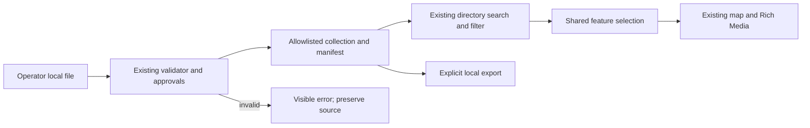
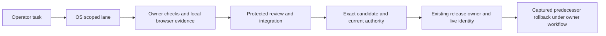

# Geo map technology stack

**`geostack@0.4.1` is the single integration plan for the former Geostack and Geomaps drafts.** The [grounding and verification companion](prd-tad-adr-mvp-gtm-geomaps.md) records source revisions, checks, reconciliation and limitations; it introduces no second product, schema or roadmap. This revision replaces `geostack@0.3.2` and absorbs `geomaps-poi@0.1.0`. Prior bytes remain in repository history or the original-input preservation snapshot named in the companion.

Graph already owns the map stack and local POI implementation. Its [Mapping Stack plan][mapping] owns broad mapping composition; [Geospatial Mode][geo] owns map/dataset/selection contracts; [Local POI Directory plan][poi] owns bounded preparation, approval, search and export. This document consumes those owners and proposes only unmet integration outcomes. The November audit found duplicated regression checks, stale draft provenance and a coarse-region projection gap; the existing map engine and validator remain the owners.

Graph's owner plan records integration through PR #1843 and a successful production release for source `f3c7816b2788d006dbf076009560eba18c2aa609`. That historical receipt does not establish today's deployed identity or acceptance of this revision. This integration plan keeps its own readiness unproved; it never overwrites the source owner's narrower recorded delivery result.

## Source closure update — 2026-11-16

The shared coordinate core is implemented under [AGENTIC-GEO-001@0.3.2](prd-tad-adr-mvp-gtm-agentic-geo.md); this integration plan creates no competing package contract. Graph's separate area-projection correction is protected source `2335267d9da9d77fb77b9df705f67927f9933931` through [PR #1974](https://github.com/huijoohwee/agentic-graph/pull/1974): 28 affected checks, linked builds/Canvas typecheck and required Integration Gate pass. Native END reports sourceComplete=true/workspaceClosed=true. Historical/local screenshots below remain scoped to their captured source; they do not prove deployment. Prior 0.4.0 authoring bytes are retained in the local evidence snapshots.

## PRD

### Buyer, pain and first outcome

The target buyer is a small directory or listing operator with an owned or permitted place file. A visitor needs to locate a place, select it and see its source. A curator needs to withhold unapproved precision and retain provenance before deliberate export. All buyer pain and willingness to pay remain **unvalidated**: no interview, task-time comparison or payment evidence is supplied.

Rank by buyer pain evidence, then proximity to existing code/minimum change, then distance to an actual $1. With no demand evidence, the current ordering is an implementation hypothesis:

| Rank / pain | Smallest existing solution | Proposed remaining outcome | Evidence needed |
|---|---|---|---|
| 1 / finding a known place in a directory | local file validation, name/category search and shared map selection already exist | one operator completes that journey without help | consenting task trial, completion/time/confusion record |
| 2 / uncertain provenance or excessive precision | one allowlist, approval flags, manifest and bounded exporter already exist | operator understands accepted/withheld records and source attribution | review with a rights-cleared operator file |
| 3 / unwanted map fees or credential exposure | local GeoJSON and SVG path; no hosted POI service required | demonstrate the scoped local path without remote data/provider calls | browser network evidence; separate proof before any provider effect |
| 4 / geographic context for a listing | listing record owner remains separate | later one-way place reference only if needed | buyer result plus owner-approved listing schema change |

**First useful outcome:** prepare one small permitted file, browse/filter/select it in the existing Geo surface, and export the normalized GeoJSON plus manifest. Test a manual $1 setup/export offer after the task succeeds. Payment collection, outreach and deployment are separate effects; this plan grants none of them.

### Requirements and acceptance

The executable field and behavior contract stays in Graph. AC-POI identifiers below are references to [its existing requirements][poi], not copied variants.

| Requirement | Priority | Owner / acceptance join | This increment |
|---|---|---|---|
| GS-01 one bounded local ingestion and approval path | Must | AC-POI-01…05; `localPoiDirectoryModel.ts` | reuse; distinguish operator attestations from legal verification |
| GS-02 one directory and one map selection owner | Must | AC-POI-06/07; FloatingPanel Geo, existing active map and Rich Media | reuse; correct stale checks and retain coarse region area geometry without a centroid marker |
| GS-03 deliberate, deterministic local export | Must | AC-POI-08; UI download and existing CLI share the validator | reuse; verify no-overwrite and byte/digest behavior |
| GS-04 current, nonduplicated documentation and evidence | Must | this plan + evidence companion; Graph source plans retain authority | reconcile drafts, duplicate checks and stale scratch provenance |
| GS-05 loaded local features remain usable without network | Must | local GeoJSON/SVG surface; scoped browser evidence | observe same-session behavior; do not promise offline reload or tile packs |
| GS-06 responsive and accessible use | Must | existing shared panels and controls; browser at 360/1280 px | record actual viewport, theme, keyboard/search/selection; physical device and screen-reader proof separately |
| GS-07 distribution of a real dataset | Deferred | Graph release owner + rights review + exact $0 proof for each provider effect | no new host, source ingestion service or publication in this increment |
| GS-08 large datasets or another country | Deferred | measured breach of current cap, approved data and scale decision | reuse existing cluster/layer contracts before introducing archive tooling |
| GS-09 logistics context | Optional existing scenario | existing supply-chain view and shared Timeline | separate source; synthetic paths never establish travel, ETA, site quality or coverage |

Targets remain unmeasured: ≤60 active minutes from an existing working environment to the first operator-approved map; ≤300 ms search/selection at the accepted dataset size; ≤3 s data paint on a named phone. Browser emulation and a tiny synthetic fixture cannot satisfy named-device performance targets.

### Completion conditions

| ID | Observable result | Evidence / current state |
|---|---|---|
| VCC-GS-01 | one plan and one evidence companion; no active alternative POI schema/host | file, link, identity and retired-decision audit |
| VCC-GS-02 | canonical POI tests and active-source replacement regression pass once each | exact command/result in companion; remove duplicated test owners |
| VCC-GS-03 | one directory, search/filter, selection and attribution observed in live UI | dated local route, source, viewport, theme and screenshot; report failures |
| VCC-GS-04 | local validator/builder proves approvals, bounds, deterministic hashes and refusal to overwrite | existing focused owner checks; synthetic scope only |
| VCC-GS-05 | operator completes permitted-file task and accepts/rejects concrete $1 offer | pending real participant and rights review |
| VCC-GS-06 | all affected repository checks green before integration; any delivery separately receipted | Graph #1974 required checks and source END pass; product delivery remains separately gated |

## TAD

### One owner per capability

| Owner | Reuse boundary | Prohibited replacement |
|---|---|---|
| `agentic-design-system` | canonical tokens/themes, semantic controls, icons, shared panel implementations; exact pinned React panel exports | local token fork, shared control/panel clone or visual override |
| `agentic-base` | existing bounded engine/adapters/projectors and product data views; Graph currently consumes its pinned controls/table/settings APIs | a new POI database or copied view implementation; shared UI mechanics stay Design System-owned |
| `agentic-canvas-os` | product shell, admitted Graph MCP/embed client and proposal contracts where needed; existing facade delegates runtime client ownership to OS | another map renderer, lifecycle controller, copied invocation dictionary or direct model integration |
| `agentic-graph` | GeoJSON ingestion, local validator/manifest, map/SVG/MapLibre host, spatial layers, selection, Rich Media, logistics and Timeline | directory-owned map instance, competing dataset/selection store or duplicated validator |
| `agentic-os` | START, admission, invocation dictionaries, effect authority and RELEASE | parallel task registry, release ledger or deploy shortcut |
| listing product owner | listing truth, editing, storage and release | copying place records into the writable listing store or dual writes |

Dependency direction remains acyclic: product surfaces consume released shared contracts; shared UI does not depend on a map product. Base, Canvas and Graph are peer Design System consumers. Existing Base-owned control adapters are migration residue under the [shared ownership contract][ownership]; extend shared behavior in Design System first and adopt a released exact pin. This task adds no Base forwarding adapter or dependency churn merely to claim reuse.

### Current stack and data boundary

1. Operator selects one local UTF-8 GeoJSON `FeatureCollection` and supplies source, licence, attribution and explicit rights/public-field review. No upload or geocoder is needed.
2. `validateLocalPoiGeoJson` binds parsed text to selected bytes, checks approvals, geometry, dates, stable IDs and public fields, and emits accepted features plus the manifest. It is the shared UI/CLI policy owner.
3. `localPoiDirectoryRuntime` projects the approved collection through the existing GeoJSON-to-graph path. Regions retain area geometry rather than acquiring a fake point centroid.
4. `LocalPoiDirectory` searches loaded fields and shows at most 50 results; `ToolbarToolMenuGeoView` resolves feature IDs through current graph/local POI projection and the shared selection owner. Rich Media and map selection consume the same feature identity.
5. Existing map hosts render geographic data; the directory does not instantiate a renderer. SVG is the local fallback; external tile/style availability is a separate provider concern.
6. Explicit UI download or the existing local builder writes allowlisted GeoJSON and its manifest. A new output directory and exclusive writes prevent overwrite; import does not publish.

The area fix extends the existing GeoJSON graph builder: explicitly tagged coarse region Polygon/MultiPolygon features reach the existing area metadata and are not emitted as point/centroid markers. It preserves other geometry behavior and grants no approval or privacy guarantee.

The schema is **the existing Graph TypeScript contract**, not a new `poi.schema.json` in this docs repository. Current accepted categories are `shop`, `store`, `f&b`, `plantation`, `property`. Stable feature IDs use `source:id`; do not replace them with UUIDv7. Approved exact Points and approved coarse region Polygon/MultiPolygon geometries are supported; coarse points are withheld. Input and normalized feature output each have a 500,000-byte cap. Unknown feature properties are dropped, not rejected; invalid accepted records fail visibly. Metadata may fall back to explicit operator inputs. The companion points to exact owner code for field lengths and details.

No country-polygon membership, postal parser, record lifecycle/revisions, business contact publication, licence allowlist, generalization algorithm, source conflation, source-release archiver, NDJSON master, PMTiles protocol or tile builder is implemented by this contract. Those former draft proposals are deferred or rejected in ADR-GS-02/03. Never describe operator attestation or a `coarse` label as proof of data rights or privacy.

### Flows and invocation

No runtime model orchestration is needed. Existing invocation identities remain `/geo on|off`, `#<tag> show|hide`, `@<geo-node-id>` and `agentic-graph.geospatial.command` MCP through the validated runtime owner. Search remains local UI; the CLI is an explicit local command. WebMCP/MCP discovery cannot grant provider, write or release authority. No new keyword, tool or remotely callable mutation is registered.

### Resources, safety and operations

- USD 0; FOSS/free only. No paid plan, add-on, upgrade or overage. Unknown provider cost/headroom blocks that effect; free-tier marketing or usage snapshots are insufficient.
- Keep input and each served data chunk below the selected owner's cap; authored files <600 lines, runtime chunks <500 kB. Existing product bundle exceptions do not prove this strict goal. This task changes no bundle boundary and adds no dependency, runtime module or always-loaded prompt/dataset bytes.
- Import approvals and map selection already use generation guards. Preserve cancellation/stale-result handling; never auto-select a feature from a superseded import.
- Personal-name review remains an operator attestation. Known contact patterns and unapproved fields are filtered/rejected by the owner; this is not identity detection or a legal conclusion.
- Refresh is manual, from an owned/permitted local file. Incidents include stale sources, rights drift, an offline regression, size overflow or unexpected network/cost. Preserve source/diagnostics and use the owner rollback path; do not overwrite data on failure.
- Loaded-data offline behavior is separate from cold start, persistent offline storage and offline basemaps. Browser cache presence proves none of those guarantees.

## ADR

| Decision | Selected / rationale | Rejected or deferred alternatives | Revisit trigger |
|---|---|---|---|
| ADR-GS-01 native composition | extend existing Graph map, directory, validator, selection and export; source plans remain authoritative | second renderer, panel, database, map host, release ledger or schema owner rejected | existing seam demonstrably cannot meet an admitted requirement |
| ADR-GS-02 data contract | consume existing local POI contract and approvals | Geomaps UUIDv7/all-null schema, 14-category taxonomy, contact fields and writable lifecycle deferred; do not silently adapt incompatible records | concrete operator dataset requires a reviewed source-owner contract change |
| ADR-GS-03 scale/distribution | one bounded local file; existing SVG and optional MapLibre layer capabilities | new static project, PMTiles/tippecanoe, NDJSON/shard pipeline and provider selection deferred; no byte-range deploy experiment required for local MVP | measured data/performance cap breach plus rights/$0/authority proof |
| ADR-GS-04 sources | operator-owned/permitted inputs only; exact source provenance and deliberate export | automatic Overture/OSM/government harvesting, scheduled queries and scraped data excluded from this increment | named source, current licence/redistribution evidence and validated refresh need |
| ADR-GS-05 precision/listings | public precision approved before normalization; listing store stays independent | display-only rounding, exact-location paywall, dual-write and automatic listing join excluded | buyer evidence and an explicit owner-approved privacy/schema decision |
| ADR-GS-06 evidence | current source checks and live observations recorded separately from historical release receipts | old scratch state as current readiness, duplicate tests and copied delivery claims rejected | source, dependency, route or acceptance drift |

## MVP

Use the canonical synthetic Places seed first, then one operator-approved file. Open FloatingPanel → Geo → Nearby Places → Local POI Directory, inspect provenance, search/filter, select a place and verify shared-map/Rich Media identity, then validate deliberate export. Test loaded-data fallback offline without fetching a provider. Keep the supply-chain seed in its existing separate view and Timeline; no cafe ranking, route distance, ETA or delivery-coverage claim follows from it.

The local audit is a bounded demo, not market acceptance. A named phone, screen reader, real-data rights and current provider/deployed identity require their own evidence. Historical production verification stays bound to its recorded candidate. This docs revision has no new deployment receipt.

| Sprint | Scope / cap | Exit / recheck |
|---|---|---|
| Docs consolidation | initial estimate 45 active minutes; two files, final total ≤60 kB, <600 lines each; zero new runtime modules/dependencies | one owner chain, no contradictory active draft or invented implementation |
| Graph correction | ≤7 existing files after an explicit drift refresh; net deletion target, added authored source ≤8 kB; one existing runtime owner changed, no new dependencies/modules | canonical POI checks + source-authority regression; selected owner checks and live UI record |
| Operator validation | ≤60 active minutes after consent/file availability | GS-01…03 task result and concrete $1 response; participant reply is an external wait, recheck on reply |
| Optional public delivery | separate exact-candidate effect | rights, current provider hard-$0 proof, green source checks, owner authorization and rollback predecessor; no ETA while blocked |

If scope/time drifts, stop expansion, record the actual blocker and next bounded check; do not buy capacity or fork shared utilities.

## GTM

1. **Nearest:** manual $1 setup/export pilot using the existing local POI workflow. Payer: one directory/listing operator. Establish task completion before a direct offer; record actual acceptance/refusal and any receipt. No outreach or in-app payment is added here.
2. **Later:** operator-managed data refresh, only after a repeat need, approved source rights and cadence are observed.
3. **Deferred:** extracts, hosted maps, featured listings or precision unlock. Each needs separate demand, support, rights, privacy and $0 delivery evidence.

Experiment E-GS-01: with consent, observe up to five operators on one permitted-file task. Record unprompted pain, workaround, help needed, completion time and export result. Continue the segment if at least three confirm a concrete pain; stop/pivot if fewer than two do. E-GS-02 offers the completed outcome for $1 to those operators; one actual paid receipt proves only that pilot. Zero acceptance after five offers triggers review. These thresholds are proposed. Revenue, collection, savings, acquisition cost, retention, support load and market size are unknown; no first dollar or unit economics is claimed.

## Handoff and authority

Intent: `/change #geo-map-stack-grounding @huijoohwee` for docs; `/fix #geo-map-stack-grounding @huijoohwee` for Graph region-projection, regression and provenance maintenance. Joohwee START readmitted the two requested paths into the existing lane; Graph START admitted its separate source-owner lane. Exact workflow IDs and validation are in the companion. Admission grants no publication or deployment.

RELEASE follows `agentic-os/docs/RELEASE-WORKFLOW.md` and the consumer's protected checks. This user request authorizes local docs and necessary source correction/live verification; no new production action is selected. Graph's [core release][release] and [rollback baseline][rollback] retain exclusive delivery ownership. A source merge, UI screenshot, historical receipt or local check never substitutes for current authority and green proof per effect. Preserve unrelated listing work and untracked canonical files. Keep the current lane available if publication/END cannot safely close it; record the blocker, diff, checks and next action in the companion.

[mapping]: https://github.com/huijoohwee/agentic-graph/blob/675d0ad10eea5d57fe101c1fb5d4318a804a7ff5/docs/documents/agentic-graph-mapping-stack-prd-tad-adr-mvp-gtm.md
[geo]: https://github.com/huijoohwee/agentic-graph/blob/675d0ad10eea5d57fe101c1fb5d4318a804a7ff5/docs/documents/agentic-graph-geospatial-mode-document.md
[poi]: https://github.com/huijoohwee/agentic-graph/blob/675d0ad10eea5d57fe101c1fb5d4318a804a7ff5/docs/documents/agentic-graph-local-poi-directory-prd-tad-adr-mvp-gtm.md
[ownership]: https://github.com/huijoohwee/agentic-os/blob/45ea0e1f4a87976c4427a6a393dfffcbdb6c5a6a/guides/DESIGN-SYSTEM-OWNERSHIP.md
[release]: https://github.com/huijoohwee/agentic-graph/blob/675d0ad10eea5d57fe101c1fb5d4318a804a7ff5/docs/production-core-runtime-release.md
[rollback]: https://github.com/huijoohwee/agentic-graph/blob/675d0ad10eea5d57fe101c1fb5d4318a804a7ff5/docs/production-rollback-baseline.md
