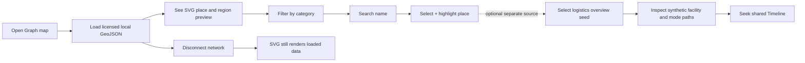
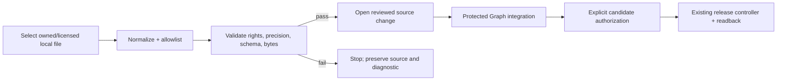
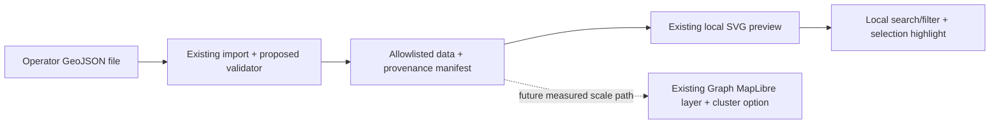
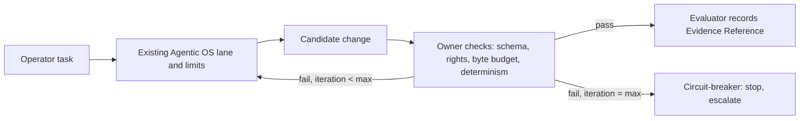
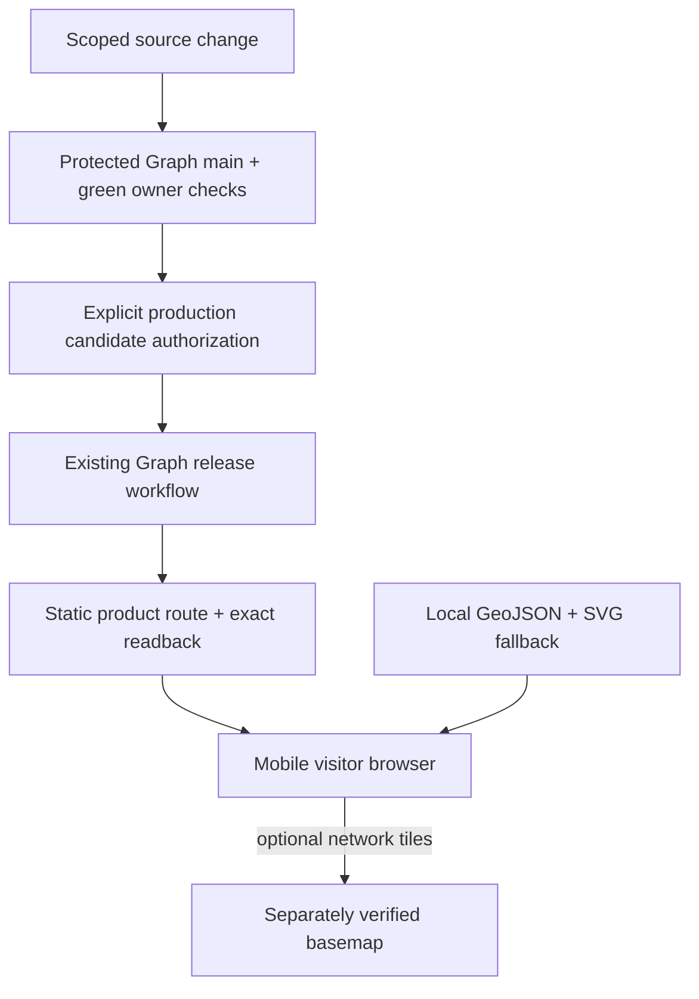

# Geostack — Keyless Place Directory with Logistics Context

Governed by *PRD, TAD & ADR Guidelines* 3.4.0. One combined artifact at `geostack@0.3.2`; every section is addressable by anchor. **Status: draft, not baselined.** Source ownership was refreshed against `agentic-graph` base `7723d9ebe3a6d1b75a7dfb2addd2f0fe0738fdf2` on 2026-10-28. The isolated candidate on `agent/device-0232231d4a19/geostack-poi-directory-mvp` reuses Graph's GeoJSON parser, active-document overlay, and existing map surfaces. The latest local UI places one Nearby Places → Local POI Directory in FloatingPanel → Geo; MainPanel Maps remains the settings surface. Directory and map selections resolve to the same feature and reuse the existing Rich Media widget and single map renderer. The directory no longer renders a separate map preview or duplicate attribution card; the operator file-import flow still captures source, license, and attribution metadata. The active document's explicit GeoJSON replaces stale geographic graph markers. The separate logistics overview reuses its existing route map and shared BottomPanel Timeline; its event lane appears there, with no second footer or clock. A production build completed on 2026-10-28, but strict chunk hygiene still fails: MapLibre emitted a 988 KiB chunk, Monaco 2.79 MiB, and several other chunks exceeded 500 KiB. `npm run check` failed in Canvas typecheck before its browser smoke because workspace dependencies lack `jsdom` and the project reports existing `Uint8Array<ArrayBufferLike>` type mismatches; the linked `grph-shared` and `gympgrph` builds passed, and a filtered diagnostic scan found no errors in the changed feature files. The full product suite was not run. No protected integration, production effect, rollback, or licensed-data run occurred. The browser fixture is synthetic and proves no customer need, deployment, provider cost, or data rights. Every pain point remains `unvalidated`; both readiness rungs remain `undocumented`.

## Scope & Neutrality

- **Product**: a reusable POI-directory layer for Singapore, then Malaysia, built on the existing `agentic-graph` geospatial surface. The local MVP reuses its GeoJSON parser, active-document overlay, main map, and SVG fallback. The directory lives in `FloatingPanel → Geo → Nearby Places`; MainPanel Maps remains the settings surface. Directory selection targets the matching feature on the shared main map. Do not add a directory-owned map preview, duplicate attribution card, map engine, host, panel, or legacy candidate layer. MapLibre and its clustering primitive remain available for a later provider-backed scale path. The existing [logistics overview seed](https://github.com/huijoohwee/agentic-graph/blob/7723d9ebe3a6d1b75a7dfb2addd2f0fe0738fdf2/docs/workspace-seeds/agentic-graph-logistics-supply-chain-overview.md) is an adjacent, separate local scenario for modeled path, transport-mode, distribution, and return-flow context. Do not merge that scenario into cafe POIs.
- **Buyer hypothesis**: an operator of a small business, property, or listing directory who needs a mobile map without exposing provider credentials or adding per-view billing. No buyer interviews or payment evidence exist.
- **Delivery shape**: static assets may use the existing product route. Public release still uses the product owner's protected release workflow and explicit authorization; a push is not deployment authority.
- **Local/offline MVP**: an operator-provided GeoJSON file can be searched and rendered without network access using the existing local-data/SVG path. The logistics seed separately reuses Graph's deterministic synthetic network and shared Timeline; its lines are schematic modeled legs, not road geometry, route calculation, directions, ETA, optimization, or a cafe-to-distribution result. External basemap tiles are optional and are not claimed to work offline; persistent offline storage is not yet proven.
- **Naming rule**: capabilities are named by function. Brands appear only under "Reference implementation"; standards and formats are not vendors.
- **Unknowns**: provider terms, data rights, billing ceilings, customer demand, performance, and deployment behavior remain unverified until their named checks run.
- **Out of scope for this increment**: candidate-specific routing/directions/ETA, live provider route calls, route optimization, address-autocomplete geocoding, native apps, public-data scraping, scheduled data collection, exact-location payment gates, and a new map renderer. The already-built local synthetic logistics view is context only, not a route service.

## From-0-to-1 Coverage Record

"0" is a code-grounded opportunity hypothesis: Graph's geospatial surface already handles GeoJSON and optional clustering, while buyer-facing directory search/export is not evidenced. "1" is a target, not an achieved result: one Singapore operator supplies a licensed GeoJSON dataset, visitors filter/search it in the existing mobile map, local data still renders offline through SVG, and an operator accepts a $1 setup/export offer. VCCs, demand, payment, deployment, and 14-day reliability are pending.

| ID | Disposition | Source section @ revision | Owner | Evidence or gap | Next check |
|---|---|---|---|---|---|
| C01 | covered | [PRD](#prd), [Pain-Point Mapping](#pain-point-to-feature-mapping) @0.3.2 | Product Manager | code fit observed; buyer pain has no quote or measured behaviour | E-01 interviews |
| C02 | deferred | [GTM](#gtm) @0.3.2 | Solo Founder | market size is unnecessary for the first $1 test; revisit before a market-sized claim | audience handoff |
| C03 | covered | [ADR](#adr) ADR-001…005 | System Architect | renderer reuse grounded; provider selection and licensing unevaluated | Evaluator run |
| C04 | covered | [PRD](#prd), [Five Flows](#five-flows) | Product Manager | synthetic local UI evidence is recorded below; threshold, phone, provider, and release VCCs remain open | close named VCC gaps |
| C05 | covered | [TAD](#tad), [Codebase Grounding](#reference-implementation--codebase-grounding-record) | System Architect | candidate built and exercised with synthetic data; no source integration | VCC-01…11 |
| C06 | covered | [Quality, Security and AI](#quality-security-and-ai) | Engineering Lead | local precision/determinism checks passed synthetically; provider and production safety gates remain open | VCC-03, VCC-05, VCC-07, VCC-09 |
| C07 | covered | [ADR](#adr) | System Architect | five ADRs with revisit triggers | Evaluator run |
| C08 | covered | [MVP](#mvp) | Engineering Lead | local smoke uses synthetic data; the full demo and customer flow remain unverified | demo rehearsal |
| C09 | covered | [GTM](#gtm) | Solo Founder | hypotheses only | E-02 |
| C10 | covered | [Operations](#operations-and-continuity) | Solo Founder | manual refresh is specified; release, live readback, and rollback are untested | authorized first release |
| C11 | covered | [ADR-003](#adr), [Quality, Security and AI](#quality-security-and-ai) | Solo Founder | data-rights reviewer unassigned (HG-2) | assign reviewer |
| C12 | deferred | [Economics](#economics) | Solo Founder | reason: no revenue mechanism validated; dependency: E-02; revisit: when a stream reaches `demand-validated` | revisit on E-02 |
| C13 | not-applicable | [Scope](#scope--neutrality) | Solo Founder | no builder-side spend proposed; paid plans/add-ons/overages are excluded | remains excluded |
| C14 | covered | [ADLC Execution Seam](#adlc-execution-seam) | Solo Founder | START admitted the initial draft snapshot; the later audit amendment is not in that immutable snapshot | bind the current digest before RELEASE |
| C15 | deferred | [GTM](#gtm) | Solo Founder | reason: no audience action depends on projections yet; dependency: baseline; revisit: before any audience handoff | revisit at handoff |
| C16 | covered | [GTM](#gtm), [Learn](#learn-loop) | Solo Founder | thresholds proposed; no actuals | E-01, E-02 |

**Counts**: dispositioned **16 / 16**; covered applicable **12 / 15** (applicable = 16 − 1 not-applicable); deferred **3**; not-applicable **1**. Coverage proves no VCC, readiness rung, customer demand, or revenue.

## PRD

**Vision**: a small SG/MY directory can show its licensed places on a mobile map without exposing provider credentials or adding a per-view bill. Zero cost is an acceptance gate to prove, not a claim about current providers.

**Users**: *visitor* (finds a place), *operator* (runs a directory or marketplace; buyer hypothesis), and *integrator* (loads a licensed GeoJSON dataset). **Job**: show and find places without exposing secrets or creating a variable map bill. **Current workaround** (hypothesis): keyed commercial APIs, embedded static images, or no map.

### MoSCoW

| ID | Priority | Story | Pain |
|---|---|---|---|---|
| PRD-MAP-01 | Must | Visitor sees approved region polygons at low zoom so private listings need not expose an exact point | PP-4 |
| PRD-PIN-02 | Must | Visitor sees allowed GeoJSON points and region context in the local SVG preview and filters by category | PP-1 |
| PRD-SRCH-03 | Must | Visitor searches local name/category fields and highlights the selected feature | PP-2 |
| PRD-DATA-04 | Must | Operator imports a licensed local GeoJSON dataset; a deterministic validator emits an allowlisted manifest | PP-3 |
| PRD-DEP-05 | Must | Directory delivery uses the existing Graph release owner; deployment requires an exact candidate and explicit authority | PP-1 |
| PRD-REG-06 | Should | Split data into sub-500-KB lazy chunks only when measured data warrants it | PP-1 |
| PRD-PLT-07 | Could | Plantation/land-use layer with a confidence label | PP-3 |
| PRD-GATE-08 | Won't (this increment) | Gated exact-location unlock (see ADR-005, Roadmap P4) | PP-4 |
| PRD-RTE-09 | Won't (this increment) | Routing, directions, geocoder autocomplete | — |
| PRD-NAT-10 | Won't (this increment) | Native apps, persistent offline tile packs, routing, and a new editing UI | — |
| PRD-LOG-11 | Should | Operator can open the existing local logistics overview to inspect synthetic facility paths, transport modes, distribution stages, and shared-Timeline state separately from cafe POI data | — |

**Reach**: mobile and desktop browsers; touch and keyboard operable search; screen-reader labels for search and feature detail. With a local file loaded, feature search and the SVG data view must work with network access disconnected. Remote basemap tiles and offline reload persistence are outside this acceptance.

**Constraints (non-functional)**: source and data attribution remain visible; no provider secret in a browser artifact; no runtime LLM; default to local data; any provider must prove commercial rights and a hard USD 0 cost boundary or deny on quota exhaustion.

### Success metrics and TTV

| Metric | Target (proposed, unmeasured) | Check |
|---|---|---|
| TTV — integrator, clean Graph Canvas environment, licensed local file to rendered/searchable map with region polygons | ≤ 60 active minutes (estimate) | VCC-01, VCC-02, and VCC-06 in a clean existing Graph environment before MVP release |
| First meaningful map paint, mid-range phone, throttled network | ≤ 3 s target; unmeasured | VCC-01 |
| Search-to-feature latency at the accepted dataset size | ≤ 300 ms target; unmeasured | VCC-02 |
| Logistics context remains separate | 12 synthetic facilities, mode-filtered schematic legs, and Timeline state appear in the existing logistics view; zero cafe ranking or live-route claims | VCC-12 |
| Builder-side recurring spend | USD 0; provider cost/headroom unknown | VCC-03 |
| 14-day observation: error-free page loads | [≥ 99% — threshold unvalidated] | runtime evidence, Phase 4 |

## Pain-Point-to-Feature Mapping

All four rows are `unvalidated`. Code proximity informs implementation cost, not customer pain or willingness to pay. The current default style and a map renderer do not establish a free production service or complete directory data.

| PP | Must | Pain point | Hook | Break | Fix | Close | Min-time-resource-max-value note (reuse / build) | Status |
|---|---|---|---|---|---|---|---|---|
| PP-1 | PRD-PIN-02, PRD-DEP-05 | Directory operators fear map fees, keys, and quota failures | "Show your places without exposing a key." | A provider requires credentials, cost, or limits incompatible with the offer | Reuse Graph's MapLibre/GeoJSON surface; verify one permissible USD 0 style or use local SVG | "The same data still renders when tiles are unavailable." | reuse: MapLibre host, style switching, SVG, GeoJSON; build: buyer-ready route and provider evidence | `unvalidated` |
| PP-2 | PRD-SRCH-03 | Visitors cannot locate a known place in a dense directory | "Type a name or category and highlight the feature." | Users browse a map or listing by eye | Client-side filter/search over loaded data and select the matching feature on the existing main map; retain SVG as local fallback | "Found it." | reuse: GeoJSON IDs, shared map selection, and SVG preview; build: directory search/filter UI | `unvalidated` |
| PP-3 | PRD-DATA-04 | Operators cannot tell whether imported listings are current or publishable | "Refresh only from an owned, licensed file." | Manual changes lose provenance, attribution, or reproducibility | Validate and manifest operator-supplied GeoJSON before review | "Same input, same output and provenance." | reuse: GeoJSON ingestion and source metadata; build: validator/manifest; public scraping excluded | `unvalidated` |
| PP-4 | PRD-GATE-08 | A directory may expose a proprietary listing's exact location | "Show the area until the owner chooses more detail." | Public artifacts leak a location the owner intended to restrict | Drop private exact coordinates or publish reviewed coarse geometry; exact unlock deferred | "The public dataset contains only approved precision." | reuse: feature properties and allowlist path; build: precision validation; payment gate deferred | `unvalidated` |

Ranking: buyer pain first, then minimum-change reuse, then a direct $1 offer test. No WTP ordering is claimed while all pains remain unvalidated.

## TAD

### Division of Work

One owner per capability. `agentic-graph` owns source integration, release, deployment, and rollback. The user authorized an isolated local source candidate for this audit; it grants no protected integration or production authority. Exact source paths and revision are in the [Codebase Grounding Record](#reference-implementation--codebase-grounding-record).

| Capability | Owner component | Decision | Origin | Extends |
|---|---|---|---|---|
| Capability | Current owner / observed source | Decision | Increment delta |
|---|---|---|---|
| 2D/3D map rendering and SVG fallback | Graph `gympgrph` MapLibre host and Canvas GeoJSON preview | reuse | no new renderer or map instance |
| GeoJSON points/areas and local preview | Graph Canvas GeoJSON parser and `InlineMarkdownGeoJsonLayerMap` SVG renderer | reuse | filter loaded features and highlight the selected feature in the existing SVG preview |
| Active map data ownership | Graph `geospatialOverlayGraphData` plus the selected Markdown GeoJSON collection | reuse + source-of-truth correction | replace stale geo-coordinate nodes and dependent edges when the active document declares GeoJSON; preserve non-geospatial graph content |
| Maps Hub directory panel | Graph `MapsHubView` → existing Nearby Places slot → `LocalPoiDirectory` | reuse | one local search/filter/manifest surface; exclude fabricated DCF/candidate data and duplicate maps |
| Logistics path and distribution context | Graph supply-chain workspace seed → existing `SupplyChainOverview` and deterministic `supplyChainScenario` | reuse | keep the 12-facility / 3-consignment local scenario in its own view; its connectors do not provide street routes, cafe reachability, distances, or ETAs |
| Journey timing | existing BottomPanel Timeline via `TimelineBottomPanelView` → `SupplyChainTimelinePanel` → `GanttTimelineTransportPanel` | reuse | seek/replay shared scenario state in the one existing panel; no map-owned footer, second clock, or routing service |
| MapLibre clustering | Graph `ensureDatasetLayer` | defer | use only after measured dataset need and a separately verified style/provider path |
| Local dataset ingestion | browser file picker and shared deterministic validator | reuse + small adapter | accept one local operator file and produce a provenance manifest; no upload or fetch |
| Singapore sample geometry | `SINGAPORE_MAJOR_POI_GEO_PROFILE` with checked-in provenance/attribution | reference fixture only | not a business directory; do not republish it as merchant inventory |
| Basemap/style selection | existing style resolver and provider adapter | reuse, provider undecided | prove rights and hard USD 0 budget before production use |
| Directory search and category filter | no buyer-facing GeoJSON directory search found | new, small local adapter | search loaded feature properties; no network geocoder |
| Data validation/manifest | no Geostack-specific build command found | new only for accepted local input | deterministic schema, precision, source and byte checks |
| Static product delivery | existing Graph release owner | reuse | no new host, Worker, or push-to-production shortcut |
| Scheduled public-data refresh | no Geostack-owned refresh job found | defer | no source scraping or scheduled API use in MVP |
| Exact-location gate | not present in this map surface | defer to P4 | requires a separate product/payment owner and ADR |
| Cost and release receipts | existing Agentic OS / Graph release evidence | reuse | do not create a second ledger |

No second database or map host. The MVP dataset is operator-supplied and versioned with its provenance. Existing browser-tab cache is bounded but is not persistent offline storage.

**Scenario boundary**: cafe/place GeoJSON remains the only source for the Nearby Places directory and active document map. The logistics seed uses its own `agentic-graph-logistics-network/v1` synthetic scenario and existing supply-chain view. The scenario can illustrate upstream supply, transfer, distribution, last-mile, exception, and returns paths; its named anchor locations and straight schematic connectors do not establish a cafe's service coverage or actual travel path. Joining the two datasets, converting its facilities into POIs, or using its synthetic timings as location evidence is prohibited.

### Interfaces and Data Contract

`PRD-[Epic]-[Story] ↔ TAD-[Component]-[Interface] ↔ VCC ↔ Evidence Reference`

| Trace | TAD component / interface | VCC | Evidence Reference |
|---|---|---|---|
| PRD-MAP-01 | Graph SVG GeoJSON preview / loaded local view | VCC-01, VCC-09 | synthetic local render and same-session offline behavior observed; acceptance pending |
| PRD-PIN-02 | Graph SVG preview / filtered local GeoJSON features | VCC-01, VCC-08 | synthetic point/region and byte cap observed; phone/performance acceptance pending |
| PRD-SRCH-03 | Maps Hub local adapter / feature ID → filtered result and SVG highlight | VCC-02 | synthetic search, category filter, and selected SVG highlight observed; latency threshold pending |
| PRD-DATA-04 | shared deterministic allowlist model + local CLI manifest | VCC-06 | synthetic repeat outputs match byte-for-byte; rights-cleared operator data pending |
| PRD-DEP-05 | existing Graph protected release workflow / exact candidate receipt | VCC-03, VCC-07 | delivery integration not proven |
| PRD-LOG-11 | existing logistics seed → `SupplyChainOverview` → shared Timeline | VCC-12 | source implementation exists; current path semantics are schematic and cafe/delivery joins are unsupported |

**Feature record (public artifact)** — proposed allowlist; unknown fields are dropped by the new validator before a reviewed change:

| Field | Type | Note |
|---|---|---|
| `id` | string | stable, `[source]:[source-id]` |
| `name`, optional `name_ms`, `name_zh` | string | source-provided search aliases; never machine-translated silently |
| `category` | enum | shop, store, f&b, plantation, property |
| `region` | string | region code for shard and band join |
| `source`, `source_ref`, `updated`, `license_ref` | strings/date | provenance, freshness and publish permission |
| `precision` | enum `exact` \| `coarse` | exact only when the owner/source permits public release |
| geometry | GeoJSON Point | omit private exact coordinates; coarse values must pass a defined generalization check |

Personal-contact fields (phone, email, personal names) are never in the public allowlist. The feature schema and exact generalization rule remain to be finalized before any proprietary dataset is accepted. The UI records an operator review that names contain no personal names/contact details; this attestation is not an automated identity detector.

**Region overlay contract**: separate map-context Polygon/MultiPolygon features use `role: region`, `precision: coarse`, a stable `id`, `name`, `region`, `source_ref`, and ISO `updated` date. This shape is not a POI record and is omitted unless the operator approves it for local preview. The approval is recorded but does not prove a polygon is sufficiently generalized; named review remains required before redistribution.

**Validator contract**: the shared local validator accepts one operator-supplied GeoJSON file up to 500,000 bytes; drops unknown properties and withheld features; validates the feature allowlist, required metadata, category, precision labels and coordinate ranges; computes deterministic input/output SHA-256, counts, byte sizes and latest source date; and emits an allowlisted GeoJSON plus manifest. It makes no network request. Its implementation candidate is `canvas/src/features/geospatial/localPoiDirectoryModel.ts`, shared by the Maps Hub preview and `scripts/geostack-local-geojson-build.mjs`. The CLI writes into a new output directory and refuses overwrite. VCC-06 remains pending until repeatability and output behavior are checked.

### Five Flows

Diagram source in text notation (reference implementation: Mermaid). Each diagram is registered below; conformance to the Diagram Guidelines companion is `unverified` (companion not supplied to the author).

**1. User journey (target; not yet verified)**

The optional logistics branch is a separate source selection; it never combines facility or journey records with cafe POIs.

**2. Workflow (operator data change and authorized release)**

**3. Data flow** (anchored to journey stages B–H)

**4. Orchestration / harness flow** (optional agent-authored tooling; never in the visitor request path)

**5. Topology and release boundary**

| Diagram ID | Class | Flow | Journey anchor | Projection check |
|---|---|---|---|---|
| DG-01 | journey | 1 | A–I | pending canvas-render check |
| DG-02 | workflow | 2 | operator | pending |
| DG-03 | data flow | 3 | B, D, F | pending |
| DG-04 | harness | 4 | operator | pending |
| DG-05 | topology | 5 | A | pending |

### Invocation Register

Reuse only existing invocation routes. New search/validation routes do not exist until implementation and their owning contracts are reviewed.

| Capability identity | Route | Owner | Mode | Effect authority |
|---|---|---|---|---|
| `geo.mode` | `/geo on|off` | existing Graph geospatial command | local view preference | no deployment or provider effect |
| `geo.layer` | `#<tag> show|hide` | existing Graph enhanced-layer command | local layer visibility | no provider effect |
| `geo.fit` | `@<geo-node-id>` | existing Graph geospatial command | local camera fit | no provider effect |
| `geo.command` | `agentic-graph.geospatial.command` MCP | existing validated command envelope/deep link | local invocation | no remote write |
| `directory.search` | proposed in-map UI | new local adapter | query loaded features only | no network/geocoder call |
| `geo.validate` | proposed deterministic CLI | new validator | read-only local file | no publication authority |
| existing supply-chain seed | select `/docs/workspace-seeds/agentic-graph-logistics-supply-chain-overview.md` | existing `SupplyChainOverview` | local synthetic facility/path projection; shared Timeline | no route-provider request or site recommendation |

No new MCP or WebMCP tool is required for the first map layer. Revisit a tool binding only when an admitted consumer needs a machine-readable search or validation contract; existing `/`, `#`, `@` meanings remain owner-bound.

### Quality, Security and AI

| Case | Handling | Check |
|---|---|---|
| Browser artifact leaks a secret or key | do not expose GrabMaps credentials or any provider secret; scan built artifacts | VCC-03 |
| Proprietary exact coordinates enter a public file | validator drops private precise coordinates; do not rely on display-only rounding | VCC-05 |
| Personal data appears in source tags | closed allowlist excludes contact/personal fields; removal request deletes the record and regenerates output | VCC-06 |
| Basemap outage or offline use | preserve loaded local features and use the existing SVG path; external tiles may be absent | VCC-09 |
| Stale or wrong data | require `updated`, `source_ref`, source revision and license reference in the manifest; the active explicit GeoJSON collection replaces prior map features | VCC-06 |
| Attribution is absent | render provider/data attribution visibly; existing POI provenance metadata is not a proof of visible UI attribution | VCC-04 |
| Public query overuse | MVP never queries public endpoints from the visitor or scheduled job | VCC-06 |
| Agent script error | runtime contains no LLM; any later build helper is deterministic, bounded, reviewed, and never auto-applied | VCC-06 |

**AI evaluation and fallback**: no model call is required in the MVP request path or data refresh. An operator-edited/validated file is the fallback; previous reviewed artifacts remain the published candidate if validation fails.

**Zero-spend gate**: no paid plan, add-on, overage or unknown fee. Before any provider effect, require exact current proof of a hard USD 0 cap or deny-on-quota-exhaustion; an advertised free tier or usage snapshot is insufficient.

### Economics

Implementation sprint bound: five source files, at most 56 KiB across touched source files, no new dependencies, every file below 600 lines, and at most one 500 kB local data file/output. The candidate uses the existing local SVG preview and adds no always-loaded dataset or hosted service. The production build completed; its prebuild source-boundary checks passed 8/8, `hygiene:check` passed, and `hygiene:chunks` failed on a 511 KiB KaTeX chunk. The product test suite was not run. Active-time, named-phone performance, and provider costs remain unmeasured.

TCO by deployment model, never blended:

| Variant | Recurring cost | Availability guarantee | Status |
|---|---|---|---|
| V1 existing Graph static delivery + a keyless hosted style | unknown until current rights, quota, and hard-$0 behavior are verified | none proven | candidate; not selected |
| V2 local GeoJSON + existing SVG fallback | no provider request for local feature display; compute/storage limits still need observation | local device only | MVP fallback candidate |
| V3 self-hosted tile archive | storage/egress and operational cost unknown | self-managed | deferred; paid plans and overages excluded |

### Operations and Continuity

- **Delivery process**: operator imports and validates a local file → reviewed source change → protected integration → exact authorized release and readback. No scheduled refresh or push-only deployment in this increment.
- **Capacity**: one operator, one active lane, one agent.
- **Incidents**: provider outage, data/chunk size breach, data-rights change, attribution failure, or unexpected request/cost → pause publication and open a successor Context.
- **Suppliers**: style provider, data source and static delivery owner; each needs current cost, license, quota, privacy and exit evidence before use.

### Human-in-the-Loop Gates

| Gate | Trigger | Evidence | Rollback |
|---|---|---|---|
| HG-1 | production release or rollback | exact candidate authorization and existing Graph controller evidence | restore the exact captured predecessor under the owner rollback workflow |
| HG-2 | publish any derived dataset | named review of source rights, attribution, precision and redistribution obligations | unpublish/revert through the owner workflow |
| HG-3 | change provider or cost boundary | current hard-$0/deny-on-quota proof and provider identity | stop provider requests and revert to local SVG/data view |

## ADR

**Constraint gates** (disposition `pass` or `fail-<constraint>` before any comparison):

| Gate | Constraint |
|---|---|
| G1 | USD 0 per builder-side effect, proven by a hard cap or fail-closed quota behavior |
| G2 | no provider key or secret in browser artifacts |
| G3 | commercial use and redistribution rights proven for both style and data |
| G4 | local GeoJSON search/render works with the network disconnected |
| G5 | reuse the Graph GeoJSON/MapLibre/SVG surfaces; provider remains swappable |
| G6 | local search, feature highlight and details work on an accessible mobile browser |
| G7 | source and provider attribution stay visible in every supported view |

### ADR-001 — Renderer and basemap

- **Decision**: use the existing Graph SVG GeoJSON preview for the local/offline MVP. Keep the existing MapLibre host as the active-document overlay and a later optional provider-backed path; do not add another map host or request provider tiles in the local-data MVP. When the selected Markdown document has an explicit GeoJSON collection, use it as the sole geographic feature source for that document and discard stale geographic nodes/edges retained from a prior graph selection.
- **Basemap decision**: unresolved. Existing default styles include MapLibre Demo Tiles and OpenFreeMap Liberty; neither source inspection nor this PRD proves current commercial rights, availability, or a hard USD 0 ceiling.
- **Outranking relation (non-compensatory, in order)**: G1–G7 must pass → local/offline behavior → payload and mobile performance → provider availability.
- **Alternatives**: see the [candidate registry](#reference-implementation--candidate-registry). Missing provider evidence blocks production selection, not local-map implementation.
- **Consequences**: map renderer and provider are separate. Attribution must remain visible. Search and geocoding do not come from the renderer.
- **Reversibility**: high while style remains configuration-owned. **Revisit trigger**: cost/terms drift, outage, or a buyer requiring an SLA.
- **Contested?** No participant has objected. Any objection opens an argument graph judged by an Evaluator holding no argument; the author does not self-grade.

### ADR-002 — Search

- **Decision**: add a small client-side search/filter adapter over the already-loaded GeoJSON properties; first search fields are name and category, with source-provided language aliases only.
- **Existing support**: the SVG renderer draws GeoJSON locally; the candidate's existing Nearby Places slot now hosts `LocalPoiDirectory`, which filters by feature ID and highlights the selected result. Its current fixture is synthetic; licensed operator data, accessibility, and performance acceptance remain open.
- **Alternatives**: network geocoder or hosted search are excluded from the zero-key, offline-local MVP.
- **Consequences**: no network call per keystroke; memory and response time scale with loaded feature count.
- **Revisit trigger**: VCC-02 fails at measured accepted dataset size.

### ADR-003 — Data refresh, provenance and licence

- **Decision**: accept one operator-supplied local GeoJSON file; validate source, license, attribution, precision, schema and bytes before a reviewed change.
- **Existing support**: Graph ingests GeoJSON and carries source metadata; no Geostack query/refresh script or scheduled job was found.
- **Alternatives**: public API scraping and browser queries are excluded until a source, license, quota, and data-removal process are proven.
- **Consequences**: provenance is explicit; source completeness is the operator's responsibility. HG-2 review is mandatory before publication.
- **Revisit trigger**: a named buyer requests an automated refresh and a source passes all gates.

### ADR-004 — Scale path

- **Decision**: keep the MVP data to one local GeoJSON file capped at 500,000 bytes and render it through SVG. Retain Graph's existing GeoJSON clustering primitive for a future path if measurements require it.
- **Triggers**: a measured VCC-01, VCC-02, memory, or byte-budget breach. Any MapLibre/provider path requires separate current rights, cost and mobile checks before use.
- **Status**: no archive or tile-generation tool selected; self-hosted tile infrastructure is deferred and cannot introduce paid storage/egress.

### ADR-005 — Exact-location gating

- **Decision**: publish exact coordinates only when the data owner and source license permit public release. For private listings, omit exact coordinates by default; a coarse representation needs a documented generalization rule and check.
- **Alternatives**: publishing all exact coordinates is rejected for private listings; a paid reveal path is deferred.
- **Consequences**: precision is enforced before public output, not only in the map UI. No payment endpoint is added to this increment.
- **Revisit trigger**: E-02 shows a buyer will pay for a separate exact-location product and its operator authorizes a new ADR.

### ADR-006 — Logistics context and site-access evidence

- **Decision**: keep the current cafe/place map and the existing logistics overview as separate source-selected views. Reuse the logistics seed, synthetic scenario, schematic path rendering, and shared Timeline to explain supply/distribution concepts; do not create a second panel, map host, route engine, or data join.
- **Recommendation rule**: no new cafe site is ranked until current licensed place data and operator-reviewed criteria are available. Future path/access criteria must use independently sourced, dated, route-specific evidence for supplier access, distribution reach, mode/transfer reliability, last-mile service, reverse logistics, and capacity. Validate weights with the operator; do not copy the historical TOPSIS weights or infer route quality from straight lines.
- **Consequences**: the scenario demonstrates interface composition and exception-flow concepts only. It yields no street distance, navigation, travel time, cost, service coverage, or candidate ranking. Candidate-specific pathfinding remains out of scope pending buyer evidence and a separately reviewed provider/data/cost gate.
- **Revisit trigger**: a validated operator need plus licensed current network data and a measured VCC breach justify a successor decision.

### Reference implementation — candidate registry

`source=unverified` for live cost and provider terms. Code observations below are pinned to the inspected Graph revision and do not select a production style.

| Candidate | G1 | G2 | G3 | G4 | G5 | G6 | Disposition |
|---|---|---|---|---|---|---|---|
| Existing Graph MapLibre host + current style resolver | pass | varies by style | unverified | supports local data | pass | partial | **renderer selected; provider not selected** |
| Existing Graph 2D SVG fallback | pass | pass | local data only | supports loaded data | pass | accessibility needs VCC | offline/local fallback candidate |
| Existing GrabMaps integration | requires bearer auth/BYOK path | fail for keyless MVP | unverified | network style | pass | provider-specific | excluded from public keyless MVP |
| OpenFreeMap Liberty style configured in Graph | pass in source config | no browser key in code path | unverified | network tiles | pass | pending | candidate only; verify current terms/cost before use |
| Self-hosted vector archive | unknown | pass | unknown storage/egress | possible | new ops | pending | defer; no paid plan or overage |

No search library, geodata API, tile archive builder, or new hosting product is selected. Add a dependency only after the existing local search approach fails a measured acceptance condition.

## MVP

**Smallest proposed slice**: a mobile browser experience inside the existing Graph Canvas, delivered only through its protected release owner; Singapore region polygons and one operator-supplied, rights-cleared GeoJSON file up to 500,000 bytes; local category/name search; selected-feature highlighting; visible attribution; and loaded local features rendered by the existing SVG preview with the network disconnected. No provider, data source, deployment, or customer result is selected or claimed yet.

### Demo Skeleton

Feature budget: 180 s. Sum of beat bounds: 145 s.

| Beat | Bound | Content |
|---|---|---|
| Hook | 15 s | "A directory map with no key and no bill." |
| Probe | 30 s | Open the existing Graph Canvas map surface on a phone and load a permitted local GeoJSON file |
| Reveal | 30 s | Show region polygons, place features, category filter, attribution, and source manifest |
| Domain action | 50 s | Search and highlight a place; disconnect network and confirm loaded data remains visible |
| Close | 20 s | Prepare a reviewed source change; deployment still requires the existing release owner |

### Verifiable Completion Conditions

Thresholds remain proposals. The synthetic observations below are local checks, not licensed-data or production evidence.

| VCC | End state | Check | Constraints | Observed 2026-10-28 |
|---|---|---|---|---|
| VCC-01 | first meaningful data paint ≤ 3 s on a named mid-range phone | throttled browser run with a rights-cleared fixture | target only until measured | not measured on a named phone or with a paint timer |
| VCC-02 | search/filter-to-feature selection ≤ 300 ms at accepted feature count | timestamped in-browser run | local index; no network search | synthetic search, category filter, and selection worked at 390×844; 300 ms threshold not timed |
| VCC-03 | no browser secret and no billable/unknown provider effect | artifact scan, network trace, exact current cost/quota proof | free-tier label alone fails | blocked: same-origin GrabMaps proxy returned 403 in dev and 404 in static preview; no secret scan or upstream/cost/quota proof |
| VCC-04 | source attribution is visible in the local directory preview | browser render/readback | metadata alone does not pass | visible in dev and production-static preview with synthetic attribution only |
| VCC-05 | no private exact coordinate enters public output | validate raw input and emitted artifact | precision is checked before display | synthetic exact point was withheld when exact-point approval was off; no real private or licensed data reviewed |
| VCC-06 | identical local input yields identical manifest/data; schema, allowlist, provenance and byte limits pass | deterministic repeated build and byte/hash comparison | proposed validator is new | two synthetic CLI runs produced byte-identical GeoJSON and manifests; input 585 B, output 1,052 B |
| VCC-07 | protected source integration and any production release are each bound to exact receipts | Graph checks plus existing release/readback evidence | merge is not deployment authority | blocked: code remains unintegrated; no release, deployment, readback, or rollback receipt |
| VCC-08 | local input and normalized output each remain at or below 500,000 bytes | manifest and byte/hash comparison | phone memory and rendering capacity remain unmeasured | synthetic input/output 585 B / 1,052 B; accepted data size and phone capacity remain open |
| VCC-09 | after local file load, disconnect network; search and SVG still show loaded features | offline browser run; no external data/style requests | no persistent offline-reload claim | pass for synthetic data in production-static preview at 390×844; search and SVG worked offline with zero further requests |
| VCC-10 | touch, keyboard and screen-reader search/feature detail work on a phone viewport | accessibility/browser readback | physical-device proof remains separate | at 390×844, keyboard search, Tab through category selection to a result, and Enter selection worked; labels were present; screen-reader and physical-phone checks remain open |
| VCC-11 | 14-day error-free route-load rate target ≥ 99% | current production telemetry and exact deployed identity | no live result exists | not available: no deployed identity or 14-day production telemetry |
| VCC-12 | separate logistics seed shows its existing synthetic facilities, mode paths, and shared Timeline without changing cafe POI inventory | canonical local source selection, live event seek, and focused scenario evidence | lines are schematic; no route geometry/ETA or candidate join | local pass: 12-facility map appeared; seeking the port-review event selected `SC-2051` at 04:22 in the existing BottomPanel Timeline; switching to the places source removed the logistics view. Four focused facility/path checks passed. This proves local UI composition only, not production routing or a cafe recommendation. |

### Domain-Object Rubric

Domain object: **a place record on a map (feature with provenance and precision)**. The Agent Experience Maturity rubric module was not supplied; **no level is claimed**. Gap: rubric assessment unresolved; owner: Evaluator; next check: apply the module's four criteria at MVP acceptance — `unresolved-rubric-gap` risk recorded, not overclaimed.

## GTM

### Monetization

`mechanism-proven`: **no**. `demand-validated`: **no**. Recognized revenue: **none**. Collected payment: **none**. No first-dollar claim is made. First-dollar test is a direct $1 setup/export offer to one operator; it is not an in-app payment feature.

Streams ordered by distance to a real first dollar (all hypotheses; payer = operator of a consumer directory/marketplace, not visitors):

| Order | Stream | Payer | Why this position |
|---|---|---|---|
| 1 | $1 one-time setup/export pilot for one operator-owned directory | directory operator | uses existing Graph map and GeoJSON path; requires only a narrow local adapter and direct buyer offer |
| 2 | paid, operator-managed data refresh | directory operator | only after rights, update cadence, and repeat demand are proven |
| 3 | featured listings or exact-location unlock | listed business or visitor | farther from current code; separate privacy/payment ADR and owner required |

The $1 offer is a validation test, not a revenue claim or payment integration. Candidate consumers are in the [candidate consumers record](#reference-implementation--candidate-consumers).

### Learn Loop

Experiments (recorded under the Lean Startup Guidelines, which were not supplied; thresholds are proposals):

| ID | Hypothesis | Experiment | Continue | Pivot | Stop | Owner |
|---|---|---|---|---|---|---|
| E-01 | SG directory operators feel map fees/keys/staleness as a problem | interview 5 operators; record unprompted quotes and current workaround | ≥ 3 confirm a specific pain → update PP status | pain differs → remap PP | < 2 confirm → stop this buyer segment | Solo Founder |
| E-02 | One operator will pay for the minimum setup/export outcome | offer one concrete $1 pilot to up to 5 interviewed operators; record actual receipt or explicit refusal | ≥ 1 paid $1 receipt → payment evidence for the pilot only | request a different deliverable/price → revise | no paid acceptance after 5 → stop/pivot | Solo Founder |
| E-03 | Existing map code can meet mobile/search/offline VCCs with a licensed fixture | run VCC-01, VCC-02, VCC-04, VCC-08…10 | all scoped VCCs pass | trim data/features or adjust budgets | cannot meet on target phone → stop | Engineering Lead |

Acquisition path (hypothesis): direct outreach to Singapore directory operators, including the existing SME Business-Pack planning consumer. Activation is one real operator dataset loaded into the existing Graph map. Retention and support are unmeasured.

### Learn trigger (successor Context)

A successor Context opens on a deterministic breach: provider cost/terms drift, data-rights issue, VCC-08 byte breach, offline/local regression, rollback, or an invalidated Must pain.

### Roadmap

Ordering is buyer pain → nearest existing capability/minimum change → direct $1 validation. No demand ranking is inferred. External waits name an unblock condition and have no ETA.

| Phase / outcome | Pain evidence / rank | Reuse / new delta / owner | Prerequisite / exit VCC | Bounds / wait condition | Stop, recovery / next check |
|---|---|---|---|---|---|
| P0 buyer pain + $1 test (E-01/E-02) | none; all pains unvalidated | interviews and direct offer / Solo Founder | no code prerequisite / PP and demand evidence | ≤ 1 active week; external wait: operator replies | stop/pivot if pain/payment threshold fails |
| P1 SG local map adapter + separate logistics context | PP-1…4 unvalidated; nearest solution is Graph GeoJSON/SVG plus the existing supply-chain view | local search/filter, validator/manifest; reuse logistics seed/component/timeline / Engineering Lead | committed plan, data rights, named phone profile / VCC-01…12 | proposed incremental bound: ≤ 5 source files, ≤ 56 KiB, 0 new dependencies, ≤ 2 active hours; measure against the selected sprint diff before baseline. Route source remains synthetic | preserve the single POI map and separate scenario; stop at any rights/cost blocker |
| P2 authorized static delivery | operator asks for a public page and source/hosting gates pass | existing Graph route/release owner / product owner | P1 checks; exact candidate; HG-1/HG-2 / VCC-03, VCC-07, VCC-11 | external wait: explicit release authority; no ETA | owner rollback to exact captured predecessor |
| P3 Malaysia or automated refresh | measured demand for a specific region/update source | existing data contract / source-owner review | P1/P2 evidence; source license, quota, and byte budget / scoped VCCs | set region cap before implementation | stop that region/source on any failed gate |
| P4 exact-location payment gate | separate buyer evidence for paid precision | separate edge/payment owner / new ADR | E-02 plus privacy, provider, and release authority | external wait: first payer and approved contract | close boundary; preserve coarse/public state |
| Won't (this increment) | — | candidate-specific route calculation/directions/ETA, route optimization/provider calls, geocoder autocomplete, native apps, offline tile packs, editing UI | — | — | revisit only on measured demand and rights/cost evidence; keep the existing synthetic logistics schematic |

## Readiness & Lane Topology

Ladder: `undocumented < spec-complete < dev-proven < runtime-ready < production-verified`. Both rungs remain `undocumented`; the audit below proves a narrow local synthetic flow, not the full acceptance set. Local and delivered are reported separately.

### Runtime Readiness Audit — 2026-10-28

**Scope and evidence**: Graph source base `7723d9ebe3a6d1b75a7dfb2addd2f0fe0738fdf2`; task branch `agent/device-0232231d4a19/geostack-poi-directory-mvp`; local production build and static artifact served at `/agentic-graph/`; Chrome mobile/touch emulation at 390×844; synthetic-only GeoJSON. The production build completed, its prebuild source-boundary checks passed 8/8, and `npm run hygiene:check` passed. Targeted checks passed (60 Node tests, 3 MCP tests, 5 Canvas invocation tests, 1 Canvas composition test, 1 refreshed map-pipeline regression, and 104 workspace-seed authority tests); a full Graph product suite was not run.

**Bundle and offline budget**: Vite emitted 938 JavaScript assets; nine are larger than 500,000 bytes, including the 563,469 B app entry, 988,354 B MapLibre vendor, and 2,791,877 B Monaco vendor. `npm run hygiene:chunks` fails on `canvas/dist/assets/7723d9ebe3a6d1b75a7dfb2addd2f0fe0738fdf2/katex-x8JYlmKl.js` at 511 KiB against the default 500 KiB cap. The Geostack Maps Hub and SVG map chunks are 30,026 B and 3,799 B. The generated service worker precaches 107 assets totalling 7,363.81 KiB. Existing Graph lazy-vendor overrides do not satisfy this PRD's stricter `<500 kB/chunk` constraint; first-paint and cold-install budgets remain unproven.

**Browser result**: the production static artifact registered its service worker. At 390×844, the synthetic file supported search, category filter, region search, selection highlight, visible attribution, manifest, and offline search/SVG rendering; no requests occurred after network disconnection. A separate keyboard pass focused local search, typed a query, tabbed through the category control to its result, and selected it with Enter. The dev UI also emitted both expected download filenames. This is same-session local behavior only; it does not prove offline reload, screen-reader or physical-device accessibility, real data rights, or provider cost. The Graph proxy routes are not part of this static artifact: the local preview returned 404 for `/__grabmaps_proxy` and `/__fetch_remote`; the dev server returned 403 for its same-origin GrabMaps proxy request. No upstream effect, hard-$0 boundary, secret scan, deployed Worker route, or live provider state was verified.

**Historical live document/map UI (superseded placement, local-only)**: on 2026-10-28, the Vite preview at `http://127.0.0.1:4176/` used an isolated local workspace store. With the canonical `/docs/workspace-seeds/agentic-graph-maps-places.md` selected, the live 2D map visibly rendered its three named synthetic points and one translucent coarse-region polygon over Singapore. The then-current Maps Hub → Nearby Places panel exposed its Local POI Directory; no second map host or cafe-ranking panel was opened. This placement is historical; see the latest local interaction below. The browser workspace also contains older `/notes` copies, which were not selected for that verification and are not authoritative inputs to this demo. This verifies local document/map composition only; browser console and network logs were not inspected in that pass. The static preview at port 4175 rejected project-document import because it had no local workspace host; this is a harness limitation, not production readback. No production endpoint or release path was read back.

**Latest live directory interaction (local-only)**: on 2026-10-28, the Vite preview at `http://127.0.0.1:5173/` selected the canonical `/docs/workspace-seeds/agentic-graph-maps-places.md` source. FloatingPanel → Geo showed exactly one Nearby Places panel and one Local POI Directory; MainPanel Maps retained its settings without another directory. The embedded source showed six synthetic place records and one coarse region. The directory rendered no separate map or duplicate attribution card; the operator-reviewed file-import flow retains source, license, and attribution fields. Selecting `Synthetic Demo Place Central` from the map, then `Synthetic Demo Place South` from the directory, aligned the map selection, directory pressed state, and existing Rich Media widget. A subsequent real browser click on map feature East selected East in all three surfaces; one MapLibre canvas remained mounted. The map affordances are six native buttons within one named `section[role=group]`; points occluded by the source editor are not exposed as visible hit targets. Main Toolbar, FloatingPanel, Rich Media widget, and Timeline headers each measured 38 px. The Rich Media default remains 360 × 203 px (16:9). On 2026-10-29, FloatingPanel was updated to reuse its 360 px default width and measured 360 px at both 1113 × 952 and 1280 × 720. These are local synthetic UI observations only. The production build completed, but the strict chunk budget remains exceeded; no production endpoint, cost boundary, data rights, or release path was verified.

**Independent live UI repeat**: a 989-byte synthetic GeoJSON fixture with three exact points, one polygon, and an unknown `internalNote` property was loaded in the mobile preview. With exact-point approval off, the UI showed 0 points, 1 region, and 3 withheld features. After explicit local approval it showed 3 points and 1 region; search, category filtering, selected-item details, and SVG highlight responded. The unknown property was omitted from the generated output. With the page already loaded, disconnecting the network produced zero new requests and search/SVG rendering still worked; the network was restored afterward. This confirms a same-session browser interaction, not offline reload or device-level behavior.

**Disposition**: production readiness is **blocked** by VCC-01/03/07/10/11, the chunk hygiene failure and stricter chunk cap, missing real data rights/provider proof, and absent protected integration, deployment/readback, rollback, and telemetry receipts. `local_rung` and `delivered_rung` stay `undocumented`. No production effect was attempted.

**Companion demo and reference**: the Graph scratch branch contains `docs/workspace-seeds/agentic-graph-maps-places.md` (the synthetic browser demo and readiness audit) and `docs/workspace-seeds/agentic-graph-maps-places-reference.md` (local-first runtime recommendation and historical cafe-score fixtures). The reference makes no current cafe-site recommendation. Both files' `readiness_provenance` fields bind to this draft's exact current bytes and SHA-256; refresh those digests whenever this draft changes. They remain scratch documentation, not protected integration or production evidence.

| Lane | Purpose | Boundary to next |
|---|---|---|
| authoring | scoped worktree changes PRD, validator, or existing Graph owner source | required source-owner review and checks |
| integration | protected agentic-graph main contains the exact accepted source | exact candidate and release-owner admission |
| production | existing Graph release workflow serves authorized static assets | exact live readback plus retained rollback predecessor |

**Deploy Boundary Register** (every boundary `closed` absent a referenced operator instruction):

| Boundary | Named gate | Evidence | Rollback | Operator instruction | State |
|---|---|---|---|---|---|
| authoring → Graph source | reviewed change and affected owner checks green | exact source PR/checks | revert source candidate under owner process | [none] | closed |
| Graph source → production | exact protected candidate, current baseline, explicit production authorization | existing Graph release/deployment/runtime receipts | existing owner rollback to exact captured predecessor | [none] | closed |

An authoring-lane command that mutates a mirror or delivery surface is `deploy-boundary-breach` at `blocker`.

## ADLC Execution Seam

| Verb | Artifact hands over | Execution returns | Blocked without it |
|---|---|---|---|
| START | committed `geostack@revision` plan or explicitly named local PRD draft, exact write scope and VCCs | admitted lane, base SHA and reservation | RELEASE |
| RELEASE | exact lane head, review body and owner-selected checks | Integration Receipt and protected source SHA | DEPLOY |
| DEPLOY | exact integrated candidate, existing Graph controller and current human authorization | deployment/readback receipt and exact rollback predecessor | `production-verified`, GTM runtime evidence |

Gating: Agentic OS START accepted the explicitly named local PRD draft in `joohwee-geostack-prd-scratch`, bound its initial bytes to fetched protected base `4d9e20f669817603034f65d585fb4609680ff647`, and reused the active `geostack` lane without committing the draft or changing `main`. A fresh START invocation on 2026-10-28 reused that same lane and workflow digest `b727b74e957b0a4906add3fb7b91372b5a46129c72adc533b432db765c1f33f6`; its immutable planning snapshot remains SHA-256 `384d78022c9f9487a78e9c581fad76d48f0eef9ed26a1e326b2ff9b5b7be6f8f`, while the current draft digest is separately recorded in `readiness_provenance`. The invocation did not refresh the planning snapshot. Preserve this distinction and obtain an updated plan binding before RELEASE; START grants no integration, deployment, provider, rollback, or publication authority. The START changes are isolated in `agentic-os-start-scratch/agentic-os`, branch `agent/device-0232231d4a19/start-draft-plan`; focused admission/workflow and runtime-budget guards cover its snapshot and failure paths. Graph code remains isolated in a separate scratch worktree based on fetched `origin/main`, branch `agent/device-0232231d4a19/geostack-poi-directory-mvp`. No protected-ref commit, source integration, deployment, rollback, or production receipt was created. The production build and synthetic browser/CLI checks above are not release, deployment, or rollback receipts.

## Planning Record

Joined at `geostack@0.3.2`.

| PRD-TAD-ADR-MVP-GTM | CID | RAO | Updated Date |
|---|---|---|---|
| PRD-MAP-01…PRD-DEP-05 / pain validation (E-01/E-02) | C: PP-1…4 `unvalidated`. I: confirm/reject buyer pain and $1 offer. D: interview, offer, and record real outcomes | R: Solo Founder. A: interview and make offer. O: pain status + payment evidence | 2026-10-28 |
| TAD grounding | C: Graph source at `7723d9ebe3a6d1b75a7dfb2addd2f0fe0738fdf2`. I: bind reusable owners and gaps. D: refresh complete; implementation uses the same geo owners | R: System Architect. A: inspect. O: versioned codebase record | 2026-10-28 |
| PRD-DATA-04 / validator-manifest | C: operator-owned data only. I: deterministic, rights-aware import. D: implementation candidate added to the local UI and CLI; verify VCC-06/08 | R: Engineering Lead. A: implement and measure. O: VCC-06, VCC-08 | 2026-10-28 |
| PRD-MAP-01/PRD-PIN-02 / existing geo surfaces | C: ADR-001. I: reuse GeoJSON parser and SVG preview for local/offline MVP; MapLibre clustering deferred. D: candidate wired without another renderer; verify offline and mobile behavior | R: Graph source owner. A: scoped change. O: VCC-01, VCC-04, VCC-09 | 2026-10-28 |
| PRD-SRCH-03 / local search | C: no directory search UI found. I: search loaded names/categories and source aliases. D: adapter and SVG selection highlight candidate added; demand and accessibility evidence remain pending | R: Graph source owner. A: scoped change. O: VCC-02, VCC-10 | 2026-10-28 |
| PRD-DEP-05 / release | C: Graph owns release and rollback. I: use exact protected candidate. D: request authority only after source acceptance | R: product release owner. A: existing workflow. O: VCC-03, VCC-07, VCC-11 | 2026-10-28 |
| PRD-LOG-11 / logistics context | C: existing local supply-chain seed and shared Timeline. I: preserve distinct source and schematic-only semantics. D: canonical source, 12-facility map, shared event Timeline, and source switch locally verified; path geometry remains schematic | R: Graph source owner. A: select the existing seed. O: VCC-12 local pass; production gates remain open | 2026-10-28 |
| Verification | C: VCC-02/04/05/06/08/09 have synthetic observations; VCC-01/03/07/10/11 remain open. I: independent evidence. D: retain fail-closed readiness and run an Evaluator after scoped gaps close | R: Evaluator. A: assess. O: evidence references and rungs | 2026-10-28 |

## Reference implementation — Codebase Grounding Record

Source audit refreshed against fetched `agentic-graph` `origin/main` at `7723d9ebe3a6d1b75a7dfb2addd2f0fe0738fdf2` on 2026-10-28 and reproduced in the isolated scratch worktree. The canonical checkout remains at `cd1da527e93b8657792292273731e6d1305a78bf`. These rows ground implementation ownership only. No external provider terms, current quota, customer behavior, or production deployment were verified.

| Source at pinned revision | Observed fact | Geostack reuse decision | Gap / next check |
|---|---|---|---|
| [Canvas package](https://github.com/huijoohwee/agentic-graph/blob/7723d9ebe3a6d1b75a7dfb2addd2f0fe0738fdf2/canvas/package.json); [geospatial mode](https://github.com/huijoohwee/agentic-graph/blob/7723d9ebe3a6d1b75a7dfb2addd2f0fe0738fdf2/docs/documents/agentic-graph-geospatial-mode-document.md) | MapLibre GL JS 6.4.1 is pinned; Graph exposes MapLibre and SVG geospatial views | reuse existing runtime; no renderer dependency | performance and mobile acceptance remain pending |
| [MapLibre layers](https://github.com/huijoohwee/agentic-graph/blob/7723d9ebe3a6d1b75a7dfb2addd2f0fe0738fdf2/gympgrph/src/maplibreLayers.ts) | `ensureDatasetLayer` accepts `cluster: true` and creates cluster/count layers | available for later measured scale path; not used by local MVP | defer until a provider-backed path passes current rights/cost/mobile gates |
| [GeoJSON registration](https://github.com/huijoohwee/agentic-graph/blob/7723d9ebe3a6d1b75a7dfb2addd2f0fe0738fdf2/canvas/src/features/geospatial/markdownGeoDatasetIntegration.tsx), [local upload](https://github.com/huijoohwee/agentic-graph/blob/7723d9ebe3a6d1b75a7dfb2addd2f0fe0738fdf2/canvas/src/features/geospatial/localGeoUpload.ts) | local Markdown/GeoJSON ingestion and bounded dataset registration already exist | reuse ingest seam for operator-owned data | confirm exact mobile/offline lifecycle in browser |
| [SVG GeoJSON preview](https://github.com/huijoohwee/agentic-graph/blob/7723d9ebe3a6d1b75a7dfb2addd2f0fe0738fdf2/canvas/src/features/geospatial/InlineMarkdownGeoJsonLayerMap.tsx); [overlay owner](https://github.com/huijoohwee/agentic-graph/blob/7723d9ebe3a6d1b75a7dfb2addd2f0fe0738fdf2/canvas/src/features/geospatial/geospatialOverlayGraphData.ts); [geospatial mode spec](https://github.com/huijoohwee/agentic-graph/blob/7723d9ebe3a6d1b75a7dfb2addd2f0fe0738fdf2/docs/documents/agentic-graph-geospatial-mode-document.md) | D3 SVG draws loaded GeoJSON; base overlay code short-circuited on any existing geo coordinate, leaving stale graph markers visible after document changes | reuse SVG and active overlay; candidate makes current explicit Markdown GeoJSON authoritative and removes stale geo nodes/edges | verify source correction and preserve non-geospatial graph content; no offline-reload claim |
| [Style resolver](https://github.com/huijoohwee/agentic-graph/blob/7723d9ebe3a6d1b75a7dfb2addd2f0fe0738fdf2/gympgrph/src/features/geospatial/basemapStyle.ts); [Maps hub](https://github.com/huijoohwee/agentic-graph/blob/7723d9ebe3a6d1b75a7dfb2addd2f0fe0738fdf2/canvas/src/features/panels/views/MapsHubView.tsx) | style configuration includes OpenFreeMap Liberty and MapLibre demo styles; GrabMaps path has bearer/BYOK auth handling | reuse style switching only | provider rights, quota, cost, availability and visible attribution need current evidence |
| [Maps hub](https://github.com/huijoohwee/agentic-graph/blob/7723d9ebe3a6d1b75a7dfb2addd2f0fe0738fdf2/canvas/src/features/panels/views/MapsHubView.tsx); [site selection widget](https://github.com/huijoohwee/agentic-graph/blob/7723d9ebe3a6d1b75a7dfb2addd2f0fe0738fdf2/canvas/src/features/maps/SiteSelectionWidget.tsx); candidate `LocalPoiDirectory` | Pinned source composed MapsHub with fabricated candidate/DCF values; the isolated candidate reuses the same Nearby Places slot for validated local GeoJSON search, filter, and provenance | remove the fabricated DCF/candidate layer; keep one existing panel and one data source | browser recheck remains required; protected integration and licensed data remain open |
| [Regional POI profile](https://github.com/huijoohwee/agentic-graph/blob/7723d9ebe3a6d1b75a7dfb2addd2f0fe0738fdf2/grph-shared/src/geospatial/singaporeMajorPoiGeo.ts); [profile contract](https://github.com/huijoohwee/agentic-graph/blob/7723d9ebe3a6d1b75a7dfb2addd2f0fe0738fdf2/grph-shared/src/geospatial/regionalPoiGeo.ts) | curated Singapore landmark geometry has checked-in provenance/attribution and forbids runtime network access | use as a contract/example fixture only | it is not a merchant directory or continuously refreshed source |
| [Release contract](https://github.com/huijoohwee/agentic-graph/blob/7723d9ebe3a6d1b75a7dfb2addd2f0fe0738fdf2/docs/production-core-runtime-release.md); [rollback baseline](https://github.com/huijoohwee/agentic-graph/blob/7723d9ebe3a6d1b75a7dfb2addd2f0fe0738fdf2/docs/production-rollback-baseline.md) | Graph owns protected release, exact deployed identity, rollback baseline and runtime readback | reuse only its existing release/rollback authority | this PRD/task has no deployment or rollback receipt |

A code-backed owner does not prove customer need, data rights, zero cost, provider SLA, or production readiness.

### Candidate consumers

The committed [SME Business-Pack PRD](https://github.com/huijoohwee/joohwee/blob/4d9e20f669817603034f65d585fb4609680ff647/undocumented-draft/prd-tad-adr-mvp-gtm-sme-business-pack-mcp.md) at `sme-business-pack@0.4.0` proposes a static Git-backed seller-attested directory. This is a planning-level consumer signal, not runtime integration or buyer demand. A future handoff must verify schema, precision, source rights and exact revision compatibility before joining the products.

## Conformance Self-Check

The Verification & Conformance module and its six-field finding contract were not supplied; this table lists author-detected findings only and is **not** a complete zero-count report.

| Finding type | Rule ID (guideline 3.4.0 ordinals) | Count | State |
|---|---|---|---|
| `pain-point-not-validated` | `pain-point-to-feature-mapping#3` | 4 (PP-1…4 back Musts) | open; severity per Verification module; blocks baseline |
| `monetization-demand-unvalidated` | `monetization#1` | 3 candidate streams | open; $1 offer has not been made |
| `unproven-claim` | `readiness-ladder#2` | 0 | rungs held at `undocumented` |
| `unresolved-rubric-gap` | `domain-object-rubric-assessment#2` | 1 | open; no level claimed |
| `unfederated-tool` | `agent-platform-readiness#4` | 0 required | existing MCP command is reused; no new remote tool is needed |
| `human-gate-unstated` | `adlc-execution-seam#2` | 0 | gates HG-1…3 named |
| `vendor-coupling` | `scope--neutrality-contract` | 0 expected | brands appear only under "Reference implementation" headings |
| `missing-economics-metric` | `time-to-value#1` | 0 | TTV and $1 test are stated; cost/provider headroom remain unknown |
| `start-plan-missing` | Agentic OS START | 0 | initial draft admitted; the later audit amendment has a different digest and needs readmission before RELEASE |

**Alignment gate**: not discharged. Exit requires E-01 results (or an accepted tracked deferral), Evaluator-recorded Evidence References, and zero `blocker`. At most 3 alignment cycles apply, with a circuit-breaker on no `blocker` reduction across two consecutive cycles.
