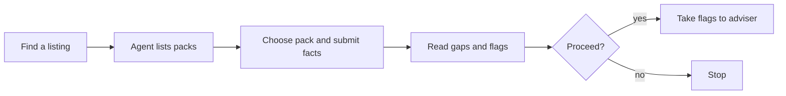
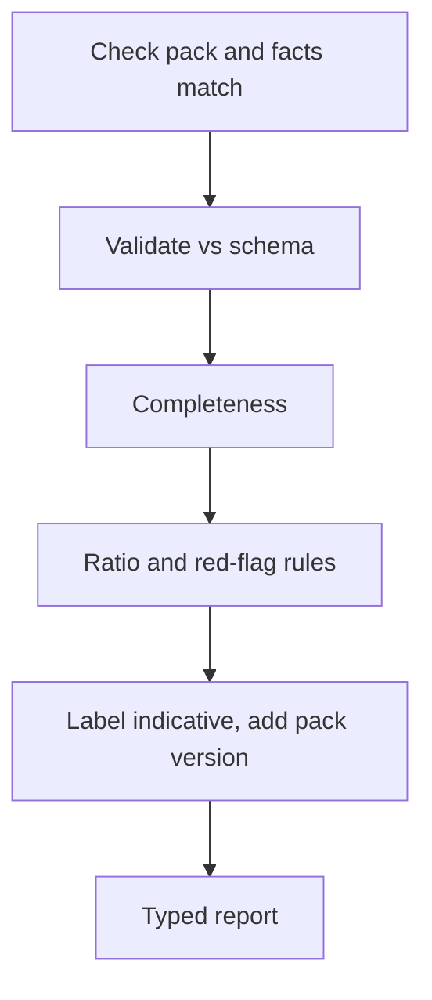
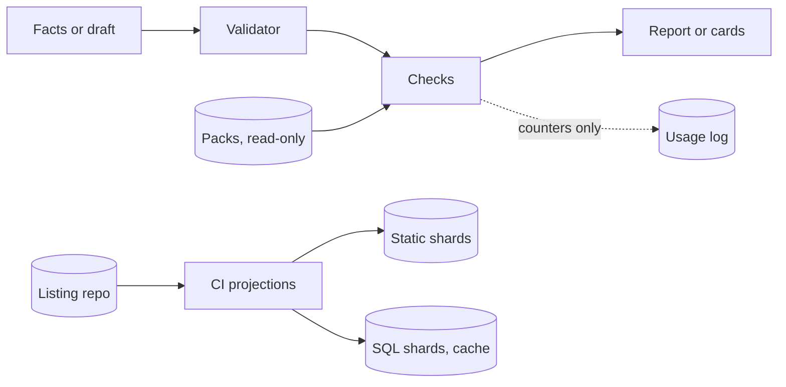
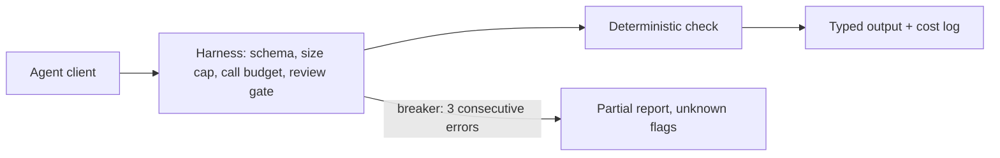
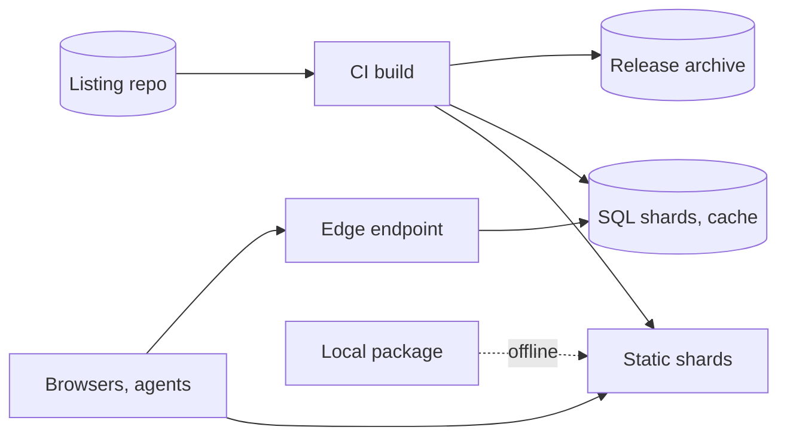
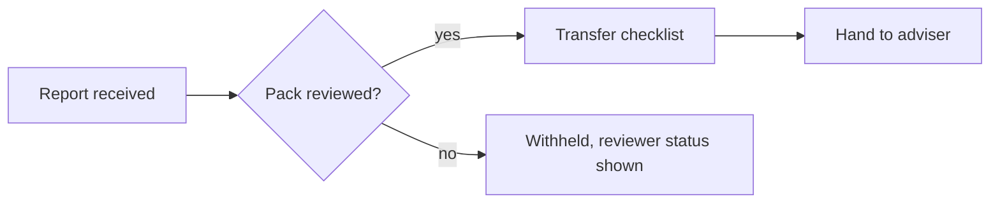
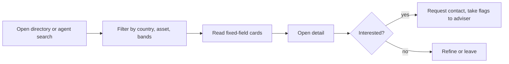
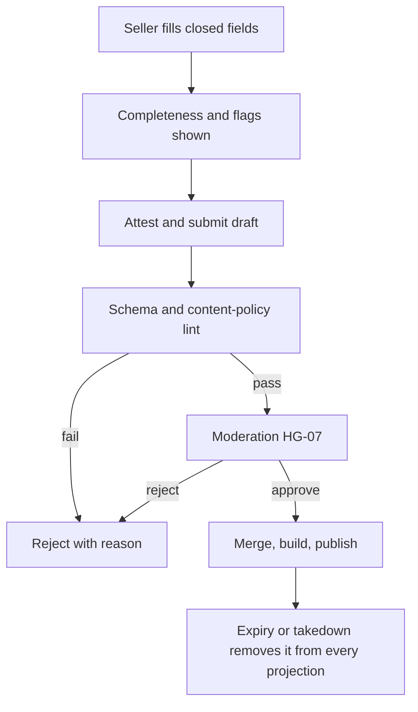
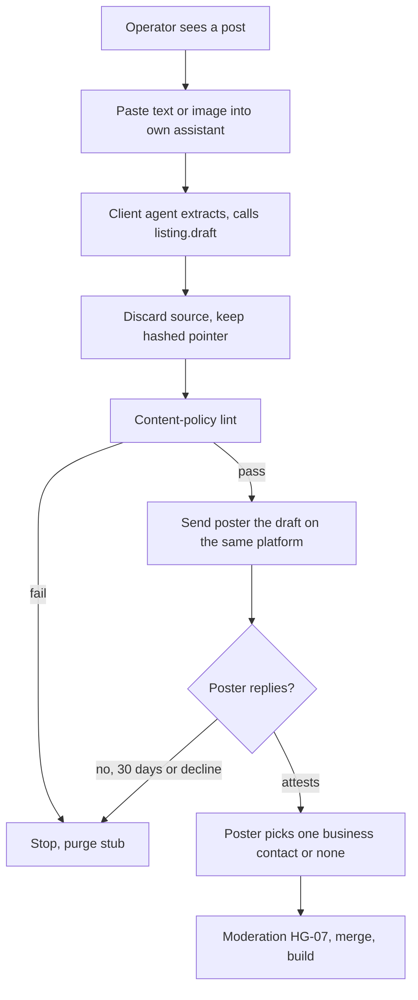
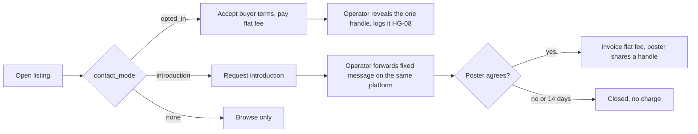

# SME Business-Pack Service — Takeover Packs
## Document Control
Join key: `sme-business-pack@0.4.0`. One combined document; PRD, TAD, ADR, MVP, GTM are addressable sections. **Clean slate**: no earlier draft is consumed; every fact carries its own source join (S-ids in [Reference Implementation](#reference-implementation)).

- **Revision 0.2.0** (2026-10-20): adds the listings directory (F3), first monetization by paid listings and first-party sponsored slots, one-schema agent surfaces, zero-cost guardrails, a minimum-content listing policy and the SSOT data schema and format decision — PP-06, US-11..US-16, VCC-12..19, ADR-005..008, HG-06, HG-07, roadmap R2/R3, F-09, F-10. No content is removed; the Demo Skeleton table became a paragraph and section rules were dropped to stay under 600 lines.
- **Revision 0.3.0** (2026-10-22): adds operator-assisted, consent-gated intake of third-party posts with a platform-neutral extractor (ADR-009); pay-to-reveal only for contacts the poster has opted in, and a paid operator-forwarded introduction for everyone else (ADR-010); amends ADR-006 and ADR-007; moves all contact data to the private ledger and removes the `contact/` path from the public tree — PP-07, US-17..US-21, VCC-20..25, HG-08, VH-04, A14..A16, F-11, F-12, T-11, T-12, S-21..S-23, roadmap R2 delta. Nothing else is removed. The 600-line bound of 0.2.0 is not carried forward.
- **Revision 0.4.0** (2026-10-22): grounds the draft against existing owners. It states reuse and non-overlap with the agentic-graph SME Care Agent, with C-LEDGER reusing its cost-log contract. C-ENDPOINT follows existing MCP precedents instead of a new harness. In-page tools detect `document.modelContext` first. Per-tool MCP descriptors use AgenticRAG terms. The Invocation Register now says "not bound" for `/`, `#`, `@` and cites the tokens agentic-os defines. ADR-011 adds placement: no central MCP server. Nothing else changes.
- **Status**: draft, **not baselinable** (see [Findings Register](#findings-register)). Rungs stay `undocumented`; `spec-complete` needs an Evaluator-run Alignment Gate with zero `blocker`. Alignment cycles used: 0 of 3.
- **Neutrality**: capabilities are named by function; brands appear only under Reference Implementation. "Agent-tool contract" means a protocol-conformant tool interface; the concrete protocol is a reference implementation.
- **Limitation**: companion modules (templates, verification, readiness, diagram, venture, selection, maturity, lean-startup, CID) were not supplied. Their joins and field names follow the index text and are `source=unverified` (F-08).
- **Vocabulary**: pain status `unvalidated` | `demand-proven`; `H` = hypothesis target; `source=unverified` = not checked against a primary source; `opted-in` = the poster's recorded consent to reveal one chosen business contact to paying buyers.
- **Not advice**: every output is information, never legal, tax, valuation or licensing advice.

### Scope declaration
| | Statement |
|---|---|
| Vision | An agent-callable, open, zero-spend service that lets a small-business owner or their agent check a takeover listing and its transfer path, one **pack** per jurisdiction and asset type |
| Pack | Field schema, checklists, ratio parameters, red-flag rules and glossary, as versioned data carrying `as_of`, sources and `review_status` |
| Pilot launch | `sg.fnb.takeover` (Singapore) and `my.fnb.takeover` (Malaysia): food-and-beverage outlet takeovers |
| Later stage | `my.oilpalm.takeover` (R4) and `my.fruitfarm.takeover` (R5): land-bearing plantation and orchard takeovers in Malaysia |
| Directory (R2) | A static, Git-backed directory of structured, seller-attested listings for the pilot packs, readable by people and agents through one schema; a directory, not a broker: no negotiation, escrow, valuation or success fee; listings sourced from a third-party post enter only by operator-assisted intake and the poster's attestation; a contact is revealed only if the poster opted in, otherwise by a paid operator-forwarded introduction |
| 0 (opportunity) | Takeover listings are free-form, self-reported and unverified; the venue's own text leaves due diligence to the user (S-05). Uncertainty: whether anyone pays |
| 1 (target outcome) | One F&B takeover seller (SG or MY) pays for a disclosure pack, collected, within 60 days of first deploy. Evidence: payment record. Observation: 60 days |
| Won't (this increment) | valuation opinions; escrow or fund-holding; real-estate-only transfers; China and other Southeast Asian packs; P&L engine and accounting/payments composition; credential custody or ledger writes; incorporation or accounting services; success fees; free-text descriptions, photos, logos or outlet names in listings; third-party ad networks; contact relay (introductions are forwarded by the operator, never relayed by the service); revealing or selling a contact the poster has not opted in; scraping, crawling or any automated collection from a platform; subscription billing |

Delivery, first collected dollar and repeat demand each need separate evidence — `blended-status`.

## Coverage Record
Source revision `sme-business-pack@0.2.0`. Disposition is a coverage decision, never a rung.

| ID | Disp. | Source | Owner | Evidence / gap | Next check |
|---|---|---|---|---|---|
| C01 | covered | [PRD](#prd) | Product Manager | gap: pain `unvalidated` | T-01 |
| C02 | covered | [GTM](#market-sizing-draft) | Product Manager | gap: two methods, inputs empty | fill, reconcile |
| C03 | covered | [GTM](#offer-and-alternatives) | Product Manager | gap: differentiation unevidenced | alternatives audit |
| C04 | covered | [PRD](#user-stories-moscow) | Product Manager | VCC-01, VCC-08 unsatisfied | clean-env TTV run |
| C05 | covered | [TAD](#tad) | System Architect | design only | CGR-01 |
| C06 | covered | [TAD](#quality-security-and-ai) | System Architect | fixtures planned | VCC-03..07 |
| C07 | covered | [ADR](#adr) | System Architect | ADR-001..004 proposed | quota re-verification |
| C08 | covered | [MVP](#mvp) | Product Manager | Demo Skeleton unrun | rehearsal |
| C09 | covered | [GTM](#acquisition-through-retention) | Product Manager | all hypotheses | VH-01 |
| C10 | covered | [TAD](#operations-and-obligations) | System Architect | solo operator, no incident history | runbook check |
| C11 | covered | [TAD](#operations-and-obligations) | Product Manager | gap: reviewers unnamed (SG, MY, land) | HG-02 |
| C12 | covered | [GTM](#financial-sketch) | Product Manager | gap: scenarios incomplete | fill A01–A09 |
| C13 | covered | [GTM](#capital) | Product Manager | bootstrap, no ask; zero-spend constraint | revisit at R2 exit |
| C14 | deferred | [ADLC seam](#adlc-seam) | Engineering Lead | reason: baseline blocked; dependency: zero `blocker`; revisit: baseline | START handoff |
| C15 | deferred | [Projections](#projections) | Financial Modeler | reason: no validated pain or payment; dependency: C01, C12; revisit: first collected payment | handoff check |
| C16 | covered | [GTM](#learning-and-next-increment) | Product Manager | thresholds set | R0 exit |

**Counts**: dispositioned 16/16; covered applicable 14/16; deferred 2; not-applicable 0. A covered heading alone proves no VCC — `unproven-claim`. v0.2.0 extends C03, C05, C09–C12 and C16 through the directory rows and changes no disposition. v0.3.0 extends C03, C05, C09–C11 through the intake, contact-reveal and introduction rows and changes no disposition.

## PRD
### Problem and pain-point mapping
Users: **buyer** (first-time owner-operator or small investor, possibly cross-border: hypothesis), **seller** (holds the money at close), **agent host** (the AI client acting for either). Workarounds: broker, lawyer or accountant diligence, personal spreadsheets, nothing. Observed 2026-10-20 (`source=unverified`): F&B listings state reported sales, margin ranges, asking prices and legal form in free-form text (S-05, S-13); orchard listings state per-acre prices, tree counts and ages, and self-reported income per harvest with no records (S-10).

Ranked by hypothesised WTP magnitude before build cost (seller pays from proceeds; buyer budgets are small; land-bearing tickets are larger but slower and reviewer-bound). All entries `unvalidated`.

| ID | Pain point | Hook | Break | Fix | Close | Min-time / resource / max-value (reuse vs build) |
|---|---|---|---|---|---|---|
| PP-02 | F&B seller cannot present a credible, standard disclosure | "Your listing leaves buyers' first questions open" | Free-form text omits lease term, licences, costs, payroll | Disclosure completeness report from the pack schema | Share the completed disclosure with the listing | build C-PACKS (SG, MY F&B), C-SCHEMA; reuse C-ENDPOINT; active ≈ [8] h |
| PP-01 | F&B buyer cannot tell if numbers are plausible or complete, or what transfer steps apply | "Is this takeover fee fair, and what must happen before handover?" | Ratios computed by hand; steps scattered across agencies | `check_listing`: gaps + ratio flags, labelled indicative; `transfer_checklist` once reviewed | Take flags and checklist to an adviser | reuse C-SCHEMA, C-PACKS; new check functions; reviewer gate HG-02 |
| PP-03 | Cross-border buyer misapplies one country's practice to the other | "Which rules apply to this outlet?" | Currency, entity form and filing steps differ by country | Pack selected by `pack_id`; mismatch flagged | Choose the right pack | reuse C-CHECKS; mismatch rule only |
| PP-04 | Land-bearing buyer cannot judge tree or palm age profile against price, or see title and consent restrictions early | "Does this price fit what is planted, and can I even take the title?" | Price per acre, age mix, tenure and consent live in separate documents; consent was a deal-ending condition in an observed case (S-09) | `my.oilpalm.takeover` / `my.fruitfarm.takeover`: age-profile and price-per-area flags, tenure and consent flags, never a verdict | Take the flags to a qualified lawyer and valuer | reuse the same tools; new data packs and ratio kinds; land reviewer gate |
| PP-05 | Orchard or estate seller's yield and income claims have no records behind them | "Show buyers your yield evidence" | Self-reported income per harvest, no per-year records (S-10) | Seller evidence checklist: records that would support each claim | Attach records to the listing | reuse `required_fields`; new pack fields |
| PP-06 | Buyers and agents cannot find and compare takeover listings in one structured place; sellers lack a credible, low-effort way to be found | "Every outlet for sale, on the same fields" | Listings are scattered, free-form and inconsistent across venues (S-05, S-13) | Directory of structured, seller-attested listings with pack completeness and flags | Contact the seller, then take flags to an adviser | reuse C-SCHEMA, C-PACKS, C-CHECKS; new C-LISTINGS, C-SLOTS; moderation gate HG-07; active ≈ [24] h |
| PP-07 | Takeover posts on social platforms and classifieds are free-form and scattered, so buyers cannot compare them and the poster cannot choose who reaches them | "Your post, on the same fields — and you choose who contacts you" | Posts mix prose, photos, names and phone numbers; contact is public or absent (S-13) | Operator-assisted draft in closed fields, sent to the poster on the same platform; the poster attests and chooses one business contact or none | Confirm the draft and set the contact choice | reuse C-SCHEMA, C-LISTINGS; new C-INTAKE, C-CONTACTS; gates HG-06, HG-07, HG-08; active ≈ [12] h |

PP-04 and PP-05 back later-stage stories only and PP-06 and PP-07 back Should stories (R2) only, so `pain-point-not-validated` is not triggered for them; promoting any to Must re-opens it. PP-06 ranks after PP-01..03 (hypothesis: it needs the supply and traffic the check tool earns first). PP-07 ranks after PP-06 (hypothesis: it needs a structured directory to send posters to). Hooks and closes imply no capability the fix lacks: no report says "verified", "safe", "allowed" or "fairly priced".

### User stories (MoSCoW)
| ID | Story | MoSCoW | Pain |
|---|---|---|---|
| US-01 | As an agent host, I list packs and required fields at zero token cost | Must | PP-01, PP-02 |
| US-02 | As a buyer, I submit listing facts for an F&B pack and receive gaps and ratio flags | Must | PP-01, PP-03 |
| US-03 | As a seller, I receive a disclosure completeness report for an F&B pack | Must | PP-02 |
| US-04 | As either party, I receive a transfer checklist, only from a reviewed pack | Should | PP-01 |
| US-05 | As a non-agent user, I use a browser form on the same capability | Should | PP-01, PP-02 |
| US-06 | As a buyer, I cross-check the entity against public registry data | Could (R3) | PP-01 |
| US-07 | As a land-bearing buyer, I check an oil palm estate listing | Later (R4) | PP-04 |
| US-08 | As a land-bearing buyer, I check a fruit-farm listing | Later (R5) | PP-04 |
| US-09 | As an orchard or estate seller, I see which records would support my claims | Later (R4–R5) | PP-05 |
| US-10 | Valuation, escrow, P&L engine, accounting integrations, China or other Southeast Asian packs | Won't (this increment) | — |
| US-11 | As a buyer or agent, I search and compare structured listings by country, asset type, price band and completeness | Should (R2) | PP-06 |
| US-12 | As a seller, I submit a listing from a form that accepts only the closed field list and records my attestation | Should (R2) | PP-02, PP-06 |
| US-13 | As a seller, I pay to feature or extend my listing by manual invoice | Should (R2) | PP-06 |
| US-14 | As a partner, I buy a labelled first-party sponsored slot | Could (R3) | PP-06 |
| US-15 | As anyone, I report a listing and see it removed within the takedown bound | Should (R2) | PP-06 |
| US-16 | As an agent, I call `listing.search`, `listing.get`, `listing.draft`, `listing.report` on any surface with identical results | Should (R2) | PP-06 |
| US-17 | As an operator, I turn a post I paste in by hand into a closed-field draft without the source text being stored | Should (R2) | PP-07 |
| US-18 | As a poster, I confirm, edit or decline a draft sent to me and, if I attest, choose one business contact or none | Should (R2) | PP-07 |
| US-19 | As a buyer, I pay a flat fee to reveal a contact the poster opted in | Should (R2) | PP-06, PP-07 |
| US-20 | As a buyer, where no contact is opted in, I pay a flat fee for an operator-forwarded introduction, due only after the poster agrees | Should (R2) | PP-06, PP-07 |
| US-21 | As a poster, I withdraw my contact opt-in or my listing and see it removed within the takedown bound | Should (R2) | PP-07 |

PRD stops at criteria; implementation is in [TAD](#tad).

### Success metrics
Every user-facing feature carries a TTV row (`missing-economics-metric`).

| Metric | Target `H` | Check |
|---|---|---|
| **TTV F1** (pack check): connect to first report, clean environment | ≤ 5 min | VCC-08 |
| **TTV F2** (transfer checklist): first report to checklist | ≤ 2 min | VCC-08 |
| **TTV F3** (directory): landing to first matching card; form start to validated draft | ≤ 30 s; ≤ 10 min | VCC-12, VCC-15 |
| **TTV F4** (operator intake): paste to validated draft | ≤ 3 min | VCC-20, VCC-22 |
| Poster response: drafts attested; of those, contact opted in | ≥ [4] of 20; ≥ [2] of those | VH-04 |
| Pain validation: interviewees quantifying a workaround | ≥ 6 of 10 per country | VH-01 |
| Seller pre-commit | ≥ 3 of 10 | VH-01 |
| Server-side inference tokens per check | 0 | VCC-01 |

### Verifiable Completion Conditions
The Evaluator is a mechanism separate from the implementer and from every work tree or agent it judges. No VCC is satisfied; each needs an Evidence Reference (invocable check, recorded result, surface).

| VCC | End state | Check | Constraints | Status |
|---|---|---|---|---|
| VCC-01 | `pack.list` and `required_fields` consume 0 inference tokens and return pack id, version, `as_of`, `review_status` | invocation log | no server-side model | unsatisfied |
| VCC-02 | `check_listing` returns a typed report in ≤ 2 s p95 on 40 fixtures (20 per pilot pack) | fixture suite | zero spend | unsatisfied |
| VCC-03 | Every omitted required field in the labelled fixtures is reported (recall 100%) | deterministic diff vs labels | schema pinned | unsatisfied |
| VCC-04 | Every out-of-range ratio in the fixtures is flagged; in-range ratios raise 0 flags | fixture assertions vs pack parameters | parameters from pack only | unsatisfied |
| VCC-05 | Every report carries the "indicative, not verified" label, pack version and `as_of`, including no-flag reports | fixture assertion | all tools | unsatisfied |
| VCC-06 | No listing content persists; unknown fields are dropped | storage audit | counters only in logs | unsatisfied |
| VCC-07 | A pack with `review_status` other than `reviewed` never returns checklist content; a pack mismatch is flagged | negative fixtures | gate in C-ENDPOINT | unsatisfied |
| VCC-08 | First report ≤ 5 min from a clean environment | timed run | guest client, no account | unsatisfied |
| VCC-09 | Simulated [200] checks/day stay ≥ [30]% under the runtime's free quota | load script vs current quota | quota re-verified at run date | unsatisfied |
| VCC-10 (R4) | `my.oilpalm.takeover`: every planted gap, age-profile and consent flag found in 15 fixtures; no verdict wording | fixture suite | land reviewer approved | unsatisfied |
| VCC-11 (R5) | `my.fruitfarm.takeover`: same, 15 fixtures, including tenure-years versus payback | fixture suite | land reviewer approved | unsatisfied |
| VCC-12 (R2) | The listing schema accepts only the closed field list: 20 negative fixtures with free text, an image, a name, an address or an unknown field are rejected and none renders | schema and render lint | ADR-006 | unsatisfied |
| VCC-13 (R2) | Every card and detail view shows "seller-reported, not verified", attestation date, expiry and pack version; a listing without an attestation record is not published | publish-gate fixtures | no record, no listing | unsatisfied |
| VCC-14 (R2) | Zero-spend lint passes: no excluded binding, every database ≤ [400] MB, every shard ≤ [1] MB, repo ≤ [2] GB, no third-party script, no payment method on any hosting account | CI lint, account audit | quotas re-verified (HG-05) | unsatisfied |
| VCC-15 (R2) | List page ≤ [150] KB and detail ≤ [30] KB transferred; p75 LCP ≤ [2.5] s on an emulated mid-range phone | Lighthouse in CI | static-first | unsatisfied |
| VCC-16 (R2) | One query fixture returns identical typed results from the static, local and remote surfaces; the in-page surface matches where the browser supports it | parity fixtures | adapters generated from C-SCHEMA | unsatisfied |
| VCC-17 (R2–R3) | Every paid or sponsored element is labelled; payment never changes completeness score or flags; at most one sponsored slot per page | render and ranking fixtures | no third-party ad scripts | unsatisfied |
| VCC-18 (R2) | A reported listing leaves the static shards, SQL projection and archive index within [24] h of the report being actioned | timed takedown drill | HG-07 | unsatisfied |
| VCC-19 (R2) | Every listing file validates against the schema and is in canonical form; NDJSON shards parse line by line and round-trip to the source records; CSV and TSV exports reopen with 0 column drift and 0 lost rows | CI validation, round-trip and export fixtures | ADR-008 | unsatisfied |
| VCC-20 (R2) | No code path in the service or the intake kit fetches a URL, uses credentials or drives a browser; 10 URL-only inputs are rejected with no outbound request | static scan, negative fixtures, egress test | ADR-009 | unsatisfied |
| VCC-21 (R2) | After extraction no source text, image, name, handle or profile link exists in the repo, private ledger, logs or build; only the URL hash and `source_class` remain | storage and log audit | ADR-009 | unsatisfied |
| VCC-22 (R2) | 20 mixed-language (en, zh, ms) fixtures map to the same enums as the form; unmappable values become `unknown`; no free text survives | fixture suite | closed vocabulary | unsatisfied |
| VCC-23 (R2) | No listing derived from a third-party post is published without a poster attestation record; an unanswered lead is purged by `purge_by` ([30] days) | publish-gate fixtures, timed purge drill | ADR-009 | unsatisfied |
| VCC-24 (R2) | No contact appears in any public file, shard, SQL projection, export or archive (leak scan); a reveal returns only an opted-in contact and writes a reveal log entry; ≤ [5] reveals per listing; a revoked contact is deleted and cannot be revealed | leak scan over every projection, reveal fixtures | ADR-010 | unsatisfied |
| VCC-25 (R2) | An introduction is invoiced only after the poster's recorded agreement; no agreement within [14] days closes it with no charge; no message passes through the service | workflow fixtures, invoice audit | ADR-010 | unsatisfied |

### Traceability
`PRD-[Epic]-[Story] ↔ TAD-[Component]-[Interface] ↔ VCC ↔ Evidence Reference` — closes in both directions; refinement bounded at 3 cycles.

| PRD | TAD | VCC | Evidence Reference |
|---|---|---|---|
| PRD-Packs-US-01 | TAD-C-ENDPOINT-pack.list, -pack.required_fields | VCC-01 | none yet (invocation log) |
| PRD-Check-US-02, US-03 | TAD-C-CHECKS-takeover.check_listing | VCC-02..06 | none yet (fixture suite) |
| PRD-Check-US-04 | TAD-C-ENDPOINT-takeover.transfer_checklist | VCC-07 | none yet (negative fixtures) |
| PRD-Check-US-05 | TAD-C-UI | VCC-02, VCC-08 | none yet |
| PRD-Land-US-07..09 | TAD-C-PACKS (land packs), C-CHECKS ratio kinds | VCC-10, VCC-11 | none yet; roadmap only |
| PRD-Directory-US-11, US-16 | TAD-C-LISTINGS-listing.search, -listing.get; C-ENDPOINT | VCC-15, VCC-16 | none yet |
| PRD-Directory-US-12, US-15 | TAD-C-LISTINGS-listing.draft, -listing.report; C-SCHEMA content policy and format | VCC-12, VCC-13, VCC-18, VCC-19 | none yet |
| PRD-Directory-US-13, US-14 | TAD-C-SLOTS | VCC-17 | none yet |
| PRD-Directory (guardrails) | TAD-C-EVAL zero-spend lint | VCC-14 | none yet |
| PRD-Intake-US-17, US-18 | TAD-C-INTAKE (intake kit), listing.draft; C-LISTINGS attestation; C-CONTACTS consent | VCC-20..23 | none yet |
| PRD-Contact-US-19..21 | TAD-C-CONTACTS-contact.request | VCC-24, VCC-25 | none yet |

## TAD
### Component inventory and division of work
One owner per capability — `duplicate-capability-owner`. Reuse decision per component — `component-origin-unstated`.

| Component | Capability owned | Origin | Note |
|---|---|---|---|
| C-SCHEMA | Pack field schema, listing JSON Schema and report types | new | pure, browser-safe, no secrets; owns the canonical form |
| C-PACKS | Versioned pack data: fields, checklists, ratio parameters, red flags, glossary, per jurisdiction × asset type | new (content) | each pack declares `pack_id`, `version`, `as_of`, `sources[]`, `review_status`, `reviewer`; parameters, not constants |
| C-CHECKS | Rule evaluator and ratio kinds named by packs (e.g. rent-to-sales, payback, price-per-area, age profile, tenure-years) | new | pure; a new ratio kind is a code delta, not pack data |
| C-ENDPOINT | Routes, input validation, budgets, pack loading, review-status gate | new adapter, existing pattern | edge runtime, stateless; follows the public catalog profile in agentic-commerce-os `src/edge/mcp.ts` (`commerce.catalog.public.list`: no credentials, same-origin only, ≤ 16 KiB request, fail-closed discovery; `docs/prd-tad-adr-mvp-gtm-a2mcp-services.md`), not a new harness |
| C-UI | Browser UI: check form, directory views (gallery, grid), submission form | extend C-ENDPOINT | static pages, same capability identities |
| C-REG | Registry cross-check | extend-owner (upstream) | Could, R3; `defer` pending CGR-01 |
| C-LEDGER | Usage and cost counters | extend platform logs | no second ledger; consider reusing agentic-graph `contracts/cost-log.schema.js` instead of a new log schema |
| C-EVAL | Fixtures, Evaluator checks and the zero-spend lint | new | held outside the implementer lane |
| C-LISTINGS | Listing records (one file per listing), validation, attestation record, projection builder (static shards, SQL import, archive index) | new | sole owner of listing data; no free-text field exists |
| C-SLOTS | Paid-listing and sponsored-slot registry: dates, labels, invoice reference | new (content) | data file approved by the operator; no third-party ad scripts |
| C-INTAKE | Operator intake kit: neutral extraction instructions for the client agent, content-policy lint, lead-stub script (hashed pointer, state, `purge_by`) | new (content, script) | no fetcher, no server-side model (ADR-002); platform is an enum; stores no source text |
| C-CONTACTS | Poster consent records, opted-in contacts, reveal log, introduction log | new (private data) | private ledger only; never projected; operator access only; sole owner of contact data |

### Five flows
Notation: Mermaid (`source=unverified` against Diagram Guidelines; class and canvas-projection check names unresolved — F-08). Features: **F1 Pack Check** (`check_listing`, `required_fields`, `pack.list`; Must) and **F2 Transfer Checklist** (Should). **F3 Listings Directory** (`listing.search`, `listing.get`, `listing.draft`, `listing.report`; Should, R2) adds D-07 (journey) and D-08 (workflow). **F4 Intake and Contact** (operator intake kit, `contact.request`; Should, R2) adds D-09 (workflow) and D-10 (journey). D-03..D-05 are shared by F1–F4 (same data, harness, topology; D-03 and D-05 now include listings). Later-stage packs reuse F1/F2 unchanged; flows are re-traced at R4 and R5 entry.

**D-01 Journey F1**


**D-02 Workflow F1**


**D-03 Data flow** (anchors to journey stage C)


**D-04 Orchestration and harness** (anchors to stage C)


**D-05 Topology**


**D-06 Journey F2**


**D-07 Journey F3** (buyer or agent)


**D-08 Workflow F3** (seller submission to takedown)


**D-09 Workflow F4** (post to attested listing)


**D-10 Journey F4** (buyer: reveal or introduction)


### Invocation Register
One register for every route. Tool discovery grants no mutation authority; every route is read-only, compute-only or prepare-only. Later-stage packs add data, not routes.

| Capability identity | Agent-tool (remote, local) | In-page tool (if supported) | Browser | Headless API | `/` | `#` | `@` | Mode | Owner |
|---|---|---|---|---|---|---|---|---|---|
| `pack.list` | yes | yes | yes | yes | not bound | not bound | not bound | read-only, 0 tokens | C-ENDPOINT |
| `pack.required_fields` | yes | yes | yes | yes | not bound | not bound | not bound | read-only, 0 tokens | C-ENDPOINT |
| `takeover.check_listing` | yes | yes | yes (Should) | yes | not bound | not bound | not bound | compute-only | C-CHECKS |
| `takeover.transfer_checklist` | yes | yes | yes (Should) | yes | not bound | not bound | not bound | read-only, review-gated | C-ENDPOINT |
| `listing.search` | yes | yes | yes | yes | not bound | not bound | not bound | read-only, 0 tokens (R2) | C-LISTINGS |
| `listing.get` | yes | yes | yes | yes | not bound | not bound | not bound | read-only, 0 tokens (R2) | C-LISTINGS |
| `listing.draft` | yes | yes | yes | yes | not bound | not bound | not bound | prepare-only (R2) | C-LISTINGS |
| `listing.report` | yes | yes | yes | yes | not bound | not bound | not bound | prepare-only (R2) | C-LISTINGS |
| `contact.request` | yes | unsupported | yes | yes | not bound | not bound | not bound | prepare-only (R2): records a buyer request and terms acceptance, returns a request id; returns no contact | C-CONTACTS |

Not bound: agentic-os `catalog/dictionaries` defines `/artifact.create`, 16 `#` family tags and `@model`, `@artifact`, `@asset` (#570, in main `a36ff34`). This pack deliberately binds none of them in the MVP, has no client command surface and defines no tokens of its own. Bind only an existing token, and only with an evidenced pain — `orphan-route`, `ambiguous-route`. Offline: the local stdio variant serves the same identities. Intake adds no route: the client agent extracts and calls `listing.draft` with `origin.channel` set; the operator creates the lead stub and fulfils each reveal or introduction by hand.

### Agent-native surfaces, one schema
C-SCHEMA is the sole schema owner; every adapter is generated from it, never hand-written (`duplicate-owner`).

| Surface | Serves | Edge-function requests | Status |
|---|---|---|---|
| Static files: index and detail shards, `llms.txt`, API description | any client or agent | 0 | baseline |
| Local package: pulls shards, runs the same tools offline | agent hosts | 0 | baseline |
| Remote agent-tool server: stateless edge function over the SQL projection | hosts without a local package | 1–3 per call `H` | baseline, hard-capped |
| In-page tools: registered on page load, run on static shards | in-browser agents | 0 | optional: draft standard, limited browser support (S-17); feature-detect `document.modelContext` first, then `navigator.modelContext`; never required (agentic-os `@webmcp-surface` is moving to the same rule in a parallel agentic-os change) |

Rules: same capability identities and typed outputs on every surface (VCC-16); read routes cost 0 tokens; writes are prepare-only (`listing.draft` returns validated JSON and a submission link, a human merges); default response ≤ 20 results and ≤ 8 KB with cursor, `as_of`, pack version and provenance; fields come from closed vocabularies, so no free text reaches an agent as instructions; in-page tools carry a read-only hint and expose only what the page already shows. Remote and local surfaces follow existing precedents: agentic-graph `cloudflare/workers/agentic-graph-mcp` (Workers agent, Streamable HTTP) and agentic-os `docs/MCP.md` (`agentic-os-mcp`, zero-dependency stdio).

**MCP descriptors**: this pack is the first real MCP server for a family, which is the previously deferred trigger. Descriptors are owned here (the capability owner): one per tool, generated from C-SCHEMA. They use AgenticRAG `huijoohwee.github.io/schema/AgenticRAG/v1/context.jsonld` v1.1.0 terms: `artifactFamily`, `continuityId` (`sme-business-pack`), `invocationToken` (existing agentic-os tokens only; none bound in the MVP), `agentSurface` (`mcp-tool` or `webmcp-tool`) and `inputSchema`. Any cross-repo index is a generated static projection in the agentic-os catalog, never a proxy server.

### Quality, security and AI
| Case | Mitigation | Check |
|---|---|---|
| Oversized or malformed input | schema validation, byte cap [32 KB], timeouts | VCC-02 |
| Instructions hidden in listing text steering the client agent | user text returned only as escaped data, never as instructions | fixture, VCC-05 |
| False reassurance ("no flags" read as safe) | mandatory "indicative, not verified" label | VCC-05 |
| Stale or unreviewed rules | `as_of`, sources, `review_status` on every pack; stale after [180] days flagged; unreviewed packs serve only completeness and arithmetic | VCC-07 |
| Wrong pack for the listing (country, currency, asset type) | `pack_id` required; mismatch flagged | VCC-07 |
| Land-bearing legal conclusions | consent and tenure raised as "verify with a qualified lawyer", never allowed or not-allowed | VCC-10, VCC-11 |
| Privacy | no persistence, no accounts in MVP | VCC-06 |
| Free text or media smuggled into a listing | closed field list; unknown fields rejected; no images, names or addresses | VCC-12 |
| Paid placement distorting ranking or misleading | every paid element labelled; payment never alters score or flags | VCC-17 |
| Reported or unlawful listing stays live | report path, human review, rebuild removes it from every projection | VCC-18 |
| Quota exhaustion or surprise cost | hard-capped free products only; zero-spend lint; static fallback | VCC-14 |
| Burst or abuse | per-client rate cap; breaker; fallback to local variant | VCC-09 |
| Automated collection from a platform | no fetcher, credentials or browser automation exist; input is user-supplied text or image only | VCC-20 |
| Source text, images or poster personal data retained | discard at extraction; hashed pointer only; purge in [30] days | VCC-21, VCC-23 |
| Contact revealed or sold without opt-in; contact in a public file | contacts only in the private ledger, only if opted in; leak scan on every projection | VCC-24 |
| Buyer misuses a revealed contact (spam, resale) | buyer terms, reveal cap, reveal log, operator-fulfilled | VCC-24 |
| Poster withdraws or post is removed | contact deleted, listing removed within the takedown bound | VCC-18, VCC-24 |

**AI components**: none server-side (ADR-002). The client agent's inference is outside this service's COGS; any future AI component needs typed input, typed output, emitted cost log and a stated fallback. Every agentic loop is bounded: session cap 10 tool calls, per-call wall clock 10 s, breaker after 3 consecutive errors — `unbounded-loop`.

**Token budget per feature**

| Feature | Server inference tokens | Max response | Session ceilings |
|---|---|---|---|
| F1 Pack Check | 0 | 64 KB (≈ [3k] tokens typical `H`) | 10 calls, 10 s per call |
| F2 Transfer Checklist | 0 | 64 KB | same |
| F3 Listings Directory | 0 | 8 KB default | same |

**TCO per deployment model** (kept separate — `blended-deployment-tco`):

| Model | Operator spend | Operator active time | Limit / risk | Exit |
|---|---|---|---|---|
| Local stdio | 0 | docs only | user's machine | n/a |
| Hosted shared endpoint | 0 within free quota (`unverified`) | monitoring, pack releases | quota and CPU limits | switch to local variant |
| Self-hosted on user's own free account | 0 | user setup | user effort | fork and run |

Zero-spend scope: unknown fees, sponsorship, paid infrastructure, paid reviewers and proprietary dependencies cannot silently enter the MVP — `constraint-gate-skipped`. Reviewer cost is the main hidden cost (A08): until a reviewer is named, packs stay provisional.

### Listing storage and zero-cost guardrails
Git is the source of truth; every other store is a rebuildable projection (ADR-005). Limits are as read from vendor documentation (S-14, S-15, S-16), `source=unverified`, and re-verified at HG-05.

| Tier | Free limit (as read) | Role | Capacity `H` |
|---|---|---|---|
| Source-host repo, public | files < 100 MiB; repo advised < 1 GB, strongly < 5 GB | one JSON file per listing; source of truth | ≈ 100k–300k listings per repo; shard repos beyond |
| Edge SQL shards | 10 databases × 500 MB, 5 GB total; 5M row reads and 100k writes a day | slim, queryable projection | ≈ 1M slim rows; one database per pack, ≤ 400 MB |
| Static hosting | 20,000 files, 25 MB each; total size and bulk-data terms unverified | index and detail shards | 100k listings ≈ 250 shards ≈ 300 MB compressed |
| Key-value cache | 1 GB; 100k reads and 1k writes a day | hot cache only | ≈ 10k entries (write cap) |
| Release archive | no total size or bandwidth limit, per-file limit applies; terms risk | snapshots, expired listings | effectively unbounded; verify terms |
| User device | browser storage | saved searches, drafts, offline pack | user's disk |

Bytes are not the binding limit; request and processing caps are: edge function 100k requests a day and 10 ms CPU per call (≈ 30k–50k agent sessions `H`), 5M SQL row reads a day with queries failing at the cap, 1k cache writes a day, and moderation time. Maximise capacity with text-only listings, slim projections, enums and integers, shards ≤ 1 MB, expiry into the archive, a data-only repo with periodic snapshots and one SQL database per pack.

**Guardrails** (each checkable):
- No payment method on any hosting account; only hard-capped free products (edge function, SQL shards, key-value cache, static hosting). Object storage, queues, vector search and stateful-object bindings are excluded: object storage needs a payment method and bills overage (S-16).
- Zero-spend lint in CI (VCC-14) fails on an excluded binding, a database > 400 MB, a shard > 1 MB, a repo > 2 GB or any third-party script; no third-party analytics, ad or font scripts.
- Degradation ladder: edge cap reached → static shards and local package keep working; SQL cap reached → static only.
- HG-05 before deploy: verify the static total-size cap and bulk-data terms, SQL full-text support, CI minutes and archive terms.

### Data schema, repository structure and formats (SSOT)
The source of truth is plain text in Git: one canonical JSON file per listing, validated by a JSON Schema (2020-12, `additionalProperties: false`). Everything else is generated, never edited (ADR-005, ADR-008).
```text
listings/{pack_id}/{id[0:2]}/{id}.json   public SSOT; opaque random id; ≤ 1,000 files per directory `H`
packs/{pack_id}/pack.json                fields, bands, flag rules, glossary (en, zh, ms), as_of, review_status
schema/listing.schema.json               listing schema; schema_version semver, one migration note per bump
mcp/descriptors/{tool}.jsonld (generated) per-tool MCP descriptors (AgenticRAG context v1.1.0 terms)
build/ (generated)                       index/{pack_id}/{n}.ndjson, detail/{id}.json, manifest.json, exports/*.csv|tsv, sql/*.sql
ledger/ (separate private repo)          seller identity, invoices, attestation originals, moderation notes, leads, contacts, reveal and introduction logs; never projected; joined by attestation, listing or lead id
```
```json
{"schema_version":"1.1.0","id":"k7m2q9x4tb3z","pack_id":"my.fnb.takeover","status":"live",
 "dates":{"listed":"2026-11-02","expires":"2027-01-01","attested":"2026-11-01"},"place":{"country":"MY","region":"[ISO 3166-2 code]"},"origin":{"channel":"operator_assisted","source_class":"social_post"},"contact_mode":"opted_in",
 "facts":{"subtype":"cafe","age_band":"b3","legal_form":"sole_prop","seating_band":"b2","staff_band":"b2","price_band":"b4","sales_band":"b3","rent_band":"b2","lease_band":"b3","licences":"held","equipment":true,"inventory":false,"sale_reason":"relocation","handover_band":"b2"},
 "attestation":{"id":"A-0001","text_version":"1","by":"seller","sha256":"[..]"}}
```
Rules: UTF-8, LF, sorted keys, 2-space indent, no trailing whitespace (canonical form checked in CI); enums and band codes only, with labels and currency in the pack glossary so one record renders in three languages; no computed field in the source (score and flags are derived in CI); every seller field is `seller_reported` unless a `provenance` entry upgrades it to `document_attached`; no personal data and no contact in listing files; `origin` is enum-only (`channel`: `seller_form`, `operator_assisted`; `source_class`: `social_post`, `classified`, `carousel`, `video`, `other`) and never a URL; `contact_mode` is an enum set at attestation (`opted_in`, `introduction`, `none`) and rebuilt to `introduction` or `none` on revocation; `status` runs draft → live → expired or removed, and removal deletes the file.

**Private ledger records** (append-only NDJSON, separate private repo, never projected; one example line each):
```json
{"lead_id":"L-0007","source_class":"social_post","url_sha256":"[..]","captured":"2026-11-01","state":"awaiting_poster","purge_by":"2026-12-01"}
{"listing_id":"k7m2q9x4tb3z","channel":"business_messaging","handle":"[..]","consent":{"text_version":"1","given":"2026-11-01","scope":"reveal_to_paying_buyers","max_reveals":5},"revoked":null}
{"reveal_id":"R-0012","listing_id":"k7m2q9x4tb3z","buyer_ref":"[..]","date":"2026-11-05","terms_version":"1","invoice_ref":"[..]"}
{"intro_id":"I-0003","listing_id":"k7m2q9x4tb3z","buyer_ref":"[..]","requested":"2026-11-06","state":"forwarded","poster_agreed":null,"closes":"2026-11-20","invoice_ref":null}
```
Lead `state`: `awaiting_poster`, `attested`, `declined`, `expired`. Introduction `state`: `requested`, `forwarded`, `agreed`, `declined`, `closed`. The contact is a business channel the poster chose, never a profile link or personal name. Buyer data is a reply channel and an invoice reference only, kept for a retention period the reviewer sets (default `H`: [12] months after close). A revoked contact is deleted, not flagged.

### Operations and obligations
- **Delivery and support**: solo operator; issues via the source host; no SLA. Incident path: pin back the pack or endpoint to the prior revision.
- **Pack release process**: draft pack → sources attached → reviewer sign-off (HG-02) → `review_status: reviewed` → publish. Each pack revision is one release with its own rollback pin.
- **Obligations (C11)**: information only; no legal, tax or valuation advice. Open questions for named reviewers, not assertions: personal-data rules in both countries for listing inputs; whether estate-agent or valuer licensing touches land-bearing packs; whether paying referral fees to legal professionals is permitted in either country. Jurisdictions: Singapore, Malaysia. Reviewers: unnamed (gap).
- **Licences and IP**: no copied listing text or assets; observed listings are cited, not reproduced; upstream open-source reuse preserves licence and attribution.
- **Listing content risk** (open questions for the reviewer at HG-06, not assertions): defamation or misleading statements in seller claims; copyright, trademark and database rights in copied text, photos, logos or outlet names; personal data in contact details and in owner or staff information in both countries; advertising and consumer-protection rules for paid and sponsored placements, including financial or lending promotions; intermediary liability and notice-and-takedown duties; whether the directory, a success fee or land-bearing listings trigger broker, estate-agent or valuer licensing; terms making the seller the warrantor of every field and granting the operator a display licence.
- **Intake and contact risk** (open questions for the reviewer at HG-06, not assertions): each platform's terms on automated collection and on commercial reuse of its content (a court ruling in one jurisdiction on logged-off public scraping is not a basis for relying on any platform, any country or logged-in access; S-21, S-22); personal-data rules in Singapore and Malaysia for lead stubs, contact records and the reveal log, including whether a publicly-available-data exception (S-23) reaches paid disclosure of a contact and how it applies after a post turns private; whether fees for a reveal or an introduction trigger broker, estate-agent or finder-fee licensing; consumer-protection terms for paid reveals (refund, accuracy of "opted-in"); unsolicited-message rules for the outreach message; the client-agent provider's handling of pasted text; retention of buyer data.

### Human gates
No silent gate — `human-gate-unstated`.

| Gate | When | Evidence | Rollback |
|---|---|---|---|
| HG-01 operator opens a Deploy Boundary | before any promotion | operator instruction reference | revert to prior protected revision |
| HG-02 qualified reviewer per pack (Singapore F&B; Malaysia F&B; Malaysia land-bearing) approves checklist, red-flag and disclaimer content | before a pack is marked `reviewed` | signed review record | revert pack to `provisional` |
| HG-03 operator approves payment-mechanism terms | before any collection | recorded fee terms | stop collection |
| HG-04 founder conducts interviews | R0 | quotes on record | none (observation only) |
| HG-05 operator re-verifies free-tier limits and terms | before deploy and every [90] days | dated record | disable hosted route |
| HG-06 qualified reviewer approves listing terms, field list, attestation text, sponsored-content rules, the intake rules, the outreach message, the contact-consent text, buyer terms and the reveal and introduction fee terms | before R2 publish and before the stage-0 concierge | signed review record | unpublish directory, stop reveals and introductions, keep check tools |
| HG-07 operator moderates each submitted listing and each report | every submission; reports within [24] h | moderation log by listing id | revert the merge; rebuild removes it |
| HG-08 operator checks the opt-in or recorded poster agreement and the invoice before each reveal or introduction, then logs it | every reveal and introduction | reveal or introduction log by id | stop the reveal route; delete the contact on request |

### Lanes and Deploy Boundary Register
| Lane | Contents | Boundary to next | Gate | Evidence | Rollback | Operator instruction | State |
|---|---|---|---|---|---|---|---|
| authoring | this document, source, packs, fixtures | → mirror | CI pass + zero `blocker` | Integration Receipt | revert to prior SHA | none referenced | closed |
| mirror | read-only public copy | → delivery | exact protected SHA named | deployment receipt | redeploy rollback predecessor | none referenced | closed |
| delivery | deployed endpoint | — | HG-01 | live identity | prior revision | none referenced | closed |

No authoring-lane command may mutate a mirror or delivery surface — `deploy-boundary-breach`.

### Ecosystem
| Participant / job | Value exchange / payer | Native owner / revision | Interface / authority | Evidence / gap | Cost, privacy, exit |
|---|---|---|---|---|---|
| Buyer: vet a listing | free report | C-CHECKS@[rev] | tool route, compute-only | none / VH-01 | no retention |
| Seller: present disclosure | pays for pack (hypothesis) | C-SCHEMA, C-PACKS | tool route, read-only | none / VH-01 | no retention |
| Agent host: call tools | none | C-ENDPOINT | discovery grants no mutation | none / VCC-08 | 0-token read path |
| Listing venues (marketplaces, property portals, social platforms) | posts the operator pastes in by hand for intake; outreach to the poster on the same venue only | external | none; no scraping, no fetching, no integration | observed (RI-3) / T-11 | venue terms untouched; no source text kept |
| Poster (seller of a post-sourced listing) | pays nothing; decides attestation and contact choice | C-INTAKE, C-CONTACTS | attests; may withdraw at any time | none / VCC-23, VCC-24 | hashed pointer purged in [30] days; contact deleted on withdrawal |
| Buyer: reveal or introduction | flat fee per reveal or per agreed introduction (hypothesis) | C-CONTACTS | operator-fulfilled after invoice; no relay | none / VH-04 | reveal log, capped reveals, buyer terms |
| Qualified reviewers (SG F&B, MY F&B, MY land) | approve pack content | HG-02 | review record | gap: unnamed | unknown cost (A08) |
| Referral partners (incorporation, accounting, lending, brokers) | referral fee (hypothesis) | external | link-out only | none / outreach | no data shared |
| Sponsors (partners, brokers, suppliers) | flat monthly fee for one labelled slot (hypothesis) | C-SLOTS | static labelled text and link; no scripts | none / VH-03 | no tracking, no data shared |
| Directory operator: moderate listings and reports | operator time | C-LISTINGS, HG-07 | merge and rebuild authority only | none / VCC-18 | moderation log, no private data |
| Associations and cooperatives (later) | channel to land-bearing owners | external | none | gap / R4 | no data shared |
| Public-data provider (registry cross-check) | source for C-REG | upstream owner | their terms | unresolved / CGR-01 | licence and attribution |

Coverage here is not certification, provider availability, revenue or a production claim.

### Shared utilities and reuse
| Candidate | Source / revision | Consumers | Decision | Smallest delta | Check |
|---|---|---|---|---|---|
| Pure schema + checks package | this repo | endpoint, browser, local stdio | `reuse` internally | share by declared export, not sibling imports | VCC-02 across all routes |
| Same four tools for every pack | this repo | F&B and land-bearing packs | `reuse` | add pack data; add ratio kinds only when needed | VCC-10, VCC-11 |
| One neutral intake contract (`listing.draft` plus `origin` enums) | this repo | operator session, form, local package | `reuse` internally | add an enum value, never a connector or parser per platform | VCC-20, VCC-22 |
| Open public-data tool server (RI-2) | revision **unresolved** | none yet | `defer` | client-side adapter for C-REG only | CGR-01 resolved |
| SME Care Agent (`/sme-care-agent`, `agent.sme` / `sme.risk.profile`) | agentic-graph `mcp/sme-risk-coverage/core.js`, `contracts/sme-profile.schema.js`; `README-sme-care-agent.md`; `docs/documents/agentic-graph-sme-protection-gap-prd-tad-adr-mvp-gtm.md` | SME owners | non-overlap: it maps an operating SME's protection gaps and this pack checks a business transfer; both are deterministic, zero-spend and fail-closed | reuse its jurisdiction source-pack convention and cost-log contract (C-LEDGER); never copy its risk profile | no second SME profile or cost-log owner |
| MCP harness (schema, size cap, origin, fail-closed discovery) | agentic-commerce-os `src/edge/mcp.ts`; agentic-graph Worker; `agentic-os-mcp` | C-ENDPOINT, local package | `reuse` pattern | a shared library only with two proven duplicate consumers, and then in agentic-base (ADR-011) | VCC-08 |

**CGR-01 Codebase Grounding Record** — input: upstream open-source repository (RI-2). Inspected 2026-10-20: README only. Observed claims: permissive licence; read-only public-data tools; registry data on its roadmap, not implemented. Missing: commit SHA, symbol inspection, named check. Status: unresolved → no baseline, execution or readiness may rely on it — `unproven-claim` (F-02). A confirmed gap is planned work, never existing capability. Regulatory and market facts are not code; they sit in the Source Register (RI-S), all `source=unverified`.

## ADR
### ADR-001 — Hosting and source runtime (proposed)
**Constraint gate** (requirements: zero spend, remote reach without local install, no retention of inputs, solo-operable):

| Candidate | Disposition |
|---|---|
| A. Edge serverless runtime with free-tier SQL and key-value store | pass (quota `unverified`) |
| B. Static hosting only | fail-remote-route |
| C. Local stdio package only | fail-remote-reach (kept as fallback) |
| D. Paid container hosting | fail-zero-spend |

Only A passes; no outranking or argument graph needed. **Decision**: A, source on a free-tier public host with scheduled CI for pack refresh (RI-1). **Consequences**: quota- and CPU-bound; vendor coupling contained by a portable pure package behind a thin adapter. **Recovery**: local stdio variant. **Reversibility**: high. **Revisit trigger**: quota burn > [60]% for 3 days, or free-tier terms change.

### ADR-002 — Deterministic checks, no server-side model (proposed)
Alternatives: server-side model (fail-zero-spend: inference cost); client-agent reasoning with no service (fails the need for sourced, versioned rules); deterministic checks (pass). **Decision**: deterministic. **Consequences**: reproducible, 0 serving tokens, VCC-01 satisfiable; unstructured listing parsing is the client agent's job. **Revisit trigger**: evidenced demand for unstructured parsing and a zero-cost inference path. Recovery: feature flag off.

### ADR-003 — Packs as versioned data, per jurisdiction × asset type (proposed)
Requirements: reviewable by a non-engineer, provenance per rule, separate review per jurisdiction, zero spend, portable.

| Candidate | Disposition |
|---|---|
| A. Data packs with schema; ratio kinds named in pack, implemented in C-CHECKS | pass |
| B. Rules hard-coded per jurisdiction | fail-reviewer-readable |
| C. One regional pack with country parameters | fail-separate-review |
| D. Hosted rules-engine service | fail-zero-spend |

**Decision**: A. **Consequences**: a new ratio kind is a code change; pack and schema versions must be compatible (validator in CI); rollback by pack pin. **Revisit trigger**: three or more packs needing the same new ratio kind (extract a shared kind) — extraction needs two concrete consumers and an ADR.

### ADR-004 — Land-bearing packs: information, flags and checklists only (proposed)
Requirements: no regulated advice (valuation, legal conclusion), zero spend, reviewer available, solo-operable.

| Candidate | Disposition |
|---|---|
| A. Checklist, indicative ratios, tenure and consent flags; no verdicts | pass |
| B. Valuation estimate | fail-no-regulated-advice (conservative; reviewer to confirm) |
| C. Land-title search integration | fail-zero-spend (access fees unverified; re-gate when priced) |
| D. Exclude land-bearing assets permanently | pass |

**Outranking** (non-compensatory): A outranks D on reuse of the same tools and on buyer reach; D outranks A on risk and on validated-pain evidence (none, reviewer unnamed). Incomparable, left so; the Roadmap gate resolves it: R4 starts only after the R1 exit and a named land reviewer. No contested argument; one pass. **Decision**: A, sequenced R4 then R5. **Consequences**: no legal or price verdict ever; consent and title are surfaced as questions. **Revisit trigger**: reviewer confirms a licence is needed, or evidenced demand for valuation (new ADR).

### ADR-005 — Directory storage: Git as source of truth, rebuildable projections (proposed)
Requirements: zero spend, no payment method, hard-capped products only, rebuildable from a reviewable source, 0-request agent reads, solo-operable. **Gate**: A Git source of truth with static shards, SQL projection, key-value cache and release archive — pass; B object storage for listings and media — fail-zero-spend (payment method, metered overage; S-16); C self-hosted no-code database platform — fail-zero-spend (needs a database server and containers; copyleft licence; S-18); D edge SQL only, no Git source — fail-rebuildable (500 MB shard cap, no reviewable history). Only A passes; no outranking needed. **Decision**: A. **Consequences**: listings are public by construction; edits go through reviewed changes; capacity ≈ 100k–300k listings per repo, then shard repos; history grows (data-only repo, periodic snapshots). **Recovery**: rebuild every projection from the repo; the local package keeps working. **Reversibility**: high. **Revisit trigger**: > [50k] live listings, repo > [2] GB, or a limit or terms change (HG-05).

### ADR-006 — Minimum listing content: facts, not prose (proposed)
Requirements: lowest legal exposure, lowest moderation time, smallest payload, comparable typed fields, no injection surface for agents. **Gate**: A free-text description plus photos — fail-unbounded-content (defamation, misleading claims, copyright, personal data, injection, per-listing review); B short free text (≤ [280] characters), no photos — fail-unbounded-content; C closed-vocabulary and banded fields only, seller-attested, plus computed flags — pass; D link-out to the seller's own page — fail-comparable-fields (no typed data; links to unreviewed claims). Only C passes. **Decision**: C, with exactly these fields:

| Group | Displayed (closed vocabulary or band) |
|---|---|
| Place and time | opaque id; pack id; country; state or region; listed and expiry dates |
| Business | asset subtype; business-age band; legal form; seating band; staff band |
| Money | asking-price band; monthly sales band; monthly rent band; lease-remaining band |
| Transfer | licence status (held, not held, unknown); equipment and inventory included; reason for sale (enumerated); handover-support band |
| Computed by us | completeness score; flag codes; ratio flags; pack version and `as_of` |
| Land packs (R4–R5) | area band; tenure and remaining-years band; title category; age-profile bands; variety enum; no lot number, coordinates or address |
| Never displayed | free text; photos; logos; outlet or brand names; source-post text or link; contact handle (ADR-010 only); street address; coordinates; owner, staff or customer names; reviews; the words "verified", "guaranteed", "profitable", "best" |

Rules: every seller field carries "seller-reported, not verified"; the seller attests ownership and accuracy in the submission record and grants a display licence (terms: HG-06); money fields are bands and ratios use band midpoints, marked indicative; contact is one poster-chosen business handle held only in the private ledger and revealed under ADR-010, never in a public file; expiry [60] days; takedown per VCC-18. **Consequences**: moderation is mostly machine (schema and policy lint), human review only for attestation and anomalies; a card ≈ [350] bytes `H`, so 100 cards ≈ [35] KB; residual risk sits in seller-reported numbers, contact data and the terms, which design does not remove — reviewer confirms (F-10). **Reversibility**: adding a field is one schema change plus review. **Revisit trigger**: evidenced buyer need for a field, with the reviewer's clearance.

### ADR-007 — Monetization instruments: paid listings and first-party sponsored slots (proposed)
Requirements: zero spend, no tracking or third-party scripts, every paid element labelled, payment cannot distort completeness ranking, collectable without a processor's unknown fees, solo-operable. **Gate**: A third-party ad network — fail-no-third-party-script (privacy, performance, traffic too low); B affiliate links only — pass; C Featured or Extended paid listings plus first-party labelled sponsored slots (text ≤ [80] characters and a link, operator-reviewed), flat fees by manual invoice — pass; D card payments through a processor at launch — fail-zero-spend (fees unverified; HG-03). **Outranking** (non-compensatory): C outranks B on first-dollar distance and control; B outranks C on sales effort; incomparable, left so — B stays as referral links (R3). **Decision**: C. **Consequences**: revenue follows direct sales, not traffic; flat price per period, never per impression or click; the basic listing stays free so supply exists; payment changes visibility only, never fields or score; regulated promotions (lending, financial products) are excluded until HG-06 clears them. **Recovery**: remove a slot or badge by one data change. **Revisit trigger**: traffic ≥ [A12] and evidenced demand for self-serve payment (new ADR). **Amendment 0.3.0**: paid reveal and paid introduction are instruments of ADR-010, not of this ADR; the rules here (flat fee, manual invoice, payment never alters fields, score or ranking) apply to them unchanged.

### ADR-008 — SSOT data format: canonical JSON per listing, NDJSON shards, derived CSV and TSV (proposed)
Requirements: human-reviewable pull-request diffs (HG-07), validation by a published schema, nested and optional fields, no merge conflicts between sellers, browser-native parsing with no library, streamable and appendable for agents and SQL import, deterministic canonical form, zero tooling cost. **Gate**: A one JSON file per listing — pass; B one large JSON file or array — fail-merge-safe (every change touches one file, 100 MiB file cap, not streamable); C CSV or TSV as the source — fail-nested-fields (flag lists, optional fields, quoting and locale drift, no per-field provenance); D YAML per listing — fail-browser-native-parse (implicit typing surprises, version differences, library needed); E SQLite or Parquet file in the repo — fail-diffable (binary, opaque pull requests); F Markdown with frontmatter — fail-no-free-text (invites prose, contradicting ADR-006). Only A passes as a source; derived forms are not source candidates. **Decision**: A as the source; generated NDJSON shards (one card per line, UTF-8, ≤ 1 MB, compressed) for browsers, the local package, agents and SQL import — NDJSON and JSON Lines are the same format, differing in name and an unstandardised media type (S-20); generated per-listing detail JSON; generated CSV and TSV exports in the release archive for spreadsheet and command-line users, never authored; a per-pack `manifest.json` with version, `as_of`, counts and content hash for cache checks. **Consequences**: one record = one file = one reviewed diff; the build is the only writer of derived files; NDJSON media types are non-standard, so serve shards as text and split by line in the client; CSV is lossy by design (flags flattened). **Recovery**: regenerate every derived file from the source. **Reversibility**: high. **Revisit trigger**: > [50k] listings per repo, a consumer needing a typed columnar export (add Parquet as a derived artefact, new ADR), or schema tooling failing a CI gate.

### ADR-009 — Operator-assisted, consent-gated intake of third-party posts (proposed)
Requirements: lowest legal exposure, zero spend, no automated collection from any platform, no retention of source content or poster personal data beyond a hashed pointer, platform- and language-neutral, one schema. **Gate**: A crawler or per-platform connector — fail-no-automated-collection (platform terms, personal data, copyright, breakage; S-21); B official platform API — fail-unverified-route (no sanctioned route to arbitrary posts identified; re-gate if one is granted in writing; T-11); C operator pastes one post into their own assistant, a closed-field draft is produced, the source is discarded and the poster attests — pass; D fully manual entry from the post — pass (fallback). **Outranking** (non-compensatory): C outranks D on operator time (≈ [2–3] min against ≈ [5–8] min `H`); D outranks C on legal exposure (no pasted text reaches an assistant provider); incomparable, left so: D for the first [20] listings (stage 0) and for any post the operator judges sensitive. **Decision**: C, with D as fallback. **Extractor rules** (neutral, low-risk):
1. Input is text or an image the operator supplies, one post at a time; no URL fetch, no credentials, no browser automation, no batch script.
2. Capture only what the operator can see logged out; skip private groups and restricted or deleted posts.
3. Output is a `listing.draft` in closed fields; unmappable values become `unknown`; no free text.
4. Source text, image, names, handles and profile links are discarded in the same step; only a hashed pointer remains in the private ledger, with `purge_by` ([30] days).
5. The platform is an enum (`source_class`); no per-platform parser, connector or branding; language is handled by glossary enums (en, zh, ms).
6. Nothing is published without the poster's attestation; the poster is contacted once, on the venue where the post was seen.

**Consequences**: operator time per listing; pasted text reaches the client-agent provider under the operator's own account, stated in the terms (HG-06); platform terms are checked per platform before it becomes an outreach source (T-11); no unattested listing exists. **Recovery**: purge leads, unpublish post-sourced listings by `origin`. **Reversibility**: high. **Revisit trigger**: a platform grants written permission for a defined use, or fewer than [4] of the first 20 drafts are attested (VH-04).

### ADR-010 — Contact reveal and introduction: reveal only if opted in, otherwise a paid forwarded introduction (proposed)
Requirements: never sell a contact the person has not chosen to share, zero spend, no processor at launch (HG-03), no message relay, solo-operable, revocable. **Gate**: A reveal a contact captured from the post for a fee — fail-no-consent; B public contact on every listing — fail-personal-data (public repo, shards, archive); C reveal fee only for a contact the poster opted in, plus a paid introduction where none is opted in, due on the poster's agreement — pass; D message relay through the service — fail-contact-relay (Won't; stores messages; moderation load); E paid link to the original post — fail-no-consent (ties the listing to the platform's content). Only C passes. **Decision**: C.
- **Reveal**: one poster-chosen business handle in the private ledger; consent record (`text_version`, `given`, `scope`, `max_reveals` [5], `revoked`); the buyer accepts terms (use for this transaction only; no resale, spam or bulk use); flat fee by manual invoice before the reveal; the operator reveals by hand and logs it (HG-08).
- **Introduction** (`contact_mode: introduction`): the buyer's request uses closed fields and a reply channel; the operator forwards a fixed-template message on the venue where the poster was first contacted; the poster may agree and share a handle of their choice, or decline; the fee is invoiced only after the poster's recorded agreement; no agreement within [14] days closes it with no charge; the service relays no messages.
- **Withdrawal**: the poster may revoke at any time; the handle is deleted and the listing can be removed (VCC-18, VCC-24).
- **Fees**: flat per reveal or per agreed introduction; never a share of a transaction (success fee stays Won't); payment never changes fields, score or ranking; labels read "contact on request (poster opted in)" or "introduction available", never "verified".

**Consequences**: revenue depends on the opt-in rate (A16); if low, only the slower introduction stream remains; operator minutes per fulfilment (A14, A15); collection is manual (HG-03); the reviewer must clear the personal-data, licensing and refund questions first (F-11). **Recovery**: stop reveals with a flag; delete contact records. **Reversibility**: high. **Revisit trigger**: opt-in below [A16]; buyers asking for self-serve payment (new ADR); a reviewer finding that either fee triggers licensing (drop to free introductions).

### ADR-011 — Placement: no central MCP server; own public repo after the gate (proposed)
Requirements: one owner per capability, no new proxy (agentic-os `@tool-gateway`), public source (ADR-001), smallest delta. **Gate**: A central `GitHub/mcp` server — fail-duplicate-owner, because it duplicates the owners in agentic-graph, agentic-commerce-os and agentic-os, breaks `@tool-gateway` "no new proxy", and that repo is private; B host the tools inside an existing owner repo — fail-capability-owner (wrong domain); C the pack's own public repo and server, created only after the R0 gate — pass. **Decision**: C. The repo is created only once R0 passes, and this draft then moves to its `docs/PRD-TAD-ADR-MVP-GTM.md`. The F3–F4 tools join the same server in R2. Oil palm and fruit farm packs (R4, R5) are data only: no new server. `olano-ai/mcp-singapore` stays a client-side, deferred dependency until it is pinned and verified (CGR-01). A shared harness library comes only with two proven duplicate consumers, and then in agentic-base, never a new repo. **Reversibility**: high. **Revisit trigger**: a second family server that duplicates this harness.

## MVP
**Scope**: US-01, US-02, US-03 (Must) for both F&B packs; the four pilot routes (`pack.list`, `pack.required_fields`, `takeover.check_listing`, `takeover.transfer_checklist`); two packs (`sg.fnb.takeover`, `my.fnb.takeover`); 40 fixtures; one Demo Skeleton. Reviewed-only content (US-04) appears only when HG-02 passes per pack; until then each pack is `provisional` and serves completeness and arithmetic only. Excludes everything under Won't, all later-stage packs and the directory (R2: US-11..US-21).

### Demo Skeleton (F1 Pack Check)
Budget 5 min; beats sum to 5 min: **Hook** 0:30 — "An outlet takeover listing: five numbers, no proof"; **Probe** 1:00 — agent lists packs and required fields for the right country; **`[domain action]` Run pack check** 1:30 — agent submits the listing facts; **Reveal** 1:30 — report shows gaps and flags with the "not verified" label (**VCC-03**, **VCC-05** holding); **Close** 0:30 — hand-off to an adviser.

### Rubric and readiness
- **Domain object**: the takeover-listing check report. The Agent Experience Maturity matrix was not supplied; claimed level: none; blocking component: matrix definitions — `unresolved-rubric-gap` (F-07).
- **Readiness** (separate): local `undocumented`; delivered `undocumented`. Dimensions in scope: discovery, zero-token read routes, single Invocation Register.

### ADLC seam
Handoff needs zero open `blocker`, resolved CGR-01 and VCCs decomposable into bounded RAO Steps. Ceilings `H` per feature: 1.5 M tokens, 20 iterations, 4 h wall clock; per-task budgets may narrow, never exceed. Operator path: START one lane → RELEASE one exact candidate → DEPLOY one exact protected revision. Cost lines (active minutes, tokens, CI minutes, provider fees, avoidable-block cost) come from receipts only. Before ending any implementing turn, update this document (criteria implemented versus remaining, receipts, blockers, next action) — `unimplemented-guideline`.

## GTM
### Offer and alternatives
Offer: free open checks and a free basic listing (supply side); paid Featured or Extended listings and first-party sponsored slots (hypotheses); pay-to-reveal of a poster-opted-in contact and a paid operator-forwarded introduction for everyone else (hypotheses); a standalone seller disclosure pack for sellers who do not list. Do-nothing and manual alternatives: broker, lawyer or accountant diligence, own spreadsheet; listing venues themselves leave diligence to users (S-05). Differentiation hypothesis: neutral, open, sourced and versioned packs callable by any agent; a directory, not a broker (no negotiation, escrow, valuation or success fee). Evidence: none (gap).

### Market sizing (draft)
Reduced discovery sketch — labelled **incomplete** (F-05). No TAM/SAM/SOM figure is asserted.

- Method A (top-down): annual SG and MY outlet transfers `[n]` × share listed online `[p]` × share seeking a disclosure pack `[q]` × price `[A01]`.
- Method B (bottom-up): active F&B listings on `[k]` venues `[m]` × monthly turnover `[t]` × conversion `[c]` × price.
- Reconcile once inputs are sourced. Observed anecdotes, not sizing: one Malaysian outlet listed at MYR 60,000 including assets (S-05); one Singapore cafe with a takeover fee near SGD 150,000 (S-13); nine orchard listings at roughly RM194k–RM607k per acre, widening with tenure and tree age (S-10).

### Acquisition through retention
Channel hypotheses: open pack pages findable by search; agent-tool registries; adviser and broker referral; operator-assisted intake of posts with poster outreach on the same platform, never automated; later, cooperatives and associations for land-bearing owners. Activation = first report. Paid conversion = seller pays for a disclosure pack. Repeat use = re-check after listing edits. Support = source-host issues. Sales cycle unknown. Directory traffic is measured from build counts and edge request counts only, with no third-party trackers; ad revenue depends on traffic that does not yet exist (A12). All hypotheses.

### Monetization
Mechanism-proven: **no**. Demand-validated: **no**. Recognized revenue: **0**. Collected payment: **0** — `monetization-demand-unvalidated` (F-04). Nearest-term segment that exists now: F&B sellers on listing venues (observed).

| Order | Stream | Distance to a real first dollar | Wait / unblock |
|---|---|---|---|
| 1 | Paid listing: Featured (pinned, labelled) or Extended duration, flat fee by manual invoice (R2) | short: needs listings and seller visits, no processor | HG-03; HG-06; VH-01 pass |
| 1a | Pay-to-reveal: flat fee to reveal one poster-opted-in contact, manual invoice (R2) | short once listings exist; needs poster opt-in (A16), no processor | HG-03; HG-06; HG-08; VH-04 pass |
| 1b | Paid introduction: flat fee due only after the poster agrees to be contacted; operator-forwarded (R2) | medium: operator minutes per request, no processor | HG-03; HG-06; HG-08; VH-04 pass |
| 2 | First-party sponsored slot: text ≤ [80] characters, labelled, flat monthly fee, sold direct to partners and brokers (R3) | needs traffic (A12) and a partner; no ad network | traffic evidence; HG-06; VH-03 pass |
| 3 | Standalone seller disclosure pack, one-off fee (SGD or MYR) | similar to 1; needs no traffic | HG-03; VH-01 pass |
| 4 | Referral fees from accounting, incorporation, lending partners | needs partner agreement; legality for legal-profession referrals unknown | reviewer answer; partner response |
| 5 | Land-bearing seller evidence pack (R4–R5) | longest: needs reviewer and association | VH-02 pass |
| 6 | Subscription | deferred: low deal volume | revisit if repeat use ≥ [3]/month |

Order = distance to a real first dollar, with the owner's stated initial streams (paid listings, then ads) first; sponsored slots rank second because they need traffic; the standalone pack is the fallback if no seller lists. Success fee is `Won't (this increment)` pending broker-licensing review (HG-06). Streams 1a and 1b charge for access to a poster-chosen contact or an agreed introduction, never a share of a transaction; if the reviewer finds either triggers broker or finder licensing, both drop to free introductions.

**Experiment VH-01** (format `source=unverified` against Lean Startup Guidelines): *Hypothesis*: ≥ 3 of 10 F&B sellers (5 SG, 5 MY) pre-commit in writing to pay ≥ [A10] for a Featured or Extended listing, or ≥ [A01] for a standalone pack. *Method*: 10 interviews from public listings, 14-day window, owner founder. *Continue* ≥ 3/10; *pivot* to referral-only at 1–2/10; *stop* at 0/10.

**Experiment VH-02** (R4 gate): *Hypothesis*: ≥ 3 of 10 oil palm or orchard owners and buyers, reached through one association, report a records or price-fit problem costing ≥ [X] and pre-commit to ≥ [A09]. *Method*: 10 interviews, 14 days, after R1. *Continue* ≥ 3/10; *pivot* to free-only at 1–2/10; *stop* R4 at 0/10.

**Experiment VH-03** (R3 gate): *Hypothesis*: ≥ 2 of 10 partners (incorporation, accounting, lending, brokers, equipment suppliers) pre-commit in writing to ≥ [A11] a month for one labelled slot once the directory shows ≥ [A12] monthly visitors and ≥ [A13] live listings. *Method*: 10 conversations, 14 days, owner founder. *Continue* ≥ 2/10; *pivot* to referral links at 1/10; *stop* slots at 0/10.

**Experiment VH-04** (gate for streams 1a and 1b): *Hypothesis*: ≥ [4] of the first 20 posters sent a draft (10 SG, 10 MY) attest, ≥ [2] of those opt in a contact, and ≥ 2 of 10 buyers pre-commit in writing to ≥ [A14] for a reveal or ≥ [A15] for an agreed introduction. *Method*: stage-0 concierge (manual, operator's own assistant), 14 days after HG-06's signed record, owner founder. *Continue* at the thresholds; *pivot* to free listings with introductions only at 1–3 attestations; *stop* the post-sourced route at 0 of 20.

### Financial sketch
| ID | Assumption | Value | Source | Disposition | Date |
|---|---|---|---|---|---|
| A01 | F&B seller pack price | SGD / MYR [..] | hypothesis | to-validate (VH-01) | 2026-10-20 |
| A02 | Active F&B listings per month on [k] venues | [..] | none | gap | 2026-10-20 |
| A03 | Interview → commit conversion | 30% | hypothesis | to-validate | 2026-10-20 |
| A04 | Infra cost per check | 0 within quota | design + unverified quota | verify (VCC-09, HG-05) | 2026-10-20 |
| A05 | Server-side serving-token cost per check | 0 | ADR-002 | design fact | 2026-10-20 |
| A06 | Payment fee | unknown | none | gap (HG-03) | 2026-10-20 |
| A07 | Referral fee rate | unknown | none | gap | 2026-10-20 |
| A08 | Reviewer cost per pack revision | unknown | none | gap (HG-02); zero-spend may need volunteer or partner reviewers | 2026-10-20 |
| A09 | Land-bearing pack price | [..] | hypothesis | to-validate (VH-02) | 2026-10-20 |
| A10 | Featured or Extended listing fee | SGD / MYR [..] | hypothesis | to-validate (VH-01) | 2026-10-20 |
| A11 | Sponsored slot monthly fee | SGD / MYR [..] | hypothesis | to-validate (VH-03) | 2026-10-20 |
| A12 | Directory monthly unique visitors | [..] | none; build and edge counts only | gap | 2026-10-20 |
| A13 | Live listings (supply) | [..] | none | gap | 2026-10-20 |
| A14 | Reveal fee (per opted-in contact) | SGD / MYR [..] | hypothesis | to-validate (VH-04) | 2026-10-22 |
| A15 | Agreed-introduction fee; operator minutes per request | SGD / MYR [..]; [..] min | hypothesis | to-validate (VH-04) | 2026-10-22 |
| A16 | Poster attestation rate; contact opt-in rate among attesters | [..]%; [..]% | none | gap (VH-04) | 2026-10-22 |

Unit economics: contribution per paid pack = A01 − A06 − support minutes × [rate] − amortised A08; per paid listing = A10 − A06 − moderation minutes × [rate]; per sponsored slot = A11 − review minutes × [rate]; per reveal = A14 − A06 − fulfilment minutes × [rate]; per agreed introduction = A15 − A06 − forwarding minutes × [rate]; serving-token COGS = A05 = 0; infrastructure = 0 within quota. Linked income, cash-flow and balance-sheet projections and Base/Downside/Upside scenarios are not built — `scenario-set-incomplete` (F-05), `financial-assumption-unsourced` (F-06). Forecast, recognized revenue and collected cash stay separate; a first-dollar claim needs payment evidence.

### Capital
Bootstrap; no ask; no dilution; constraint: zero spend. Contingency: stop at the R0 threshold. Revisit at R2 exit.

### Roadmap
Ranked by validated pain and WTP first (none yet, so hypothesis), then proximity to built capability, then distance to a collected first dollar. F&B packs precede land-bearing packs: the segment exists now, tickets close faster, and land packs reuse the same four tools.

| Phase / outcome | Pain evidence / rank | Reuse / new delta / owner | Prerequisite / exit VCC | Bounds / wait | Stop, recovery / next |
|---|---|---|---|---|---|
| R0 Validate pain and WTP (SG and MY F&B) | hypothesis PP-02 > PP-01 > PP-03 | none / interviews, reviewer outreach / founder | none / VH-01 result recorded | active ≈ [10] h; spend 0; waits: interviewee and reviewer availability, recheck weekly | stop at 0/10; next R1 or stop |
| R1 Pilot launch: `sg.fnb.takeover` + `my.fnb.takeover`, four routes | PP-01, PP-02, PP-03 after R0 | new C-SCHEMA, C-PACKS, C-CHECKS, C-ENDPOINT / founder | R0 pass; CGR-01 resolved; HG-05; VCC-01..09 | active ≈ [28] h; ≤ 4 routes; response ≤ 64 KB; spend 0; packs lazy-loaded per `pack_id`; wait: reviewers (HG-02) | rollback to prior pin; packs stay `provisional` without reviewer; next R2 |
| R2 Directory v1: structured listings, submission and moderation, Featured or Extended paid listings, standalone disclosure pack, operator-assisted intake of social-platform posts, poster-opted-in contact reveal and paid introductions | PP-06, PP-07, PP-02 hypotheses | reuse C-SCHEMA, C-PACKS, C-CHECKS; new C-LISTINGS, C-SLOTS, C-INTAKE, C-CONTACTS; extend C-ENDPOINT, C-UI / founder | R1 deployed (HG-01); HG-03, HG-05, HG-06, HG-07, HG-08; VH-01 pass; VH-04 before any reveal or introduction fee; VCC-12..25 | active ≈ [52] h; spend 0; 9 routes; stage-0 concierge (first [20] listings, manual, operator's own assistant) before any intake tooling; list page ≤ 150 KB; waits: reviewer, first sellers and posters; recheck weekly | first collected payment or stop; unpublish directory, stop reveals and introductions, keep tools; next R3 |
| R3 First-party sponsored slots, referral links, reviewer network, registry cross-check (Could) | PP-06, PP-01 | extend C-SLOTS; extend-owner upstream (C-REG) / founder | R2 evidence incl. traffic ≥ [A12]; VH-03 pass; CGR-01 | active ≈ [16] h; wait: partners, dataset terms | drop slots at VH-03 0/10; drop C-REG if terms block |
| R4 `my.oilpalm.takeover` | PP-04, PP-05 hypotheses | reuse four tools; new land pack, ratio kinds (age profile, price per area, consent flags) / founder with land reviewer | R1 exit; VH-02 pass; named land reviewer; flows re-traced; VCC-10 | active ≈ [20] h; spend 0; wait: association, reviewer; recheck monthly | stop at VH-02 0/10; disable pack; next R5 |
| R5 `my.fruitfarm.takeover` | PP-04, PP-05 hypotheses | reuse; new orchard pack (tree profile, tenure years vs payback) | R4 exit; VCC-11 | active ≈ [14] h; spend 0 | disable pack; next trigger: evidenced demand |
| Won't (this increment): valuation; escrow; P&L engine and accounting or payments composition; China and other Southeast Asian packs; hosted ledger writes; success fees; free-text descriptions, photos, logos or outlet names; third-party ad networks; contact relay; revealing a contact without opt-in; automated collection from a platform | — | — | — | — | revisit on evidenced demand |

### Learning and next increment
Actual versus target is recorded per VCC and per experiment. Continue, pivot and stop thresholds sit in VH-01, VH-02 and the Roadmap stop column; decisions go to the Lean Startup Pivot-or-Persevere Record (`source=unverified`). Successor Context: whichever stream clears first (seller pack or referral).

## Projections
Pitch Deck, Business Plan and Financial Model are deferred (C15). Handoff conditions: C01 evidence beyond `unvalidated`, A01–A09 sourced, market sizing reconciled, scenarios complete, all three joined at one `sme-business-pack@revision`. Slide Register: not started, bounds to be set at handoff. No audience action may depend on a projection before then; a claim first appearing in a projection is `pitch-claim-unsourced`.

## Planning Record
| PRD-TAD-ADR-MVP-GTM | CID | RAO | Updated Date |
|---|---|---|---|
| T-01 PRD | C: PP-01..03 `unvalidated`, `source=unverified`. I: validate pain and WTP in SG and MY. D: 10 interviews, record quotes | R: Product Manager. A: interview, label evidence. O: pain statuses updated | 2026-10-20 |
| T-02 TAD | C: component inventory above. I: fix schema and pack format. D: author C-SCHEMA and the two F&B packs with sources and `as_of` | R: System Architect. A: specify. O: schema revision pinned | 2026-10-20 |
| T-03 ADR | C: ADR-001..004 proposed; quotas `unverified`. I: ratify. D: re-verify free-tier limits at run date, then accept or amend | R: System Architect. A: verify, decide. O: ADRs accepted with receipts | 2026-10-20 |
| T-04 MVP | C: VCC-01..09, CGR-01 unresolved. I: build four routes. D: resolve CGR-01 first; stay under ceilings | R: Engineering Lead. A: implement via ADLC. O: Integration Receipt | 2026-10-20 |
| T-05 MVP | C: 40 fixtures not authored. I: independent checks. D: author fixtures with labelled omissions and out-of-range ratios; Evaluator runs them | R: Evaluator (mechanism). A: judge VCCs. O: Evidence References | 2026-10-20 |
| T-06 GTM | C: VH-01 defined. I: test seller WTP. D: collect written pre-commits; record result | R: Solo Founder / AI Orchestrator. A: experiment. O: monetization status updated | 2026-10-20 |
| T-07 GTM | C: reviewers unnamed; A08 unknown. I: find one reviewer per pack. D: approach bar and accounting bodies, record answers on referral legality | R: Product Manager. A: outreach. O: HG-02 names or a documented gap | 2026-10-20 |
| T-08 ADR | C: ADR-005..008 proposed; limits `source=unverified` (S-14..S-16). I: ratify. D: re-verify each storage and hosting limit and the static-hosting bulk-data terms before R2; confirm no payment method is required; test how the static host serves `.ndjson` | R: System Architect. A: verify, decide. O: ADRs accepted or amended with a dated record | 2026-10-20 |
| T-09 PRD | C: ADR-006 field list; reviewer unnamed. I: approve listing terms and policy. D: reviewer approves field list, terms, attestation and sponsored-content rules (HG-06) | R: Product Manager. A: review loop. O: signed review record or documented gap | 2026-10-20 |
| T-10 GTM | C: VH-01 and VH-03 defined; A10–A13 unknown. I: test paid-listing and slot WTP. D: collect written pre-commits; record traffic from build and edge counts | R: Solo Founder / AI Orchestrator. A: experiment. O: monetization status updated | 2026-10-20 |
| T-11 ADR | C: ADR-009, ADR-010 proposed; platform terms and any sanctioned route `source=unverified` (S-21..S-23). I: ratify. D: read each platform's terms on automated collection and commercial reuse before it is accepted as an outreach source; check for any sanctioned route; record per platform | R: System Architect. A: verify, decide. O: dated per-platform record; `source_class` values accepted or amended | 2026-10-22 |
| T-12 PRD | C: intake rules, outreach message, contact-consent text, buyer terms, reveal and introduction fee terms not yet drafted or reviewed. I: reviewer approval (HG-06), including SG and MY personal-data rules and the licensing question. D: draft the five texts; obtain the signed record before the stage-0 concierge; then run VH-04 | R: Product Manager. A: draft, review loop. O: signed review record or documented gap | 2026-10-22 |

## Findings Register
Fields: Type · Severity · Rule ID · Location · Observation · Owner / next (six-field shape `source=unverified`). Severity is shown only where the guidelines state it; otherwise `unassigned` because the verification module was not supplied. Every open row is treated as baseline-blocking.

| # | Type | Severity | Rule ID | Location | Observation | Owner / next |
|---|---|---|---|---|---|---|
| F-01 | `pain-point-not-validated` | unassigned | `pain-point-to-feature-mapping#3` | PRD pain table | `unvalidated` PP-01..03 back Must US-02, US-03 | Product Manager / T-01 |
| F-02 | `unproven-claim` | blocker (per `readiness-ladder#2`) | `artifact-continuity-authoring-seam#3` | CGR-01, Source Register | upstream revision uninspected; every regulatory and market fact `source=unverified` and no reviewer named | Engineering Lead / T-04, T-07 |
| F-03 | `unproven-claim` | blocker (per `readiness-ladder#2`) | `ecosystem#2` | C-PACKS content | pack rules rest on secondary sources; none `reviewed` | Product Manager / HG-02 |
| F-04 | `monetization-demand-unvalidated` | unassigned | `monetization#1` | GTM | no validation result for paid listings, sponsored slots or packs | Founder / T-06, T-10 |
| F-05 | `scenario-set-incomplete` | unassigned | `venture-record-pitch-deck-business-plan--financial-model#5` | Financial sketch, market sizing | no linked statements, scenarios or reconciled sizing | Financial Modeler / A01–A09 |
| F-06 | `financial-assumption-unsourced` | unassigned | `venture-record-pitch-deck-business-plan--financial-model#4` | assumption register | hypotheses without source, incl. A08, A10–A13 | Financial Modeler / VH-01..VH-03 |
| F-07 | `unresolved-rubric-gap` | unassigned | `domain-object-rubric-assessment#3` | MVP | matrix not supplied | Product Manager / obtain module |
| F-08 | `unresolvable-reference` | unassigned | `scope--neutrality-contract#8` | Document Control, D-01..06 | companion modules, diagram class and canvas-check names unresolved | Technical Writer / obtain modules |
| F-09 | `unproven-claim` | blocker (per `readiness-ladder#2`) | `ecosystem#8` | Storage tiers, guardrails | limits read from vendor docs via search; static-hosting total size and bulk-data terms, SQL full-text support and archive terms unverified; one hosting product needs a payment method | System Architect / T-08 |
| F-10 | `unproven-claim` | blocker (per `readiness-ladder#2`) | `ecosystem#7` | ADR-006, terms | listing terms, attestation text, sponsored-content rules and takedown process unreviewed; legal-risk reduction rests on design, not on review | Product Manager / T-09 |
| F-11 | `unproven-claim` | blocker (per `readiness-ladder#2`) | `ecosystem#7` | ADR-009, ADR-010 | platform terms, personal-data rules in SG and MY for lead stubs, consent records and the reveal log, licensing of paid introductions, buyer terms, outreach message and refund terms unreviewed; reveal and introduction streams stay off until HG-06 signs | Product Manager / T-11, T-12 |
| F-12 | `monetization-demand-unvalidated` | unassigned | `monetization#1` | GTM streams 1a, 1b | no evidence that posters attest, opt in a contact, or that buyers pay to reveal or be introduced | Founder / VH-04 |

Not triggered: `pain-point-not-validated` for PP-04, PP-05 (later-stage stories) and PP-06, PP-07 (Should stories only). Zero counts: `vendor-coupling` 0 (brands confined to Reference Implementation), `missing-lane` 0, `deploy-boundary-breach` 0, `unbounded-loop` 0, `human-gate-unstated` 0, `paid-read-path` 0, `duplicate-capability-owner` 0, `missing-demo-beat` 0.

## Checkpoint
**Next bounded action**: T-01 and T-07 in parallel — run the R0 interviews (5 SG, 5 MY F&B) and ask for one named reviewer per pack. Owner: Solo Founder. Prerequisites: a list of 10 sellers and buyers from public listings; HG-04. Recheck trigger: 14 days, or 10 interviews done. Completion check: VH-01 result recorded; a pain moves to `demand-proven` only with paid-customer evidence. Without dependency: T-03 re-verify free-tier limits; T-04 step 1 resolve CGR-01 (commit SHA, symbols, a named check). T-08 and T-09 may start now (documentation and review only); the R2 build waits for the R1 deployment. T-11 and T-12 may also start now (documentation and review only); the stage-0 concierge waits for the signed HG-06 record, and no reveal or introduction fee is collected before VH-04 passes.

## Reference Implementation
Non-binding. Brands appear only here.

- **RI-1 Runtime and source host** (user-stated constraint: GitHub and Cloudflare, zero cost). Source host: GitHub (public repository, scheduled workflows). Edge runtime: Cloudflare Workers with D1 and KV; R2 and Pages optional. Free-tier limits `source=unverified`; verify at T-03.
- **RI-2 Agent-tool contract and upstream reuse**: Model Context Protocol. Upstream candidate: `olano-ai/mcp-singapore` (MIT; read-only public-data tools; registry data on its roadmap; revision unresolved; client-side and deferred per ADR-011). Ecosystem precedents (read-only, not modified): agentic-commerce-os, agentic-graph, agentic-os; paths are cited where used.
- **RI-3 Alternatives and venues observed** (web search, `source=unverified`): regulated listing marketplace SMERGERS; classifieds Carousell, Mudah; property portals PropertyGuru, EdgeProp, iProperty; other takeover venues Easy Buy Sell Business, Business Takeover, Lookforbuyer, Flippa, BizQuest; incorporation and accounting providers Osome, Sleek, Grof, Counto; inspiration Stripe Atlas, Gust Launch.
- **RI-4 Tier mapping (0.2.0)**: source-host repo, release archive and CI → GitHub (repo, releases, Actions); static hosting → Cloudflare Pages / static assets; edge function and remote agent-tool server → Cloudflare Workers (`createMcpHandler`, stateless); SQL shards → D1; key-value cache → Workers KV; object storage → R2 (excluded); in-page tool surface → WebMCP (`document.modelContext`, `navigator.modelContext` fallback); local package → stdio MCP package. Directory patterns (gallery, grid and form views; for-sale cards, leaderboard, categories; `llms.txt`, API and agent-tool server) are conceptual inputs from Teable (AGPL-3.0, PostgreSQL and containers, not reusable here) and TrustMRR (revenue verified through payment providers, unavailable in this domain). Private ledger → a separate private repository on the same source host (private-repository free limits `source=unverified`; verify at T-08).
- **RI-5 Intake runtime**: the operator's own agent-tool-capable assistant session (any vendor) runs the neutral intake instructions and calls `listing.draft` over the agent-tool contract; the browser form is the no-agent path. Pasted text reaches that assistant's provider under the operator's own account (disclosed in the terms; HG-06).
- **RI-S Source Register** (all observed 2026-10-20 unless stated; none primary):

| ID | Locator | Supports | Status |
|---|---|---|---|
| S-01 | straitsdata.com/blog/singapore-fnb-industry-guide | SG food-shop licence required from the food agency; F&B cost shares (food 30–35%, rent 20–30%, labour 25–35%) | unverified, blog |
| S-02 | klikit.io/en/learn/restaurant-profit-margin-singapore | SG independent restaurant net margins about 5–10% | unverified, blog |
| S-03 | ras.org.sg/resources/industry-benchmarks | rent ≤ 15% of revenue rule of thumb; prime cost 55–65% (conflicts with S-01 on rent) | unverified |
| S-04 | singaporetech.edu.sg/news/last-orders-why-are-so-many-singapore-eateries-shutting-down | about $60–65 sales per man-hour (productivity report, 380 outlets) | unverified |
| S-05 | smergers.com listings, MY F&B (e.g. /business/newly-established-restaurant-for-sale-in-puchong-malaysia/z1nla/) | listing fields (reported sales, EBITDA range, legal form, asking price); venue leaves diligence to users | observed listing |
| S-06 | 3ecpa.com.my/blog/business-for-sale-buy-over-existing-business | notify the company registry within 14 days of changes after a sale | unverified, accountancy blog |
| S-07 | conventuslaw.com/?p=116859; oneasia.legal EN_12-2022 PDF; mahwengkwai.com/property-transactions-requiring-state-consent | state consent for non-citizens and foreign companies under the land code; approval fee about 2% or RM20,000 minimum; consent typically months | unverified, law-firm articles |
| S-08 | mondaq.com/guides/results/36/1129/all/malaysia-real-estate | Malay reservation land has transfer restrictions; state land registers searched per state | unverified |
| S-09 | en.infosawit.com/news/1125/sarawak-oil-palm-terminates-acquisition-deal | a 2014 plantation share deal aborted when vendors could not obtain land-ministry consent | news, single case |
| S-10 | propertyguru.com.my/property-listing/raub-for-sale-by-jiew-tin-ho-500630354; edgeprop.my/listing/sale/4031309, /3786903, /4067763, /2267752; mudah.my listings 114872513, 115216223, 115598635; iproperty.com.my sale-200441021 | nine durian orchard listings: price per acre about RM194k–RM607k, tenure, title category, tree counts and ages, self-reported income per harvest | observed listings |
| S-11 | opiej.mpob.gov.my (MSPO certification study, 2020) | independent smallholder FFB yield 17.88 → 21.24 t/ha/yr after MSPO certification | unverified |
| S-12 | prestasisawit.mpob.gov.my/en/palmnews/news/6160 | palm oil cess reported near RM11 per tonne plus RM4 stabilisation fund; rates change | unverified, dated news |
| S-13 | carousell.sg/cafe-takeover/q/ (observed 2026-10-19) | Singapore cafe takeover listing: takeover fee near SGD 150,000, rent near SGD 9.3k | observed listing |
| S-14 | developers.cloudflare.com/workers/platform/pricing/; /d1/platform/limits/; /d1/reference/faq/ | free plan: 100,000 requests/day, 10 ms CPU; KV 100k reads, 1k writes/day, 1 GB; D1 5M row reads, 100k writes/day, 10 databases × 500 MB, 5 GB per account; queries fail at the cap | vendor docs via search |
| S-15 | docs.github.com/en/repositories/working-with-files/managing-large-files/about-large-files-on-github | files ≥ 100 MiB blocked; repo ideally < 1 GB, strongly < 5 GB; release assets: no total size or bandwidth limit, per-file limit applies | vendor docs |
| S-16 | freetier.co/directory/products/cloudflare-r2; flarecalc.com; freetier.co/cloudflare-free-tier | object storage: capped free tier, payment method listed as required, pay-as-you-go beyond allowance; Workers and Pages free plans use hard daily caps; Pages about 500 builds a month | third-party, unverified |
| S-17 | webmachinelearning.github.io/webmcp/; web-platform-dx.github.io/web-features-explorer/features/navigator-modelcontext; mcpplaygroundonline.com/blog/what-is-webmcp; agentpatterns.ai/standards/webmcp/ | in-page tool draft (W3C Community Group); API moved to `document.modelContext` in the July 2026 draft; limited availability, no stable browser support listed; needs an open tab, sequential calls, read-only hint | draft spec, secondary |
| S-18 | github.com/teableio/teable | AGPL-3.0 community edition (packages MIT), PostgreSQL and containers; grid, form, kanban, gallery, calendar views | repo README |
| S-19 | trustmrr.com | for-sale cards (revenue, price, multiple), leaderboard, categories, `llms.txt`, API, agent-tool server; revenue verified via payment providers | observed site |
| S-20 | hypertesto.me/en/blog/jsonl-and-ndjson/; realpython.com/ref/computer-science-glossary/ndjson/; macmyths.com/jsonl-vs-json-key-differences-syntax-and-use-cases/; golang.org/issue/32369 | NDJSON and JSON Lines are practically identical (UTF-8, one JSON value per line, streamable, appendable); `.ndjson` with `application/x-ndjson`, `.jsonl` with `application/jsonl`, neither a standardised media type; one project reported browser-viewing problems with `application/x-ndjson` | secondary, unverified |
| S-21 | itechguides.com/?p=863569; courthousenews.com/judge-rules-brandtotals-data-harvesting-violates-metas-terms-of-use-and-anti-hacking-laws/ (observed 2026-10-22) | the largest social platform's automated-collection terms (effective 2024-10-07, as reported) require express written permission before automated collection and limit use of collected data; a US court found a scraper in breach of the platform's terms | unverified, secondary; the platform's own terms not read (T-11) |
| S-22 | fbm.com/technology/publications/major-decision-affects-law-of-scraping-and-online-data-collection-meta-platforms-v-bright-data/ (observed 2026-10-22) | one US district summary-judgment ruling found the platform's terms did not reach logged-off public scraping; the platform continues to assert its terms | unverified, law-firm summary; US only; not Singapore or Malaysia; not logged-in access |
| S-23 | law.asia/singapore-pdpa-compliance/; isentia.com/latest-reads/social-listening-frameworks-in-singapore-why-the-publicly-available-data-exemption-is-not-a-free-pass/; pdpc.gov.sg PDPA advisory-guidelines factsheet (observed 2026-10-22) | Singapore PDPA exception to consent for publicly available personal data; the exception may stop applying if the data later turns private; retention limits apply | unverified, secondary; Malaysia not checked |
