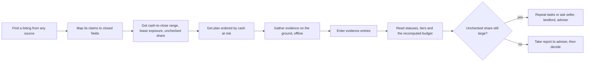
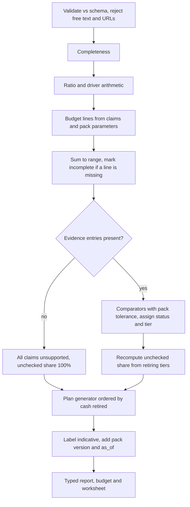
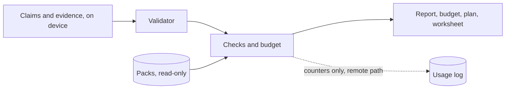
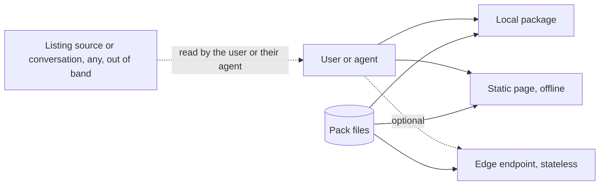

# SME Business-Pack Service — Takeover Cash-to-Close Check (Buyer Side)
## Document Control
Join key: `sme-business-pack@0.9.4`. PRD, TAD, ADR, MVP and GTM are addressable here, with the evidence register and open findings at the end. **Clean slate**: rewritten from one wedge. Version 0.7.0 is consumed only for document conventions and for observations carried into the [Evidence register](#evidence-register) (marked *carried*); every fact carries its own source join (S-ids).

- **Revision 0.8.0** (2026-10-27): rewritten around one buyer-side offer, **the takeover cash-to-close check**: before an offer on a small Singapore F&B outlet, the buyer learns (1) the total cash needed to take over and open, (2) the lease exposure, and (3) how much of that cash rests on claims nobody has checked. The service analyses the buyer's own claims. It does not list, host, introduce, match, route, negotiate, reveal contacts, value, hold funds or charge anything tied to a deal (green zone, ADR-007). Introduces PP-01..PP-05, US-01..US-13, VCC-01..VCC-19, ADR-001..ADR-009, HG-01..HG-07, VH-01..VH-05, A01..A12, F-01..F-11, S-01..S-16.
- **Revision 0.9.0** (2026-10-31): adds a gated, fixed-row comparison of two or three buyer-entered claim sets in the existing SME workspace; it reuses the same pack and evaluator and does not rank or recommend. Adds PP-06, US-14..US-15, VCC-20..VCC-25, ADR-010, VH-06, F-12, S-17. **Revision 0.9.1** (2026-10-31): merges the Singapore cash-to-close integration plan and local candidate evidence; reserves VCC-20..VCC-23 for shell identity, surface parity, Singapore-only discovery and legacy compatibility, and renumbers comparison VCCs to VCC-24..VCC-29. Adds S-18. **Revision 0.9.2** (2026-10-31): records the user-authorized VH-06 build-gate waiver for an unreleased local comparison candidate; adds bounded per-slot closed-vocabulary evidence entry; VH-06 remains unvalidated, and the waiver grants no pilot, publication, integration or deployment authority. Updates S-18 with the shared local stdio adapter, printable worksheet and v18 candidate receipts; VH-06 validation remains open and no VCC is accepted.
- **Revision 0.9.3** (2026-11-04): makes comparison a single native Agentic Base Multi-dimensional Table in the existing SME result area. A leading Option dimension labels A/B/C in entry order; fixed report rows follow, and Base's pivot keeps those labels visible in both orientations. It reuses the Commerce-pinned offline Base browser adapter and the generated Commerce theme tokens sourced from Agentic Design System. The evaluator, claim inputs, evidence, pack and route remain their existing owners; no second renderer, summary variant, external data source or runtime dependency is introduced. Adds VCC-30 and updates ADR-010, TAD and shared-utility traceability. Local browser verification is candidate evidence only; evaluator acceptance, buyer validation and release authority remain open.
- **Revision 0.9.4** (2026-11-04): makes `pack.protocol.claim_kinds` the sole current workflow field collection and removes the unrelated legacy field list from that response. The neutral bounded tool envelope no longer embeds the active pack ID, currency or field names; pack identity and values resolve through the explicit registry. The E2E input workflow is one Base Multi-dimensional Table with claim sets as rows and every protocol field as a column, with unknowns and evidence counts retained. Adds one codebook/data dictionary, a workflow-table criterion (VCC-31), and updates ADR-003, ADR-010 and the pack/tool traceability. The runtime still enables only one provisional localized pack; reusable schema does not imply additional reviewed packs. Local verification remains candidate evidence until checks, independent acceptance, buyer validation and release gates pass.
- **Changed from 0.7.0**: the money question becomes the product (budget engine, lease exposure, unchecked share); the plan is ordered by cash at risk; pilot narrows to Singapore F&B (`sg.fnb.takeover`), Malaysia follows after its own legal review (R3); land-bearing packs leave this document; seller and adviser exports become gated later stories; the teaser, stealth and pay-to-reveal ideas are parked behind a legal gate (ADR-008).
- **Status**: draft, **not baselinable** (see [Findings](#findings-and-open-items)). Rungs stay `undocumented`. Alignment cycles used: 0 of 3.
- **Neutrality**: shared identity, field, currency, validation, table and tool-envelope contracts are pack-driven and do not assume a locale, sector, field key or currency. The current commercial pilot remains deliberately narrower: one provisional localized pack and a task-specific cash-to-close evaluator. `agentic-commerce-os` is the target host and code-evidence source only. No external asset, service or package is a build or runtime dependency. **The product itself never searches or fetches**.
- **Limitation**: companion guideline modules (templates, verification, readiness, diagram, venture, maturity, lean-startup) were not supplied; their joins follow the index text and are `source=unverified` (F-07).
- **Vocabulary**: pain status `unvalidated` | `demand-proven`; `H` = hypothesis target; `source=unverified` = not checked against a primary source; **claim** = a closed-field assertion about the takeover, taken from any listing source or conversation; **evidence entry** = a closed-field observation or document sighting gathered by a person offline; **provenance** = how an evidence entry was obtained; **tier** = evidence strength T0..T3 (Evidence model); **line** = one cash item in the budget; **retiring tier** = the tier at which a claim counts as checked for its line; **unchecked share** = the share of the planned cash whose lines still rest on claims below their retiring tier (a plain ratio, not a score); **status** = `discrepancy`, `conflicting_evidence`, `no_discrepancy_found` or `unsupported`; **protocol** = reviewer-approved tasks that gather evidence for one claim kind; **plan** = protocol tasks selected and ordered for one claim set.
- **Not advice**: every output is information, never legal, tax, valuation, financing or licensing advice, and never an opinion on whether a price is fair.
### Scope declaration
| | Statement |
|---|---|
| Vision | An agent-callable, offline-capable, zero-spend service that tells a first-time buyer, before an offer, what a small F&B takeover will really cost in cash, what the lease commits them to, and which parts of that cash rest on unchecked claims, then plans the ground checks that retire the largest unchecked amounts first |
| Pitch | **Know your real cash to close, and how much of it nobody has checked.** Works on a listing from any source; needs none of their data |
| Pack | An allowlisted, versioned declaration of identity, currency, claim fields, budget lines, parameters, ratios, evidence protocols and tolerances. Each addition has its own `as_of`, sources and review state; the current runtime enables one provisional pack. The shared codebook and data dictionary is `agentic-commerce-os/docs/sme-business-pack-codebook-and-data-dictionary.md`. |
| Target host | Reuse the existing `agentic-commerce-os` SME route, its pinned `agentic-base` browser adapter and `agentic-design-system` Commerce tokens; the table renderer and UI tokens remain shared owners, while Commerce owns pack data and lifecycle. S-17 and S-19 record source pins and boundaries. |
| Pilot launch | `sg.fnb.takeover` (Singapore): takeovers of F&B units (cafe, restaurant, coffee-shop or hawker stall) with or without a lease transfer |
| Later | `my.fnb.takeover` (R3, after its own legal review, HG-07); retail packs on demand evidence |
| Evidence rule | Human-gathered and offline: site observation, measurement on foot, documents sighted, written confirmation from a third party. No web search, fetching, scraping or third-party data lookup exists in the service (ADR-004) |
| Green-zone rule | The service analyses the user's own claims and plans the user's own checks. It never introduces, matches, relays, negotiates, hosts, publishes or reveals counterparties; never charges a fee tied to a deal or an introduction; never values, advises or holds funds (ADR-007, VCC-10) |
| 0 (opportunity) | Listings show asking price and sometimes rent or sales; the cash to take over and open is spread across deposits, fit-out and equipment, legal and licence costs, reinstatement and working capital, and the lease commitment is not shown as a number (S-01..S-05). Uncertainty: whether first-time buyers recognise the gap and will pay to close it |
| 1 (target outcome) | One Singapore F&B takeover buyer or adviser pays for an evidence pack or adviser seat, collected, within 60 days of first deploy. Evidence: payment record. Observation: 60 days |
| Won't (this increment) | a directory, marketplace, showcase, teaser, stealth listing or pay-to-reveal feature; hosting or republishing listing text; introductions, matching, contact reveals or message relay; negotiation or any act for a counterparty; fees contingent on a deal or tied to an introduction; sponsored slots; crawling, scraping, web search, URL fetching or third-party data lookup; map, traffic or open-data layers; valuation or price-fairness opinions; legal, tax or financing advice; escrow, deposits or fund-holding; land-bearing packs; China and other Southeast Asian packs; accounting, P&L or payments composition; credential custody; composite scores, sorting, ranking, recommendations or a winner; verdict wording about a listing or a person; storing claims, evidence, images, names, contacts or personal data |

Delivery, first collected dollar and repeat demand each need separate evidence — `blended-status`.
## PRD
### Problem and pain-point mapping
Every pain is `unvalidated` until interviews or payments exist (F-01). Ranked by hypothesised pain × willingness to pay: the buyer carries the cash risk; the adviser repeats the work; the seller's interest is secondary and gated.

| ID | Pain | Who | Today's workaround | Our response |
|---|---|---|---|---|
| PP-01 | The cash needed to take over and open is not stated anywhere: asking price and rent are shown, while fit-out and equipment, deposits, reinstatement, legal and licence costs and opening working capital are not | First-time buyer of a cafe, restaurant or stall | Own spreadsheet, adviser hours, generic checklists (S-05) | A budget engine: claims in, cash-to-close range and the gap above the asking price out |
| PP-02 | The lease is a multi-year commitment that listings do not total, and assignability, landlord consent, remaining term and reinstatement are unchecked | Same buyer | Verbal assurance, lawyer review late in the process | Lease-exposure line (remaining months × rent, with reinstatement) and a landlord written-confirmation task |
| PP-03 | The buyer cannot tell which claims have been checked or how much cash depends on the ones that have not; a portal's "Verified" stamp concerns the listing, not the claims (S-04) | Same buyer | Trust, gut feel | Evidence tiers per claim and the **unchecked share** of the planned cash |
| PP-04 | The buyer does not know what to check first, in what order or with what sampling | Same buyer | Own judgment; consultant feasibility spend (S-05, S-06) | A plan ordered by cash at risk, with a printable worksheet |
| PP-05 | Advisers repeat the same budget and diligence questions by hand deal after deal, and honest sellers cannot show what supports their claims | Fit-out contractor, F&B consultant, accountant; seller | Own checklists; verbal assurances | Same protocol and exports under the adviser's name; a summary the seller shares themselves (Could, R2, gated) |
| PP-06 | A buyer cannot compare two or three takeover options on consistent cash, lease and evidence rows | First-time buyer considering multiple outlets | Separate notes and inconsistent spreadsheets | Compare buyer-entered claim sets against the same pack and evaluator, with unknowns visible and no winner (Should; local unreleased build authorized while VH-06 stays unvalidated) |

PP-05 backs Could stories only, so no feature exists without a named pain (`pain-pointless-feature`).
### User stories (MoSCoW)
| ID | Story | Priority | Pain |
|---|---|---|---|
| US-01 | As a buyer, adviser or agent, I list the packs and see the required fields, budget lines, claim kinds and evidence protocol for the right country and asset | Must | PP-01 |
| US-02 | As a buyer, I submit a closed-field claim set from any listing source or conversation and receive missing fields and arithmetic flags | Must | PP-01 |
| US-03 | As a buyer, I receive the cash-to-close range, the gap above the asking price, the opening runway and the lease exposure, each with its lines | Must | PP-01, PP-02 |
| US-04 | As a buyer, I see the unchecked share and which lines rest on unchecked claims | Must | PP-03 |
| US-05 | As a buyer, I receive a plan that orders the ground tasks and documents to request by the cash each would retire, as a worksheet I can print or fill offline | Must | PP-04 |
| US-06 | As a buyer, I enter what I gathered and receive per-claim statuses with tiers, and the budget and unchecked share recomputed | Must | PP-03, PP-04 |
| US-07 | As a buyer, I receive a transfer checklist, only from a reviewed pack | Should | PP-02, PP-04 |
| US-08 | As a non-agent user, I run the same checks in a browser page that works offline and sends nothing | Should | PP-04 |
| US-09 | As an agent, I call the tools on any surface and get identical typed results at zero token cost | Should | PP-01 |
| US-10 | As a bilingual user, I read the same record in en or zh (ms with the Malaysia pack) | Should | PP-01 |
| US-11 | As an adviser, I run the protocol on a client's deal and export the result under my own name, labelled | Could (R2) | PP-05 |
| US-12 | As a seller, I generate a summary of which of my claims have evidence at which tier, and share it myself; the service does not publish, route or reveal it | Could (R2, after HG-07) | PP-05 |
| US-13 | A directory, showcase, teaser, stealth listing, pay-to-reveal, introduction, matching, contact reveal, success fee, scraping, web search, score, ranking, recommendation, winner, valuation or price opinion, escrow, or legal advice | Won't (this increment) | — |
| US-14 | As a buyer, I compare exactly two or three claim sets with the same pack, version and currency in one Base Multi-dimensional Table; optionally attach closed evidence to each set; missing data stays visibly unknown | Should (local candidate only; no buyer validation) | PP-06 |
| US-15 | As a buyer on mobile or offline, I enter every protocol field in one pack-driven workflow table with claim sets as rows and fields as columns, then read the computed comparison in the existing SME workspace; inputs stay in memory and clear when I leave the route | Should (local candidate only; no buyer validation) | PP-06 |

PRD stops at criteria; implementation is in [TAD](#tad).
### Success metrics
Every user-facing feature carries a TTV row (`missing-economics-metric`).

| Metric | Target `H` | Check |
|---|---|---|
| **TTV F1** (budget check): connect to first report, clean environment | ≤ 5 min | VCC-14 |
| **TTV F2** (plan): first report to worksheet | ≤ 2 min | VCC-15 |
| **TTV F3** (evidence): worksheet entries to recomputed budget | ≤ 3 min | VCC-07 |
| **TTV F4** (reviewed checklist) and **TTV F5** (comparison): first report to checklist or fixed-row table | ≤ 2 min each | VCC-13, VCC-24, VCC-28, VCC-30 |
| Mapping: pilot users who turn a listing into a claim set unaided | ≥ [60]% | VH-04 |
| Field effort: protocol completed on site by a practitioner | ≤ [3] h | VH-04 |
| Pain recognition: buyers who describe a past takeover where the cash needed exceeded the advertised price materially | ≥ 5 of 10 | VH-01 |
| Willingness to pay: buyers who pre-commit after seeing the free output; advisers who pre-commit | ≥ 3 of 10; ≥ 2 of 10 | VH-02, VH-03 |
| Server-side inference tokens per check | 0 | VCC-01 |

### Verifiable Completion Conditions
The Evaluator is a mechanism separate from the implementer and from every work tree or agent it judges. No VCC is satisfied; each needs an Evidence Reference (invocable check, recorded result, surface).

| VCC | End state | Check | Constraints | Status |
|---|---|---|---|---|
| VCC-01 | `pack.list`, `pack.protocol`, `takeover.budget` and `takeover.plan` consume 0 inference tokens and return pack id, version, `as_of`, `review_status` | invocation log | no server-side model | unsatisfied |
| VCC-02 | `takeover.check` and `takeover.budget` return typed reports in ≤ 2 s p95 on [30] labelled fixtures | fixture suite | zero spend | unsatisfied |
| VCC-03 | Every omitted required claim in the fixtures is reported (recall 100%) | deterministic diff vs labels | schema pinned | unsatisfied |
| VCC-04 | Every planted arithmetic inconsistency (implied sales vs band, rent share, payroll share, break-even above claimed sales) is flagged; in-range figures raise 0 flags | fixture assertions | parameters from the pack only | candidate evidence covers the pack-defined rent-to-sales bound and break-even arithmetic; payroll-share rule absent pending HG-02; unsatisfied |
| VCC-05 | **Budget integrity**: the lines sum exactly to the total on every fixture; low ≤ high; an independent re-implementation in C-EVAL matches the engine to the dollar on [30] fixtures; a missing required line yields `incomplete` and a range, never a zero | oracle comparison | ADR-002, ADR-006 | unsatisfied |
| VCC-06 | **Unchecked share**: 100% with no evidence; computed only from lines and retiring tiers; never rises when retiring evidence is added; shown with the lines behind it | fixture suite, monotonicity test | ADR-006 | unsatisfied |
| VCC-07 | Planted discrepancies and conflicts between claims and evidence are all reported (recall 100%); within-tolerance evidence raises 0 discrepancies; a claim with only T0 evidence returns `unsupported`, never `no_discrepancy_found`; the budget recomputes after entries | fixture suite | ADR-004, ADR-006 | unsatisfied |
| VCC-08 | Every report carries "indicative, not verified", pack version, `as_of` and claim counts by tier, including reports with no flag; no composite score, no verdict word and no price-opinion word (for example "fair", "overpriced", "good deal") appears in any output string; documents are labelled "sighted, not authenticated" | wording lint over all outputs | ADR-006 | unsatisfied |
| VCC-09 | Claims and evidence validate against closed vocabularies and numeric bounds; unknown fields are dropped; free text, images, names, addresses, contacts and any URL are rejected: [20] negative fixtures | schema and negative fixtures | ADR-004, ADR-005 | unsatisfied |
| VCC-10 | **Green zone**: no route, field or output string introduces, matches, relays or discloses a counterparty; no field accepts a counterparty's name or contact; no field or flow carries a fee tied to a deal or an introduction | static scan and negative fixtures | ADR-007 | unsatisfied |
| VCC-11 | The local package and the static page complete a full check with 0 network requests; no code path fetches a URL, uses credentials or drives a browser | static scan, egress test | ADR-001, ADR-004 | unsatisfied |
| VCC-12 | No claim, evidence or worksheet content persists on any service surface; counters only in logs | storage and log audit | no accounts | unsatisfied |
| VCC-13 | A pack not `reviewed` returns only completeness, arithmetic and raw differences, with no budget parameters presented as reviewed, no tolerance and no checklist; a pack mismatch is flagged | negative fixtures | gate in C-ENDPOINT | unsatisfied |
| VCC-14 | First report ≤ 5 min from a clean environment | timed run | guest client, no account | unsatisfied |
| VCC-15 | A worksheet exported as Markdown, CSV or JSON re-imports to the identical claim and evidence set (0 lost rows, 0 column drift); the printable worksheet is ≤ [4] pages | round-trip fixtures | one schema | unsatisfied |
| VCC-16 | [3] practitioners run the worksheet on real or mock outlets: ≥ [80]% of tasks completed unaided and median effort within ±[30]% of the estimate | pilot record | HG-06 | unsatisfied |
| VCC-17 | One query fixture returns identical typed results from the local, static-page and remote surfaces; the in-page surface matches where the browser supports it | parity fixtures | adapters generated from C-SCHEMA | unsatisfied |
| VCC-18 | [20] mixed-language fixtures (en, zh) map to the same enums; unmappable values become `unknown` | fixture suite | closed vocabulary | unsatisfied |
| VCC-19 | Simulated [200] remote checks/day stay ≥ [30]% under the runtime's free quota | load script vs current quota | quota re-verified at run date (HG-05) | unsatisfied |
| VCC-20 | Opening `#sme` keeps the existing Commerce document and shell mounted while only the SME workspace slot changes | browser shell-identity check | no second page, router or shell | unsatisfied |
| VCC-21 | Local, WebMCP and optional Worker/MCP calls return the same typed result for identical inputs; local check and budget work offline with zero service requests | cross-surface fixtures and offline browser check | all adapters call one core; no claim/evidence persistence | unsatisfied |
| VCC-22 | All discovery and tool surfaces expose only registry-enabled packs; unregistered IDs fail closed, and every additional pack requires its own data and review gates | REST, MCP, WebMCP and negative fixtures | explicit registry; no cross-pack inference | unsatisfied |
| VCC-23 | Existing `pack.required_fields` and `takeover.check_listing` clients receive a parity-tested adapter over the shared core or keep their current contract until migration is reviewed | pinned-client inventory and compatibility fixtures | no duplicate calculations or silent breaking change | unsatisfied |
| VCC-24 | `takeover.compare_claim_sets` accepts exactly 2 or 3 buyer-entered claim sets and returns the same deterministic report for each as an individual check on [30] labelled fixtures | oracle and parity fixtures | same pack evaluator; no inference | unsatisfied |
| VCC-25 | Comparison uses fixed slot order A/B/C and fixed report-row order; unknowns remain explicit; no sort, weight, score, recommendation, rank or winner is emitted | schema, wording and render checks | ADR-010 | unsatisfied |
| VCC-26 | Mixed pack id, pack version or currency is rejected before evaluation; all reports carry the common pack id, version and `as_of` | negative fixtures | no cross-pack conversion | unsatisfied |
| VCC-27 | Comparison accepts no free text, candidate name, URL, contact or address; content is memory-only and clears on leaving the SME route | negative fixtures, storage audit | no persistence or network fetch | unsatisfied |
| VCC-28 | Comparison opens within the existing SME workspace on direct entry, mobile, offline and back/forward navigation; cancelled or late results cannot replace the active route | browser route and race checks | reuse current shell and lazy SME module | unsatisfied |
| VCC-29 | F5 local comparison completes ≤ 2 s; request ≤ 32 KB and response ≤ 64 KB if the existing service adapter is used; 0 inference, 0 new modules/dependencies, ≤ 3 existing feature modules changed, each emitted chunk < 500 KB | bounded local and adapter checks | $0 cap; fail closed on quota or size | unsatisfied |
| VCC-30 | The existing SME result area renders exactly one comparison surface through the pinned Base browser adapter with `layout: multiDimensional`; the leading Option dimension labels A/B/C in entry order, fixed cash/lease/evidence rows follow unchanged, two-set comparisons show C as not supplied, and Base pivot preserves labels and values. At 360 and 1280 CSS px the table is reachable by keyboard and touch, page-level horizontal overflow is zero, Commerce theme tokens map into Base slots, and comparison makes no service request. No second cards/table renderer or duplicate summary appears. | live browser at 360/1280 px; pivot and value parity assertions; zero-request capture; source/token pin inspection | Agentic Base owns the grid; Commerce owns data and lifecycle; Agentic Design System remains the token source | unsatisfied |
| VCC-31 | The E2E input workflow has exactly one Base `multiDimensional` table. Its columns are `Claim set` plus every declared `pack.protocol.claim_kinds` field in protocol order; its rows are the active A/B/C sets in entry order. Blank fields remain visibly unknown, field values and evidence counts derive from the same in-memory records as the editor, and the canonical orientation keeps fields in columns. No duplicate input table, step-card workflow or alternate field renderer exists. At 360 and 1280 CSS px the table is reachable by keyboard and touch, page-level horizontal overflow is zero, and no SME service request occurs. | live browser; protocol-to-column parity; row-edit parity; route, mobile and offline checks; zero-request capture; owner-pin inspection | Agentic Base owns the grid; Commerce owns pack data and lifecycle; Agentic Design System remains the token source | unsatisfied |
### Traceability
`PRD-[Epic]-[Story] ↔ TAD-[Component]-[Interface] ↔ VCC ↔ Evidence Reference` — closes in both directions; refinement bounded at 3 cycles.

| PRD | TAD | VCC | Evidence Reference |
|---|---|---|---|
| PRD-Packs-US-01 | TAD-C-ENDPOINT-pack.list, -pack.protocol | VCC-01 | none yet (invocation log) |
| PRD-Check-US-02 | TAD-C-CHECKS-takeover.check | VCC-02..04, VCC-08, VCC-09 | none yet (fixture suite) |
| PRD-Budget-US-03, US-04 | TAD-C-CHECKS-takeover.budget | VCC-01, VCC-05, VCC-06, VCC-08 | none yet (oracle, fixtures) |
| PRD-Plan-US-05 | TAD-C-CHECKS-takeover.plan; C-UI worksheet | VCC-01, VCC-15, VCC-16 | none yet |
| PRD-Evidence-US-06 | TAD-C-CHECKS (comparators, recompute) | VCC-06, VCC-07 | none yet |
| PRD-Check-US-07 | TAD-C-ENDPOINT-takeover.transfer_checklist | VCC-13 | none yet (negative fixtures) |
| PRD-Check-US-08 | TAD-C-UI, C-LOCAL; ADR-009 integration | VCC-11, VCC-14, VCC-15, VCC-20..VCC-23 | S-18 local candidate; evaluator acceptance pending |
| PRD-Check-US-09, US-10 | TAD-C-SCHEMA adapters; C-PACKS glossary | VCC-17, VCC-18, VCC-19 | none yet |
| PRD-Adviser-US-11, PRD-Seller-US-12 | TAD-C-UI exports; C-CHECKS | VCC-07, VCC-08, VCC-10, VCC-15 | none yet; R2 only, US-12 after HG-07 |
| PRD-Boundary-US-13 | TAD-C-EVAL scans | VCC-10, VCC-11 | none yet |
| PRD-Compare-US-14, US-15 | TAD-C-CHECKS-compare; existing Commerce SME route; Base Multi-dimensional Tables and Commerce theme tokens | VCC-24..VCC-31 | S-18 local candidate, S-19 shared-source pins, S-20 prior local candidate, S-21 current successor candidate; independent acceptance and VH-06 validation remain open |
## TAD
### Component inventory and division of work
One owner per capability — `duplicate-capability-owner`. Reuse decision per component — `component-origin-unstated`.

| Component | Capability owned | Origin | Note |
|---|---|---|---|
| C-SCHEMA | Generic bounded request envelope; pack-resolved claim, evidence, budget, report and comparison validation | extend existing contracts | pure, browser-safe, no secrets; pack IDs resolve through one explicit registry; comparison slots are A/B/C only |
| C-PACKS | Versioned pack data: required fields, budget lines and parameters, claim kinds, evidence protocols with retiring tiers, tolerances, ratio parameters, red flags, checklists, glossary (en, zh) per jurisdiction × asset family | new (content) | each pack declares `pack_id`, `version`, `as_of`, `sources[]`, `review_status`, `reviewer`; parameters, not constants |
| C-CHECKS | Rule evaluator: completeness, ratio and driver arithmetic, **budget engine**, claim-vs-evidence comparators, unchecked-share computation, plan generator and fixed-row comparison assembly | extend existing SME core in `agentic-commerce-os` | pure and offline; compare outputs from the same evaluator; no ranking logic |
| C-LOCAL | Offline stdio MCP package serving the same seven canonical tools | 23-line adapter over the existing pinned MCP SDK 1.30.0 | shared evaluator; no network or input persistence |
| C-ENDPOINT | Optional stateless routes, input validation, budgets and review-status gate | extend `src/local-first/sme-business-pack.ts` | reuse current MCP/API handler, 32 KB/64 KB/2 s bounds and tool descriptor owner |
| C-UI | Claim form, budget view, worksheet, export/import, print view and comparison | reuse `agentic-commerce-os` SME route; render comparison through its pinned `agentic-base` Multi-dimensional Table adapter and existing `agentic-design-system` Commerce tokens | one comparison renderer; fixed rows and slot order; text-only temporary A4 print view; `afterprint` cleanup; inputs stay local |
| C-EVAL | Fixtures, budget oracle (independent re-implementation), wording lint, green-zone scan, egress and static scans | new | held outside the implementer lane |
| C-LEDGER | Usage counters only | new | no content; no second ledger |

### Flows
Notation: Mermaid (`source=unverified` against Diagram Guidelines; class and canvas-projection check names unresolved — F-07). Features: **F1 Budget Check** (`takeover.check` + `takeover.budget`; Must), **F2 Plan and Worksheet** (`takeover.plan`; Must), **F3 Evidence Re-run** (Must), **F4 Transfer Checklist** (Should), **F5 Comparison** (`takeover.compare_claim_sets`; local unreleased candidate under the user-authorized VH-06 build-gate waiver; validation and core report VCCs remain open).

**D-01 Journey** (F1–F3)


**D-02 Workflow** (check and budget)


**D-03 Data flow**


**D-04 Topology**

**D-05 Comparison (F5)**: accept two or three options, each with pack id/version/currency, closed claims and optional closed evidence → reject any identity mismatch before evaluation → run each through the same evaluator → project the leading Option dimension and fixed report rows into the existing Base Multi-dimensional Table, with A/B/C in entry order, explicit unknowns and a Base-owned pivot between options-as-columns and options-as-rows. Evidence stays slot-specific and in memory. The SME route owns no competing comparison cards, table or duplicate summary; it does not sort, rank or select a winner. The user waived VH-06 as a build gate for the local unreleased candidate on 2026-10-31; no interviews or paper-prototype results exist, so demand and neutral interpretation remain unvalidated.

### Budget model
All amounts are whole currency units (SGD in the pilot). Each line is a range `[low, high]`: a number the user enters gives `low = high`; a band code gives the band's bounds; a pack parameter gives the parameter's reviewed range. Every parameter carries `as_of`, source and `review_status`. A user may override a parameter with their own quote, which then counts as T0 (stated) or T2 (document sighted).

| Line | Source | Retiring tier |
|---|---|---|
| L1 Takeover price (consideration for the business) | claim `price` | T2 (written offer or agreement terms sighted) |
| L2 Equipment and fit-out purchase | claim `equipment_included`, `equipment_price`; else pack parameter, marked incomplete | T1 (inventory counted on site) |
| L3 Landlord deposit | claim `deposit_months` × monthly rent; else pack parameter | T2 (lease or deposit receipt sighted) |
| L4 Utilities and other deposits | pack parameter | T2 |
| L5 Transfer, legal, licence and registration costs | pack parameter, reviewed | T2 (quote sighted) |
| L6 Immediate repairs and reinstatement provision | pack parameter by fit-out age and handover condition | T1 (condition observed) |
| L7 Opening working capital | `runway_months` (buyer-set, default `[3]`) × monthly fixed cost | T3 for rent, T2 for payroll, per component |

Derived: **monthly fixed cost** = rent + payroll (staff-count band × wage parameter) + utilities parameter. **Break-even monthly sales** = monthly fixed cost ÷ (1 − variable-cost share parameter). **Cash to close** = L1 + L2 + L3 + L4 + L5 + L6 + L7. **Gap above asking price** = cash to close − L1. **Lease exposure** = remaining lease months × monthly rent, shown beside the reinstatement provision. **Opening runway** = working capital ÷ monthly shortfall, where shortfall = fixed cost − contribution at claimed sales; shown only when claimed sales are present, otherwise "not computable".

**Unchecked share** = Σ(midpoint of lines whose claim is below its retiring tier) ÷ Σ(midpoint of all lines), shown with the lines behind it. It is a plain ratio of cash, not a score: it makes no statement about any person or listing and has no threshold. Reports always show the cash-to-close range first and the unchecked share second.

### Green-zone boundary
The service performs analysis for the person using it. The Singapore Estate Agents Act defines estate agency work as work for a client, in the course of business or for a fee, that introduces a third person who wishes to acquire or dispose of a property or that negotiates such an acquisition or disposition; property includes interests in land and "lease" includes subleases and tenancies (S-11). Licensing of agents covers residential, commercial and industrial property (S-12), and acting without a licence is an offence (S-11). A takeover that transfers a lease may therefore engage that regime if the service introduces or negotiates. The boundary below keeps the service on the analysis side; it is a design position for counsel to confirm (HG-07), not a legal conclusion.

| Boundary | Rule | Check |
|---|---|---|
| Introduction and matching | no route, field or output introduces, matches, ranks or recommends a counterparty | VCC-10 |
| Contact and identity | no counterparty name, contact or address is accepted, stored, revealed or relayed | VCC-09, VCC-10 |
| Negotiation | no message drafting, relay or act for a counterparty; outputs are the user's own questions and worksheets | VCC-10 |
| Fees | charged only for software access or an evidence pack; never contingent on a deal, never tied to an introduction, never a commission or referral flowing from a counterparty | VCC-10, HG-03 |
| Listings | the service does not host, publish, mirror or republish listings; the source is an enum | VCC-09 |
| Valuation and price opinion | none; the budget is arithmetic on stated claims and parameters, and wording is linted | VCC-08 |
| Legal, tax, financing advice | none; lease and licence items are raised as questions for a qualified adviser | VCC-08 |
| Funds | none held, escrowed or routed | VCC-10 |
| Personal data | none stored; observation tasks use counts and enums only; reviewer sets privacy rules (PDPA scope unresearched) | VCC-12, HG-02 |
| Malaysia | separate legal review of Act 242 and board guidance before `my.fnb.takeover`; this document makes no claim about it (S-14) | HG-07 |

### Invocation Register
One register for every route. Tool discovery grants no mutation authority; every route is read-only or compute-only. No command-token or alias is bound in the MVP — `orphan-route`, `ambiguous-route`.

| Capability identity | Agent-tool (local, remote) | In-page tool (if supported) | Browser | Mode | Owner |
|---|---|---|---|---|---|
| `pack.list` | yes | yes | yes | read-only, 0 tokens | C-ENDPOINT, C-LOCAL |
| `pack.protocol` | yes | yes | yes | read-only, 0 tokens: required fields, budget lines, parameters, claim kinds, tasks, tolerances | C-ENDPOINT, C-LOCAL |
| `takeover.check` | yes | yes | yes | compute-only: claims and optional evidence in, completeness, flags and statuses out | C-CHECKS |
| `takeover.budget` | yes | yes | yes | compute-only: claims and optional evidence in, cash-to-close range, gap, lease exposure, runway and unchecked share out | C-CHECKS |
| `takeover.plan` | yes | yes | yes | compute-only: tasks ordered by cash retired; worksheet out (Markdown, CSV, JSON); C-UI renders A4 print view (≤4 pages) | C-CHECKS, C-UI |
| `takeover.compare_claim_sets` | yes | yes | yes | compute-only: 2–3 compatible buyer-entered sets in, fixed-row reports out; no ranking or recommendation | C-CHECKS |
| `takeover.transfer_checklist` | yes | yes | yes | read-only, review-gated | C-ENDPOINT, C-LOCAL |

### Agent-native surfaces, one schema
C-SCHEMA is the sole schema owner; every adapter is generated from it, never hand-written (`duplicate-owner`).

| Surface | Serves | Network use | Status |
|---|---|---|---|
| Local package (stdio) | agent hosts, offline users | 0 requests | baseline, primary |
| Static files: pack data, worksheet templates, API description, `llms.txt` | any client or agent | 0 outbound from the service | baseline |
| Static page (single file) | people | 0 requests after load | baseline |
| Remote agent-tool server (stateless edge function) | hosts without a local package | 1 per call `H` | optional, hard-capped |
| In-page tools | in-browser agents | 0 | optional: draft standard with limited support (S-16); feature-detect first; never required |

Rules: same capability identities and typed outputs on every surface (VCC-17); default response ≤ 64 KB with pack version, `as_of` and provenance; fields come from closed vocabularies, so no free text reaches an agent as instructions. Comparison preserves A/B/C input order and the common fixed report rows. The client agent that maps a listing into claims does so on the user's side; its inference is outside this service's COGS (ADR-002, ADR-005).

### Evidence model
Evidence is what a person on the ground collects. The service never collects it and never authenticates it.

| Tier | Provenance values | Meaning | Counts toward `no_discrepancy_found`? |
|---|---|---|---|
| T0 | `seller_stated`, `buyer_assumed` | the claim itself, or the buyer's own assumption | no |
| T1 | `observed_on_site`, `measured_on_foot`, `counted_on_site` | one person saw, counted or measured it | yes, if the protocol's coverage rule is met |
| T2 | `document_sighted` | a document was seen, not authenticated | yes |
| T3 | `third_party_confirmed` | written confirmation from the landlord, an accountant, an authority or a supplier | yes |

Rules: a claim's status uses its independent entries (T1 and above). Entries within tolerance give `no_discrepancy_found`; outside tolerance give `discrepancy`; independent entries that disagree give `conflicting_evidence`; none give `unsupported`. A claim counts as checked for its budget line only at or above that line's retiring tier. The report counts claims by highest tier reached and never sums them into a number. Protocols carry a coverage rule (for customer counts: at least `[3]` windows including a weekday peak, a weekday off-peak and a weekend window), so one staged hour cannot clear a claim. Observer role (`buyer`, `adviser`, `field_checker`) is recorded; observer bias and seasonality are stated limits, not corrected.

### Quality, security and AI
| Case | Mitigation | Check |
|---|---|---|
| Oversized or malformed input | schema validation, byte cap `[32 KB]`, numeric bounds, timeouts | VCC-02, VCC-09 |
| Instructions hidden in pasted text steering the client agent | closed fields only; free text rejected; output returns user values as escaped data | VCC-09 |
| A low cash-to-close or "no flags" read as safe | range shown first, `incomplete` marking, unchecked share beside it, mandatory "indicative, not verified" label, unsupported claims counted | VCC-05, VCC-06, VCC-08 |
| Budget parameters stale or invented | `as_of`, sources, `review_status`; stale after `[180]` days flagged; unreviewed packs show arithmetic on user inputs only | VCC-13 |
| Output read as a price opinion or advice | no valuation or fairness wording; lint | VCC-08 |
| Output read as an accusation | statuses name claims, never persons; lint | VCC-08 |
| A staged week, observer effect or seasonality | coverage rule per protocol; tiers; T3 tasks (written landlord or accountant confirmation) | VCC-07, VCC-16 |
| A sighted document treated as authentic | label "sighted, not authenticated" | VCC-08 |
| Observation captures personal data | counts and enums only; no images, names or free text | VCC-09, HG-02 |
| Online evidence creeps in | no fetch code path; URL-bearing input rejected | VCC-09, VCC-11 |
| Drift toward introductions or deal-linked fees | green-zone scan in C-EVAL; HG-07 before any new module | VCC-10 |
| An impractical or unsafe protocol task (for example entering premises uninvited) | tasks limited to public vantage points or seller-consented access; reviewer approves every task | HG-02, HG-06, VCC-16 |
| Persistence of listing or evidence content | no storage; counters only | VCC-12 |
| A comparison looks like endorsement or mixes incompatible offers | neutral A/B/C slots, fixed rows, unknowns shown; reject pack/version/currency mismatch | VCC-25, VCC-26 |
| Quota exhaustion or abuse (remote) | per-client rate cap; breaker; fall back to local package | VCC-19 |

**AI components**: none server-side (ADR-002). Any future AI component needs typed input, typed output, an emitted cost log and a stated fallback. Every agentic loop is bounded: session cap 10 tool calls, per-call wall clock 10 s, breaker after 3 consecutive errors — `unbounded-loop`.

| Feature | Server inference tokens | Max response | Session ceilings |
|---|---|---|---|
| F1 Budget Check | 0 | 64 KB (≈ `[3k]` tokens typical `H`) | 10 calls, 10 s per call |
| F2 Plan and Worksheet | 0 | 64 KB | same |
| F3 Evidence Re-run | 0 | 64 KB | same |
| F4 Transfer Checklist | 0 | 64 KB | same |
| F5 Comparison | 0 | 64 KB | same; reuse the report evaluator |

**TCO per deployment model** (kept separate — `blended-deployment-tco`):

| Model | Operator spend | Operator active time | Limit / risk | Exit |
|---|---|---|---|---|
| Local package and saved static page | 0 | docs and pack releases | user's machine | n/a |
| Optional shared remote endpoint | 0 within free quota (`unverified`, F-06) | monitoring | quota and CPU limits | use local package |
| Self-hosted on the user's own free account | 0 | user setup | user effort | fork and run |

Zero-spend scope: unknown fees, paid infrastructure, paid reviewers and proprietary dependencies cannot silently enter the MVP — `constraint-gate-skipped`. Reviewer cost and budget-parameter sourcing are the main hidden costs (A08, F-10): until reviewers are named, packs stay provisional.

### Data schema and formats (SSOT)
The runtime single source of truth is the active pack module plus the explicit registry in `agentic-commerce-os/public/local-first/sme-business-pack-core.js`. The bounded transport schema validates a neutral request envelope; after resolving a registered pack, the core validates each claim and evidence value against that pack's protocol. No field, locale, currency, or pack identity is copied into a second schema or input table.
```text
public/local-first/sme-pack-{id}.js       versioned pack declarations, loaded only by the explicit registry
public/local-first/sme-business-pack-core.js neutral request envelope, pack resolution and deterministic evaluation
pack.protocol                              canonical field, line, parameter, ratio, protocol and tolerance dictionary
docs/sme-business-pack-codebook-and-data-dictionary.md  code definitions and table contract
test/shared/sme-business-pack.test.ts      evaluator, protocol and transport contract checks
test/local-first/sme-comparison-browser.mjs live table, interaction and mobile/offline verification
```
`pack.protocol.claim_kinds` is the only current workflow field list. `pack.protocol.parameters` and `tolerances` are empty until a reviewed pack declares them; `ratios` lists only pack-authored relations and carries its review flag. Claim values are closed types: pack-bounded whole numbers, enumerated strings, booleans, or money integers/ranges in the pack's declared ISO currency. Evidence keys and values must match the referenced claim field. Unknown and omitted values remain unknown. No URL, free text, name, address, or contact is accepted or stored.

The workflow table derives one column per claim field and one row per entered set. The editor and table read/write the same in-memory claim object. A separate Base table presents calculated result dimensions; it is not a second input workflow. Legacy `pack.required_fields` and `takeover.check_listing` remain a named compatibility surface and are not inputs to the new protocol table.

### Operations and obligations
- **Delivery and support**: solo operator; issues via the source host; no SLA. Incident path: pin back the pack or endpoint to the prior revision.
- **Pack release**: draft pack → sources attached → practitioner pilot (HG-06) → reviewer sign-off (HG-02) → `review_status: reviewed` → publish. Each pack revision is one release with its own rollback pin.
- **Obligations**: information only; no legal, tax, valuation, financing or licensing advice. Open questions for named reviewers, not assertions: whether the analytic-only role stays outside Singapore estate-agency licensing, including for lease-bearing takeovers and for any paid evidence pack (HG-07); whether and how a person may lawfully observe and count customers at an outlet and whether the seller's consent is required; confidentiality owed when documents are sighted; whether `discrepancy` wording about a listing creates defamation or misleading-statement exposure; whether referral fees to legal or accounting professionals are permitted; personal-data rules for any future stored record. Jurisdiction: Singapore (Malaysia at R3). Reviewers: unnamed (F-02).
- **Licences and IP**: no copied listing text or assets; the service stores nothing from any listing.

### Human gates
No silent gate — `human-gate-unstated`.

| Gate | When | Evidence | Rollback |
|---|---|---|---|
| HG-01 operator opens a Deploy Boundary | before any promotion | operator instruction reference | revert to prior protected revision |
| HG-02 qualified reviewer per pack (Singapore F&B practitioner for budget parameters and protocols; Malaysia at R3) approves budget parameters, claim kinds, protocol tasks, retiring tiers, tolerances, checklists, observation and privacy rules, wording and disclaimers | before a pack is marked `reviewed` | signed review record | revert pack to `provisional` |
| HG-03 operator approves payment-mechanism terms | before any collection | recorded fee terms | stop collection |
| HG-04 founder conducts interviews | R0 | quotes on record | none (observation only) |
| HG-05 operator re-verifies free-tier limits and terms | before any hosted route and every `[90]` days | dated record | disable hosted route |
| HG-06 founder runs a practitioner pilot: ≥ 3 practitioners execute the protocol on real or mock outlets | before HG-02 sign-off of any protocol | pilot record: tasks completed, time, errors | protocol reverts to `provisional` |
| HG-07 **legal review** by a qualified Singapore lawyer (and, before R3, a Malaysian one) confirms the green-zone boundary, fee structure and wording; written clarification from the regulator is optional | before any collection, before any seller-facing output (US-12), and before any module parked in ADR-008 | written opinion | stop collection; remove the module |

### Lanes and Deploy Boundary Register
| Lane | Contents | Boundary to next | Gate | Evidence | Rollback | State |
|---|---|---|---|---|---|---|
| authoring | this document, source, packs, fixtures | → mirror | CI pass + zero `blocker` | Integration Receipt | revert to prior SHA | closed |
| mirror | read-only public copy | → delivery | exact protected SHA named | deployment receipt | redeploy rollback predecessor | closed |
| delivery | optional deployed endpoint | — | HG-01 | live identity | prior revision | closed |

No authoring-lane command may mutate a mirror or delivery surface — `deploy-boundary-breach`.

### Ecosystem
| Participant / job | Value exchange / payer | Native owner | Interface / authority | Evidence / gap | Cost, privacy, exit |
|---|---|---|---|---|---|
| Buyer: budget, check claims, plan and gather evidence | free open checks; pays for an evidence pack (hypothesis) | C-CHECKS | local or tool route, compute-only | none / VH-01, VH-02 | no retention |
| Adviser (fit-out contractor, F&B consultant, accountant) | seat or exports (hypothesis) | C-UI exports | same routes, adviser label | none / VH-03 | no client data stored |
| Seller | shares a summary they generate (R2, gated) | C-UI exports | same routes | none / HG-07 | no retention |
| Listing venues (classifieds, marketplaces, portals, brokers) | none; the service reads nothing from them and sends them nothing | external | none; no integration | observed (S-01..S-04, S-08) | untouched |
| Agent host | none | C-LOCAL, C-ENDPOINT | discovery grants no mutation | none / VCC-14 | 0-token read path |
| Qualified reviewers (SG practitioner, SG lawyer) | approve pack content and the boundary | HG-02, HG-07 | review record | gap: unnamed (F-02) | unknown cost (A08) |
| Referral partners (incorporation, accounting, lending) | referral fee (hypothesis) | external | link-out only; never from a counterparty | none / outreach | no data shared |

Coverage here is not certification, availability, revenue or a production claim.

### Shared utilities and reuse
| Candidate | Source / revision | Consumers | Decision | Smallest delta | Check |
|---|---|---|---|---|---|
| Pure schema, checks and budget engine package | this repo | local package, endpoint, browser | `reuse` internally | share by declared export, not sibling imports | VCC-17 |
| Pack registry, generic bounded tool envelope and one protocol per enabled pack | this repo | local package, browser and Worker adapters | `reuse` | validate exact values from the resolved pack; keep the current enabled inventory explicit | protocol and parity fixtures |
| Existing MCP server SDK | `@modelcontextprotocol/sdk@1.30.0`, pinned in this repo | C-LOCAL | `reuse` SDK only; local 23-line stdio adapter delegates to the shared evaluator; no copied harness | installed-version stdio contract checks; SDK licence checked | VCC-11 |
| Existing Base browser data-view artifact | `agentic-commerce-os/config/agentic-base-data-view.json`, pinned to `agentic-base@0cd7602d0b968bf27ecdaee0d8726138bf7997df` | SME workflow and result tables | `reuse` the existing `mountDataView` adapter and `multiDimensional` layout; no React copy, second renderer, or store | project protocol-driven input and closed report values into one table each | VCC-30..VCC-31; artifact manifest and browser parity |
| Existing Commerce design tokens | `agentic-design-system` Commerce profile, generated into Commerce `commerce-theme.css` at pinned source revision | Commerce SME and Base shadow-root host | `reuse` current Commerce tokens and map them to Base theme slots; do not add a competing palette or runtime dependency | pass the existing token variables to Base's eight host slots | VCC-30..VCC-31; token provenance and contrast/focus browser check |

## ADR
### ADR-001 — Local-first, offline-capable delivery with an optional stateless remote (proposed)
Requirements: zero spend, no retention of inputs, usable with no network, solo-operable, agent-callable.

| Candidate | Disposition |
|---|---|
| A. Local package plus static files, with an optional free-tier stateless endpoint | pass |
| B. Hosted service only | fail-offline and fail-no-retention-by-construction |
| C. Static page only | fail-remote-agent-route (kept as baseline surface) |
| D. Paid container hosting | fail-zero-spend |

**Decision**: A. The local package is primary; the remote is optional, hard-capped and fails closed to the local package when quota is reached (VCC-19). Free-tier terms are `unverified` and re-checked at HG-05. **Consequences**: users install or save a file; vendor coupling is contained by a pure package behind thin adapters. **Recovery**: disable the hosted route. **Reversibility**: high. **Revisit trigger**: evidence that most users cannot or will not run a local package.

### ADR-002 — Deterministic checks and budget arithmetic, no server-side model (proposed)
Alternatives: server-side model (fail-zero-spend: inference cost; fail-reproducible: money outputs must be identical on re-run); client-agent reasoning with no service (fails the need for sourced, versioned, reviewable parameters); deterministic engine (pass). **Decision**: deterministic, with an independent oracle in C-EVAL (VCC-05). **Consequences**: reproducible, 0 serving tokens; mapping a listing's prose into closed claims is the client agent's job. **Revisit trigger**: evidenced demand for unstructured parsing and a zero-cost inference path.

### ADR-003 — Packs as versioned data with budget parameters and evidence protocols (proposed)
Requirements: reviewable by a non-engineer, provenance per parameter and rule, separate review per jurisdiction, protocols checkable on the ground, zero spend, portable.

| Candidate | Disposition |
|---|---|
| A. An explicit allowlist of versioned packs; one canonical protocol per pack; generic bounded transport with pack-specific validation at runtime | pass |
| B. Rules and parameters hard-coded per jurisdiction | fail-reviewer-readable |
| C. One regional pack with country parameters | fail-separate-review |
| D. Hosted rules-engine service | fail-zero-spend |

**Decision**: A. `pack.protocol.claim_kinds` is the sole current workflow field collection; the workflow table, editor, evidence selector and validator derive from it. Generic tool schemas carry syntax and resource limits only, while the registry resolves pack IDs and pack data provides exact types, bounds, enums and currency. Shared metadata and presentation remain locale- and sector-agnostic. **Consequences**: a new line kind or comparator is a code change; pack and protocol versions must be compatible; unregistered packs fail closed; rollback by registry pin; parameters without sources stay `provisional` (F-10). The current runtime still enables only one provisional localized pack. **Revisit trigger**: evidence that another task needs a distinct evaluator, or multiple packs need the same new comparator (extract a shared kind with an ADR).

### ADR-004 — Evidence is human-gathered and offline; no web search or data fetch (proposed)
Requirements: the pitch (sits on top of any source, needs none of their data), evidence about this unit rather than an area, no automated collection, zero spend, no retention.

| Candidate | Disposition |
|---|---|
| A. Web or open-data lookups (maps, footfall, registries) at build or run time | fail-pitch and fail-this-unit (area proxies do not measure the outlet); deferred |
| B. Scrape listing platforms or third-party sites | fail-no-automated-collection |
| C. Structured evidence entered by a person: observations, counts, documents sighted, written confirmations, each with provenance and tier | pass |
| D. Vendor footfall, mobility or point-of-sale data | fail-zero-spend |
| E. The service ingests uploaded documents (OCR) | fail-no-retention and fail-cost; deferred |

**Decision**: C, with tiers T0..T3. **Consequences**: effort sits with the user, so the plan must make the work small, specific and ordered by cash retired; quality depends on protocol design and reviewer approval; a sighted document is not authenticated; observer bias, staged periods and seasonality remain. **Recovery**: drop a protocol task by pack release. **Reversibility**: high. **Revisit trigger**: buyers say area context would change a decision (VH-01) and a source passes a new ADR on licence, cost and independence.

### ADR-005 — Source-agnostic input: closed-field claim sets with numeric money (proposed)
Requirements: works for any source, no URL fetching, no retention, no per-platform parsers, one schema, exact buyer figures where the buyer has them.

| Candidate | Disposition |
|---|---|
| A. Per-venue connector or URL fetcher | fail-no-automated-collection |
| B. Server-side extraction of pasted listing text with a model | fail-zero-spend (ADR-002) |
| C. Closed-field claim set mapped by the user or their client agent; money as bounded whole numbers or band codes; the source is an enum | pass |

**Decision**: C. Input containing a URL, name, address or contact is rejected (VCC-09). Money amounts are not personal data, so exact figures are accepted and give point values; bands give ranges. **Consequences**: mapping effort on the client side; claims the schema has no field for are dropped. **Revisit trigger**: fewer than `[60]`% of pilot users complete mapping unaided (VH-04).

### ADR-006 — Report semantics: budget range, unchecked share, per-claim status; no score, verdict or price opinion (proposed)
| Candidate | Disposition |
|---|---|
| A. A composite honesty, trust or deal score | fail-false-precision and fail-no-verdict (unreviewable weights, defamation exposure, invites gaming) |
| B. A single cash-to-close number | fail-false-precision (hides incompleteness and parameter ranges) |
| C. Binary pass or fail per claim | fail-false-reassurance |
| D. A range with its lines and an `incomplete` flag, the unchecked share of cash as a plain ratio, status per claim (`discrepancy`, `conflicting_evidence`, `no_discrepancy_found`, `unsupported`), highest tier reached, counts by tier, next task | pass |

**Decision**: D. `no_discrepancy_found` requires independent evidence of T1 or above and never means true or verified. The unchecked share has no threshold and no label. Wording is linted against a pack-listed verdict-word list and a price-opinion list (VCC-08). **Consequences**: reports look unfinished when little evidence exists, which is accurate. **Revisit trigger**: a reviewer finds any label or ratio unsafe.

### ADR-007 — Green zone: analytic role only (proposed)
Requirements: stay outside introducing, matching, negotiating and brokerage; no regulated advice; no deal-linked revenue; solo-operable.

| Candidate | Disposition |
|---|---|
| A. Analysis of the user's own claims and plans for the user's own checks; fees for software or evidence packs only; no counterparty handling | pass |
| B. A listings showcase with introductions or contact reveals | fail-green-zone (introduction for a fee where a lease is involved; S-11) |
| C. A listings showcase with no contacts, relying on the publishing carve-out | defer: the carve-out applies only to someone who does no other estate agency work (S-11); needs HG-07 and ADR-008 |
| D. Partnership with a licensed agency for the introduction step | defer: needs HG-07, a partner and a fee structure reviewed by counsel |

**Decision**: A, enforced by VCC-10 and the Green-zone boundary table. **Consequences**: no marketplace revenue and no network effects in this increment; distribution depends on free outputs, advisers and worksheets passed between people. **Revisit trigger**: HG-07 opinion that a defined showcase module is outside the regime and evidence that sellers would publish (VH-05).

### ADR-008 — Parked modules: showcase, teaser, stealth listing, pay-to-reveal (proposed)
These are valuable ideas that are not part of this increment. Condition to unpark any of them: (1) HG-07 written opinion; (2) a new ADR covering stored records, privacy, fee structure and the re-identification risk of bands in thin markets (suppress or merge any cell with fewer than `k` listings; no coordinates or exact figures in the page before payment); (3) VH-05 evidence that sellers or agents would publish; (4) the core check at R1 exit. Design intent if unparked: only listings that have passed through the check are shown; a free teaser shows asset type, area-level region, bands for cash-to-close, rent share and runway, and tier counts; paid reveal unlocks figures and the gap list, never a counterparty contact. **Reversibility**: n/a, nothing is built.

### ADR-009 — Placement: reuse the existing SME workspace (proposed)
Requirements: one owner per capability, no second app or shell, smallest delta. **Decision**: target the existing SME route and feature modules in `agentic-commerce-os` (S-17); S-18 records a local cash-to-close candidate on that route, with no integration or deployment claim. Its owner retains source release, deployment and rollback authority. Add no central MCP server or separate repository for this increment. **Revisit trigger**: two proven duplicate consumers justify a shared library.

### ADR-010 — Buyer-entered fixed-row comparison in the native Base table (proposed)
**Decision**: compare 2–3 closed claim sets with optional closed evidence only when pack id, version and currency match, through the same deterministic report evaluator; show A/B/C in entry order, preserve unknowns, calculate evidence tiers per slot, and emit no sort, score, recommendation or winner. Project the typed report into one existing Agentic Base Multi-dimensional Table using the Commerce-pinned offline browser adapter. Put a leading Option dimension first so Base labels each option column/row. Default to options as columns; let Base own the report pivot to options as rows. The input workflow is one additional Base Multi-dimensional Table: claim sets are rows and every field declared by `pack.protocol.claim_kinds` is a column in protocol order; there is no input-table pivot or second input renderer. Reuse the generated Agentic Design System Commerce tokens through the existing Base host theme slots. Do not add a second report renderer, repeated report cards, copied table implementation, duplicate field collection, data store or runtime dependency. Browser/local-package use computes in memory and offline; the existing edge tool uses the same stateless handler. No comparison content persists. The user waived VH-06 only as a build gate for an unreleased local candidate; no interviews or paper-prototype results exist. VCC-05..08, VCC-30..31, VH-06 validation and explicit release approval remain open before any pilot or publication.

## MVP
**Scope**: US-01..US-06 (Must), plus US-07..US-10 where the pack is reviewed; six planned base capabilities; one active provisional pack; `[30]` fixtures; local-first operation; existing Commerce SME route. F5 is an unreleased local candidate under the user-authorized VH-06 build-gate waiver; VCC-05..08, VCC-30..31, evaluator acceptance and VH-06 validation remain open, with no pilot or publication authorized. F5 stays within the current feature modules and adds no module or dependency: result and workflow projections reuse the existing Base browser adapter and table artifact. Separately, base C-LOCAL adds one stdio adapter using the existing SDK; base F2 print is inline in the existing SME UI. S-17 records four baseline tool identities; S-18 records the six-tool base and seven-tool comparison candidate, not integration or acceptance. S-19 records shared artifact and theme-token pins, not SME UI acceptance. Pack data version `1.0.0` is separate from PRD revision `0.9.4`. Until HG-02 passes, the pack remains `provisional`; further packs stay disabled until their own review.

### Demo Skeleton (F1–F3)
Budget 5 min; beats sum to 5 min: **Hook** 0:30 — "The listing says SGD 150,000. How much cash do you actually need?"; **Probe** 0:45 — agent lists packs, budget lines and protocol; **Run budget check** 1:00 — cash-to-close range, lease exposure and unchecked share (**VCC-05**, **VCC-06** holding); **Plan** 0:45 — tasks ordered by cash retired; **Reveal** 1:00 — mock evidence changes one status and narrows the range (**VCC-07**, **VCC-08** holding); **Compare** 0:30 — local unreleased candidate shows two same-pack options on fixed rows, with unknowns and no winner; **Close** 0:30 — hand open items to an adviser.

### Rubric and readiness
- **Domain object**: the takeover cash-to-close report. The Agent Experience Maturity matrix was not supplied; claimed level: none; blocking component: matrix definitions — `unresolved-rubric-gap` (F-07).
- **Readiness** (separate): local `undocumented`; delivered `undocumented`. Dimensions in scope: discovery, zero-token read routes, offline operation, single Invocation Register.

### ADLC seam
Handoff needs zero open `blocker`, VCCs decomposable into bounded RAO Steps, a named reviewer path for HG-02 and an HG-07 plan. Ceilings `H` per feature: 1.5 M tokens, 20 iterations, 4 h wall clock; per-task budgets may narrow, never exceed. Operator path: START one lane → RELEASE one exact candidate → DEPLOY one exact protected revision. Cost lines (active minutes, tokens, CI minutes, provider fees, avoidable-block cost) come from receipts only. Before ending any implementing turn, update this document (criteria implemented, evidence recorded).

## GTM
### Offer and alternatives
**Pitch**: know your real cash to close, and how much of it nobody has checked. **Offer**: free open budget checks, plans, worksheets and any gated comparison (zero spend); a paid evidence pack for buyers and adviser seats or branded exports remain hypotheses. Comparison is an activation aid, not a new fee or a claim of willingness to pay. No marketplace, ads, listing, introduction or success fees.

**Whitespace claim (hypothesis, `source=unverified`)**: from search snippets only, no player was found that totals the cash to take over a small F&B outlet, totals the lease exposure, and shows how much of that rests on unchecked claims, for Singapore. Adjacent players cover listings, listing authenticity, generic checklists, bespoke professional diligence or large-deal AI tooling.

| Alternative | What it does | Overlap | Our difference | Evidence |
|---|---|---|---|---|
| Classifieds (SG) | Free-text takeover ads with price, rent, size and claims | Source of the claims we check | Any source accepted; never hosted or read by us | S-01 |
| Structured marketplace | Profiles with sales, EBITDA and asking price; screens against a basic requirement; diligence left to the user | Nearest structured rival; could add a cash calculator | Budget lines, lease exposure and ground evidence; no listing, no score | S-02 |
| Property portals | Rent, psf, size, MRT distance and agent tags for spaces; "Verified" stamp and agent registration checks concern the listing | Source of space and rent claims | We total the takeover cash and the lease, and tier the claims; portal verification does not address claim accuracy | S-03, S-04 |
| Free checklists and guides | Generic financial, legal and operational checklists (accounting software vendor, law firms, POS vendor, food blog) | The real free substitute | Numeric budget, tiers, plan ordered by cash at risk, reviewed parameters | S-05 |
| Professional diligence (accountants, lawyers, consultants) | Bespoke human diligence aimed at M&A scale | Same job, by hand, at prices unsuited to a small stall | Structured protocol they can reuse; not a substitute for them | S-06 |
| AI diligence tools | Data-room and document analysis for SMB acquirers; US-centric | Same buyer concern, different market and input | No seller documents needed up front; ground evidence; SG pack; zero tokens | S-07 |
| Brokers | Human intermediaries, mostly sell side | Adjacent channel | Buyer-side, no introductions | S-08 |
| Scraping due-diligence agent tool | Scrapes US listing sites and returns a 0–100 risk score | Closest in form (agent tool) | No scraping, no score, SG pack, human evidence | S-10 |
| General AI assistants with a prompt | Ask what is missing from seller documents | The real free substitute | Versioned, sourced, reviewer-gated parameters; reproducible money output; zero tokens | S-05 |

Differentiation is a hypothesis, not demonstrated value. Main threats: a free assistant plus a generic checklist is enough; a marketplace adds a cash calculator; buyers will not do ground work; and the unreviewed budget parameters may be wrong. Do-nothing: rely on a broker, an adviser late in the process, or the venue's disclaimer.

Lease scale, for orientation only (arithmetic on rents shown on one portal for spaces, not takeovers, S-03): a monthly rent of SGD 6,000 over 1 to 3 years is SGD 72,000 to 216,000; SGD 22,800 over the same terms is about SGD 273,600 to 820,800.

### Market sizing (draft)
Reduced discovery sketch — labelled **incomplete** (F-01). No TAM/SAM/SOM figure is asserted.
- Method A (top-down): annual SG F&B unit transfers `[n]` × share by first-time or small buyers `[q]` × share seeking a structured check `[r]` × price `[A01]`.
- Method B (bottom-up): active SG F&B takeover postings across channels `[m]` × monthly turnover `[t]` × conversion `[c]` × price.
- Observed anecdotes, not sizing: one SG cafe takeover advertised near SGD 150,000 (S-01, carried); structured profiles for cafes and restaurants with run-rate sales and asking prices (S-02).

### Acquisition through retention
Channel hypotheses, all human and offline-first: advisers who already meet buyers (fit-out contractors, F&B consultants, accountants); F&B community groups and associations; saved and printed worksheets passed between people; open pack pages findable by search; agent-tool registries. No automated outreach and no collection from any venue. Activation = first budget report. Paid conversion = buyer buys an evidence pack or an adviser takes a seat. Repeat use = re-run after evidence entries. Support = source-host issues. Sales cycle unknown. All hypotheses.

### Monetization
Mechanism-proven: **no**. Demand-validated: **no**. Recognized revenue: **0**. Collected payment: **0** — `monetization-demand-unvalidated` (F-01).

| Order | Stream | Distance to a real first dollar | Wait / unblock |
|---|---|---|---|
| 1 | Buyer evidence pack: one-off fee (SGD) for the printable protocol, evidence entry and recomputed budget | short: concierge-testable by hand before any build | HG-02, HG-03, HG-07; VH-02 pass |
| 2 | Adviser seat or branded exports: flat annual or per-engagement fee (R2) | medium: needs adviser trials | HG-03, HG-07; VH-03 pass |
| 3 | Seller-generated evidence summary, shared by the seller (R2, gated) | needs a seller who wants proof | HG-07; VH-05 |
| 4 | Referral fees from accounting, incorporation and lending partners | needs partner agreement; legality unknown; never from a counterparty | reviewer answer; partner response |
| 5 | Subscription | deferred: low deal volume | revisit if repeat use ≥ `[3]`/month |

Success fee, introduction fee, listing and sponsor revenue are `Won't (this increment)`. The free budget check stays free; a paid stream must charge for the evidence pack or the adviser workflow, not for access to the check and never for a deal.

**Experiment VH-01** (pain, buyers; format `source=unverified` against Lean Startup Guidelines): *Hypothesis*: ≥ 5 of 10 recent or active SG F&B takeover buyers describe a takeover where the cash needed exceeded the advertised price by a material amount, and ≥ 6 of 10 quantify a workaround. *Method*: 10 interviews reached by personal introduction, adviser referral or public postings seen by hand, no automated collection; 14-day window; owner founder; the interview also asks what total cash they needed against what was advertised and whether they would filter by it. *Continue* ≥ 5/10; *pivot* to the adviser channel only at 3–4/10; *stop* the buyer-side wedge at ≤ 2/10.

**Experiment VH-02** (buyer WTP): *Hypothesis*: ≥ 3 of 10 buyers who see the free budget output on their own listing pre-commit in writing to pay ≥ [A01] for an evidence pack. *Method*: concierge test with manual worksheets, after VH-01 and after HG-07 confirms the fee structure; 14 days; owner founder. *Continue* ≥ 3/10; *pivot* to adviser-only at 1–2/10; *stop* paid buyer streams at 0/10.

**Experiment VH-03** (adviser WTP): *Hypothesis*: ≥ 3 of 10 fit-out contractors, F&B consultants or accountants use the protocol on a live or recent deal and ≥ 2 pre-commit in writing to ≥ [A02]. *Method*: 10 conversations and a supervised 14-day trial, owner founder. *Continue* at the thresholds; *pivot* to buyer-only at 1; *stop* adviser streams at 0.

**Experiment VH-04** (R1 gate, with HG-06): *Hypothesis*: (a) ≥ 3 practitioners complete the protocol on site, ≥ [80]% of tasks unaided, effort within ±[30]% of the estimate; (b) ≥ [60]% of pilot users map a listing to claims unaided; (c) of `[5]` real outlets checked with the seller's permission, ≥ `[2]` show a gap above the asking price or a material discrepancy that changes the cash plan. *Method*: stage-0 manual worksheets, no build, 14 days, owner founder. *Continue* at (a), (b) and (c); *pivot* to checklist-only at (a) without (c); *stop* R1 at none.

**Experiment VH-05** (parked modules gate): *Hypothesis*: ≥ 3 of 10 sellers or agents would publish a teaser with stealth identity and pre-commit to a listing fee. *Method*: 10 conversations after R1 exit and HG-07, no build, 14 days. *Continue* ≥ 3/10 and a favourable opinion; *stop* at ≤ 1/10.

**Experiment VH-06** (buyer comparison gate): *Hypothesis*: recent or active buyers need to compare two or three options using consistent cash, lease and evidence rows, and understand the output as neutral. *Validation method*: 10 buyer interviews plus a paper prototype, 14 days; *continue* only if ≥ 6/10 describe a recent comparison workaround and ≥ 8/10 identify unknowns without reading a winner; *revise* at 3–5 workaround cases or 6–7 neutral readings; *drop F5* at ≤ 2 workarounds or if users require ranking. Owner: founder. **Build-gate status**: the user waived VH-06 only for the local unreleased candidate on 2026-10-31; validation has not occurred and no result is claimed. VH-06 and VCC-05..08 remain release/pilot gates.

### Financial sketch
| ID | Assumption | Value | Source | Disposition | Date |
|---|---|---|---|---|---|
| A01 | Buyer evidence pack price | SGD [..] | hypothesis | to-validate (VH-02) | 2026-10-27 |
| A02 | Adviser seat or export price | SGD [..] | hypothesis | to-validate (VH-03) | 2026-10-27 |
| A03 | Interview → commit conversion | 30% | hypothesis | to-validate | 2026-10-27 |
| A04 | Infra cost per check | 0 within quota | design + unverified quota | verify (VCC-19, HG-05) | 2026-10-27 |
| A05 | Server-side serving-token cost per check | 0 | ADR-002 | design fact | 2026-10-27 |
| A06 | Payment fee | unknown | none | gap (HG-03) | 2026-10-27 |
| A07 | Referral fee rate | unknown | none | gap | 2026-10-27 |
| A08 | Reviewer cost per pack (practitioner and lawyer) | unknown | none | gap; main hidden cost | 2026-10-27 |
| A09 | Field effort per outlet check | `[3]` h `H` | hypothesis | to-validate (VH-04) | 2026-10-27 |
| A10 | Outlets with a material gap above the asking price | `[..]` of 5 | none | gap (VH-04) | 2026-10-27 |
| A11 | Operator support minutes per month | `[..]` | none | gap | 2026-10-27 |
| A12 | Seller-generated summary price (R2) | SGD [..] | hypothesis | to-validate (VH-05) | 2026-10-27 |

Unit economics: contribution per paid pack = A01 − A06 − support minutes × `[rate]` − amortised A08; infrastructure = 0 within quota. Break-even packs = A08 ÷ contribution. All inputs open.

### Capital
Zero external capital sought. Cost = operator time, then reviewer fees (A08, unknown). No spend before HG-03.

### Roadmap
| Phase | Pain | Reuse / owner | Prerequisite | Cost / time | Stop / recovery | Next |
|---|---|---|---|---|---|---|
| R0 Validate | PP-01..PP-04; PP-06 | founder | none | interviews and stage-0 worksheets ≈ `[30]` h `H`; spend 0 | stop per VH-01, VH-04; validate VH-06 before release/pilot | R1 on pass |
| R1 Pilot: `sg.fnb.takeover`, six base capabilities, local-first in existing Commerce SME route | PP-01..PP-04; PP-06 | C-SCHEMA, C-PACKS, C-CHECKS, C-LOCAL, C-UI / founder | R0 pass; HG-06; HG-02 for `reviewed`; HG-07 before collection; HG-05 for hosted route; local F5 build waiver only; VH-06 validation and VCC-05..08 before pilot/release | base ≈ `[60]` active h `H`; F5 ETA/cap ≤12 active h, ≤20 KB added source, ≤3 existing SME feature modules, 0 new modules/deps; spend $0; chunks <500 KB | revert F5 only; keep base check | R2 |
| R2 Buyer evidence pack, adviser exports, seller-generated summary | PP-05 | C-UI, C-CHECKS | VH-02 or VH-03 pass; HG-03; HG-07 | ≈ `[20]` h `H` | stop collection | R3 |
| R3 `my.fnb.takeover` | PP-01..PP-04 (MY) | C-PACKS | R1 exit; Malaysian legal review (HG-07); MY practitioner reviewer | ≈ `[40]` h `H` | unpublish pack | R4 |
| R4 Parked modules (ADR-008): showcase, teaser, stealth, pay-to-reveal | PP-05 | new | R1 exit; HG-07 opinion; new ADR; VH-05 pass | `[..]` | remove the module | — |
| Later (new ADR and evidence required) | — | — | evidenced demand | — | — | retail packs, land-bearing packs, area context, data lookups |

### Learning and next increment
Actual versus target is recorded per VCC and per experiment. Continue, pivot and stop thresholds sit in VH-01..VH-06 and the roadmap stop column. Any R1 measurement of F5 requires separate pilot/release approval and VH-06 validation; none has occurred. Decide R2 on VH-02 and VH-03 evidence.

## Evidence register
Market entries S-01..S-16 remain `source=unverified`: observed 2026-10-26 and 2026-10-27 through web-search snippets (and, for S-11, a fetched copy of the statute); most pages were not opened in full, and informal channels are not observable this way (F-04). S-17 is a read-only baseline observation; S-18 records local candidate checks and an unreleased working-tree comparison diff, neither is integration, acceptance or release proof. *Carried* = from version 0.7.0, not re-observed.

| ID | Observation | Source |
|---|---|---|
| S-01 | *Carried.* Singapore classifieds search "cafe takeover": free-text ads with rent, takeover price, size and claims such as SFA-approved premises; one cafe takeover near SGD 150,000 | https://www.carousell.sg/cafe-takeover/q/ |
| S-02 | *Carried.* Structured marketplace profiles for SG and MY F&B: years established, employees, reported and run-rate sales, EBITDA margin, asking price; disclaimers that completeness is not guaranteed; screens profiles against a basic requirement and leaves thorough diligence to users | https://www.smergers.com/business/restaurant-for-sale-in-singapore/76dro/ ; https://www.smergers.com/business/na/3y1xl/ |
| S-03 | A Singapore property portal's commercial and F&B pages show monthly rent, psf, size, unit type, MRT distance and agent-chosen tags such as "High Tourist Footfall"; example rents SGD 6,000 (619 sqft) and SGD 22,800 (1,560 sqft) a month | https://www.99.co/singapore/rent/commercial/retail/with-multi-purpose-hall ; https://www.99.co/singapore/rent/commercial/retail/with-bbq?page_num=4 |
| S-04 | The same portal states that most listings come from CEA-registered agents, that it checks phone and registration details, that authenticated "Must See" listings carry a "Verified" stamp, that not all listings are verified, and that it is free for seekers | https://www.99.co/singapore/sale/commercial/with-no-column?page_num=16 ; https://www.99.co/singapore/sale/commercial/with-bbq?page_num=38 |
| S-05 | Free checklists and guides on taking over or buying a business: accounting-software vendor, POS vendor, law firms, a food blog (the last carried); the same blog notes consultant feasibility spend; an AI-prompt newsletter suggests asking an assistant what is missing from seller documents (carried) | https://www.xero.com/sg/guides/buying-a-business/ ; https://www.ichefpos.com/en-sg/blog/take-over-an-foodandbeverage-business ; https://irblaw.com.sg/learning-centre/due-diligence-checklist-buying-businesses/ ; https://yuenlaw.com.sg/singapore-law/how-to-buy-a-business-in-singapore/ ; https://sethlui.com/taking-over-food-beverage-business/ ; https://nikolas-newsletter-241a64.beehiiv.com/p/newsletter-0007-how-to-buy-your-first-business-with-ai-in-7-steps |
| S-06 | Professional due-diligence services by accounting and consultancy firms; due diligence described as handled by the buyer or investor with legal and financial advisers | https://sg.ecovis.com/?p=4880 ; https://intuitconsultancy.com/sg/due-diligence-services-in-singapore/ |
| S-07 | AI due-diligence tools and posts aimed at small-business and search-fund acquirers, built around data rooms and documents; largely US-centric | https://searchfunder.com/post/we-built-an-ai-agent-that-interrogates-your-data-room-not-just-reads-it-looking-for-beta-testers-with-active-deals ; https://searchfunder.com/post/looking-for-due-diligence-support-aitools-for-smb-roll-ups |
| S-08 | Broker offices and other business-for-sale channels in SG and MY (Sunbelt, a listicle of sites; not inspected in depth) | https://www.sunbeltnetwork.com/international/malaysia/ ; https://www.axial.net/company/sunbelt-business-brokers-singapore-and-malaysia ; https://sbo.sg/?p=71168 |
| S-09 | Pattern reference from a verified-revenue directory for software startups: verified figures, stealth listings that hide identity, a broker fee tied to completed sales, and public pages scraped by third-party tools | https://www.trustmrr.com/faq ; https://trustmrr.com/startup/posture-icu.md ; https://apify.com/memo23/trustmrr-scraper |
| S-10 | *Carried.* An agent-callable due-diligence server that scrapes US listing sites and owner profiles and returns a 0–100 risk score | https://apify.com/warui09/due-diligence-mcp |
| S-11 | Singapore Estate Agents Act 2010 (2020 Rev Ed): definition of estate agency work (introduction or negotiation for a client for a fee), "property" and "lease", exclusions (publishing advertisements or disseminating information by someone doing no other such work; a party acting as vendor or purchaser; valuation or survey only), licensing requirement and offence | https://www.cea.gov.sg/docs/default-source/default-document-library/estate-agents-act-2010.pdf |
| S-12 | Regulator material: the Act covers residential, commercial and industrial property; agents must be registered through a licensed agency | https://www.cea.gov.sg/consumers/engaging-a-property-agent/check-if-your-property-agent-is-registered/ ; https://www.cea.gov.sg/docs/default-source/default-document-library/cea_brochure_englisha30f3033f22f6eceb9b0ff0000fcc945.pdf |
| S-13 | The portal's glossary states that an entity must hold an estate agent licence to perform estate agency work through a traditional or digital platform | https://www.99.co/singapore/glossary/estate-agent-licence/ |
| S-14 | Malaysia: estate agency governed by Act 242 and a board (BOVAEP); acting without a licence reported as punishable by a fine up to RM300,000 and/or three years' jail; the board has flagged online portals and web applications marketing properties | https://www.malaymail.com/news/malaysia/2019/07/31/real-estate-agents-group-raises-alarm-over-unlicensed-reps/1776217 ; https://www.starproperty.my/news/featured-news/-use-only-registered-property-agents-/75212 ; https://nst.com.my/amp/property/2018/04/353373/know-your-real-estate-practitioner |
| S-15 | *Carried.* A Johor cafe listing claims roughly 200 customers a day at peak and 15–20 at the low end | https://www.smergers.com/business/cafe-for-sale-in-johor-bahru-malaysia/az906/ |
| S-16 | *Carried.* In-page agent tools are a draft browser standard with limited support; not verified here | none gathered (F-07) |
| S-17 | At `agentic-commerce-os` revision `2fb00defb2f9a057eaaa659338500c2b6b07aafc`, `public/local-first/workspace.js` lazy-loads the SME view into `#sme`; `sme-business-pack.js`, `sme-business-pack-core.js` and `src/local-first/sme-business-pack.ts` expose four tools: `pack.list`, `pack.required_fields`, `takeover.check_listing`, `takeover.transfer_checklist`. No comparison tool exists; pack data is version `1.0.0` | local read-only code inspection; no live or deploy claim |
| S-18 | Candidate parent `f0f0f072f3ae5065c9eaa9433f2331a1c0527583` adds the Singapore cash-to-close, evidence re-runs, unchecked share and worksheet; its 0.9.2 local working candidate adds `takeover.compare_claim_sets`, fixed A/B/C slots and rows, shared-evaluator parity, closed identity/input checks, direct `#sme-compare`, offline/mobile navigation, manual history-scroll restoration, stale-result suppression and route-exit clearing. Each comparison slot accepts up to 40 closed-vocabulary evidence entries, calculates only that slot’s evidence tier and clears on route exit without persistence. It also surfaces the pack-defined rent-to-sales arithmetic observation and break-even-above-sales arithmetic; no payroll-share cutoff is invented while the provisional pack has no reviewer-approved rule. C-LOCAL now runs as `npm run sme:local`: stdio discovery exposes the same seven canonical Singapore tools and typed calls delegate to the shared evaluator; direct legacy routes remain compatible, with no network or input persistence. C-UI adds `Print worksheet`, which renders validated plan JSON through text-only DOM with pack identity, cash-to-close range, closed claims/evidence, ordered next checks and disclaimer, then removes the temporary sheet on `afterprint`. A mobile A4 print of 40 evidence entries is 2 pages (limit 4). Focused SME tests pass 18/18, including the local stdio tool list, all seven typed routes, legacy compatibility, 30-fixture budget oracle, closed-input rejection, comparison parity and determinism; browser-proof contract passes 4/4; typecheck passes. Bundle-size check passes with the largest emitted chunk at 489,849 bytes (<500,000). Current-source local-first browser proof v18 passes all 13 checks, including fresh anonymous 360×780 report, local comparison, per-slot evidence isolation, print page bound and cleanup, offline WebMCP parity, fixed rows, back/forward restoration, stale-report/result clearing, route-exit clearing and zero SME service calls. Proof `agentic-commerce-os/docs/evidence/sme-business-pack-v0.9.2-local-candidate/v18/browser-proof.json` SHA-256 `d373ee616d0b3edd6b9d22ff03c57f6fd9363ea60be75488a4b3cdd43a8155c3`, verified 2026-10-31T15:19:48.800Z; its `sourceRevision` is the candidate parent. Fresh anonymous first-report timing is 2,052 ms against 300,000 ms with zero SME service calls; receipt `agentic-commerce-os/docs/evidence/sme-business-pack-v0.9.2-local-candidate/v18/sme-first-report-timing.json` SHA-256 `621943c9db75caaad6c2f0c1bcfe9f9ddcf2308cee540e2566b4e6997fbba9ee`. The 40-entry print receipt `sme-print-proof.json` SHA-256 `f717c4ddda1748c90eaebdd2b815c82b6a7fabfe14a95bdde071151d67c5d19f` binds the two-page PDF `sme-print-worksheet.pdf` SHA-256 `51ea611532487ee5810d5d922bd28dbb0b3a61fc525797373f625a44951b6523`. Exact 12-path source/test manifest `agentic-commerce-os/docs/evidence/sme-business-pack-v0.9.2-local-candidate/v18/working-source-manifest.json` SHA-256 `3f1b9e6446364562b187571c159ffd5ee2113fcec0ffe6b3aa749edfeb5783fe` binds the uncommitted working candidate to the parent. The v17 F5 comparison-specific increment measured 18,412 bytes across three existing code modules and the stylesheet; v18 base F2 print adds 3,377 net bytes across the existing UI and stylesheet, and C-LOCAL adds a separate 1,205-byte stdio entry point. No dependency was added; these base-workflow additions remain outside the comparison cap. `sme-business-pack.js` is 595 lines. The local-first unit suite has one exact-clean gate failure (`listing_source_must_be_exact_and_clean`) in `fulfillment-build.test.mjs` because the candidate is uncommitted; the direct current-source browser proof passes. Aggregate `npm run check` remains blocked at `blocked-workflow-planning-file`; `complete-adlc` still requires a published lane. The candidate remains uncommitted, unintegrated and unreleased; no VCC is independently accepted and there is no deployment receipt | local branch and check outputs observed 2026-10-31; candidate evidence only
| S-19 | At Commerce revision `b23b25ec73beee7266a1a2c95db122a1cd30228c`, `config/agentic-base-data-view.json` pins the offline `mountDataView` artifact to `agentic-base` revision `0cd7602d0b968bf27ecdaee0d8726138bf7997df`, output digest `390ded9cf3feb3ce3c3b17906750003b6c7f51327f6ffa74b93b53dbd50681ab`; `public/local-first/commerce-theme.css` records generated token provenance from `agentic-design-system` revision `c18253b35e8bcc0bed548cfb717ec31909422dbe`, profile digest `000adeb267d0d0ff9527e1227faefcd5fd2c15faee463fa70173204783ea7c9e`. These pins establish reusable renderer and token assets, not SME integration, live behavior or acceptance | local configuration and generated-theme provenance inspected 2026-11-04 |
| S-20 | Commerce working candidate based on `b23b25ec73beee7266a1a2c95db122a1cd30228c`, with `sme-business-pack.js` SHA-256 `5b1519ecb7f7bb021af247dca79505aaace482d34f0dd11dfdd4bc01820321be`, `sme-business-pack.css` `93803030ef16e6779a3800512d55dde6e52aaa320cff42e77973229e5d338083`, and `sme-comparison-browser.mjs` `298e488b2bd882aed2060568f7d18afaf2b97a2f901093e24156be5603fb607c`. The focused local Playwright helper passed on 2026-11-04: fresh anonymous first report in 2,107 ms, 360×780 page width 360 px with Base scroller 294 px client/744 px scroll and a touch swipe of 243 px; keyboard focus and pivot; A/B labels and pivot value parity; 1280×900 page width 1280 px with no page overflow; two-set unknown C and three-set C at SGD 210,000; back/forward, stale-result clearing, 40-entry print at 2 pages with cleanup, and zero SME service requests. Visual captures `result-mobile.png` and `result-desktop.png` were reviewed from `/tmp/sme-comparison-live-check`; hashes `905918f6dbdb2ced4f4f1b1f82651fd0ce1c0b630db226256bcedfa6c001138d` and `f55d36cf7b47cb18942277fb86e74ce247cc1cafa63303fd909fbdebc1f6df34`. Browser metadata labels this source `local-unreleased`; evidence is candidate-only and is not independent evaluator acceptance or a release receipt | local worker, Playwright output and visual captures observed 2026-11-04 |
| S-21 | Exact Commerce candidate `a3de8ed5c90c9ad1c77a471b0b86e903aedb1544` passes `npm run check:local-first` (233 tests, required clean-source gate, and release browser proof), `npm run typecheck`, and `git diff --check`; candidate-bound browser proof has 14 checks (SHA-256 `6056123ebda79705184b4dff8ab1fdd624e2e4da8ea7ff87dc7898970c9994eb`), including the native result-table comparison, offline/mobile journeys and zero service writes. The pack/workspace proof has 11 checks and covers the workflow table (SHA-256 `a56dd2d456eff0bbce81b5e06134f2ed7d354f3cf767301d8d6160425e664159`). Fresh anonymous first report: 1,897 ms, zero SME service calls (receipt SHA-256 `2c7514708efd20dd5c6218ed61d3b06218eed7a8179fb26a2080587f6938d1c0`). Live UI inspection confirms one workflow table with protocol fields as columns and unknown values visible. These are local candidate receipts, not evaluator acceptance, buyer validation, integration approval or release; PR #194 remains unmerged | local checks, proof receipts and live UI observed 2026-11-04 |

## Findings and open items
| ID | Finding | Effect |
|---|---|---|
| F-01 | No interview or willingness-to-pay evidence exists | all pains `unvalidated`; monetization unvalidated |
| F-02 | No qualified reviewer named (SG F&B practitioner, SG lawyer; MY at R3); reviewer cost unknown | packs stay `provisional`; HG-02 and HG-07 open |
| F-03 | Protocols and effort estimates are untested in the field | VH-04 and HG-06 open |
| F-04 | Competitor evidence is search snippets only; informal channels not observable | whitespace and differentiation are hypotheses |
| F-05 | Lawfulness and consent for observing and counting customers are unreviewed; the green-zone boundary rests on a reading of the statute, not on an opinion | tasks may change or drop at HG-02; collection blocked at HG-07 |
| F-06 | Free-tier limits and terms for any hosted route are unverified | remote route stays optional (HG-05) |
| F-07 | Companion guideline modules and the maturity matrix were not supplied; the in-page tool standard is unverified | rubric and diagram checks unresolved |
| F-08 | No upstream tool-server harness was copied; C-LOCAL uses the repository-pinned `@modelcontextprotocol/sdk@1.30.0` via a local 23-line stdio adapter. Available SDK docs cover v1.x rather than the pinned patch; installed-version contract checks pass. | no copied harness dependency; verify API against installed SDK when it changes |
| F-09 | Payment fees and mechanism are unknown | collection blocked at HG-03 |
| F-10 | Budget parameters (legal and transfer costs, reinstatement provisions, utilities deposits, wage and variable-cost shares) have no sources, and no pack rule defines the payroll-share bound named in VCC-04 | budget stays `provisional`; arithmetic uses buyer inputs and existing pack rules only until HG-02 approves the parameters |
| F-11 | Personal-data rules (PDPA), payments or escrow regimes, and the limits of lease-related information versus legal advice are unresearched | reviewer questions at HG-02 and HG-07 |
| F-12 | Comparison demand and neutral interpretation remain unvalidated; the user waived VH-06 only as a build gate for the local unreleased S-18 candidate. No interviews or paper prototype occurred, and no VCC has evaluator acceptance. The shell PRD is pinned to older source `88bd730c8f35da249fb23349c50820cc1932a95c` | validate VH-06 and reconcile `docs/prd-tad-adr-mvp-gtm-agentic-commerce-os.md` with the current route before pilot or delivery; keep publication/deployment blocked |

## Checkpoint
**Checkpoint (2026-11-04)**: revision 0.9.4 defines a neutral pack-driven core while retaining one provisional localized pilot. S-19 records reused Base and Design System pins; S-20 records prior comparison checks; S-21 binds current-source local checks and live UI evidence to the published successor candidate. The workflow table has claim sets as rows and all protocol fields as columns; report output remains a separate purpose-specific table. VCC-30..31 remain unsatisfied pending independent evaluator acceptance. The pack-driven rent-to-sales observation remains limited to its provisional arithmetic rule; VCC-04 stays open because HG-02 has not approved a payroll-share rule. Existing source, release and human gates still control; no buyer validation, pilot, integration or deployment is implied, and HG-07 gates collection.
